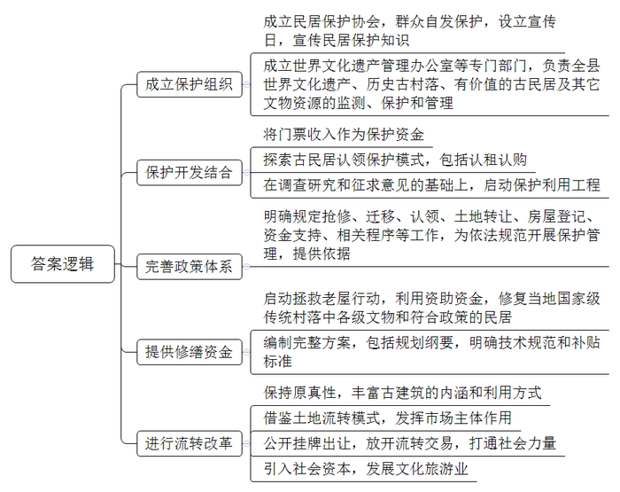
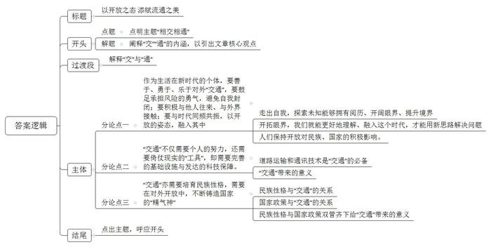

# 2019年公务员多省联考《申论》题（福建县级卷）

<!-- gwy:overview:start -->
> **福建 · 2019 · 申论 · 县级卷** ｜ 3 题 · 图片 3 处 · 答案随题折叠

导航：[题目](#题目)
<!-- gwy:overview:end -->

> 候选采集稿。参考答案及解析来自粉笔页面，不代表官方答案或真实高分答卷；来源使用许可与原卷对应关系仍需人工核实。

## 给定材料

### 材料 material-73a59c99a45e3fb7

“这儿要是高速公路修通了，我们可怎么办？”十几年前，年迈的“背二哥”（山区的力夫）老秦问我。他的脸上写满疲惫和沧桑。老秦家在地处川鄂茶盐古道上的L村。该村的人祖祖辈辈都是“背二哥”，靠背背篼卖力气吃饭。因为深度贫困和交通闭塞，L村在当地非常“有名”。是啊，公路一通，车轮一转，“背二哥”们靠什么吃饭？老秦看我没有回答，深叹了一口气，用嘶哑的喉咙唱起了歌：“长江呃，河来哟，三峡哦，峡来哟，我是三峡哟，‘背二哥’罗哈，太阳送我哟上巫山，月亮陪我哟下江河……”这就是“背二歌”。原来，三峡两岸，山高路陡，行走艰难，“背二哥”一声吼起，“背二歌”高亢激昂，以翻山越岭、穿云破雾之势，响彻川鄂茶盐古道。“背二歌”不是刻意唱给谁听的，它本身就是“背二哥”劳动的一部分。它是他们为了消除寂寞，缓解疲劳而唱的，是寂寞和艰辛之中自然升华出的歌。“背二歌”调子是豪迈、高亢、激越的，但是不得不承认，在这调子背后，它却有着沉郁、悲凉的本质：“背二歌”承载着“背二哥”的艰辛、无奈与哀怨，承载着三峡两岸的陡峭与苍凉，承载着道路的漫长与寂寞，也包含着他们对幸福生活的希冀。在抬头见天、低头见峡的山谷里，“背二歌”和三峡古韵中的民歌、情歌、哭嫁歌、花轿歌一起，在悠长的日子里飘扬，成为包括“背二哥”在内的三峡人们心中疗伤与温养的良药。那是对自然伟力的祭歌，对顽强生命的赞歌，对爱情和生活的颂歌。

2018年，高速公路延伸到这儿了，曾经害怕路通地平影响生计的“背二哥”们，如今又是何般模样？走进L村，我发现它和三峡两岸所有村一样公路纵横。更为惊讶的是，一条条水泥铺就的人行便道从公路两边伸向每一户村民家中，除了上坡下田的路，村里几乎看不到一条土路。见到老秦时，他正在家里教儿子和一群年轻人唱“背二歌”。“调子是老样子，但歌词被儿子他们这些年轻人改啦。”老秦告诉我，村里通了公路，河上修起了水库，老家改天换地了。儿子不再外出打工，而是回到老家买了一艘小游艇，搞起了“农家乐”，日子过得红红火火。生活好起来了，但关于“背二哥”的记忆不能淡漠。那种在如苦水般的日子里依旧坚强乐观、努力生活的精神不能丢。为了让更多的人来到这方古道，为了留住关于古道的深刻记忆，儿子还专门要他们这些老“背二哥”教他们唱“背二歌”。他们学会了，要唱给游客们听，让新的欢快的“背二歌”飞扬到更远的地方。

“小小游艇荡碧波，我是年轻‘背二哥’，背山背水背太阳，古道春风唱新歌……”“背二歌”在以前是一种苦吟。在新时代，它以另一种方式被新的“背二哥”们唱响。时代向前，总有新歌要唱，也总有新人要上场。

### 材料 material-fe96c932b4acb3f3

Y县位于A省南部。初夏时，这里群山披翠、江水碧蓝、小桥流水、长街曲巷、飞檐翘角、雕梁画栋……它们既是游客镜头里的美景，也是历史积淀的见证，更是当地薪火相传的文化根脉。

“今天恰好是我们县的‘民居宣传保护日’。每年今天，我们会家家户户地宣传民居保护知识。”当地世界文化遗产管理办公室负责人介绍说，“在县委、县政府的支持下，我们成立了民居保护协会，大家自发参与民居保护。每年，还会将古民居门票收入的一部分作为文物保护资金用于本地民居保护。这实现了保护与开发的良性循环。”

十余年前，Y县成立世界文化遗产管理办公室，负责全县世界文化遗产、历史古村落、有价值的古民居及其它文物资源的监测、保护和管理工作。当时，这一专门的保护机构在全国尚属罕见。同年，Y县又开始探索古民居认领保护活动的试点工作。试点的认领保护模式，包括认租和认购。在投资保护的前提下，认租、认购项目通过合理利用古建筑可以获得收益。这吸引了全国各地，尤其是艺术、收藏类的爱好者走进Y县，共同宣传和保护当地古民居。千山画院、归云山房、印象老屋……一大批国内艺术大师的工作室都安居在此。这无疑增加了当地的文化气息。

2009年，Y县在充分调查研究和广泛征求意见的基础上，启动了“百村千幢”古民居保护利用工程。Y县用了五年时间，成功地完成了对百余个古村落和上千幢古民居的保护开发和利用，探索出了“在保护中突出利用，在传承中注重创新”的新模式。

同时，当地还建立了以古民居认领保护利用、抢修保护利用、迁移保护利用、原地保护利用等为重点的古民居保护利用政策体系，对涉及的抢修、迁移、认领、土地转让、房屋登记、资金支持等作出了明确规定，为依法规范开展古民居保护管理工作，提供了依据。

据统计，Y县共有3000多幢古民居，其中列为各级文物保护单位的仅600余处，其他大部分非文保单位的古民居，多散落乡野，难以顾及。

“我们的老屋要垮了，我们没有能力维修，文物部门是不是该拨钱给我们维修？”这是工作人员经常遇到的问题。据了解，根据《文物法》第二十一条的规定，非国有不可移动文物由所有人负责修缮、保养，地方文物部门负责报批程序和给予技术指导。2016年，某文物基金会在Y县启动了“拯救老屋行动”项目，计划在两年时间里资助4000万元，用于修复当地国家级传统村落中的各级文物和符合政策的民居。符合条件的老屋至少能得到占修缮总费用50%的补贴款。

为此，Y县委托省古建筑设计研究院编制了一套完整的方案，其中不仅有规划纲要，更有具体到每一种建材的技术规范和补贴标准。以修复一栋民居为例，首先由户主根据房屋损毁情况，提供图片证据及修复方案，交由专家委员会进行审核并作出修改，最终方案通过后再进行资金预算，政府补贴资金为预算资金的50%。双方确认并签订合同后便可施工，施工过程中，要随时接受专家巡查并按照整改意见来调整，施工进度完成三分之一时政府支付部分补贴资金，工程完工通过专家验收后再支付剩余补贴。

不仅如此，Y县探索开展的古民居流转改革试点工作，在依法保护的前提下、在保持“原汁原味”的基础上，不断丰富古建筑的内涵和利用方式。借鉴农村的土地流转模式，注重发挥市场主体作用。2014年，Y县开始探索古民居产权流转改革：以征地形式将古民居所在的集体土地转变为国有土地后公开挂牌出让，通过放开流转交易，打通社会力量参与古民居保护利用的通道。

现在，借力社会资本，Y县的部分古民居“复活”变为风情浓郁的精品民宿、文化客栈，不仅奏出一首古韵悠长的新曲，更是当地旅游转型升级的新业态。

## 题目

### 第 1 题

**根据给定资料**1**，谈谈随着时代变迁，“背二歌”内涵意义的变化。（20分）**

关联材料：材料 material-73a59c99a45e3fb7

作答要求：

要求：紧扣资料，理解准确；条理清晰，内容全面；字数不超过200字。

第 1 题 · 答案与解析

**参考答案（粉笔题库参考内容）**

一、歌词内容由描写自然条件艰苦和生活、劳动艰辛变为歌唱自然美景、公路水库等农村富裕新生活。从为了消除寂寞、缓解疲劳，到为了赞美生活和让游客快乐。

二、情绪情感由沉重变为轻松。由沉郁、悲凉、无奈、心酸、苦涩和对幸福生活的希冀，到充满愉悦、欢快。

三、精神追求由面向现实转向面向未来。由歌唱自然伟力、顽强生命、爱情，为人们疗伤养心的苦吟，到传承坚强乐观、努力生活的精神和古道历史文化，歌唱新人新生。

**解析**

**参考答案说明**：本参考答案从“歌词内容”“情绪情感”“精神追求”三个方面，对“背二歌”内涵意义的“变化”进行了说明，各条答案要点之间在内容上相互并列，没有交叉。

**考点**：考点变化类

**来源**：来源2019年公务员多省联考《申论》题（福建县级卷）

粉笔申论页面对本题只提供「解析视频」入口，该入口是会员推广位，页面无视频地址与文字解析。

### 第 2 题

**根据给定资料**3**，归纳Y县古民居保护的有效措施。（30分）**

关联材料：材料 material-fe96c932b4acb3f3

作答要求：

要求：全面、简明，有条理，字数不超过400字。

第 2 题 · 答案与解析

**参考答案（粉笔题库参考内容）**

1.成立保护组织。成立民居保护协会，群众自发保护，设立宣传日，宣传民居保护知识；成立世界文化遗产管理办公室等专门部门，负责全县世界文化遗产、历史古村落、有价值的古民居及其它文物资源的监测、保护和管理。

2.保护开发结合。将门票收入作为保护资金；探索古民居认领保护模式，包括认租认购；在调查研究和征求意见的基础上，启动保护利用工程。

3.完善政策体系。明确规定抢修、迁移、认领、土地转让、房屋登记、资金支持、相关程序等工作，为依法规范开展保护管理，提供依据。

4.提供修缮资金。启动拯救老屋行动，利用资助资金，修复当地国家级传统村落中各级文物和符合政策的民居；编制完整方案，包括规划纲要，明确技术规范和补贴标准。

5.进行流转改革。保持原真性，丰富古建筑的内涵和利用方式；借鉴土地流转模式，发挥市场主体作用；公开挂牌出让，放开流转交易，打通社会力量；引入社会资本，发展文化旅游业。

**解析**

**参考答案说明**：本参考答案从“成立保护组织”“保护开发结合”“完善政策体系”“提供修缮资金”“进行流转改革”这五个方面入手，提出了保护古民居的相关措施。各条答案要点之间在内容上相互并列，没有交叉。

**考点**：考点概括措施类

**来源**：来源2019年公务员多省联考《申论》题（福建县级卷）

粉笔申论页面对本题只提供「解析视频」入口，该入口是会员推广位，页面无视频地址与文字解析。

### 第 3 题

**给定资料**5**中提到“我们与世界相交，与时代相通，才能让一切保值增值，更添赋流通的美。”请你根据对这句话的理解，自拟题目，写一篇文章。（50分）**

关联材料：材料 material-73a59c99a45e3fb7

作答要求：

要求：

（1）自选角度，立意明确；

（2）思路清晰，语言流畅；

（3）联系实际，不拘泥于“给定资料”；

（4）总字数1000～1200。

第 3 题 · 答案与解析

**参考答案（粉笔题库参考内容）**

**以开放之态** **添赋流通之美**

如今是个开放的、变化的时代，万物之间的联系深刻而广泛，事物的变化快速且凶猛。有人说，我们与世界相交，与时代相通，才能让一切保值增值，更添赋流通的美。的确，在这样一个时代，**封闭孤立、不思进取会注定走向没落。无论是一人一集体，还是一国一社会，都需要对外****“交****”“****通****”，**这样才能实现持续的发展。

所谓的“交”与“通”，本义指对外交往的渠道，以及与他人的沟通。实质指空间上保持开放的姿态，走出一人、一地、一国，与世界相连；时间上紧跟时代的发展、与时俱进、突破自我、革旧维新。

**作为生活在新时代的个体，要善于、勇于、乐于对外****“交通”，要鼓足承担风险的勇气，避免自我封闭；要积极与他人往来、与外界接触；要与时代同频共振，以开****放****的姿态，融入其中。**

**走出****自我时间与空间****，向未知和可能进军，****让人拥有阅历、沉淀与气质，让人****眼界****开阔****，境界****提升，变得开明、包容****。**任何人的认知都有局限，尤其是在这个变化的时代，新的知识、研究领域不断出现，封闭会让我们错过整个时代、整个世界。只有开拓眼界，才能**理解****、****适应、融入这个时代****，****破解乡村发展困局，****才能用新思路解决****旧****问题。**比如说，在城镇化、工业化浪潮的裹挟下，很多村庄日渐“空心化”，衰退着、凋零着，隐有“垂暮之态”。此时，多地通过现代化改造，改善人居环境，发展乡村旅游业……在传承中创新、在保护中开发，乡村也可以有人气、有活力、有效益。**只有****人人保持开放****的姿态****、学习的状态****、****进步的心态****，****才能与世界和谐共生，共建人类命运共同体****。**

**“****交通****”****不仅需要个人的努力，还需要倚仗现实的****“工具”，即需要完善的基础设施与发达的科技保障****。**道路运输工程能实现人员、物资的交流输送，通讯技术能实现信息的交互往来，这都是“交通”的必备利器。山头的基站、陆上的高铁、跨海的大桥、云上的飞机、太空中的卫星……这些道路运输工程和通信通讯技术，能跨越空间距离，快速勾连世界，提高“交通”效率；更能打通偏远断点，形成商品和信息的流通渠道，畅通经济血脉，让落后地区有发展机遇，让各地的资源优势转变为经济优势，还能重塑经济地理标志，形成国家经济发展的全新格局。

**“交通”亦需要培育民族性格，需要在对外开放中，不断铸造国家的“精气神”**。自信、谦逊、乐于分享的民族性格，是我们与世界同呼吸、共命运的“软实力”，是我国“交通”发展更为顺畅的“润滑剂”；敞开国门、对外开放的国家政策是适应全球化发展的“硬保障”，是应对闭关锁国、固步自封的“高压线”。“软硬兼施”能让斑斓文化、优质产品和细致服务走向世界，能让我们引入先进的发展模式、理念、技术，充分汲取其发展养分，为我所用。唯有此，才能让流动、个性的中国充满繁荣发展的活力，在世界舞台展现“中国性格”。

流通的美是奔涌向前、不断攀升的美，是生机勃勃、充满活力的美，是互联互通、相扶相助的美。下一个40年，我们将会在更加开放、融通中，走出独具特色的步伐。

**解析**

**文章分析**

**以开放之态** **添赋流通之美**

【**标题的优点：**首先，范文的标题“以开放之态 添赋流通之美”突出了“相交相通”这一主题。其次，形式上，文字简洁明快。】

（1）如今是个开放的、变化的时代，万物之间的联系深刻而广泛，事物的变化快速且凶猛。有人说，我们与世界相交，与时代相通，（2）才能让一切保值增值，更添赋流通的美。的确，在这样一个时代，（3）**封闭孤立、不思进取会注定走向没落****。无论是一人一集体，还是一国一社会，都需要对外****“交****”“****通****”，**这样才能实现持续的发展。

【**开头的优点：**★内容方面。范文的开头是紧扣题目给定的“相交相通”这一主题展开的。首先，开头开门见山点出主题，做到了主题明确。其次，对“相交相通”这一主题进行了分析阐述，（1）介绍了当前的时代背景；（2）介绍了“相交相通”的意义；（3）介绍了事物封闭孤立的危害。★文字表达方面：长短句配合使用，使语言表达有节奏感；使用了“无论……，还是……”关联词，使语言表达有逻辑性。】

（1）所谓的“交”与“通”，本义指对外交往的渠道，以及与他人的沟通。（2）实质指空间上保持开放的姿态，走出一人、一地、一国，与世界相连；时间上紧跟时代的发展、与时俱进、突破自我、革旧维新。

【**过渡段的优点：**范文过渡段分析了“交”与“通”的含义等方面的内容，分别阐释了（1）“交”与“通”的本义；（2）“交”与“通”的实质含义。】

**作为生活在新时代的个体，要善于、勇于、乐于对外****“交通”，要鼓足承担风险的勇气，避免自我封闭；要积极与他人往来、与外界接触；要与时代同频共振，以开放的姿态，融入其中**。

**（****1）****走出自我时间与空间，向未知和可能进军****，****让人拥有阅历、沉淀与气质****，****让人眼界开阔****，****境界提升****，****变****得****开明、包容****。**任何人的认知都有局限，尤其是在这个变化的时代，新的知识、研究领域不断出现，封闭会让我们错过整个时代、整个世界。（2）**只有开拓眼界****，****才能理解、适应、融入这个时代****，****破解乡村发展困局****，****才能用新思路解决****旧****问题****。**比如说，在城镇化、工业化浪潮的裹挟下，很多村庄日渐“空心化”，衰退着、凋零着，隐有“垂暮之态”。此时，多地通过现代化改造，改善人居环境，发展乡村旅游业……在传承中创新、在保护中开发，乡村也可以有人气、有活力、有效益。（3）**只有人人保持开放的姿态、学习的状态、进步的心态****，****才能与世界和谐共生****，****共建人类命运共同体**。

【**论述段****1****的优点：**★观点句：范文的观点句是紧扣“相交相通”这一文章主题提出的。形式上，它在段首处直接写出，位置突出，容易发现。内容上，关键词突出，可以明显看出它是从“个人角度”入手，指出了“如何实现个人相交相通”的对策。★论述内容：（1）介绍了走出自我，探索未知能够拥有阅历、开阔眼界、提升境界；（2）介绍了开拓眼界，我们就能更好地理解、融入这个时代，才能用新思路解决问题；（3）介绍了人们保持开放对民族、国家的积极影响。注意：以上几个方面的内容都是紧扣“作为生活在新时代的个体，要善于、勇于、乐于对外‘交通’，要鼓足承担风险的勇气，避免自我封闭；要积极与他人往来、与外界接触；要与时代同频共振，以开放的姿态，融入其中”这个观点句进行分析论述的，论述的针对性强，内容层次丰富。最后，在论述方法和论据的选取上做到了讲道理、举例子相结合，做到了丰富多样。】

**“交通”不仅需要个人的努力，还需要倚仗现实的****“工具”，即需要完善的基础设施与发达的科技保障**。（1）道路运输工程能实现人员、物资的交流输送，通讯技术能实现信息的交互往来，这都是“交通”的必备利器。山头的基站、陆上的高铁、跨海的大桥、云上的飞机、太空中的卫星……这些道路运输工程和通信通讯技术，（2）能跨越空间距离，快速勾连世界，提高“交通”效率；更能打通偏远断点，形成商品和信息的流通渠道，畅通经济血脉，让落后地区有发展机遇，让各地的资源优势转变为经济优势，还能重塑经济地理标志，形成国家经济发展的全新格局。

【**论述段****2****的优点：**★观点句：范文的观点句是紧扣“相交相通”这一文章主题提出的。形式上，它在段首处直接写出，位置突出，容易发现。内容上，关键词突出，可以明显看出它是从“倚仗现实‘工具’”入手，指出了“实现相交相通的对策”。★论述内容：（1）介绍了道路运输和通讯技术是“交通”的必备；（2）介绍了“交通”带来的意义。注意：以上几个方面的内容都是紧扣“‘交通’不仅需要个人的努力，还需要倚仗现实的‘工具’，即需要完善的基础设施与发达的科技保障”这个观点句进行分析论述的，论述的针对性强，内容层次丰富。最后，在论述方法和论据的选取上做到了讲道理、举例子相结合，做到了丰富多样。】

**“交通”亦需要培育民族性格，需要在对外开放中，不断铸造国家的“精气神”。**（1）自信、谦逊、乐于分享的民族性格，是我们与世界同呼吸、共命运的“软实力”，是我国“交通”发展更为顺畅的“润滑剂”；（2）敞开国门、对外开放的国家政策是适应全球化发展的“硬保障”，是应对闭关锁国、固步自封的“高压线”。（3）“软硬兼施”能让斑斓文化、优质产品和细致服务走向世界，能让我们引入先进的发展模式、理念、技术，充分汲取其发展养分，为我所用。唯有此，才能让流动、个性的中国充满繁荣发展的活力，在世界舞台展现“中国性格”。

【**论述段****3****的优点：**★观点句：范文的观点句是紧扣“相交相通”这一文章主题提出的。形式上，它在段首处直接写出，位置突出，容易发现。内容上，关键词突出，可以明显看出它是从“培育民族性格”入手，指出了“实现相交相通的对策”。★论述内容：（1）介绍了民族性格与“交通”的关系；（2）介绍了国家政策与“交通”的关系；（3）介绍了民族性格与国家政策双管齐下给“交通”带来的意义。注意：以上几个方面的内容都是紧扣“‘交通’亦需要培育民族性格，需要在对外开放中，不断铸造国家的‘精气神’”这个观点句进行分析论述的，论述的针对性强，内容层次丰富。最后，在论述方法和论据的选取上做到了讲道理、举例子相结合，做到了丰富多样。】

【**论述段之间的关系**：★内容的内在逻辑：范文的论述段之间是依照“并列”的逻辑展开的。论述段1先写了“作为生活在新时代的个体，要善于、勇于、乐于对外‘交通’，要鼓足承担风险的勇气，避免自我封闭；要积极与他人往来、与外界接触；要与时代同频共振，以开放的姿态，融入其中”，论述段2写了“‘交通’不仅需要个人的努力，还需要倚仗现实的‘工具’，即需要完善的基础设施与发达的科技保障”，论述段3写了“‘交通’亦需要培育民族性格，需要在对外开放中，不断铸造国家的‘精气神’”。】

（1）流通的美是奔涌向前、不断攀升的美，是生机勃勃、充满活力的美，是互联互通、相扶相助的美。下一个40年，（2）我们将会在更加开放、融通中，走出独具特色的步伐。

【**结尾的优点**：范文的结尾回扣了“相交相通”这一主题。（1）再次提到“相交相通”这一主题；（2）作出了展望。】

**考点**：考点文章写作题

**来源**：来源2019年公务员多省联考《申论》题（福建县级卷）

粉笔申论页面对本题只提供「解析视频」入口，该入口是会员推广位，页面无视频地址与文字解析。

