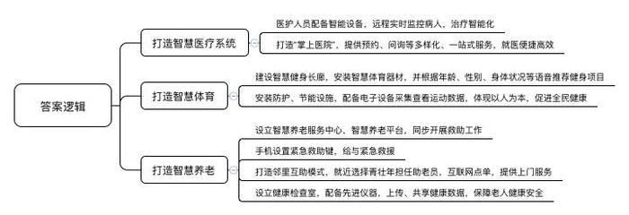
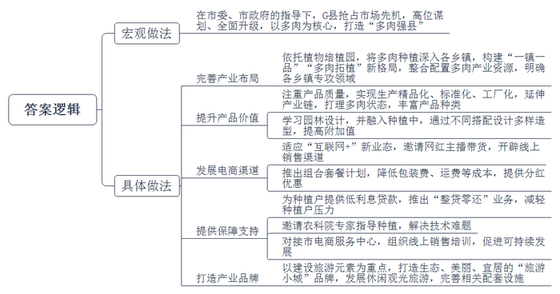
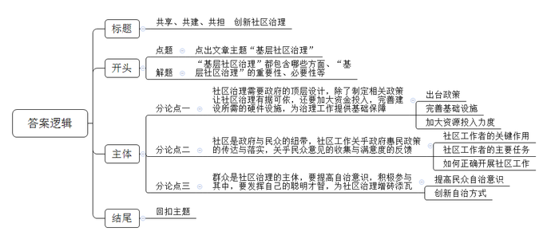

# 2020年0725公务员多省联考《申论》题（福建县级卷）

> 候选采集稿。参考答案及解析来自粉笔页面，不代表官方答案或真实高分答卷；来源使用许可与原卷对应关系仍需人工核实。

## 给定材料

### 材料 material-6678207e9193c04d

“26床的小框目前是橙色的，代表着滴速过慢，需要立即处理。”见状，护士小杨立即调整了流速，小框很快变成了绿色，流速恢复了正常。“滴、滴、滴”，小杨随身携带的智能挂表又响了起来，“哦，11床有情况”，小杨从容地前去处理……“唉呀，现在方便多了。以前挂号、门诊就诊、检查室分诊台预约就诊、排队等候检查……做个检查很麻烦。今天，我用‘掌上医院’APP提前预约了生化全套和心电图，省心省力，速度特别快。”前来看病的黄阿姨介绍道。原来，K镇卫生院在县人民医院的帮助下，建立起了“智慧医疗系统”，居民足不出门就能完成预约挂号、在线询医问诊等操作，实现了就医全过程的智能化，极大方便了居民就医。

“我有点胖，要多到公园里的智慧健身长廊走一走，用健身器材锻炼锻炼，这样身体才能更健康。”K镇居民老夏说，“这个智慧健身长廊很‘洋气’，会‘说话’能‘计数’，还能根据年龄、性别以及身体状况推荐合适的健身器材，神奇得很。”为推进全民健身运动，用智慧体育赋能健康生活，K镇试点在部分公园里安装了一些智慧体育器材，如智能太空漫步机、腹部训练机、智能扭腰器、智能转盘等等。每个设备都配有太阳能遮阳棚，还有专属的二维码和显示屏，并铺装了防水防滑地胶，居民健身不仅不会被日晒雨淋，还可以查看自己的运动数据，累了还可以听歌放松。“我们就是要以人为本，让居民享受到运动的快乐，进而热爱健身。”K镇党委赵书记说，“现代人的健康，绝不仅仅限于没有疾病伤痛，更要增强体质。我相信没有全面健康，就没有全民小康。”

“一机在手，养老无忧。”这是K镇智慧养老服务中心的宗旨。“叮铃铃……”K镇智慧养老服务中心的电话铃声响起。“我感觉很不舒服，咳得厉害。”打电话的徐奶奶因冠心病合并肺部感染急需救助。通过该中心的“智慧养老”平台，自动定位、问询，联络医院、救援人员、家属，这一系列救助工作可以在几分钟内同步展开。徐奶奶被迅速送到了医院，经抢救稳住了病情。如今，像她这样享受智慧养老服务的老人，在K镇越来越多。近年来，K镇致力于打通养老服务的“最后一公里”，为老年人提供“触手可及”的智能化服务。只需按下专用手机上的紧急求助键，就可获得紧急救援；通过互联网点单，“助老员”可以上门为老人服务。对于居住地较为偏远的独居老人，K镇则采取了邻里互助的助老服务模式。“助老员”一般由居住在老人家附近的青壮年担任，一旦出现紧急情况就立即启动紧急救援，让这些特殊的老人享受到居家养老服务带来的安全和便利。此外，家住K镇东来社区的唐大爷最近常去本社区居家养老服务驿站的健康检查室。因为驿站最近添加了一台医疗一体机测试仪，让他能实时了解自己的身体状况。像唐大爷这样经常来检查室“报到”的老人们的健康数据信息，在征得老人们同意后，已被上传至K镇智慧养老服务中心及各医院共享。据统计，因数据反馈完整和医护人员抢救及时，仅今年上半年，K镇就有数十位老人的病情得到了有效的控制。

### 材料 material-4487f59fc99f6fd5

近年来，因为萌萌的体态、超高的颜值、诗意的名字，多肉植物俘获了大众的“芳心”，市场的需求迅速增大。多肉植物之所以能成为产业，电商功不可没。“我们必须要更加适应‘互联网+’这种新业态。”G县商务部门的一位负责人说，“以前我们一般认为，因为植物单株价格低、运输易造成损毁、运费高昂等原因，包括多肉植物在内的花卉业不太适合电商模式，但数据告诉我们这种想法其实不对。”G县多肉产业主要集中在景天科多肉，品种较单一。“大家都卖桃蛋这一个品种，就相互踩价。现在我们这儿的桃蛋已经降到8毛钱一株了，可还是看的人多，买的人少，这可怎么办哟？”说到销售，多肉种植大户老王一筹莫展；G县多肉植物滞销率约为40%，而多肉的销售旺季主要在春秋两季。以前花农们通过降价促销基本能全部出货，但现在这个策略似乎失效了。“有的种植户只是‘抓一把、赶紧跑’，只想快点回本赚钱，我们G县多肉的招牌怎么能打响哟？”老王嘟囔着。

“我们是‘多肉大县’，却不能算‘多肉强县’。”G县多肉协会副会长老叶强调，“国内标准化要求不高，主要依靠品相吸引消费者，因此精致、小巧、色彩艳丽是多肉生产的目标。我们县由于小农户型生产者居多，产品区域差异明显，品相参差不齐，规格难以统一。”

“其实我们G县的土壤和气候是适合大部分多肉植物的。”一位园艺专家在一次花博会上对记者说道，“目前，我们县的多肉种植是以小农户为主，真正企业化生产的极少。而且即使是企业化生产，也是往往在某一个品种的量上面下功夫。一旦市场饱和，恐怕他们也难以应对。此外，我们的多肉种植起步不算晚，但整个花卉产业基础薄弱，相当一部分个体种植户缺乏经验，不知道在水土上做文章、在病虫害防治等方面多下功夫。吃到盲目扩建的亏后，要么改种其他花植，要么干脆迁居外县另起炉灶。”

## 题目

### 第 1 题

**根据****“给定资料**1**”，归纳K镇打造智慧健康生活的主要做法。（20分）**

关联材料：material-6678207e9193c04d

作答要求：

要求：全面准确，层次清晰，字数不超过300字。

### 第 2 题

**根据****“给定资料**2**、**3**”，谈谈G县是如何实现从“多肉大县”到“多肉强县”这一转变的。（30分）**

关联材料：material-4487f59fc99f6fd5

作答要求：

要求：全面准确，分析透彻，针对性强，字数不超过500字。

### 第 3 题

**参考给定资料，围绕基层社区治理主题，自选角度，自拟题目，写一篇文章。（****50分）**

关联材料：material-6678207e9193c04d

作答要求：

要求：

（1）结合给定资料，但不拘泥于给定资料；

（2）观点正确，结构完整；

（3）逻辑清晰，语言流畅；

（4）字数1000-1200字。

## 答案与解析

第 1 题

**参考答案（粉笔题库参考内容）**

一、打造智慧医疗系统。医护人员配备智能设备，远程实时监控病人，治疗智能化；打造“掌上医院”，提供预约、问询等多样化、一站式服务，就医便捷高效。

二、打造智慧体育。建设智慧健身长廊，安装智慧体育器材，并根据年龄、性别、身体状况等语音推荐健身项目；安装防护、节能设施，配备电子设备采集查看运动数据，体现以人为本，促进全民健康。

三、打造智慧养老。设立智慧养老服务中心，智慧养老平台，同步开展救助工作；手机设置紧急救助键，给与紧急救援；打造邻里互助模式，就近选择青壮年担任助老员，互联网点单，提供上门服务；设立健康检查室，配备先进仪器，上传、共享健康数据，保障老人健康安全。

**解析**

**参考答案说明：**答案从“打造智慧医疗系统”“打造智慧体育”“打造智慧养老”这三个方面对K镇打造智慧健康生活的主要做法进行了分条撰写。各条要点之间在内容上是并列关系，没有交叉。

**考点**：考点概括措施类

**来源**：来源2020年0725公务员多省联考《申论》题（福建县级卷）

粉笔申论页面对本题只提供「解析视频」入口，该入口是会员推广位，页面无视频地址与文字解析。

第 2 题

**参考答案（粉笔题库参考内容）**

在市委、市政府的指导下，G县抢占市场先机，高位谋划、全面升级，以多肉为核心，打造“多肉强县”。

1.完善产业布局。依托植物培植园，将多肉种植深入各乡镇，构建“一镇一品”“多肉拓植”新格局，整合配置多肉产业资源，明确各乡镇专攻领域。

2.提升产品价值。注重产品质量，实现生产精品化、标准化、工厂化，延伸产业链，打理多肉状态，丰富产品种类；学习园林设计，并融入种植中，通过不同搭配设计多样造型，提高附加值。

3.发展电商渠道。适应“互联网+”新业态，邀请网红主播带货，开辟线上销售渠道；推出组合套餐计划，降低包装费、运费等成本，提供分红优惠。

4.提供保障支持。为种植户提供低利息贷款，推出“整贷零还”业务，减轻种植户压力；邀请农科院专家指导种植，解决技术难题；对接市电商服务中心，组织线上销售培训，促进可持续发展。

5.打造产业品牌。以建设旅游元素为重点，打造生态、美丽、宜居的“旅游小城”品牌，发展休闲观光旅游，完善相关配套设施。

**解析**

**参考答案说明：**本参考答案在结构上，包含了宏观政策和具体措施，在具体措施方面重点从“完善产业布局”“提升产品价值”“发展电商渠道”“提供保障支持”“打造产业品牌”这五个方面进行了分条撰写，各条要点之间在内容上是并列关系，并且撰写每条要点时，都提炼出了概括性强的总结句前置。

**考点**：考点概括措施类

**来源**：来源2020年0725公务员多省联考《申论》题（福建县级卷）

粉笔申论页面对本题只提供「解析视频」入口，该入口是会员推广位，页面无视频地址与文字解析。

第 3 题

**参考答案（粉笔题库参考内容）**

**共享、共建、共担 创新社区治理**

这是一个最好的时代，经济发展、社会进步、文化繁荣；这是一个最坏的时代，权责不清、治理混乱、环境污染……传统行政式的社区管理方式，让管理者疲于奔命，让参与者怨声载道，核心问题在于社区治理格局的畸形。随着城市化进程加快，基层社区的情况愈加复杂多变，基层治理难度陡然上升，依靠传统治理模式举步维艰。

党的十九大报告中指出，加强社区治理体系建设，实现政府治理和社会调节、居民自治良性互动。告诉世人，在社区这个“小世界”中，打造一个最优的时代，需政府调控、社区架桥、个人参与，共享、共建、共担。

**社区治理需要政府的顶层设计，除了制定相关政策让社区治理有据可依，还要加大资金投入，完善建设所需的硬件设施，为治理工作提供基础保障。**“好雨知时节，当春乃发生”，政策要“恰逢其时”、应运而生，让治理工作“有法可依”。“生活垃圾治理和环境整治考核奖惩办法”“社区生活垃圾全域治理巡查管理办法”等各项制度，改善环境面貌，提升生活生态质量。当然，政府的资源投入也很重要，要舍得“给钱”，给与专项资金，给与补贴，提供治理的经费；要舍得“给物”，完善休闲、道路、体育、文化等各项基础设施，满足群众对美好生活的需要；要舍得“给人”，配备督察员、志愿者等，加强监管，实现治理的长效化。

政府为群众办实事、办好事，做到权责明晰，离不开社区的鼎力支持。**社区是政府与民众的纽带，社区工作关乎政府惠民政策的传达与落实，关乎民众意见的收集与满意度的反馈。**“上面千条线，下面一根针”，身处一线的社区以及社区工作者，通过穿针引线、承上启下，发挥着落实方针政策、共谋福祉的关键作用。在落实各级各部门具体要求的同时，要确保基层群众支持、理解，同时享受到社会发展带来的实惠。因此，社区工作，要有充分的执行力，要实现政策性与群众性的统一、结合，要达到“上面”与“下面”的和谐一致。就如成立废品回收网点，设立治理专项经费等等，在响应政策的同时注重民意。

当然共享共建共担的社区治理工作，也同样少不了每一位群众的参与。**群众是社区治理的主体，要提高自治意识，积极参与其中，要发挥自己的聪明才智，为社区治理增砖添瓦。**传统行政式的社区管理方式，政府既是决策者、管理者，也是宣传者、监督者，常常都会处在“费力又不讨好”的尴尬境遇。发展为了人民，发展更要依靠人民，社区治理也要坚持群众路线，听民意、汇民智、集民力。“人居环境整治义务督察员”及时发现、反馈环境问题，人人共建美好的生态环境，就是群众主人翁意识的体现。总之，既有政府的投入与权利赋予，也有群众的责任共担，才能求得自上而下精细管理与自下而上广泛参与的“最大公约数”，画出“共享共建共担”的“最大同心圆”。

古人云：“图垂成之功者，如挽上滩之舟，莫少停一棹。”社区治理关系到群众的切身利益，且并非一朝一夕之功，任重而道远。因此，需要社会各界携起手来，才能提高治理效率，让社区和谐之花充分绽放！

**解析**

**文章分析**

**共享、共建、共担 创新社区治理**

【**标题的优点**：首先，范文的标题突出了“基层社区治理”这一主题。其次，它在形式上采用了对称式结构，前半句点出了号召，后半句点出了主体，使标题更加完整、饱满。】

这是一个最好的时代，（1）经济发展、社会进步、文化繁荣；这是一个最坏的时代，权责不清、治理混乱、环境污染……（2）传统行政式的社区管理方式，让管理者疲于奔命，让参与者怨声载道，核心问题在于社区治理格局的畸形。（3）随着城市化进程加快，基层社区的情况愈加复杂多变，基层治理难度陡然上升，依靠传统治理模式举步维艰。

【**开头的优点：**★内容方面：范文的开头是紧扣“基层社区治理”这一主题展开的。首先，开头前两句话点出主题，做到了主题明确。其次，对“基层社区治理”这一主题进行了分析阐述：（1）介绍了时代背景；（2）介绍了传统社区管理方式的弊端及其原因；（3）介绍了传统社区治理模式面临的困境。★文字表达方面：长短句配合使用，使语言表达有节奏感。】

党的十九大报告中指出，加强社区治理体系建设，实现政府治理和社会调节、居民自治良性互动。告诉世人，在社区这个“小世界”中，打造一个最优的时代，需政府调控、社区架桥、个人参与，共享、共建、共担。

**【****过渡段的优点：**范文过渡段指出了十九大报告中对社区治理提出的新要求，此外，还要注意过渡段末尾的“需政府调控、社区架桥、个人参与，共享、共建、共担”是用来引起下文的过渡句。**】**

**社区治理需要政府的顶层设计，除了制定相关政策让社区治理有据可依，还要加大资金投入，完善建设所需的硬件设施，为治理工作提供基础保障。**“好雨知时节，当春乃发生”，（1）政策要“恰逢其时”、应运而生，让治理工作“有法可依”。“生活垃圾治理和环境整治考核奖惩办法”“社区生活垃圾全域治理巡查管理办法”等各项制度，（2）改善环境面貌，提升生活生态质量。当然，（3）政府的资源投入也很重要，要舍得“给钱”，给与专项资金，给与补贴，提供治理的经费；要舍得“给物”，完善休闲、道路、体育、文化等各项基础设施，满足群众对美好生活的需要；要舍得“给人”，配备督察员、志愿者等，加强监管，实现治理的长效化。

【**论述段****1****的优点：**★观点句：范文的观点句是紧扣“基层社区治理”这一文章主题提出的。形式上，它在段首处直接写出，位置突出，容易被发现；内容上，关键词突出，内容要点明确，可以明显看出它是从“出台政策、完善基础设施、资源投入”这一角度入手，指出了“政府提供保障”。★论述内容：本段主要围绕“基层社区治理”这一主题进行分析阐述：（1）强调了社区治理要有法可依；（2）通过举例介绍了政府制定政策的意义；（3）指出了加强社区治理需要政府提供人财物等资源。注意：以上三个方面的内容都是紧扣观点句“社区治理需要政府的顶层设计，除了制定相关政策让社区治理有据可依，还要加大资金投入，完善建设所需的硬件设施，为治理工作提供基础保障”进行分析论述的，针对性强、内容层次丰富。最后，在论述方法和论据的选取上做到了讲道理、举例子相结合，让论述内容丰富多样。】

政府为群众办实事、办好事，做到权责明晰，离不开社区的鼎力支持。**社区是政府与民众的纽带，社区工作关乎政府惠民政策的传达与落实，关乎民众意见的收集与满意度的反馈。**“上面千条线，下面一根针”，身处一线的社区以及社区工作者，（1）通过穿针引线、承上启下，发挥着落实方针政策、共谋福祉的关键作用。（2）在落实各级各部门具体要求的同时，要确保基层群众支持、理解，同时享受到社会发展带来的实惠。因此，（3）社区工作，要有充分的执行力，要实现政策性与群众性的统一、结合，要达到“上面”与“下面”的和谐一致。就如成立废品回收网点，设立治理专项经费等等，在响应政策的同时注重民意。

【**论述段****2****的优点：**★观点句：范文的观点句是紧扣“基层社区治理”这一文章主题提出的。形式上，它在段首处直接写出，位置突出，容易被发现；内容上，关键词突出，内容要点明确，可以明显看出它是从“传达落实政策、收集反馈民众意见”这一角度入手，指出了“社区连接政府与民众”。★论述内容：本段主要围绕“基层社区治理”这一主题进行分析阐述：（1）指出了社区工作者的关键作用；（2）指出了社区工作者的主要任务；（3）指出了如何正确开展社区工作。注意：以上三个方面的内容都是紧扣观点句“社区是政府与民众的纽带，社区工作关乎政府惠民政策的传达与落实，关乎民众意见的收集与满意度的反馈”进行分析论述的，针对性强、内容层次丰富。最后，在论述方法和论据的选取上做到了讲道理、举例子相结合，让论述内容丰富多样。】

当然共享共建共担的社区治理工作，也同样少不了每一位群众的参与。**群众是社区治理的主体，要提高自治意识，积极参与其中，要发挥自己的聪明才智，为社区治理增砖添瓦。**（1）传统行政式的社区管理方式，政府既是决策者、管理者，也是宣传者、监督者，常常都会处在“费力又不讨好”的尴尬境遇。（2）发展为了人民，发展更要依靠人民，社区治理也要坚持群众路线，听民意、汇民智、集民力。“人居环境整治义务督察员”及时发现、反馈环境问题，人人共建美好的生态环境，就是群众主人翁意识的体现。总之，既有政府的投入与权利赋予，也有群众的责任共担，才能求得自上而下精细管理与自下而上广泛参与的“最大公约数”，画出“共享共建共担”的“最大同心圆”。

【**论述段****3****的优点：**★观点句：范文的观点句是紧扣“基层社区治理”这一文章主题提出的。形式上，它在段首处直接写出，位置突出，容易被发现；内容上，关键词突出，内容要点明确，可以明显看出它是从“提高自治意识、创新自治方式”这一角度入手，指出了“群众自治”。★论述内容：本段主要围绕“基层社区治理”这一主题进行分析阐述：（1）指出了传统社区治理过程中政府面临的窘境；（2）指出了创新社区治理离不开群众参与。注意：以上两个方面的内容都是紧扣观点句“群众是社区治理的主体，要提高自治意识，积极参与其中，要发挥自己的聪明才智，为社区治理增砖添瓦”进行分析论述的，针对性强、内容层次丰富。最后，在论述方法和论据的选取上做到了讲道理、举例子相结合，让论述内容丰富多样。】

【**论述段之间的关系：**★内容的内在逻辑：以上三个论述段分别从“政府”“社区”“民众”三个不同主体展开论述。】

古人云：“图垂成之功者，如挽上滩之舟，莫少停一棹。”社区治理关系到群众的切身利益，且并非一朝一夕之功，任重而道远。因此，需要社会各界携起手来，才能提高治理效率，让社区和谐之花充分绽放！

【**结尾的优点：**范文的结尾回扣了“基层社区治理”这一主题，并发出了呼吁。】

**考点**：考点文章写作题

**来源**：来源2020年0725公务员多省联考《申论》题（福建县级卷）

粉笔申论页面对本题只提供「解析视频」入口，该入口是会员推广位，页面无视频地址与文字解析。

