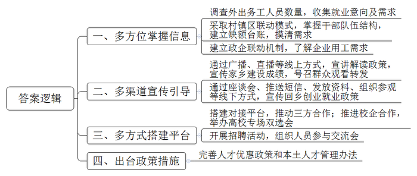
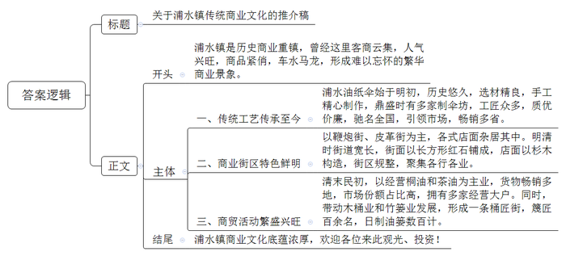
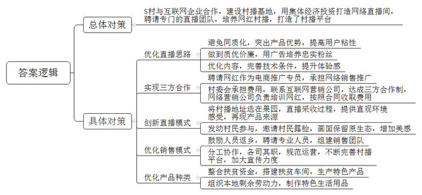
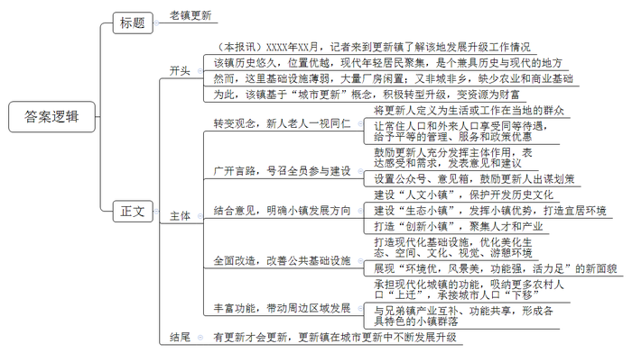

# 2020年0725公务员多省联考《申论》题（福建乡镇卷）

<!-- gwy:overview:start -->
> **福建 · 2020 · 申论 · 乡镇卷** ｜ 4 题 · 图片 4 处 · 答案随题折叠

导航：[题目](#题目) · [材料 1](#材料-1)
<!-- gwy:overview:end -->

> 候选采集稿。参考答案及解析来自粉笔页面，不代表官方答案或真实高分答卷；来源使用许可与原卷对应关系仍需人工核实。

## 给定材料

### 材料 1

在T区委组织部人才科，小李拿着一本花名册对记者说：“这是我区近两年来回引的人员名单，主要是外出务工经商人员。”小李继续介绍，近年来，T区大力开展“把老乡留在老家”专项行动，千方百计把外出务工、经商、学习等各类人员回引回乡创业就业。2019年以来，全区已掌握外出务工人员信息11万条，累计回引2万余名老乡返乡，为产业发展、脱贫攻坚、基层治理等方方面面提供了源源不断的人才支撑，全区乡村振兴战略持续推进。

在T区务工人员输出大村G村，刚过大年十五，支部书记老梁打开了村广播，“广大村民朋友，今年受疫情影响，大家都还没有外出，我呀，再把区里的‘把老乡留在老家’的一些政策给大家简单讲一讲，大家琢磨琢磨。留在家乡创业，既照顾了家庭，也帮助了乡亲嘛，还有不少优惠政策哦……最后啊，再给大家发个通知，正月二十五，区里要通过直播举办一场线上宣讲会，除了播放我区发展新面貌的宣传片和乡村振兴示范片，还将有详细的政策解读，请大家到时积极观看并转发。”老梁告诉记者，“从去年开始，我们还通过座谈会、推送返乡创业就业邀请短信、发放宣传资料等方式进行了广泛宣传和动员，还有多次组织有返乡意向的人到企业现场参观走访。”在T区E村村口，记者碰到了正在开展防疫宣传的大学生村官小马，除了带着防疫资料，他的背包里还有一大叠回乡创业政策指南。小马说：“在做好防疫宣传工作的同时，我也给本村的大学生宣传一下回乡创业政策，同时再调查摸底一下外出务工人员数，收集一些就业意向及需求。”

T区委组织部，区人社局和各乡镇、街道，还采取村级自查摸底、镇街分析研判、区级审核把关的联动模式，精准掌握全区基层干部队伍年龄、性别、学历等结构，建立缺额台账，摸清人才需求状况。同时，区政府还建立政企联动机制，了解区内企业用工需求。“我们主动为村级党组织、民营企业和务工人员合作‘牵线搭桥’，积极搭建人才对接平台。对在外的本土人才，还采取多渠道多方式开展回引工作。”小李介绍到，今年T区大力推进部分高校与企业合作，举办高校专场人才双选会；大力开展人才招聘活动，积极组织相关人员参与人才的座谈会，人才论坛等。同时，为确保回引的人才留得住，区里还出台了“人才政策十条”和本土人才管理办法等政策措施。

### 材料 2

仲夏时节，小王到浦水镇旅游。踏进小镇，首先映入眼帘的是晾晒在浦水河堤的上千把成品雨伞，它们在阳光下熠熠生辉，五光十色，成为浦水一道亮丽的风景线。浦水的油纸雨伞始创于明代初年，以引纸、桐油、楠竹、柿水等为原料，经手工精心制作而成。鼎盛时期全镇有制伞坊20余家，工匠达百数以上。浦水雨伞质优价廉，曾驰名全国，至今仍是澄江流域雨伞市场的龙头，产品畅销云、贵、川、湘、鄂五省。

看到小王长久地驻足在雨伞旁，刘大爷自愿当上了小王的导游。“过去，从十字街到浦溪一路是鞭炮街，有大大小小的鞭炮作坊几十家。十字街到医院一带是皮革街，生产经营各式皮具。还有各式瓷器店、铁匠铺、澡堂子等店面杂居其中。”刘大爷指着不远处说道，“明清时期，浦水镇区面积约2平方公里，街道宽约四米，街面以长条形红石铺成，房屋店面都用杉木构造。街区轮廓如一木排，有正街、河街和后街三大街道。河街和后街各长1.5公里，各行各业在这里集中，银行、钱庄、典当行、油号、瓷庄、洋行遍布街市，数不胜数。”

“那是姚亨生号桐油店。”刘大爷继续介绍，“这个商号在清末民初，以经营桐油和茶油为主业，货物辗转运销常德、长沙、武汉等地。这边的商号李秉纪号却是以鞭炮发家，转而经营桐油，极盛时，李家的桐油占到了浦水市场桐油总量的五分之二。此外还有太平街的吉中兴、吉和兴，都是当时的桐油业经营大户。油行业的兴旺同时带来了专制油产品包装的木桶业和竹篓业的兴旺，桶行、篓行相应地发展成为一条桶匠街。谷家篓厂雇请篾匠百余名，日制油篓数百计，那时节沿河长街的篓坊常有两三千新油篓晒在太阳下，场景分外壮观。”

走到后街尾，刘大爷说：“据老辈人回忆，当时市场繁华至极，街市上十省三府会馆客商云集，市面上每天要杀60多头猪，所杀的猪就从来没有卖剩过。待装上船的桐油、生铁，因市面过于拥挤，白天无法出仓，只能到晚上起运。人们得赶在天亮前装完货物，天一亮，街市上又会被做生意的人堵塞。”

依依惜别之后，小王的脑海里一直萦绕着刘大爷所描绘的“络绎不绝的生意人、此起彼伏的叫卖声、川流不息的货运船交织在一起，街市上‘腋底下送货，人头上接钱’”的繁华商业景象，久久不能忘怀。

### 材料 3

S村“90后”姑娘小丁正对着手机在果林下做直播。只见她徒手掰开一个刚摘下的水蜜桃，粉嘟嘟的果肉惹人垂涎欲滴，立刻吸引了不少粉丝点击购买。

水蜜桃是S村的主导产业。2018年，某互联网企业与村里合作，准备打造村播基地。2019年9月，村里从集体经济中拿出20多万元投资打造了一个网络直播间，聘请了专门的直播团队，在村委会帮忙的小丁成为小山村里第一位“网红”村播。

刚开始，小丁的直播效果并不理想：观看人数少，点击量上不去。而且由于手机信号的问题，直播时断时续，不少网友对此颇有怨言。正当小丁的直播陷入瓶颈的时候，S村来了一位从事新媒体传播研究的驻村第一书记郑书记，他帮小丁深入地分析了村播不成功的原因。

“虽然你用村播卖地道农货，但现在同类型的农村电商太多了，大家都是卖农货，这一方面，你的货品本身没有突出优势。而且，你的货品太单一，光靠水蜜桃赚不到钱，也留不住客人。顾客今年在你这里买了，明年未必还在你家买。就算他明年还记得你，他一年又能买多少呢？”

“在货品本身缺乏资源优势的前提下，同样的货品，要么有价格优势，要么就是你的广告做得特别吸引人，能够逐渐培养起一批铁杆粉丝，以此来和其它销售同类型产品的村播拉开差距。”

“村播的形式虽然新颖，但并不一定就有良好的效果。有了新的形式，还必须有优质的内容才行。而且，直播对技术条件的要求比较高，若收看体验不好，也很难留住网友。”

要想做出高质量的直播，就需要有专门的包装，要有懂行的专业人，而这些是小丁无法独自做到的。为此，郑书记安排她成为S村的电商推广专员，承担全村农产品的网络销售推广，小丁的“乡下妹子”这个账号成了S村的村播平台，由村委会来承担村播所需要的相关费用。郑书记还联系了一家互联网营销公司，与S村达成合作协议：S村负责网络直播间的打造，公司负责培训小丁。在粉丝数量和销售额达到预期目标后，公司再按双方合同议定的金额收取费用。这样一来，小丁、互联网营销公司和村委会三方皆大欢喜。

改版后的“乡下妹子”，把第一场村播选在了贫困户老牛的果园里。这天，直播团队在老牛的果园里支起直播架，现场直播老牛采收水蜜桃的过程。小丁则在一旁绘声绘色地讲解，并在直播团队指导下，用手机拍下果园周边优美的山水风光，让网友直观地感受水蜜桃的生长环境。

“这次直播很成功，‘乡下妹子’的粉丝量从原来的300多一下子涨到了2000多，累计播放量突破1万次。”小丁说。同时，这场直播也帮老牛卖出了200多斤水蜜桃，销售单价远远高于中间商的收购价。看到老牛尝到甜头的村民们纷纷邀请小丁来自家果园搞直播，还主动将水蜜桃放在S村的网店寄卖。小丁给记者算了笔账，在1个月时间里，她一共帮村里卖了5000多斤水蜜桃。

“乡下妹子”第二次爆粉则是在今年，小丁身穿汉服，在果林下直播吃水蜜桃的视频火了。在直播中，S村还邀请其他村民在镜头前露脸，通过对场景、服装、剧情和背景音乐等的安排，使得S村的乡村生活在镜头下既保留着原生态的特色，又多了几分精致的美感。直播当天，小丁就帮村民卖掉了400多斤水蜜桃，成为了村里名副其实的“带货达人”。

初获成功的S村决定继续打造村播事业，进一步优化S村的农产品网上销售模式。受此吸引，村里两位在外地从事电商工作的年轻人主动返乡，加上S村专门聘请的两位工作人员，他们和小丁一起组建了专业的电商销售团队。他们一起分工合作，各司其职，规范网店运营，不断完善村播平台，加大宣传力度，开拓货物品种。S村也整合扶贫资金，搭建扶贫车间，生产特色雨伞，还组织S村的家庭妇女，制作乡土风味浓厚、手工精良的鞋垫、布鞋等生活用品，以丰富村播网店的货品种类。

### 材料 4

为了解更新镇发展升级工作的情况，记者对镇政府工作人员进行了采访。以下是工作人员在接受记者采访时的部分谈话。

其实我们镇发展升级工作的灵感是来源于“城市更新”概念。我们镇虽然是一个历史悠久的老镇，但居民却是生活在现代的居民，而且其中有相当一部分是年轻人。所谓“衣食住行”嘛，肯定是要吃得好，玩得开心，住得舒适，出行方便。但是，我们镇作为全市“年龄”最大的一个镇，那时各类基础设施是十分薄弱的。镇里有大量的厂房闲置，我每每经过，都忍不住叹气：它们都应该成为我们的资源和财富，而不是负担。

当然，我们是镇，它有别于农村，也不是城市。以前有的群众不理解，老说我们这样的镇“城不城，乡不乡”，稍微好点的评价也是说我们“半城半乡”。其实，我们都清楚，那是指我们处于既没有工商业支撑，又没有充分的农业发展空间的尴尬境地。但换一个思路来想，我们是市郊大镇，距离三个县城、两个市区都只有不到四十分钟的车程。我们有优越的地理位置，有能够直接使用的作为产业发展基地的厂房，有丰富的历史底蕴，这些都是我们的优势。那么，要怎么样让我们更新镇名副其实呢？更新镇要发展升级，首要转变的当然是人。首先，我们转变了一个观念，不是非要一天24小时，一年365天住在我们这儿的才能算我们更新人。我们积极与县政府有关部门沟通，争取到3条公交班车线直达镇里。大家可以白天在城市里上班，晚上在镇里生活；也可以倒过来，白天在镇里工作，而居家却在城市里。反正来了都是更新人，对他们都是一视同仁，他们享受的管理、服务、政策优惠都是一样。更新镇的建设肯定要让更新人全面参与，让全体更新人谈感受，讲需求，提建议，说意见，充分发挥主体作用，否则我们镇的建设就成了“我们干，他们看”，那样是搞不好的。

为此，我们创建设置了专门的公众号以及群众意见信箱，鼓励大家为更新的建设出谋划策。综合群众的建议以及有关专家的意见，我们定下了三个发展的主要方向：一是建设“人文小镇”，着力于全镇的保护和开发，留住历史记忆；二是建设“生态小镇”，在本镇及其周边乡村营造更好的生态，发挥市郊小镇的优势，打造宜居的环境；三是建设“创新小镇”，吸引人们前来创新创业，吸纳相关产业逐步集聚。我们坚信：有更新才会更新。

为了适应现代化的生活，我们对全镇的基础设施、公共服务设施等进行了全方面的改造改善。经过全镇人民一年多的共同努力，终于实现了生态环境、空间环境、文化环境、视觉环境、游憩环境的优化美化，展现了我们镇“环境优，风景美，功能强，活力足”的现代化城镇的新面貌。而且，作为一个毗邻两个大城市的大镇，我们与兄弟乡镇承担起了现代化城镇的功能：吸纳更多农村人口“上迁”，承接城市人口“下移”。我们更新镇和其他兄弟乡镇都不是孤立的，我们形成了各具特色的小镇群落，产业互补、功能共享。大家各不一样，又互相支撑。时代在变，万事万物都需要更新发展。

## 题目

### 第 1 题

**请根据****“给定资料**1**”，总结T区开展“把老乡留在老家”专项行动的主要做法。（15分）**

关联材料：材料 1、材料 2、材料 3、材料 4

作答要求：

要求：归纳准确，条理清楚，字数不超过250字。

第 1 题 · 答案与解析

**参考答案（粉笔题库参考内容）**

一、多方位掌握信息。调查外出务工人员数量，收集就业意向及需求；采取村镇区联动模式，掌握干部队伍结构，建立缺额台账，摸清需求；建立政企联动机制，了解企业用工需求。

二、多渠道宣传引导。通过广播、直播等线上方式，宣讲解读政策，宣传家乡建设成绩，号召群众观看转发；通过座谈会、推送短信、发放资料、组织参观等线下方式，宣传回乡创业就业政策。

三、多方式搭建平台。搭建对接平台，推动三方合作；推进校企合作，举办高校专场双选会；开展招聘活动，组织人员参与交流会。

四、出台政策措施。完善人才优惠政策和本土人才管理办法。

**解析**

**参考答案说明：**本参考答案在内容上，从“多方位掌握信息”“多渠道宣传引导”“多方式搭建平台”“出台政策措施”这四个不同方面进行了分条撰写，各条答案要点之间在内容上相互并列，没有交叉。

**考点**：考点概括措施类

**来源**：来源2020年0725公务员多省联考《申论》题（福建乡镇卷）

粉笔申论页面对本题只提供「解析视频」入口，该入口是会员推广位，页面无视频地址与文字解析。

### 第 2 题

**请根据****“给定资料**2**”，为镇政府拟写一份关于浦水镇传统商业文化的推介稿。（25分）**

关联材料：材料 1、材料 2、材料 3、材料 4

作答要求：

要求：全面准确、条理清晰、语言流畅，字数不超过350字。

第 2 题 · 答案与解析

**参考答案（粉笔题库参考内容）**

关于浦水镇传统商业文化的推介稿

浦水镇是历史商业重镇，曾经这里客商云集，人气兴旺，商品紧俏，车水马龙，形成难以忘怀的繁华商业景象。

一、传统工艺传承至今。浦水油纸伞始于明初，历史悠久，选材精良，手工精心制作，鼎盛时有多家制伞坊，工匠众多，质优价廉，驰名全国，引领市场，畅销多省。

二、商业街区特色鲜明。以鞭炮街、皮革街为主，各式店面杂居其中。明清时街道宽长，街面以长方形红石铺成，店面以杉木构造，街区规整，聚集各行各业。

三、商贸活动繁盛兴旺。清末民初，以经营桐油和茶油为主业，货物畅销多地，市场份额占比高，拥有多家经营大户。同时，带动木桶业和竹篓业发展，形成一条桶匠街，篾匠百余名，日制油篓数百计。

浦水镇商业文化底蕴浓厚，欢迎各位来此观光、投资！

**解析**

**参考答案说明：**（1）格式方面，本参考答案写到了“标题”“正文”。（2）正文部分，一方面从内容来看，围绕着“浦水镇传统商业文化”这一主题，本参考答案的开头先写到了“浦水镇传统商业文化”的过往情况等，主体部分从“传统工艺传承至今”“商业街区特色鲜明”“商贸活动繁盛兴旺”三个方面给出了“浦水镇传统商业文化”的优势。另一方面，形式上，本参考答案做到了分段、分条撰写，整体上条理较为清晰。

**考点**：考点宣传类

**来源**：来源2020年0725公务员多省联考《申论》题（福建乡镇卷）

粉笔申论页面对本题只提供「解析视频」入口，该入口是会员推广位，页面无视频地址与文字解析。

### 第 3 题

**根据****“给定资料**3**”，谈谈S村是如何打造村播平台的。（25分）**

关联材料：材料 1、材料 2、材料 3、材料 4

作答要求：

要求：全面、准确、有条理，字数不超过400字。

第 3 题 · 答案与解析

**参考答案（粉笔题库参考内容）**

S村与互联网企业合作，建设村播基地，用集体经济投资打造网络直播间，聘请专门的直播团队，培养网红村播，打造了村播平台。具体有：

一、优化直播思路。1.避免同质化，突出产品优势，提高用户粘性。2.做到质优价廉，用广告培养忠实粉丝。3.优化内容，完善技术条件，提升体验感。

二、实现三方合作。1.聘请网红作为电商推广专员，承担网络销售推广。2.村委会承担费用，联系互联网营销公司，达成三方合作制，网络营销公司负责培训网红，按照合同收取费用。

三、创新直播模式。1.将村播地址选在果园，直播采收过程，提供直观环境感受，再现产品来源。2.发动村民参与，邀请村民露脸，画面保留原生态，增加美感。

四、优化销售模式。1.鼓励人员返乡，聘请专业人员，组建销售团队。2.分工协作，各司其职，规范运营，不断完善村播平台，加大宣传力度。

五、优化产品种类。1.整合扶贫资金，搭建扶贫车间，生产特色产品。2.组织本地剩余劳动力，制作特色生活用品。

**解析**

**参考答案说明：**本参考答案先讲了打造村播平台的总体对策，接着从“优化直播思路”“实现三方合作”“创新直播模式”“优化销售模式”“优化产品种类”这五个方面对具体对策进行了分条撰写。答案要点整体上是总分结构。

**考点**：考点概括措施类

**来源**：来源2020年0725公务员多省联考《申论》题（福建乡镇卷）

粉笔申论页面对本题只提供「解析视频」入口，该入口是会员推广位，页面无视频地址与文字解析。

### 第 4 题

**假设你是这位记者，请根据****“给定资料**4**”，以“老镇更新”为标题，写一篇关于该镇发展升级工作的报道。（35分）**

关联材料：材料 1、材料 2、材料 3、材料 4

作答要求：

要求：主题突出、全面准确、语言流畅，不超过600字。

第 4 题 · 答案与解析

**参考答案（粉笔题库参考内容）**

老镇更新

（本报讯）XXXX年XX月，记者来到更新镇了解该地发展升级工作情况。该镇历史悠久，位置优越，现代年轻居民聚集，是个兼具历史与现代的地方。然而，这里基础设施薄弱，大量厂房闲置；又非城非乡，缺少农业和商业基础。为此，该镇基于“城市更新”概念，积极转型升级，变资源为财富。

转变观念，新人老人一视同仁。将更新人定义为生活或工作在当地的群众；让常住人口和外来人口享受同等待遇，给予平等的管理、服务和政策优惠。

广开言路，号召全员参与建设。鼓励更新人充分发挥主体作用，表达感受和需求，发表意见和建议；设置公众号、意见箱，鼓励更新人出谋划策。

结合意见，明确小镇发展方向。建设“人文小镇”，保护开发历史文化；建设“生态小镇”，发挥小镇优势，打造宜居环境；打造“创新小镇”，聚集人才和产业。

全面改造，改善公共基础设施。打造现代化基础设施，优化美化生态、空间、文化、视觉、游憩环境，展现“环境优，风景美，功能强，活力足”的新面貌。

丰富功能，带动周边区域发展。承担现代化城镇的功能，吸纳更多农村人口“上迁”，承接城市人口“下移”；与兄弟镇产业互补、功能共享，形成各具特色的小镇群落。

有更新才会更新，更新镇在城市更新中不断发展升级。

**解析**

**参考答案说明：**（1）本参考答案写到了“标题+正文”两个部分。（2）正文部分：①内容上，围绕“老镇发展升级工作”这一主题展开，开头部分总体写道了“老镇发展升级的背景”；主体部分从“转变观念”“广开言路”“明确发展方向”“改善公共设施”“丰富城镇功能”这五个方面展开；结尾部分对全文进行了总结。②形式上，本参考答案做到了分段、分条撰写，整体上条理较为清晰。

**考点**：考点总结类

**来源**：来源2020年0725公务员多省联考《申论》题（福建乡镇卷）

粉笔申论页面对本题只提供「解析视频」入口，该入口是会员推广位，页面无视频地址与文字解析。

