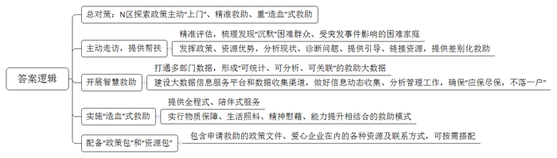
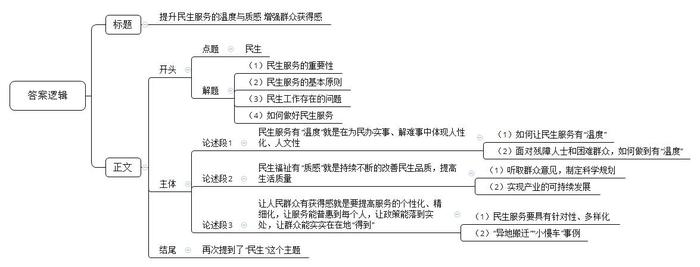

# 2021年公务员多省联考《申论》题（福建县级卷）

<!-- gwy:overview:start -->
> **福建 · 2021 · 申论 · 县级卷** ｜ 3 题 · 图片 3 处 · 答案随题折叠

导航：[题目](#题目)
<!-- gwy:overview:end -->

> 候选采集稿。参考答案及解析来自粉笔页面，不代表官方答案或真实高分答卷；来源使用许可与原卷对应关系仍需人工核实。

## 给定材料

### 材料 material-780a1fe2e3df5838

“把她的家粉刷一新。给独自生活的她更多支持。”

某公益平台上，为女孩小珊修缮房屋的公益计划得到不少爱心网友的支持。1元、10元、100元……不到一个月，爱心捐赠就超过了修缮所需。

小珊家住C市N区。唯一的亲人去世，自己又身患严重疾病，让她一度有轻生念头，是N区“社区救助顾问”团队把她从疾病与孤独中拉了出来。

“我们希望为她‘粉刷’的不仅是墙面，也是内心。”为小珊修缮房屋正是为其定制的救助“组合拳”中的一步：修葺后的房屋腾出一间出租，能有效缓解其家庭债务。同时，提供专业心理咨询、继续教育、就业指导等服务，帮助她重拾生活信心。

小珊的事例是C市N区近年在全国率先推出“社区救助顾问”制度及社区救助综合改革的一个缩影。在党的十九届四中全会“建立解决相对贫困的长效机制”的背景下，N区探索政策主动“上门”、精准救助、重“造血”的救助方式取得了较好效果。

尽管C市已建立较完备的现代社会救助体系，但因救助工作涉及部门较多、政策内容较复杂，总有少数困难群众不熟悉政策而未得到应有救助。唯有变“人找政策”为“政策找人”，才能彻底解决救助工作“最后一公里”难题。

2020年9月，C市宣布在全市全面实施“社区救助顾问”制度。N区作为全国社会救助综合改革试点区，在C市最先探索此项制度。2019年，该区试点组建一支由社区事务受理中心人员、居民区救助人员和专业社工组成的300余人“社区救助顾问”团队。团队在主动发现极少数“沉默”困难群众的同时，充分发挥熟悉各项救助政策、能够调配各项救助资源的优势，就近帮助困难群众分析现状、诊断问题、提供指引、链接资源，最终找到符合他们实际需要的差别化救助方式。“社区救助顾问”制度推出至今，N区已对7000多户居民进行了精准评估，梳理出高度困境家庭重点服务对象1300多户，其中不少为原本“沉默”的困难人群。

2020年，在新冠肺炎疫情影响下，那些本就脆弱的家庭是否会面临更大的风险呢？N区红桥路街道救助顾问联合居民区开展主动走访。他们发现，从外地来N区的苏先生的公司因疫情无法开工，妻子无业在家，还有三胞胎女儿需要照顾，家庭基本生活难以维持。救助顾问以最快速度制定救助方案，除发放临时帮扶金外，还链接外部资源，帮助苏先生妻子找到了线上工作岗位。

在N区华新路街道，近年来通过打通民政、人社、卫健、医保、残联等部门数据，形成了“可统计、可分析、可关联”的智慧救助大数据。街道服务办何主任举例说，救助顾问在比对居民医保与工会数据时，发现陈女士家庭医药费支出突然增大，上门走访后得知陈女士最近做了一场大手术，丈夫又生病在家，儿子也找不到工作。救助顾问随即为陈女士一家对接救助政策，不仅解决了大部分自费医药费，还帮助其儿子找到临时工作，使这个家庭走出了困境。

“我们还将进一步建设好大数据信息服务平台和数据收集渠道，做好低保家庭、低收入家庭、支出型贫困家庭和特殊困难家庭的动态信息收集、数据管理分析工作，确保‘应保尽保，不落一户’。”N区民政局申局长说。

“贫困有时候不是光靠钱就能解决，‘社区救助顾问’就是要分析每个个体或家庭的致贫原因，以‘一户一方案’原则设计救助计划，并提供全程式、陪伴式服务，把过去‘供血’式的物质救助转变为物质保障、生活照料、精神慰藉、能力提升等相结合的‘造血’式救助。”申局长说。

N区每名救助顾问都有一个“政策包”和一个“资源包”，“政策包”里装着为困难群众申请救助的政策文件，“资源包”里则有包括爱心企业、群团组织、基金会等在内的各种资源和联系方式。救助顾问可根据救助对象实际所需及时匹配相应救助资源。“社区救助顾问”制度在N区试点两年来，越来越多的困难人群被救助顾问发现，越来越多的人得到了相关救助。

### 材料 material-a4c376dce83ccb2d

为加强全县基层农业专业技术人员队伍建设，D县成立专项调研组进行了走访调研。

“我们的工作，既缺钱，也缺人。”县农业农村局副局长说，“全县基层三农服务岗位有141个编制。目前仅有105人。”“这种情况不是个例。”县水技站站长说，“单位编制不断压缩，如今只剩下‘光杆司令’。”

某乡农服中心主任是农技推广好手，也是省级科技特派员，但近年工作起来愈发感觉“难为无米之炊”。他说，近几年种植的水稻品种效益低，农户种植新品种的意愿强烈，但农服中心却难以推广试种新品种。“原来的试验田已经被取消了，经费也减少了。”这位农服中心主任说，“现在要推广新品种新技术，只能自己去劝服农户，要是种失败了还得个人掏腰包。”

某渔政管理站站长说，为增加百姓收入，他们引导渔民种新品种紫菜，但部分渔民为了多赚点钱，不按规定时间下苗。最终导致产量下跌40%左右，反而责怪站里没有指导好。

“基层技术性岗位待遇低，青年人才不愿意来。来了没几年也要走。”某海岛农服中心主任已经干了26年，正为找不到接任的干部而苦恼。“站里人员断档严重，要么是刚工作的，要么就是我这样工作了二三十年的。”

调研组在基层走访时，常常听到类似的吐槽：“农服中心就剩2人，还都去做其他工作了”“现在负责水利方面工作的，专业是搞村建的”“原来专业搞水利的，被调到财务部门做出纳了”……

一些基层专业干部被频频“挪作他用”，导致旧业务丢掉了，新业务也不熟悉。一位在水利系统工作了22年的水利干部突然被调到海洋渔业部门工作。这位干部说，虽然都和水有关，但工作内容差别较大。刚上任不久，他就接手了“整改违规养殖导致海洋环境污染”的工作，缺少经验的他只好“以文件贯彻文件”，最后被上级批评。

去年秋天，县里指导乡镇开设培训班，要求每户农民都要参加一个月的农技培训。“我们这里种的是茶叶和瓜果，培训内容是竹、菇、菜，培训内容和实际情况不相关。而培训时，正是农忙季节，谁愿意脱产一个月来参加培训？培训有什么用？”某乡镇农技干部说。

“招不来学农的大学生，好不容易招到一个，还留不住。”在走访中，不少农服中心反映“招人难”问题突出。据不完全统计，全县干部队伍中，学农的大学生从事本专业工作的人数不到50%，仅有不足10%的毕业生愿意到乡镇农服中心就业。

有限的农业干部也常常是“身兼数职”，甚至还要承担防汛、防疫等工作。县农服中心主任说：“有个乡镇的农服中心主任还兼着其他几个站所的负责人，根本没有精力研究业务。”

调研组在走访中了解到，少了农业人才的支持，无论是农业供给侧改革还是乡村振兴都受到了影响。去年，农民老杨种的辣椒大面积患病，但农技人员赶到现场一看，表示“不熟悉辣椒、无能为力”。最后病害没能控制住，老杨损失了近10万元。

## 题目

### 第 1 题

**根据“给定资料**1**”归纳****N****区试点“社区救助顾问”制度的主要做法。（****20****分）**

关联材料：材料 material-780a1fe2e3df5838

作答要求：

要求：全面、准确、有条理。不超过300字。

第 1 题 · 答案与解析

**参考答案（粉笔题库参考内容）**

N区探索政策主动“上门”、精准救助、重“造血”式救助：

1.主动走访，提供帮扶。精准评估，梳理发现“沉默”困难群众、受突发事件影响的困难家庭；发挥政策、资源优势，分析现状、诊断问题、提供引导、链接资源，提供差别化救助。

2.开展智慧救助。打通多部门数据，形成“可统计、可分析、可关联”的救助大数据；建设大数据信息服务平台和数据收集渠道，做好信息动态收集、分析管理工作，确保“应保尽保，不落一户”。

3.实施“造血”式救助。提供全程式、陪伴式服务；实行物质保障、生活照料、精神慰藉、能力提升相结合的救助模式。

4.配备“政策包”和“资源包”。包含申请救助的政策文件、爱心企业在内的各种资源及联系方式，可按需搭配。

**解析**

**参考答案说明：**本参考答案在整体上为“总—分”结构，先整体上指出N区探索政策主动“上门”、精准救助、重“造血”式救助，再指出具体做法。具体做法部分分别从“主动走访，提供帮扶”“开展智慧救助”“实施‘造血’式救助”“配备‘政策包’和‘资源包’”这四个层面展开，并进行了分条撰写，且每条要点都将总结性的信息前置。

**考点**：考点概括措施类

**来源**：来源2021年公务员多省联考《申论》题（福建县级卷）

粉笔申论页面对本题只提供「解析视频」入口，该入口是会员推广位，页面无视频地址与文字解析。

### 第 2 题

**根据“给定资料**3**”，梳理****D****县基层农业专业技术人员队伍存在的主要问题，并提出加强队伍建设的建议。（****30****分）**

关联材料：材料 material-a4c376dce83ccb2d

作答要求：

要求：全面准确，条理清晰，具体可行。不超过400字。

第 2 题 · 答案与解析

**参考答案（粉笔题库参考内容）**

问题：1.缺少人才。编制压缩，待遇低，难吸引和留下青年人才，人才断档。2.资源不足。试验田取消，经费减少，新品种新技术推广缺乏支持，风险个人承担。3.工作安排混乱。专业干部被频繁调岗，业务不熟悉，工作成效差；身兼数职，时间精力不足。4.培训不合理。内容脱离现实需求，脱产培训且与农忙时间冲突，农民参与意愿低。

建议：1.扩充人才队伍。核增编制，提高薪资福利，吸引青年人才；建立“老带新”培养机制，缓解人才断档。2.强化资源支撑。恢复试验田，加大经费投入，设立政府主导的风险共担基金，分摊试验损失。3.优化工作分配。严禁随意抽调专业干部，明确岗位职责；合理统筹任务，减少非业务性工作，确保干部专注农技服务。4.精准开展培训。根据当地种植结构定制培训内容，采用“田间课堂”等灵活方式，避开农忙时段，提升农民参与度。

**解析**

**参考答案说明**：本参考答案整体上分为“问题”和“对策”两个部分。其中，在“问题”部分，从“缺少人才”“资源不足”“工作安排混”“培训不合理”四个方面进行了分条撰写；在“对策”部分，从“扩充人才队伍”“强化资源支撑”“优化工作分配”“精准开展培训”四个方面进行了分条撰写。各条答案要点之间在内容上相互并列，没有交叉。

**考点**：考点提出对策类

**来源**：来源2021年公务员多省联考《申论》题（福建县级卷）

粉笔申论页面对本题只提供「解析视频」入口，该入口是会员推广位，页面无视频地址与文字解析。

### 第 3 题

**“给定资料**5**”中提到“努力让民生服务更有‘温度’，民生福祉更有‘质感’，让人民群众的获得感更足”。请你深入思考这句话，联系实际，自选角度，自拟题目，写一篇文章。（****50****分）**

关联材料：材料 material-780a1fe2e3df5838

作答要求：

要求：

（1）观点明确，见解深刻；

（2）参考给定资料，但不拘泥于给定资料；

（3）逻辑清晰，语言流畅；

（4）字数1000~1200字。

第 3 题 · 答案与解析

**参考答案（粉笔题库参考内容）**

**提升民生服务的温度与质感** **增强群众获得感**

党的十九大报告指出：“增进民生福祉是发展的根本目的。必须多谋民生之利、多解民生之忧，在发展中补齐民生短板。”民生服务保障工作必须谨遵“群众至上”的原则，需要一代又一代人的不断奋斗与努力。但是如今还是存在就业不稳定、教育缺失、交通拥堵等问题，政府的民生工作和群众的民生需求出现了“错位”，说明在一定程度上政府工作脱离了群众、脱离了实际。

因此，**只有让群众有更稳定的工作、更可靠的保障、更舒适的居住条件、更满意的收入等，才能展现民生服务的****“温度”与“质感”，让群众有获得感。**

**民生服务有****“温度”就是在为民办实事、解难事中体现人性化、人文性，要考虑到多数人的需求，也要重视少数群体的利益诉求，满足不同人群的多样化需求。**有“温度”的民生服务要贴近群众实际，获得群众支持，遵从群众意愿。比如面对残障人士，一方面要积极主动学习，提升自身服务水平；另一方面可创建“无声服务室”，帮助听障居民找到工作，解决实际困难。对于困难群众，可联合居民区主动走访、调查，快速制定救助方案，发放临时帮扶资金，对接外部资源帮助就业等。

**民生福祉有****“质感”就是持续不断****地****改善民生品质，提高生活质量，****要****听取群众意见，制定科学规划，****还要因地制宜，发展特色、优势产业****。**制度、规划是提升服务质量的保障，深入实地的走访调查，换位思考的沟通交流，不仅能快速反馈群众意见建议，还能提高政策、方案的落实效率和性价比；实现产业的可持续发展是提高生活品质的有效途径，要发挥党员的先锋模范作用，引进培养专业人才，加强队伍建设，整合资源，筹措资金，发展特色经济和集体经济，打造特色品牌，带领群众共同致富。

**让人民群众有获得感就是要提高服务的个性化、精细化，让服务能普惠到每个人，让政策能落到实处，让群众能实实在在地****“得到”。**民生服务涉及到群众生活的各个方面，包括教育、就业、住房、健康等诸多领域，要注重服务的针对性、多样化。帮助异地搬迁群众融入城市生活，为其开办“夜校”，讲解法规政策、生活常识等，鼓励大家放下乡情、主动拥抱新生活；为乡亲们修建公路，帮助村民寻找就医机会，改造敬老院，改善居住条件等，真正帮老百姓办实事、解难题，把群众关心的事情办好。

民生无小事。“保障和改善民生没有终点，只有连续不断的新起点。”这是对群众的承诺，是对国家的负责，不但温暖亿万群众心田，还能保障国家发展节节高。用政府的紧日子换取群众的好日子，同时带动中国经济“芝麻开花节节高”。

**解析**

**文章分析**

**提升民生服务的温度与质感** **增强群众获得感**

【**标题的优点**：首先，范文的标题突出了“民生服务的温度与质感”“群众获得感”这些关键词。其次，从形式上来说，前半句是大主题，后半句点明意义，使标题更加完整、饱满，且与文章结构对应，富有逻辑性。】

（1）党的十九大报告指出：“增进民生福祉是发展的根本目的。必须多谋民生之利、多解民生之忧，在发展中补齐民生短板。”（2）民生服务保障工作必须谨遵“群众至上”的原则，需要一代又一代人的不断奋斗与努力。（3）但是如今还是存在就业不稳定、教育缺失、交通拥堵等问题，政府的民生工作和群众的民生需求出现了“错位”，说明在一定程度上政府工作脱离了群众、脱离了实际。

（4）因此，**只有****让群众有更稳定的工作、更可靠的保障、更舒适的居住条件、更满意的收入等****，才能展现民生服务的****“温度”与“质感”，让群众有获得感。**

【**开头的优点**：★内容方面。范文的开头是紧扣题目给定的“民生服务”这一主题词展开的。首先，开头第一句话点出了“民生”，非常明确。其次，对“民生服务”这一主题词进行了分析阐述，指出了：（1）民生服务的重要性；（2）民生服务的基本原则；（3）民生工作存在的问题；（4）如何做好民生服务。★文字表达方面：使用了“只有……才”等关联词，让语言更有逻辑。】

**民生服务有****“温度”就是在为民办实事、解难事中体现人性化、人文性，要考虑到多数人的需求，也要重视少数群体的利益诉求，满足不同人群的多样化需求。**（1）有“温度”的民生服务要贴近群众实际，获得群众支持，遵从群众意愿。（2）比如面对残障人士，一方面要积极主动学习，提升自身服务水平；另一方面可创建“无声服务室”，帮助听障居民找到工作，解决实际困难。对于困难群众，可联合居民区主动走访、调查，快速制定救助方案，发放临时帮扶资金，对接外部资源帮助就业等。

【**论述段****1****的优点**：★观点句：范文的观点句是紧扣“民生服务”这一文章主题词提出的。形式上，它在段首处直接写出，位置突出，容易被发现；内容上，关键词突出，内容要点明确，可以明显看出它是从“民生服务的‘温度’”这一角度入手，指出了为民办事要体现人性化、人文性，既要考虑多数人的需求，也要考虑少数人的需求。★论述内容：本段主要围绕“民生服务”这一主题词进行分析阐述，指出了：（1）如何让民生服务有“温度”；（2）面对残障人士和困难群众，如何做到有“温度”。注意：以上两个方面的内容都是紧扣观点句“民生服务有‘温度’就是在为民办实事、解难事中体现人性化、人文性，要考虑到多数人的需求，也要重视少数群体的利益诉求，满足不同人群的多样化需求”进行分析论述的，针对性强、内容层次丰富。在论证方法和论据选取方面，讲道理和举例子相结合，做到了丰富多样。】

**民生福祉有****“质感”就是持续不断地改善民生品质，提高生活质量，要听取群众意见，制定科学规划，还要因地制宜，发展特色、优势产业。**（1）制度、规划是提升服务质量的保障，深入实地的走访调查，换位思考的沟通交流，不仅能快速反馈群众意见建议，还能提高政策、方案的落实效率和性价比；（2）实现产业的可持续发展是提高生活品质的有效途径，要发挥党员的先锋模范作用，引进培养专业人才，加强队伍建设，整合资源，筹措资金，发展特色经济和集体经济，打造特色品牌，带领群众共同致富。

【**论述段****2****的优点**：★观点句：范文的观点句是紧扣“民生服务”这一文章主题词提出的。形式上，它在段首处直接写出，位置突出，容易被发现；内容上，关键词突出，内容要点明确，可以明显看出它是从“民生福祉有‘质感’”这一角度入手，指出了要改善民生品质，提高生活质量。★论述内容：本段主要围绕“民生服务”这一主题词进行分析阐述，指出了：（1）制定科学合理的制度、规划以保障服务质量；（2）实现产业的可持续发展。注意：以上两个方面的内容都是紧扣观点句“民生福祉有‘质感’就是持续不断地改善民生品质，提高生活质量，要听取群众意见，制定科学规划，还要因地制宜，发展特色、优势产业”进行分析论述的，针对性强、内容层次丰富。在论证方法和论据选取方面，讲道理和举例子相结合，做到了丰富多样。】

**让人民群众有获得感就是要提高服务的个性化、精细化，让服务能普惠到每个人，让政策能落到实处，让群众能实实在在地****“得到”。**（1）民生服务涉及到群众生活的各个方面，包括教育、就业、住房、健康等诸多领域，要注重服务的针对性、多样化。（2）帮助异地搬迁群众融入城市生活，为其开办“夜校”，讲解法规政策、生活常识等，鼓励大家放下乡情、主动拥抱新生活；为乡亲们修建公路，帮助村民寻找就医机会，改造敬老院，改善居住条件等，真正帮老百姓办实事、解难题，把群众关心的事情办好。

【**论述段****3****的优点**：★观点句：范文的观点句是紧扣“民生服务”这一文章主题词提出的。形式上，它在段首处直接写出，位置突出，容易被发现；内容上，关键词突出，内容要点明确，可以明显看出它是从“让人民群众有获得感”这一角度入手，指出了要提高服务的个性化、精细化。★论述内容：本段主要围绕“民生服务”这一主题词进行分析阐述，指出了：（1）民生服务要具有针对性、多样化；（2）介绍了为群众办实事的一系列做法。注意：以上两个方面的内容都是紧扣观点句“让人民群众有获得感就是要提高服务的个性化、精细化，让服务能普惠到每个人，让政策能落到实处，让群众能实实在在地‘得到’”进行分析论述的，针对性强、内容层次丰富。在论证方法和论据选取方面，讲道理和举例子相结合，做到了丰富多样。】

【**论述段之间的关系**：★内容的内在逻辑：范文的论述段之间是依照并列逻辑展开的。论述段1先写了“民生服务的温度”，论述段2又写了“民生福祉的‘质感’”，论述段3再写了“让群众有获得感”。★段与段的外在衔接：论述段1、2、3都在开头段直接点题，使文章整体上看起来逻辑清晰。】

民生无小事。“保障和改善民生没有终点，只有连续不断的新起点。”这是对群众的承诺，是对国家的负责，不但温暖亿万群众心田，还能保障国家发展节节高。用政府的紧日子换取群众的好日子，同时带动中国经济“芝麻开花节节高”。

【**结尾的优点**：范文结尾是回扣题目给定的“民生服务”这一主题词展开的，再一次强调了“民生服务”的深远意义。】

**考点**：考点文章写作题

**来源**：来源2021年公务员多省联考《申论》题（福建县级卷）

粉笔申论页面对本题只提供「解析视频」入口，该入口是会员推广位，页面无视频地址与文字解析。

