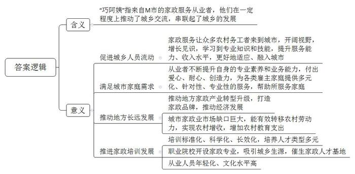
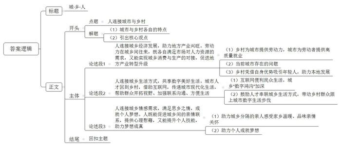

# 2022年公务员多省联考《申论》题（福建省市卷）

> 候选采集稿。参考答案及解析来自粉笔页面，不代表官方答案或真实高分答卷；来源使用许可与原卷对应关系仍需人工核实。

## 给定材料

### 材料 material-91c8fbe7876fdca9

2022年3月的一天，77名来自M市的“巧阿姨”列队整齐、精神抖擞。刚一出站，就吸引了众人的目光。作为M市就业及技能提升培训班第48期学员，她们将在北京一所职业院校完成为期两周的家政培训。“学员们基本来自农村。此次培训，主要是帮助她们开阔视野，增长见识，提升家政服务能力，尽快适应城市环境，及早融入城市生活。”M市阳光职业学校校长郭玲说。

2017年初，还在广州某家政服务公司担任部门经理的郭玲发现，城市白领、青年双职工家庭对家政服务的市场需求量大，服务内容越来越多元，对服务质量的要求也越来越高。想到家乡的贫困落后，她决定回乡创业，并在多方支持下创建了阳光职业学校。

“我来北京已经四年多了，现在是一名月嫂。辛苦是肯定的，两个孩子都还在上学，得多赚点钱。”2017年11月，礼嘉镇河湾村的小李与其他19人作为首批“巧阿姨”与家人依依惜别，踏上了进京列车。“公司统一培训后，我被安排到了一家月子中心。在月子中心工作了两年，那里有非常专业的妇产科医生和护士，能学到的技能很多，老师的指导也更加细致。”从月子中心离开后，小李开始作为住家月嫂接受派单，爽朗乐观的性格和耐心专业的服务，让她总能收获雇主家庭的好评。在精湛技能和丰富经验的加持下，小李的薪资稳步增长。“家政这份工作不仅让我见识到了外面的世界，还使我成了家里的顶梁柱。”小李谈道，接下来她想在烹饪和烘焙上再多学习一些专业知识，做出更加营养可口的月子餐。

弘志社工服务中心梅主任从没想过自己会和如此多的家政人员成为朋友。她大学毕业后投身社会工作领域，和许多城市居民一样，除非家里雇了阿姨，并没有太多和家政从业者产生交集的可能。2021年，她所在的社工服务中心发起“百手撑家”摄影大赛。期间，她认识了40多位家政人员，其中“巧阿姨”展示出的专业素养和业务能力让她尤为深刻。“阿姨好找，但好阿姨是稀缺资源。”梅主任说，“供需之间要精准匹配是一件很难的事情，现在的年轻人忙于工作，无暇顾及老人小孩，更没有多余的精力打理家庭琐事，因此往往要求阿姨不仅有爱心、耐心，还得懂一些专业知识，能力素质要高。”不过，她很愿意向周围有需要的人推荐“巧阿姨”，在她看来，“这是一个很专业、有韧性、有创造力的群体，他们帮助了所服务的家庭，实际上也靠双手撑起了自己的家。”

随着经济社会的持续快速发展，家政服务业也迈入了新发展阶段，从需求端来看，家政服务覆盖了各类群体，包括新生儿、幼儿、少年、老年人、残疾人等，服务内容已经从过去简单的洗衣做饭升级为现在涵盖家庭教育、家务管理、康养护理、营养配餐、婴幼儿智力开发等多元化业态。为此，M市审时度势、抢抓机遇，把推动家政产业转型升级、塑造“巧阿姨”品牌作为富民利民工程来抓。每年家政从业人员外出务工收入近30亿元，“家政业市场缺口大，为我市转移农村劳动力提供了一条新路。这不仅实现了农村的增收，家政从业者的收入有很大一部分用于自己子女的教育，将给乡村带来深远的影响。”M市刘副市长介绍，“我们还把促进家政产业高质量发展写入了M市‘十四五’规划，要将‘巧阿姨’家政品牌打造成全国家政服务业的标杆。”

近两年，M市持续推进家政教育培训标准化、科学化、长效化。针对不同的年龄段、知识素养和服务方向，政府主要引导家政行业协会、家政服务企业、家政培训机构以及职业院校，全方位培育家政服务行业职业经理人、家政培训讲师、高端家政服务人员和普通家政服务人员四类群体。2021年，M市职业技术学院新开设的家政专业首次面向社会招生，吸引了众多来自城乡家庭的学生报考。“我们还与北京、上海等地的高等职业院校以及家政服务公司合作，培育打造中高端家政人才基地。”M市职业技术学院家政服务系张主任介绍，“这一行最明显的趋势是年轻人越来越多、文化水平越来越高。这些学生学东西更快，适应性更强，在接受专业、系统的教育培训后，能够有效满足城市对家政服务的多元化需求。”

“今年上半年，M市已开展家政技能培训2万余人次，向全国输出‘巧阿姨’11万余人，家政服务业已成为我市经济发展倚重的重要业态之一。”M市社科院孙研究员说，“‘巧阿姨’搭建了城乡交流的桥梁，串起了城和乡。”

### 材料 material-255a386d1a8e29d9

“走，去璧云摘樱桃！”四月里，璧云区头塘镇的樱桃园内，绯红欲滴的樱桃和翠绿的树叶相映成趣，沉甸甸地挂满枝头。一到周末，这里便游人如织。自区委区政府2017年确定“四城”建设目标以来，璧云区生态之城、文化之城、活力之城、幸福之城的图景渐渐浮现，一个承载着璧云市民理想生活的高品质生活示范区逐渐成型。

从地铁1号线璧云东路站下车，远处驶来的是圆滚滚、萌嘟嘟的空中有轨电车“云巴”。2021年通车的“云巴”不仅方便了璧云市民的出行，更以其智能、绿色、经济的特点为市民的高品质生活穿针引线。搭乘“云巴”一路飞驰，城市的美景还未看够，林湖公园站便到了。“不管来多少次，我们都觉得林湖公园美不胜收。”每天晚饭后搭“云巴”去林湖公园散步，已成为市民罗先生一家的习惯。林湖公园占地1500亩，既紧邻璧云区新商业中心，又是天然“氧吧”，园内绿树成荫、鲜花常开。为了让市民“推窗见绿、出门见景”，璧云区打造了35座生态公园，68个生态广场。“生态公园建设以‘山水林田湖草’一体化为总思路，构建城区三大水系绿廊，实现景城融合，避免同质化重复性建设。”璧云区城市管理局林局长说。

“春雨惊春清谷天，夏满芒夏暑相连……”在春华体育公园，市民雷女士正在给孩子念刻在景观石上的《二十四节气歌》。像这样传播民俗文化、介绍历史故事、解读诗词歌赋的石刻，在璧云区大大小小的公园随处可见。“我们要坚定文化自信，深度挖掘璧云千年文脉，塑造城市精神，以文明之风彰显儒雅风范，持续打造新时代文明典范城市。”璧云区委宣传部黄部长表示，“让文化浸润城市、深入人心，是璧云区城市建设之魂。”

为此，璧云区不断涵养城市文化深度，实施“城市记忆工程”，大力保护文庙等文物古迹，多形式再现古道文化、抗战文化等历史文脉；实施文艺精品工程，努力推出“璧云原创”“璧云出品”等匠心之作。如今，在三道湾公园里，古村落、茶铺等主题场景重现了明清时期古驿道上的浩然意境；在枫凌塘湿地公园内，典雅大气的状元桥两侧展示着当地本土名家字画；在林湖汽车露营公园里，老照片与仿古城墙巧妙搭配。一个个传统文化元素让千年儒雅之风在城市中吹拂，汇聚成当代璧云人的文化之根、自信之魂。

2022年3月，集招才引智、招商引资、城市宣传、项目孵化等功能为一体的“璧云人才”APP上线，璧云区着力打造人才建设品牌，从建立高端人才“管家”机制，到评选表彰“璧云英才”“璧云工匠”“璧云创客”，使各路人才在璧云区的获得感满满。在智力资源支撑下，璧云区秉持“绿色发展”理念，一方面，以智能制造为主攻方向，加快发展新能源、人工智能、集成电路等先进制造业和战略性新兴产业；另一方面，提档升级菜园、果园、花园，打造集观光游览、休闲度假、品尝采摘为一体的新业态。采摘节、艺术节等活动活力四射，“引爆”乡村旅游。从“璧云樱桃”“璧云肉兔”等品牌影响力提升，到举办国际半程马拉松赛、西部动漫节；从规划建设国家级数字文创产业园，到继续申办量子信息安全托管全国运营基地，璧云区坚持产城融合的发展逻辑，不断为城市发展注入新活力。

“亲爱的小朋友：欢迎你来到我们身边，你像一轮旭日，晨曦中积攒着力量和希望……”6月1日，璧云区行政服务中心内，“新手”母亲朱女士从“出生一件事”礼包中抽出一封信，柔声读起来。除了写给新生儿的信，礼包里还有孩子的社会保障卡、出生医学证明和居民户口簿。“我是昨天在线上申请的，没想到今天就可以领取了。”朱女士高兴不已。“出生一件事”是璧云区行政服务中心的一项特色服务，该服务将曾经分散在不同部门的多个事项集中在线下1个窗口，解决了新生儿出生相关事项办事繁、材料多、多头跑的难题。自2021年5月试点运行以来，该服务广受群众好评。区行政服务中心王科长介绍，在“出生一件事”基础上，“入学一件事”“退休一件事”等都已形成初步方案，预计今年秋季将试点运行。“这些事看起来不起眼，却能让市民收获的幸福从‘小’一直到‘老’。”王科长说。

坐落于秀湖街道的三泉康养小镇，以专业的养老服务闻名于区内外。智慧健康养老云平台带来安心，“快乐管家、生活管家、健康管家”三大管家服务带来舒心，多种多样的娱乐项目带来开心，老年群众的各种需求在康养小镇基本都能得到满足。2021年以来，璧云区逐渐形成“高端有引领、社会有服务、兜底有保障”的养老服务体系，已建设15个镇街养老服务中心、45个社区养老服务站和54个村级互助养老点。

## 题目

### 第 1 题

**根据****“给定资料**1**”，请你谈谈为什么说“‘巧阿姨’搭建了城乡交流的桥梁，串起了城和乡”。（20分）**

关联材料：材料 material-91c8fbe7876fdca9

作答要求：

要求：分析全面，条理清晰。不超过400字。

### 第 2 题

**假如你是****璧****云区委宣传部的一名工作人员，请根据****“给定资料**3**”，拟写一篇反映****璧****云区****“四城”建设成就的宣传****稿****。（****30分）**

关联材料：材料 material-255a386d1a8e29d9

作答要求：

要求：

（1）紧扣资料，内容全面；

（2）条理清晰，语言生动；

（3）不超过500字。

### 第 3 题

**请结合****给****定资料，以****“城·乡·人”为题，联系实际，自选角度，写一篇文章。（50分）**

关联材料：材料 material-91c8fbe7876fdca9

作答要求：

要求：

（1）观点明确，见解深刻；

（2）参考给定资料，但不拘泥于给定资料；

（3）思路清晰，语言流畅；

（4）总字数1000-1200字。

## 答案与解析

第 1 题

**参考答案（粉笔题库参考内容）**

“巧阿姨”指来自M市的家政服务从业者，他们在一定程度上推动了城乡交流，串联起了城乡的发展，具体体现在：

1.促进城乡人员流动。家政服务让众多农村务工者来到城市，开阔视野，增长见识，学习到专业知识和技能，提升服务能力、收入水平，更好地适应、融入城市。

2.满足城市家庭需求。从业者不断提升自身的专业素养和业务能力，付出爱心、耐心、创造力，为各类雇主家庭提供多元化、针对性、专业性的服务，帮助所服务家庭。

3.推动地方长远发展。推动地方家政产业转型升级，打造家政品牌，推动经济发展；城市家政业市场缺口巨大，能有效转移农村劳动力，实现农村增收，增加农村教育支出。

4.推进家政培训发展。培训标准化、科学化、长效化，培养人才类型多元；职业院校开设家政专业，吸引城乡生源，催生家政人才基地；从业人员年轻化、文化水平高。

**解析**

**参考答案说明：**先对“巧阿姨”的含义进行解释，接着分析“巧阿姨”对于城乡发展的意义，分别从“促进城乡人员流动”“满足城市家庭需求”“推动地方长远发展”“推进家政培训发展”这四个方面进行分条撰写，各部分要点语言简明、层次清晰。

**考点**：考点原因类

**来源**：来源2022年公务员多省联考《申论》题（福建省市卷）

粉笔申论页面对本题只提供「解析视频」入口，该入口是会员推广位，页面无视频地址与文字解析。

第 2 题

**参考答案（粉笔题库参考内容）**

理想品质生活 尽在璧云“四城”

2017年，区政府确定“四城”建设目标，经过五年的努力，如今璧云的高品质生活示范区已逐渐成型：

一、建设生态之城，实现景城融合。空中电车云巴，让市民享受智能、绿色、经济的出行；众多的生态公园、广场，让市民开窗见绿、出门见景，还有了休闲场所。二、建设文化之城，塑造城市精神。实施城市记忆、文艺精品工程，在城市中再现传统文化，彰显儒雅之风，汇聚成文化之根、自信之魂，让文化浸润城市，深入人心。三、建设活力之城，促进产城融合。打造人才建设品牌，使人才获得感满满；坚持发展绿色产业，本地品牌影响力显著提升，举办了国际半程马拉松赛等大型赛事。四、打造幸福之城，优化公共服务。探索“一件事”服务，解决了办事繁、材料多、多头跑难题；建成康养小镇，形成“高端有引领、社会有服务、兜底有保障”的养老体系。

欢迎大家与我们共品“四城”之美。

**解析**

**参考答案说明：**（1）格式方面，本参考答案写到了“标题”“正文”两个部分。（2）正文部分，一方面从内容来看，围绕着“璧云区‘四城’建设成就”这一主题，本参考答案的开头先写到了“璧云区‘四城’建设的背景”；接着主体部分从“建设生态之城，实现景城融合”“建设文化之城，塑造城市精神”“建设活力之城，促进产城融合”“打造幸福之城，优化公共服务”这四个方面介绍了璧云区“四城”建设的成就；结尾部分进行了呼吁号召。另一方面，形式上，本参考答案做到了分段、分条撰写，整体上条理较为清晰。

**考点**：考点宣传类

**来源**：来源2022年公务员多省联考《申论》题（福建省市卷）

粉笔申论页面对本题只提供「解析视频」入口，该入口是会员推广位，页面无视频地址与文字解析。

第 3 题

**参考答案（粉笔题库参考内容）**

**城****·乡·人**

在众人的固有印象中，城市与乡村在产业发展、日常生活方式等多方面存在极大差异，城市云集资金、技术、新兴产业，生活节奏快；乡村则拥有大量富余劳动力、良好的生态环境及闲适的生活状态。然而城市和乡村从来不是对立、隔断的，二者间一直是通过一条纽带来双向传输资源、实现优势互补，这条纽带就是人。

**人连接城乡经济发展，助力地方产业兴旺。劳动力在城乡间往来，既各自满足市场对人力资源的需求，又能实现城乡消费与生产的对接，促进地方产业转型升级。**著名爱国实业家卢作孚曾提到，乡村是不断供给城市人口的地方。城市产业发展所带来的市场需求升级，成功激活了农村富余劳动力，为劳动者提供更多高质量择业的可能。同时，当前城市生活压力大，“城市病”等问题频现。因此，生态环境优美、人情氛围浓郁的农村便成为无数年轻人事业选择的“诗和远方”，他们将电商等新产业带到农村，盘活农村闲置资源，为农产品拓宽城市市场，让小村播拥有大学问，利用自身拥有的学识、技能等为农村产业更新带来希望。

**人连接城乡生活方式，共享数字美好生活。城市人才回到乡村，借助互联网，传递城市现代化生活，帮助群众开拓视野****、****加强联系****沟通、****方便生活。**互联网发展极大地便利了民众的生活，但同时，城乡间的“数字鸿沟”却逐渐加深，城市中习以为常的线上通讯、网络购物等生活方式在乡村仍属于绝大部分村民不懂不会的“盲区”。因此，要发挥人才在城乡生活方式上的串联作用，鼓励人才返乡投身于农村电商贸易、快递物流等产业，助力打造诸如菜鸟驿站等新型便利设施，以此带动村民充分利用互联网加强对外联络、开展购物娱乐活动，让乡村群众跟上城市数字生活的步伐，享受互联网时代的便利。

**人连接城乡情感需求，满足思乡之情，成就个人梦想。****人既能****促进城乡****间的亲情****联系，****提供心理慰藉****，****又能提升个人技能，助力****梦想****成真****。**“独在异乡为异客，每逢佳节倍思亲”，如今借助人的力量，分隔在城乡中的亲人无需再“登高望远”，就能够感受家乡温暖、品味亲情关怀。正如城市中的人才回到乡村，带去乡情优选驿站，让外地游子既能为父母添衣加物、传递孝心，又能接收到父母邮寄的土特产中饱含的爱子之情；再如乡村中的人来到城市，打造原汁原味的农庄，让背井离乡之人“梦回家乡”，得到心灵放松。不仅如此，人在城乡之间的游走，有助于捕捉到城乡发展中的机遇，找到施展个人才华的舞台，从而锻炼提升自我，助力实现人生价值。

城乡间本就共生共存、互相依托，只要我们在两者间充当好往来连接的角色，就能避免城乡在各自发展中成为“孤岛”，在城市与乡村间找到个人发展的契合点，为二者共同发展提供“有效链接”。

**解析**

**文章分析**

**城****·乡·人**

【**标题的优点：**本题严格按照题目要求，以“城·乡·人”为标题。】

（1）在众人的固有印象中，城市与乡村在产业发展、日常生活方式等多方面存在极大差异，城市云集资金、技术、新兴产业，生活节奏快；乡村则拥有大量富余劳动力、良好的生态环境及闲适的生活状态。（2）**然而城市和乡村从来不是对立、隔断的，二者间一直是通过一条纽带来双向传输资源、实现优势互补，这条纽带就是人**。

【**开头的优点：**★内容方面。范文的开头是紧扣题目给定的“人连接城市与乡村”这一主题展开的。（1）介绍了城市与乡村各自的特点；（2）引出核心观点。★文字表达方面。使用了“然而……”等连接词，使语言表达具有严谨的逻辑性。】

**人连接城乡经济发展，助力地方产业兴旺。劳动力在城乡间往来，既各自满足市场对人力资源的需求，又能实现城乡消费与生产的对接，促进地方产业转型升级。**（1）著名爱国实业家卢作孚曾提到，乡村是不断供给城市人口的地方。城市产业发展所带来的市场需求升级，成功激活了农村富余劳动力，为劳动者提供更多高质量择业的可能。（2）同时，当前城市生活压力大，“城市病”等问题频现。（3）因此，生态环境优美、人情氛围浓郁的农村便成为无数年轻人事业选择的“诗和远方”，他们将电商等新产业带到农村，盘活农村闲置资源，为农产品拓宽城市市场，让小村播拥有大学问，利用自身拥有的学识、技能等为农村产业更新带来希望。

【**论述段****1的优点：**★观点句：范文的观点句是紧扣“人连接城市与乡村”这一文章主题提出的。形式上，它在段首处直接写出，位置突出，容易发现。内容上，关键词突出，内容要点明确，可以明显看出是从“经济发展”角度，对“人连接城市与乡村”展开了论述。★论述内容：（1）乡村为城市提供劳动力，城市为劳动者提供高质量就业；（2）当前城市存在的问题；（3）乡村凭借自身优势吸引年轻人，助力本地发展。注意：以上三个方面的内容都是紧扣“人连接城乡经济发展，助力地方产业兴旺。劳动力在城乡间往来，既各自满足市场对人力资源的需求，又能实现城乡消费与生产的对接，促进地方产业转型升级”这个观点句进行分析论述的，论述的针对性强，内容层次丰富。在论述方法上采用了摆事实、讲道理相结合的方式，论述清晰透彻。】

**人连接城乡生活方式，共享数字美好生活。城市人才回到乡村，借助互联网，传递城市现代化生活，帮助群众开拓视野、加强联系沟通、方便生活。**（1）互联网发展极大地便利了民众的生活，但同时，城乡间的“数字鸿沟”却逐渐加深，城市中习以为常的线上通讯、网络购物等生活方式在乡村仍属于绝大部分村民不懂不会的“盲区”。（2）因此，要发挥人才在城乡生活方式上的串联作用，鼓励人才返乡投身于农村电商贸易、快递物流等产业，助力打造诸如菜鸟驿站等新型便利设施，以此带动村民充分利用互联网加强对外联络、开展购物娱乐活动，让乡村群众跟上城市数字生活的步伐，享受互联网时代的便利。

【**论述段****2的优点：**★观点句：范文的观点句是紧扣“人连接城市与乡村”这一文章主题提出的。形式上，它在段首处直接写出，位置突出，容易发现。内容上，关键词突出，内容要点明确，可以明显看出是从“生活方式”角度，对“人连接城市与乡村”展开了论述。★论述内容：（1）指出了互联网便利民众生活，城乡“数字鸿沟”加深；（2）要鼓励人才串联城乡生活方式，带动乡村群众跟上城市数字生活步伐。注意：以上两个方面的内容都是紧扣“人连接城乡生活方式，共享数字美好生活。城市人才回到乡村，借助互联网，传递城市现代化生活，帮助群众开拓视野、加强联系沟通、方便生活”这个观点句进行分析论述的，论述的针对性强，内容层次丰富。在论述方法上采用了摆事实、讲道理相结合的方式，论述清晰透彻。】

**人连接城乡情感需求，满足思乡之情，成就个人梦想。人既能促进城乡间的亲情联系，提供心理慰藉，又能提升个人技能，助力梦想成真。**（1）“独在异乡为异客，每逢佳节倍思亲”，如今借助人的力量，分隔在城乡中的亲人无需再“登高望远”，就能够感受家乡温暖、品味亲情关怀。正如城市中的人才回到乡村，带去乡情优选驿站，让外地游子既能为父母添衣加物、传递孝心，又能接收到父母邮寄的土特产中饱含的爱子之情；再如乡村中的人来到城市，打造原汁原味的农庄，让背井离乡之人“梦回家乡”，得到心灵放松。（2）不仅如此，人在城乡之间的游走，有助于捕捉到城乡发展中的机遇，找到施展个人才华的舞台，从而锻炼提升自我，助力实现人生价值。

【**论述段****3的优点：**★观点句：范文的观点句是紧扣“人连接城市与乡村”这一文章主题提出的。形式上，它在段首处直接写出，位置突出，容易发现。内容上，关键词突出，内容要点明确，可以明显看出是从“情感需求”角度，对“人连接城市与乡村”展开了论述。★论述内容：（1）助力城乡分隔的亲人感受家乡温暖、品味亲情关怀；（2）助力个人成就梦想。注意：以上两个方面的内容都是紧扣“人连接城乡情感需求，满足思乡之情，成就个人梦想。人既能促进城乡间的亲情联系，提供心理慰藉，又能提升个人技能，助力梦想成真”这个观点句进行分析论述的，论述的针对性强，内容层次丰富。在论述方法上采用了摆事实、讲道理相结合的方式，论述清晰透彻。】

【**论述段之间的关系：**三个论述段分别从“经济发展”“生活方式”“情感需求”等三个角度，对文章主题“人连接城市与乡村”展开了论述，在内容上，彼此之间呈现出并列的逻辑。】

城乡间本就共生共存、互相依托，只要我们在两者间充当好往来连接的角色，就能避免城乡在各自发展中成为“孤岛”，在城市与乡村间找到个人发展的契合点，为二者共同发展提供“有效链接”。

【**结尾的优点：**范文的结尾回扣了“人连接城市与乡村”这个主题，并且进行了总结升华。】

**考点**：考点文章写作题

**来源**：来源2022年公务员多省联考《申论》题（福建省市卷）

粉笔申论页面对本题只提供「解析视频」入口，该入口是会员推广位，页面无视频地址与文字解析。

