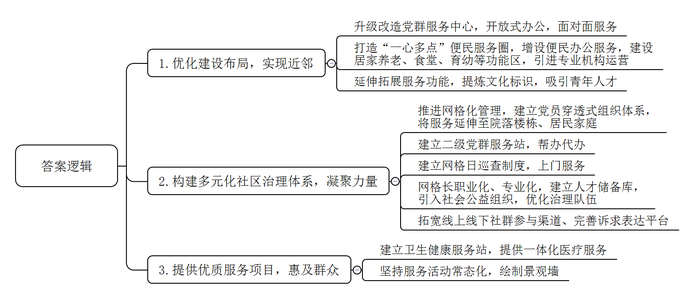
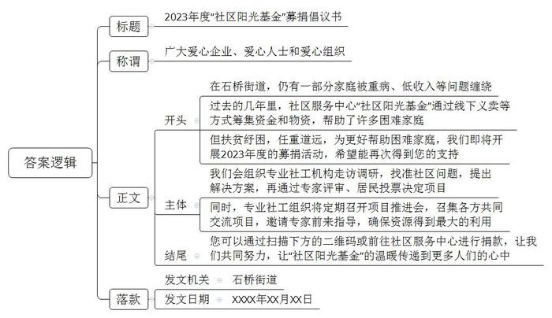
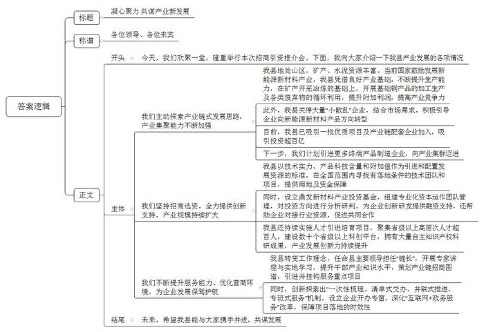

# 2023年公务员多省联考《申论》题（福建县乡卷）

> 候选采集稿。参考答案及解析来自粉笔页面，不代表官方答案或真实高分答卷；来源使用许可与原卷对应关系仍需人工核实。

## 给定材料

### 材料 material-1319707469df0f97

曾林社区是典型的“村改社区”。为做好“村改居”后半篇文章，近年来，曾林社区以“近邻”为基、“聚邻”为要、“惠邻”为本，通过做优做实“党建+”邻里中心建设，提升社区综合治理水平。

走进曾林社区“党建+”邻里中心的党群服务中心，这里窗明几净、视野开阔。升级改造后，一改此前窗口办公的风格，开放式的办公区更加亲民，营造出面对面服务的温馨氛围。

在“党建+”邻里中心建设过程中，曾林社区按照“去形式化、去机关化、去办公化”的原则，打造“一心多点”便民服务圈。改造后，社区党群服务中心办公空间占比减少80%。党支部袁书记说：“虽然办公空间减少了，但便民服务却增加了，我们引进了政务服务自助一体机，编排印制社区便民服务联络卡，开设便民事项预约热线，为群众办事提供更多便利。”

居家养老服务照料中心是曾林社区“党建+”邻里中心建设的重要一环。今年74岁的谢阿姨一有空就会到照料中心同邻居们一起休闲娱乐、话家常。除了新建照料中心，还配备了社区食堂、儿童之家、亲子阅读室及早教托育中心等8个功能区域，并引进第三方专业机构运营。

曾林社区进一步延伸拓展服务功能，立足本土文化，设计提炼社区独具特色的文化标识，建成社区乡村记忆馆，推动社区大学生“反哺”基地、曾林茶产学研基地落地，增设人才驿站等阵地，推动青年人才走进曾林。

目前，曾林社区正全面推进“红色网格化”管理，推动党小组建立在网格上、党员沉到网格中、处置融入网格里，成立社区邻里先锋队，选聘32户党员中心户、8名党员楼栋长，按照每人挂钩联系10-20户群众，组织党员认领责任片区，建立“社区党组织—网格党小组—党员楼栋长—党员中心户”一贯到底的穿透式组织体系，将党组织的服务延伸至院落楼栋、居民家庭，实现邻里良性互动。党员中心每户家门口都挂有用于亮身份的责任牌。“看到这个红色的牌子，立刻就感受到自己作为一名党员的责任。”曾林社区党员梁女士说。

与此同时，曾林社区建成3个二级网格党群服务站，实现二级网格驻点办公，提供前移帮办代办便民服务，并建立网格日巡查制度，通过就近设、入户帮、上门办，将儿童之家、医疗护理等服务项目送到家。

为优化治理队伍，曾林社区坚持以职业化为基础、以专业化为方向，选聘一批网格长，通过“老带新”一对一帮带，加速提升网格员综合素养，同时建立社区人才储备库，引入致和社工、亿家社工等社会公益组织，着力提升社区治理能力。

在推深做实党建引领网格化管理的基础上，曾林“党建+”邻里中心拓宽社群参与渠道，完善诉求表达平台。在线下，设置居民意见箱，设立部门轮值室，主动对接“两代表一委员”、纪工委等部门，定期开放接访群众；还设置邻里会事厅，为民众议事解难题提供多元共商平台。在线上，依托社区公众号开通邻里会事留言板，利用“微监督”小程序及时公开居务情况，实时收集群众诉求和意见。

“不用到医院，在家门口的卫生健康服务站就能完成心电图、血常规、尿酸等一系列体检检查。”曾林社区“党建+”邻里中心卫生健康服务站李站长说。该卫生健康服务站由街道和社区共建，通过完善“病有所医”配套，推动优质卫生健康资源和服务人员“双下沉”，让社区居民在家门口就能享受到就诊、体检、取药、医保结算一体化的医疗卫生服务。

为进一步提升社区生活品质，增强群众幸福感与获得感，曾林“党建+”邻里中心坚持服务活动常态化，今年来累计开展了“粽叶飘香”“爱在重阳”等主题活动20余场，其他日常活动60余场，参与人数超4000人次。此外，社区以文化认同为切入点，绘制景观墙，既展示了“爱乡邻·爱曾林”的“聚邻”文化，又扮靓了村居颜值。

### 材料 material-bbbf55ee884fb3db

2022年本应是L县山核桃丰产的大年，但由于高温干旱，产量只是略有增加。虽然产量受影响，但效益却创下了新高，这背后是该县山核桃的转型升级之路。

多年来，L县山核桃产业生产主体众多，很多是家庭作坊，质量参差不齐，以次充好并不鲜见。相关部门不断加强对山核桃销售市场的监管，但收效甚微。“为此，我们决定制定统一的标准，鼓励、引导、带动企业执行这个标准。”L县农业农村局古局长介绍。

2021年，L县发布“天目”农产品区域公用品牌，覆盖包括山核桃在内的众多农产品。县政府委托省山核桃产业协会牵头制定“天目”山核桃系列标准。9月，“天目”山核桃系列标准体系对外发布，包括炒制山核桃、手剥类山核桃和山核桃仁3个标准。标准起草人之一、省山核桃产业协会蔡秘书长说：“在山核桃领域20多个标准中，我们这次制定的标准是最高的。”

“要获得‘天目’品牌使用授权，企业需要申请，产品要符合我们的标准。”古局长说。目前已有8家山核桃企业获得授权，L县太康炒货食品厂就是其中之一。“现在，我们有两款产品用了‘天目’品牌。”程厂长说，“这两款山核桃的品质是我们产品中最好的。”获得“天目”品牌使用授权后，程厂长感受最深的是品牌推广的力度大大提升。“‘天目’需要好的产品来支撑，我们也需要‘天目’这个公共品牌提升消费者的认可度。”

“市场监管部门会不定期抽查，如果授权企业的‘天目’产品不符合相关标准，将撤销授权并向社会公布，同时在一定时间内禁止该企业再次申请。”古局长表示。

L县山核桃加工企业有280多家，年加工能力3万吨，光是龙水镇就聚集了170余家炒货食品加工产业链企业。但这些企业大多是给品牌企业代加工，尽管做自己品牌的也有，然而规模、名气都不大，没有一个家喻户晓的品牌。蔡秘书长说：“为品牌企业做代加工利润薄，只有更多品牌企业成长起来，L县山核桃的品牌价值才会更大，才能分享到山核桃产业带来的更多效益。”

2022年，天生记总部落户龙水镇，L县终于有了第一个具有全国知名度的坚果类品牌。天生记杨总经理深耕坚果领域20多年。他说，将总部从省城迁到L县，不仅有公司发展的考量，也有助力L县山核桃产业发展的情怀。

透过玻璃，能看到天生记山核桃加工生产的每一个环节，自动化、数字化程度很高。“没有什么不能看的，每一个环节都经得起检验。”杨总经理说，数字工厂已于去年9月初投用，如果L县其他山核桃加工企业有打造数字工厂的需求，他们愿意提供帮助。

“看着都是山核桃，但其实有很多不同的地方，在企业文化、品牌宣传等方面，天生记更有优势。”在程厂长看来，大家可以合作，一起将山核桃产业做强做大，“如果整个市场能做得更大，效益进一步提升，大家都可以从中受益。”而在古局长眼里，天生记的到来，更为重要的是“带来理念的变化”，包括规范经营、现代化生产、市场营销、科技研发等。

几年前，因山核桃种植规模无序扩张，加之过度使用农药、化肥，导致山坡植被大面积破坏、水土流失严重，山核桃品质逐年下降。L县痛定思痛，于2019年9月起开展了一场生态修复行动，“退果还林”2万亩，由村集体看管，禁止经营活动。正常经营的山核桃林，则鼓励生态经营，推广自然落果，不滥用农药、化肥，减少人为干预。L县农林技术推广中心李主任说：“生态经营逐步推广，使山核桃林的产出更稳定，品质也更好。”

为了提升山核桃林的生产效益，L县近年还在推进山核桃林流转，推广适度规模经营。“近年来，由于种植成本上涨、分散经营等原因，山核桃林的投入产出比持续下降，年轻一辈经营山核桃林的意愿也持续下降。”李主任说，“规模经营更有利于农业机械和数字技术应用，能更好地实施科学种植与培育，降低生产成本、优化投入产出比。”

中间的加工储存环节，L县也在求变。山核桃脱蒲的汁液碱性很强，乱排放对环境有影响。晒干、存储环节没做好，山核桃品质就会受影响。“脱蒲中心可以实现山核桃脱蒲、晒干、存储、销售‘一条龙’服务。”古局长介绍，“这个中心由政府建设，实行市场化运营。农户将采收的山核桃送到中心脱蒲后，可以直接将山核桃存储在这里的仓库。仓库是数字化管理，精准地对温度、湿度等进行控制，山核桃存储在这里比存放在家里更妥当。”

### 材料 material-4dbf17483b0bfb0f

1.2米宽的木床、一个衣柜和一张单人书桌，便将4平方米的卧室塞得满满当当，但15岁的小王却很满足。“这是我第一张书桌，床也终于不塌了。”他用力在床上坐了坐，展示着新床的扎实，害羞地笑了。“小王家4口人，他和妹妹以及患病的姑姑，全靠低保和父亲做零工的收入维持生活。”冶金社区党委杜书记至今记得小王卧室改造前的样子，“衣服、书全部都堆在床上、地上，床板中间还有两个大洞。”

在石桥街道，和小王家类似的困难家庭还有不少。他们能享受政府兜底政策，但生活仍被重病、收入低、老人无人赡养等问题缠绕。要办好这些情理之中、政策之外的难事，光靠社区还不行。“过去，我们也曾收到社会慈善组织和居民的捐款，但资金有限，援助面小，且大多是送钱送米油等传统方式。”街道办易主任介绍。为此，石桥街道决定成立一个街道级社区服务中心，邀请社会组织入驻，期望在街道层面聚拢更多资源。

2020年5月，市慈善总会调研团队前往石桥街道实地考察。同年10月，全市首个街道级“社区阳光基金”在石桥街道正式成立，市、区两级慈善总会共提供资金80万元，多家爱心企业联合捐赠了36万元，再加上街道原有的慈善资金和居民捐款，一共筹集了137万元资金和价值15万元的物资。“150多万元‘巨款’，以前我们想都不敢想。”易主任兴奋地说。

有了资金，该用在哪儿？怎么用？经过街道、社会组织和居民的共同商议，石桥街道“幸福家园·社区阳光基金”社区公益提案大赛应运而生。“让专业的社工机构和社会组织到社区走访调研，了解居民需求，找准社区问题，拿出解决方案，再通过专家评审、居民投票决定支持哪个项目。”易主任说，“这样既能有效回应居民需求，也能让居民参与到社区治理中。”

石桥街道第一届社区公益提案大赛共征集到80个公益项目，并最终确定支持23个项目，涵盖特殊困难人群帮扶、助学助困、关爱妇女儿童、养老服务、青少年心理健康服务等多个方面。

“征集到项目只是第一步，真正的工作还在后面。”美和社会工作服务中心负责人李女士说。与以往直接到社区开展服务工作不同，石桥街道将基金支持项目运营工作交给美和社会工作服务中心，她每个月都会召开阳光基金项目推进会，召集参与项目的社会组织成员、街道社区代表和居民代表，共同交流项目进展、困难、资金使用情况，并将自己的经验分享给大家。同时，她还邀请相关领域专家前来指导，确保项目进度。

基金设立之初，易主任就在担心，这个“小钱袋”“瘪”了怎么办？但他低估了基金的能量。每一个参与、受益的居民，都成为基金的“代言人”。王大妈自费为社区“养老顾问”项目印发宣传卡片；一位在石桥街道生活了30多年的居民，将数万元退休金全部捐给了基金，“这些捐款，就用在我居住的地方，怎么用都看得见摸得着，非常有意义。”

2021年9月，石桥街道开展了“社区阳光基金”募捐活动。数十名志愿者和23家爱心企业参与到线下义卖、义诊、口腔检查、金融咨询等服务活动中，仅3天时间，便有1.1万人次参与活动，捐款捐物总计超过50万元。此外，石桥街道还在探索从财政资金支持、线上线下募集、专项募集、社区资源创收等方面进行自我“造血”和“续血”，“小钱袋”不“瘪”的目标已基本实现。

更让人欣慰的是，在第二届社区公益提案大赛中，有不少项目都是居民自己的点子。辖区内民营医院负责人希望能为困难老人提供上门医疗服务，热爱舞蹈的蔡阿姨想组建社区舞蹈队让更多独居老人“动起来”……一个个普通居民正借助基金的力量，回报自己生活成长的地方。一个个项目让人真切感受到“社区阳光基金”背后的意义——让温暖传递到更多角落。

### 材料 material-2b7a9f8617ef0c5d

地处山区的S县，曾经以采矿、水泥等产业为主导，发展一度陷入困局。从2012年建设20万吨铜冶炼项目开始，S县开启了向产业链式发展要竞争力的探索，不断将长板优势转化为产业竞争力。如今，S县已形成金铜、半导体新材料、锂电新材料产业链，正在加快建设储能产业链。

“我们从最初的矿产冶炼起步，逐步发展出铜杆、钢板带、钢箔等加工品生产能力。”S县金铜产业发展中心常主任说，“能力的提升一环扣着一环，我们在把废酸、废气、废渣‘吃干榨尽’的探索中争取更高附加利润，逐渐形成明确的链式发展思路。”

脱胎于水泥厂的尔德科技是一家半导体新材料企业，该公司已破解电子级三氟化氯、电子级一氟甲烷等13个半导体材料技术难题。尔德科技王董事长说，S县近年关停大量“小散乱”水泥厂，结合铜冶炼副产品消化和化工产品市场需求，积极引导我们向生产半导体领域所需的含氟化工产品方向转型。

“国家鼓励发展锂电、半导体新材料等产业，我县正好具备产业基础。”S县工信委陈主任说，县委县政府据此提出打造新能源新材料产业链，提高产业集聚能力。

近年来，S县吸引了一批高技术、高附加值产业项目和产业链优质配套企业。“上下游企业在S县投资的意愿不断增强。”S县委黄书记介绍，2021年S县实际使用工业用地6000余亩，推进了10个投资超十亿元的新能源新材料产业项目。“下一步，我们将引进更多新能源汽车、储能电池、半导体等领域的终端产品制造企业，持续打通各产业链，向产业集群迈进。”

2022年上半年，S县多数锂电和半导体新材料企业产品供不应求，产值、利润翻番或接近翻番。这样的成绩，与S县突出强化产业发展创新力密切相关。

借助矿业资源、工业基础等优势，S县近几年不仅引进了一些知名企业，布局行业创新链的前沿项目，还引进了年产值只有1亿多元、但具备技术优势的旭晶半导体公司。黄书记说：“我们坚持招商选资，摒弃‘捡到篮子里都是菜’的观念，不管项目大小，都以技术实力、产品科技含量和附加值作为引进和配置发展资源的标准，并给予用地、融资等支持。”

2019年，S县成立首期规模为5亿元的鼎发新材料产业投资基金，交由县国投公司管理，瞄准主要产业发展方向，在全国范围内寻找有落地条件的技术团队和项目。“鼎发基金的投资方向主要基于公司的市场调研和分析研判。”S县国投公司凌总说，“我们组建了专业化资本运作团队，保障基金运作的专业性。”尔德科技生产六氟磷酸锂产品时，启动资金不足，缺少行业资源。县国投公司经过研判，通过引入工发集团，共同以股权投资方式，利用前期资金撬动风投资金超10亿元，建成年产6000吨六氟磷酸锂项目。

近年来，S县的科技创新投入连年增长，2022年全社会研发投入强度达到2.9%，连续5年保持全省县域前列，具有自主知识产权科研成果230个；持续实施领军型科技创业人才引进培育和高端人才引进培养工程，聚集了国家重大计划人才8人、省高层次人才127人，建成28个省级以上科创平台。通过培育产业创新能力，S县仅用不到5年时间，就实现了新能源新材料产业从0到200亿元的产业规模跨越。近三年，S县新能源新材料产业年均增速50%以上。

服务工业发展，干部必须转变理念。S县委、县政府领导担任“链长”，带头请专家做讲座，进企业做“学生”，学习产业知识，让服务产业发展的干部成为产业专家，组织策划产业链招商图谱，引进并挂钩服务重点项目。2022年下半年，S县各新材料产业链“链长”共策划项目288个，已落地101个。

“项目落地的时效性，直接关系企业产品的市场竞争力。”黄书记说，为了抢抓项目的投产时效，S县创新探索出“一次性梳理、清单式交办、并联式推进、专班式服务”机制，设立企业开办专窗，深化“互联网+政务服务”改革，将企业开办时间压缩至半个工作日。“打造与工业发展相匹配的服务能力和营商环境，是促进产业发展的核心竞争力，也是企业落地、扩大投资的重要因素。”

## 题目

### 第 1 题

**请根据****“给定资料**1**”，谈谈曾林社区是如何做好“村改居”后半篇文章的。（15分）**

关联材料：material-1319707469df0f97、material-bbbf55ee884fb3db、material-4dbf17483b0bfb0f、material-2b7a9f8617ef0c5d

作答要求：

要求：全面、准确、有条理。不超过300字。

### 第 2 题

**请根据****“给定资料**2**”，概括L县山核桃产业发展过程中存在的问题及解决措施。（20分）**

关联材料：material-1319707469df0f97、material-bbbf55ee884fb3db、material-4dbf17483b0bfb0f、material-2b7a9f8617ef0c5d

作答要求：

要求：全面、准确、有条理。不超过400字。

### 第 3 题

**石桥街道准备开展****2023年度“社区阳光基金”募捐活动，请根据“给定资料**3**”，拟写一份募捐倡议书。（25分）**

关联材料：material-1319707469df0f97、material-bbbf55ee884fb3db、material-4dbf17483b0bfb0f、material-2b7a9f8617ef0c5d

作答要求：

要求：

（1）紧扣资料，内容全面；

（2）条理清晰，语言流畅；

（3）不超过400字。

### 第 4 题

**S县近期准备举办招商引资推介会，请根据“给定资料**4**”，为黄书记拟写在推介会开幕式上的讲话稿。（40分）**

关联材料：material-1319707469df0f97、material-bbbf55ee884fb3db、material-4dbf17483b0bfb0f、material-2b7a9f8617ef0c5d

作答要求：

要求：

（1）目的明确，内容全面；

（2）语言流畅，逻辑清晰；

（3）不超过800字。

## 答案与解析

第 1 题

**参考答案（粉笔题库参考内容）**

1.优化建设布局，实现近邻。升级改造党群服务中心，开放式办公，面对面服务；打造“一心多点”便民服务圈，增设便民办公服务，建设居家养老、食堂、育幼等功能区，引进专业机构运营；延伸拓展服务功能，提炼文化标识，吸引青年人才。

2.构建多元化社区治理体系，凝聚力量。推进网格化管理，建立党员穿透式组织体系，将服务延伸至院落楼栋、居民家庭；建立二级党群服务站，帮办代办；建立网格日巡查制度，上门服务；网格长职业化、专业化，建立人才储备库，引入社会公益组织，优化治理队伍；拓宽线上线下社群参与渠道、完善诉求表达平台。

3.提供优质服务项目，惠及群众。建立卫生健康服务站，提供一体化医疗服务；坚持服务活动常态化，绘制景观墙。

**解析**

**参考答案说明：**本参考答案从“优化建设布局，实现近邻”“构建多元化社区治理体系，凝聚力量”“提供优质服务项目，惠及群众”三个方面进行了分条撰写。各条答案要点之间在内容上相互并列，没有交叉。

**考点**：考点概括措施类

**来源**：来源2023年公务员多省联考《申论》题（福建县乡卷）

粉笔申论页面对本题只提供「解析视频」入口，该入口是会员推广位，页面无视频地址与文字解析。

第 2 题

**参考答案（粉笔题库参考内容）**

1.问题：质量参差不齐。生产主体多，家庭作坊为主，以次充好，市场监管效果差。对策：打造区域公用品牌，制定统一标准，引导企业执行标准；企业产品达标后，授权企业使用，提升企业品牌推广力度；市场监管部门不定期抽查，撤销对不达标企业的授权并向社会公布，一定时间内禁止再次申请。

2.问题：品牌价值低。企业以代加工为主，利润薄，自主品牌少，规模小、名气低。对策：引进全国知名企业，利用自动化、数字化优势，打造数字工厂；利用企业文化、品牌宣传等优势，合作做大做强产业，带动理念变化。

3.问题：生产效益低下。种植规模无序扩张，过度使用农药化肥，生态退化；种植成本上涨、分散经营，投入产出比和年轻人经营意愿下降；加工储存环节容易影响品质。对策：部分林地“退果还林”，修复生态，正常经营的山核桃林，鼓励生态经营；推进林地流转，推广适度规模经营；建设脱蒲中心，实行市场化运营，提供一条龙服务，优化加工储存环节。

**解析**

**参考答案说明：**答案从“质量参差不齐”“品牌价值低”“生产效益低下”3个方面指出了L县山核桃产业发展过程中存在的问题，并针对每一方面的问题给出了相应的对策。此外，形式方面，本答案做到了分类分条撰写，各条要点之间在内容上是并列关系，没有交叉。

**考点**：考点多要素组合类

**来源**：来源2023年公务员多省联考《申论》题（福建县乡卷）

粉笔申论页面对本题只提供「解析视频」入口，该入口是会员推广位，页面无视频地址与文字解析。

第 3 题

**参考答案（粉笔题库参考内容）**

2023年度“社区阳光基金”募捐倡议书

广大爱心企业、爱心人士和爱心组织：

在石桥街道，仍有一部分家庭被重病、低收入等问题缠绕。过去的几年里，社区服务中心“社区阳光基金”通过线下义卖等方式筹集资金和物资，帮助了许多困难家庭。但扶贫纾困，任重道远，为更好帮助困难家庭，我们即将开展2023年度的募捐活动，希望能再次得到您的支持。

我们会组织专业社工机构走访调研，找准社区问题，提出解决方案，再通过专家评审、居民投票决定项目。同时，专业社工组织将定期召开项目推进会，召集各方共同交流项目，邀请专家前来指导，确保资源得到最大的利用。

您可以通过扫描下方的二维码或前往社区服务中心进行捐款，让我们共同努力，让“社区阳光基金”的温暖传递到更多人们的心中。

石桥街道

XXXX年XX月XX日

**解析**

**参考答案说明**：（1）格式方面，本参考答案写到了“标题”“称谓”“正文”“落款”四个部分。（2）正文部分，一方面从内容上来看，本参考答案的开头先写到了开展“社区阳光基金”募捐活动的背景、目的；主体部分从“决定项目”“推进项目”两个方面介绍了具体做法；结尾部分说明了捐款渠道并发出呼吁号召。另一方面，形式上，本参考答案做到了分段、分条撰写，整体上条理较为清晰。

**考点**：考点宣传类

**来源**：来源2023年公务员多省联考《申论》题（福建县乡卷）

粉笔申论页面对本题只提供「解析视频」入口，该入口是会员推广位，页面无视频地址与文字解析。

第 4 题

**参考答案（粉笔题库参考内容）**

凝心聚力 共谋产业新发展

各位领导、各位来宾：

今天，我们欢聚一堂，隆重举行本次招商引资推介会。下面，我向大家介绍一下我县产业发展的各项情况：

我们主动探索产业链式发展思路，产业集聚能力不断加强。我县地处山区，矿产、水泥资源丰富。当前国家鼓励发展新能源新材料产业，我县凭借良好产业基础，不断提升生产能力，在矿产开采冶炼的基础上，开展基础铜产品的加工生产及各类废弃物的循环利用，提升附加利润，提高产业竞争力。此外，我县关停大量“小散乱”企业，结合市场需求，积极引导企业向新能源新材料产品方向转型。目前，我县已吸引一批优质项目及产业链配套企业加入，吸引投资超百亿，下一步，我们计划引进更多终端产品制造企业，向产业集群迈进。

我们坚持招商选资，全力提供创新支持，产业规模持续扩大。我县以技术实力、产品科技含量和附加值作为引进和配置发展资源的标准，在全国范围内寻找有落地条件的技术团队和项目，提供用地及资金保障。同时，设立鼎发新材料产业投资基金，组建专业化资本运作团队管理，对投资方向进行分析研判，为企业创新研发提供融资支持，还帮助企业对接行业资源，促进共同合作。我县还持续实施人才引进培育项目，聚集省级以上高层次人才超百人，建设数十个省级以上科创平台，拥有大量自主知识产权科研成果，产业发展创新力持续提升。

我们不断提升服务能力、优化营商环境，为企业发展保驾护航。我县转变工作理念，任命县主要领导担任“链长”，开展专家讲座与实地学习，提升干部产业知识水平，策划产业链招商图谱，引进并挂钩服务重点项目。同时，创新探索出“一次性梳理、清单式交办、并联式推进、专班式服务”机制，设立企业开办专窗，深化“互联网+政务服务”改革，保障项目落地的时效性。

未来，希望我县能与大家携手并进，共谋发展！

**解析**

**参考答案说明：**（1）格式方面，本参考答案写到了“标题”“称谓”“正文”三个部分。（2）正文部分，一方面从内容上来看，围绕“招商引资”这一主题，本参考答案的开头先简单引出了发言内容；主体部分从“主动探索产业链式发展思路，产业集聚能力不断加强”“坚持招商选资，全力提供创新支持，产业规模持续扩大”“不断提升服务能力、优化营商环境，为企业发展保驾护航”这三个方面进行了介绍；最后结尾部分进行呼吁号召、展望未来。另一方面，形式上，本参考答案做到了分段、分层撰写，整体上条理较为清晰。

**考点**：考点总结类

**来源**：来源2023年公务员多省联考《申论》题（福建县乡卷）

粉笔申论页面对本题只提供「解析视频」入口，该入口是会员推广位，页面无视频地址与文字解析。

