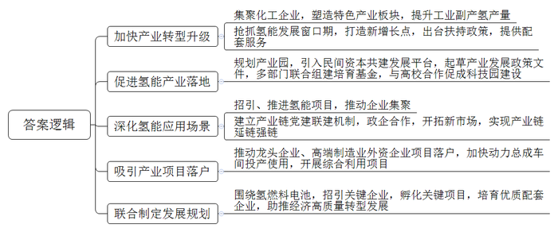
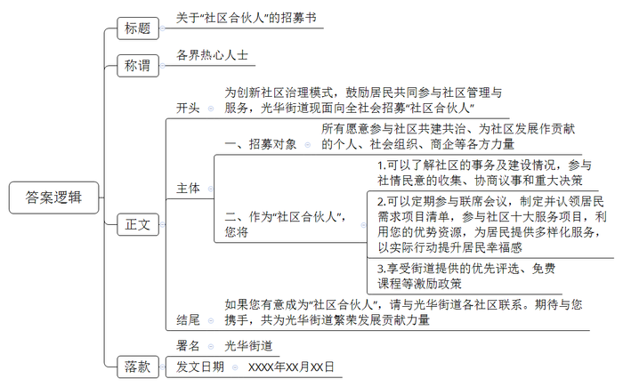
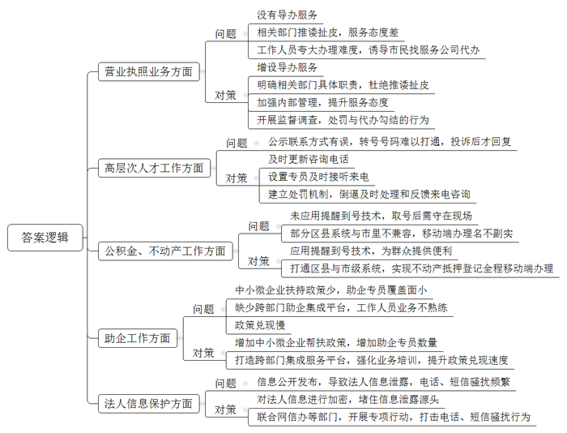
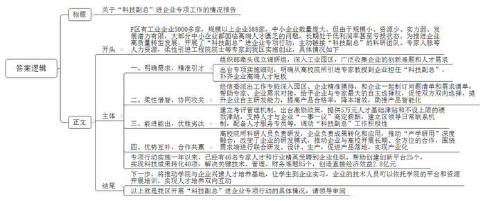

# 2024年公务员多省联考《申论》题（福建县乡卷）

<!-- gwy:overview:start -->
> **福建 · 2024 · 申论 · 县乡卷** ｜ 4 题 · 图片 4 处 · 答案随题折叠

导航：[题目](#题目) · [材料 1](#材料-1)
<!-- gwy:overview:end -->

> 候选采集稿。参考答案及解析来自粉笔页面，不代表官方答案或真实高分答卷；来源使用许可与原卷对应关系仍需人工核实。

## 给定材料

### 材料 1

“总有一天，水可以被电解为氢和氧，并用作燃料……成为供暖和照明的无限能源。”经过一个半世纪，科幻小说《神秘岛》中描述的场景正在成为现实。

在A市兴嘉港，白、蓝、绿相间的“小清新”氢能重卡来回穿梭，排出的尾气变成了水蒸气……“与柴油车相比，氢能重卡每次加注氢气燃料最快只需5分钟，加满能跑400公里。”A市兴嘉港港务有限公司相关负责人说，一辆氢能重卡每年可减少碳排放量2600多吨，目前兴嘉港投入运行的氢能重卡有近百台，预计到2025年末将有近1000台氢能重卡物流车投入使用。

除了氢能重卡，A市已开通全市首条跨行政区域氢能公交线路，氢能船舶正式投入内河运输……一个个搭载氢能“绿心”的应用场景正在A市不断拓展。

“我们发展氢能产业具有得天独厚的优势。”A市李副市长说。位于A市的国家级化工新材料园区，原本就集聚着化嘉能源、江三化工、泓华新材料等一大批化工企业，不仅塑造了聚碳酸酯、环氧乙烷、有机硅等5个走在国际前沿的特色产业板块，每年更是有近10万吨的工业副产氢产量。

“化工产业的资源环境约束不断加大，产业转型升级势在必行。”李副市长说，“‘氢’装前行，是立足全市实际的战略选择，更是高质量转型发展的大势所趋。”2018年，A市抢抓氢能发展窗口期，切入“新赛道”，打造产业转型升级的新增长点，先后出台氢能产业规划、氢能产业发展扶持政策，从多个方面为氢能产业项目招引、孵化提供整体配套服务。

A市谋定而动，一连串行动让氢能产业开始“落地生根”：2021年初，完成1.4平方公里氢能产业园专项规划；4月，携手多家民营企业共同出资成立氢能产业发展平台公司；7月，成为全省氢能产业发展首批试点城市，参与起草氢能产业发展相关政策文件；9月，联合国家和省市有关单位组建5亿元氢能母基金和20亿元氢能产业培育基金，启动产业园一期“氢能科技园”建设；次年，与多所高校合作共建的氢能安全和运用研究中心在氢能科技园落地……

近几年，A市围绕产业链、创新链、应用链，全力抓好氢能项目招引和推进，推动氢能装备制造企业集聚，深化氢能应用场景。泓华新材料一期的丙烷脱氢项目是氢能产业链上游项目，每年可生产45万吨丙烯，还能产出1.6万吨工业副产氢。“在市氢能产业链党建联建机制的‘牵线搭桥’下，我们已和盛合硅业、谷岩气体等企业合作，每年通过管道输送氢气约2500吨，实现了氢能产业链的延链强链。”泓华新材料高总经理说，“我们也在积极开拓工业用氢装置、氢气发电、固态储氢、氢气充装等新市场。”

凭借深厚的产业优势、清晰的产业定位，A市目前已吸引了锦美氢能科技、盘动电气、沐优氢瓶、云量双极板在内的大批氢能产业项目落户，其中不乏全球行业龙头企业项目、高端制造业外资项目。目前，投资50亿元的锦美氢能科技氢动力总成车间已经正式投产，年产5000套燃料电池电堆和系统总成；氢能安全和运用研究中心与一批产业链上游企业开展了系列氢气综合利用项目……

日前，省发改委、省能源局、省住建厅联合制定全省加氢站发展规划，提出了加强氢源保障、推进加氢站和储运基础设施等多项重点建设任务。“接下来，我们将围绕氢燃料电池的上下游产业链，重点招引‘八大零部件’关键企业，孵化一批质子交换膜、催化剂、碳纸等氢能关键项目，培育一批优质的加氢、运氢、储氢装备配套企业。”李副市长表示，未来在龙头企业、核心平台引领带动下，A市将初步形成以“氢燃料电池电堆——膜电极——双极板——质子交换膜”为重点的氢燃料电池核心产业链，全力助推区域经济高质量转型发展。

### 材料 2

“能不能针对老年人开展一些通俗易懂的反诈宣传？”“我们不在父母身边，有人帮老人理发吗？”“能否在社区组织大家一起下棋，玩一玩？”……

2023年9月，光华街道各社区在征集民意过程中发现，大家最关心的还是居民“身边那点事”。在光华街道辖区，有60岁以上老人占比超过50%的“银发社区”——老厂社区，也有成立两年多的“年轻社区”——乐天社区……街道党工委高书记坦言，各社区既面临缺钱、缺人、缺资源等现实困难，又存在居民参与自治的积极性不高、邻里关系疏远、矛盾纠纷多等突出问题。为此，光华街道创新社区治理模式，以党建统领为基础，发动多方力量共同参与社区管理与服务，在所辖8个社区探索推行“社区合伙人”制度。“所有愿意参与社区共建共治、愿意为社区发展作贡献的个人或群体，都可以成为‘合伙人’。”

“真没想到大家这么热情。”高书记激动地说。在她展示的一份“社区合伙人”名单中，既有退役运动员等“个人合伙人”，也有像友好社会工作服务中心这样的“社会组织合伙人”，更有包括老厂商会等在内的“商企合伙人”。

高书记介绍，各社区通过发放居民需求调查问卷，梳理社区内有特殊需求或共同需求较为强烈的事项，以项目化运作为主要方式，陆续开展公共服务、文化教育、矛盾调处以及助残扶困在内的十大服务项目。项目“张榜”后，老厂商会党支部率先“揭榜”。“既然‘揭榜’了，咱就得出实招。你看，我们把老厂商会的传达室改成了‘光华红’党建会客厅，现在这儿可热闹了！”老厂商会党支部负责人介绍说，昔日闲置的传达室，如今已成为政务便民快捷区、青年志愿活动区、金融助企惠民区。

这两年，乐天社区的“老漂族”越来越多。由于没有熟识的朋友，且方言不通、生活习惯不适应，他们逐渐成为社区的边缘人。如何让“老漂族”快乐起来？

借助“社区合伙人”的力量，乐天社区开展了形式多样的服务。例如，由社区出场地，爱宁养老服务公司入驻社区居家养老照料中心，为老年人提供居家照料等服务；市老年大学为“老漂族”开设了声乐、舞蹈、书画等课程，丰富老年人的业余生活。

周大妈是乐天社区的“老漂族”，曾经因为人生地不熟而感到孤独。自从加入声乐班，她不仅结交了一群老伙伴，心情变得开朗起来，还自荐当上了楼道小组长。因为热心社区公益，她报名成为了“社区合伙人”。前不久，周大妈又被社区推选为“最美乐天人”。

“对于‘社区合伙人’，我们出台了奖励机制，例如，对居民个人可优先评选为‘最美乐天人’，优先获得老年大学免费课程名额等。”高书记说。

随着越来越多居民成为“社区合伙人”，社区治理“人人有责、人人尽责、人人享有”的氛围日渐浓厚。

“江春茗悦、风雅苑两个小区周边断头路多，需绕道才能到地铁站，上班族很不方便……”在一次小区楼道长会议上，有居民向社区反映。很快，在社区、业委会、物业以及居民“合伙人”等多方协调下，促成开通了公交地铁接驳线，将原先二十分钟的路程缩短到了三四分钟，居民出行更方便了。

“居民成为‘合伙人’后，开始关注社区事务，主动了解社区建设，成为了社情民意的收集者、协商议事的参与者。”高书记说，“凡是社区遇到重大决策，我们都会邀请居民‘合伙人’全程参与。”不仅如此，各社区每个月都会召开一次“社区合伙人”联席会议，制定需求项目清单，由“社区合伙人”认领。

区消防应急救援中心进驻老厂社区微型消防站，认领了“全家总动员”消防安全项目；超越运动中心运营百姓健身房，提供普惠性健身服务，年费仅需365元；在隆兴社区，省师范大学的学生组成志愿服务队伍，为辖区儿童开设书法、英语等兴趣班……如今，“社区合伙人”的队伍不断壮大，服务内容也在不断扩展。

看到“社区合伙人”个个给力，居民群众笑意盈盈，高书记对未来充满了信心。她说：“接下来，街道将通过购买服务、共建共享、资源共筹等多种途径，以街道这块‘磁石’吸引各类资源，变‘旁观者’为‘建设者’，引领更多‘社区合伙人’在小社区中发挥大作用，让基层治理更具活力、更可持续。”

### 材料 3

在全国工商联发布的《2022年万家民营企业评营商环境报告》中，H市连续四年得分排名第二。成绩是亮丽的，但仍有优化提升的空间。日前，H市电视台记者就本市营商环境中存在的问题和不足进行了暗访。以下是暗访过程中收集到的几个视频片段：

●“我操作了四五次，实在不会弄。我们年龄大了，电脑、手机上的东西，实在不太会操作，工作人员也不帮忙。”市民叶先生说，他想办理互联网销售的营业执照，但该业务在滨湖区行政服务中心没有窗口，需要网上申报，对网上办理流程不太熟悉的叶先生，需要指导，却找不到人。“行政服务中心工作人员让我去市场监督管理所，可我到了市场监督管理所，工作人员同样表示无法受理，并表示没人也没空帮忙指导。”

服务不够贴心，代办就有了市场。在锦城区行政服务中心，暗访记者去咨询个体户办理营业执照，工作人员露出了不耐烦的表情，并表示若不熟悉申报流程可找服务公司代为办理。当记者询问代办是否靠谱时，工作人员表示：“每天都有人找代办，你想省事一点就找他们，想自己弄就麻烦一点。”

当记者找到代办人员时，代办人员说：“你们要线下去跑街道的，最起码两趟，你首先去领表，数据填完，交到他们那里，等审核，不管过没过，都要再跑一趟拿审核结果。找我们代办只收一千块钱。”

后经记者咨询锦城区市场监管局及部分街道得知，办理该业务根本不需要多次跑。

●“投诉之后才有人联系我。”东湖区张先生说，他前几天申报H市高层次人才分类认定，上传了两次材料都被驳回。“我想咨询原因，拨打官网公布的电话，打过去之后说这个号码已经转号，转号的号码又打不通、没人接。”

无独有偶，安化区的方先生也遇到了相似的窘境：“我电话打了好几天，后来回复我，说出差去了。”

记者随即通过网上《高层次人才分类认定申报管理系统》公示的联系方式，随机拨打了东湖区、安化区等多个区县人才工作部门的咨询电话，可对方语音提醒已改号，并且改过的号码不是无人接听，就是用户正忙。

●H市市民服务中心的公积金业务窗口前，排队市民抱怨道：“取号以后如果不想过号，就得一直守在现场。现在提醒到号的技术在商场都很成熟了，这儿却没有。”

在H市，不动产抵押登记实现全程移动端办理，是一项重要便民利企措施，但在玉林区，市民感觉这个移动端办理名不副实。“其他区县是可以选择邮寄的，我们区的窗口却要我们自己送过来，说是开通了移动端办理，但我没有享受到。”市民马先生对此感到困惑，“据说是区里的不动产权系统与市里的不相融合。”

●在钱江区，不少街道、部门都有助企专员，但一些企业表示获得感不强。“现在政策还是针对招大引强的，还需要给努力成长的中小微企业更多扶持政策。”某小微企业孵化园负责人表示，“现在全区助企专员共有170多个，与全区12万经营主体相比，覆盖面只有1.5%，不知道什么时候能覆盖到我们。”

“这个事情涉及多部门，没有一个集成的平台，遇到的工作人员业务不太熟，感觉没有对他们进行培训。”来自某科技企业的刘先生说，他最近想在钱江区开一家公司，可多方联系直到现在都没有得到满意答复。“按照政策，去年12月我在钱江区某4S店购买的车可以享受区里2500元的汽车消费补贴，可3个月过去了，我还是没收到这笔钱。”

●“由于我们法人的姓名跟手机号码会被公布在网上，我经常会收到一些陌生的电话短信。有一次，我挂了一个陌生电话，结果对方用100多条短信对我进行了‘轰炸’。”某企业法人刘先生说，“把手机号码公布在网上，是本着信息公开的初衷，可这却影响到了我正常的工作和生活。”随行的游先生也表示：“前不久，我刚在阳江区市场监管局办完企业注册手续，回家路上就接到了问我需不需要贷款的电话。”

3月1日下午，聚焦“优化营商环境，助力经济发展”主题，H市电视台举办了2024年“公述民评”第一场面对面问政活动，现场播放了前期暗访过程中收集的视频。在随后3个多小时的问政活动中，暗访视频所涉及相关单位负责人直面监督，对视频所曝光的问题进行了一一回应，作出了整改承诺。

### 材料 4

F区有工业企业5000多家，规模以上企业588家，中小企业数量庞大。但由于规模小、资源少、实力弱、发展潜力有限，大部分中小企业都面临高端人才匮乏的问题。

“200多名员工，本科学历专业人才仅15人。”尚志摩托张总感叹，尚志摩托一直无法对生产工艺进行改造，摆脱不了劳动密集型生产方式，更没有能力研发高端产品，长期处于低利润率甚至亏损状态。“再不转型迟早会被市场淘汰，但没有高端人才，我们转型难度也很大。”

2022年5月，F区委组织部牵头成立调研组，深入4个工业园区，广泛收集企业的创新难题和人才需求。7月，出台《F区“科技副总”进企业专项实施细则（试行）》，明确从高校院所引进专家教授到企业担任“科技副总”，补齐企业高端人才短板。

9月，张总收到区经信委发来的专家人才情况介绍清单。几乎同一时间，交通大学机电工程学院孙教授也收到了首批企业的用才需求。由于孙教授的研究方向与尚志摩托瞄准的转型目标非常契合，双方不约而同选择了对方。

孙教授很快就加入到企业的技术攻关中。他和尚志摩托的技术人员花了两个月时间，自主研制出制动踏板性能测试平台。这一测试平台让尚志摩托具备了制动踏板智能检测能力，产品合格率提升到99.99%，生产效率提高20%，相较外包平台检测降低成本70%。孙教授的加入，让尚志摩托的转型升级多了底气和信心。目前，公司正在加速由生产传统的制动踏板、离合踏板等产品转向研发生产具有更高附加值的智能化产品。

F区建立“柔性借智、协同攻关”工作机制，由区经信委派出工作专班深入园区、企业精准摸排，和企业一起制订问题清单和需求清单，给予企业最大的自主选择权，帮助它们按需引进“科技副总”。同时，畅通“能进能出”通道，对“科技副总”建立优胜劣汰的考评管理机制。区经信委胡主任说：“两年任期内，每位‘科技副总’可享受区里提供的5万元人才基础津贴和不设上限的绩效津贴，支持他们与企业‘一事一议’商定薪酬，建立区领导日常联系机制，配备人才服务专员……”

“我曾和其他‘科技副总’交流过，大家都认为，‘科技副总’这个身份及其背后的政策支持，极大调动了我们的积极性。”孙教授说，许多“科技副总”已经把自己当作企业的一份子。

“我平均每周要到公司1至2次。适合山地丘陵地形的电动履带式无人农机动力平台，就是在这种交流碰撞中诞生的。”广田机械制造有限公司“科技副总”、中科院绿色智能技术研究院杨教授说，该平台目前已经应用到多个地区的田间地头。“高校院所科研人员擅长‘从0到1’的突破，企业擅长‘从1到100’的成果转化和应用。‘科技副总’正好将双方的优势结合起来，互为对方补齐了短板。”

“‘科技副总’在一定程度上改变了企业的研发模式，过去企业单纯向高校院所购买专利，或与高校开展短期项目合作，现在双方实现了深度融合，围绕需求端进行联合研发、设计、生产，产品更容易落地，实现产业化。”广田机械王总经理说。

中建桥梁“科技副总”、工业大学刘教授的研究方向是大跨桥梁智能监测。“我之前与中建桥梁有过一些合作，但都是短期项目制的。”刘教授说，“科技副总”进企业专项行动启动后，双方再续前缘。“跟之前相比，最大的变化就是双方能开展长期、全方位的合作，进一步推动了‘产学研用’的深度融合。”再度牵手后，刘教授和中建桥梁不断碰撞出新的研究方向，并申请了两个发明专利，还为其成功申报了“政府间国际科技创新合作”国家重点研发项目。

为了进一步深化校企合作，刘教授还邀请同校的林教授到中建桥梁调研，希望促成更多的合作。“一次工程会遇到很多问题，涉及许多细节领域，这需要更多专家参与其中。”刘教授说，下一步，他们要借助“科技副总”这一模式，推动学院与企业兴建人才培养基地，让学生到中建桥梁实习，企业的技术人员可以依托学院的平台和资源开展培训，实现人才培养的双向互动。

“今年我们主动链接‘科技副总’的科研团队、专家人脉等人力资源，柔性引进工程院院士等专家到F区实施创业。”负责人说，“科技副总”进企业专项行动实施一年以来，已经有46名专家人才和行业精英受聘到企业任职，帮助创建创新平台25个，实现科技成果转化40项，解决关键技术、管理、财务难题85个，创造直接经济效益2.8亿元。

## 题目

### 第 1 题

**请根据“给定资料1”，谈谈A市是如何“氢”装前行的。（15分）**

关联材料：材料 1、材料 2、材料 3、材料 4

作答要求：全面、准确、有条理。不超过300字。

第 1 题 · 答案与解析

**参考答案（粉笔题库参考内容）**

1.加快产业转型升级。集聚化工企业，塑造特色产业板块，提升工业副产氢产量；抢抓氢能发展窗口期，打造新增长点，出台扶持政策，提供配套服务。

2.促进氢能产业落地。规划产业园，引入民间资本共建发展平台，起草产业发展政策文件，多部门联合组建培育基金，与高校合作促成科技园建设。

3.深化氢能应用场景。招引、推进氢能项目，推动企业集聚；建立产业链党建联建机制，政企合作，开拓新市场，实现产业链延链强链。

4.吸引产业项目落户。推动龙头企业、高端制造业外资企业项目落户，加快动力总成车间投产使用，开展综合利用项目。

5.联合制定发展规划。围绕氢燃料电池，招引关键企业，孵化关键项目，培育优质配套企业，助推经济高质量转型发展。

**解析**

**参考答案说明：**本参考答案从“加快产业转型升级”“促进氢能产业落地”“深化氢能应用场景”“吸引产业项目落户”“联合制定发展规划”五个方面展开，各条答案要点之间在内容上相互并列，没有交叉。

**考点**：概括措施类

**来源**：2024年公务员多省联考《申论》题（福建县乡卷）

粉笔申论页面对本题只提供「解析视频」入口，该入口是会员推广位，页面无视频地址与文字解析。

### 第 2 题

**光华街道准备扩大“社区合伙人”队伍，请根据“给定资料2”，为光华街道拟写一份“社区合伙人”招募书。（20分）**

关联材料：材料 1、材料 2、材料 3、材料 4

作答要求：

（1）紧扣资料，内容全面；

（2）条理清晰，语言准确；

（3）不超过400字。

第 2 题 · 答案与解析

**参考答案（粉笔题库参考内容）**

关于“社区合伙人”的招募书

各界热心人士：

为创新社区治理模式，鼓励居民共同参与社区管理与服务，光华街道现面向全社会招募“社区合伙人”。

一、招募对象：所有愿意参与社区共建共治、为社区发展作贡献的个人、社会组织、商企等各方力量。

二、作为“社区合伙人”，您将：1.可以了解社区的事务及建设情况，参与社情民意的收集、协商议事和重大决策。2.可以定期参与联席会议，制定并认领居民需求项目清单，参与社区十大服务项目，利用您的优势资源，为居民提供多样化服务，以实际行动提升居民幸福感。3.享受街道提供的优先评选、免费课程等激励政策。

如果您有意成为“社区合伙人”，请与光华街道各社区联系。期待与您携手，共为光华街道繁荣发展贡献力量！

光华街道

XXXX年XX月XX日

**解析**

**参考答案说明：**（1）格式方面，本参考答案写到了“标题”“称谓”“正文”“落款”四个部分。（2）正文部分，一方面从内容上来看，围绕“社区合伙人”这一主题，本参考答案的开头先写到了招募社区合伙人的背景；主体部分从“招募对象”“社区合伙人的权益”两个方面展开；结尾部分添加了结束语。另一方面，形式上，本参考答案做到了分段、分条撰写，整体上条理较为清晰。

**考点**：宣传类

**来源**：2024年公务员多省联考《申论》题（福建县乡卷）

粉笔申论页面对本题只提供「解析视频」入口，该入口是会员推广位，页面无视频地址与文字解析。

### 第 3 题

**请根据“给定资料3”，梳理H市营商环境存在的问题，并提出解决建议。（25分）**

关联材料：材料 1、材料 2、材料 3、材料 4

作答要求：

（1）问题梳理全面、准确；

（2）所提建议与问题相对应，具体明确、切实可行；

（3）不超过500字。

第 3 题 · 答案与解析

**参考答案（粉笔题库参考内容）**

1.营业执照业务方面：没有导办服务；相关部门推诿扯皮，服务态度差；工作人员夸大办理难度，诱导市民找服务公司代办。对策：增设导办服务；明确相关部门具体职责，杜绝推诿扯皮；加强内部管理，提升服务态度；开展监督调查，处罚与代办勾结的行为。

2.高层次人才工作方面：公示联系方式有误，转号号码难以打通，投诉后才回复。对策：及时更新咨询电话；设置专员及时接听来电；建立处罚机制，倒逼及时处理和反馈来电咨询。

3.公积金、不动产工作方面：未应用提醒到号技术，取号后需守在现场；部分区县系统与市里不兼容，移动端办理名不副实。对策：应用提醒到号技术，为群众提供便利；打通区县与市级系统，实现不动产抵押登记全程移动端办理。

4.助企工作方面：中小微企业扶持政策少，助企专员覆盖面小；缺少跨部门助企集成平台，工作人员业务不熟练；政策兑现慢。对策：增加中小微企业帮扶政策，增加助企专员数量；打造跨部门集成服务平台，强化业务培训，提升政策兑现速度。

5.法人信息保护方面：信息公开发布，导致法人信息泄露，电话、短信骚扰频繁。对策：对法人信息进行加密，堵住信息泄露源头；联合网信办等部门，开展专项行动，打击电话、短信骚扰行为。

**解析**

**参考答案说明：**本参考答案从“营业执照业务方面”“高层次人才工作”“公积金、不动产工作”“助企工作”“法人信息保护”五个方面梳理了H市营商环境存在的问题，并提出解决建议。答案呈现为“问题+建议”的形式，符合题干中“所提建议与问题相对应”这一要求。本参考答案做到了分类分条撰写，各条答案要点之间在内容上相互并列，没有交叉。

**考点**：提出对策类

**来源**：2024年公务员多省联考《申论》题（福建县乡卷）

粉笔申论页面对本题只提供「解析视频」入口，该入口是会员推广位，页面无视频地址与文字解析。

### 第 4 题

**请根据“给定资料4”，拟写一篇F区开展“科技副总”进企业专项行动工作的情况报告，供领导参阅。（40分）**

关联材料：材料 1、材料 2、材料 3、材料 4

作答要求：

（1）紧扣资料，内容全面；

（2）逻辑清晰，语言准确；

（3）字数800字左右。

第 4 题 · 答案与解析

**参考答案（粉笔题库参考内容）**

关于“科技副总”进企业专项工作的情况报告

F区有工业企业5000多家，规模以上企业588家，中小企业数量庞大。但由于规模小、资源少、实力弱、发展潜力有限，大部分中小企业都面临高端人才匮乏的问题，长期处于低利润率甚至亏损状态。为推进企业高质量转型发展，开展了“科技副总”进企业专项行动，主动链接“科技副总”的科研团队、专家人脉等人力资源，柔性引进工程院院士等专家到我区实施创业，具体情况如下：

一、明确需求，精准引才。组织部牵头成立调研组，深入工业园区，广泛收集企业的创新难题和人才需求；出台专项实施细则，明确从高校院所引进专家教授到企业担任“科技副总”，补齐企业高端人才短板。

二、柔性借智，协同攻关。经信委派出工作专班深入园区、企业精准摸排，和企业一起制订问题清单和需求清单，帮助专家、企业需求对接，给予企业与专家最大的自主选择权，促使双方双向选择，提升企业自主研发能力，提高产品合格率，降本增效，助推产品智能化。

三、能进能出，优胜劣汰。建立考评管理机制，出台激励政策，提供5万元人才基础津贴和不设上限的绩效津贴，支持人才与企业“一事一议”商定薪酬，建立区领导日常联系机制，配备人才服务专员等，调动“科技副总”工作积极性。

四、优势互补，合作共赢。高校院所科研人员负责研发，企业负责成果转化和应用，推动“产学研用”深度融合，改变了企业的研发模式，推动企业与高校开展长期、全方位的合作，围绕需求端进行联合研发、设计、生产，促进产品落地，实现产业化。

专项行动实施一年以来，已经有46名专家人才和行业精英受聘到企业任职，帮助创建创新平台25个，实现科技成果转化40项，解决关键技术、管理、财务难题85个，创造直接经济效益2.8亿元。

下一步，将推动学院与企业兴建人才培养基地，让学生到企业实习，企业的技术人员可以依托学院的平台和资源开展培训，实现人才培养双向互动。以上就是我区开展“科技副总”进企业专项行动的具体情况，请领导审阅。

**解析**

**参考答案说明：**（1）格式方面，本参考答案写到了“标题”“正文”两个部分。（2）正文部分：一方面从内容来看，围绕着“‘科技副总’进企业专项工作”这一主题，开头部分介绍了F区企业的规模以及面临的问题,主动链接“科技副总”的工作方针等；主体部分先是写到了“明确需求，精准引才”“柔性借智，协同攻关”“能进能出，优胜劣汰”“优势互补，合作共赢”这四个方面的对策，再是写出了专项行动实施的成果；结尾部分写出下一步的工作计划并补充结束语；另一方面从形式来看，本参考答案做到了分段、分条撰写，各条要点在内容上各自独立，没有交叉。

**考点**：总结类

**来源**：2024年公务员多省联考《申论》题（福建县乡卷）

粉笔申论页面对本题只提供「解析视频」入口，该入口是会员推广位，页面无视频地址与文字解析。

