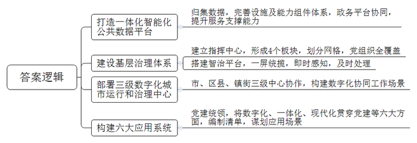
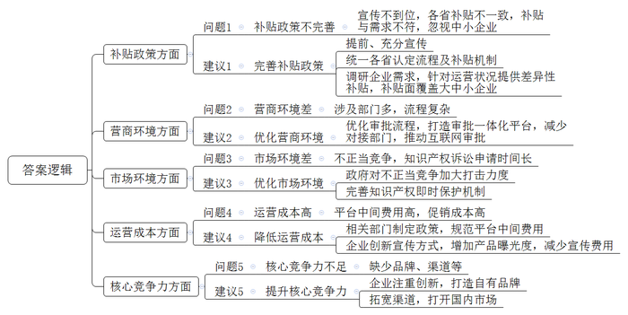
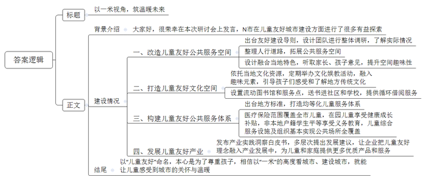

# 2024年公务员多省联考《申论》题（福建省市卷）

<!-- gwy:overview:start -->
> **福建 · 2024 · 申论 · 省市卷** ｜ 4 题 · 图片 4 处 · 答案随题折叠

导航：[题目](#题目) · [材料 1](#材料-1)
<!-- gwy:overview:end -->

> 候选采集稿。参考答案及解析来自粉笔页面，不代表官方答案或真实高分答卷；来源使用许可与原卷对应关系仍需人工核实。

## 给定材料

### 材料 1

“我们早上9点提交申请，不到半小时就收到资料检查通过的短信，10点多签了个字，当天下午3点企业就注册成功了。”12月，创业者小苏在网上提交“企业开办一件事”申请，轻松完成了企业开办手续。

“像这样在网上申请开办企业的光是今天就有50例，几乎都能当日办结。如果申请人勾选了社保、公积金等其他事项，也能一并办结。”

D县政务服务中心周主任表示，随着Q市一体化智能化公共数据平台的持续打造，“足不出户”就能办成的事将越来越多，办事体验越来越好。

“2023年以来，围绕提升一体化智能化公共数据平台服务支撑能力，我市重点抓好了数据归集、数据设施支撑能力提升、能力组件体系共建共享、两大政务平台端口联通升级等四方面工作。”Q市大数据发展局王局长说。目前，平台构成数据要素“一组库”，共编目52346类数据，为76个市级部门、41个区县打通数据仓环境；建成全市物联感知系统，接入摄像头、传感器等117类、157.34万个设备；实现303项上架能力组件，能力组件调用量达到1070万次；“快办”平台精细化梳理了2866个政务服务事项，支撑53项“一件事一次办”上线运行，“快政”平台形成16项协同功能，日均活跃用户40万。

走进S区双桂镇基层治理指挥中心，一块智慧大屏映入眼帘，辖区内场镇路口、森林河道、公路铁路等各个监控点位的高清画面可以被实时查看。“我们将原有办公场地建成为基层治理指挥中心，形成党建统领、经济生态、平安法治和公共服务4个板块，沟通更便捷，协作更高效。”覃镇长表示，全镇共划为176个网格，全覆盖建立网格党支部或党小组，采取整合、招聘、下沉方式，配备专职网格员176人。“在应用场景建设方面，我们通过智治平台，以网格为单元核准‘人、房、地、事、物’等信息，实现全镇网格一屏统览。一旦发生紧急事件，网格地图将立即变色并闪烁预警，实现即时感知、及时处理。”智治平台投用半个月来，累计处理矛盾纠纷、突发险情等各类事件378起。

Q市现有3000多万常住人口，兼具“大城市”与“大农村”特点，体系结构错综复杂、运行治理难度大。2023年初，Q市启动部署市、区县、镇街数字化城市运行和治理中心。市级中心作为治理“大脑”，负责感知发现、决策指挥等数字化治理中枢工作；区县中心聚焦“实战”，承载市级应用，谋划本级特色应用，支撑公共安全等事件的快速响应；镇街中心聚焦“联勤联动”，负责服务群众、推动发展等。王局长说，全市90%的镇街目前已建成“一中心四板块”和智治平台，形成网格7万余个，并通过三级数字化城市运行和治理中心，构建起全网“一屏掌控”、政令“一键智达”、执行“一贯到底”、监督“一览无余”的数字化协同工作场景。

“经开大道由堵变通，这要归功于全市首个交通信号配时中心的高效运转协调。”Q市公安局经开分局夏局长说。作为本级特色应用，交通信号配时中心发现拥堵后，会立即切换到相应道路的视频监控摄像头，借助智能算法进行快速计算，针对拥堵问题给出最优解，打造一条条“绿波带”，提升道路通行效率。

Q市842家医疗机构已实现影像检查结果互认，医生可以跨院调阅患者的影像检查结果，避免患者重复检查，让诊断更高效；B区智慧养老服务中心对养老群体的居住环境进行适老化改造，装上了一键呼叫，一旦出现异常，工作人员会第一时间联系处理；在革命纪念馆，游客拿出手机扫描馆内张贴的二维码，历史跃然眼前，山城的红色记忆重现。大家借助馆内的数字技术手段，“穿越”时空，沉浸式感受红色文化……

2023年初，Q市召开数字城市建设大会，对标“数字中国”战略部署，加快建设“1361”数字城市建设整体构架，构建党建统领整体智治新格局。Q市作为引领新时代的数字文明城市范例，一年多来，Q市始终坚持党建统领，把数字化、一体化、现代化贯穿到党建、政务、经济、社会、文化、法治建设全过程各方面，着力构建“六大应用系统”，编制应用重大需求清单、多跨场景清单、重大改革清单，并以“一件事”思维谋划场景930个。Q市加“数”前行，数字化运行和治理的场景和想象还在不断扩展……

### 材料 2

2023年1月，F省入选国家首批内外贸一体化试点地区名单。按照计划，F省准备用三年左右的时间培育具有国际竞争力、内外贸融合发展的产业基地100家，内外贸一体化“领跑者”企业1000家。日前，为了解全省内外贸一体化试点工作中存在的问题和不足，省商务厅组织部分企业代表、专家学者以及有关部门负责人进行了座谈。以下是座谈会发言摘录：

省商务厅符厅长：在国家构建以国内大循环为主体、国内国际双循环相互促进的新发展格局背景下，我省积极探索推动内外贸一体化试点工作，取得了一定成效。一年多来，我们已认定省级“领跑者”企业744家、基地76个。通过内外贸产品“同线同标同质”的“三同”行动推动实现内外贸标准对接、内外贸产品质量一致。目前，全省已有400多家企业获得“三同”产品认证，并获得了相应补贴。

某新兴企业负责人张总：企业刚起步时，我们确实从政府获得了一些发展补贴，但“三同”这个事儿我们是在开会前才知道的。如果早一点儿知道政府的相关政策举措，我们就能少走一些弯路。

某儿童用品公司负责人林总：我们是一家外向型企业，近年来，开始布局国内市场，在多个省市建立了分公司。但在外省，“三同”需要重新认定，认定标准及认定后所使用的相关产品标识等不尽相同，导致各分公司都需要另起炉灶申报。此外，各分公司享受所在省的补贴政策又不一样。你说放弃这个补贴吧，产品又缺少了价格优势。

某机电集团负责人陈总：过去，我们为满足海外客户的质量要求，在设施设备、人才储备、经营管理上标准高、投入多，生产成本较高。现在，以同样标准转向国内市场，却经常遭遇产品被仿制、低质低价不正当竞争等问题，高投入换不来高回报，政策补贴有点杯水车薪。

某市商务局胡局长：培育认定内外贸一体化“领跑者”企业，要通过自主申请、审查推荐、专家评审等步骤，对企业的销售情况、品牌建设、质量标准、科技创新等方面进行评估，经认定后企业才能得到一定的补贴支持。在主题教育“大走访大调研”期间，我市不少企业反映，目前的政策多是对具有一定实力的企业“扶优扶强”，这给本就在竞争中处于劣势的中小企业带来了很多压力，存在“保大”“汰小”的倾向。

某代工企业负责人钱总：我们做外贸代工20多年了，一直感觉订单量大、销售省事、货款到位及时。近几年兼顾国内市场，发现不仅竞争对手多、营商环境存在隐忧，订单还不稳、货款常被拖欠。当然，这里也有我们自身的问题。我们多年来习惯外贸代工，几乎没有形成核心竞争力，缺少自己的品牌、渠道，只能通过低价竞争、压低利润率来获得订单。我听说，全省做外贸代工的企业有一半还未涉足内销业务，他们宁愿去海外扩展低起点的新兴市场，也不想在国内市场建品牌、“卷”渠道。

某交通设备企业负责人孙总：钱总说的“内卷”“外扩”，我们感同身受。我们生产的交通设备主要用于出口，一般只需要与商务、海关、税务等部门打交道。现在一部分产品转内销，却要与商务、发改、经信、税务、公安、交运、市场监管等10多个部门打交道，有点儿“分身乏术”。

省市场监管局赵处长：最近，我们在处理一起投诉，某内外贸一体化公司在电商“大促”期间遇到竞争对手恶意刷差评，该公司前期为宣传促销花费了大量成本，结果却打了个“水漂”。据我们了解，遭遇这种情况的企业不在少数。加强对市场主体合法利益的保护，净化市场环境，还需要大家的共同参与。

某大学法学院罗教授：去年，我们做课题调研时发现，国内中高端羽绒服品牌越来越受国际市场欢迎，但在国内，新开发的原创款式上市一周就可能出现高仿款。传统的外观设计专利、著作权保护等知识产权诉讼手段一般很难在短时间内生效，容易让不法厂商利用时间差钻空子、牟暴利。如果有备案或其他即时保护机制，他们或许就无机可乘了。

某化妆品公司孙总监：以前，我们想抓住国内电商行业发展机遇进军国内市场，没想到这几年电商平台高额的中间费用反而拖累了企业发展。如今，我们交给电商平台的各类中间费用接近产品成本的40%，要是找一些平台的头部主播带货，中间费用更高。

某大学商学院黄教授：目前，直播带货等各类销售形式兴起，企业需要不断增加产品曝光度以提升销量。他们不仅要持续运营电商平台的线上店铺、参与各类促销获取公域流量，还要培养自己的带货主播以争取定价主动权，这都需要企业投入不少的成本。

省商务厅符厅长：感谢大家今天针对内外贸一体化发展工作开诚布公地摆问题、提建议。下一步，我们将深入分析内外贸一体化“好事多磨”的根源，进一步打好“组合拳”，用实实在在的举措让内外贸一体化“好事成真”。

### 材料 3

“这顶凉帽是我在去年暑假跟师傅学着做的。他教我们编织的时候，还给我们讲凉帽民俗和客家历史。”恬恬自豪地说。来自华成区凉帽新村的恬恬亲手编织的客家凉帽在N市首届儿童友好博览会上引起了围观，大人小孩纷纷试戴合影。

凉帽新村是一个典型的城中村，村里有500余名儿童，占总人口的16%。在N市儿童友好空间改造工作之前，华成区城管局活力城中村项目负责人小青带领设计团队做了整体调研，发现诸如凉帽新村这样的城中村普遍存在空间狭小、安全隐患多、环境差、儿童游乐设施少等问题。

为此，设计团队重新整理了凉帽新村西侧人行道路，利用架空技术，将人行道扩展出3800平方米的公共服务空间。“其中有一处红色的儿童无动力设施——空中乐园最受孩子欢迎，每天一放学，这里就会‘长满’孩子。”小青说，设施的顶是形似竹编的钢结构，契合了凉帽新村的竹编特色。“设计过程中，我们专门听了家长和孩子们的意见，尽量避免过度设计可能带来的千篇一律、剥夺孩子想象空间的问题。对孩子而言，随处有一滩水、一处沙、一个捉迷藏的空间，比安装一个固定的滑梯更友好。”

“以前接小孩子放学后就要寸步不离看着他，村里的车乱开乱停，小孩子跑来跑去很危险。现在孩子们都喜欢去空中乐园玩，我们都很放心。”一个孩子妈妈开心地说。除了有形的友好空间，凉帽新村也为儿童打造了友好的文化空间。村里以市级非遗凉帽编织技艺为主题，定期举办科普、彩绘等亲子文化娱教活动，并融入趣味元素，引导孩子们感受和了解地方传统文化。

“打造儿童友好空间已经成为N市2135个城中村改造升级的重要内容之一。”N市妇联刘主席表示，市里去年出台了城中村儿童友好空间建设导则，目标是根据城中村的基础以及居住的儿童数量，为居住在城中村的孩子们创造更多安全游乐的空间。

“妈妈，流动图书馆大巴怎么开到这里来了！”看到儿童友好博览会场外停着的一辆彩绘大巴，安化区中心小学的一菡同学激动地说，“我已经从流动图书馆里借阅了快100本书了！每次大巴车开到家门口，我都约了好朋友一起上车挑选，我太喜欢流动图书馆了！”

“安化区城中村比较多，有的村没有条件建设图书馆，有不少孩子反映日常看书借书不方便，于是我们就用大巴车将书送到孩子身边。”图书馆姚馆长说，“大巴车按社区路线走，每个小朋友一次可以借阅20本，两个月内大巴车会循环回来，届时小朋友可以还书再借新书。”

安化区流动车站自2020年在N市率先启用以来，已在8个社区和16所学校设置服务点，至今，流动图书馆已累计投入优质儿童书籍11万余册，总借阅量超过7万册次。

2022年，N市出台全国首个儿童友好地方标准《儿童友好公共服务体系建设指南》，明确从法律保护等八个方面构建儿童友好公共服务体系。刘主席说：“作为一座移民城市，N市一直致力打造无户籍地域差异、优质均衡发展的儿童公共服务体系，来了就是N市人，来了就是N市的娃，让改革发展成果更公平惠及所有儿童。”

N市的医疗保险范围已覆盖全市中小学、托幼机构在册的非户籍儿童，3至4岁儿童均可享受健康成长补贴，每年有58万名孩子受益。51%的义务教育学位给了非本地户籍学生，使这些孩子成为与户籍学生平等的主体。

截至2023年底，N市已建成市级儿童友好基地452个、友好公民儿童议事组织580个、社区儿童之家761个，建成母婴室1270间，基本保障公共场所全覆盖，创新推广移动母婴室，让儿童出行更为便利。

在首届儿童友好博览会开幕式上，N市前瞻产业研究院发布了《中国儿童友好产业实践洞察白皮书》，从政府、企业、消费者三个层面提出儿童产业发展的建议。“我们希望企业把儿童友好理念融入到产业发展中，为儿童和家庭提供更多优质产品和服务，更好支撑儿童友好城市建设的‘硬设施’和‘软服务’。”

“去年，我们在湖华小学调研时，曾询问孩子们什么是‘儿童友好’，随机询问了1名6年级学生，他想了想，说是‘尊重’。我觉得最容易被忽略的，就是对孩子的尊重，这也是‘儿童友好’的本源。只有学会以‘一米’的高度看城市，才能让儿童真正感受到城市的关怀与温暖。”

### 材料 4

近段时间，C市的“背篓专列”在各大平台火爆出圈。所谓“背篓专列”是C市轨道交通4号线石船至民安大道方向的首班车，因为主要乘客是来自C市渝北区石船镇的菜农，他们都背着装满红薯叶、辣椒、韭菜等新鲜蔬菜的背篓。

“坐着地铁去卖菜”被众多网友称为城市快速发展中的“人间烟火”。

农民进城卖菜原本是司空见惯的现象，为何这种现象的载体变成了轨道交通，就能“刷屏”网络？日前，C市《当代党员》杂志“民生”专栏工作人员小刘一行坐了一次“背篓专列”，以下是小刘的日志：

9月27日凌晨5点，我们从市区出发前往菜农们集中搭车的起点——石船站。当天下着大雨，我们直到6点20分才到目的地。

我们到的时候，菜农们已在排队等待过安检了，因为背篓重，工作人员并没有要求他们将背篓放到安检传送带上，而是用手持式金属探测器进行安检。看到年纪大、行动缓慢的老人，他们会时不时搭把手，引导老人乘坐无障碍电梯。

我们问安检人员，菜农一般是赶早摘的新鲜蔬菜，难免沾有露水或雨水，是否会因此带来不便，甚至被拒绝上车？“抛洒滴漏，造成地面湿滑，影响清洁，这是难免的。就算没有他们，有时候也有这些问题。如果带上车的菜有气味、汁水，弄脏车厢，工作人员也会上前处理。”安检人员是这么回答的。

6点30分，列车准时到，菜农们熟练地进入车厢，将自己的背篓、菜篮放置在中间空道处后，便在就近的位置坐下。他们普遍喜欢坐在列车中部相连的几节车厢，便于互相聊些家长里短或是近日卖菜的收获。

我们找了挨着他们的空位坐下，纳闷为何大家都聚在人比较多的这几节车厢？身旁的老人解释：“不懂了吧？坐一块儿，大家好聊天，顺便了解一下最近卖菜的行情和收获，而且这样也免得影响别人出行。”

看我们拿着相机和笔记本，问是不是来采访他们的。

“对呀！我们今天要是没赶上这班车是不是就遇不上你们了？”我们问。

“卖菜要赶早，那自然要赶首班车。”老人说。

老人叫樊军，家住石船镇，镇上的农民几乎家家户户都种了菜，种得多了吃不完，镇上也不好卖。去年1月起，老樊便开始进城卖菜。当时，轨道交通4号线二期还没开通，老樊和其他菜农得先赶到镇上的公交车站，然后换乘3、4次才能到达市区的菜市场，单程需耗时近4小时。现在，老樊一般选择在洋河卖菜。他每天准时乘上4号线，再换乘1次就抵达洋河，只需70来分钟。

在列车上，老樊感到很放松，因为列车车厢比公交车车厢更宽敞，不会因为背篓、菜篮挡住其他乘客，也不用总是担心绊倒别人，带来安全隐患。“以前在镇上卖菜，人少，卖得慢，价格低，同样的空心菜，在镇上1斤才卖1.5元，到了市区能卖3元，两三个小时就能卖完，回家还能赶上吃午饭。”和老樊同行的老陈感叹道。

“我听说有些地方是不允许菜农背着背篓上地铁的，说是怕弄脏地面，影响乘客观感和行车安全，又说是怕占座位、霸座，引起矛盾。但是公共交通本来就是为群众提供方便的，允许菜农乘坐地铁出行，既解决了他们的生计问题，也让我们在市区就能够买到新鲜实惠的蔬菜。”一位乘客插话说道。

对身处市区的人来说，石船站是轨道交通4号线上遥远的终点站，但对这群郊区菜农来说，这是通往市区的起点站。这些菜农大多年事已高，他们带着浓厚的口音，有的雨衣早已陈旧，衣摆上挂着碎片；有的因为自身听力退化，说话时嗓门难免大些，他们的背篓宽大，让本就狭窄的车厢更显得拥挤。但这些都不影响他们愉快地搭着地铁去城里卖菜。如果说轨道交通的发展更好地连接城市的中心和边缘，那么真正激活城市的神经末梢，让城市更显张力和灵性的则是在轨道交通上流溢的无限暖意。<u>文明之所以文明，就是因为它既容纳了现代的行为方式，也包容了传统的生活习惯。</u>

## 题目

### 第 1 题

**请根据****“给定资料**1**”，谈谈Q市能够加“数”前行的原因。（10分）**

关联材料：材料 1

作答要求：

要求：全面、准确、有条理。不超过200字。

第 1 题 · 答案与解析

**参考答案（粉笔题库参考内容）**

1.打造一体化智能化公共数据平台。归集数据，完善设施及能力组件体系，政务平台协同，提升服务支撑能力。

2.建设基层治理体系。建立指挥中心，形成4个板块，划分网格，党组织全覆盖；搭建智治平台，一屏统揽，即时感知，及时处理。

3.部署三级数字化城市运行和治理中心。市、区县、镇街三级中心协作，构建数字化协同工作场景。

4.构建六大应用系统。党建统领，将数字化、一体化、现代化贯穿党建等六大方面，编制清单，谋划应用场景。

**解析**

**参考答案说明：**本参考答案分别从“打造一体化智能化公共数据平台”“建设基层治理体系”“部署三级数字化城市运行和治理中心”“构建六大应用系统”四个方面介绍了Q市能够“加‘数’前行”的原因，各条要点之间在内容上相互并列，没有交叉。

### 第 2 题

**请根据****“给定资料**2**”，梳理F省在加快推动内外贸一体化发展过程中遇到的问题，并提出解决建议。（20分）**

关联材料：材料 2

作答要求：

要求：

（1）问题梳理全面、准确；

（2）所提建议与问题相对应，具体明确、切实可行；

（3）不超过400字。

第 2 题 · 答案与解析

**参考答案（粉笔题库参考内容）**

问题1：补贴政策不完善。宣传不到位，各省补贴不一致，补贴与需求不符，忽视中小企业。建议1：完善补贴政策。提前、充分宣传；统一各省认定流程及补贴机制；调研企业需求，针对运营状况提供差异性补贴，补贴面覆盖大中小企业。

问题2：营商环境差。涉及部门多，流程复杂。建议2：优化营商环境。优化审批流程，打造审批一体化平台，减少对接部门，推动互联网审批。

问题3：市场环境差。不正当竞争，知识产权诉讼申请时间长。建议3：优化市场环境。政府对不正当竞争加大打击力度；完善知识产权即时保护机制。

问题4：运营成本高。平台中间费用高，促销成本高。建议4：降低运营成本。相关部门制定政策，规范平台中间费用；企业创新宣传方式，增加产品曝光度，减少宣传费用。

问题5：核心竞争力不足。缺少品牌、渠道等。建议5：提升核心竞争力。企业注重创新，打造自有品牌；拓宽渠道，打开国内市场。

**解析**

**参考答案说明：**本参考答案写为“问题”+“建议”的形式。从“补贴政策”“营商环境”“市场环境”“运营成本”“核心竞争力”五个方面展开，介绍了内外贸一体化发展过程中遇到的问题以及解决建议。各条答案要点之间在内容上相互并列，没有交叉。

### 第 3 题

**N市妇联刘主席应邀在首届儿童友好城市建设研讨会上作主旨发言，请根据“给定资料**3**”，为刘主席拟写一份主旨发言提纲。（30分）**

关联材料：材料 3

作答要求：

要求：

（1）紧扣资料，内容全面；

（2）逻辑清晰，语言准确；

（3）不超过500字。

第 3 题 · 答案与解析

**参考答案（粉笔题库参考内容）**

以一米视角，筑温暖未来

背景介绍：大家好，很荣幸在本次研讨会上发言，N市在儿童友好城市建设方面进行了很多有益探索。

建设情况：一、改造儿童友好公共服务空间。出台友好建设导则，设计团队进行整体调研，了解实际情况；整理人行道路，拓展公共服务空间；设计融合当地特色，听取家长、孩子意见，提升空间趣味性。二、打造儿童友好文化空间。依托当地文化资源，定期举办文化娱教活动，融入趣味元素，引导孩子们感受和了解地方传统文化；设置流动图书馆和服务点，送书进社区和学校，提供循环借阅服务。三、构建儿童友好公共服务体系。出台地方标准，打造均等化儿童服务体系；医疗保险范围覆盖全市儿童，在园儿童享受健康成长补贴，非本地户籍学生平等享受义务教育，儿童综合服务设施及组织基本实现公共场所全覆盖。四、发展儿童友好产业。发布产业实践洞察白皮书，多层次提出发展建议，让企业把儿童友好理念融入产业发展中，为儿童和家庭提供更多优质产品和服务。

结尾：以“儿童友好”命名，本心是为了尊重孩子，相信以“一米”的高度看城市、建设城市，就能让儿童感受到城市的关怀与温暖！

**解析**

**参考答案说明：**（1）格式方面，本参考答案写到了“标题”“正文”两个部分。（2）正文部分，一方面从内容上来看，围绕“儿童友好城市建设”这一主题，本参考答案的开头先简单问好，引出主题；主体部分从“改造儿童友好公共服务空间”“打造儿童友好文化空间”“构建儿童友好公共服务体系”“发展儿童友好产业”四个方面展开；结尾进行了总结。另一方面，形式上，本参考答案做到了分段、分条撰写，整体上条理较为清晰。

### 第 4 题

**“给定资料**4**”提到：“文明之所以文明，就是因为它既容纳了现代的行为方式，也包容了传统的生活习惯。”请深入思考这句话，联系实际，自选角度，自拟题目，写一篇文章。（40分）**

关联材料：材料 1、材料 2、材料 3、材料 4

作答要求：

要求：

（1）立意明确，内容充实；

（2）思路清晰，语言流畅；

（3）参考“给定资料”，但不拘泥于“给定资料”；

（4）字数1000-1200字。

第 4 题 · 答案与解析

**参考答案（粉笔题库参考内容）**

**城市文明的“现代性”和“烟火气”**

城市是人类文明的重要成果和标志。作为人类文明发展的高级阶段，**城市文明应该是以人的幸福为中心的文明**。从整体而言，人类都在追求更优渥的物质条件、更便利的生活；但从个体角度来看，每个人的需求和感受、生活方式和价值观念等又都是不同的。因此，**城市的文明应当是包容的、多元的，让每个人都能够在其中获得满足和尊重**。

在城市文明中，代表着未来发展方向的“现代性”与代表传统的“人间烟火气”，一个追求速度和秩序，一个关注温度和个体，二者看似格格不入，但实际上都是城市文明的重要组成。

**毋庸置疑，****“现代性”是城市文明最显著的特征，治理有序、运转高效、产业发达、设施完善等，都是其体现。**城市居民的生活质量，在很大程度上取决于城市的现代性水平。“数字城市”等先进的社会治理方式，让城市决策更高效、治理更精细；城市机能的高效运转，能够让人以最短的时间、最低的成本，完成各种各样的社会活动；城市中发达的产业，能够创造更高的GDP，提供更多的就业机会……可以说，在当下的中国，每一座城市的居民，都能切实感受到城市发展的红利，都在城市的发展中受益。

但是在有些人的眼中，城市发展的速度和秩序，就是城市文明的唯一标准，乃至有些地方，不允许菜农上地铁、不允许摆摊，因为这不够“现代”，影响“秩序”。

**恰恰相反，代表传统的****“人间烟火气”也是城市文明不可或缺的一部分，它是城市的温度和活力的重要来源。**城市的发展，不能只有高楼大厦、车水马龙，清早装满蔬菜的背篓、夜市里嘈杂的叫卖，也同样是城市的风景。山城重庆开通的“背篓专列”，一头连接乡村生计，一头连接城市需求，这是政府换位思考、人性化管理的智慧，也是城市烟火气的再现。“人间烟火气，最抚凡人心”，“烟火气”能够激活城市的神经末梢，是观察城市文明的一扇窗口，是城市张力和灵性的所在，一个失去“烟火气”的城市，往往会变得空洞、冷漠，缺乏生机和活力。真正文明的城市，既要装得下“公文包”，也容得下“菜背篓”。

**城市文明，****可以****也应当兼顾****“速度”和“温度”，如何让“现代性”和“烟火气”融合，考验着城市治理者的“****治****慧”****和担当。**在宏观的战略布局上，通过先进的技术、科学的规划，保障城市的经济发展、秩序稳定，为市民提供便捷舒适的生活环境；在微观的民生福祉上，倾听市民的声音，满足他们的真实需求与期望，让他们找到归属感与幸福感，为城市的繁荣贡献力量。同时，也需要加强公众教育，让关爱、尊重、包容成为每一个市民的共识，让每一个人都成为城市文明的传播者与践行者，让身边的人都能感受到融融暖意。

电影《流浪地球2》有句打动人心的话：“没有人的文明，毫无意义。”同理，脱离人性的城市文明亦属空谈。唯有速度与温情并存，秩序与人性相依，数字与情感交融，方可称得上真正的城市文明。

**文章分析**

**城市文明的“现代性”和“烟火气”**

【**标题的优点：**首先，范文的标题突出了“城市文明”这一主题。其次，形式上，文字简洁明快，不拖沓。】

（1）<u>城市是人类文明的重要成果和标志</u>。作为人类文明发展的高级阶段，<u>城市文明应该是以人的幸福为中心的文明</u>。（2）从整体而言，人类都在追求更优渥的物质条件、更便利的生活；<u>但从个体角度来看</u>，<u>每个人的需求和感受</u>、<u>生活方式和价值观念等又都是不同的</u>。（3）因此，<u><u><b>城市的文明应当是包容的</b></u></u>**、**<u><u><b>多元的</b></u></u>**，**<u><u><b>让每个人都能够在其中获得满足和尊重</b></u></u>**。**

【**开头的优点：**★内容方面：范文的开头是紧扣“城市文明”这一主题展开的。首先，开头点出主题，做到了主题明确。其次，对“城市文明”这一主题进行了分析阐述：（1）首先指出了城市与城市文明的定义；（2）其次强调每个人的需求是不同的；（3）最后引出文章核心观点：城市文明应当包容多元，满足每个人的需求。★文字表达方面：长短句配合使用，使语言表达有节奏感。】

<u>在城市文明中</u>，代表着未来发展方向的“<u>现代性</u>”与代表传统的“<u>人间烟火气</u>”，<u>一个追求速度和秩序</u>，<u>一个关注温度和个体</u>，二者看似格格不入，<u>但实际上都是城市文明的重要组成</u>。

【**过渡段的优点：**范文过渡段分析了城市文明的组成，一是“现代性”，二是“烟火气”，这两部分组成起到了引起下文的作用。】

**毋庸置疑，****“现代性”是城市文明最显著的特征，治理有序、运转高效、产业发达、设施完善等，都是其体现。**（1）<u>城市居民的生活质量</u>，在很大程度上<u>取决于城市的现代性水平</u>。（2）“<u>数字城市</u>”等先进的社会治理方式，让城市决策更高效、治理更精细；<u>城市机能的高效运转</u>，能够让人以最短的时间、最低的成本，完成各种各样的社会活动；城市中<u>发达的产业</u>，能够创造更高的GDP，提供更多的就业机会……（3）可以说，在当下的中国，每<u>一座城市的居民</u>，<u>都能切实感受到城市发展的红利</u>，<u>都在城市的发展中受益</u>。

【**论述段****1的优点：**★观点句：范文的观点句是紧扣“城市文明”这一文章主题提出的。形式上，它在段首处直接写出，位置突出，容易发现。内容上，关键词突出，内容要点明确，可以明显看出它是从“现代性”这个角度入手，指出了城市文明“现代性”的表现。★论述内容：（1）首先指出了城市现代性水平的重要性；（2）其次列举了城市“现代性”的具体体现；（3）最后强调了城市居民在城市的现代性发展中受益。注意：以上三个方面的内容都是紧扣“毋庸置疑，‘现代性’是城市文明最显著的特征，治理有序、运转高效、产业发达、设施完善等，都是其体现”这个观点句进行分析论述的，论述的针对性强，内容层次丰富。最后，在论述方法上主要采用了讲道理的方式，论述深刻有力。】

<u>但是在有些人的眼中</u>，<u>城市发展的速度和秩序</u>，<u>就是城市文明的唯一标准</u>，乃至有些地方，<u>不允许菜农上地铁</u>、<u>不允许摆摊</u>，<u>因为这不够</u>“<u>现代</u>”，<u>影响</u>“<u>秩序</u>”。

【**过渡段的优点：**范文过渡段指出了部分人对城市文明“现代性”的绝对肯定和对城市文明“烟火气”的否定，起到了引起下文的作用。】

**恰恰相反，代表传统的****“人间烟火气”也是城市文明不可或缺的一部分，它是城市的温度和活力的重要来源。**（1）<u>城市的发展</u>，<u>不能只有高楼大厦</u>、<u>车水马龙</u>，<u>清早装满蔬菜的背篓</u>、<u>夜市里嘈杂的叫卖</u>，<u>也同样是城市的风景</u>。（2）<u>山城重庆开通的</u>“<u>背篓专列</u>”，一头连接乡村生计，一头连接城市需求，这是政府换位思考、人性化管理的智慧，也<u>是城市烟火气的再现</u>。（3）“人间烟火气，最抚凡人心”，“<u>烟火气</u>”<u>能够激活城市的神经末梢</u>，<u>是观察城市文明的一扇窗口</u>，<u>是城市张力和灵性的所在</u>，一个<u>失去</u>“<u>烟火气</u>”<u>的城市</u>，<u>往往会变得空洞</u>、<u>冷漠</u>，<u>缺乏生机和活力</u>。真正文明的城市，既要装得下“公文包”，也容得下“菜背篓”。

【**论述段****2****的优点：**★观点句：范文的观点句是紧扣“城市文明”这一文章主题提出的。形式上，它在段首处直接写出，位置突出，容易发现。内容上，关键词突出，内容要点明确，可以明显看出它是从“烟火气”这个角度入手，指出了城市文明“烟火气”的重要性。★论述内容：（1）首先指出了城市的发展既需要“现代性”，也需要“烟火气”；（2）其次列举了城市“烟火气”的事例；（3）最后强调了“烟火气”的重要性。注意：以上三个方面的内容都是紧扣“恰恰相反，代表传统的‘人间烟火气’也是城市文明不可或缺的一部分，它是城市的温度和活力的重要来源”这个观点句进行分析论述的，论述的针对性强，内容层次丰富。最后，在论述方法上主要采用了讲道理与举例子结合，做到了丰富多样。】

**城市文明，可以也应当兼顾****“速度”和“温度”，如何让“现代性”和“烟火气”融合，考验着城市治理者的“治慧”和担当。**（1）<u>在宏观的战略布局上</u>，通过先进的技术、科学的规划，保障城市的经济发展、秩序稳定，为市民提供便捷舒适的生活环境；（2）<u>在微观的民生福祉上</u>，倾听市民的声音，满足他们的真实需求与期望，让他们找到归属感与幸福感，为城市的繁荣贡献力量。同时，也需要<u>加强公众教育</u>，让关爱、尊重、包容成为每一个市民的共识，让每一个人都成为城市文明的传播者与践行者，让身边的人都能感受到融融暖意。

【**论述段****3****的优点：**★观点句：范文的观点句是紧扣“城市文明”这一文章主题提出的。形式上，它在段首处直接写出，位置突出，容易发现。内容上，关键词突出，内容要点明确，可以明显看出它是从“现代性”与“烟火气”这个角度入手，指出了城市文明应当兼顾两者。★论述内容：（1）首先从宏观角度指出了城市文明如何兼顾“现代性”；（2）其次从微观角度指出了城市文明如何兼顾“烟火气”。注意：以上两个方面的内容都是紧扣“城市文明，可以也应当兼顾‘速度’和‘温度’，如何让‘现代性’和‘烟火气’融合，考验着城市治理者的治慧和担当”这个观点句进行分析论述的，论述的针对性强，内容层次丰富。最后，在论述方法上主要采用了讲道理的方式，论述深刻有力。】

【**论述段之间的关系：**★内容的内在逻辑：范文的论述段之间是依照“并列”的逻辑展开的。论述段1先写了城市文明的“现代性”，论述段2接着写了城市文明的“烟火气”，论述段3最后写了城市文明要兼顾“现代性”与“烟火气”。三个论述段相互并列，逻辑清晰。】

电影《流浪地球2》有句打动人心的话：“没有人的文明，毫无意义。”同理，脱离人性的城市文明亦属空谈。唯有速度与温情并存，秩序与人性相依，数字与情感交融，方可称得上真正的城市文明。

【**结尾的优点：**范文的结尾回扣了“城市文明”这个主题，并且进行了总结提升。】

**解析状态：unknown（来源未提供）**

