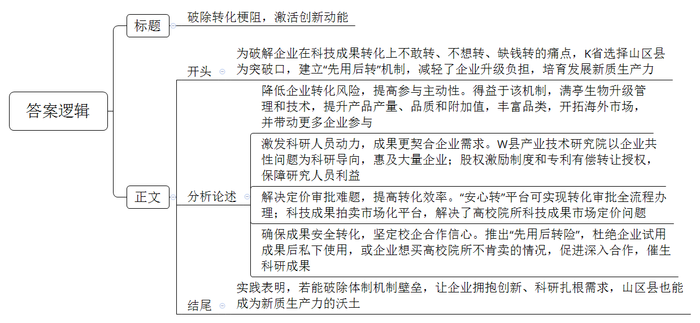
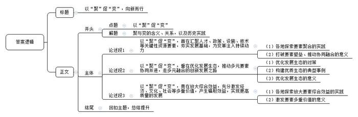

# 2025年公务员多省联考《申论》题（福建省市卷）

<!-- gwy:overview:start -->
> **福建 · 2025 · 申论 · 省市卷** ｜ 4 题 · 图片 4 处 · 答案随题折叠

导航：[题目](#题目) · [材料 1](#材料-1)
<!-- gwy:overview:end -->

> 候选采集稿。参考答案及解析来自粉笔页面，不代表官方答案或真实高分答卷；来源使用许可与原卷对应关系仍需人工核实。

## 给定材料

### 材料 1

清晨，A区居民小陈准备烧饭，打开水龙头，清冽的自来水哗哗流出。这股来自13公里外B县三合水库的清泉，为A区3个街道的16万人“解了渴”。两地同饮一库水，得益于A区和B县的同城合作。

两地地域相连且同属C市，2018年，在市政府主导下，两地签署战略合作协议，全力推动同城化发展。截至目前共推进了80余项合作，“1+1＞2”的区域发展格局初步形成。

“A区和B县，一个是人口众多、商贸发达的市场大区，一个是人文和生态资源丰富的生态文明建设示范县，各具优势。”C市政府办许主任说，“协议签订仅半年，就实现了B县向A区每日输送3万吨饮用水的目标。”

同城合作带来的最大变化莫过于交通，这几年两地开通了城际公交，实现了高速公路免费互通。“有了城际公交，我们去A区看病方便多了。”B县村民齐大爷说。不仅如此，B县卫健局工作人员也表示：“县中医院的骨科远近闻名，这两年，从A区到县里来看骨伤的患者也明显增多了。”“两地的互联互通还在进一步加速，未来将新建、提升改造3条道路。”A区交通运输局秦局长介绍。

早在2020年4月，两地组织部门就签署了人才协同发展战略合作框架协议，建立年轻干部互派挂职机制，以干部交流促进生产要素整合。现挂职A区文旅局副局长的B县青阳街道办马副主任在漫步A区文创街区时，突然冒出一个想法，“青阳也有一条特色美食街，两地各有优势，何不强强联手？”想到就干，他与同事合作，促成A区与B县召开文旅共建联席会议，积极推动两地开展“美食文创街区”旅游营销活动，协同打造县域消费目的地。“要全方位整合资源，变单打独斗为抱团发展。”马副主任干劲十足。

“这几年，A区高速发展对B县的辐射带动正在逐步增强，两地产业互补性、协调性还在加深。”B县孙县长表示，“2024年，我县制造业投资增长超过50%，增速位列全市第一。在A区新兴产业带动下，一批与其紧密关联的新能源项目相继落地我县，不仅完善了产业结构，也带动了装备制造、光伏光电、电子信息等新兴产业投资，为下一步发展注入了新动能。”

对此，长期跟踪C市县域经济发展的市委党校潘教授认为：“除了市政府在推动两地同城化发展中发挥了统筹协调作用之外，两地产业、人口等其实也形成了一种双向流动，互利互惠。”以消费为例，A区商贸业发达，对B县群众很有吸引力，经常有B县年轻人到A区逛街、消费。而B县的农家乐也很受A区居民欢迎，去年前往B县乡村游的A区游客较往年大为增长。

同城化合作后，A区传统产业向B县转移，给B县带来的人才红利、用工需求等显而易见。走进B县黄龙工业园区，一栋栋现代化新厂房映入眼帘。近几年，该园区共落地企业218家，其中企业法人为A区籍的有86家。A区某面膜生产企业负责人表示，2020年她看准两地同城合作机遇，在B县投资建起了新工厂。在市场需求带动下，A区和B县之间已经形成了面膜上下游供应链企业紧密合作的生态圈，带动了当地上千人就业。A区发改局郭局长说：“市场主导的资源配置优化带来的合作，往往后劲更足。”

“以前一些A区企业到B县招零工，都是我们人社部门帮助对接。今年，市场化运作的A区‘找零工’APP打入B县市场，将实时零工招聘信息推送到B县用户手中，目前已帮助1000余名B县籍务工人员在A区找到了打短工的机会。”B县人社局工作人员说。家住B县城乡接合部的邹先生，忙时在家务农，闲时出门打工。他说，这几年A区的零工需求很多，打包的、配货的、装运的，有时一干就是十天半个月，增加了不少收入。

近期，两地的物流公司正积极谋划在黄龙工业园区开展综合货运枢纽共建等项目。“我们在黄龙工业园建有物流仓库。B县建仓成本低、发货效率高，在这里集货后，可通过A区中欧班列、水运发往全世界。”A区某物流公司负责人说。

B县某商业小区因地理位置优越、价格合适，项目一开盘就吸引了500余户A区市民前来投资置业。“在A区赚钱，在B县生活。”在A区做服装生意的小江选择将家安在B县，生活成本低、舒适度高，一家人在一起，幸福甜蜜。小江脸上的笑容，正是对两地同城深化合作的生动注解。

### 材料 2

“大棚根本进不去，里面积水太深。用水泵抽，泵一开，就听见水井口咕嘟咕嘟的上水声，泵一闭，水一下就漫上来了。”2024年8月，一场特大暴雨降临M县，老赵至今都清晰地记得当时自家大棚的情形。“几天过去，水退了也还有问题。用脚轻轻一踩，水立马就渗出地面。”老赵发现，只要附近的水库一放水，棚里的水井就跟着涨水，大棚不远处还有一座废弃的方塘，如果方塘涨水，棚内积水就更加严重。

邻近的几十个大棚，情况大同小异。“当时下那么大的雨，总不能说不让水库放水吧？”无奈之下老赵拨通了刘镇长的电话。土生土长的刘镇长，人熟，地也熟。他记得小时候旱得厉害，种的玉米和杂粮根本收不了多少。后来，镇里鼓励大家种果树，不少村子开始修建方塘，雨天蓄水，需要的时候拿泵抽水浇果树。

“2005年左右，镇里牵头开始引进设施农业，建蔬菜大棚。大棚的灌溉基本不需要方塘蓄水，很多方塘就慢慢废弃了。”当初在引进设施农业时，他全程参与了设计，“那时考虑的是防旱，从没想过排涝的事。田里也没什么排水设计，在后续优化中，排水问题也几乎没有纳入考量。”

“我也不确定是咋回事，太专业的知识我也不懂，想着水库、方塘和大棚里的水井在地下是不是连通的，如果是，那把河道清出来应该有用。”刘镇长坦言，当时灾情紧急，很多想法来不及论证，请示上级后他便紧急调来两台挖掘机和翻斗车对河道垃圾进行清理，同时深挖和拓宽河道。

河道挖开，大棚水退。然而，开挖河道只是权宜之计。“这不是随便挖条沟、挖个坑就能解决的事，具体该怎么设计、怎么施工都需要很专业的技术人员，我们没有这个水平。”不仅如此，刘镇长坦言，更愁的是资金问题，“这属于公共设施，村民不可能自己出钱，镇里也没这笔钱。”

第三次全国国土调查结果显示，M县共有水域及水利设施用地超5200公顷，其中，坑塘水面约76公顷，沟渠超46公顷。但在县水利局和农业农村局，却没有各村镇沟渠、坑塘等排水和灌溉设施分布及使用的具体信息。

2019年左右，县里对小型农田水利的管理进行了职能调整。“那次调整把‘小农水’的归口管理从水利部门调到了农业部门，但事走了、人没动，各种资料、手续很多还在水利局。以前信息化、数字化不像现在这样普及，存在基础信息缺失和含混不清等问题。”县政府办王副主任表示，近些年的人事变动，也给全县“小农水”的管理增加了困难。

农业水利专家周教授指出，目前，农田水利公共设施由农业主管部门负责建设，但建成后的归属权、管理和维护问题却缺乏明确的政策规定。

在M县，不时会看到废弃的方塘和水井，有的水井已经有五六十年之久，早已无人使用，不远处的泵房也无人管理。村民老牛说：“之前有人承包方塘养鱼、建垂钓园，那会儿由他们自己管。但因为不挣钱，后来就慢慢荒了，再倒点垃圾，水都臭了。”

刘镇长说，过去种果树、种粮食的年代，村里会对方塘进行集中管理，定期组织清淤、检查维护泵房。“现在利用率太低，就没人管了。在别的地方，还有人把坑填了另做他用，我们不敢这么干。之前水库管理局将所辖部分闲置鱼池租赁给驾校做硬化训练道路，结果因非法占用被通报了。”

“这些都是历史问题，想要重新管起来太难了。”县水利局工作人员说，水库建设之初在下游预留了几个坑塘，想着可以养养鱼，职工也可以搞点副业。后来，经历机构改革，水库管理局的建制早已不复存在，水库和相关资产、人员转由地方国企统一管理，但只是清算了工资，根本没钱对坑塘水面和周边土地作进一步的开发和规划。“而且历史遗留的产权归属可能也有一定问题，所以就只能搁着，可惜了一块好地方。”

周教授介绍，当前，各地小型农田水利工程，如果被划入高标准农田建设范畴或是几大灌区的主要水利设施，有中央财政参与支持，管理就比较规范。但对于其他农田或者温室大棚这样的设施农业，灌排工作更多还是以农户或生产经营者自身为主。“农业的投入产出效益比较低，农民对于‘小农水’的投入积极性不高。”他指出，虽然各级涉农涉水部门均有相关建设资金，但各自项目要求不同，整合起来并不容易。

“在乡村各类基础设施中，道路是管理维护最好的。老百姓几乎每天要走，能每时每刻感受到价值，所以维护意识很强。”周教授说，“小型农田水利设施使用频率低，特别在发生涝害几率小的地区，对排水排涝不够重视，经常会看到排水沟里种植作物，还有的因为种地要用大型农机，直接把沟填平了。要想从根本上解决问题，还必须想方设法让村集体和农户意识到其中潜在的价值。”

### 材料 3

一朵花菇能卖多少钱？因为有了科技的加持，最高能卖到50元！在K省F县，通过引进高校科技成果、研发新产品，满亭生物科技有限公司让花菇从此不再简单。

K省有21个山区县，曾经因为区位条件欠佳、产业基础薄弱、人才资源匮乏，限制了发展步伐。如何奋起直追？科技助力是个中关键。然而谈到科技成果转化落地，一些企业顾虑重重：砸下真金白银，买来成果，没出效果，还得自负后果，这如何是好？满亭生物董事长老朱就有这种担忧：传统农业升级，要有科技加持，而农业企业本身投资大、回报周期长，再花钱搞创新，万一科技成果转化失败，反而加重企业负担。

老朱的担忧不是个例。风险敏感性强、承接能力弱，是许多企业面临的共同问题。“为了打通不敢转、不想转、缺钱转的痛点，我省选择山区县作为突破口，让企业家们放下包袱，在创新升级路上轻装上阵。”省科技厅成果转化处范处长介绍。

2021年，K省率先建立科技成果“先用后转”机制，通过“先免费试用、后付费转化”的方式，推动高校院所向山区21县的中小企业实施科技成果高效转化，降低企业承接成果的风险。企业在试用满意后，按照约定的条件和方式支付费用，完成科技成果的正式转化。

得益于“先用后转”的模式，满亭生物于2022年从省农业大学引进了一套农业智能管理系统，三年来效果显著：一个大棚年产花菇逾5万公斤，亩产15%，优质花菇占比达80%。“‘先用后转’让我们消除了顾虑、放开了手脚。”老朱说。满亭生物还与多所省内外高校合作，引进深加工技术，花菇产品创意不断。公司展示区里，花菇鲜品、冻干、即食花菇粉等琳琅满目，高端调味品卖到数百元一斤，一些产品远销海外。越来越多的山区县企业像满亭生物一样，从犹豫不决变为积极主动地参与科技成果转化。据统计，2023年K省21个山区县技术交易额达到274亿元，同比增长22%。

如果说，成果需求端的企业敢创新是成果转化的A面，B面则是激发成果供给端科研人员的转化动力，让科技成果更契合企业的实际需求。W县是K省最大的电动工具制造中心，有500多家电动（园林）工具整机生产及配套加工企业，但企业“低小散”问题比较突出。以木工、瓦工等常用的角磨机为例，当地企业面临电机效率不高、装配效率偏低、外观创意缺乏等行业共性问题。“让单个或几个企业挑起解决共性技术难题的重担，显然力不从心。”科技局相关负责人表示，县里依托与省工业大学联合组建的智能制造产业技术研究院，开展电动工具行业技术研究。“我们把角磨机结构拆分为各个模块，设计了全新的组装流水线，哪个环节出了问题一目了然。企业可以根据自身需求，定制整套流水线或者部分模块。”智能制造产业技术研究院阳院长介绍，研究院以企业面临的共性问题为科研导向，成果惠及50余家企业。县里还通过财政补助，鼓励企业通过股权激励等方式开展产学研合作，目前达成产学研合作项目金额超1500万元。“扎根生产线，摸清不同企业的痛点，才能让成果更好转化。”日前，W县出台了进一步加强智能制造产业技术研究院后续扶持实施方案，计划组建国有平台公司，将研究院前期研发的产品以专利转让或授权使用等有偿方式由平台公司进行产业化。“这能推动更多研究人员深入企业、服务企业，在制度层面保障他们学术上接地气、转化上有钱赚、职称上有前途，更坚定了他们做创新也能创业的信心！”阳院长高兴地说。

以往科技成果定价难、审批流程繁琐等，是科研人员转化成果的“梗阻”。K省科技厅与财政厅联合打造“安心转”平台，转化审批等均在平台完成，这也是该省首创的科技成果单列管理范式。通过科技成果拍卖市场化平台，K省进一步解决了高校院所处置职务科技成果的市场定价问题。“如果说之前是在拆除阻碍成果转化的篱笆墙，现在则是在提高科研成果的转化效率。”范处长表示。针对前期“免费环节”，高校院所担心一些企业试用成果后仍私下使用，或是企业试用后想买专利而高校院所不肯卖可能发生的情况，省里促成科技保险公司推出“先用后转险”，联动知识产权和信用等部门，为成果转化上了一道“安全险”。得益于“先用后转险”，省理工大学和正宇集团坚定了合作信心，开展深入合作，在2023年10月成功研发出某型号海缆弯曲限制器。截至目前，K省通过“先用后转”机制，面向山区县成功转化成果超3000项，有效助力培育发展新质生产力。

## 题目

### 第 1 题

**请根据“给定资料1”，谈谈A区与B县是如何推动两地同城化发展形成“1+1＞2”区域发展格局的。（15分）**

关联材料：材料 1

作答要求：全面、准确、有条理。不超过250字。

第 1 题 · 答案与解析

**参考答案（粉笔题库参考内容）**

两地政府签署战略合作协议，推进多项合作，实现两地优势互补。

1.推动交通互联。开通城际公交，高速公路免费互通，持续新建、改造提升道路。

2.人才协同发展。签署人才合作协议，建立年轻干部互派挂职机制，促进生产要素整合。

3.产业互补协调。A区高速发展辐射带动B县；产业、人口双向流动，互利互惠。

4.市场主导资源优化配置。A区传统产业向B县转移，上下游供应链企业合作紧密；利用B县低成本高效率优势，共建物流项目。

5.促进民生融合。供水、医疗等公共资源共享；开发App实现零工供需跨区对接；居民跨区置业。

**解析**

**参考答案说明**：本参考答案先给出“整体举措”，再分别从“推动交通互联”“人才协同发展”“产业互补协调”“市场主导资源优化配置”“促进民生融合”这五个方面给出了做法，各条答案要点之间在内容上互相并列，没有交叉。

**考点**：概括措施类

**来源**：2025年公务员多省联考《申论》题（福建省市卷）

粉笔申论页面对本题只提供「解析视频」入口，该入口是会员推广位，页面无视频地址与文字解析。

### 第 2 题

**根据“给定资料2”，梳理M县沟渠、坑塘等相关小型农田水利设施管理存在的问题，并提出解决建议。（20分）**

关联材料：材料 2

作答要求：

（1）问题梳理全面、准确、有条理；

（2）所提建议与问题相对应，针对性强、切实可行；

（3）层次分明，有逻辑性；

（4）不超过400字。

第 2 题 · 答案与解析

**参考答案（粉笔题库参考内容）**

1.问题：技术能力薄弱。设施农业设计排水系统缺失；缺少解决问题的设计、施工的专业人员。对策：引入水利专家团队和专业施工团队，重新规划、建设设施农业排水系统。

2.问题：维护资金不足。地方国企无力负担开发规划资金；投入产出比低，农民投入积极性低；涉农涉水部门资金整合困难。对策：争取上级财政补贴，引入社会资本；完善激励机制，提高农民积极性；统筹各部门涉农资金，设立“小农水”专项维护基金。

3.问题：管理混乱。基础信息缺失、含混不清，管理难度大；归属权、管理和维护缺乏明确规定，闲置设施难以再开发。对策：开展普查工作，补齐基础信息；建立数据库，智慧化管理，信息动态更新；完善归属权、管理和维护等相关规定，扫除设施维护、开发制度障碍。

4.问题：农民维护意识弱。使用频率低，群众难以感受其价值，出现占用或填埋等情况。对策：加强宣传，让农民认识水利设施的增产、抗灾价值；严查占用、破坏水利设施的行为。

**解析**

**参考答案说明：**本参考答案从“技术能力”“维护资金”“管理”“农民维护意识”四个方面介绍了小型农田水利设施管理存在的问题并提出解决建议。本参考答案做到了分类分条撰写，各条答案要点之间在内容上相互并列，没有交叉。

**考点**：提出对策类

**来源**：2025年公务员多省联考《申论》题（福建省市卷）

粉笔申论页面对本题只提供「解析视频」入口，该入口是会员推广位，页面无视频地址与文字解析。

### 第 3 题

**“给定资料3”是《K省日报》近期刊登的一篇专题报道，请自拟题目，为这篇报道写一篇短评。（25分）**

关联材料：材料 3

作答要求：

（1）观点明确，简明深刻；

（2）紧扣资料，重点突出；

（3）有逻辑性，思路流畅；

（4）不超过450字。

第 3 题 · 答案与解析

**参考答案（粉笔题库参考内容）**

破除转化梗阻，激活创新动能

为破解企业在科技成果转化上不敢转、不想转、缺钱转的痛点，K省选择山区县为突破口，建立“先用后转”机制，减轻了企业升级负担，培育发展新质生产力。

降低企业转化风险，提高参与主动性。得益于该机制，满亭生物升级管理和技术，提升产品产量、品质和附加值，丰富品类，开拓海外市场，并带动更多企业参与。

激发科研人员动力，成果更契合企业需求。W县产业技术研究院以企业共性问题为科研导向，惠及大量企业；股权激励制度和专利有偿转让授权，保障研究人员利益。

解决定价审批难题，提高转化效率。“安心转”平台可实现转化审批全流程办理；科技成果拍卖市场化平台，解决了高校院所科技成果市场定价问题。

确保成果安全转化，坚定校企合作信心。推出“先用后转险”，杜绝企业试用成果后私下使用，或企业想买高校院所不肯卖的情况，促进深入合作，催生科研成果。

实践表明，若能破除体制机制壁垒，让企业拥抱创新、科研扎根需求，山区县也能成为新质生产力的沃土。

**解析**

**参考答案说明**：（1）格式方面，本参考答案写到了“标题”“正文”两个部分。（2）正文部分，一方面从内容上来看，围绕“企业科技成果转化”这一主题，本参考答案开头部分介绍了相关背景，并表明了态度观点；分析论述部分分别写到了“降低企业转化风险，提高参与主动性”“激发科研人员动力，成果更契合企业需求”“解决定价审批难题，提高转化效率”“确保成果安全转化，坚定校企合作信心”这四个方面的内容；结尾部分进行了简单总结评价。另一方面从形式来看，本参考答案做到了分段、分条撰写，各条要点在内容上各自独立，没有交叉。

**考点**：评论类

**来源**：2025年公务员多省联考《申论》题（福建省市卷）

粉笔申论页面对本题只提供「解析视频」入口，该入口是会员推广位，页面无视频地址与文字解析。

### 第 4 题

**不同的事物集聚在一起时，可能会相互影响、碰撞融合，进而催生新变化，请以“聚·变”为话题，参考全部给定资料，联系实际，自选角度，自拟题目，写一篇文章。（40分）**

关联材料：材料 1

作答要求：

（1）观点明确，见解深刻，内容充实；

（2）参考给定资料，但不拘泥于给定资料；

（3）思路清晰，语言流畅；

（4）字数1000-1200字。

第 4 题 · 答案与解析

**参考答案（粉笔题库参考内容）**

**以“聚”促“变”，向新而行**

从春秋战国百家争鸣催生思想大解放，到工业革命时期技术、资本、劳动力的聚合引发生产力质变，历史实践反复印证：聚是变的序章，变是聚的华章——当多元要素如溪流汇聚，终将激荡出变革的浪花。时代发展的今天，要知道聚什么，怎么聚，还要知道如何碰撞融合。

**以“聚”促“变”，首在汇聚人才、政策、设施、技术等关键性资源要素，夯实发展基础，为变革注入持续动力。**各地探索中，要素聚合的实践极具说服力：安徽合肥建立算力中心、引进科研团队、设立创投基金，推动电池技术与整车制造耦合，让新能源产业从“追跑者”跃为“领跑者”，形成千亿集群；深圳南山整合高校技术、优惠税收政策、完善产业链条，吸引创客集聚，催生出大批科技企业，跻身全球科创高地。可见，唯有打破要素壁垒、推动协同融合，才能激活资源潜能，将要素聚合的优势转化为变革实效，为发展注入强劲动能。

**以“聚”促“变”，重在优化发展生态，推动多元要素协同并进，走多元融合的创新发展之路。**若仅简单堆砌要素，缺乏良好生态支撑，变革便难以持续。这就需要打破制度壁垒，通过体制机制创新让资源优势充分释放，实现效能跃升；更要搭建协同平台，为要素对接创造条件。杭州未来科技城的崛起正是因其构建了优质生态——浙江大学等高校的科研成果高效转化，民营资本与政府引导基金联动赋能科创项目，阿里巴巴等龙头企业与大量初创公司形成产业生态共生圈，鼓励探索的创业文化更让创新活力不断迸发。可见，唯有打造灵活高效的制度环境与协同生态，才能让要素从“聚合”走向“融合”，最终实现从量变到质变的突破。

**以“聚”促“变”，贵在放大综合效益，充分激发经济、文化、社会等多重价值，产生辐射效益，实现更高质量的发展。**昆明安宁产业园区依托云南杉杉、云南裕能等龙头企业，构建新能源电池千亿级产业集群，同时降低碳排放，实现经济效益与绿色转型双赢；南昌胜利路步行街打造“空中楼阁”舞台，融合南昌采茶戏、苗族银饰歌舞等民族艺术，推动非遗的生活化传承；黄龙县白马滩镇建设农副产品集散中心，整合储存、加工、销售链条，以高于市场价收购农产品并错峰销售，带动村民增收与企业、村集体多方共赢，推动联农带农与共同富裕。“聚”通过产业链、文化链、利益链的深度咬合，催生“1+1>2”的乘数效应，最终实现发展质量的全维度跃升。

“聚”是“变”的前提，“变”是“聚”的目标，未来，唯有以系统思维编织要素网络，方能让每一次聚合都成为质变的序曲，在变革浪潮中向新而行。

**解析**

**文章分析**

**以“聚”促“变”，向新而行**

【**标题的优点：**首先，标题中含有主题词，使文章主题更突出、清晰。其次，形式上采用对称式结构，使标题更加完整、饱满。】

从春秋战国百家争鸣催生思想大解放，到工业革命时期技术、资本、劳动力的聚合引发生产力质变，历史实践反复印证：聚是变的序章，变是聚的华章——当多元要素如溪流汇聚，终将激荡出变革的浪花。时代发展的今天，要知道聚什么，怎么聚，还要知道如何碰撞融合。

【**开头的优点：**★内容方面。范文的开头是紧扣“以‘聚’促‘变’”这一主题展开的。首先，开头点出主题，做到了主题明确。其次，对“以‘聚’促‘变’”这一主题进行了分析阐述，指出了聚与变的含义、关系，以及历史实践。★文字表达方面。长短句配合使用，使语言表达有节奏感。】

**以“聚”促“变”，首在汇聚人才、政策、设施、技术等关键性资源要素，夯实发展基础，为变革注入持续动力。**（1）各地探索中，要素聚合的实践极具说服力：安徽合肥建立算力中心、引进科研团队、设立创投基金，推动电池技术与整车制造耦合，让新能源产业从“追跑者”跃为“领跑者”，形成千亿集群；深圳南山整合高校技术、优惠税收政策、完善产业链条，吸引创客集聚，催生出大批科技企业，跻身全球科创高地。可见，（2）唯有打破要素壁垒、推动协同融合，才能激活资源潜能，将要素聚合的优势转化为变革实效，为发展注入强劲动能。

【**论述段1的优点：**★观点句：范文的观点句是紧扣“以‘聚’促‘变’”这一文章主题提出的。形式上，它在段首处直接写出，位置突出，容易发现。内容上，关键词突出，内容要点明确，可以明显看出主要从“汇聚资源要素，夯实发展基础”的角度展开论述。★论述内容：（1）各地探索要素聚合的实践；（2）打破要素壁垒、推动协同融合的意义。注意：以上几个方面的内容都是紧扣“以‘聚’促‘变’，首在汇聚人才、政策、设施、技术等关键性资源要素，夯实发展基础，为变革注入持续动力”这个观点句进行分析论述的，论述的针对性强，内容层次丰富。在论述方法上采用了讲道理与举例子相结合的方式，论述充实清晰。】

**以“聚”促“变”，重在优化发展生态，推动多元要素协同并进，走多元融合的创新发展之路。**（1）若仅简单堆砌要素，缺乏良好生态支撑，变革便难以持续。这就需要打破制度壁垒，通过体制机制创新让资源优势充分释放，实现效能跃升；更要搭建协同平台，为要素对接创造条件。（2）杭州未来科技城的崛起正是因其构建了优质生态——浙江大学等高校的科研成果高效转化，民营资本与政府引导基金联动赋能科创项目，阿里巴巴等龙头企业与大量初创公司形成产业生态共生圈，鼓励探索的创业文化更让创新活力不断迸发。（3）可见，唯有打造灵活高效的制度环境与协同生态，才能让要素从“聚合”走向“融合”，最终实现从量变到质变的突破。

【**论述段2的优点：**★观点句：范文的观点句是紧扣“以‘聚’促‘变’”这一文章主题提出的。形式上，它在段首处直接写出，位置突出，容易发现。内容上，关键词突出，内容要点明确，可以明显看出主要从“优化发展生态，推动要素融合”的角度展开论述。★论述内容：（1）优化发展生态的对策；（2）构建优质生态的典型事例；（3）优化发展生态的意义。注意：以上几个方面的内容都是紧扣“以‘聚’促‘变’，重在优化发展生态，推动多元要素协同并进，走多元融合的创新发展之路”这个观点句进行分析论述的，论述的针对性强，内容层次丰富。在论述方法上采用了讲道理与举例子相结合的方式，论述充实深刻。】

**以“聚”促“变”，贵在放大综合效益，充分激发经济、文化、社会等多重价值，产生辐射效益，实现更高质量的发展。**（1）昆明安宁产业园区依托云南杉杉、云南裕能等龙头企业，构建新能源电池千亿级产业集群，同时降低碳排放，实现经济效益与绿色转型双赢；南昌胜利路步行街打造“空中楼阁”舞台，融合南昌采茶戏、苗族银饰歌舞等民族艺术，推动非遗的生活化传承；黄龙县白马滩镇建设农副产品集散中心，整合储存、加工、销售链条，以高于市场价收购农产品并错峰销售，带动村民增收与企业、村集体多方共赢，推动联农带农与共同富裕。（2）“聚”通过产业链、文化链、利益链的深度咬合，催生“1+1>2”的乘数效应，最终实现发展质量的全维度跃升。

【**论述段3的优点：**★观点句：范文的观点句是紧扣“以‘聚’促‘变’”这一文章主题提出的。形式上，它在段首处直接写出，位置突出，容易发现。内容上，关键词突出，内容要点明确，可以明显看出主要从“放大综合效益，激发多重价值”的角度展开论述。★论述内容：（1）各地探索放大要素综合效益的实践；（2）激发要素多重价值的意义。注意：以上几个方面的内容都是紧扣“以‘聚’促‘变’，贵在放大综合效益，充分激发经济、文化、社会等多重价值，产生辐射效益，实现更高质量的发展”这个观点句进行分析论述的，论述的针对性强，内容层次丰富。在论述方法上采用了讲道理与举例子相结合的方式，论述充实到位。】

【**论述段之间的关系：**★内容的内在逻辑：范文的论述段之间是依照“递进”的逻辑展开的。论述段1先写了“汇聚资源要素，夯实发展基础”，论述段2再写了“优化发展生态，推动要素融合”，论述段3接着写了“放大综合效益，激发多重价值”，文章整体论述层层递进，逻辑清晰。】

“聚”是“变”的前提，“变”是“聚”的目标，未来，唯有以系统思维编织要素网络，方能让每一次聚合都成为质变的序曲，在变革浪潮中向新而行。

【**结尾的优点：**范文的结尾回扣了“以‘聚’促‘变’”这个主题，并且进行了总结提升。】

**考点**：文章写作题

**来源**：2025年公务员多省联考《申论》题（福建省市卷）

粉笔申论页面对本题只提供「解析视频」入口，该入口是会员推广位，页面无视频地址与文字解析。

