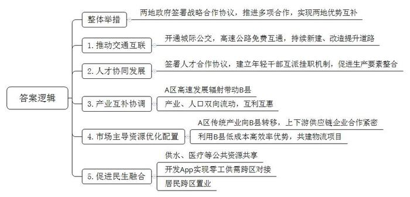
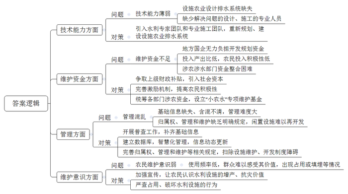
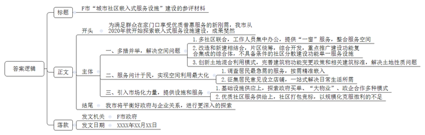
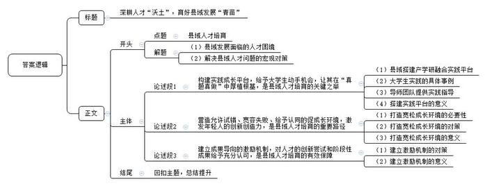

# 2025年公务员多省联考《申论》题（福建通用卷）

<!-- gwy:overview:start -->
> **福建 · 2025 · 申论 · 通用卷** ｜ 4 题 · 图片 4 处 · 答案随题折叠

导航：[题目](#题目) · [材料 1](#材料-1)
<!-- gwy:overview:end -->

> 候选采集稿。参考答案及解析来自粉笔页面，不代表官方答案或真实高分答卷；来源使用许可与原卷对应关系仍需人工核实。

## 给定材料

### 材料 1

清晨，A区居民小陈准备烧饭，打开水龙头，清冽的自来水哗哗流出。这股来自13公里外B县三合水库的清泉，为A区3个街道的16万人“解了渴”。两地同饮一库水，得益于A区和B县的同城合作。

两地地域相连且同属C市，2018年，在市政府主导下，两地签署战略合作协议，全力推动同城化发展。截至目前共推进了80余项合作，“1+1＞2”的区域发展格局初步形成。

“A区和B县，一个是人口众多、商贸发达的市场大区，一个是人文和生态资源丰富的生态文明建设示范县，各具优势。”C市政府办许主任说，“协议签订仅半年，就实现了B县向A区每日输送3万吨饮用水的目标。”

同城合作带来的最大变化莫过于交通，这几年两地开通了城际公交，实现了高速公路免费互通。“有了城际公交，我们去A区看病方便多了。”B县村民齐大爷说。不仅如此，B县卫健局工作人员也表示：“县中医院的骨科远近闻名，这两年，从A区到县里来看骨伤的患者也明显增多了。”“两地的互联互通还在进一步加速，未来将新建、提升改造3条道路。”A区交通运输局秦局长介绍。

早在2020年4月，两地组织部门就签署了人才协同发展战略合作框架协议，建立年轻干部互派挂职机制，以干部交流促进生产要素整合。现挂职A区文旅局副局长的B县青阳街道办马副主任在漫步A区文创街区时，突然冒出一个想法，“青阳也有一条特色美食街，两地各有优势，何不强强联手？”想到就干，他与同事合作，促成A区与B县召开文旅共建联席会议，积极推动两地开展“美食文创街区”旅游营销活动，协同打造县域消费目的地。“要全方位整合资源，变单打独斗为抱团发展。”马副主任干劲十足。

“这几年，A区高速发展对B县的辐射带动正在逐步增强，两地产业互补性、协调性还在加深。”B县孙县长表示，“2024年，我县制造业投资增长超过50%，增速位列全市第一。在A区新兴产业带动下，一批与其紧密关联的新能源项目相继落地我县，不仅完善了产业结构，也带动了装备制造、光伏光电、电子信息等新兴产业投资，为下一步发展注入了新动能。”

对此，长期跟踪C市县域经济发展的市委党校潘教授认为：“除了市政府在推动两地同城化发展中发挥了统筹协调作用之外，两地产业、人口等其实也形成了一种双向流动，互利互惠。”以消费为例，A区商贸业发达，对B县群众很有吸引力，经常有B县年轻人到A区逛街、消费。而B县的农家乐也很受A区居民欢迎，去年前往B县乡村游的A区游客较往年大为增长。

同城化合作后，A区传统产业向B县转移，给B县带来的人才红利、用工需求等显而易见。走进B县黄龙工业园区，一栋栋现代化新厂房映入眼帘。近几年，该园区共落地企业218家，其中企业法人为A区籍的有86家。A区某面膜生产企业负责人表示，2020年她看准两地同城合作机遇，在B县投资建起了新工厂。在市场需求带动下，A区和B县之间已经形成了面膜上下游供应链企业紧密合作的生态圈，带动了当地上千人就业。A区发改局郭局长说：“市场主导的资源配置优化带来的合作，往往后劲更足。”

“以前一些A区企业到B县招零工，都是我们人社部门帮助对接。今年，市场化运作的A区‘找零工’APP打入B县市场，将实时零工招聘信息推送到B县用户手中，目前已帮助1000余名B县籍务工人员在A区找到了打短工的机会。”B县人社局工作人员说。家住B县城乡接合部的邹先生，忙时在家务农，闲时出门打工。他说，这几年A区的零工需求很多，打包的、配货的、装运的，有时一干就是十天半个月，增加了不少收入。

近期，两地的物流公司正积极谋划在黄龙工业园区开展综合货运枢纽共建等项目。“我们在黄龙工业园建有物流仓库。B县建仓成本低、发货效率高，在这里集货后，可通过A区中欧班列、水运发往全世界。”A区某物流公司负责人说。

B县某商业小区因地理位置优越、价格合适，项目一开盘就吸引了500余户A区市民前来投资置业。“在A区赚钱，在B县生活。”在A区做服装生意的小江选择将家安在B县，生活成本低、舒适度高，一家人在一起，幸福甜蜜。小江脸上的笑容，正是对两地同城深化合作的生动注解。

### 材料 2

“大棚根本进不去，里面积水太深。用水泵抽，泵一开，就听见水井口咕嘟咕嘟的上水声，泵一闭，水一下就漫上来了。”2024年8月，一场特大暴雨降临M县，老赵至今都清晰地记得当时自家大棚的情形。“几天过去，水退了也还有问题。用脚轻轻一踩，水立马就渗出地面。”老赵发现，只要附近的水库一放水，棚里的水井就跟着涨水，大棚不远处还有一座废弃的方塘，如果方塘涨水，棚内积水就更加严重。

邻近的几十个大棚，情况大同小异。“当时下那么大的雨，总不能说不让水库放水吧？”无奈之下老赵拨通了刘镇长的电话。土生土长的刘镇长，人熟，地也熟。他记得小时候旱得厉害，种的玉米和杂粮根本收不了多少。后来，镇里鼓励大家种果树，不少村子开始修建方塘，雨天蓄水，需要的时候拿泵抽水浇果树。

“2005年左右，镇里牵头开始引进设施农业，建蔬菜大棚。大棚的灌溉基本不需要方塘蓄水，很多方塘就慢慢废弃了。”当初在引进设施农业时，他全程参与了设计，“那时考虑的是防旱，从没想过排涝的事。田里也没什么排水设计，在后续优化中，排水问题也几乎没有纳入考量。”

“我也不确定是咋回事，太专业的知识我也不懂，想着水库、方塘和大棚里的水井在地下是不是连通的，如果是，那把河道清出来应该有用。”刘镇长坦言，当时灾情紧急，很多想法来不及论证，请示上级后他便紧急调来两台挖掘机和翻斗车对河道垃圾进行清理，同时深挖和拓宽河道。

河道挖开，大棚水退。然而，开挖河道只是权宜之计。“这不是随便挖条沟、挖个坑就能解决的事，具体该怎么设计、怎么施工都需要很专业的技术人员，我们没有这个水平。”不仅如此，刘镇长坦言，更愁的是资金问题，“这属于公共设施，村民不可能自己出钱，镇里也没这笔钱。”

第三次全国国土调查结果显示，M县共有水域及水利设施用地超5200公顷，其中，坑塘水面约76公顷，沟渠超46公顷。但在县水利局和农业农村局，却没有各村镇沟渠、坑塘等排水和灌溉设施分布及使用的具体信息。

2019年左右，县里对小型农田水利的管理进行了职能调整。“那次调整把‘小农水’的归口管理从水利部门调到了农业部门，但事走了、人没动，各种资料、手续很多还在水利局。以前信息化、数字化不像现在这样普及，存在基础信息缺失和含混不清等问题。”县政府办王副主任表示，近些年的人事变动，也给全县“小农水”的管理增加了困难。

农业水利专家周教授指出，目前，农田水利公共设施由农业主管部门负责建设，但建成后的归属权、管理和维护问题却缺乏明确的政策规定。

在M县，不时会看到废弃的方塘和水井，有的水井已经有五六十年之久，早已无人使用，不远处的泵房也无人管理。村民老牛说：“之前有人承包方塘养鱼、建垂钓园，那会儿由他们自己管。但因为不挣钱，后来就慢慢荒了，再倒点垃圾，水都臭了。”

刘镇长说，过去种果树、种粮食的年代，村里会对方塘进行集中管理，定期组织清淤、检查维护泵房。“现在利用率太低，就没人管了。在别的地方，还有人把坑填了另做他用，我们不敢这么干。之前水库管理局将所辖部分闲置鱼池租赁给驾校做硬化训练道路，结果因非法占用被通报了。”

“这些都是历史问题，想要重新管起来太难了。”县水利局工作人员说，水库建设之初在下游预留了几个坑塘，想着可以养养鱼，职工也可以搞点副业。后来，经历机构改革，水库管理局的建制早已不复存在，水库和相关资产、人员转由地方国企统一管理，但只是清算了工资，根本没钱对坑塘水面和周边土地作进一步的开发和规划。“而且历史遗留的产权归属可能也有一定问题，所以就只能搁着，可惜了一块好地方。”

周教授介绍，当前，各地小型农田水利工程，如果被划入高标准农田建设范畴或是几大灌区的主要水利设施，有中央财政参与支持，管理就比较规范。但对于其他农田或者温室大棚这样的设施农业，灌排工作更多还是以农户或生产经营者自身为主。“农业的投入产出效益比较低，农民对于‘小农水’的投入积极性不高。”他指出，虽然各级涉农涉水部门均有相关建设资金，但各自项目要求不同，整合起来并不容易。

“在乡村各类基础设施中，道路是管理维护最好的。老百姓几乎每天要走，能每时每刻感受到价值，所以维护意识很强。”周教授说，“小型农田水利设施使用频率低，特别在发生涝害几率小的地区，对排水排涝不够重视，经常会看到排水沟里种植作物，还有的因为种地要用大型农机，直接把沟填平了。要想从根本上解决问题，还必须想方设法让村集体和农户意识到其中潜在的价值。”

### 材料 3

看着小区内正在装修的社区服务综合体，F市白沙街道南华社区居民老高满怀期待，“社区已经在进行运营商招投标，5月份就能使用，太好了！”这个内嵌于柠檬郡小区、面积达2000平方米的综合体，具备养老、托育、健身、阅读等功能，让居民在家门口就能享受普惠优质的社区服务。

“在家门口享受普惠优质的服务，是新刚需。”在F市规划委员会专家唐教授看来，当前我国近七成的人口在城市工作生活，预计到2035年将达到八成左右。社区，既是城市人口安居之所，也是城市公共服务和城市治理的基本单元。“新刚需的出现对社区服务提出了新要求，也促进了社区工作新发展。”

F市是嵌入式服务设施建设领域的先行者。早在2020年，F市就启动了产业园区嵌入式幼儿园（托育）建设。2023年启动“民生幸福共同体”建设，突破社区（村）服务行政区划，以“共同体”形式提升完善“15分钟公共服务圈”……

江滨街道社区服务综合体由新民、七塘、太安3个社区共同打造，东临市体育馆，南接物联网小镇核心区，可谓“寸土寸金”。3个社区现有居民两万余人，其中9000多人是本地居民。“在街道统筹下，我们整合了3个社区的存量空间，社区工作人员集中办公，社区服务‘一窗’提供，整合出1万平方米空间为居民提供服务。”综合体工作人员小徐说。

云开区红梅社区将雅苑三区20幢原3层、2100平方米房屋拆除后重建，打造5层楼高、4300平方米的邻里中心；双桥区长河街道明月社区在区内分散建设了阅览室、食堂、健身房、医疗室、托育所等……F市秉持“改造和新建相结合”的原则，重点推广和优先建设（改造）功能复合集成的社区嵌入式服务综合体（社区服务中心），暂不具备条件的社区采用“插花”式分散建设功能相对单一的嵌入式服务设施。支持以片区统筹、综合开发模式推进社区嵌入式服务设施建设。

空间的腾挪，有不少涉及土地性质问题。比如，七彩社区为更好建设嵌入式服务设施，在土地出让时混合了住宅、商业、公共场站、停车场、文化设施等多种性质用地，创新了土地混合利用模式。F市完善建筑物使用功能变更政策和幼儿园建筑标准等，为多家产业园区嵌入式幼儿园（托育）的开办“开了绿灯”。

有了空间后，如何引入服务，实现空间的最大化利用？“从目前的实践来看，最有效的办法就是问计于民。”F市发改委杨主任介绍，在启动“民生幸福共同体”建设前，他们做过调查，从3000多份问卷中选出居民最急需的家门口服务，实现“按需精准嵌入”。

和睦街道仙桃社区是一个典型的老社区，60周岁以上的人口占36%。这几年，社区利用居民楼的楼下空间打造了“仙桃养老爱心街区”。“居民日常生活所需基本都能在这条街上一站式解决。”街道党工委文书记说，街上的店铺类型，大多是征求居民意见设立的，街口是早点餐饮，街尾是公园，在仙桃社区4幢至10幢之间嵌入了乐养中心、小超市、小药房、小修小补店等，覆盖了生活服务圈内的近万居民。

在社区基础设施供应中，有不少市场化力量加入其中，如蔚蓝集团在F市运营着多个社区服务综合体。集团事业部何经理表示，目前大多数社区服务以政府购买形式委托运营商运营，也就是政府买单的模式；也有物业公司接管周边片区的“大物业”模式，将设计、采购、施工及运营一体化承包；还有越来越多的社区与物业公司成立合资公司联合运营，探索全域可持续的政企合作模式。

“社区人手有限，专业人做专业事，优质社区服务的供给最好是引入市场化力量。然而作为公共服务，收费水平不能太高；但也不能没有利润，否则就没有企业愿意投入，也无法保证公共服务的质量。”杨主任表示，考虑到社区服务的微利属性，在城乡社区“民生幸福共同体”建设中，一些街道采取几个社区打包竞标的方法，以规模化克服微利的不足。

从现实情况来看，城市社区嵌入式服务设施建设需要集基本服务、公益服务以及商业服务等多种服务为一体，仅靠政府大包大揽难以持续，单靠企业投资又难有作为。二者之间如何平衡是个大难题。“不仅如此，投入大量资金建成的设施如何可持续运营，更是一个值得关注的问题。”杨主任强调，为老百姓在家门口提供更多普惠优质的服务，F市还需要进行更深入的探索。

### 材料 4

三个大小不一、叠在一起的棕色圆盘，拉伸展开，便成为一套颜值“爆表”的可折叠“魔法凳”。在N县腾浩户外用品有限公司，新品刚刚完成试样。张总经理一边拿着“滚烫”的样品频频点头，一边给销售部下达任务：“今年主推这款，争取9月上市！”一旁的设计师，大四学生小谭的心怦怦直跳，“电脑里的毕业设计变成货架上的真实产品，想想就很燃。”

这一切，来自于N县谋划的一盘创新“引才大棋”。2022年，N县向全国高校学子发出邀请——将毕业设计“写在”大地上，即以当地经济社会发展的现实需求为题，真题真做，开展“全国高校联合毕业设计”行动，架起县域人才“桥梁”。N县郑县长介绍：“每年9月，活动正式启动，我们‘出题’，全国高校学子‘选题’和‘答题’，第二年5月进行终期答辩。”在N县全国高校联合毕业设计组委会办公室的墙上，挂满了参与院校的校徽。这项行动目前已吸引171所高校的千余名大学生加入，诞生了456个作品。N县打造“中国毕业设计之城”的梦想，正在成为现实。

2024年，第三届全国联合毕业设计行动正式启动后，N县聚焦城镇更新、艺术乡建、产业升级、文旅开发等领域，征集了22个需求作为“毕业设计”开题方向，这其中就有小谭正在做的可折叠“魔法凳”。起初小谭信心满满，然而令他始料未及的是他的设计方案“一波三折”。“最初，我设计了折弯结构的构件，可到了生产一线，才发现要实现它，不仅需要加装转弯轴承，还要让铁件加厚，这大大增加了生产难度和成本，第二稿改用伸缩结构，但因为没有生产经验，数据不准，比例失调……”一遍遍修改，一次次提升。在这一过程中，小谭的“在地导师”柳工程师帮了他大忙。

联合设计的每个作品或项目都配备了由出题方派出的“在地导师”团队，他们与高校导师一起辅导毕业设计，共同参与毕业答辩。项目开始后，柳工并不着急让小谭动手设计，而是带着他扎进生产一线，从了解生产流程、制造工艺、市场销售开始，再理论结合实际，磨合方案，大大小小的修改不计其数。“柳工给的意见总能直击要害，特别实用！”小谭说。

“无论人生的哪个阶段，‘首次’都至关重要，联合毕业设计行动抓住高校毕业生的成长节点，允许试错、宽容失败，给予认同感，最大限度激活了他们的创新创造力。”毕业设计行动迅速扩圈扩容，也令毕业设计组委会委员王教授兴奋不已。

L村口有一面宋代名士浮雕墙，大四学生小李的毕业设计作品《L村公共景观设计》就从这里开始：“我想以宋代活字印刷为蓝本，将抽象山水和活字版融合进行造景……”小李的设计让L村党支部曾书记眼前一亮。“我们就是要将题出得好，并帮助大学生答得妙。”曾书记说。

“我们在镇里支持下，在全镇的村庄开展数月调研，找出迫切的、有资金支持的项目，再结合高校和专家的意见，将现实需求转化为可攻关的课题发布，毕业生则来实地选题、开题。”王教授介绍，“邀请项目方全程参与，将论文答辩直接搬到项目方所在的田野村庄或车间，村民、产业工人都可以来现场提问。学生论文呈现方式也不拘一格，可以是设计方案、进行中的工程，也可以是已完成的项目。”

“今年，我们将落地作为考评中最大的加分项，希望以实实在在的成果，为打通毕业生和县城的双向接口、满足双向需求‘加码’。”郑县长说，三年来，已有36个毕业设计作品落地，另外28个毕业设计转化为县、镇重大项目配套设计方案。从选题到答题，N县通过一系列的场景重构、流程再造、机制创新，把毕业设计全链条搬进了县城。未来，N县还谋划利用投资、金融等市场手段加固毕业设计“链条”。事实上，已有不少人在关注，乡贤基金、教育基金会、创业联盟，都可能成为“造血”的力量。每年N县还拿出40多万资金奖励优秀毕业设计作品，奖金覆盖面高达70%，以奖代补，吸引更多毕业生加入行动。

“县域，或许没有足够广阔的平台、没有一掷千金的引才实力，但可以给初出茅庐的青年人才提供成长沃土。”郑县长说，“我们不提要求、不讲条件，只做好服务、把‘题’出好，并且在毕业设计作品完结后，继续帮他们搭建平台，创造条件。未来县域的发展势必更加依赖年轻人，招才引智的目标也将前移。<u>我们应当把更多精力投入在‘种树’上，而非静待成熟再‘摘果’。”</u>

## 题目

### 第 1 题

**请根据“给定资料1”，谈谈A区与B县是如何推动两地同城化发展形成“1+1＞2”区域发展格局的。（15分）**

关联材料：材料 1

作答要求：

要求：全面、准确、有条理。不超过250字。

第 1 题 · 答案与解析

**参考答案（粉笔题库参考内容）**

两地政府签署战略合作协议，推进多项合作，实现两地优势互补。

1.推动交通互联。开通城际公交，高速公路免费互通，持续新建、改造提升道路。

2.人才协同发展。签署人才合作协议，建立年轻干部互派挂职机制，促进生产要素整合。

3.产业互补协调。A区高速发展辐射带动B县；产业、人口双向流动，互利互惠。

4.市场主导资源优化配置。A区传统产业向B县转移，上下游供应链企业合作紧密；利用B县低成本高效率优势，共建物流项目。

5.促进民生融合。供水、医疗等公共资源共享；开发App实现零工供需跨区对接；居民跨区置业。

**解析**

**参考答案说明**：本参考答案先给出“整体举措”，再分别从“推动交通互联”“人才协同发展”“产业互补协调”“市场主导资源优化配置”“促进民生融合”这五个方面给出了做法，各条答案要点之间在内容上互相并列，没有交叉。

**考点**：概括措施类

**来源**：2025年公务员多省联考《申论》题（福建通用卷）

### 第 2 题

**根据“给定资料2”，梳理M县沟渠、坑塘等相关小型农田水利设施管理存在的问题，并提出解决建议。（20分）**

关联材料：材料 2

作答要求：

要求：

（1）问题梳理全面、准确、有条理；

（2）所提建议与问题相对应，针对性强、切实可行；

（3）层次分明，有逻辑性；

（4）不超过400字。

第 2 题 · 答案与解析

**参考答案（粉笔题库参考内容）**

‌ 1.问题：技术能力薄弱。设施农业设计排水系统缺失；缺少解决问题的设计、施工的专业人员。对策：引入水利专家团队和专业施工团队，重新规划、建设设施农业排水系统。

‌ ‌ 2.问题：维护资金不足‌。地方国企无力负担开发规划资金；投入产出比低，农民投入积极性低；涉农涉水部门资金整合困难。对策：争取上级财政补贴，引入社会资本；完善激励机制，提高农民积极性；统筹各部门涉农资金，设立“小农水”专项维护基金。

‌ 3.问题：管理混乱。基础信息缺失、含混不清，管理难度大；归属权、管理和维护缺乏明确规定，闲置设施难以再开发。对策：开展普查工作，补齐基础信息；建立数据库，智慧化管理，信息动态更新；完善归属权、管理和维护等相关规定，扫除设施维护、开发制度障碍。

‌ ‌4.问题：农民维护意识弱。使用频率低，群众难以感受其价值，出现占用或填埋等情况。对策：加强宣传，让农民认识水利设施的增产、抗灾价值；严查占用、破坏水利设施的行为。

**解析**

**参考答案说明：**本参考答案从“技术能力”“维护资金”“管理”“农民维护意识”四个方面介绍了小型农田水利设施管理存在的问题并提出解决建议。本参考答案做到了分类分条撰写，各条答案要点之间在内容上相互并列，没有交叉。

**考点**：提出对策类

**来源**：2025年公务员多省联考《申论》题（福建通用卷）

### 第 3 题

**省里拟开展“城市社区嵌入式服务设施”建设典型案例评选。请根据“给定资料3”，为F市拟写一份参评材料。（25分）**

关联材料：材料 3

作答要求：

要求：

（1）紧扣资料，内容全面；

（2）条理清晰，语言流畅；

（3）不超过450字。

第 3 题 · 答案与解析

**参考答案（粉笔题库参考内容）**

F市“城市社区嵌入式服务设施”建设的参评材料

为满足群众在家门口享受优质普惠服务的新刚需，我市从2020年就开始探索嵌入式服务设施建设，成果斐然：

一、多措并举，解决空间问题。1.多社区联合，工作人员集中办公，提供“一窗”服务，整合服务空间。2.改造和新建相结合，片区统筹，综合开发，重点推广建设功能复合集成的综合体，不具备条件的社区分散建设功能单一服务设施。3.创新土地混合利用模式，完善建筑物功能变更政策和相关建筑标准，解决土地性质问题。二、服务问计于民，实现空间利用最大化。1.调查居民最急需的服务，按需精准嵌入。2.征集居民意见设立店铺，一站式解决日常生活所需。三、引入市场化力量，提供设施和服务。1.基础设施供应上，探索政府买单、“大物业”、政企合作多种模式。2.优质社区服务供给上，社区打包竞标，以规模化克服微利的不足。

我市将平衡好政府与企业关系，进行更深入的探索。

F市政府

XXXX年XX月XX日

**解析**

**参考答案说明：**（1）格式方面，本参考答案写到了“标题”“正文”两个部分。（2）正文部分，一方面从内容上来看，围绕“F市‘城市社区嵌入式服务设施’建设”这一主题，本参考答案的开头先介绍了F市城市社区嵌入式服务设施建设的背景目的；主体部分从“多措并举，解决空间问题”“服务问计于民，实现空间利用最大化”“引入市场化力量，提供设施和服务”三个方面展开；最后，结尾部分进行了总结。另一方面，形式上，本参考答案做到了分段、分条撰写，整体上条理较为清晰。

**考点**：总结类

**来源**：2025年公务员多省联考《申论》题（福建通用卷）

### 第 4 题

**“给定资料4”中提到“我们应当把更多精力投入在‘种树’上，而非静待成熟再‘摘果’。”请对这句话进行深入系统的思考，联系实际，自选角度，自拟题目，写一篇文章。（40分）**

关联材料：材料 1、材料 2、材料 3、材料 4

作答要求：

要求：

（1）观点明确，见解深刻，内容充实；

（2）参考给定资料，但不拘泥于给定资料；

（3）思路清晰，语言流畅；

（4）字数1000-1200字。

第 4 题 · 答案与解析

**参考答案（粉笔题库参考内容）**

**深耕人才“沃土”，育好县域发展“青苗”**

当前，县域发展普遍面临人才匮乏的困境，且与经济发达的大城市相比，也不具备高薪引进成熟人才的优势。**县域人才工作需要转变思路，要把更多精力投入到“种树”上，将招才引智的目标前移，为初出茅庐的青年人才提供成长的沃土，通过构建良好的人才生态系统，打通毕业生和县城的双向接口、满足双向需求。**

**构建实践成长平台，给予大学生动手机会，让其在“真题真做”中厚植根基，是县域人才培育的关键之举。**县域应主动搭建产学研深度融合的实践平台，将地方发展需求转化为可供探索的实际课题，让大学生在真实场景中施展才华、积累经验。从可折叠“魔法凳”的设计研发，到农村公共景观设计，千余名大学生在实践中摸爬滚打，将毕业设计从图纸变为现实。同时，配备“在地导师”团队，带领学生扎根生产一线，了解流程工艺，打磨设计方案。通过搭建实践平台、构建全链条培育生态，让大学生在实践中积累经验、增长才干，成为县域发展的坚实力量。

**营造允许试错、宽容失败、给予认同的促成长环境，激发年轻人的创新创造力，是县域人才培育的重要路径。**在人才成长过程中，创新探索难免遭遇挫折与失败。县域要树立“失败是成功之母”的理念，打造包容开放的人才发展环境，允许人才在试错中积累经验、在挫折中总结教训。创新活动具有不确定性和风险性，若过分强调成功、苛责失败，必然抑制人才的创新勇气。在具体操作上，可设立创新风险补偿基金，对符合县域发展方向但未达预期的项目给予适当扶持；建立创新失败案例分享制度，将失败经验转化为组织知识。这种宽容文化能够解除人才的后顾之忧，激发其持续创新的内生动力，形成“失败-学习-再创新”的良性循环。

**建立成果导向的激励机制，对人才的创新尝试和阶段性成果给予充分认可，是县域人才培育的有效保障。**设立专项人才奖励基金，对在县域经济发展、科技创新、文化建设等领域作出突出贡献的人才给予物质奖励，以奖代补，提高人才待遇。通过高额奖金、项目补贴等方式，向社会传递重视人才的强烈信号，吸引更多外部人才关注县域发展。物质奖励不仅是对人才付出的肯定，更能营造良好的人才竞争氛围，形成人才汇聚、竞相发展的生动局面，为县域发展提供坚实的人才支撑。

“不谋万世者，不足谋一时；不谋全局者，不足谋一域。”县域人才培育是一项长期而系统的工程，需要我们摒弃急功近利的“摘果”思维，以“种树”的耐心和毅力，为人才提供成长的沃土，让更多人才在县域这片广阔天地中茁壮成长，为县域发展提供坚实的人才支撑，书写县域发展的崭新篇章。

**文章分析**

**深耕人才“沃土”，育好县域发展“青苗”**

【**标题的优点：**首先，标题中含有主题词，使文章主题更突出、清晰。其次，形式上采用对称式结构，使标题更加完整、饱满。】

（1）当前，县域发展普遍面临<u>人才匮乏的困境</u>，且与经济发达的大城市相比，也<u>不具备高薪引进成熟人才的优势</u>。（2）县域人才工作需要<u>转变思路</u>，要把更多精力投入到“种树”上，<u>将招才引智的目标前移</u>，为初出茅庐的<u>青年人才提供成长的沃土</u>，通过<u>构建良好的人才生态系统</u>，<u>打通毕业生和县城的双向接口、满足双向需求</u>。

【**开头的优点：**★内容方面。范文的开头是紧扣“县域人才培育”这一主题展开的。首先，开头点出主题，做到了主题明确。其次，对“县域人才培育”这一主题进行了分析阐述，指出了：（1）县域发展面临的人才困境；（2）解决县域人才问题的宏观对策。★文字表达方面。长短句配合使用，使语言表达有节奏感。】

**构建实践成长平台，给予大学生动手机会，让其在“真题真做”中厚植根基，是县域人才培育的关键之举。**（1）县域应主动<u>搭建产学研深度融合的实践平台</u>，将地方发展需求转化为<u>可供探索的实际课题</u>，让大学生<u>在真实场景中施展才华、积累经验</u>。（2）从<u>可折叠“魔法凳”</u>的设计研发，到<u>农村公共景观设计</u>，千余名大学生在实践中摸爬滚打，将毕业设计从图纸变为现实。（3）同时，<u>配备“在地导师”团队</u>，带领学生<u>扎根生产一线</u>，<u>了解流程工艺</u>，<u>打磨设计方案</u>。（4）通过搭建实践平台、构建<u>全链条培育</u>生态，让大学生在实践中<u>积累经验</u>、<u>增长才干</u>，成为县域发展的坚实力量。

【**论述段1的优点：**★观点句：范文的观点句是紧扣“县域人才培育”这一文章主题提出的。形式上，它在段首处直接写出，位置突出，容易发现。内容上，关键词突出，内容要点明确，可以明显看出主要从“构建实践平台”的角度展开论述。★论述内容：（1）县域搭建产学研融合实践平台；（2）大学生实践的具体事例；（3）导师团队提供实践指导；（4）搭建实践平台的意义。注意：以上几个方面的内容都是紧扣“构建实践成长平台，给予大学生动手机会，让其在‘真题真做’中厚植根基，是县域人才培育的关键之举”这个观点句进行分析论述的，论述的针对性强，内容层次丰富。在论述方法上采用了讲道理与举例子相结合的方式，论述充实清晰。】

**营造允许试错、宽容失败、给予认同的促成长环境，激发年轻人的创新创造力，是县域人才培育的重要路径。**（1）在人才成长过程中，<u>创新探索难免遭遇挫折与失败</u>。县域要树立“失败是成功之母”的理念，<u>打造包容开放的人才发展环境</u>，允许人才<u>在试错中积累经验</u>、<u>在挫折中总结教训</u>。<u>创新</u>活动具有<u>不确定性和风险性</u>，若过分强调成功、苛责失败，必然抑制人才的<u>创新勇气</u>。（2）在具体操作上，可<u>设立创新风险补偿基金</u>，对符合县域发展方向但未达预期的<u>项目给予适当扶持</u>；建立<u>创新失败案例分享</u>制度，将失败经验转化为组织知识。（3）这种宽容文化能够<u>解除人才的后顾之忧</u>，激发其持续<u>创新的内生动力</u>，形成“失败-学习-再创新”的良性循环。

【**论述段2的优点：**★观点句：范文的观点句是紧扣“县域人才培育”这一文章主题提出的。形式上，它在段首处直接写出，位置突出，容易发现。内容上，关键词突出，内容要点明确，可以明显看出主要从“营造宽松环境”的角度展开论述。★论述内容：（1）打造宽松成长环境的必要性；（2）打造宽松成长环境的对策；（3）打造宽松成长环境的意义。注意：以上几个方面的内容都是紧扣“营造允许试错、宽容失败、给予认同的促成长环境，激发年轻人的创新创造力，是县域人才培育的重要路径”这个观点句进行分析论述的，论述的针对性强，内容层次丰富。在论述方法上主要采用了讲道理的方式，论述深刻清晰。】

**建立成果导向的激励机制，对人才的创新尝试和阶段性成果给予充分认可，是县域人才培育的有效保障。**（1）<u>设立专项人才奖励基金</u>，对在县域<u>经济发展</u>、<u>科技创新</u>、<u>文化建设</u>等领域作出突出贡献的人才<u>给予物质奖励</u>，以奖代补，<u>提高人才待遇</u>。（2）通过<u>高额奖金</u>、<u>项目补贴</u>等方式，向社会<u>传递重视人才的强烈信号</u>，吸引更多外部<u>人才关注县域发展</u>。物质奖励不仅是<u>对人才付出的肯定</u>，更能<u>营造良好的人才竞争氛围</u>，形成人才汇聚、竞相发展的生动局面，为县域发展提供坚实的人才支撑。

【**论述段3的优点：**★观点句：范文的观点句是紧扣“县域人才培育”这一文章主题提出的。形式上，它在段首处直接写出，位置突出，容易发现。内容上，关键词突出，内容要点明确，可以明显看出主要从“建立激励机制”的角度展开论述。★论述内容：（1）建立激励机制的对策；（2）建立激励机制的意义。注意：以上几个方面的内容都是紧扣“建立成果导向的激励机制，对人才的创新尝试和阶段性成果给予充分认可，是县域人才培育的有效保障”这个观点句进行分析论述的，论述的针对性强，内容层次丰富。在论述方法上主要采用了讲道理的方式，论述清晰透彻。】

【**论述段之间的关系：**★内容的内在逻辑：范文的论述段之间是依照“并列”的逻辑展开的。论述段1先写了“构建人才实践成长平台”，论述段2再写了“打造包容开放的成长环境”，论述段3接着写了“建立成果导向的激励机制”，文章整体论述逻辑清晰。】

“不谋万世者，不足谋一时；不谋全局者，不足谋一域。”县域人才培育是一项长期而系统的工程，需要我们摒弃急功近利的“摘果”思维，以“种树”的耐心和毅力，为人才提供成长的沃土，让更多人才在县域这片广阔天地中茁壮成长，为县域发展提供坚实的人才支撑，书写县域发展的崭新篇章。

【**结尾的优点：**范文的结尾回扣了“县域人才培育”这个主题，并且进行了总结提升。】

**解析状态：unknown（来源未提供）**

**考点**：文章写作题

**来源**：2025年公务员多省联考《申论》题（福建通用卷）

