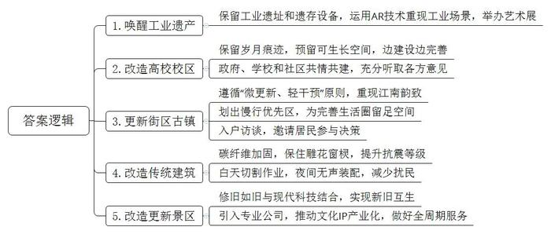
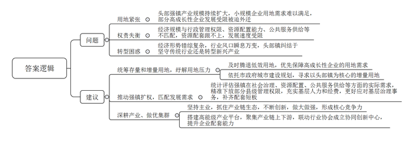
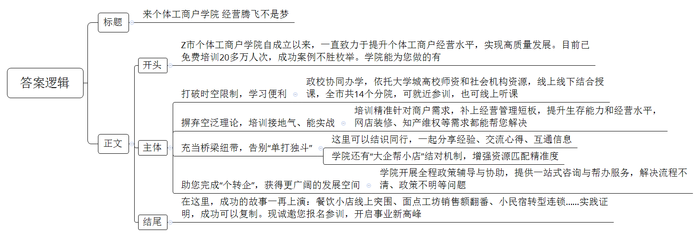
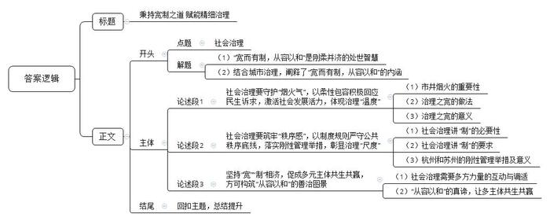

# 2026年公务员多省联考《申论》题（福建通用卷）

<!-- gwy:overview:start -->
> **福建 · 2026 · 申论 · 通用卷** ｜ 4 题 · 图片 4 处 · 答案随题折叠

导航：[题目](#题目) · [材料 1](#材料-1)
<!-- gwy:overview:end -->

> 候选采集稿。参考答案及解析来自粉笔页面，不代表官方答案或真实高分答卷；来源使用许可与原卷对应关系仍需人工核实。

## 给定材料

### 材料 1

城市更新需要温度，更需要智慧。近年来，C市积极创新理念，探索出一条传承历史、赋能当下、引领未来的城市更新之路。

在江南电厂遗址，锈蚀的锅炉与数字光影交织，AR技术重现了上世纪80年代初期的工业场景：运煤轨道车在虚实交织中穿梭，巨型发电机组吞吐能量的轰鸣声仿佛能够穿越时空……这座停摆多年的“能源堡垒”，如今已蜕变为年均举办23场先锋艺术展的“城市能量场”。C市建筑设计院高院长轻触涡轮残骸感慨：“这座工业遗产的唤醒，从立项到运营，我们团队参与始终，陪伴至今，虽有艰辛，但更多的是欣慰。”

“城市更新是件‘绣花’的细活、慢活，既要做到项目规划时的尽善尽美，也要允许项目完工时的弹性化交付，给建设、运营留有余地，给未来发展留足空间，让‘更好’成为可能。”高院长说。

滨江大学老校区更新后，校区的历史建筑群，灰木吊顶、黄土墙面等承载岁月痕迹的构件被精心保留，老教授们轻抚斑驳墙面时，青春记忆如潮水涌现。“以前供暖制冷能耗高，效果还不太好，现在有了智能楼宇系统，能耗降低了30%，使用起来也更舒适便捷了。”一位在此工作30年的老教授感慨道。“老校区的智能楼宇系统，是一边建设一边完善的结果。”高院长坦言。老校区更新规划之初，并没有智能楼宇系统的设想。后来，C市建筑设计院创新提出“预留10%-15%可生长空间”的项目方案，与滨江大学一同努力实现了历史建筑的“新旧共生”。

老校区改造后，图书馆日均接待市民超500人次，体育馆成为周边居民的健身打卡地。另外，与改造同步完成的校企共建产学研平台，已孵化23个科创项目，带动就业超2000人。“这种‘校园-社区-产业’融合模式打破了物理与心理的围墙，促进了产城融合，让高校资源反哺城市。”C市周副市长表示，“这是政府、学校和社区共情共建，充分听取师生和市民意见的结果。”

这样的“新旧对话”，不仅发生在校园，也在街区上演。滨江区春华路片区变化更新期间，C市始终遵循“微更新、轻干预”原则，修复18座古桥、疏浚5公里河道，重现“桥桥相映、户户临水”的江南韵致。同时，划出慢行优先区，为今后引入社区食堂、托育中心，完善“15分钟生活圈”留足空间。

“从江桥古镇改造开始，我们的团队就租下临街民房，和村民吃住在一起。”C市建筑设计院郑总工回忆道。郑总工团队通过每日入户访谈、邀请居民参与决策，最终采用“糯米灰浆”配方修复传统夯土墙，让江桥古镇更新具有了坚实的群众基础。更新完成后，商铺出租率从45%跃升至92%，原住民回流率达68%。

“凌晨两点，会议室还亮着灯，有时还会通宵。”说起江南饭店的改造，高院长记忆犹新。2018年初，C市传统越派建筑江南饭店改造项目给高院长出了一道难题：既要保留建筑的人文精髓，又需满足国际会议的功能需求。为确保项目质量，高院长亲自带队入驻工地，发现古建木梁存在虫蛀隐患后，连夜调整方案，采用碳纤维加固技术，既保住雕花窗棂，又将抗震等级提升至8级。为减少扰民，高院长将切割作业集中在白天，夜间仅进行无声装配。最终项目提前交付，成为“老建筑改造既好又快”的标杆。

在大禹陵景区的系列更新改造中，C市既做到修旧如旧，又立足现代科技，实现“新旧互生”。特别是大禹纪念馆的选址与建设，C市建筑设计院以现代手法演绎和重构历史人物与历史建筑意象，通过悬浮的建筑与镜面水池的映射呼应，刻画出大禹治水“疏而不堵”的伟绩。纪念馆采用全息投影等技术，将大禹治水的神话场景与当地水网地理数据叠加呈现，游客可通过多种方式交互体验“疏浚九河”的华夏文明及智慧。

“在城市更新中，我市着眼长远发展，坚持做好全周期服务。”周副市长说。景区系列更新改造完成后，C市通过招投标引入东方文化咨询公司，协助大禹纪念馆推动文化IP产业化，将文化赋能转化为经济新动能。如今，大禹纪念馆年均举办30余场跨界展示，吸引大量年轻观众，让历史人物与历史建筑重获新生。

“要尊重每一份细微的期待。”在郑总工看来，无论是滨江大学老校区的更新，还是大禹陵景区的系列改造，这些细节共同构成了城市更新的温情底色。当历史记忆与现代生活悄然融合，这场城市的“修行”，终将绘就一幅“人人皆是创作者”的美好图景。

### 材料 2

镇域经济被视为经济高质量发展的“毛细血管”，头部镇的发展对镇域经济起着标杆和示范作用。K省头部镇现状如何，面临哪些烦恼，该怎样突围？省发展改革委会同相关部门赴W市、J市、H市等地调研，寻找来自基层一线的答案。

秋日清晨的薄雾尚未散尽，前江口北岸的W市大竹镇已在一片物流货车的引擎声中苏醒。这里仅92平方公里，却生活着40多万人，相当于一个小型县城的规模。大竹镇拥有1.2万家企业，包括5家上市公司，是国内最大的低压电器集散中心。不论从直观感受还是经济数据来看，这里早已超越了很多人对于“镇”的认知，但在行政层级上依然还是建制镇。

350公里外的H市长兴区七里店镇，既有国家农业现代产业园、淡水水产研究所，也有商贸地标、音乐文化产业街区，甚至还有一个著名的红土网球中心。“七里店是镇，也是城，在这里很难找到镇与城市之间的界限。”镇党委徐书记表示，该镇的目标是成为集聚青年人才的创新之城，这种“半城半乡”的特质正是其优势所在。

不少头部强镇有发展雄心，但受困于“成长烦恼”。在J市白马镇，马路两边的企业密集地铺展，整个镇区显得特别拥挤。作为电气元器件制造强镇，63平方公里的土地上星罗棋布着约3000家工业企业。随着产业规模持续扩大，用地紧张问题越来越突出。镇党委刘书记介绍，在当地，一些年产值1亿元以上的企业用地需求能基本满足，产值5000万元以上的只能勉强获得供应，规模再小一点的企业就实在没办法了。“一些企业研发了新技术，但供地不足影响上新产线，企业发展因此受限，这让一些有成长性的企业不得不‘远走他乡’。”站在地图前的刘书记意识到，“要到大水缸里找水喝”。当前，J市正在实施“强城行动”，要举全市之力建设前江新城，而白马镇就处在前江新城核心区。“过去镇里解决不了的，这次或许就是机会。”

现在，不论走到哪个强镇，都能看到宽敞的马路、高耸的楼盘、密集的工厂，但与快速发展的经济相比，一些基础设施建设特别是医疗、教育、城市绿化等公共服务配套还存在差距。

在不同的头部镇，调研组都听到这样一句话：小马拉大车。这些强镇往往外来人口占比高，人口流动快，复杂的人员结构使得社会治安、公共卫生等管理事务快速增长，基层治理压力很大。“我们是镇级帽子，县级担子。”某强镇负责人说。头部镇的经济规模与行政管理权限、资源配置能力、公共服务供给等不匹配，导致资源配套跟不上，发展速度上不去。强镇扩权，成为基层强烈的呼声。

当下，经济形势错综复杂，行业风口瞬息万变，头部镇到底是坚守传统制造业，还是实现新兴产业战略转型？今年初，大竹镇党政班子前往外省调研。“走了不少地方，发现强镇发展模式各异，难以简单复制，但有一点是共通的：深耕产业、做优集群。”大竹镇胡镇长说，“产城融合度越高，越能吸引人口流入，从而反哺当地产业。”调研结束后，大竹镇选择在坚持主业的基础上牢牢抓住电气产业形成的生态，不断创新，做大做强，形成自己的核心竞争力。“这是我们最大的优势，扎实把这一亩三分地耕好才是正道。”胡镇长发现，曾经因为土地成本高等各种因素离开的企业，现在又因产业链和公共服务配套设施的完善而逐步回归了。

类似的故事也发生在J市洛西镇。“当前，短剧迎来风口，我们把微短剧作为发展方向，开启从‘横屏’到‘竖屏’的适配升级。”洛西镇党委朱书记认为，完备的“服化道机灯美”产业链，正是洛西镇于风浪中屹立不倒的根基。

随着高铁的联通，七里店镇积极主动融入区域发展格局，把招商方向瞄准了临近的两个大城市，发展起了以数控机床为代表的智能制造产业。多年低效用的腾退土地，终于有了用武之地。目前，七里店镇已成功招引8家智能制造企业，吸引了大量青年人才在此安家落户。

位于仙桃镇的智能汽车关键零部件产业平台，是W市首个省级“万亩千亿”新产业平台。国家级临空经济示范区也为仙桃镇的发展打开了重要的窗口。在临空“自贸+保税+跨境”综合赋能下，仙桃镇的产业实现了蝶变跃升，在对外开放中链接全球，展现了外向型经济发展的无限可能。“我们每年都能吸引数十亿级产业项目落地，秘诀就在这一高能级平台，这里集聚了产业链上下游，联动行业协会成立协同创新中心，不断提升企业配套能力。”仙桃镇赵镇长说。

### 材料 3

“学院老师教的这些内容，我听得懂，用得上。”个体工商户老陈在Z市福堂街经营餐饮店多年，但生意总是火不起来。看着越来越多顾客习惯用手机搜索餐厅，他也尝试在多个平台上线店铺，但曝光量低，订单量一直上不去。2023年2月，Z市市场监管局会同有关部门，成立了Z市个体工商户学院。老陈得知后，立刻前去报名。网店装修优化、关键词设置、根据平台算法调整营业时间和配送范围……老陈边学边做，请来摄影师重拍招牌菜图片，在菜品描述中加入“福堂街老味道”等关键词……一段时间下来，网上订单显著增加，高峰期营业额甚至超过线下。

“我们基本采取政校协同的办学模式。”个体工商户学院王院长介绍，为方便个体工商户就近接受培训，他们依托Z市大学城的高校师资和各类社会机构资源，建设了14个分院，采用线上线下相结合的授课方式，打破时空限制，提高学习便利性。“学院不是培养理论型人才，而是直接赋能个体工商户，通过提供接地气的实战培训，切实提升个体工商户的生存能力和经营水平。”

“左拎右送”工坊位于Z市黄岩区洋河镇直播基地内，其制作的蔓越莓、玫瑰等十几种创新口味的馒头深受欢迎。谈起这两年的快速发展，工坊负责人小杨如数家珍，仅去年，销售额就同比增长了200%，今年经营范围还将拓展到饮料生产、文化传媒等领域。“多亏了个体工商户学院的学习经历，让我补上了经营管理的短板，还让我的员工学会了制作短视频。学院的培训都是围绕我们的需求展开，缺什么，学院就提供什么，学了就能用。”小杨感激地说。

冷集区古方斋食品店的老方最近遇到了一件烦心事：有商户仿冒古方斋的产品进行销售，影响了品牌声誉。正当他一筹莫展之际，个体工商户学院专门邀请知识产权专家为区里的老字号品牌店主授课。“从品牌打造到商标申报、维权，学院为我们指了一条可行的路，提供了一系列服务支持。”老方称赞。

2021年，大学生小范回到家乡白沙镇，租下村建大楼办起民宿，还取了一个富有诗情画意的名字“花语堂”。一次次改造升级，一次次创新尝试，但“花语堂”的经营一直没有太大起色。“感觉自己像在风雨中独自前行。”小范说，“参加个体工商户学院的首期培训后，我找到了方向。”在学院，她结识了许多同行，一起分享经验、交流心得、互通信息。培训后的小范转变经营思路，逐渐将“花语堂”发展为一个连锁民宿品牌。2025年，“花语堂”获评省级公共品牌。

今年1月，Z市曲江区辉红服装厂在个体工商户学院的全程政策辅导与协助下，顺利完成了“个转企”。“这种变化是我以前不敢想的。”服装厂程总说，“学院提供的一站式咨询与帮办服务，帮我解决了遇到的流程不清、政策不明等问题，让我对未来发展有了更多憧憬。”

针对个体户大多“单打独斗”的现状，Z市还充分发挥个体工商户学院的桥梁纽带作用，创新推广“大企帮小店”结对机制，增强资源匹配精准度。“以前一个星期接不了几单，现在客户明显多起来了。”经营一家五金店的小姚说，在学院培训期间，小姚认识了林氏锁业创始人林总。在林总的悉心指导下，小姚对店铺的产品定位、品类选择、装潢布置等进行全方位改造提升，去年营业额突破百万元大关。

Z市个体工商户学院通过政校联动，研究本地个体经济发展状况，参与标准制定、发展指数发布等，助推本地特色产业集群化、规范化、品牌化发展。同时，还创新推出“个体户您好”APP，涵盖开店选址、装修标准等增值化服务事项，并为个体户“入市”提供辅导。

2023年以来，Z市通过个体工商户学院免费培训个体工商户20多万人次。“个体工商户不仅拥有庞大的从业人群，更承载着居民生活所需的方方面面。”Z市市场监管局洪局长表示，“下一步，我局将继续依托个体工商户学院开展分型分类培育，全方位提升个体工商户经营水平，持续赋能个体经济高质量发展。”

### 材料 4

2025年5月中旬，S市多部门联合发布了进一步优化设摊治理、提升城市“烟火气”工作方案，提出包容与鼓励守法合规的外摆位、设摊经营等活动。很多商家纷纷拨打12345市民服务热线，希望尽快落实外摆摊位政策。A区东建路北侧沿街商铺的商户们看到盛夏马上到来，对能否开设外摆位、扩大经营空间尤为关注。

东建路商户黄先生经营着一家小龙虾店，是这排店铺中开得最久的。他指着店内一角倚放着的折叠不锈钢方桌称，外侧红线区域可以容纳七八张这样的桌子，这意味着如果允许外摆，店里的经营面积能扩大一倍。“夏天晚上，外摆位带来的氛围感不是室内空间可比的。”黄先生说，“路人经过，看可以坐在室外喝啤酒吃龙虾，就愿意留下来坐一坐。”这几天他反复拨打12345市民服务热线，但得到的答复总是“根据有关规定，外摆位应设置在具有管理主体的商圈、景区、集市等区域，东建路商铺无管理主体，商户不得跨门经营”。

实际上，东建路几乎每个商家都备有可外摆的桌椅，只要有“机会”，就会把桌椅摆出去。由于未得到外摆许可，商家只能“打游击”。一旦有居民投诉商家跨门经营，城管就会来执法，要求商家将外摆位撤除。“既然需要‘烟火气’，这条街道又有条件，为何始终不给商家开放外摆位？”黄先生很不理解。

6月初，记者来到A区金融城物业管理中心。物业负责人称，商家在红线内开设外摆位，物业是支持的。早在两周前，物业收到商户希望在红线内开设外摆位的诉求，就第一时间咨询了属地的有关部门，均被告知“没有明确口径”。反复沟通下，针对商家开设外摆位后的管理措施，物业管理中心又问街道营商办是否需要相关部门来操作，街道营商办表示并没明确。

对于东建路商户的外摆诉求，街道营商办表示会尽快会同有关部门认真研判。如果东建路确实有条件开设外摆位，街道会给城管部门出具一份“说明”，建议同意商家开设外摆位。“但这不是正式的许可。”对方强调。

对于外摆位的正当性，B区转变思维，从外摆位是否对街道、社区有利，是否对激发业态、提升经济活力有利等多个角度进行分析研判。“切实把涉及老百姓切身利益的政策落实到位，是我们义不容辞的责任。”B区丁区长说。

早在去年4月，B区就在两个街道推行外摆位试点，建立了“沿街商铺外摆线上申报”系统。这一试点的管理逻辑是“自下而上”的，即商户提出申请，政府部门审核后给予许可。对于提出申请的商户，并不限定要有综合物业管理主体，也不强制外摆区域不能占用人行道。

“外摆不是‘随便摆’，也不能搞‘禁摆’一刀切，而是要在合规的前提下，找到商业活力与市容秩序的平衡点。”丁区长的这句话道出了外摆管理的核心逻辑。如何在S市推进城市精细化治理的背景下，突破“要么全禁、要么乱摆”的困境，各级部门需要整合资源，做好相关服务。

“商户都可以提出申请。复核时，只要不影响交通、不扰民，我们会尽量满足商户的需求。商户对外摆位实行自主管理，每个月需上传2次外摆自检照片，同时接受管理部门随机抽查，若出现3次以上违规将会被取消外摆资格。”相关部门负责人解释了试点的管理细节。下一步，B区将在全区主要商业道路实施外摆申请制，一街一策，让普通街区商户都享有外摆的机会。

傍晚6点，B区天星桥路的“焰喀”店铺外，几张餐桌已整齐摆放，桌角点缀的小绿植与暖黄色灯光相映，携宠而来的顾客正轻声交谈。这既是B区外摆经济的缩影，也是城市“烟火气”与“秩序感”共生的注脚。“外摆摊位多摆了几张桌子，却让城市更有活力，我们要做的就是‘<u><u>宽而有制，从容以和</u></u>’。”丁区长说。

## 题目

### 第 1 题

**请根据“给定资料1”，概括C市开展城市更新的主要做法。（15分）**

关联材料：材料 1

作答要求：

要求：全面、准确、有条理，不超过250字。

第 1 题 · 答案与解析

**参考答案（粉笔题库参考内容）**

1.唤醒工业遗产。保留工业遗址和遗存设备，运用AR技术重现工业场景，举办艺术展。

2.改造高校校区。保留岁月痕迹，预留可生长空间，边建设边完善；政府、学校和社区共情共建，充分听取各方意见。

3.更新街区古镇。遵循“微更新、轻干预”原则，重现江南韵致；划出慢行优先区，为完善生活圈留足空间；入户访谈，邀请居民参与决策。

4.改造传统建筑。碳纤维加固，保住雕花窗棂，提升抗震等级；白天切割作业，夜间无声装配，减少扰民。

5.改造更新景区。修旧如旧与现代科技结合，实现新旧互生；引入专业公司，推动文化IP产业化，做好全周期服务。

**解析**

**参考答案说明：**本参考答案从“唤醒工业遗产”“改造高校校区”“更新街区古镇”“改造传统建筑”“改造更新景区”五个方面展开，各条答案要点之间在内容上相互并列，没有交叉。

**考点**：概括措施类

**来源**：2026年公务员多省联考《申论》题（福建通用卷）

### 第 2 题

**调研结束后，调研组拟向领导汇报相关情况。假如你是调研组工作人员，请根据“给定资料2”，拟写调研报告的“存在问题”和“解决建议”部分。（20分）**

关联材料：材料 2

作答要求：

要求：

（1）问题梳理全面、准确、有条理；

（2）所提建议与问题相对应，针对性强、切实可行；

（3）层次分明，有逻辑性；

（4）不超过400字。

第 2 题 · 答案与解析

**参考答案（粉笔题库参考内容）**

问题：

1.用地紧张。头部强镇产业规模持续扩大，小规模企业用地需求难以满足，部分高成长性企业发展受限被迫外迁。

2.权责失衡。经济规模与行政管理权限、资源配置能力、公共服务供给等不匹配，资源配套跟不上，发展速度受限。

3.转型困惑。经济形势错综复杂，行业风口瞬息万变，头部镇纠结于坚守传统行业还是转型新兴产业。

建议：

1.统筹存量和增量用地，纾解用地压力。及时腾退低效用地，优先保障高成长性企业的用地需求；依托市政府城市建设规划，寻求以头部镇为核心的增量用地。

2.推动强镇扩权，匹配发展需求。统计评估强镇在社会治理、资源配置、公共服务供给等方面的实际需求，精准下放部分县级管理权限，充实基层人力和经费，更好应对基层治理事务，补齐配套短板。

3.深耕产业、做优集群。坚持主业，抓住产业链生态，不断创新，做大做强，形成核心竞争力；搭建高能级产业平台，聚集产业链上下游，联动行业协会成立协同创新中心，提升企业配套能力。

**解析**

**参考答案说明：**本参考答案整体分为“问题”和“建议”两个部分，其中“问题”部分从“用地紧张”“权责失衡”“转型困惑”三个方面展开；“建议”部分从“统筹存量和增量用地，纾解用地压力”“推动强镇扩权，匹配发展需求”“深耕产业、做优集群”三个方面展开，且所提建议与问题相对应。各条答案要点之间在内容上相互并列，没有交叉。

**考点**：提出对策类

**来源**：2026年公务员多省联考《申论》题（福建通用卷）

### 第 3 题

**请根据“给定资料3”，为Z市个体工商户学院撰写一份宣传材料，吸引更多个体工商户报名参训。（25分）**

关联材料：材料 3

作答要求：

要求：

（1）紧扣资料，内容全面；

（2）条理清晰，语言流畅；

（3）不超过450字。

第 3 题 · 答案与解析

**参考答案（粉笔题库参考内容）**

来个体工商户学院 经营腾飞不是梦

Z市个体工商户学院自成立以来，一直致力于提升个体工商户经营水平，实现高质量发展。目前已免费培训20多万人次，成功案例不胜枚举。学院能为您做的有：

一、打破时空限制，学习便利。政校协同办学，依托大学城高校师资和社会机构资源，线上线下结合授课，全市共14个分院，可就近参训，也可线上听课。二、摒弃空泛理论，培训接地气、能实战。培训精准针对商户需求，补上经营管理短板，提升生存能力和经营水平，网店装修、知产维权等需求都能帮您解决。三、充当桥梁纽带，告别“单打独斗”。这里可以结识同行，一起分享经验、交流心得、互通信息；学院还有“大企帮小店”结对机制，增强资源匹配精准度。四、助您完成“个转企”，获得更广阔的发展空间。学院开展全程政策辅导与协助，提供一站式咨询与帮办服务，解决流程不清、政策不明等问题。

在这里，成功的故事一再上演：餐饮小店线上突围、面点工坊销售额翻番、小民宿转型连锁……实践证明，成功可以复制。现诚邀您报名参训，开启事业新高峰！

**解析**

**参考答案说明：**（1）格式方面，本参考答案写到了“标题”“正文”两个部分。（2）正文部分，一方面从内容来看，开头先写了个体工商户学院的整体情况；主体从“打破时空限制，学习便利”“摒弃空泛理论，培训接地气、能实战”“充当桥梁纽带，告别‘单打独斗’”“助您完成‘个转企’，获得更广阔的发展空间”这四个方面介绍了其具体优势及作用；结尾再次总结学院的典型事例及发出呼吁。逻辑清楚，结构完整。另一方面，形式上，本参考答案做到了分段、分条撰写，整体上条理较为清晰。

**考点**：宣传类

**来源**：2026年公务员多省联考《申论》题（福建通用卷）

### 第 4 题

**“给定资料4”中提到“宽而有制，从容以和”。请对这句话进行深入系统的思考，结合社会治理工作，联系实际，自选角度，自拟题目，写一篇文章。（40分）**

关联材料：材料 1、材料 2、材料 3、材料 4

作答要求：

要求：

（1）观点明确，见解深刻，内容充实；

（2）参考给定资料，但不拘泥于给定资料；

（3）思路清晰，语言流畅；

（4）字数1000-1200字。

第 4 题 · 答案与解析

**参考答案（粉笔题库参考内容）**

**秉持宽制之道** **赋能精细治理**

古人推崇“宽而有制，从容以和”，以此作为立身修身的行事准则，这套刚柔并济的处世智慧，同样为当下城市治理提供了深刻指引。“宽”是对城市“烟火气”的包容，让市井生活焕发活力；“制”是对公共“秩序感”的坚守，让城市运行井然有序。城市精细化治理，唯有把握包容之宽、恪守规矩之制，摆脱一刀切管控与无序放任两极困境，方能实现“从容以和”的善治境界。

**社会治理要守护“烟火气”，以柔性包容积极回应民生诉求，激活社会发展活力，体现治理“温度”。**市井烟火不仅是街头巷尾的人声鼎沸、夏夜排档的热闹红火，更承载着小微商户生计、映照百姓日常所需。治理之宽，要摒弃一刀切的治理惯性，做好分析研判，从是否有利于激发业态活力、是否有利于增进民生福祉等维度进行科学考量，秉持以人为本思维体恤基层民生、包容市井业态；同时各级部门要整合资源，做好相关服务，保障经营者合理经营空间，为市民提供良好市井体验。唯有以宽厚之心接纳市井百态，方能让发展的活力在社会肌理中蓬勃生长。

**社会治理要筑牢“秩序感”，以制度规则严守公共秩序底线，落实刚性管理举措，彰显治理“尺度”。**如果只讲“宽”而不讲“制”，城市终将陷入“一放就乱”的无序状态。这就要求在放开经营空间的同时，必须通过明确的制度设计划定行为边界，刚性的管理措施落实制度。杭州市制定外摆经营“负面清单”和“七个不得”等刚性标准，做到“放开不放任”，让“一放就乱”不再上演；苏州市在姑苏区试点“分色管理”制度，精管善治沿街商户，通过“红黄绿牌”实施动态管理、辅助决策，提升监管效能和商户依法诚信经营能力。用刚性的制度把“秩序感”具象化，明确什么不可为、违反将受何种惩戒，才能让包容有底线、让活力有规矩。

**坚持“宽”“制”相济，促成多元主体共生共赢，方可构筑“从容以和”的善治图景。**社会治理从来不是单方面的管控，而是政府、市场、社会等多方力量的互动与调适。成功的治理，关键在于构建各方在规则共识下各得其所、各尽其责的良性生态——政府不再是高高在上的单一管控者，而是搭建平台、制定规则的统筹者；市场主体也不再是被动受管的对象，而是自我约束、参与共治的合伙人。管理者获得治理效能，经营者获得发展空间，公众获得生活品质，“烟火气”与“秩序感”从对立走向共生。这正是“从容以和”的真谛：不是静态的平衡，而是动态的和谐；不是僵化的妥协，而是智慧的共赢。当治理从“你输我赢”的博弈转向“共生共荣”的多赢格局，社会便有了持久发展的生命力。

新时代社会治理，既要守护市井烟火，以柔性包容赋予治理温度；也要坚守规则底线，以制度规则把控治理尺度。平衡烟火温情与城市秩序，统筹民生需求与公共利益，方能破除粗放治理弊病，绘就政通人和、民生安宁的善治画卷。

**文章分析**

**秉持宽制之道 赋能精细治理**

【**标题的优点：**首先，范文的标题突出了“社会治理”这一主题；其次，在形式上采用对称式结构，使标题更加完整、饱满。】

（1）古人推崇“宽而有制，从容以和”，以此作为<u><u>立身修身的行事准则</u></u>，这套<u><u>刚柔并济的处世智慧</u></u>，同样为当下<u><u>城市治理提供了深刻指引</u></u>。（2）<u><u>“宽”是对城市“烟火气”的包容</u></u>，<u><u>让市井生活焕发活力</u></u>；<u><u>“制”是对公共“秩序感”的坚守</u></u>，<u><u>让城市运行井然有序</u></u>。城市精细化治理，唯有<u><u>把握包容之宽</u></u>、<u><u>恪守规矩之制</u></u>，<u><u>摆脱一刀切管控与无序放任</u></u>两极困境，方能<u><u><u>实现</u></u></u><u><u><u>“从容以和”的善治境界</u></u></u>。

【**开头的优点：**★内容方面：范文的开头是紧扣“社会治理”这一主题展开的。首先，开头点出主题，做到了主题明确。其次，对“社会治理”这一主题进行了分析阐述：（1）指出了“宽而有制，从容以和”是刚柔并济的处世智慧；（2）结合城市治理，阐释了“宽而有制，从容以和”的内涵。★文字表达方面：使用了“唯有……方能……”等关联词，使语言表达有逻辑性。】

**社会治理要守护“烟火气”，以柔性包容积极回应民生诉求，激活社会发展活力，体现治理“温度”**。（1）市井烟火不仅是街头巷尾的人声鼎沸、夏夜排档的热闹红火，更承载着<u><u>小微商户生计</u></u>、映照<u><u>百姓日常所需</u></u>。（2）治理之宽，要<u><u>摒弃一刀切的治理惯性</u></u>，做好<u><u>分析研判</u></u>，从是否有利于<u><u>激发业态活力</u></u>、是否有利于<u><u>增进民生福祉</u></u>等维度<u><u>进行科学考量</u></u>，秉持<u><u>以人为本思维体恤基层民生</u></u>、<u><u>包容市井业态</u></u>；同时<u><u>各级部门要整合资源</u></u>，<u><u>做好相关服务</u></u>，<u><u>保障经营者合理经营空间</u></u>，为市民<u><u>提供良好市井体验</u></u>。（3）唯有以宽厚之心<u><u>接纳市井百态</u></u>，方能让<u><u>发展的活力</u></u>在社会肌理中蓬勃生长。

【**论述段1的优点：**★观点句：范文的观点句是紧扣“社会治理”这一文章主题提出的。形式上，它在段首处直接写出，位置突出，容易发现。内容上，关键词突出，内容要点明确，可以明显看出主要从“治理之宽，以柔性包容回应民生诉求”这个角度展开论述。★论述内容：（1）介绍了市井烟火的重要性；（2）介绍了治理之宽的做法，如：转变思维、科学考量、整合资源、做好服务等；（3）介绍了治理之宽的意义。注意：以上三个方面的内容都是紧扣“社会治理要守护‘烟火气’，以柔性包容积极回应民生诉求，激活社会发展活力，体现治理‘温度’”这个观点句进行分析论述的，论述的针对性强，内容层次丰富。在论述方法上主要采用了讲道理的方式，论述清晰透彻。】

**社会治理要筑牢“秩序感”，以制度规则严守公共秩序底线，落实刚性管理举措，彰显治理“尺度”**。（1）如果只讲“宽”而不讲“制”，<u><u>城市终将陷入</u></u>“一放就乱”的<u><u>无序状态</u></u>。（2）这就要求在<u><u>放开经营空间</u></u>的同时，必须<u><u>通过明确的制度设计划定行为边界</u></u>，<u><u>刚性的管理措施落实制度</u></u>。（3）<u><u>杭州市制定</u></u>外摆经营“负面清单”和“七个不得”等<u><u>刚性标准</u></u>，做到“放开不放任”，让“一放就乱”不再上演；<u><u>苏州市</u></u>在姑苏区<u><u><u>试点</u></u></u><u><u><u>“分色管理”制度</u></u></u>，精管善治沿街商户，通过“红黄绿牌”<u><u>实施动态管理</u></u>、<u><u>辅助决策</u></u>，<u><u>提升监管效能和商户依法诚信经营能力</u></u>。用刚性的制度把“秩序感”具象化，明确什么不可为、违反将受何种惩戒，才能<u><u>让包容有底线</u></u>、<u><u>让活力有规矩</u></u>。

【**论述段2的优点：**★观点句：范文的观点句是紧扣“社会治理”这一文章主题提出的。形式上，它在段首处直接写出，位置突出，容易发现。内容上，关键词突出，内容要点明确，可以明显看出主要从“治理之制，以制度规则守护公共秩序”这个角度展开论述。★论述内容：（1）介绍了社会治理讲“制”的必要性；（2）介绍了社会治理讲“制”的要求；（3）介绍了杭州和苏州的刚性管理举措及意义。注意：以上三个方面的内容都是紧扣“社会治理要筑牢‘秩序感’，以制度规则严守公共秩序底线，落实刚性管理举措，彰显治理‘尺度’”这个观点句进行分析论述的，论述的针对性强，内容层次丰富。在论述方法上采用了讲道理与举例子相结合的方式，论述充实透彻。】

**坚持“宽”“制”相济，促成多元主体共生共赢，方可构筑“从容以和”的善治图景**。（1）社会治理从来不是单方面的管控，而是<u><u>政府、市场、社会等多方力量的互动与调适</u></u>。成功的治理，关键在于<u><u>构建</u></u>各方在规则共识下各得其所、各尽其责的<u><u>良性生态</u></u>——<u><u>政府</u></u>不再是高高在上的单一管控者，而是<u><u>搭建平台</u></u>、<u><u>制定规则</u></u>的统筹者；<u><u>市场主体</u></u>也不再是被动受管的对象，而是<u><u>自我约束</u></u>、<u><u>参与共治</u></u>的合伙人。（2）<u><u>管理者获得治理效能</u></u>，<u><u>经营者获得发展空间</u></u>，<u><u>公众获得生活品质</u></u>，“烟火气”与“秩序感”从对立走向共生。这正是“从容以和”的真谛：不是静态的平衡，而是<u><u>动态的和谐</u></u>；不是僵化的妥协，而是<u><u>智慧的共赢</u></u>。当治理从“你输我赢”的博弈转向“共生共荣”的<u><u>多赢格局</u></u>，社会便有了持久发展的生命力。

【**论述段3的优点：**★观点句：范文的观点句是紧扣“社会治理”这一文章主题提出的。形式上，它在段首处直接写出，位置突出，容易发现。内容上，关键词突出，内容要点明确，可以明显看出主要从“宽制相济，促成多主体‘从容以和’”这个角度展开论述。★论述内容：（1）介绍了社会治理需要多方力量的互动与调适；（2）介绍了“从容以和”的真谛，让多主体共生共赢。注意：以上两个方面的内容都是紧扣“坚持‘宽’‘制’相济，促成多元主体共生共赢，方可构筑‘从容以和’的善治图景”这个观点句进行分析论述的，论述的针对性强，内容层次丰富。在论述方法上主要采用了讲道理的方式，论述清晰深刻。】

【**论述段之间的关系：**★内容的内在逻辑：范文的论述段之间是依照“并列”的逻辑展开的。论述段1先写了“治理之宽，以柔性包容回应民生诉求”，论述段2再写了“治理之制，以制度规则守护公共秩序”，论述段3接着写了“宽制相济，促成多主体‘从容以和’”。文章整体论述思路清晰。】

新时代社会治理，既要守护市井烟火，以柔性包容赋予治理温度；也要坚守规则底线，以制度规则把控治理尺度。平衡烟火温情与城市秩序，统筹民生需求与公共利益，方能破除粗放治理弊病，绘就政通人和、民生安宁的善治画卷。

【**结尾的优点：**范文的结尾回扣了“社会治理”这个主题，并且进行了总结提升。】

**解析状态：unknown（来源未提供）**

**考点**：文章写作题

**来源**：2026年公务员多省联考《申论》题（福建通用卷）

