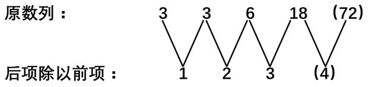
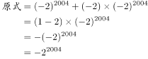
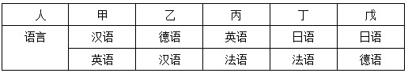
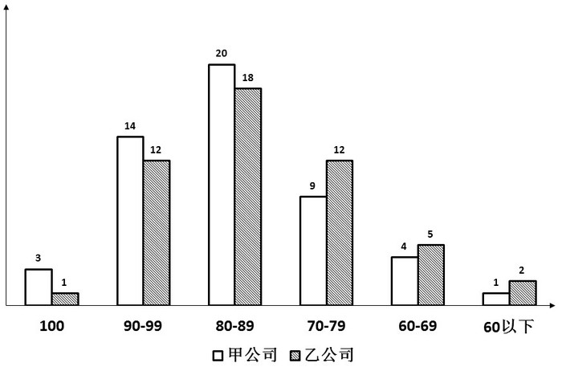
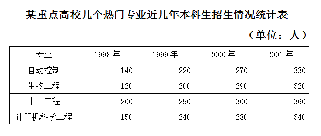

# 2008年贵州省公务员录用考试《行测》题

<!-- gwy:overview:start -->
> **贵州 · 2008 · 行测 · 统考** ｜ 88 题 · 图片 21 处 · 答案随题折叠

| 题型模块 | 题量 | 题号 |
| --- | ---: | ---: |
| 数量关系 | 13 | 1–13 |
| 言语理解与表达 | 30 | 14–43 |
| 判断推理 | 20 | 44–63 |
| 基本常识 | 10 | 64–73 |
| 资料分析 | 15 | 74–88 |
| **合计** | **88** | |

导航：[题型与作答说明](#题型与作答说明) · [题目](#题目) · [材料 1](#材料-1)
<!-- gwy:overview:end -->

> 候选采集稿。参考答案及解析来自粉笔页面，不代表官方答案或真实高分答卷；来源使用许可与原卷对应关系仍需人工核实。

## 题型与作答说明

数量关系

（13题）

本部分包括数字推理与数学运算两种类型的试题。

言语理解与表达

（30题）

本部分包括语句表达、阅读理解与文章阅读三种类型的试题，均为单项选择题。

判断推理

（20题）

本部分包括逻辑判断、类比推理与常识判断三种类型的试题。

基本常识

（10题）

根据题目要求，在四个选项中选出正确答案。

资料分析

（15题）

所给出的图表（形）或一段文字均有5个问题要你回答。你应根据资料提供的信息进行分析、比较、计算和判断处理。

## 题目

### 第 1 题

3，3，6，18，（  ）

A. 24

B. 72

C. 36

D. 48

第 1 题 · 答案与解析

**参考答案（粉笔题库参考内容）**

B

**解析**

故正确答案为B。

**来源**：2008年贵州省公务员录用考试《行测》题第1题

### 第 2 题

9，4，7，-4，5，4，3，-4，1，4，（  ），（  ）

A. 0，4

B. 1，4

C. \-1，-4

D. \-1，4

第 2 题 · 答案与解析

**参考答案（粉笔题库参考内容）**

C

**解析**

原数列为交叉数列：

奇数项：9、7、5、3、1、(-1)为等差数列；

偶数项：4、-4、4、-4、4、(-4)为周期数列。

故空缺项分别为-1、-4。

故正确答案为C。

**来源**：2008年贵州省公务员录用考试《行测》题第2题

### 第 3 题

\-81，-36，-9，0，9，36，（  ）

A. 49

B. 64

C. 81

D. 100

第 3 题 · 答案与解析

**参考答案（粉笔题库参考内容）**

C

**解析**

观察数列，第2项与倒数第2项、第3项与倒数第3项均互为相反数，和为0，故可推断首项与末项的和为0，则末项应为81。

故正确答案为C。

**来源**：2008年贵州省公务员录用考试《行测》题第3题

### 第 4 题

1，2，6，24，（  ）

A. 56

B. 120

C. 96

D. 72

第 4 题 · 答案与解析

**参考答案（粉笔题库参考内容）**

B

**解析**

观察数列有如下多级数列规律：

故正确答案为B。

**来源**：2008年贵州省公务员录用考试《行测》题第4题

### 第 5 题

\-26，-6，2，4，6，（  ）

A. 11

B. 12

C. 13

D. 14

第 5 题 · 答案与解析

**参考答案（粉笔题库参考内容）**

D

**解析**

原数列为三级等差数列。

故正确答案为D。

**来源**：2008年贵州省公务员录用考试《行测》题第5题

### 第 6 题

\-32+5-3-5+12 的值为（  ）

A. 22

B. \-22

C. 23

D. \-23

第 6 题 · 答案与解析

**参考答案（粉笔题库参考内容）**

D

**解析**

移项简化计算，原式=-32+(5-5)+(12-3)=-32+9=-23。

故正确答案为D。

**来源**：2008年贵州省公务员录用考试《行测》题第6题

### 第 7 题

的值为(     )。

A. 2^2004

B. -2^2005

C. -2^2004

D. 2^2005

第 7 题 · 答案与解析

**参考答案（粉笔题库参考内容）**

C

**解析**

根据幂运算法则，有：

故正确答案为C。

**来源**：2008年贵州省公务员录用考试《行测》题第7题

### 第 8 题

一辆汽车以60千米/时的速度从A地开往B地，它又以40千米/时的速度从B地返回A地，则汽车行驶的平均速度为多少千米/小时：

A. 50

B. 48

C. 30

D. 20

第 8 题 · 答案与解析

**参考答案（粉笔题库参考内容）**

B

**解析**

解析1：

根据等距离平均公式，可知该辆汽车的平均速度为。

等距离平均公式：。

解析2：

假设AB两地的距离为240千米，则该汽车往返的时间分别为240÷60＝4小时、240÷40＝6小时，故汽车行驶的平均速度为。

故正确答案为B。

**考点**：平均速度

**来源**：2008年贵州省公务员录用考试《行测》题第8题

### 第 9 题

某商品标价为165元，若降价以9折出售，仍可获利10%（相对于进价），则该商品的进货价为多少元：

A. 135

B. 136

C. 140

D. 145

第 9 题 · 答案与解析

**参考答案（粉笔题库参考内容）**

A

**解析**

因实际售价是进货价的(1＋10%)，则进货价为165×90%÷(1＋10%)＝135元。

故正确答案为A。

**考点**：经济利润问题

**来源**：2008年贵州省公务员录用考试《行测》题第9题

### 第 10 题

篮子里装有不多于500个苹果，如果每次二个、每次三个、每次四个、每次五个、每次六个地取出，篮子中都剩下一个苹果，而如果每次七个地取出，那么没有苹果剩下，篮子中共有多少个苹果：

A. 298

B. 299

C. 300

D. 301

第 10 题 · 答案与解析

**参考答案（粉笔题库参考内容）**

D

**解析**

由题意，篮子中的苹果数目n是一个奇数，且n-1能同时被2、3、4、5、6整除，即n-1是60的倍数。在不大于500的正整数中，60的倍数有60、120、180、240、300、360、420、480，分别加上1为61、121、181、241、301、361、421、481，其中能被7整除的只有301。所以篮子中共有苹果301个。

故正确答案为D。

**考点**：和差倍比问题

**来源**：2008年贵州省公务员录用考试《行测》题第10题

### 第 11 题

某施工队计划用120个劳动力在规定时间内完成一定的挖土任务，施工25天后，因调走30人，于是每人每天必须多挖1方土才能在规定时间内完成任务。问：在25天后每人每天挖土多少方：

A. 3

B. 4

C. 5

D. 6

第 11 题 · 答案与解析

**参考答案（粉笔题库参考内容）**

B

**解析**

方法一：

设在25天后每人每天挖土n方，规定完成时间为t天，由题意有：。消项解方程，得n＝4。

方法二：

调走30人后，只有120－30＝90人参与施工，这90人要按时完成120人的工作量，这90人的工效必须是原来的120/90，即工效必须提升30/90=1/3；由题干可知，每人每天必须多挖1方土，才能将工效提升1/3，即每人每天本来应挖土1×3＝3方。故在25天后每人每天挖土3＋1＝4方。

故正确答案为B。

**考点**：给具体单位型

**来源**：2008年贵州省公务员录用考试《行测》题第11题

### 第 12 题

两个运输队，第一队有320人，第二队有280人，现因任务变动，要求第二队的人数是第一队人数的2倍，需从第一队抽调多少人到第二队：

A. 80人

B. 100人

C. 120人

D. 140人

第 12 题 · 答案与解析

**参考答案（粉笔题库参考内容）**

C

**解析**

解析1：

设需抽调n人，根据题意可得2×(320－n)＝280＋n，解得n＝120。

解析2：

两个运输队的总人数不变，为320＋280＝600人；由倍数关系知，抽调后第一队的人数为600÷(2＋1)＝200人，即抽调了320－200＝120人到第二队。

故正确答案为C。

**考点**：和差倍比问题

**来源**：2008年贵州省公务员录用考试《行测》题第12题

### 第 13 题

铺设一条自来水管道，甲队单独铺设8天可以完成，而乙队每天可铺设50米。如果甲、乙两队同时铺设，4天可以完成全长的2/3 ，这条管道全长是多少米：

A. 1000米

B. 1100米

C. 1200米

D. 1300米

第 13 题 · 答案与解析

**参考答案（粉笔题库参考内容）**

C

**解析**

解析1：

设甲队每天可铺设n米，由题意列方程得：，解得n＝150。故这条管道全长150×8＝1200米。

解析2：

设全长为n米，甲队单独做要8天完成，则每天完成n/8米，由已知条件有，解得n＝1200米。

故正确答案为C。

**考点**：给具体单位型

**来源**：2008年贵州省公务员录用考试《行测》题第13题

### 第 14 题

潮州地区在几年的发展过程中，既造就了一批有作为的弄潮儿，也＿＿＿＿了一些意志薄弱者。

上面划线处填入词语，最恰当的是：

A. 暴露

B. 出现

C. 清除

D. 淘汰

第 14 题 · 答案与解析

**参考答案（粉笔题库参考内容）**

D

**解析**

此题考查近义实词的语境搭配。

从题干可以看出，“弄潮儿”与“意志薄弱者”为语义相对的词，所以，空格处应填与“造就”语义相对的选项。

“淘汰”是指去掉差的、不合适的，意思与“造就”相对，D选项正确。

“暴露”是说隐蔽的事物、矛盾、缺陷、问题等显露出来；“出现”意为呈现，显露，词义甚广，没有针对性；“清除”是指扫除干净，全部去掉，与题干“一些”不符。

故正确答案为D。

**考点**：关联关系-并列关系、实词填空、词的辨析-词义侧重

**来源**：2008年贵州省公务员录用考试《行测》题第14题

### 第 15 题

对盗伐林木者要严肃查处，如果姑息肇事者，少数人得不到惩处，就会使更多的人＿＿＿＿＿，＿＿＿＿＿，＿＿＿＿＿，最终使国家资源蒙受损失。

上面划线处依次填入成语，最恰当的是：

A. 以身试法，肆无忌惮，群起效尤

B. 肆无忌惮，以身试法，群起效尤

C. 肆无忌惮，群起效尤，以身试法

D. 群起效尤，以身试法，肆无忌惮

第 15 题 · 答案与解析

**参考答案（粉笔题库参考内容）**

C

**解析**

题目考查成语理解与排序。

根据题干意思，这三个成语在语义上应该是前后连贯，感情色彩严重程度逐渐加深的。

“以身试法”是说亲身去做触犯法律的事。“肆无忌惮”指非常放肆，一点没有顾忌。“群起效尤”意思是大家一起向坏的学习。根据正常的逻辑思维，如果犯了错误得不到惩处，就会积累肇事者的恶习，让他们在态度上更加无所顾忌，从而引发更多的人效仿这种不良的行为，所以“肆无忌惮”和“群起效尤”在语义上应该是前后相接的；“以身试法”的感情色彩在三个成语中最强烈，触犯了法律，造成了重大的恶劣后果，才使国家资源造成了损失，应排在最后。

所以正确顺序应为“肆无忌惮”“群起效尤”“以身试法”。

故正确答案为C。

**考点**：成语填空、词的辨析-程度轻重

**来源**：2008年贵州省公务员录用考试《行测》题第15题

### 第 16 题

《律师法》当年是在封闭情况下制定的，因此要作修订，以利于对中外律师的＿＿＿＿一体保护。

上面划线处填入词语，最恰当的是：

A. 权力

B. 权益

C. 权利

D. 利益

第 16 题 · 答案与解析

**参考答案（粉笔题库参考内容）**

B

**解析**

本题考查对实词理性意义的理解和语境搭配。

“权力”是指权位、势力；“利益”是指好处。“权益”指公民受法律保护的权力和利益。题干中《律师法》保护的当然是律师的权力和利益，所以选“权益”。“权利”广义的讲就是人在相应的社会关系中应该得到的价值回报。不符合文意。所以不选。

故正确答案为B。

**考点**：实词填空、对应关系-前后呼应、词的辨析-词义侧重

**来源**：2008年贵州省公务员录用考试《行测》题第16题

### 第 17 题

依次在横线处填上词语，最恰当的一组是（  ）。

长江流域，无疑也是中华民族文化的＿＿＿之一。考古发现＿＿＿，旧石器时代处于长江上游今云南境内的元谋人，与黄河流域今陕西境内的蓝田人＿＿＿。这个结论具有划时代的意义。

A. 发源地 表明 共存

B. 发祥地 证明 并存

C. 发源地 证明 并存

D. 发祥地 表明 共存

第 17 题 · 答案与解析

**参考答案（粉笔题库参考内容）**

B

**解析**

第一空，形容长江流域对于中华民族文化的作用，“发祥地”原指帝王祖先兴起的地方，现用来指民族、革命、文化等起源的地方，填入文段表达长江流域是中华民族文化的起源，语义恰当。“发源地”指河流开始流出的地方或者借指可考证的、物质范畴的发出、根源之处，而文段重在强调文化的起源，故与文段不符，排除A、C两项。

第二空，根据文意可知，横线处表达根据考古发现得出结论，B项“证明”指根据确实的材料判明真实性，题目中提到“考古发现”，也就是有证据支撑，故“证明”语义恰当，对应B项。D项“表明”是表示清楚地让外界知道自己的想法或态度，无法体现出考古发现的作用，排除。

第三空，代入“并存”验证，“并存”是指作为单独个体并列存在，两者之间可以不相互依靠；而“共存”是指一起作为一体存在，两者有相互依赖的意思，根据语意可知此处用“并存”合适。

故正确答案为B。

**考点**：实词填空、对应关系-前后呼应、词的辨析-搭配对象、词的辨析-词义侧重

**来源**：2010年黑龙江省公务员录用考试《行测》题第32题

### 第 18 题

目前，以经济和科技领衔的全球化浪潮正迅猛地＿＿＿＿整个地球村。

上面划线处填入词语，最恰当的是：

A. 风靡

B. 席卷

C. 覆盖

D. 平铺

第 18 题 · 答案与解析

**参考答案（粉笔题库参考内容）**

B

**解析**

此题考查近义实词的语境搭配和不同侧重点辨析。

“席卷”是指像卷席子一样包裹，生动形象地把地球村被全球化浪潮包围的状态描述了出来，所以应该选B。

“风靡”是用来形容事物很风行，像风吹倒树木，不符合题意；“覆盖”指遮盖或指地面成片生长的植物；“平铺”是指平着铺展开。均不能完全表达句意。

故正确答案为B。

**考点**：实词填空、词的辨析-搭配对象

**来源**：2008年贵州省公务员录用考试《行测》题第18题

### 第 19 题

找出有歧义的一句是：

A. 他的友好的举动，赢得了人家的赞许

B. 诸葛亮挥泪斩马谡

C. 他发明的卧式粉碎机得到了客户的好评

D. 两个工厂的领导等着经理回来给他们批钢材

第 19 题 · 答案与解析

**参考答案（粉笔题库参考内容）**

D

**解析**

考查语句歧义辨析。

D选项指代对象不明确，“两个工厂的领导”有两个意思：一是同一工厂中的两个领导，二是两个不同工厂的领导。

A、B、C选项都没有歧义。

故正确答案为D。

**来源**：2008年贵州省公务员录用考试《行测》题第19题

### 第 20 题

关于中国传统文化将成为21世纪的主导性文化的观点，十分流行。西方一些学者也持有此类观点，对此，我则持怀疑态度。

“我”认为中国传统文化将成为21世纪的主导性文化吗：

A. 无所谓

B. 不可能

C. 怀疑

D. 肯定会

第 20 题 · 答案与解析

**参考答案（粉笔题库参考内容）**

C

**解析**

此题的关键在于“对此，我则持怀疑态度”一句，根据句子意思可知，“此”指的是“中国传统文化将成为21世纪的主导性文化”。

故正确答案为C。

**考点**：特殊问法

**来源**：2008年贵州省公务员录用考试《行测》题第20题

### 第 21 题

下列各句中没有语病的一句是：

A. 一篇议论文观点正确、论据充分、结构完整，是衡量其好坏的重要标准

B. 由于《古文观止》具有特色，自问世以后近三百年来，广为传布，经久不衰，至今仍不失为一部有价值的选本

C. 采取各种办法培养餐饮业服务人员的水平，尤其是青年同志的水平，是当务之急

D. 市领导在检查某市属国营企业工作时，提醒他们要向竞争对手南方企业学习

第 21 题 · 答案与解析

**参考答案（粉笔题库参考内容）**

D

**解析**

此题考查病句辨析。

D选项语义通顺，表达正确。

A选项句式杂糅，应改为：“衡量一篇议论文好坏的重要标准是：观点是否正确，论据是否充分，结构是否完整”；B选项缺少主语，应改为：“自其问世以后近三百年来”；C选项搭配不当，“培养”不能搭配“水平”，应改为：“采取各种办法提高餐饮业服务人员的水平，尤其是青年同志的水平，是当务之急”。

故正确答案为D。

**来源**：2008年贵州省公务员录用考试《行测》题第21题

### 第 22 题

从以下各句中找出没有语病的一句是：

A. 努力学习文化知识与否，这是衡量一个青年学生愿意为四化贡献的大问题

B. 在一次战斗中，他负伤了

C. 研究表明，《红楼梦》作者是高鹗和曹雪芹合作完成的

D. 代表们在经济工作会议上的讨论发言，很值得我们注意重视

第 22 题 · 答案与解析

**参考答案（粉笔题库参考内容）**

B

**解析**

此题考查病句辨析。

经分析可知，A选项中主语是一个正反否定的句式，与之对应的宾语也应该是一个正反否定的句式，应在“愿意”前加上“是否”；C选项句式杂糅，去掉“作者”或者“合作完成的”；D选项“注意”与“重视”重复，应删掉其中一个。

故正确答案为B。

**来源**：2008年贵州省公务员录用考试《行测》题第22题

### 第 23 题

请找出有歧义的一句是：

A. 在古代，黄河流域的自然环境是很优越的

B. 在座的教师和同学都以热烈的掌声欢迎这位英雄的父亲和他的小儿子

C. 殷代以后，黄河中下游流域成为我国开发最早的地区

D. 黄河流域成为中华民族成长的摇篮

第 23 题 · 答案与解析

**参考答案（粉笔题库参考内容）**

B

**解析**

此题考查语句歧义辨析。

B选项中“这位英雄的父亲和他的小儿子”有歧义，一个意思是，大家欢迎的是这位英雄的父亲和这位英雄的小儿子；另一个意思是，大家欢迎的是这位英雄的父亲和英雄父亲的小儿子。

A、C、D选项均没有歧义。

故正确答案为B。

**来源**：2008年贵州省公务员录用考试《行测》题第23题

### 第 24 题

人大代表在选举的基础上产生。根据《选举法》规定，中华人民共和国年满十八周岁的公民，不分种族、民族、性别、职业、家庭出身、宗教信仰、教育程度、财产状况和居住期限，都有选举权和被选举权。但是依照法律被剥夺政治权利的人没有选举权和被选举权。

这段话主要支持了这样一个论点，即：

A. 人大代表的产生方式是选举

B. 选举法规定了年满十八周岁的中华人民共和国公民享有选举权

C. 选举权的行使不受任何非法限制和剥夺

D. 选举权的行使受到政治法律等方面的限制

第 24 题 · 答案与解析

**参考答案（粉笔题库参考内容）**

D

**解析**

据提问“主要支持”可知此题为中心理解题。

根据材料中“但是”可知，尾句为重点。意思是除了依照法律被剥夺政治权利的人没有选举权和被选举权，其余所有中华人民共和国年满十八周岁的公民都有选举权和被选举权。所以，这段话的论点很明显，就是选举权和被选举权的行使受到政治法律等方面的限制。

A、B选项说法只是片面的意思表达，未能完全表达整段话的意思；C选项与文意不符。

故正确答案为D。

**考点**：关联词-转折

**来源**：2008年贵州省公务员录用考试《行测》题第24题

### 第 25 题

目前人造关节所用的材料不外乎金属和塑料两大类。由于人体内钾、钠、氯等化学物质可能使金属材料腐蚀生锈，塑料老化，所以选用的金属和塑料的化学性质必须高度稳定。

这段话的主要观点是：

A. 人造关节必须用金属制造

B. 塑料人造关节容易老化

C. 人体内钾、钠、氯等化学物质很活跃，有腐蚀作用

D. 制造人造关节必须选用化学性质高度稳定的金属和塑料

第 25 题 · 答案与解析

**参考答案（粉笔题库参考内容）**

D

**解析**

据提问“主要观点”可知此题为中心理解题。

材料首先提出人造关节所用的材料主要是金属和塑料两大类，又根据人体内的化学物质可能会使这两类材料有所损坏，最后通过总结词“所以”得出结论：选用的金属和塑料的化学性质必须高度稳定。

所以很明显D项的表达最能完整概括材料的意思。

A选项与文意不符；B、C选项不是此段话的重点。

故正确答案为D。

**考点**：关联词-因果

**来源**：2008年贵州省公务员录用考试《行测》题第25题

### 第 26 题

个体总是生活在一定的制度安排中，中国传统儒家制度安排大多是非正式，强调行为规则的内化过程，不重视外在强制约束，具有较高的灵活性。因此：

A. 儒家制度具有现代性

B. 在儒家制度的安排下，个体可以随心所欲，不受约束

C. 在儒家制度的安排下，个体能以自我制度规则的理解来灵活地调整自己的行为规则

D. 在儒家制度的安排下，个体能获得最大的自由

第 26 题 · 答案与解析

**参考答案（粉笔题库参考内容）**

C

**解析**

题目考查对材料语句的理解。

根据题干意思可知，中国传统儒家制度安排对个体不做外在的强制约束，而是强调个体行为的“内化”，说明个体可以基于自己内心对制度规则的理解，对自己的行为灵活地进行自我调整。

C选项能够完整表达此意思。

A选项在材料中并没有涉及到；B、D选项与文意不符。

故正确答案为C。

**考点**：句子

**来源**：2008年贵州省公务员录用考试《行测》题第26题

### 第 27 题

语言和语言的碰撞和融合是文化交往的一部分。现今世界，这种交往正在变得更频繁、更迅速，然而从一种语言本身来看，它总是既要保持过去的精华，又要吸收外来因素，否则无法传达新的现实。在这段话里，“语言与语言的碰撞和融合”是指：

A. 一种语言对另一种语言的吸收

B. 不同语言彼此间的相互影响，相互吸收

C. 对外来语言取其精华，去其糟粕

D. 既保持本国语言的精华，又吸收外来语言的合理成分

第 27 题 · 答案与解析

**参考答案（粉笔题库参考内容）**

B

**解析**

据提问可知此题为词句理解题。

材料用“文化交往的一部分”，“既要保持过去的精华，又要吸收外来因素”来对“语言与语言的碰撞和融合”进行描述，通过这些描述可以看出，“语言与语言的碰撞和融合”指的就是不同语言之间的相互影响，相互吸收。

因此，结合选项应该选择B。

A、C、D的表述都很片面，只提到了吸收、融合，并没有提到碰撞、影响。

故正确答案为B。

**考点**：实词

**来源**：2008年贵州省公务员录用考试《行测》题第27题

### 第 28 题

扫描电子显微镜在物证检验中有着广泛的用途。它对工具痕迹、弹头、弹壳上痕迹的检验非常有用，对毛发、射击残留物和其他微细物证也极为有用。扫描电子显微镜不仅能以极高的倍数提供物证的形态和表面结构特点的放大图像，而且由于有很好的景深，还能提供清晰的三维图像。这些优点都是一般光学显微镜所不及的。此外，扫描电子显微镜与X射线分析仪联网还能对验材进行定性分析。

这段话中主要支持了这样一个论点，即：

A. 扫描电子显微镜在物证检验中有广泛的用途

B. 扫描电子显微镜的优点其他光学显微镜不具备

C. 扫描电子显微镜有适于物证检验的优点

D. 扫描电子显微镜是物证检验中运用最广泛的一种仪器

第 28 题 · 答案与解析

**参考答案（粉笔题库参考内容）**

A

**解析**

据提问“主要支持”可知此题是中心理解题。

材料第一句话直接点明主体“扫描电子显微镜在物证检验中有着广泛的用途”，后面都是围绕这个主体展开的。所以材料明显属于总分结构。

主旨为“总”的部分，即“扫描电子显微镜在物证检验中有广泛的用途”。所以答案选A。

B选项与文意不符；C选项并不是材料的主要意思；D选项材料并没有提到。

故正确答案为A。

**考点**：分述句特征-多角度论述、特殊问法

**来源**：2008年贵州省公务员录用考试《行测》题第28题

### 第 29 题

在人体的生长发育过程中，脉搏、血压和肺活量指标的机能状况具有明显的年龄特点和性别差异。

能直接支持这句话观点的是：

A. 年龄和性别对脉搏、血压和肺活量有影响

B. 人体的生长发育是不同的

C. 男性脉搏比女性慢

D. 血压和肺活量有关联

第 29 题 · 答案与解析

**参考答案（粉笔题库参考内容）**

A

**解析**

据提问和选项可知此题为细节判断题。

题目问的是选项中能“直接”支持题干的一项。

A选项说年龄和性别对脉搏、血压和肺活量有影响，很明显能直接得出“脉搏、血压和肺活量指标的机能状况具有明显的年龄特点和性别差异”。所以A正确。

B选项的说法太过宽泛，不能直接得出题干的内容；C、D选项题干中均没有体现出来。

故正确答案为A。

**考点**：细节判断题

**来源**：2008年贵州省公务员录用考试《行测》题第29题

### 第 30 题

在战争问题上，日本政府一直采取蒙混过关的态度，不去正视历史，还声称日本没有像希特勒那样的战争狂人，企图将某个民族像犹太人那样灭绝掉。在面对二战造成的灾难时，也往往一味强调日本受到的伤害，俨然以二战的受害者自居，尤其是一些右翼政客，置周边国家人民的强烈反对于不顾，屡次三番地去靖国神社参拜；相反，却对被侵略国家人民遭受的创伤轻描淡写，根本就不提对战争罪行谢罪之事。
这段话表明：

A. 日本人侵略成性，是彻头彻底的法西斯

B. 日本坚持扩张之路，至今仍未放弃这样的军国主义道路，有朝一日仍将完成征服周边国家的计划

C. 日本已彻底转右，否认和歪曲历史，是为新的扩张找借口

D. 日本政府某些政客丧失了良知，缺乏与周边国家友好的诚意

第 30 题 · 答案与解析

**参考答案（粉笔题库参考内容）**

D

**解析**

根据提问可知本题为中心理解题。

材料为“总分”结构，首句提出材料的观点“在战争问题上，日本政府一直采取蒙混过关的态度，不去正视历史”，后面列举了一些具体的做法来进行论证。

因此，结合选项应该选择D。D项内容为主旨句的同义替换，为正确答案。

A、B两项文中并未涉及，且说法太过偏激，排除；C项说法太过绝对，在文中找不到依据，排除。

故正确答案为D。

**考点**：分述句特征-多角度论述

**来源**：2008年贵州省公务员录用考试《行测》题第30题

### 第 31 题

民事主体的人格生而平等，每个人都可依自己的精神生活、物质生活的需要自由支配自己的人格，他人不得支配，否则将是对他人独立人格的否定。当然无民事行为能力人或者限制民事行为能力人需要法定代理人代其进行民事活动，甚至支配其人格利益。从形式上讲，这种情况似乎是对民事主体独立人格的否定，但从实质上讲，\_\_\_\_\_\_。

填入横线上最恰当的是：

A. 这种情况是为了实现民事主体的人格

B. 这种情况是对民事主体独立人格的肯定

C. 这种情况是对民事主体独立人格的冲击

D. 这种情况是对民事主体独立人格的侵犯

第 31 题 · 答案与解析

**参考答案（粉笔题库参考内容）**

A

**解析**

此题为语句填空题。

由题干可知，“从形式上讲，这种情况似乎是对民事主体独立人格的否定”，“这种情况”指的是为无民事行为能力人或者限制民事行为能力人设置法定代理人，由法定代理人代替他们进行民事活动。

根据材料意思，我们很容易理解，这种情况是为了帮助那些无民事行为能力人或限制民事行为能力人进行民事活动，享有民事权利和承担民事义务，其实质正是为了实现他们的民事主体的人格。所以A正确。

B、C、D选项均不符合文意。B选项为干扰项，一般情况下由“从形式上讲，是对民事主体独立人格的否定”，很轻易就会想到，从实质上讲，当然是对民事主体独立人格的肯定。其实则不然，对民事主体独立人格的肯定，是说肯定某人具有了民事主体独立人格。但“无民事行为能力人或限制民事行为能力人”显然是不具备完全的民事主体独立人格的。

故正确答案为A。

**考点**：横线在结尾

**来源**：2008年贵州省公务员录用考试《行测》题第31题

### 第 32 题

不能证明“电子媒介的崛起通常被视为一种进步的标志”的一项是（    ）。

A. 电影、广播、电视或互联网给人们带来快乐

B. 互联网的出现使人们的生活环境更民主，更开放

C. 电视仍然垄断了信息的收集、组织、编辑、诠释和发布

D. 不同的性别、年龄、文化阶层的人，都可能围绕电视形成某种共同体

第 32 题 · 答案与解析

**参考答案（粉笔题库参考内容）**

C

**解析**

第一步：找出论点论据。

论点：电子媒介的崛起通常被视为一种进步的标志。

第二步：逐一判断选项。

A项，阐述电影、广播、电视或互联网电子媒介给人们带来快乐，是积极的影响，说明是进步，一定程度上可以支持题干的观点。

B项，阐述互联网给人们生活环境带来的积极作用，说明是进步，一定程度上可以支持题干的观点。

C项，阐述“电视”对信息各方面的垄断，是一种消极作用，不是进步，无法支持题干的观点。

D项，阐述“电视”对形成共同体的作用，是积极的，说明是进步，一定程度上可以支持题干的观点。

第三步：再次标注答案。

本题为选非题，故正确答案为C。

**考点**：加强选非题

**来源**：2008年贵州省公务员录用考试《行测》题第32题

## 材料 1

阅读下文，回答以下各题。

        在大多数人眼里，电子传播媒介的崛起通常被视为一种进步的标志。这不仅因为电影、广播、电视或者互联网相继为大众的日常现实制造了巨大的快乐；更为重要的是，新型传播媒介的问世往往是与进一步的民主和开放联系在一起的。历史证明，<u>媒介的垄断时常导致符号的垄断；反之，符号的解放必然吁求媒介的解放。</u>相对于报纸，电视显然提供了一个较为广泛的公共空间。尽管如此，许多人仍然抱怨电视是一种单向的发射。它仍然垄断了信息的收集、组织、编辑、诠释和发布。因此，计算机互联网的出现再度震动了人们。许多人看到，计算机互联网正在将这些权力归还大众。互联网是无中心、无权威的。它不仅最大限度地敞开了门户，而且，它的特征是大众与传播媒介的互动。

        所以，人们对于解放之中所包含的另一些新型的隐蔽枷锁不易察觉。人们往往忽略了电子传播媒介的强大功能中存在着强大的控制。如果说电视发射台的部分权威来自机械的力量，那么，互联网的无中心网络结构——互联网的进出路径是分散的——同样得到了强大的技术支持。网络似乎是一个自由出入的空间，传统的空间栅栏正在被漫不经心地跨越。然而，技术知识和语种突然显示了比地理位置更为重要的意义。没有一定软件知识和技术的人无法在网络之中自如地驰骋，计算机程序的编写者已经事先指定了人们所能驰骋的范围；另一方面，英语是网络空间的通行语种，不谙英语的人进入网络之后常常空手而归。在这个意义上，网络提供的自由是以享有某些社会条件为前提的。这即是另一种新型的限制。电子传播媒介的解放和控制几乎是同时发生的，并均与电子传播媒介的技术特征联系在一起。如果电视台没有如此强大的发射功率，电视又怎么能如此大规模地包揽文化权力，裁定电视节目的趣味，甚至充当惟一的裁决？

### 第 33 题

对文中画线句子理解正确的一项是：

A. 一种媒介的运行会给人们带来不便，而不便又会引发新型媒介的产生

B. 电视的弊端导致互联网的出现

C. 电视垄断了信息的处理，观众的需求促使互联网的产生

D. 大众与传播媒介是一种互动关系

第 33 题 · 答案与解析

**参考答案（粉笔题库参考内容）**

C

**解析**

此题考查语句理解。

定位原文，我们看到画线句子后几句话是对画线句子的解释。“媒介的垄断造成了符号的垄断”指的是电视“垄断了信息的收集、组织、编辑、诠释和发布”，这样就把大众与媒介互动的符号垄断了。大众想要呼吁符号的解放，前提必然是媒介先解放，然后才能解放符号，这时候互联网出现了，把权力归还大众，并且最大限度敞开了门户，正好契合了大众的需求。

可以说是大众的需求促使了互联网的出现，互联网的出现也满足了大众的需求。故选C。

D选项是互联网的特征；B选项表述不准确，“电视的弊端”与“互联网的出现”之间不是因果关系；A选项是干扰项，表达的也是C选项的意思，但是语义空泛，没有C选项更有针对性。

故正确答案为C。

**来源**：2008年贵州省公务员录用考试《行测》题第33题

### 第 34 题

下面不属于电子媒介“解放之中所包含的另一些新型的隐蔽枷锁”的一项是：

A. 互联网的进出路径是分散的

B. 计算机程序的编写者已经事先指定了人们所能驰骋的范围

C. 英语是网络空间的通行语种

D. 电视台的运行费用很高

第 34 题 · 答案与解析

**参考答案（粉笔题库参考内容）**

A

**解析**

此题考查细节判断。

在原文中定位A选项，从破折号的使用可以看出，“互联网的进出路径是分散的”是对“互联网的无中心网络结构”的解释，而且，这一“无中心网络结构”得到了强大的技术支持，并不是隐蔽枷锁，A正确。

根据材料可以很明显地看出B、C项所述都属于“另一些新的隐蔽枷锁”；根据文意可以引申出运行电视台这一有如此强大发射功率的电子媒介必然需要很高的运行费用，所以D项也是“枷锁”的一种。

本题为选非题，故正确答案为A。

**来源**：2008年贵州省公务员录用考试《行测》题第34题

### 第 35 题

下面对本文的理解，不符合文意的一项是：

A. 互联网把对信息进行处理的权力归还大众

B. 电视发射台的权威来自机械的力量

C. 网络提供的自由是有限制的

D. 广告商对电视台的运行起了重要作用

第 35 题 · 答案与解析

**参考答案（粉笔题库参考内容）**

B

**解析**

此题考查细节判断。

通读全文，根据第二自然段第三句话中的限制性词语“部分”，可知B选项的表达不符合文意，当选。

由第一自然段的“计算机互联网正在将这些权力归还大众”可知，选项A符合文意；由第二自然段的“网络提供的自由是以享有某些社会条件为前提的”可知，选项C符合文意；D选项是干扰项，广告商是电视台传播的信息的来源之一，所以他们对于电视台的运行必然有重要的作用，所以D正确；电视是电子媒介的一种，信息的传播与发布必然与广告商有关系，所以D选项也符合文意。

本题为选非题，故正确答案为B。

**来源**：2008年贵州省公务员录用考试《行测》题第35题

## 材料 2

阅读下文，回答以下各题。

        各种美容上的保养，不论是请医生进行诊护，还是请美容师施以美容术，目的不外是为了减少老化作用在脸上留下的痕迹。老化现象是否可以避免呢？

        加速老化的原因有很多种，其中有一些是与个人体质有关，有一些则是因为外界因素的影响所造成的。不均衡的饮食习惯会导致过度肥胖，或体重不足，而更可能造成以上两种情况交替产生。此外，机体各组织合成的成分间分配不均衡，如碳水化合物、油脂、蛋白质、维生素及机体必须的微量元素等，也会造成老化现象。外界环境对呼吸道器官的神经刺激，例如香烟就是头号敌人，它能使弹性纤维断裂，尤其它会降低呼吸道器量，呼吸道间的氧气会因此减少。大气污染也是呼吸道受到侵害的主要元凶，虽然生病要用药物治疗，但使用不当难免造成副作用而加速老化。太阳光的辐射线，尤其是紫外线，会渗透深层皮肤造成破坏。

        上述因素都会协助体内各种毒素的形成，其中最主要的就是自由基。所谓自由基就是机体内循环流动的分子，或是分子的部分，经由本身能量的转化而成为有毒的分子。一个处于稳定状态的分子在受到氧电子的作用后，会变成自由基，同时也会使其他分子变质成为自由基。

        自由基进行攻击的目标是细胞及其外围，细胞膜便是自由基的第一靶子，当细胞自行修补的功能耗尽之后，就只能听任自由基进入细胞内部。自由基一进入细胞质就产生破坏细胞的元素，渐渐地，不正常的细胞便形成了。最后连细胞核也成了受攻击的目标，由于能量规律受到破坏，细胞核中传送出的讯息也有所更改。与此同时，它对细胞外部的破坏也正同时进行，它会使支撑组织变质，特别是会破坏弹性纤维及胶原蛋白，因此便导致人体皮肤的老化。

### 第 36 题

“自由基进行攻击的目标是细胞及其外围”一句中，“外围”是指：

A. 胶原蛋白

B. 弹性纤维

C. 支撑组织

D. 细胞膜

第 36 题 · 答案与解析

**参考答案（粉笔题库参考内容）**

C

**解析**

此题考查词语理解。

定位原文，文章最后一自然段第一句话的前半句先点出“自由基进行攻击的目标是细胞及其外围”，之后对自由基攻击细胞和自由基攻击细胞外围分别进行了详细的描述。通过关键句“与此同时，它对细胞外部的破坏也正在同时进行”，可知，此句之后是自由基对细胞外围的破坏，由“它会使支撑组织变质”可知，细胞外围指的是支撑组织。所以C正确。

弹性纤维和胶原蛋白都是支撑组织的构成成分，所以A、B选项不正确；细胞膜是细胞的组成部分，不属于细胞外围，所以D选项也不正确。

故正确答案为C。

**来源**：2008年贵州省公务员录用考试《行测》题第36题

### 第 37 题

关于“自由基”，不符合文意的一项是：

A. 一些外界因素会协助自由基的产生

B. 自由基攻击的目标是细胞和它的外围

C. 自由基可把有毒的分子化解为无毒

D. 自由基本身就是一种毒素

第 37 题 · 答案与解析

**参考答案（粉笔题库参考内容）**

C

**解析**

此题考查细节判断。

C选项表述与文意不符，自由基是可以使无毒分子变成有毒，不是把有毒分子变成无毒。当选。

根据材料的第三自然段第一句话，“上述因素都会协助体内各种毒素的形成，其中最主要的就是自由基”，可以得出：自由基的形成有受到外界因素的协助，并且是受到外界因素协助产生的各种毒素的其中一种，所以A、D选项符合文意；根据最后一自然段第一句话可以知道B选项符合文意。

本题为选非题，故正确答案为C。

**来源**：2008年贵州省公务员录用考试《行测》题第37题

### 第 38 题

准确反映吸烟对容颜老化的顺序是：

①弹性纤维断裂

②降低呼吸道器量

③形成自由基等毒素

④促进体内氧电子

⑤侵入细胞膜

⑥支撑组织断裂

A. ①③⑤⑥

B. ①②④⑤

C. ②④③⑥

D. ④③⑤①

第 38 题 · 答案与解析

**参考答案（粉笔题库参考内容）**

D

**解析**

据提问可知此题属于语句选择与排序题。

答案在三、四两段中：自由基的产生必须有氧电子，所以④③句子形成捆绑，排除A、B；阅读材料可知，②和④并没有直接联系，所以排除C；根据“自由基进行攻击的目标是细胞及其外围，细胞膜便是自由基的第一靶子”可知，⑤在①前，所以正确顺序为④③⑤①。

故正确答案为D。

**来源**：2008年贵州省公务员录用考试《行测》题第38题

### 第 39 题

下列语句不适合作本文标题的一项是：

A. 皮肤老化浅谈

B. 皮肤是怎样老化的

C. 皮肤老化的内外因素

D. 皮肤老化的敌人

第 39 题 · 答案与解析

**参考答案（粉笔题库参考内容）**

C

**解析**

此题考查文章标题选择。

材料主要谈影响皮肤老化的外在因素以及这些外在因素破坏皮肤老化的过程，并没有讲述“与个人体质有关”的内在因素。

因此以“内外因素”做标题并不符合本文的内容。所以C当选。

A、B、D选项表达都比较准确。

本题为选非题，故正确答案为C。

**来源**：2008年贵州省公务员录用考试《行测》题第39题

### 第 40 题

下列对“禽流感”的定义，准确的一项是（    ）。

A. 禽流感是人类在直接接触受H5N1病毒感染的家禽及其粪便或直接接触H5N1病毒后受到感染的一种传染病

B. 禽流感是由A型流感病毒引起禽类的一种从呼吸系统到严重全身败血症等多种症状的传染病

C. 禽流感是能同时给禽类和人类造成大量死亡的流行性感冒传染病

D. 禽流感是禽类的病毒性流行性感冒

第 40 题 · 答案与解析

**参考答案（粉笔题库参考内容）**

B

**解析**

本题考查对生活中常常提到的“禽流感”概念的认知。禽流感，全名鸟禽类流行性感冒，是由病毒引起的动物传染病，通常只感染鸟类，少见情况会感染猪。

A项，引发禽流感的病毒很多，不限于H5N1病毒，将禽流感这个概念的范围缩小到H5N1病毒，该项表述错误。

B项，“由流感病毒引起”、“多症状”等描述很好地揭示了“禽流感”的本质属性，该项表述正确。

C项，禽流感病毒高度针对特定物种，但在极少情况下会跨越物种障碍感染人，该项表述错误。

D项，禽流感是由病毒引起的动物传染病，将禽流感这种传染病理解成动物的流行性感冒，偷换了概念，该项表述错误。

故正确答案为B。

**考点**：文学常识

**来源**：2008年贵州省公务员录用考试《行测》题第40题

## 材料 3

阅读下文，完成各题。

        禽流感通俗地说，就是禽类的病毒性流行性感冒，是由A型流感病毒引起禽类的一种从呼吸系统到严重全身败血症等多种症状的传染病，禽类感染后死亡率很高。其传染源主要是鸡、鸭，人类在直接接触受H5N1病毒感染的家禽及其粪便或直接接触H5N1病毒后也可能会受到感染。此外，飞沫、呼吸道分泌物也能传播病毒。

        候鸟有可能将禽流感病毒带到更远的地方，目前缺乏能像跟踪人类疾病那样监控动物疾病的有力机制，这些都进一步说明了这个世界的脆弱。世卫组织发言人迪克•汤普森说：“全球公共卫生网络在监控许多对人类造成影响的动物疾病方面存在很大的漏洞。世界需要明白，第三世界国家的动物疾病与其利益息息相关。”

        虽然世卫组织研究一些动物疾病，但它并没有要求成员向其报告这些动物疾病的情况。

        专家们说，需要采取一些措施，以改善对动物疾病的监控。这些措施包括改进实验室设施、降低诊断试验的费用以及在国际卫生组织之间分享更多的信息。

        虽然兽医是亚洲禽流感暴发调查小组必不可少的成员，但许多专家认为有必要让更多的兽医参与公共卫生事务。医学院和兽医学院需要更多合作。专家们还敦促有关国家政府更为明智地看待隐瞒信息所带来的长期后果。如果及早发现并做出有效反应，本来可能控制禽流感的蔓延、减少经济损失，并使科学家们能确定传播病毒的动物。

        传染病的形成，需要合适的条件。但是精确的机制还很不清楚。世卫组织已开始研究建造水坝和其他环境因素可能怎样改变了鸟类的迁徙方式，并促进了禽流感的传播。

        关于禽流感的记载最早是在一个多世纪前的意大利，但是随着时间的过去，卫生官员一直没有跟踪禽流感在鸟类或人群中小规模暴发的机制。另一个未知数是，是什么导致H5N1变异成鸭子和其他候鸟致命性病毒，而较早的病毒的危害却相对较小。专家说，这种病毒最近从鸭子、鹅、天鹅和火烈鸟等各种动物身上查出。

### 第 41 题

对文中“缺乏能像跟踪人类疾病那样监控动物疾病的有力机制”一句，理解正确的一项是：

A. 指兽医与人类健康专家之间缺少联系

B. 指人类无法控制禽流感，说明这个世界十分脆弱，连小小的病毒都对付不了

C. 感叹世界上还没有跟踪鸟类、监控动物疾病的机构

D. 指全球公共卫生网络在工作系统的组织或部门之间相互作用的过程和方式等方面还存在漏洞

第 41 题 · 答案与解析

**参考答案（粉笔题库参考内容）**

D

**解析**

此题考查语句理解。

定位原文，根据引文后的句子可以得到我们需要的信息：“全球公共卫生网络在监控许多对人类造成影响的动物疾病方面存在很大的漏洞”，这些漏洞包括世卫组织内部系统的信息传达问题、设施的不完备，以及部门信息资源没有共享等等。

D选项最能完整表达这个意思。

A选项是D选项“漏洞”的其中一个方面；B、C选项与文意不符。

故正确答案为D。

**来源**：2008年贵州省公务员录用考试《行测》题第41题

### 第 42 题

不属于专家们认为及时公布疫情信息的好处的一项是：

A. 可能控制禽流感的蔓延

B. 减少经济损失

C. 降低诊断试验的费用以及在国际卫生组织之间分享更多的信息

D. 使科学家能确定传播病毒的动物

第 42 题 · 答案与解析

**参考答案（粉笔题库参考内容）**

C

**解析**

此题考查细节判断。

解答本题的关键句是“如果及早发现并做出有效反应，本来可能控制禽流感的蔓延、减少经济损失，并使科学家们能确定传播病毒的动物”。

因此，结合选项应该选择C，C选项是改善对动物疾病的监控的措施，不属于及时公布疫情的好处。

A、B、D选项都属于及时公布疫情信息的好处。

本题为选非题，故正确答案为C。

**来源**：2008年贵州省公务员录用考试《行测》题第42题

### 第 43 题

根据原文提供的信息，以下推断不正确的一项是：

A. 世界卫生组织研究动物疾病，要求成员向其报告动物疾病的情况

B. 医学院和兽医学院需要更多合作

C. 世界卫生组织已开始研究建造水坝和其他环境因素可能怎样改变了鸟类的迁徙方式，并促进了禽流感的传播

D. 科学家已从鸭子、鹅、天鹅和火烈鸟等各种动物身上查出H5N1变异病毒

第 43 题 · 答案与解析

**参考答案（粉笔题库参考内容）**

A

**解析**

此题考查细节判断。

根据第三自然段“虽然世卫组织研究一些动物疾病，但它并没有要求成员向其报告这些动物疾病的情况”可以很明显地看到，A选项的表述是错误的，当选。

B、C、D选项材料中都有提到。

本题为选非题，故正确答案为A。

**来源**：2008年贵州省公务员录用考试《行测》题第43题

### 第 44 题

某学校学雷锋小组决定给校园现在的小树浇水，可当他们到了学校之后，发现学校正好有三个学生，而小树也浇过了。甲说：“是乙干的。”乙说：“不是我干的。”丙说：“不是我干的。”这三个人中有两个说了假话，一个说了真话，由此可知，浇树的是：

A. 甲

B. 乙

C. 丙

D. 其他人

第 44 题 · 答案与解析

**参考答案（粉笔题库参考内容）**

C

**解析**

第一步：找突破口。

本题突破口为甲和乙之间的矛盾关系，两人的话必有一真和一假。

第二步：看其他的话。

本题只有一句为真，故丙的话为假，则浇树的是丙。

故正确答案为C。

**考点**：只有一真/一假

**来源**：2008年贵州省公务员录用考试《行测》题第44题

### 第 45 题

某单位要编排一个歌唱节目，在成员的选择上，要考虑以下原则：A的表演经验丰富，必须入选；B与C配合得最好，要么一起去，要么都不去；D的歌唱技巧需要C的指导，D去了，C一定要去；E与B都是唱高音的，只需要去其中一个。

那么这个节目的成员人数可能是多少个？

A. 1或2

B. 1或3

C. 5

D. 2、3或4

第 45 题 · 答案与解析

**参考答案（粉笔题库参考内容）**

D

**解析**

本题属于排列组合题型。

第一步：找突破口。

（1）A必须去（事实信息）；（2）（B∧C）/（－B∧－C）；（3）D→C；（4）E/B。

信息量最大的为B，如果B不去，由（2）可知C不去，根据逆否规则，由（3）可知，D不去，由（4）可知，E去，此时只有A、E这1种组合；如果B去，由（2）可知C去，由（3）不确定D，可去可不去，由（4）可知，E不去，此时有A、B、C、D和A、B、C两种组合。

第二步：根据分析，确定答案。

综上，这个节目的成员人数可能是2、3或4个。

故正确答案为D。

**考点**：假设

**来源**：2012年广州市公务员录用考试《行测》题第57题

### 第 46 题

只有具备足够的资金投入和技术人才，一个企业的产品才能拥有高科技含量。而这种高科技含量，对于一个产品长期稳定地占领市场是必不可少的。

以下哪项情况如果存在，最能削弱以上断定：

A. 苹果牌电脑拥有高科技含量并长期稳定地占领着市场

B. 西子洗衣机没能长期稳定地占领市场，但该产品并不缺乏高科技含量

C. 长江电视机没能长期稳定地占领市场，因为该产品缺乏高科技含量

D. 清河空调长期稳定地占领着市场，但该产品的厂家缺乏足够的资金投入

第 46 题 · 答案与解析

**参考答案（粉笔题库参考内容）**

D

**解析**

第一步：找到论点和论据。

本题论点是“具备足够的资金投入和技术人才”和“高科技含量”是“产品长期稳定地占领市场”的必要条件，没有明显论据。

第二步：判断削弱方式。

本题只有论点，没有论据，所以需削弱论点。

第三步：逐一判断选项的作用。

论点可翻译为：产品长期稳定地占领市场→足够的资金投入和技术人才，D选项的意思是：长期稳定地占领着市场，同时，缺乏足够的资金投入，属于论点的矛盾命题，与题干意思相对，削弱论点；

A为题干加入了论据，属于加强论点，A错；

B把题干中的必要条件说成了充分条件，与题干意思不相符，B错；

C为题干加入了论据，属于加强论点，C错。

故正确答案为D。

**考点**：削弱论点

**来源**：2008年贵州省公务员录用考试《行测》题第46题

### 第 47 题

心脏的搏动引起血液循环。对同一个人来说，心率越快，单位时间内进入循环的血液量越多。血液中的红血球运输氧气。一般地说，一个人单位时间内通过血液循环获得的氧气越多，他的体能及其发挥就越佳。因此，为了提高运动员在体育比赛中的竞技水平，应该加强他们在高海拔地区的训练，因为在高海拔地区，人体内每单位体积血液中含有的红血球数量，要高于在低海拔地区。

以下哪项是题干的论证必须假设的：

A. 海拔的高低对于运动员的心率不发生影响

B. 运动员在高海拔地区的心率不低于在低海拔地区

C. 运动员的心率比普通人慢

D. 在高海拔地区训练能使运动员的心率加快

第 47 题 · 答案与解析

**参考答案（粉笔题库参考内容）**

B

**解析**

第一步：找出论点和论据。

论点：为了提高运动员在体育比赛中的竞技水平，应该加强他们在高海拔地区的训练。

论据：心率越快，单位时间内进入循环的血液量越多。血液中的红血球运输氧气。一个人单位时间内通过血液循环获得的氧气越多，他的体能及其发挥就越佳。在高海拔地区，人体内每单位体积血液中含有的红血球数量，要高于在低海拔地区。

决定单位时间内通过血液循环获得的氧气多少有两个因素，一是心率，二是单位体积血液中含有红血球的数量。本题的论证为从高海拔地区红血球数量更多，就得出应该在高海拔地区训练这一结论。要想论证成立，需要补充高海拔下心率的变化情况。

第二步：逐一分析选项。

A项：该项说明海拔的高低对于运动员的心率不发生影响，是对论据的补充，具有加强作用，但如果高海拔下心率会升高，也可以得出在高海拔地区能够通过血液循环获得更多的氧气，因此该项不是论证成立必须的假设，排除；

B项：该项说明海拔高的地区心率不低于海拔低的地区，只有在高海拔地区心率不降低，加之论据提到的高海拔地区单位体积血液中红血球数量更多，才能得到在高海拔地区能够通过血液循环获得更多的氧气，提高竞技水平，因此该项是论证成立必须的假设，当选；

C项：该项说明运动员的心率比普通人慢，与高海拔下能提高运动员的竞技水平无关，无关选项，排除；

D项：该项说明高海拔地区训练能使运动员的心率加快，是对论据的补充，具有加强作用，但如果高海拔下心率不变，也可以得出在高海拔地区能够通过血液循环获得更多的氧气，因此该项不是论证成立必须的假设，排除。

故正确答案为B。

**考点**：必要条件

**来源**：2008年贵州省公务员录用考试《行测》题第47题

### 第 48 题

一项每年进行的全国性的调查表明，过去30年里上高中的高年级学生对非法药品的使用呈持续而明显的下降。要想从上面描述的调查结果得出结论，认为20岁以下的人对非法药品的使用正在下降。

下列哪项如果正确，能提供最有力的支持？

A. 上高中的高年级学生们使用非法药品水平的变化很少与20岁以下的其他人使用非法药品的水平的变化相符

B. 在过去，上高中的高年级学生一直是最可能使用非法药品和最可能大量使用非法药品的人群

C. 上高中的高年级学生使用非法药品的比例与所有的20岁以下使用非法药品的人的比例非常相似

D. 这项调查显示的下降趋势是特别针对20岁以下的人进行的药物教育计划的结果

第 48 题 · 答案与解析

**参考答案（粉笔题库参考内容）**

C

**解析**

第一步：找出论点和论据。

论点：20岁以下的人对非法药品的使用正在下降。

论据：一项每年进行的全国性的调查表明，过去30年里上高中的高年级学生对非法药品的使用呈持续而明显的下降。

本题论点说的是“20岁以下的人”对非法药品的使用正在下降，论据说的是“上高中的高年级学生”对非法药品的使用呈持续而明显的下降，二者主体不一致，加强优先考虑搭桥，即在“20岁以下的人”与“上高中的高年级学生”之间建立联系。

第二步：逐一判断选项。

A项：上高中的高年级学生使用非法药品水平的变化很少与20岁以下的其他人相符，切断了论据与论点的联系，削弱了论证，无法加强，排除；

B项：该项未提及20岁以下人群，则20岁以下人群使用非法药物的情况未知，无法加强，排除；

C项：该项通过指出上高中的高年级学生使用非法药品的比例与所有的20岁以下使用非法药品的人的比例相似，搭建论据与论点的联系，说明20岁以下人群对非法药物的使用也在下降，加强论证，当选；

D项：题干话题是20岁以下的人对非法药品的使用情况，未提及药物教育计划，该项为无关项，无法加强，排除。

故正确答案为C。

**考点**：加强-实验类、搭桥

**来源**：2008年贵州省公务员录用考试《行测》题第48题

### 第 49 题

某旅行社为三位旅客预订了机票，这三位旅客分别是英国人约翰，美国人托马斯和法国人布朗。他们三人一个去英国，一个去美国，一个去瑞士，已知约翰不打算去美国，托马斯不打算去瑞士。布朗既不去美国也不去瑞士。由此可知：

A. 托马斯去英国，布朗去法国，约翰去美国

B. 托马斯去美国，布朗去瑞士，约翰去英国

C. 托马斯去美国，布朗去英国，约翰去瑞士

D. 托马斯去英国，布朗去美国，约翰去法国

第 49 题 · 答案与解析

**参考答案（粉笔题库参考内容）**

C

**解析**

第一步：找突破口。

本题突破口是信息量最大的对象，即布朗。由“布朗既不去美国也不去瑞士”知，布朗去英国。

第二步：抄信息于表中，即将题干和第一步的所有信息放在一个表中。

人：托马斯      布朗        约翰

地：美国          英国        瑞士

故正确答案为C。

**考点**：排除法

**来源**：2008年贵州省公务员录用考试《行测》题第49题

### 第 50 题

在一次国际会议上，来自四个国家的五位代表被安排坐在一张圆桌，为了使他们能够自由交谈，事先了解到情况如下：甲是中国人，还会说英语；乙是德国人，还会说汉语；丙是英国人，还会说法语；丁是日本人，还会说法语；戊是日本人，还会说德语，请问如何安排：

A. 甲丙戊乙丁

B. 甲丁丙乙戊

C. 甲乙丙丁戊

D. 甲丙丁戊乙

第 50 题 · 答案与解析

**参考答案（粉笔题库参考内容）**

D

**解析**

第一步：抄信息于表中，即将题干信息放在一个表中。

第二步：进行排列组合。

从表格中可以看出，甲和丙或乙、乙和甲或戊、丙和甲或丁、丁和丙或戊、戊和乙或丁，一定要坐在一起，由于每个选项均给出完整的排列组合情况，所以本题可以采用排除法。A中丙、戊不能自由交谈，A错；B中甲、丁不能自由交谈，B错；C中乙丙不能自由交谈，C错。

故正确答案为D。

**考点**：排除法

**来源**：2008年贵州省公务员录用考试《行测》题第50题

### 第 51 题

贾女士：我支持日达公司雇员的投诉。他们受到了不公正的待遇。他们中大多数人的年薪还不到10000元。

陈先生：如果说工资是主要原因的话，我很难认同你的态度。据我了解，日达公司雇员的平均年薪超过15000元。

以下哪项最为恰当地概括了陈先生和贾女士意见分歧的焦点：

A. 日达公司雇员是否都参与了投诉

B. 大多数日达公司雇员的年薪是否不到10000元

C. 日达公司雇员的工资待遇是否不公正

D. 工资待遇是否为日达公司雇员投诉的主要原因

第 51 题 · 答案与解析

**参考答案（粉笔题库参考内容）**

C

**解析**

第一步：抓住每句话中的对象及其关系。

第一句强调日达公司雇员受到了不公正的待遇的原因是工资水平不高，第二句说明日达公司雇员的平均工资水平相对较高。

第二步：判断整体关系。

两人意见分歧的焦点集中在日达公司雇员的工资待遇是否不公正，即答案C。

第三步：逐一判断选项。

A与两人的观点无关，B中说的太过片面，D从陈先生的“如果工资是主要原因的话”，可以知道，他并不否认“待遇低是罢工的重要原因”，但怀疑“待遇不公正是不是因为工资待遇不公正”。

故正确答案为C。

**考点**：日常结论

**来源**：2008年贵州省公务员录用考试《行测》题第51题

### 第 52 题

电冰箱的问世引起了冰市场的崩溃，以前人们用冰来保鲜食物，现在电冰箱替代了冰的作用。同样道理，由于生物工程的成果，研究出能抵抗害虫的农作物，则会引起什么后果？
以下哪项是上述问题的最好回答：

A. 化学农药的需求减少

B. 增加种子成本

C. 增加农作物的产量

D. 农田的价值下降

第 52 题 · 答案与解析

**参考答案（粉笔题库参考内容）**

A

**解析**

第一步：抓住题干主要信息。

第一句说明新事物替代了具有同等效用的旧事物，导致人们对旧事物的需求下降。电冰箱代替了冰的作用。

第二步：分析题干信息，并结合选项得出答案。

A项正确，抵抗害虫的农作物出现后，需要的农药就会减少；

B、C、D项错误，没有提到对旧事物的需求，属于无关选项。

故正确答案为A。

**考点**：日常结论

**来源**：2008年贵州省公务员录用考试《行测》题第52题

### 第 53 题

S企业与J企业生产和销售一样的仪表。S企业和J企业中员工的工资都占了生产仪表的40%。S企业正在寻求强于J企业的竞争优势。因此，为促使达到这个目的，S企业应该降低员工的工资。

以下哪一项如果是正确的，将最能削弱以上论述？

A. 因为他们生产少量的精密仪器，仪表制造商们不能在原材料上获得批量折扣

B. 工资降低会降低员工工作质量，这种质量降低将导致销量的下降

C. J企业去年抢走了S企业20%的生意

D. S企业付给它的员工的工资，平均来说，比J企业高10%

第 53 题 · 答案与解析

**参考答案（粉笔题库参考内容）**

B

**解析**

第一步：找到论点和论据。

本题论点是S企业应该降低员工的工资以寻求强于J企业的竞争优势，没有论据。

第二步：判断削弱方式。

本题只有论点，没有论据，所以需削弱论点。

第三步：逐一判断选项的作用。

A项说明可以通过生产少量的精密仪器的方式，来获得竞争优势，并不能说明降低员工的工资能获得竞争优势，属无关选项，排除；

B项直接削弱论点，说明工资越低，员工工作质量越差，销量越差，当选；

C项只说明了J企业销售额高，属无关选项，排除；

D项说明S企业付给它的员工的工资比J企业高，属无关选项，排除。

故正确答案为B。

**考点**：削弱论点

**来源**：2008年贵州省公务员录用考试《行测》题第53题

### 第 54 题

文字：编辑

A. 报纸：记者

B. 麦子：农民

C. 桌椅：木匠

D. 鱼网：渔夫

第 54 题 · 答案与解析

**参考答案（粉笔题库参考内容）**

D

**解析**

第一步：判断题干词语间逻辑关系。

题干两个词属于对应关系，文字是编辑工作的使用对象。

第二步：判断选项词语间逻辑关系。

A项：记者主要从事信息采集和新闻报道的工作，报纸不是记者工作的使用对象，与题干逻辑关系不一致，排除；

B项：农民生产麦子，麦子不是农民工作的使用对象，与题干逻辑关系不一致，排除；

C项：桌椅是木匠的制作而成的，但桌椅不是木匠工作的使用对象，与题干逻辑关系不一致，排除；

D项：鱼网是渔夫工作的使用对象，与题干逻辑关系一致，当选。

故正确答案为D。

**考点**：逻辑关系-对应关系

**来源**：2008年贵州省公务员录用考试《行测》题第54题

### 第 55 题

红豆：秋衣

A. 宝马：香车

B. 骆驼：沙漠

C. 白雪：冬天

D. 绿箭：口香糖

第 55 题 · 答案与解析

**参考答案（粉笔题库参考内容）**

D

**解析**

第一步：判断题干词语间逻辑关系。

题干两词是对应关系，且是商品品牌与商品种类的对应关系。

第二步：判断选项词语间逻辑关系。

D绿箭牌口香糖，与题干具有相同的逻辑关系。

A、B、C均是物品与象征意义的对应关系。

故正确答案为D。

**考点**：逻辑关系-对应关系

**来源**：2008年贵州省公务员录用考试《行测》题第55题

### 第 56 题

世界环境日：6月5日

A. 地球日：4月22日

B. 中国植树节：3月1日

C. 世界无烟日：5月30日

D. 世界艾滋病日：2月1日

第 56 题 · 答案与解析

**参考答案（粉笔题库参考内容）**

A

**解析**

第一步：判断题干词语间逻辑关系。

题干两词是对应关系，且是命名日和时间的一一对应关系。

第二步：判断选项词语间逻辑关系。

中国植树节为3月12日，世界无烟日为5月31日，世界艾滋病日为12月1日。

B、C、D错误，地球日为4月22日。

故正确答案为A。

**考点**：逻辑关系-对应关系

**来源**：2008年贵州省公务员录用考试《行测》题第56题

### 第 57 题

上海：沪

A. 河南：豫

B. 福建：鲁

C. 江西：皖

D. 河北：赣

第 57 题 · 答案与解析

**参考答案（粉笔题库参考内容）**

A

**解析**

第一步：判断题干词语间逻辑关系。

“沪”是上海的简称，二者为全同关系。

第二步：判断选项词语间逻辑关系。

A项，“豫”是河南的简称，二者为全同关系，与题干逻辑关系一致，当选；

B项，福建的简称是“闽”，不是“鲁”，与题干逻辑关系不一致，排除；

C项，江西的简称是“赣”，不是“皖”，与题干逻辑关系不一致，排除；

D项，河北的简称是“冀”，不是“赣”，与题干逻辑关系不一致，排除。

故正确答案为A。

**考点**：逻辑关系-全同关系

**来源**：2008年贵州省公务员录用考试《行测》题第57题

### 第 58 题

男人：女人

A. 黑：白

B. 左：右

C. 高：矮

D. 生：死

第 58 题 · 答案与解析

**参考答案（粉笔题库参考内容）**

D

**解析**

第一步：判断题干词语间逻辑关系。

题干词语之间是并列关系中的矛盾关系。男人和女人是一对矛盾关系，人的类别按照性别来分只有男和女，不存在第三种性别。

第二步：判断选项词语间逻辑关系。

A项，颜色除了黑和白之外还有其他颜色，黑和白不是矛盾关系，而是反对关系，排除。

B项，方位除了左和右之外还有上下、前后等，左和右不是矛盾关系，而是反对关系，排除。

C项，物体的高度除了高和矮之外还有同高同矮，高和矮不是矛盾关系，而是反对关系，排除。

D项，生物的生命存在形态只有生和死，不是生就是死，反之亦然，不存在其他存在形态，是一对矛盾关系，当选。

第三步：再次标注答案。

故正确答案为D。

**考点**：逻辑关系-并列关系

**来源**：2008年贵州省公务员录用考试《行测》题第58题

### 第 59 题

大海：鱼

A. 天空：小鸟

B. 大地：高山

C. 猪：森林

D. 果子：核

第 59 题 · 答案与解析

**参考答案（粉笔题库参考内容）**

A

**解析**

第一步：判断题干词语间逻辑关系。

题干两词是对应关系，且是生存环境和动物的一一对应关系。

第二步：判断选项词语间逻辑关系。

B是并列关系，C无明显逻辑关系，D是包容关系。

与题干相同逻辑关系的即为A，“鱼”可以游弋在“大海”中，“小鸟”可在“天空”中翱翔。

故正确答案为A。

**考点**：逻辑关系-对应关系

**来源**：2008年贵州省公务员录用考试《行测》题第59题

### 第 60 题

成功：失败

A. 开始：中断

B. 幸福：悲哀

C. 希望：失望

D. 喜欢：仇恨

第 60 题 · 答案与解析

**参考答案（粉笔题库参考内容）**

C

**解析**

第一步：判断题干词语间逻辑关系。

题干两词是反义词。

第二步：判断选项词语间逻辑关系。

与题干相同逻辑关系的即为C；A不构成逻辑关系，开始的反义词是结束；B幸福和悲哀不是反义词，只是感情色彩不一样；D喜欢和仇恨不是反义词，喜欢的反义词是讨厌。

故正确答案为C。

**考点**：语义关系-反义关系

**来源**：2008年贵州省公务员录用考试《行测》题第60题

### 第 61 题

马铃薯：土豆

A. 地瓜：梨

B. 西红花：玫瑰

C. 甘蓝：大白菜

D. 杜鹃花：映山红

第 61 题 · 答案与解析

**参考答案（粉笔题库参考内容）**

D

**解析**

第一步：判断题干词语间逻辑关系。

题干两词是同义词，且是学名和别名之间的同义词。

第二步：判断选项词语间逻辑关系。

与题干相同逻辑关系的即为D。

A、B、C不是同义词。

故正确答案为D。

注释：地瓜的学名为红薯；番红花又称藏红花、西红花；卷心菜通称甘蓝。

**考点**：逻辑关系-全同关系

**来源**：2008年贵州省公务员录用考试《行测》题第61题

### 第 62 题

鸟：翅膀

A. 羊：狗

B. 鱼：鳍

C. 蝉：知了

D. 牛：草

第 62 题 · 答案与解析

**参考答案（粉笔题库参考内容）**

B

**解析**

第一步：判断题干词语间逻辑关系。

题干两词是包容关系，且是包容中的必然组成关系。

第二步：判断选项词语间逻辑关系。

与题干相同逻辑关系的即为B。

A是并列关系，C是同义词，D是对应关系。

故正确答案为B。

**考点**：逻辑关系-包容关系

**来源**：2008年贵州省公务员录用考试《行测》题第62题

### 第 63 题

谬误：语法

A. 木头：煤

B. 庸俗：文章

C. 饼干：面粉

D. 快乐：兴奋

第 63 题 · 答案与解析

**参考答案（粉笔题库参考内容）**

B

**解析**

第一步：判断题干词语间逻辑关系。

语法中可能会存在谬误，前者可以描述后者。

第二步：判断选项词语间逻辑关系。

与题干逻辑关系一致的即为B项。A、C两项，前者词语均不可以描述后者；D项中“快乐”和“兴奋”都是描述心情的，A、C、D三项均与题干逻辑关系不一致，排除；而B项中的庸俗可以用来形容文章，当选。

故正确答案为B。

**考点**：语法关系

**来源**：2008年贵州省公务员录用考试《行测》题第63题

### 第 64 题

下列叙述正确的是：

A. 海南人说：我们这里纬度低，太阳高度角大，太阳辐射最强

B. 黑龙江人说：我们这里夏季的白昼时间最长，太阳辐射最强

C. 西藏人说：我们这里海拔高，空气稀薄，太阳辐射最强

D. 新疆人说：我们这里气候干燥，云雨少，晴天多，太阳辐射最强

第 64 题 · 答案与解析

**参考答案（粉笔题库参考内容）**

C

**解析**

影响太阳辐射的因素有日照时间和正午太阳高度角的大小。日照时间受纬度位置和天气状况的影响，正午太阳高度角受纬度位置的影响。

A选项错误，海南纬度位置低，为季风气候，夏秋季节多受台风影响，多阴雨天气；

B选项错误，黑龙江纬度位置高，也为季风气候；

C选项正确，西藏位于青藏高原上，青藏高原是我们国家太阳能最丰富的地区。那里海拔高，空气稀薄，大气透明度好，大气对太阳辐射的削弱作用弱，到达地面的太阳辐射多，而且那里多晴朗天气；

D选项错误，新疆虽然干燥，云雨少，晴天多，但和西藏比还是没有西藏太阳辐射强。

故正确答案为C。

**考点**：中国地理

**来源**：2008年贵州省公务员录用考试《行测》题第64题

### 第 65 题

信息产业大体可以分为两大门类：

A. 计算机软件、硬件的生产

B. 通信卫星、电信终端设备的生产

C. 集成电路、半导体材料的生产

D. 信息工业、信息服务业

第 65 题 · 答案与解析

**参考答案（粉笔题库参考内容）**

D

**解析**

信息产业可分为信息工业和信息服务业两大门类。

故正确答案为D。

本题相关知识点：信息产业是指以计算机和通讯设备行业为主体的IT产业，也称第四产业。

**考点**：物理常识

**来源**：2008年贵州省公务员录用考试《行测》题第65题

### 第 66 题

由广东倡议成立的“泛珠三角”经济合作区包括了珠江流域的省（区）及其周围地区，其中有水系与珠江相通的省（区）是：

A. 粤、闽、赣、黔、滇、桂

B. 赣、粤、湘、桂、滇、黔

C. 桂、赣、粤、滇、黔、川

D. 琼、闽、桂、滇、粤、黔

第 66 题 · 答案与解析

**参考答案（粉笔题库参考内容）**

B

**解析**

“泛珠三角”经济合作区包括广东、福建、江西、湖南、广西、海南、四川、贵州、云南等八省（区）政府和香港、澳门特别行政区；本题关键信息是“其中有水系与珠江相通的省（区）”，珠江由东江、北江、西江构成，其流域涉及的省区很多。

A选项错误，东江源于广东东部山地，其流域涉及不到闽（福建）；

C选项错误，川（四川）在云贵高原以北，而西江发源于云贵高原东南部；

D选项错误，琼（海南）隔琼州海峡与珠江流域相望。

故正确答案为B。

**考点**：中国地理

**来源**：2008年贵州省公务员录用考试《行测》题第66题

### 第 67 题

“忆昔开元全盛日，小邑犹藏万家室”和“寂寞天宝后，园庐但蒿藜”全是唐代一位著名诗人的诗句。这位诗人最有可能是：

A. 陈子昂

B. 孟浩然

C. 杜甫

D. 杜牧

第 67 题 · 答案与解析

**参考答案（粉笔题库参考内容）**

C

**解析**

“忆昔开元全盛日，小邑犹藏万家室”出自杜甫的《忆昔二首》，“寂寞天宝后，园庐但蒿藜”出自杜甫的《无家别》。

故正确答案为C。

**考点**：文学常识

**来源**：2008年贵州省公务员录用考试《行测》题第67题

### 第 68 题

作为中国共产党和中国国民党正视现实、开创未来的重要标志的事件是：

A. 由连战率领的访问团访问大陆

B. 由江丙坤率领的参访团访问大陆

C. 由宋楚瑜率领的访问团访问大陆

D. 由马英九率领的访问团访问大陆

第 68 题 · 答案与解析

**参考答案（粉笔题库参考内容）**

A

**解析**

2005年5月，连战率领的访问团对大陆进行了历史性的访问，被视为中国共产党和中国国民党正视现实、开创未来的重要标志事件。

故正确答案为A。

**考点**：中国历史

**来源**：2008年贵州省公务员录用考试《行测》题第68题

### 第 69 题

“十一”黄金周，小王出游时购买了20元的旅游保险金。对小王而言，这种购买保险的行为属于：

A. 存款储蓄行为

B. 投资行为

C. 交换行为

D. 生产行为

第 69 题 · 答案与解析

**参考答案（粉笔题库参考内容）**

B

**解析**

小王购买的旅游保险属于商业保险，属于投资行为。

故正确答案为B。

**考点**：市场经济

**来源**：2008年贵州省公务员录用考试《行测》题第69题

### 第 70 题

国家在发展经济、教育和文化，保护资源与环境等方面发挥了重要作用，这体现了国家的：

A. 统治属性

B. 阶级属性

C. 主权属性

D. 社会属性

第 70 题 · 答案与解析

**参考答案（粉笔题库参考内容）**

D

**解析**

国家的社会属性即国家执行公共事务和社会职能的属性，体现在解决国家的各种公共事务，如对自然资源、生态平衡、医疗卫生、交通运输、邮电通讯的管理，对社会生产力、科学技术、文化教育的管理等。

故正确答案为D。

本题相关知识点：

国家的阶级属性是国家的本质属性；

国家的主权属性是国家最重要的要素和属性，是国家具有独立自主地处理对内对外事务的最高权力。

**考点**：唯物史观

**来源**：2008年贵州省公务员录用考试《行测》题第70题

### 第 71 题

根据《中华人民共和国民法通则》规定，下列权利中，属于人格权的是：

A. 债权

B. 亲权

C. 所有权

D. 生命权

第 71 题 · 答案与解析

**参考答案（粉笔题库参考内容）**

D

**解析**

《中华人民共和国民法典》第一百一十条第一款规定：“自然人享有生命权、身体权、健康权、姓名权、肖像权、名誉权、荣誉权、隐私权、婚姻自主权等权利。”

故正确答案为D。

**考点**：民法典

**来源**：2008年贵州省公务员录用考试《行测》题第71题

### 第 72 题

某作家写了一本小说，他对这本小说所享有的发表权的保护期限为：

A. 作家终生及其死后20年

B. 作家终生及其死后30年

C. 作家终生及其死后40年

D. 作家终生及其死后50年

第 72 题 · 答案与解析

**参考答案（粉笔题库参考内容）**

D

**解析**

根据我国《著作权法》第十条第一款第（五）项至第（十七）项规定，法人或者其他组织的作品、著作权（署名权除外）由法人或者其他组织享有的职务作品，权利保护期为五十年，截止于作品首次发表后第五十年的12月31日，但作品自创作完成后五十年内未发表的，《著作权法》不再保护。

故正确答案为D。

**考点**：民法典

**来源**：2008年贵州省公务员录用考试《行测》题第72题

### 第 73 题

甲公司向乙公司发出采购50台电脑的要约，乙公司于3月1日发出承诺信件表示完全同意要约内容，3月7日信件发至甲公司，3月8日甲公司的经理知悉了该信件内容，遂于3月10日电传告知乙公司收到承诺信件。在该合同的订立过程中，承诺通知的生效时间是：

A. 3月1日

B. 3月7日

C. 3月8日

D. 3月10日

第 73 题 · 答案与解析

**参考答案（粉笔题库参考内容）**

B

**解析**

我国对承诺生效时间的规则采用的是到达主义，即承诺通知到达要约人时生效；承诺不需要通知的，根据交易习惯或者要约的要求作出承诺的行为时生效。根据题意，在双方都知情的前提下，乙公司表示同意的要约的信件是在3月7日正式发到甲公司，根据到达主义，要约人在收到承诺人的承诺通知时，承诺方生效，这个时间即生效时间。

故正确答案为B。

**考点**：民法典

**来源**：2008年贵州省公务员录用考试《行测》题第73题

## 材料 4

根据下面的统计图完成各题。

甲乙两个公司的水平测试情况（单位：人）

### 第 74 题

甲乙两个公司共有多少人：

A. 101

B. 97

C. 91

D. 96

第 74 题 · 答案与解析

**参考答案（粉笔题库参考内容）**

A

**解析**

从统计图中可以看出：甲、乙两个公司总人数为3+1+14+12+20+18+9+12+4+5+1+2人，移项化简为30+20+30+10+2+9=90+2+9=101。

故正确答案为A。

**考点**：简单加减计算、统计图

**来源**：2008年贵州省公务员录用考试《行测》题第74题

### 第 75 题

如果90分以上为优秀，甲公司的优秀率是多少：

A. 30%

B. 34%

C. 26%

D. 28%

第 75 题 · 答案与解析

**参考答案（粉笔题库参考内容）**

B

**解析**

从统计图中可以看出：

甲公司的人数为3+14+20+9+4+1=51人；

90以上优秀人数为：14+3=17人。

所以，甲公司的优秀率为。

故正确答案为B。

**考点**：现期比重、统计图

**来源**：2008年贵州省公务员录用考试《行测》题第75题

### 第 76 题

乙公司的及格率是多少：

A. 95%

B. 90%

C. 96%

D. 98%

第 76 题 · 答案与解析

**参考答案（粉笔题库参考内容）**

C

**解析**

由第74题与75题可知，两公司总人数为101人，甲公司为51人，故乙公司人数为50人。从统计图中可以看出乙公司及格人数为5+12+18+12+1=48人。所以，乙公司的及格率为：48÷50＝96%。

故正确答案为C。

**考点**：现期比重、统计图

**来源**：2008年贵州省公务员录用考试《行测》题第76题

### 第 77 题

下列哪项叙述是正确的：

A. 乙公司的优秀率比甲公司高

B. 乙公司的及格率比甲公司低

C. 甲公司人数比乙公司少

D. 乙公司人数比甲公司多

第 77 题 · 答案与解析

**参考答案（粉笔题库参考内容）**

B

**解析**

因C和D选项表达的结果相同，只是形式不同，此为单项选择题，故可排除C和D选项。由图表可知，乙公司的优秀率为13/50，甲公司的优秀率为17/51，因，甲公司优秀率大于乙公司优秀率，A选项错误。

故正确答案为B。

**考点**：统计图、综合分析

**来源**：2008年贵州省公务员录用考试《行测》题第77题

### 第 78 题

甲公司80分以上的比例比乙公司多百分之几：

A. 11%

B. 14%

C. 15%

D. 13%

第 78 题 · 答案与解析

**参考答案（粉笔题库参考内容）**

A

**解析**

从统计图可知，甲公司80分以上的比例为37/51，乙公司80分以上的比例为31/50，而。

故正确答案为A。

**考点**：现期比重、统计图

**来源**：2008年贵州省公务员录用考试《行测》题第78题

## 材料 5

根据以下文字资料，完成各题。

        从地区分布情况看，东、中、西各地区高速公路总量以及所占比重都存在较明显的差异。

        东部地区共有高速公路10878千米，占全国高速公路总里程的56％；中部地区5014千米，占25.8％；西部地区3545千米，仅占全国高速公路总里程的18.2％。在各地区的公路总里程中，东部地区高速公路所占比重为2.0％，中部地区为0.9%，西部地区仅为0.6％，中部地区所占比重不到东部地区的一半，西部地区不足东部地区的三分之一。在全国高速公路超过1000千米的7个省中，东部地区有5个，其中山东超过2000千米，达2077千米，河北、广东分别超过和达到1500千米，而中、西部地区高速公路超过1000千米的省各只有1个，分别是河南1077千米和四川1144千米。

### 第 79 题

按照统计资料，山东高速公路里程占本区域的比例为：

A. 19％

B. 20％

C. 21％

D. 22％

第 79 题 · 答案与解析

**参考答案（粉笔题库参考内容）**

A

**解析**

根据题意，东部地区共有高速公路10878千米，山东公路里程为2077千米，故山东高速公路里程所占比例为，直除可知首位为1。

故正确答案为A。

**考点**：文字资料、现期比重

**来源**：2008年贵州省公务员录用考试《行测》题第79题

### 第 80 题

东部公路总里程为多少千米：

A. 543800

B. 543900

C. 544000

D. 544100

第 80 题 · 答案与解析

**参考答案（粉笔题库参考内容）**

B

**解析**

根据题意，东部地区共有高速公路10878千米，在地区公路总里程中占2.0%，故东部公路总里程为：10878÷2.0%＝10878×50，易知计算值的百位数为9。

故正确答案为B。

**考点**：文字资料、现期比重

**来源**：2008年贵州省公务员录用考试《行测》题第80题

### 第 81 题

高速公路超过1000千米的省份中，东部5省至少比中西部2省多：

A. 3000千米以上

B. 3500千米以上

C. 4000千米以上

D. 4800千米以上

第 81 题 · 答案与解析

**参考答案（粉笔题库参考内容）**

D

**解析**

根据题意：

东部5省至少为：2077﹢1500×2﹢1000×2＝7077千米；

中西部2省为：1077+1144千米。

因此，东部5省至少比中西部2省多：7077-1077-1144=6000-1144=4856千米>4800千米。

故正确答案为D。

**考点**：文字资料、简单加减计算

**来源**：2008年贵州省公务员录用考试《行测》题第81题

### 第 82 题

根据上述资料可知，西部地区与东部地区公路总里程相比：

A. 西部地区多46930千米左右

B. 东部地区多46930千米左右

C. 西部地区多56930千米左右

D. 东部地区多56930千米左右

第 82 题 · 答案与解析

**参考答案（粉笔题库参考内容）**

A

**解析**

根据题意，西部地区公路总里程为3545÷0.6%千米，而东部为10878÷2.0%千米。比较35450/6.0%与10878/2.0%两个分数，化同分母后，分子35450﹥10878×3，易知西部公路总长大于东部，排除B、D。又因，直除知计算值首位为4。

故正确答案为A。

**考点**：文字资料、现期比重

**来源**：2008年贵州省公务员录用考试《行测》题第82题

### 第 83 题

全国共有高速公路里程约为：

A. 17600千米

B. 18600千米

C. 19500千米

D. 20000千米

第 83 题 · 答案与解析

**参考答案（粉笔题库参考内容）**

C

**解析**

根据题意，全国共有高速公路里程为10878＋5014＋3545。观察计算式子，可知结果值大于19000，小于20000。

故正确答案为C。

**考点**：文字资料、简单加减计算

**来源**：2008年贵州省公务员录用考试《行测》题第83题

## 材料 6

根据下表，完成以下各题。

### 第 84 题

从上表可以看出，近几年招生人数呈上升趋势的专业有几个：

A. 1

B. 2

C. 3

D. 4

第 84 题 · 答案与解析

**参考答案（粉笔题库参考内容）**

D

**解析**

由表中的数字可知，四个专业的招生人数都呈增长趋势。

故正确答案为D。

**考点**：直接找数、统计表

**来源**：2008年贵州省公务员录用考试《行测》题第84题

### 第 85 题

2001年招生人数最多的专业比人数最少的专业多多少：

A. 1.25%

B. 12.5%

C. 2.5%

D. 25%

第 85 题 · 答案与解析

**参考答案（粉笔题库参考内容）**

B

**解析**

由表中的数字可知，2001年招生人数最多的为360人，最少的为320人，则(360－320)÷ 320＝0.125。

故正确答案为B。

**考点**：简单加减计算、统计表

**来源**：2008年贵州省公务员录用考试《行测》题第85题

### 第 86 题

四年来，招生总人数相对最少的一个专业是：

A. 自动控制

B. 生物工程

C. 电子工程

D. 计算机科学工程

第 86 题 · 答案与解析

**参考答案（粉笔题库参考内容）**

B

**解析**

由图表可知，在1998年、1999年、2001年的招生人数统计中，生物工程专业均为人数最少的一个专业。又因为1998年生物工程专业招生人数比第二少的专业少20人，在2000年中该专业人数仅比人数最少的一个专业多20人。故可判断生物工程是这四年内招生人数相对最少的。

故正确答案为B。

**考点**：简单加减计算、统计表

**来源**：2008年贵州省公务员录用考试《行测》题第86题

### 第 87 题

2001年的招生人数比1998年的招生人数增加最多的一个专业是：

A. 自动控制

B. 生物工程

C. 电子工程

D. 计算机科学工程

第 87 题 · 答案与解析

**参考答案（粉笔题库参考内容）**

B

**解析**

由2001年的招生人数减去1998年的招生人数的差，生物工程专业为200，其他专业均小于200。

故正确答案为B。

**考点**：增长量比较、统计表

**来源**：2008年贵州省公务员录用考试《行测》题第87题

### 第 88 题

下列说法正确的是：

A. 自动控制专业以每年57%的规模扩招

B. 生物工程专业2001年招生人数是1998的2.7倍

C. 2000年招生总人数相对最少的一个专业是计算机科学工程专业

D. 电子工程专业四年均以相同比例扩招

第 88 题 · 答案与解析

**参考答案（粉笔题库参考内容）**

B

**解析**

自动控制专业2000年相对1999年的扩招规模明显小于50%，故A错误；

生物工程专业2001年招生人数是1998的倍，故B正确；

2000年招生总人数相对最少的一个专业明显是自动控制专业，故C错误；

电子工程专业显然并非四年均以相同比例扩招，故D错误。

故正确答案为B。

**考点**：统计表、综合分析

**来源**：2008年贵州省公务员录用考试《行测》题第88题

