# 2009年贵州省公务员录用考试《行测》题

<!-- gwy:overview:start -->
> **贵州 · 2009 · 行测 · 统考** ｜ 140 题 · 图片 67 处 · 答案随题折叠

| 题型模块 | 题量 | 题号 |
| --- | ---: | ---: |
| 常识判断 | 25 | 1–25 |
| 言语理解与表达 | 40 | 26–65 |
| 判断推理 | 40 | 66–105 |
| 数量关系 | 15 | 106–120 |
| 资料分析 | 20 | 121–140 |
| **合计** | **140** | |

导航：[题型与作答说明](#题型与作答说明) · [题目](#题目) · [材料 1](#材料-1)
<!-- gwy:overview:end -->

> 候选采集稿。参考答案及解析来自粉笔页面，不代表官方答案或真实高分答卷；来源使用许可与原卷对应关系仍需人工核实。

## 题型与作答说明

常识判断

（25题）

各题的四个选项中，有一项是符合题意的，请将答案填在答题卡上。

言语理解与表达

（40题）

每道题包含一段话或一个句子，要求应试者选出与所提要求最相符合的一项。

判断推理

（40题）

本部分包括图形推理、定义判断、类比推理、逻辑判断与事件排序五种类型的题目。

数量关系

（15题）

本部分包括数字推理与数学运算两种类型的试题。

资料分析

（20题）

所给出的图、表或一段文字均有5个问题要你回答。你应根据资料所提供的信息进行分析、比较、计算和判断处理。

## 题目

### 第 1 题

（    ）犯罪是属于“可以从轻、减轻或者免除处罚的”。

A. 盲人

B. 醉酒的人

C. 未成年人犯罪

D. 聋子

第 1 题 · 答案与解析

**参考答案（粉笔题库参考内容）**

A

**解析**

我国《刑法》第19条规定：“又聋又哑的人或者盲人犯罪，可以从轻、减轻或者免除处罚。”我国刑法第22条第2款规定：“对于预备犯，可以比照既遂犯从轻、减轻处罚或者免除处罚。”我国刑法第23条第2款规定：“对于未遂犯，可以比照既遂犯从轻或者减轻处罚。”

故正确答案为A。

**考点**：刑法

**来源**：2009年贵州省公务员录用考试《行测》题第1题

### 第 2 题

中国古代四大名楼分别是“欲穷千里目，更上一层楼”的鹳雀楼、“黄鹤一去不复返，白云千载空悠悠”的黄鹤楼、“先天下之忧而忧，后天下之乐而乐”的岳阳楼、“落霞与孤鹜齐飞，秋水共长天一色”的滕王阁。

上述引用诗文的作者依次是：

A. 王之涣 崔颢 范仲淹 王勃

B. 陈子昂 李颀 王勃 范仲淹

C. 王之涣 李颀 范仲淹 王勃

D. 陈子昂 崔颢 王勃 范仲淹

第 2 题 · 答案与解析

**参考答案（粉笔题库参考内容）**

A

**解析**

“欲穷千里目，更上一层楼”出自唐朝边塞诗人王之涣的《登鹳雀楼》；“黄鹤一去不复返，白云千载空悠悠”出自唐朝诗人崔颢的《黄鹤楼》；“先天下之忧而忧，后天下之乐而乐”出自宋朝文学家范仲淹的《岳阳楼记》；“落霞与孤鹜齐飞，秋水共长天一色”出自“初唐四杰”王勃的《滕王阁序》。

故正确答案为A。

**考点**：文学常识

**来源**：2009年贵州省公务员录用考试《行测》题第2题

### 第 3 题

吕坤《社学要略》：“先读《三字经》，以习见闻；《百家姓》，以便日用；《千字文》，亦有义理。”说明蒙学教育既为识字，也兼为：

A. 见闻知识教育

B. 实用知识教育

C. 义理思想教育

D. 修身出世教育

第 3 题 · 答案与解析

**参考答案（粉笔题库参考内容）**

B

**解析**

《三字经》《百家姓》《千字文》是我国古代流传最广、历时最久、最具代表性的蒙学读物，合称“三百千”。“三百千”即用韵语化的方式识字，也兼有“习见闻”“日用”“亦有义理”的实用知识教育。

故正确答案为B。

**考点**：文学常识

**来源**：2009年贵州省公务员录用考试《行测》题第3题

### 第 4 题

能够有效地监督组织各项计划的落实与执行情况，发现计划与实际之间的差距，这一管理环节是：

A. 协调

B. 组织

C. 控制

D. 领导

第 4 题 · 答案与解析

**参考答案（粉笔题库参考内容）**

C

**解析**

计划、组织、领导、控制、创新这五种管理职能是一切管理活动最基本的职能。其中控制是对组织活动的动态监测与调节，以实现组织目标的过程，可以有效地监督组织各项计划的落实与执行情况，发现计划与实际之间的差距。

故正确答案为C。

**来源**：2009年贵州省公务员录用考试《行测》题第4题

### 第 5 题

能为经济建设和改革开放提供强大的精神动力和智力支持，创造良好的社会环境的是：

A. 物质文明建设

B. 精神文明建设

C. 政治文明建设

D. 国民整体素质的提高

第 5 题 · 答案与解析

**参考答案（粉笔题库参考内容）**

B

**解析**

社会主义精神文明建设可以为社会主义物质文明的发展提供精神动力和智力支持，同时又为改革开放和现代化建设创造有利的环境。并为它的正确发展方向提供有力的思想保证。

故正确答案为B。

**考点**：文化建设

**来源**：2009年贵州省公务员录用考试《行测》题第5题

### 第 6 题

李某因犯杀人（未遂）罪、抢劫罪、盗窃罪而分别被判处10年、8年、5年有期徒刑，对其最后量刑应为多少年：

A. 10年

B. 23年

C. 10-23年

D. 10-20年

第 6 题 · 答案与解析

**参考答案（粉笔题库参考内容）**

D

**解析**

我国《刑法》第六十九条规定：“判决宣告以前一人犯数罪的，除判处死刑和无期徒刑的以外，应当在总和刑期以下、数刑中最高刑期以上，酌情决定执行的刑期，但是管制最高不能超过三年，拘役最高不能超过一年，有期徒刑总和刑期不满三十五年的，最高不能超过二十年，总和刑期在三十五年以上的，最高不能超过二十五年。”

故正确答案为D。

**考点**：刑法

**来源**：2009年贵州省公务员录用考试《行测》题第6题

### 第 7 题

“三个和尚”的故事中，“一个和尚挑水喝，两个和尚抬水喝，三个和尚没水喝”。主要揭示（    ）的重要性。

A. 计划

B. 人事

C. 协调

D. 激励

第 7 题 · 答案与解析

**参考答案（粉笔题库参考内容）**

C

**解析**

“一个和尚挑水喝，两个和尚抬水喝，三个和尚没水喝”的故事说明：“办一件事，如果协调不成功，责任不落实到位，人多反而办不成事。”这强调了协调的重要性。

故正确答案为C。

**来源**：2009年贵州省公务员录用考试《行测》题第7题

### 第 8 题

张某因故意杀人罪被判处死刑，执行完毕后，其父急恨交加导致旧病复发而亡。张某有妻、子、女、兄、弟。张父的遗产应由（    ）继承。

A. 张某、妻、子、女、兄、弟

B. 妻、子、女、兄、弟

C. 子、女、兄、弟

D. 妻、兄、弟

第 8 题 · 答案与解析

**参考答案（粉笔题库参考内容）**

C

**解析**

根据我国《继承法》的规定，丧偶儿媳对公、婆，丧偶女婿对岳父、岳母，尽了主要赡养义务的，作为第一顺序继承人。故张妻不能作为继承人。张某的子女可以通过代位继承的方式继承张父的财产，张某的兄弟可以通过法定继承的方式继承其父的财产。

故正确答案为C。

**考点**：其他法律法规

**来源**：2009年贵州省公务员录用考试《行测》题第8题

### 第 9 题

能引起听觉的声波振动频率是：

A. 0-20Hz

B. 20-20000Hz

C. 20000-40000Hz

D. 40000Hz-无穷大

第 9 题 · 答案与解析

**参考答案（粉笔题库参考内容）**

B

**解析**

声波（Sound Wave或Acoustic Wave）是声音的传播形式。声波是一种机械波，由物体（声源）振动产生，声波传播的空间就称为声场。在气体和液体介质中传播时是一种纵波，但在固体介质中传播时可能混有横波。人耳可以听到的声波的频率一般在20赫兹至20000赫兹之间。

弹性媒质中，各质点振动的传播过程称为“声波”。它是一种机械波。起源于发声体的振动频率在20赫兹与20000赫兹之间的声波能引起人的听觉，故又称可听声波。

故正确答案为B。

**考点**：生活常识

**来源**：2009年贵州省公务员录用考试《行测》题第9题

### 第 10 题

凡是有我国国籍的自然人就是我国的公民，这属于：

A. 政治概念

B. 法律概念

C. 政治概念也是法律概念

D. 不是政治概念也不是法律概念

第 10 题 · 答案与解析

**参考答案（粉笔题库参考内容）**

B

**解析**

《宪法》第三十三条规定：“凡具有中华人民共和国国籍的人都是中华人民共和国的公民。中华人民共和国公民在法律面前一律平等。国家尊重和保障人权。任何公民享有宪法和法律规定的权利，同时必须履行宪法和法律规定的义务。”公民是与外国人相对应的法律概念，指的是具有我国国籍的自然人。

故正确答案为B。

【知识拓展】

公民指具有一国国籍，并根据该国法律规定享有权利和承担义务的人。公民政治权利是指公民依法享有参与国家政治生活的权利。它包括以下的内容：公民有选举权及被选举权；参与国家管理的权利；政治参与的基本条件是知情权。

**考点**：宪法

**来源**：2009年贵州省公务员录用考试《行测》题第10题

### 第 11 题

多媒体信息在计算机中的存储形式是：

A. 二进制数字信息

B. 十进制数字信息

C. 文本信息

D. 模拟信号

第 11 题 · 答案与解析

**参考答案（粉笔题库参考内容）**

A

**解析**

多媒体信息在计算机中的存储形式是二进制数字信息。

故正确答案为A。

**考点**：物理常识

**来源**：2009年贵州省公务员录用考试《行测》题第11题

### 第 12 题

“三讲”不包括：

A. 讲学习

B. 讲民主

C. 讲政治

D. 讲正气

第 12 题 · 答案与解析

**参考答案（粉笔题库参考内容）**

B

**解析**

1995年11月8日，江泽民在北京视察工作时指出：“根据当前干部队伍的状况和存在的问题，在对干部进行教育当中，要强调讲学习，讲政治，讲正气。”

本题为选非题，故正确答案为B。

**来源**：2009年贵州省公务员录用考试《行测》题第12题

### 第 13 题

我国现行宪法规定，中央军事委员会主席向（    ）负责。

A. 中央军事委员会集体

B. 中共中央政治局

C. 中共中央委员

D. 全国人民代表大会和全国人大常务委员会

第 13 题 · 答案与解析

**参考答案（粉笔题库参考内容）**

D

**解析**

我国《宪法》第94条规定：“中央军事委员会主席对全国人民代表大会和全国人民代表大会常务委员会负责。”

故正确答案为D。

**考点**：宪法

**来源**：2009年贵州省公务员录用考试《行测》题第13题

### 第 14 题

甲乙为夫妻，甲在外有外遇，为摆脱妻子，他产生杀妻之心。一天吃饭时，甲将老鼠药放入乙的饭中，乙吃过有毒的饭后，甲又心生后悔将乙送入医院，但是还是没有将乙救活。请问甲的行为是属于：

A. 犯罪中止

B. 犯罪既遂

C. 犯罪预备

D. 犯罪未遂

第 14 题 · 答案与解析

**参考答案（粉笔题库参考内容）**

B

**解析**

犯罪中止，是指犯罪分子在实施犯罪过程中，自动放弃犯罪或者自动有效地防止犯罪结果的发生的行为。题目中，甲虽然积极地实施了防止犯罪结果发生的行为，但是还是造成了乙死亡的结果，不属于有效地防止犯罪结果的发生，所以不属于犯罪中止，而应为犯罪既遂。

故正确答案为B。

**考点**：刑法

**来源**：2009年贵州省公务员录用考试《行测》题第14题

### 第 15 题

在中国四大古典文学名著中，唯一出自于清代的小说是：

A. 《红楼梦》

B. 《三国演义》

C. 《水浒传》

D. 《西游记》

第 15 题 · 答案与解析

**参考答案（粉笔题库参考内容）**

A

**解析**

《红楼梦》是清代著名文学家曹雪芹的作品，也是我国古典小说的巅峰之作。《三国演义》《水浒传》《西游记》都是明代的作品，作者分别是罗贯中、施耐庵、吴承恩。

故正确答案为A。

**考点**：文学常识

**来源**：2009年贵州省公务员录用考试《行测》题第15题

### 第 16 题

中华人民共和国（    ）在法律面前一律平等。

A. 人民

B. 公民

C. 广大人民群众

D. 各族人民

第 16 题 · 答案与解析

**参考答案（粉笔题库参考内容）**

B

**解析**

我国《宪法》第33条第2款规定：“中华人民共和国公民在法律面前一律平等。”

故正确答案为B。

**考点**：宪法

**来源**：2009年贵州省公务员录用考试《行测》题第16题

### 第 17 题

张某，17岁，农民，15岁时父母双亡，因与哥嫂不和，即分家另过，独自居住在父母给自己的两间平房里，靠种承包田和外出打工度日。张某：

A. 是完全民事行为能力人

B. 是限制民事行为能力人

C. 是无民事行为能力人

D. 视为完全民事行为能力人

第 17 题 · 答案与解析

**参考答案（粉笔题库参考内容）**

D

**解析**

《中华人民共和国民法总则》第十七条规定：“十八周岁以上的自然人为成年人。不满十八周岁的自然人为未成年人。”《民法总则》第十八条第二款规定：“十六周岁以上的未成年人，以自己的劳动收入为主要生活来源的，视为完全民事行为能力人。”本题中，张某17岁，以自己靠承包田和外出打工为主要收入来源，应视为完全民事行为能力人。

故正确答案为D。

**考点**：民法典

**来源**：2009年贵州省公务员录用考试《行测》题第17题

### 第 18 题

香港特别行政区不享有（    ）权利。

A. 行政管理权

B. 防务权

C. 立法权

D. 独立的司法、终审权

第 18 题 · 答案与解析

**参考答案（粉笔题库参考内容）**

B

**解析**

《中华人民共和国香港特别行政区基本法》第14条规定：“中央人民政府负责管理香港特别行政区的防务。”

故正确答案为B。

**考点**：宪法

**来源**：2009年贵州省公务员录用考试《行测》题第18题

### 第 19 题

以（    ）为中心的唯物论思想，体现了毛泽东的辩证唯物主义世界观和方法论立场。

A. 真理的本质是主观和客观相符合

B. 真理的客观性

C. 实事求是

D. 物质世界的可知

第 19 题 · 答案与解析

**参考答案（粉笔题库参考内容）**

C

**解析**

实事求是是毛泽东思想的精髓、根本点和出发点。以其为中心的唯物论思想，体现了毛泽东的辩证唯物主义世界观和方法论立场。

故正确答案为C。

**来源**：2009年贵州省公务员录用考试《行测》题第19题

### 第 20 题

下列各大洲中，土地资源开发潜力最大的是：

A. 亚洲

B. 非洲

C. 欧洲

D. 南美洲

第 20 题 · 答案与解析

**参考答案（粉笔题库参考内容）**

A

**解析**

非洲有最大的沙漠撒哈拉沙漠，开发难度较大，故B错误。

欧洲由于是传统的发达国家聚集地，能开发的土地已经开发完了，故C错误。

南美洲由于有最大的热带雨林，被称为地球之肺，故而不能进行开发，因此D错误。

亚洲是世界最大的洲，虽然人口众多，但是分布过于集中，还有大片的土地有待开发。

故正确答案为A。

（此题年代久远，不具备参考价值）

**考点**：其他

**来源**：2009年贵州省公务员录用考试《行测》题第20题

### 第 21 题

在沪宁杭地区区域开发的重点中，正开发的大旅游圈的中心是杭州、苏州与（    ）。

A. 黄山

B. 雪峰山

C. 衡山

D. 庐山

第 21 题 · 答案与解析

**参考答案（粉笔题库参考内容）**

A

**解析**

沪宁杭地区大旅游圈开发区的范围包括整个上海市、江苏南部、浙江北部，还有安徽的东南部地区。泰山远在山东，庐山在江西，雁荡山在浙江南部，只有黄山在安徽南部。

故正确答案为A。

**考点**：中国地理

**来源**：2009年贵州省公务员录用考试《行测》题第21题

### 第 22 题

下列有关文学常识的表述不正确的一项是：

A. 李健吾，我国著名的作家、戏剧家、翻译家，他的小说《雨中登泰山》选入了课本

B. “说”是古文的一种文体，一般为陈述自己对某种事物的见解，属议论文范畴

C. 莫泊桑的《项链》成功地塑造了一个向往奢华、舒适生活的小资产阶级妇女形象

D. 关汉卿是元代伟大的戏剧家、元杂剧的奠基人，1956年被列入世界文化名人

第 22 题 · 答案与解析

**参考答案（粉笔题库参考内容）**

D

**解析**

A项正确，李健吾，中国现代作家、戏剧家、翻译家、文学批评家，笔名刘西渭。《雨中登泰山》，散文，1961年发表，写作者登泰山时遇雨，而得以观赏到烟雨变幻中泰山的奇特风光。作品着笔于“雨中”，意在写登山的“雨趣”和雨中赏景的感受，并在写景抒情之中插引传说故事。语言优美，情趣生动，曾被选入中学语文课本。学者王克煜将这篇散文和姚鼐的《登泰山记》、杨朔的《泰山极顶》、冯骥才的《挑山工》并称为现代泰山四大著名散文；（注：此处真题设置存在瑕疵，《雨中登泰山》属于散文而非小说，把握考点即可。）

B项正确，“说”是古代以记叙、议论或说明等方式来阐述事理的文体，大多是陈述作者对某个问题的见解，有点类似于现代的杂文；

C项正确，《项链》原题《首饰》，发表于1884年，是19世纪法国杰出的批判现实主义作家、世界闻名的短篇小说之王莫泊桑的短篇精品，它反映了当时法国社会风尚日趋败坏，“上流社会”的骄奢浮华的生活也成为小资产阶级中的不少人憧憬的理想，主人公玛尔德就是这样个向往豪华、舒适的生活，并为此而追求的小资产阶级妇女形象；

D项错误，关汉卿（生卒年不详），元代杂剧奠基人，“元曲四大家”之首。晚号已斋（一说名一斋）、已斋叟。关汉卿是位伟大的戏曲家，后世称关汉卿为“曲圣”。1958年，被世界和平大会理事会定为世界文化名人，在中外展开了关汉卿创作700周年纪念活动。同年6月28日晚，国内至少100种不同的戏剧形式，1500个职业剧团，同时上演关汉卿的剧本。他的剧作被译为英文、法文、德文、日文等，在世界各地广泛传播，外国人称他为“东方的莎士比亚”。经过七百多年历史的考验，关汉卿在中国戏剧史和世界文化史上的地位，已被大家所公认。他的创作遗产已成为民族艺术的精英，人类文化的瑰宝，全世界人民的共同财富。不是1956年。

故正确答案为D。

**考点**：文学常识

**来源**：2009年贵州省公务员录用考试《行测》题第22题

### 第 23 题

牛顿在科学上的贡献是多方面的，最重要的是：

A. 物理学方面

B. 数学方面

C. 万有引力学方面

D. 力学方面

第 23 题 · 答案与解析

**参考答案（粉笔题库参考内容）**

D

**解析**

牛顿在科学上的贡献是多方面的，最重要的是力学方面。他的科学巨著《自然哲学的数学原理》，提出物体机械运动的三大定律和万有引力定律。牛顿力学体系的建立标志着近代科学的形成。

故正确答案为D。

**考点**：生活常识

**来源**：2009年贵州省公务员录用考试《行测》题第23题

### 第 24 题

中国的抗日战争与同时期各国的反法西斯战争比较，其明显的不同是：

A. 以弱胜强

B. 建立抗日根据地

C. 共产党和其他政党合作共同对敌

D. 出现正面和敌后两个战场

第 24 题 · 答案与解析

**参考答案（粉笔题库参考内容）**

D

**解析**

形成正面与敌后两个战场是中国抗战的一大特点，是中华民族的伟大创举。它对抗日战争的进程和结局产生了深刻影响。两个战场是相辅相成、密不可分的。

故正确答案为D。

**考点**：中国历史

**来源**：2009年贵州省公务员录用考试《行测》题第24题

### 第 25 题

在现实生活中，按劳分配统筹表现为按劳动者的（    ）进行分配。

A. 劳动时间

B. 劳动贡献

C. 劳动数量

D. 劳动质量

第 25 题 · 答案与解析

**参考答案（粉笔题库参考内容）**

B

**解析**

按劳分配是按劳动者向社会提供的为社会承认的劳动量分配个人消费品的原则，既包括劳动数量也包括劳动质量，统筹表现为按劳动者的劳动贡献进行分配。

故正确答案为B。

**考点**：宏观经济与调控政策

**来源**：2009年贵州省公务员录用考试《行测》题第25题

### 第 26 题

中华民族的五千年文明史也是五千年抗击灾难的历史。在战胜灾难的过程中，这个民族越来越强大。这次雪灾和历史上的一次次灾难一样，在带给我们教训的同时，我们这个民族一定会通过抗灾收获些什么。尤其是在这个广土众民的国家由传统农业社会急剧向工商业社会转型的重要时期，\_\_\_\_\_\_\_\_。

填入横线上最恰当的是：

A. 灾难将成为比农业社会更可靠的信赖关系的催化剂

B. 灾难将为政府组织民众应对各种危机提供有益的经验

C. 灾难将促使民众更加成熟

D. 灾难将促使政府和民众更加成熟

第 26 题 · 答案与解析

**参考答案（粉笔题库参考内容）**

D

**解析**

横线在结尾，需要结合上文给总结，前文“这次雪灾和历史上的一次次灾难一样，在带给我们教训的同时，我们这个民族一定会通过抗灾收获些什么。”后文提到“尤其是在这个广土众民的国家由传统农业社会急剧向工商业社会转型的重要时期”，说明“灾难会让我们有收获”，对应D项。A项讲“灾难将成为依赖关系的催化剂”显然夸大了灾难的作用，甚至于美化灾难，排除；B项为“灾难提供经验”，但从文段来判断，应当是综合“政府”和“民众”两方面的，B项的说法只针对“政府”，所以排除；C项与D项相比较，D项表述更全面。

故正确答案为D。

**考点**：横线在结尾

**来源**：2009年贵州省公务员录用考试《行测》题第26题

### 第 27 题

布什、奥布默特和阿巴斯以为，在创造一个巴勒斯坦的同时，哈马斯可以被密封在不为人重视的加沙。实际上哈马斯不断重申它有能力打断和平进程，通过向以色列发射火箭引发军事冲突吸引世界注意。美国舆论认为，只要哈马斯还能够使用领土进攻以色列，和平进程就会停滞。

对这段话的正确理解是：

A. 以色列和哈马斯的冲突，是巴以和谈停滞的原因

B. 以色列和哈马斯的冲突，证明布什中东战略的致命缺陷

C. 哈马斯被密封在加沙是不现实的

D. 哈马斯是决定中东和平进程的关键人物

第 27 题 · 答案与解析

**参考答案（粉笔题库参考内容）**

B

**解析**

本题属于细节判断题。

概括文意，“布什、奥布默特和阿巴斯”本以为，“哈马斯可以被密封在不为人重视的加沙”，从而可以开启加沙和平进程，但事实上，由于哈马斯向以色列发射火箭，中东地区仍旧冲突不断。这只说明了一点，即“以色列和哈马斯的冲突，证明布什中东战略存在致命缺陷”。

故正确答案为B。

**考点**：细节判断题

**来源**：2009年贵州省公务员录用考试《行测》题第27题

### 第 28 题

20世纪，道·琼斯指数从66点涨至11497点，看似巨大，其实每年只增长了5.3％，按这个速度，到2099年，道·琼斯指数将是两百万。如果有人许诺每年给你百分之十的增长，那么，道·琼斯指数则必须在2099年12月31日达到2400万点。这个简单的算术题就能让人看到\_\_\_\_\_\_\_\_。

填入横线上最恰当的是：

A. 不要相信中国股市的股评家的炒作

B. 每天在股市里有多少谎言

C. 任何判断股市走向的做法都是不明智的

D. 股市的短线搏杀、跟风炒作都是不明智的

第 28 题 · 答案与解析

**参考答案（粉笔题库参考内容）**

B

**解析**

本题为语句填空题。横线在结尾，需要结合上文给总结，前文以道·琼斯指数的例子说明，持续近百年的增长，每年增长百分之十，是不可能实现的，那么这个“许诺”违背事实和股市规律，基本上是个谎言。

因此，结合选项应该选择B。

A项股评家在前文中没有任何体现，所以排除；C项同样在文段中没有看到股市走向的内容，所以也不符合；D项文章论述的重点是股市的指数回报，炒作也没有涉及。

故正确答案为B。

**考点**：横线在结尾

**来源**：2009年贵州省公务员录用考试《行测》题第28题

### 第 29 题

我可以不同意你的观点，但誓死捍卫你说话的权利。

对这句话的正确理解是：

A. 言者无罪，闻者足戒

B. 知无不言，言无不尽

C. 法律意义上的表达权，常识意义上的豁免权，应该受到尊重

D. 法律意义上的豁免权，常识意义上的表达权，应该受到尊重

第 29 题 · 答案与解析

**参考答案（粉笔题库参考内容）**

C

**解析**

本题主要考查词句理解。

“我可以不同意你的观点”属于常识意义上的豁免权；“誓死捍卫你说话的权利”属于法律意义上的表达权。

故正确答案为C。

**考点**：句子

**来源**：2009年贵州省公务员录用考试《行测》题第29题

### 第 30 题

更开放的网络，更理性的网民，具有更真切地影响世界的力量——盘点这样的内容，无疑比“网民人数世界第一”更值得欣喜。对这段话的正确理解是（    ）。

A. 网络媒体正在发生转变

B. 网络需要更理性的网民

C. 更理性的网民是中国网民

D. 中国网络开始展示其实际质量

第 30 题 · 答案与解析

**参考答案（粉笔题库参考内容）**

B

**解析**

这是一道细节判断题。这种题需要将选项和文段作对照，最终得出正确答案。

文段强调的重点是，更开放的网络，更理性的网民，才更具真切的影响力，并非网民的数量越多越好。B选项是对理性网民重要性的肯定，正确。

开放的网络，理性的网民，使网络更具影响力，这是网络的一个发展趋势，并非“网络媒体的转变”，故A选项错误。

C和D选项中的“中国网民”在文中并未提及，无中生有，排除。

故正确答案为B。

**考点**：细节判断题

**来源**：2009年贵州省公务员录用考试《行测》题第30题

### 第 31 题

性行为安全是指不会惹病，不会意外怀孕。婚外性生活、多元化性行为或嫖娼、卖淫都是不安全的性行为，婚外性生活不仅有悖于道德观念，也是艾滋病、性病的主要传播途径。因此，\_\_\_\_\_\_\_\_。

填在横线上最恰当的是：

A. 洁身自爱，选择安全性行为，是预防感染艾滋病的关键所在

B. 选择安全性行为，是预防感染艾滋病毒的关键

C. 有悖于道德观念的性行为是艾滋病传播途径

D. 安全的性行为是无悖于道德的

第 31 题 · 答案与解析

**参考答案（粉笔题库参考内容）**

A

**解析**

本题考查语句填空。

本段为分—分—总的关系。根据空格前面的“因此”可知，空格处的句子为前两句的总结语。前两句讲述的是一种社会道德，空格处的句子除了要有总结性之外，还要有呼吁性。

因此，结合选项应该选择A。A项与B项相比较，A项表述更为全面，更有逻辑。

C项为事实的叙述，而非总结，故排除；D项属于过度推断，非总结，故排除。

故正确答案为A。

**考点**：横线在结尾

**来源**：2009年贵州省公务员录用考试《行测》题第31题

### 第 32 题

不是每一个人都能成为科学家、文学家等等大名鼎鼎的人，不是每一个人都能成为太阳、星星、月亮，那么，不能发巨大光亮的人，可不可以心里想着“只做一支蜡烛也好”照亮身边的一圈人，照亮身边这个社会的角落？

这段话支持了这样一种观点，即：

A. 蜡烛竭尽全力奉献社会，值得赞扬

B. 蜡烛毫不利己，专门利人，值得赞扬

C. 只要对他人有利，对社会有利，再小的奉献也是伟大的

D. 一个人活在世界上，心里装着他人、装着社会，就是伟大的

第 32 题 · 答案与解析

**参考答案（粉笔题库参考内容）**

C

**解析**

根据提问和材料可知，本题属于中心理解题。

材料的连接词“不是”“不是”“可不可以”可以看出后面的内容是重点，同时材料最后用反问句强调每个人都可以心里想着做一支蜡烛“照亮身边的一圈人，照亮身边这个社会的角落”，每个人都可以对他人奉献。C项表述体现了“蜡烛小但仍可发挥有益作用”。

因此，结合选项应该选择C。

A、B项表述片面，没有挖掘出文中更深层次的含义，排除；D项有点偏离主题，排除。

故正确答案为C。

**考点**：关联词-并列

**来源**：2009年贵州省公务员录用考试《行测》题第32题

### 第 33 题

工匠手中为民造福的劳动工具，在愚昧无知、失去理性的人手中也会变成凶器；科学家可以造福人类，也可以毁灭世界；电脑专家可以帮助企业发展，也可以造成工商界的混乱。

这段话支持了这样的观点，即：

A. 科学技术是把双刃剑

B. 科学技术需要道德的把握

C. 科学技术不能离开道德的指引

D. 道德品质是第一位

第 33 题 · 答案与解析

**参考答案（粉笔题库参考内容）**

C

**解析**

作者列举了科学技术“为民造福”的一面与“祸害人类”的一面，之所以会产生两方面完全不同的效用，关键在于人主观意识的驱使，即意在强调道德指引之于科学的重大作用。

因此，结合选项应该选择C。

A项表述的主体是科学技术，“双刃剑”一词强调的重点在于其可能发挥不同的作用。而通过对原文的分析可知，不同作用的源头在于人的主观意识，因此从原文出发，A项表述不够具体；B项表述虽然提及“道德”，但“把握”一词使用不当；D项偏离了文段主旨，未将“科学技术”这一关键词提炼概括出来。

故正确答案为C。

**考点**：关联词-并列

**来源**：2009年贵州省公务员录用考试《行测》题第33题

### 第 34 题

一般的人，如果经常把“我”挂在口头，这种人多是主观自负、自我表现欲强、属于唯我独尊的类型。和这样的人交往，应尽量避免与之发生冲突。有的人谈话爱借用名言，提到名人，甚至炫耀自己的父母和家庭，这种人多半是权威的崇拜者，有依赖心理，往往缺乏主见，服从于强者，属于自率性格类型。但往往会媚上压下，与这类人相处，也须小心。喜欢用强烈感情色彩的语言的人，大都比较虚伪，因为任何情感过分的话，都不会真实，过度的恭维反而表现出嫉妒、戒备、讽刺或者敌意；态度的强硬到了蛮不讲理的地步，却透露出内心的空虚，是色厉内荏的表现。

对这段文字的主题概括最准确的是：

A. 和不同的人打交道应该有不同的策略

B. 以语言看性格是个简洁有效的途径

C. 有依赖心理的人，往往缺乏主见而服从于强者

D. 过度的恭维反而表现出嫉妒、戒备、讽刺或者敌意

第 34 题 · 答案与解析

**参考答案（粉笔题库参考内容）**

B

**解析**

据提问可知本题属于中心理解题。

文段中“把我······与之发生冲突”“有的人······自率性格类型”“喜欢用强烈感情色彩······色厉内荏”三部分都是从“不同人的讲话方式”来判断人的类型，进而采用不同的相处之道。

因此，结合选项应该选择B。

A项“策略”在文中并没有体现，所以排除；C、D项是对原文中个别例子的重复，并非全文段主旨。

故正确答案为B。

**考点**：关联词-并列

**来源**：2009年贵州省公务员录用考试《行测》题第34题

### 第 35 题

很难有一件商品是完美无瑕、无可挑剔的。有一位顾客到商店购买冰箱，起先从外表上找毛病，给他找到有一处划痕，要求店员为他打折，然后，他又问店员：“这种冰箱有几种颜色？”店员立即拿来样品本，他指着店里没有的颜色说：“其实这种颜色和我的家具颜色协调，如果你不再为我降一些价，我就要重新考虑换一家商店去买了。”经过一番挑剔，店员将冰箱价格一降再降，这位顾客才好像极不情愿地低价买下了那台冰箱。

对这段文字的主旨概括最准确的是：

A. 凡事不宜吹毛求疵

B. 应从外表、颜色等方面要求店员打折

C. 吹毛求疵是购物讲价时百试百灵的好方法

D. 顾客在买物品时应表现出不情愿的表现

第 35 题 · 答案与解析

**参考答案（粉笔题库参考内容）**

C

**解析**

本题为中心理解题。

从文段第一句“很难有一件商品是完美无瑕、无可挑剔的”就说明只要想给一件商品挑毛病，总是能够找到毛病的，而这种“吹毛求疵”的方法其实是购物时要求卖方降价的良好方法。

因此，结合选项应该选择C。

A项为主观臆断，并未在文中体现；B项太过具体，显然不是主旨；D项未体现出文章的主旨。

故正确答案为C。

**考点**：分述句特征-引入铺垫

**来源**：2009年贵州省公务员录用考试《行测》题第35题

### 第 36 题

平时我们请人帮个小忙，习惯说劳驾、借光，帮忙和借光有什么关系？其实“借光”一词的来历就说明了求助也就意味着互利。据说，古代有个勤劳的女子，因为家里太穷买不起灯油，夜晚无法纺线。村里有个大房子里有灯光，那里有许多妇女纺线，她便去请求帮助，借点光亮，为了让人家欢迎她去，她说，你们给我方便，我也要给大家做点好事，每天晚上我来打扫房间，于是，她就这样每天晚上和大家一起纺线了。

这段文字旨在表达的意思是：

A. 解释了“借光”一词的来历

B. 人们习惯说劳驾、借光是有缘由的

C. 人际交往要注意互利原则

D. 平时请人帮忙应该学会感恩

第 36 题 · 答案与解析

**参考答案（粉笔题库参考内容）**

C

**解析**

本题为中心理解题。

这段文字的结构为典型的总分式，开头两句点明论点“求助也就意味着互利”，最后一句通过一个故事来进一步阐释，再次点题。

因此，结合选项选择C。文段利用“光”来说明人与人之间的互惠互利。

A项只是文段中的一部分，并不是全文意思；B项并没有提炼出作者最终所传达的核心意义；D项的“感恩”在文中未提及，均不选。

故正确答案为C。

**考点**：分述句特征-举例子、分述句特征-引入铺垫

**来源**：2009年贵州省公务员录用考试《行测》题第36题

### 第 37 题

中国旧时的店铺里，在店面是不陈列贵重的货物的，店主总是把它们收藏起来，只有遇到有钱又识货的人，才告诉他们好东西在里面，倘若随便将上等商品摆放在明面上，岂有贼不惦记之理。元末的朱元璋在攻占了南京之后，因为群雄对峙，为了避免因崭露头角而成为众矢之的，他采用了谋臣的建议，以“高筑墙，广积粮，缓称王”的策略赢得了各个击破的时间与力量，在众人的眼皮底下暗度陈仓，最后一并群雄当上了大明皇帝。

对这段文字的主旨概括最准确的是：

A. 做生意不能太张扬

B. 谦虚使人进步

C. 枪打出头鸟

D. 满招损，谦受益

第 37 题 · 答案与解析

**参考答案（粉笔题库参考内容）**

C

**解析**

本题属于中心理解题。

文段分为并列关系的两部分，前面举了经商的例子说明昂贵的商品要留给识货又有实力的买家，而不能过早地暴露给贼；后面引用朱元璋的故事也说明不能过早地暴露自己真正的实力才是取胜的重要条件，并列提取共性即不要暴露自己，对应C项“枪打出头鸟”即不要太过暴露，否则易招来横祸。

A项只是片面的概括，可以排除；B项和D项强调谦虚，与文段意思不符，且B、D两项意思用法基本一致，用排同的方法互相排除。

故正确答案为C。

**考点**：关联词-并列

**来源**：2009年贵州省公务员录用考试《行测》题第37题

### 第 38 题

俗话说：“逢人只说三分话”。还有七分话，不必对人说出。你也许以为大丈夫光明磊落，事无不可对人言，何必只说三分话呢？彼此关系浅薄，你与之深谈，显示你没有修养；你说的话，是属于对方的，你不是他的诤友，不配与他深谈，忠言逆耳，显出你的冒昧；你说的话，是属于国家的，对方的立场如何，你没有明白，对方的主张如何，你也没有明白，你偏高谈阔论，轻言更易招祸。

对这段文字的主旨概括最准确的是：

A. 人应学会保护自己

B. 知无不言常常会招来祸害

C. 忠言逆耳

D. 切勿“交浅言深”

第 38 题 · 答案与解析

**参考答案（粉笔题库参考内容）**

D

**解析**

本题属于中心理解题。

这段文字属于总分式结构，从态度、关系、立场三个方面论述了与关系浅薄的人深谈会遭遇尴尬，所以本文的重点就在开头，“切勿‘交浅言深’”是“逢人只说三分话”的同义替换项。

因此，结合选项选择D。

A项只是从最后一句得到的结论，过于片面；B项也是对文章中部分内容的总结，不全面；C项只是文段中字面的摘抄，也不正确。

故正确答案为D。

**考点**：分述句特征-多角度论述

**来源**：2009年贵州省公务员录用考试《行测》题第38题

### 第 39 题

心理学家指出：倘若人在儿童时期能得到父母的照顾和爱抚，并受到伙伴的喜爱和信任，那么他们成年后不易患身心疾病，生活与事业发展往往较为顺利。研究表明，如果只保障孩子物质生活上的需要，而缺乏人际的感情融合，那么孩子往往身心不够健康。有关专家做过这样的试验，把从小住在孤儿院的孩子分成两组。一组一直放在孤儿院，另一组分给其养父养母，一年后，后一组的孩子无论在智力上或体质上都发展得更好。

对这段文字的主旨概括最准确的是：

A. 人际友爱对身心健康起着重要作用

B. 人们应该加强对孩子的照顾

C. 孩子身心不够健康是由于童年时没有得到父母的照顾和爱抚

D. 人际友爱对身心健康起着决定作用

第 39 题 · 答案与解析

**参考答案（粉笔题库参考内容）**

A

**解析**

据提问可知此题是中心理解题。

文段是总分结构，其实第一句就已经概括了主旨。

因此，结合选项选择A。A选项是第一句的同义总结。

而B项用了“应该”更倾向为意图，而非对原文的客观概述，排除；C项不合逻辑，排除；D项表述过于绝对，排除。

故正确答案为A。

**考点**：分述句特征-多角度论述

**来源**：2009年贵州省公务员录用考试《行测》题第39题

### 第 40 题

消极的戏剧性行为常常是由一些消极的情绪化语言引起的。因此，区别描述性语言与情绪化语言的差异相当重要。感情激动时，如果谈论你自己或配偶，你是否容易夸大其词，言过其实？表达积极情感的情绪化语言有益于密切夫妻关系，但是，消极情绪化语言则容易影响夫妻感情。使用消极情绪化语言描述对方的行为尤其如此。排除消极隐患，需要变消极情绪化语言为描述性语言。描述性语言简单扼要、情绪冷静地描述人。

这段文字旨在表达的意思是：

A. 区别描述性语言和情绪化语言的差异

B. 表达积极情感的情绪化语言有益于密切夫妻关系

C. 情绪化的语言会对人们产生消极作用

D. 消极情绪化语言容易影响夫妻感情

第 40 题 · 答案与解析

**参考答案（粉笔题库参考内容）**

A

**解析**

据提问可知此题是中心理解题。

本题属于总分结构，前两句其实已经点明主旨，随后通过不同情绪下的语言表达以及产生效果，区别描述性语言和情绪化语言的差异。

因此，结合选项应该选择A。

B、D项都是在讲文中的例子，皆不正确；根据文意，消极的情绪化语言会对人们产生消极作用，故C项表述错误，也排除。

故正确答案为A。

**考点**：关联词-因果

**来源**：2009年贵州省公务员录用考试《行测》题第40题

### 第 41 题

解释是心理战最常见的表现形式。其攻击的语言旨在表现自己一种深刻的心理洞察力，表明自己理解对方行为的根源。例如，“你之所以这么说是因为你缺乏基本的安全感”，或者“你之所以不想结婚显然是因为你害怕性行为”，或者“很明显你潜意识中非常敌视女性”。解释的原因越丰富详实、有凭有据，就越发具有说服力。

对这段文字的主旨概括最准确的是：

A. 解释是心理战最常见的表现形式

B. 解释的原因越丰富就越具有说服力

C. 解释是心理战中一种表现自己对对手心理和行为了解程度的行为

D. 只有真实的事情才具有说服力

第 41 题 · 答案与解析

**参考答案（粉笔题库参考内容）**

C

**解析**

本题属于中心理解题。文段采用总-分的结构，首先介绍“解释是心理战常见的表现形式”，然后具体说明攻击的语言在解释过程中的目的和作用，并通过举例阐释。文段前两句话是中心句，结合选项，只有C项全面概括了中心句的内容。

A、B两项的概括都不够全面，故排除。

D项，在原文未涉及相关内容，属于无中生有，故排除。

故正确答案为C。

**考点**：分述句特征-多角度论述

**来源**：2009年贵州省公务员录用考试《行测》题第41题

### 第 42 题

在语言表达能力和对事物的反应方面，一般说来，男人灵敏的程度较女人略逊一筹，在这方面，丈夫们经常受威胁，但他们却不愿妻子知道自己的短处，他们护短的手法是沉默寡言，除非他们对于某些事物有足够的认识，否则就不会随便开口，言必有中是他们的藏拙武器，经常听到妻子说：“我家那位虽然话不多，可很有见地，一句能顶十句。”如果她知道了她丈夫“话不多”的真正原因以及在说出“能顶十句”的一句前要经过多么痛苦的思索，她恐怕不会再用“很有见地”来评价了。

对这段文字的主旨概括最准确的是：

A. 男人习惯用沉默的手段掩饰自己的弱点

B. 男人的话不多，但是看法很有见地

C. 女人在语言表达和反应方面能力强于男人

D. 男人说一句话要经过痛苦的思索过程

第 42 题 · 答案与解析

**参考答案（粉笔题库参考内容）**

A

**解析**

据提问可知本题为中心理解题。

本段采用分-总的方式来叙述，一开始阐释男性和女性在语言表达和应对能力上的区别，然后说明男性为何会在交谈中沉默，但女性却误解的状况，最后对男性弱点和掩饰手法加以总结。

因此，结合选项选择A。

B项表述是一种表面现象，而文段主要是在揭露这种表面现象背后的原因，而非就表面谈表面，可排除；文段主要讨论的是“男人”，可排除C项；D项概括片面，且深度不够，排除。

故正确答案为A。

**考点**：关联词-转折

**来源**：2009年贵州省公务员录用考试《行测》题第42题

### 第 43 题

商品生产越发达，社会化程度越高，人们越是相互依赖。商品交换的规模越大，频率越高，法律规则的数量就越多，覆盖面就越广，由商品经济形态所需要和决定的法律规则具有权利本位性、权利和义务的对等性、对象的普遍性及确定性、连续性和稳定性等优良品格，这同自然经济形态和产品经济形态所需要、并由它们各自所决定的法律规则具有质的根本区别。

对这段文字的主旨概括最准确的是：

A. 法治观念强于人治，有利于社会关系的稳定

B. 自然经济产生的法律规则具有权利和义务的对等性

C. 法治观念与商品经济关系密切，法治及其观念的形成是以商品经济发展为基础的

D. 产品经济形态产生的对象的普及性及确定性，是一种最完善的法制

第 43 题 · 答案与解析

**参考答案（粉笔题库参考内容）**

C

**解析**

据提问可知此题是中心理解题。

题干一开始抛出结论，并由此阐释结果“商品经济形态决定法律规则的特点”，最后和自然经济形态下的法律做简单对比，传递出法治与商品经济关系。

因此，结合选项选择C。

A项无中生有，排除；B、D项把商品经济的特点放在了自然经济和产品经济上，排除。

故正确答案为C。

**考点**：主题词

**来源**：2009年贵州省公务员录用考试《行测》题第43题

### 第 44 题

居里夫人说，我认定科学本身就具有伟大的美。一位从事研究工作的科学家，不仅是一个技术人员，并且他是一个小孩儿，在大自然的景色中，好像迷醉于神话故事一般。这种魅力，就是使我终生能够在实验室里埋头工作的主要原因。

作者说，从事研究工作的科学家“是一个小孩”，意在说明：

A. 科学本身具有伟大的美

B. 科学家对所从事的工作达到迷醉的程度

C. 科学家一直沉醉于在实验室埋头工作

D. 小孩迷醉于大自然的美景如同进入神话境界

第 44 题 · 答案与解析

**参考答案（粉笔题库参考内容）**

B

**解析**

据提问可知本题是中心理解题。

作者认为从事研究工作的科学家“是一个小孩”，是在比喻科学家从事研究工作时的一种状态，而不是讲科学，也不是比喻小孩本身，排除A、D项；C项是居里夫人的状态，予以排除。

故正确答案为B。

**来源**：2009年贵州省公务员录用考试《行测》题第44题

### 第 45 题

超声波清洗技术主要是利用超声波在液体中的空化作用将物体表面的污物剥离，从而达到清洗的目的，液体在超声波作用下产生大量的非稳定的微小气泡，这些气泡随超声波的振动反复生成、闭合并迅速变大，在闭合时所产生压强高达成百上千帕的微激波，因剧烈碰撞导致突然爆裂，使气泡周围产生上千个大气压，把附着在物体表面和死角的污物打散，达到清洗的效果。

这段文字意在说明：

A. 超声波清洗技术的作用

B. 超声波清洗技术的效能

C. 超声波清洗技术的原理

D. 超声波清洗技术的应用

第 45 题 · 答案与解析

**参考答案（粉笔题库参考内容）**

C

**解析**

此题是中心理解题。

题干中通过“产生微小气泡”、“微激波的爆裂”、“打散污物”这些具有先后承接关系的字眼中可以看出，文段是在描述超声波清洗技术的工作原理。

因此，结合选项应该选择C。

A、B、D均不是文段强调的重点。

故正确答案为C。

**考点**：关联词-并列

**来源**：2009年贵州省公务员录用考试《行测》题第45题

### 第 46 题

我们国家和民族的文化遗产的确得天独厚，无比丰富，但我们要对历史对文化心存＿＿＿＿，而不能＿＿＿＿过度开发滥用，更不能将其当成赚钱和政绩的卖点与砝码。

填在横线上最恰当的词语是：

A. 敬重 肆意

B. 敬畏 肆意

C. 敬重 决意

D. 敬畏 决意

第 46 题 · 答案与解析

**参考答案（粉笔题库参考内容）**

B

**解析**

本题属于实词辨析题。

第一空“敬重”指恭敬尊重，多用于下级对上级的态度；“敬畏”是人类对待事物的一种态度，从内心出发对其他事物既尊敬而不敢逾越界限，且带有一些害怕；根据原文，“我们”的对象是“历史”，是“文化”，它们都是事物，故第一空填“敬畏”。

第二空“肆意”指任意、放纵地；“决意”指拿定主张、决计。与“过度开发滥用”相对应的应是“肆意”。

故正确答案为B。

**考点**：实词填空、对应关系-前后呼应、词的辨析-搭配对象

**来源**：2009年贵州省公务员录用考试《行测》题第46题

### 第 47 题

中国网民应该更加珍惜这种参政议政方式，＿＿＿＿“网络暴力”等不良行为，发兴亡之言不叉腰＿＿＿＿，写载道之文不偏激狭隘，做负责任、建设性的大国网民。

填在横线上最恰当的词语是：

A. 杜绝 谩骂

B. 杜撰 漫骂

C. 杜绝 漫骂

D. 杜撰 谩骂

第 47 题 · 答案与解析

**参考答案（粉笔题库参考内容）**

A

**解析**

此题考查实词的填空。

第一空“杜绝”指遏制、彻底制止；“杜撰”指臆造、虚构，没有根据地编造、虚构；“谩骂”指用轻慢、嘲笑的态度骂；“漫骂”指放肆地乱骂。根据以上分析，首先排除“杜撰”，即B、D项；

第二空中，根据文意，对于网民的“骂”，作者并没有过度地批评，只是奉劝他们要文明理性，而“漫骂”放在这里语义过重，故排除C项。

故正确答案为A。

**考点**：实词填空、对应关系-前后呼应、词的辨析-程度轻重、词的辨析-词义侧重

**来源**：2009年贵州省公务员录用考试《行测》题第47题

### 第 48 题

生态也是资本，＿＿＿＿是“不可复制”的资本，创新生态资本＿＿＿＿方式，对于建设“环境友好型”社会具有现实意义。

填在横线上最恰当的词语是：

A. 而且 保障

B. 常常 保障

C. 而且 利用

D. 常常 利用

第 48 题 · 答案与解析

**参考答案（粉笔题库参考内容）**

C

**解析**

第一空考查虚词的搭配，空前已出现了“也”，故紧接着应该是一种语意的递进，所以第一空填“而且”。

第二空考查实词的搭配，“生态资本”与“保障”搭配不当，再根据对整个句意的理解，第二个空应填“利用”。

故正确答案为C。

**考点**：混搭填空、词的辨析-搭配对象、词的辨析-程度轻重

**来源**：2009年贵州省公务员录用考试《行测》题第48题

### 第 49 题

大城市不应该所有产业“通吃”，而应该尽快促进城市资源与产业形态合理＿＿＿＿，使大城市与中心城市之间形成产业＿＿＿＿，依次形成知识密集、机器密集、劳动密集产业，引导人口在大、中、小城市之间合理分布。

填在横线上最恰当的词语是：

A. 配置 链条

B. 布置 链条

C. 布置 连锁

D. 配置 连锁

第 49 题 · 答案与解析

**参考答案（粉笔题库参考内容）**

A

**解析**

本题属于实词辨析题。

第一空“布置”指根据某种需要对场所、活动、人员等做出安排，此处与题意不符，首先排除B、C项。

第二空再根据搭配关系，填“链条”与“产业”搭配更合适。

故正确答案为A。

**考点**：实词填空、对应关系-前后呼应、词的辨析-搭配对象、词的辨析-词义侧重

**来源**：2009年贵州省公务员录用考试《行测》题第49题

### 第 50 题

发挥宗教在促进社会和谐方面的积极作用命题的提出，不是＿＿＿＿＿＿而是深思熟虑，不是一般口号而是＿＿＿＿命题，不是权宜之计而是基本政策。

填在横线上最恰当的词语是：

A. 信手拈来 科学

B. 信口雌黄 科学

C. 信手拈来 真实

D. 信口雌黄 真实

第 50 题 · 答案与解析

**参考答案（粉笔题库参考内容）**

A

**解析**

第一空考查成语的搭配，信手拈来形容对于某事务的处理非常自如，是褒义词。信口雌黄指对待事物没有信义，通俗地讲就是“满嘴跑火车”，有贬义。根据文意，“信口雌黄”在此意义过于消极，不选，故该空应选“信手拈来”。

第二空考查实词的搭配，“真实”在此表述过于随意，该空应选“科学”。

故正确答案为A。

**考点**：关联关系-并列关系、混搭填空、词的辨析-感情色彩、词的辨析-搭配对象

**来源**：2009年贵州省公务员录用考试《行测》题第50题

### 第 51 题

坦白地说，作为一个有着二十多年从业经验的记者，笔者深为自己完全看不出那个假报道的破绽而＿＿＿＿，更为自己的同行里＿＿＿＿有如此骗子而羞愧。

填在横线上最恰当的词语是：

A. 惊诧 竟

B. 汗颜 尚

C. 惊诧 尚

D. 汗颜 竟

第 51 题 · 答案与解析

**参考答案（粉笔题库参考内容）**

D

**解析**

第一空考查实词的搭配，“惊诧”指表示十分吃惊，十分惊讶。“汗颜”指因羞愧而汗发于颜面，泛指惭愧。根据原句意思，“笔者深为自己······”可知第一空应填“汗颜”，排除A、C项。

第二空考查虚词的搭配，“尚”指还、仍然。“竟”指居然，表示出乎意料。根据语境，第二空填“竟”更合适，排除B项。

故正确答案为D。

**考点**：对应关系-前后呼应、混搭填空

**来源**：2009年贵州省公务员录用考试《行测》题第51题

### 第 52 题

汪玉凯说，这两位新任发言人的强势＿＿＿＿，在某种程度上可以视为政治气候的风向标。

填在横线上最恰当的词语是：

A. 亮相

B. 过程

C. 出击

D. 上任

第 52 题 · 答案与解析

**参考答案（粉笔题库参考内容）**

A

**解析**

此题考查近义实词的填空。

根据“发言人”可知此处应填“亮相”。“过程” “上任”与“强势”不能搭配，排除B、D项；“出击”在此不符合语境，排除C项。

故正确答案为A。

**考点**：实词填空、词的辨析-搭配对象

**来源**：2009年贵州省公务员录用考试《行测》题第52题

### 第 53 题

无论你心里怎么想，你的言谈举止都应该＿＿＿＿＿＿，在许多国家，任何形式的炫耀都会被视为粗鲁＿＿＿＿。

填在横线上最恰当的词语是：

A. 谨小慎微 无理

B. 谦虚谨慎 无理

C. 谦虚谨慎 无礼

D. 谨小慎微 无礼

第 53 题 · 答案与解析

**参考答案（粉笔题库参考内容）**

C

**解析**

第一空考查成语的搭配，谨小慎微：过分小心谨慎，不敢放手去做；谦虚谨慎：形容人虚心礼让，小心谨慎；无理：没有道理，毫无理由；无礼：缺乏礼貌。“谨小慎微”比“谦虚谨慎”的语义要重，题中只是表达人们在生活中要注意自己的言行举止，所以用“谦虚谨慎”更为合适。

第二空考查实词的搭配，空格前的“粗鲁”意思为粗俗，鲁莽。应该搭配“无礼”一词。

故正确答案为C。

**考点**：混搭填空、词的辨析-搭配对象、词的辨析-程度轻重

**来源**：2009年贵州省公务员录用考试《行测》题第53题

### 第 54 题

高尚的人，从电影中＿＿＿＿自己的心灵，＿＿＿＿自己的情操，＿＿＿＿自己的智慧。卑微的人，从电影中＿＿＿＿享乐的醉酒，＿＿＿＿庸俗的慰藉，＿＿＿＿自己的品格。

填入横线上最恰当的一项是：

A. 陶冶 升华 增强 吸收 寻找 玷污

B. 熏陶 丰富 强化 获得 找寻 侮辱

C. 陶冶 丰富 增添 吸饮 寻找 污染

D. 熏陶 丰富 增加 吮吸 找寻 玷污

第 54 题 · 答案与解析

**参考答案（粉笔题库参考内容）**

C

**解析**

此题考查近义实词的填空。

第一空中“陶冶”指怡情养性，比喻给人的思想、性格以有益的影响。“熏陶”指人的思想行为因长期接触某些事物而受到好的影响。文意讲“电影”对人的影响，但没有涉及时间的问题，所以第一个空填“陶冶”，排除B、D项；

根据第四空后面的“醉酒”可知，空白处应填“吸饮”，“吸收”放在此处不搭配，故排除A项。

故正确答案为C。

**考点**：实词填空、词的辨析-搭配对象

**来源**：2009年贵州省公务员录用考试《行测》题第54题

### 第 55 题

假如一个人，从他的少年时代开始，就时刻地守住＿＿＿＿＿＿，用它来学习、劳动，决不容忍无聊的玩乐来剥夺任何一个早晨，也决不允许让缥缈的幻想来骗取任何一个夜晚，每迎接一个黎明都有＿＿＿＿＿＿的斗志，每送走一个黄昏，都有前进一步的喜悦，那么，他的生命将成倍的延长，他将会做出许多别人看来是＿＿＿＿＿＿的成绩。

填入横线上最恰当的一项是：

A. 闻鸡起舞 一朝一夕 不可思议

B. 一朝一夕 不可思议 闻鸡起舞

C. 一朝一夕 闻鸡起舞 不可思议

D. 每时每刻 闻鸡起舞 水到渠成

第 55 题 · 答案与解析

**参考答案（粉笔题库参考内容）**

C

**解析**

本题属于成语辨析题。

第一空根据文中“用它来学习、劳动”，可知“它”一定是一个名词，再根据接下来的进一步陈述：“······任何一个早晨”，“······任何一个夜晚”，很容易选出第一个空为“一朝一夕”，排除A、D项；

第二空中再根据“斗志”，填“闻鸡起舞”与之搭配更符合上下文语境。

故正确答案为C。

**考点**：对应关系-前后呼应、成语填空

**来源**：2009年贵州省公务员录用考试《行测》题第55题

### 第 56 题

公民个人信息往往被某些人暗中频繁交易流转到各种发送垃圾短信的公司，成了他们<u>牟取</u>暴利的工具。

替换画线部分最好的词语是：

A. 谋取

B. 攫取

C. 骗取

D. 获取

第 56 题 · 答案与解析

**参考答案（粉笔题库参考内容）**

B

**解析**

此题考查实词替换的能力。

结合选项应该选择B项。“攫取”有“巧取豪夺”的贬意，在文中与“暗中频繁交易流转”对应。

“谋取”，指设法取得，包括取得正当利益，与原文语境不符，故排除A项；“骗取”指通过欺骗获得，在原句中没有体现“欺骗”，所以排除C项；“获取”语义太轻，与原句感情基调不符，排除D项。

故正确答案为B。

**来源**：2009年贵州省公务员录用考试《行测》题第56题

### 第 57 题

抗生素拯救了无数的生命，但今天，＿＿＿＿滥用严重，它＿＿＿＿成为致命的药品。

填入横线上最恰当的一项是：

A. 因为 所以

B. 由于 竟

C. 因为 也

D. 由于 又

第 57 题 · 答案与解析

**参考答案（粉笔题库参考内容）**

B

**解析**

本题属于关联词辨析题。

“但”转折后意思与前文相反，所以从第二空可以判断出选择“竟”，与“但”相对应。而第一个空应为条件副词，以此可以判断出此处用“由于”最合适。

故正确答案为B。

**考点**：关联关系-转折关系

**来源**：2009年贵州省公务员录用考试《行测》题第57题

### 第 58 题

据日本卫生部门的统计数据，每年冬季因为泡热水澡而猝死的老人人数，多于车祸死亡人数。因为冬天气温低，老人脱光衣服后，血管收缩，血压上升，而泡热水澡，是从冷到热的急速转变，血管＿＿＿＿张开，血压＿＿＿＿下降，老人很容易在澡堂里晕过去，发生危险。

填入横线上最恰当的一项是：

A. 突然 忽然

B. 骤然 瞬间

C. 忽然 突然

D. 瞬间 骤然

第 58 题 · 答案与解析

**参考答案（粉笔题库参考内容）**

B

**解析**

此题考查实词的填空。

第一空中“突然”形容情况发生得急促，出人意料。“忽然”表示情况发生得迅速而又出人意料。“骤然”有两个意思：①突然，忽然，突然间，忽然间。②来得很突然，没有任何的征兆，一下子就发生了，没给任何准备。显然，“骤然”包含了“突然”“忽然”的意思，首先排除A、C项。

第二空中“瞬间”表示一眨眼的工夫，转瞬之间。强调时间极短。文中第一个空强调一个突然的变化，填“骤然”合适，第二个空强调在血管张开后很短的时间内发生的另一变化，用“瞬间”恰当。

故正确答案为B。

**考点**：实词填空、对应关系-前后呼应、词的辨析-词义侧重

**来源**：2009年贵州省公务员录用考试《行测》题第58题

### 第 59 题

想壮志凌云，须脚踏实地。不屑于干平凡小事和不肯下苦功夫学习的青年，即使他的理想多么壮丽，也只能是一个＿＿＿＿＿＿的肥皂泡。

填入横线上最恰当的一项是：

A. 不切实际

B. 五彩斑斓

C. 司空见惯

D. 虚无缥缈

第 59 题 · 答案与解析

**参考答案（粉笔题库参考内容）**

B

**解析**

此题考查成语的填空。

不切实际：不符合实际。

五彩斑斓：五彩，指青、黄、赤、白、黑五色。

司空见惯：司空，古代官名。指某事常见，不足为奇。

虚无缥缈：虚无，空虚；缥缈，隐隐约约，若有若无的样子。形容空虚渺茫。

“肥皂泡”是彩色的，根据搭配关系，只有用“五彩斑斓”指多种颜色错杂而繁多耀眼来修饰最为合适，所以选择B项更为贴近。

不切实际和虚无缥缈属于近义词，皆有空中楼阁、纸上谈兵的意思。而司空见惯则完全是另外一个意思，形容经常可以见到的事物。

故正确答案为B。

**考点**：对应关系-前后呼应、成语填空

**来源**：2009年贵州省公务员录用考试《行测》题第59题

### 第 60 题

＿＿＿＿＿＿的批评，像一面优质的镜子，能照出自身的真相；＿＿＿＿＿＿的恭维，如同歪曲物体的“哈哈镜”，难识庐山真面目。

填入横线上最恰当的一项是：

A. 直截了当 直言不讳

B. 直言不讳 虚情假意

C. 虚情假意 直言不讳

D. 甜言蜜语 虚情假意

第 60 题 · 答案与解析

**参考答案（粉笔题库参考内容）**

B

**解析**

此题考查成语填空。

直言不讳：说话坦率，毫无顾忌；虚情假意：装着对人热情，不真实。从搭配关系来看，“直言不讳”形容批评，“虚情假意”形容恭维。

故正确答案为B。

**考点**：对应关系-解释说明、成语填空、词的辨析-感情色彩

**来源**：2009年贵州省公务员录用考试《行测》题第60题

### 第 61 题

其实劳动和自然界一起才是一切财富的＿＿＿＿，自然界为劳动提供材料，劳动把材料变为财富。但是劳动还远不止如此。它是整个人类生活的第一个基本条件，而且达到这样的程度，以致我们在某种意义上不得不说：劳动创造了人本身。

填入横线上最恰当的一项是：

A. 起源

B. 起点

C. 源泉

D. 出发点

第 61 题 · 答案与解析

**参考答案（粉笔题库参考内容）**

C

**解析**

此题考查近义实词的填空。

起源是指“开始发生”“事物发生的根源”；起点是指“开始的地方或时间”；源泉是指泉水的源头，另外常用来比喻事物的起源和发展，是更加书面化的使用；出发点也是指开始的地方。

根据文中“自然界为劳动提供材料，劳动把材料变为财富”的解释，可以很容易得出“源泉”这个答案。

故正确答案为C。

**考点**：实词填空、对应关系-前后呼应、词的辨析-词义侧重

**来源**：2009年贵州省公务员录用考试《行测》题第61题

### 第 62 题

有轰动一时的荣誉，顷刻＿＿＿＿＿＿；有永世长存的荣誉，它与＿＿＿＿＿＿。真正的荣誉只有一种，就是和人类进步事业连在一起的荣誉。进步的事业＿＿＿＿＿＿，真正的荣誉＿＿＿＿＿＿。

填入横线上最恰当的一项是：

A. 永垂不朽 日月同辉 万古长青 烟消云散

B. 烟消云散 日月同辉 万古流芳 顶天立地

C. 烟消云散 日月同辉 永垂不朽 万古长青

D. 烟消云散 天地常存 永垂不朽 顶天立地

第 62 题 · 答案与解析

**参考答案（粉笔题库参考内容）**

C

**解析**

第一空，根据文意可知，横线处所填成语需体现“轰动一时的荣誉”迅速消失，B、C、D“烟消云散”指像烟和云消散一样，比喻事物消失无余，填入符合文意，保留。A项“永垂不朽”指人物的事迹与精神长久流传、永不磨灭，与文意不符，排除；

分析第四空，横线处搭配“荣誉”，根据“真正的荣誉只有一种，就是和人类进步事业连在一起的荣誉”可知，横线处需体现真正的荣誉是一直存在的。C项“万古长青”指事物如同松柏般永远苍翠，引申比喻精神或友谊的永恒性，符合文意，当选。B、D“顶天立地”形容人物形象的雄伟高大与精神的崇高伟岸，常见于文学作品中对刚正不阿人格的刻画，与“荣誉”搭配不当，排除。

故正确答案为C。

**考点**：对应关系-前后呼应、成语填空、词的辨析-搭配对象

**来源**：2009年贵州省公务员录用考试《行测》题第62题

### 第 63 题

下列语句中有歧义的一句是：

A. 一位名叫“水心雪儿”的网友在博客上发表的那篇挑战百位经济学家的文章，批评的人很多

B. 与“二奶”等配偶之外的人生育或重婚生育的，将按双方上年度总收入的6至8倍征社会抚养费

C. 不要轻易相信社会上的人所说的“乙肝转阴”，而应到正规的医疗机构接受抗病毒治疗

D. 财政部近日下发了金融企业国有资产转让管理办法

第 63 题 · 答案与解析

**参考答案（粉笔题库参考内容）**

A

**解析**

本题属于歧义辨析题。

A项中“批评的人”指代不明，可以指被“水心雪儿”批评的人，也可以指在看了这篇博客文章后批评“水心雪儿”的人。

故正确答案为A。

**来源**：2009年贵州省公务员录用考试《行测》题第63题

### 第 64 题

下列新闻标题语意明确的一项是：

A. 用餐时间禁播反胃广告

B. 张家界天梯上下都尴尬

C. 审计署会审中央部门问题

D. 今年上半年黑大米价格稳中有升

第 64 题 · 答案与解析

**参考答案（粉笔题库参考内容）**

A

**解析**

此题考查病句辨析的能力。

A项由于有“用餐时间”的限定，“反胃广告”意义明确，在这里即指容易引起受众反感的广告，当选。

B项中“上下”可以是方位名词，指“张家界天梯”的上面和下面，也可以是动词，指“张家界天梯”这一项目的上马与下马；C项中“会审”可以是一个词，指会同审查，也可以是两个词，表示审查这件事可以实现；D项中“黑大米”可指质量低劣的“黑心大米”，也可以指一种黑色的米。

故正确答案为A。

**来源**：2009年贵州省公务员录用考试《行测》题第64题

### 第 65 题

从下列选项中选出没有语病的一项是：

A. 人类活动必须在与自然和谐相处的观念指导下，对自然界合理地开发利用

B. 每个人不是都能意识到金融危机对全球经济的负面影响

C. 假日消费尤其是长假期消费对经济增长的拉动作用非常明显

D. 有专家认为长假是“食、住、行、游、购、娱”的全方位综合性经济活动

第 65 题 · 答案与解析

**参考答案（粉笔题库参考内容）**

C

**解析**

此题考查病句辨析的能力。

A项经过缩句后变为：人类活动开发利用，显然主谓不搭，排除；B项中“不是”应放句首，排除；D项中“全方位”和“综合性”语义重复，排除。

C项毫无语病。

故正确答案为C。

**来源**：2009年贵州省公务员录用考试《行测》题第65题

### 第 66 题

从所给四个选项中，选择最合适的一个填入问号处，使之呈现一定的规律性：

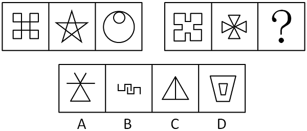

A. A

B. B

C. C

D. D

第 66 题 · 答案与解析

**参考答案（粉笔题库参考内容）**

C

**解析**

元素组成凌乱，考虑数数。

数笔画，本题每幅图形都是一笔画成，A、B、D三项都是两笔完成，C项可以一笔完成。

故正确答案为C。

**考点**：数量规律-线

**来源**：2009年贵州省公务员录用考试《行测》题第66题

### 第 67 题

从所给四个选项中，选择最合适的一个填入问号处，使之呈现一定的规律性：

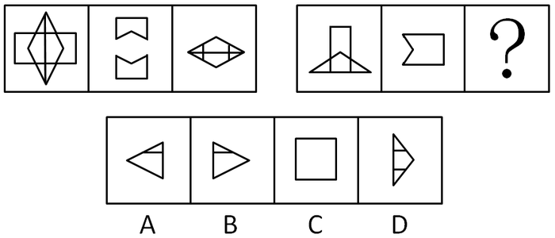

A. A

B. B

C. C

D. D

第 67 题 · 答案与解析

**参考答案（粉笔题库参考内容）**

D

**解析**

元素组成相似，元素叠加。

后两图旋转90度后进行简单叠加形成第一个图形。

故正确答案为D。

**考点**：样式规律-加减同异

**来源**：2009年贵州省公务员录用考试《行测》题第67题

### 第 68 题

选项四个图形中，哪个可由左边图形折叠而成？

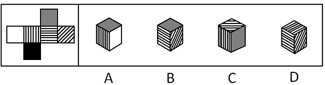

A. A

B. B

C. C

D. D

第 68 题 · 答案与解析

**参考答案（粉笔题库参考内容）**

B

**解析**

A项的侧面分别为横向与斜向的阴影；C项的顶面应为垂直横线阴影，侧面分别为横向与斜向的阴影；D项的顶面应为灰色。

B项正确。

故正确答案为B。

**考点**：空间类-空间重构-六面体

**来源**：2009年贵州省公务员录用考试《行测》题第68题

### 第 69 题

从所给四个选项中，选择最合适的一个填入问号处，使之呈现一定的规律性：

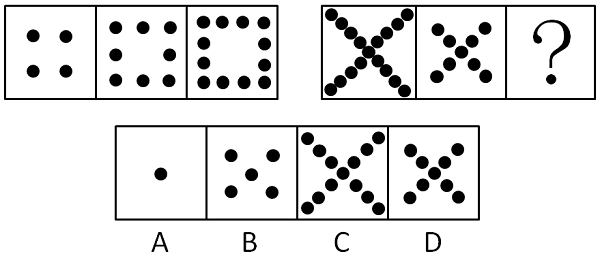

A. A

B. B

C. C

D. D

第 69 题 · 答案与解析

**参考答案（粉笔题库参考内容）**

A

**解析**

点数呈现明显数量变化，第一串图形中，后一个图形比前一个图形每边多一个黑点（也可以看作第一串图形中的点数分别为4、8、12，呈等差数列）。第二串图形中，后一个图形比前一个图形每边少4个黑点（也可以看作第二串图形中的点数分别为17、9、1，呈等差数列）。

故正确答案为A。

**考点**：数量规律-素

**来源**：2009年贵州省公务员录用考试《行测》题第69题

### 第 70 题

从所给四个选项中，选择最合适的一个填入问号处，使之呈现一定的规律性：

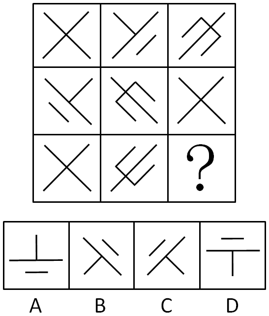

A. A

B. B

C. C

D. D

第 70 题 · 答案与解析

**参考答案（粉笔题库参考内容）**

C

**解析**

元素组成相同，优先考虑位置规律。

观察发现，第一行的图一不动，图二顺时针旋转90度，图三逆时针旋转90度得到第二行的图形，第二行的图形到第三行的图形依然保持此规律，那么只有C项符合。

故正确答案为C。

**考点**：位置规律-旋转

**来源**：2009年贵州省公务员录用考试《行测》题第70题

### 第 71 题

循环经济，是指在生产、流通和消费等过程中进行的减量化、再利用、资源化活动的总称。其中“减量化”是指在生产、流通和消费等过程中减少资源消耗和废物产生。

下列选项中属于“减量化”内容的是：

A. 某企业采用串联用水系统，提高了水的重复利用率

B. 某建筑施工单位对工程施工过程中产生的建筑废物进行了综合利用

C. 某县政府农业主管部门鼓励和支持农业生产者采用节水、节肥、节药的先进种植、养殖和灌溉技术，推动农业机械节能，优先发展生态农业

D. 某县政府林业主管部门积极发展生态林业，鼓励和支持相关企业采取木材节约和代用技术，开展林业废弃物综合利用，提高木材综合利用率

第 71 题 · 答案与解析

**参考答案（粉笔题库参考内容）**

D

**解析**

第一步：抓住定义中的关键词。
关键词强调“减少资源消耗和废物产生”。
第二步：逐一判断选项。
A：提高水的利用率，可以减少能源消耗，但没有提及减少废物；
B：废物综合利用，减少废物产生，没有提及减少能源消耗；
C：节水、节肥、节药，可以减少能源消耗，但没有提及减少废物；
D：木材节约属于减少能源消耗，开展林业废弃物综合利用属于减少废物产生，符合减量化的定义。
故正确答案为D。

**考点**：常规问法

**来源**：2009年贵州省公务员录用考试《行测》题第71题

### 第 72 题

时点指标是反映统计研究对象在某一具体时刻的指标。

根据以上定义，下列属于时点指标值的是：

A. 经初步核算，到2007年12月31日，我国2007年国内生产总值达到246619亿元

B. 2007年12月，我国外汇储备总额同比增长43.3%

C. 2008年春运期间我国铁路发送旅客20.17亿人次，比去年同期下降1.6%

D. 2008年1月30日在广州火车站滞留旅客超过40万人

第 72 题 · 答案与解析

**参考答案（粉笔题库参考内容）**

D

**解析**

第一步：找出定义关键词。

“某一具体时刻”。

第二步：逐一分析选项。

A项：“到2007年12月31日”表示的是一段时间，不符合定义，排除；

B项：“2007年12月”表示的是一段时间，不符合定义，排除；

C项：“2008年春运期间”表示的是一段时间，不符合定义，排除；

D项：指出的是火车站在2008年1月30日的旅客滞留量，表示的是具体的某一天，符合定义，当选。

故正确答案为D。

**考点**：大前提

**来源**：2009年贵州省公务员录用考试《行测》题第72题

### 第 73 题

事故应急救援预案（简称预案或应急预案）是指政府或企业为降低事故后果的严重程度，以对危险源的评价和事故预测结果为依据，预先制订的事故控制和抢险救灾方案。

根据上述定义，下列不属于事故应急救援预案范畴的是：

A. 某石油天然气集团公司为尽可能减小其所属的钻井公司在施工过程中可能发生的井喷事故的危害，对钻井公司的员工进行了相关应急培训

B. 某商厦为了减小发生火灾时可能造成的损失，配备了专用灭火器等器材，并规定了应急状态下的报警通讯方式、通知方式

C. 某危险化学品生产企业因管理不善，引发了大量的液氯泄露，公司临时从外面调来抢救器械，虽未造成人员中毒死亡，但造成了较大的经济损失

D. 某矿务局所属的大型煤矿为了减少可能发生的瓦斯爆炸事故的危害，编制了详实的应急预案，内容包括应急计划区、应急组织机构、人员、预案分级响应条件等

第 73 题 · 答案与解析

**参考答案（粉笔题库参考内容）**

C

**解析**

第一步：抓住定义中的关键词。

关键词强调“预先制订的事故控制和抢险救灾方案”。

第二步：逐一判断选项。

C项事故已经发生了，虽采取了措施，但是措施并不是预先制定的，故不符合定义；A、B、D三项表述均符合事故应急救援预案定义。

本题为选非题，故正确答案为C。

**考点**：拆词

**来源**：2009年贵州省公务员录用考试《行测》题第73题

### 第 74 题

公众参与是指社会群众、社会组织、单位或个人作为主体，在其权利义务范围内有目的地进行的一种社会行动。它是一种有计划的行动，通过政府部门和开发行动负责单位与公众之间双向交流，使公民们能参加决策过程并且防止和化解公民和政府机构与开发单位之间、公民与公民之间的冲突。

根据上述定义，下列不属于公众参与范畴的是：

A. 某企业准备新建一条危险化学品生产线，该生产线产生的废水可能会对下游村民的饮用水源水质造成一定的影响。为了避免建成后可能引起的环境污染纠纷，该企业的项目负责人在项目初步设计阶段就该项目对下游村民进行了访谈，了解村民的意见和建议

B. 某水泥厂建成投产后所产生的粉尘经常超标排放，对周边居民的身心造成了极大的影响，最终被投诉到了环境保护行政主管部门

C. 某工业园区定位为以制革行业为主，在开发过程中，园区开发单位为了获得当地居民对开发行动的支持，组织当地居民代表召开了座谈会

D. 某高速公路选线经过一个自然保护区的外围保护地带，在可行性研究阶段，该公路的建设方征求自然保护区管理机构的意见

第 74 题 · 答案与解析

**参考答案（粉笔题库参考内容）**

B

**解析**

第一步：抓住定义中的关键词。

关键词强调防止和化解公民和政府机构与开发单位之间、公民与公民之间的冲突而通过交流进行的一种社会行动。

第二步：逐一判断选项。

A项中和村民进行了访谈，C项中召开了座谈会，D项中征求意见，均是公众参与；

B项中对居民产生了影响，并且被投诉，说明该水泥厂没有为了防止冲突而采取行动，不符合定义。

本题为选非题，故正确答案为B。

**考点**：方式目的

**来源**：2009年贵州省公务员录用考试《行测》题第74题

### 第 75 题

既满足当代人的需求，又不对后代人满足其需求的能力构成危害的发展称为可持续发展。

根据上述定义，下列不属于可持续发展范畴的是：

A. 自然资源及其开发利用程序间的平衡

B. 小王小时候德、智、体、美、劳全面发展，为以后人生的持续进步打下了良好的基础

C. 在生存不超出维持生态系统涵容能力的情况下，改善人类的生活品质

D. 当发展能够保持当代人的福利增加时，也不会使后代的福利减少

第 75 题 · 答案与解析

**参考答案（粉笔题库参考内容）**

B

**解析**

第一步：抓住定义中的关键词。

关键词强调“满足当代人需求”且“不危害后代人满足其需求的能力”。

第二步：逐一判断选项。

A、C、D选项均符合定义；

B选项中的小王只是对自己的人生进行规划，并没有对后代产生影响。

本题为选非题，故正确答案为B。

**考点**：主客体

**来源**：2009年贵州省公务员录用考试《行测》题第75题

### 第 76 题

一个国家或区域在任何时期都存在一个经济上的最大收益点，当劳动力超过或者少于这个量时，都会引起收益减少，处于“最大收益点”的人口便是最合适的人口，这是经济学角度的“适度人口”概念。

根据上述定义，下列不属于经济学角度“适度人口”定义范畴的是：

A. 使得按人口平均计算的国民生产总额达到最大值的那种人口规模

B. 在一定的土地资源生产能力及一定的生活水平下承载的人口数量

C. 与一定时期内工业生产活力所可能达到的最高水平（即最高人均收入）相适应的人口

D. 以最令人满意的方式，达到某项特定经济效益目标之人口

第 76 题 · 答案与解析

**参考答案（粉笔题库参考内容）**

B

**解析**

第一步：抓住定义中的关键词。

关键词强调“最大收益点”。

第二步：逐一判断选项。

A中有“最大值”，C中有“最高水平”，D中有“最令人满意”均属于经济学角度“适度人口”定义范畴；

而B中没有达到“最大收益点”。

本题为选非题，故正确答案为B。

**考点**：单定义-其他句式

**来源**：2009年贵州省公务员录用考试《行测》题第76题

### 第 77 题

水土流失是指在水力、重力、风力等外力作用下，水土资源和土地生产力的破坏和损失，包括土地表层侵蚀和水土损失，亦称水土损失。水土保持，是指对自然因素和人为活动造成水土流失所采取的预防和治理措施的总称。

下列不属于水土保持措施的是：

A. 某采矿工程闭矿后，建设方采取了恢复表土层和植被的措施

B. 在铁路、公路两侧地界以内的山坡地，除修建护城外，还采取了其他土地整治措施

C. 某大桥建设方为防止危险化学品运输车辆发生交通事故时所产生的危险化学品废液对下游水体的污染，在大桥上设置事故池用于储存事故废液

D. 某地修建水利工程时，尽量减少破坏植被，且将废弃的砂、石、土运至规定的专门存放地堆放

第 77 题 · 答案与解析

**参考答案（粉笔题库参考内容）**

C

**解析**

第一步：判断考查定义。

题目考查“水土保持”，但是在“水土保持”中涉及到了“水土流失”的内容，所以需要通读题干。

第二步：抓住定义中的关键词。

关键词包括“外力作用下，水土资源和土地生产力的破坏和损失”、“对水土流失所采取的预防和治理措施”。

第三步：逐一判断选项。

A选项中“采取了恢复表土层和植被的措施”，B选项中“土地整治措施”，D选项中“减少破坏植被”，均属于水土保持；

C选项中设置的事故池，是为了防止发生交通事故时发生污染，不符合定义。

本题为选非题，故正确答案为C。

**考点**：常规问法

**来源**：2009年贵州省公务员录用考试《行测》题第77题

### 第 78 题

国民经济核算中的经济领土是指由政府管理的地理领土组成，在这个地理领土内，人员、商品、资本可以自由流动。根据以上定义，试判断下列不属于中国经济领土的是：

A. 中国海南岛

B. 中国南极长城科学考察站

C. 中国在美国华盛顿的大使馆

D. 拥有大量华人聚居的美国纽约唐人街

第 78 题 · 答案与解析

**参考答案（粉笔题库参考内容）**

D

**解析**

第一步：抓住定义中的关键词。

关键词强调“政府管理的地理领土”。

第二步：逐一判断选项。

A中的中国海南岛，B中的中国南极长城科学考察站，C中的中国在美国华盛顿的大使馆均属于中国政府管理，属于经济领土；

而D中美国纽约唐人街，显然不是中国政府管理的，不属于经济领土。

故正确答案为D。

**考点**：主客体

**来源**：2009年贵州省公务员录用考试《行测》题第78题

### 第 79 题

无形资产是指企业拥有或者控制的没有实物形态的可辨认的非货币性资产，资产满足下列条件之一的，即可视为无形资产：

（1）能够从企业中分离或者划分出来，并能够单独或者与相关合同、资产或负债一起，用于出售、转移、授予许可、租赁或者交换。

（2）源自合同性权利或其他法定权利，无论这些权利是否可以从企业或其他权利和义务中转移或者分离。

那么，下列不属于无形资产的为：

A. 某人的知识产权

B. 文学艺术原作

C. 专利作品

D. 机器设备

第 79 题 · 答案与解析

**参考答案（粉笔题库参考内容）**

D

**解析**

第一步：抓住定义中的关键词。

关键词强调“没有实物形态”。

第二步：逐一判断选项。

A中的知识产权，B中的艺术原作，C中的专利作品，均是无形资产；

而D中的机器设备显然是一种有实物形态的资产，不属于无形资产。

故正确答案为D。

**考点**：拆词

**来源**：2009年贵州省公务员录用考试《行测》题第79题

### 第 80 题

政府购买是指政府花钱设置法院、提供国防、建筑道路、开办学校等公共服务，也就是说政府通过雇请公务员、教师，造公共设施或枪炮、潜艇等，为社会提供服务。

根据以上定义，下列项目中属于政府购买的是：

A. 地方政府办三所学校

B. 政府给低收入者提供一笔住房补贴

C. 政府组织群众贷款修公路

D. 政府拨付1.0亿元救助冰冻灾害的群众

第 80 题 · 答案与解析

**参考答案（粉笔题库参考内容）**

A

**解析**

第一步：抓住定义中的关键词。

关键词强调“政府花钱”、“公共服务”、“雇请公务员、教师，造公共设施或枪炮、潜艇”。

第二步：逐一判断选项。

A项的学校是政府购买；

B、D两项不符合“公共服务”、“雇请公务员、教师，造公共设施或枪炮、潜艇”这一要求；

C项是群众贷款修路，不是政府花钱。

故正确答案为A。

**考点**：方式目的

**来源**：2009年贵州省公务员录用考试《行测》题第80题

### 第 81 题

辛亥革命：1911

A. 十月革命：1917

B. 新文化运动：1911

C. 明治维新：1884

D. 戊戌变法：1868

第 81 题 · 答案与解析

**参考答案（粉笔题库参考内容）**

A

**解析**

第一步：判断题干词语间逻辑关系。

辛亥革命是1911年发生的，两者是对应关系。

第二步：判断选项词语间逻辑关系。

A项，十月革命发生的时间是1917年，符合题干。

B项，新文化运动发生的时间是1915年，与题干不符。

C项，明治维新发生的时间是1868年，与题干不符。

D项，戊戌变法发生的时间是1898年，与题干不符。

第三步：再次标注答案。

故正确答案为A。

**考点**：逻辑关系-对应关系

**来源**：2009年贵州省公务员录用考试《行测》题第81题

### 第 82 题

《人间喜剧》：巴尔扎克

A. 《雾都孤儿》：狄更斯

B. 《三个火枪手》：雨果

C. 《复活》：玛丝洛娃

D. 《茶花女》：大仲马

第 82 题 · 答案与解析

**参考答案（粉笔题库参考内容）**

A

**解析**

第一步：判断题干词语间逻辑关系。

题干两词中，《人间喜剧》的作者是巴尔扎克，是作品和作者间的对应关系。

第二步：判断选项词语间逻辑关系。

A项，《雾都孤儿》的作者是狄更斯，符合题意。

B项，《三个火枪手》的作者为大仲马，不符合题意。

C项，《复活》的作者为托尔斯泰，不符合题意。

D项，《茶花女》的作者为小仲马，不符合题意。

第三步：再次标注答案。

故正确答案为A。

**考点**：逻辑关系-对应关系

**来源**：2009年贵州省公务员录用考试《行测》题第82题

### 第 83 题

自行车 对于 （    ） 相当于 （    ） 对于 卡车

A. 单车——轿车

B. 轿车——马车

C. 飞机——火箭

D. 马路——桥梁

第 83 题 · 答案与解析

**参考答案（粉笔题库参考内容）**

B

**解析**

第一步：将选项逐一代入，判断各选项前后部分的逻辑关系。

A中前面部分是全同关系，后面部分是并列关系；

B中前面部分是并列关系，后面部分是并列关系；

C中前面部分是并列关系，后面部分没有逻辑关系；

D中前面部分没有逻辑关系，后面部分没有逻辑关系。

第二步：逻辑关系相同即为答案。

根据第一步可知，逻辑关系完全相同的是B。

故正确答案为B。

**考点**：逻辑关系-并列关系

**来源**：2009年贵州省公务员录用考试《行测》题第83题

### 第 84 题

手机 对于 （    ） 相当于 （    ） 对于 商店

A. 公司——医院

B. 个人——病人

C. 电话——药店

D. 学生——售货员

第 84 题 · 答案与解析

**参考答案（粉笔题库参考内容）**

C

**解析**

第一步：将选项逐一代入，判断各选项前后部分的逻辑关系。

A中前面部分没有逻辑关系，后面部分是并列关系；

B中前面部分没有逻辑关系，后面部分没有逻辑关系；

C中前面部分是种属关系，后面部分是种属关系；

D中前面部分没有逻辑关系，后面部分是包容关系。

第二步：逻辑关系相同即为答案。

根据第一步可知，逻辑关系完全相同的是C。

故正确答案为C。

**考点**：逻辑关系-包容关系

**来源**：2009年贵州省公务员录用考试《行测》题第84题

### 第 85 题

树根 对于 树 相当于 （    ） 对于 （    ）

A. 伞架——伞

B. 齿轮——曲柄

C. 墙基——房屋

D. 竹节——竹叶

第 85 题 · 答案与解析

**参考答案（粉笔题库参考内容）**

C

**解析**

第一步：判断题干词语间逻辑关系。

题干给出的两词是对应关系，且有了前者，后者才能稳固，那么空格处的两词也应该是这一规律。

第二步：判断选项词语间逻辑关系。

与题干相同逻辑关系的即为C；

A是包容中的必然组成关系；

B不构成逻辑关系；

D是并列关系。

故正确答案为C。

**考点**：逻辑关系-对应关系

**来源**：2009年贵州省公务员录用考试《行测》题第85题

### 第 86 题

泼水节 对于 （    ） 相当于 （    ） 对于 彝族

A. 瑶族——走婚

B. 侗族——开斋节

C. 回族——淋浴节

D. 傣族——火把节

第 86 题 · 答案与解析

**参考答案（粉笔题库参考内容）**

D

**解析**

第一步：判断题干词语间逻辑关系。

根据题干给出的词汇，可以推断，题干中的前两个词和后两个词分别是对应关系，且是民族和节日间的一一对应关系。

第二步：判断选项词语间逻辑关系。

与题干相同逻辑关系的即为D项；

A项，走婚是摩梭人的一种婚姻模式，瑶族的传统节日有讨念拜、讨寮皈节；

B项，开斋节是伊斯兰教节日，侗族的节日以春节、祭牛神（农历四月初八或六月初六）、吃新节（农历七月间）较为普遍。有些地区还有在十月或十一月过侗年。由于民族之间的交往，侗族还有清明、端午、中秋、重阳等节；淋浴节是西藏的节日；

C项，回族的传统节日为开斋节、古尔邦节和圣纪节。

故正确答案为D。

**考点**：逻辑关系-对应关系

**来源**：2009年贵州省公务员录用考试《行测》题第86题

### 第 87 题

千克 对于 （    ） （    ） 相当于 分米 对于 （    ） （    ）

A. 升 天平——毫米 直尺

B. 两 量筒——克 游标卡尺

C. 克 米尺——尺 游标卡尺

D. 克 天平——厘米 直尺

第 87 题 · 答案与解析

**参考答案（粉笔题库参考内容）**

D

**解析**

第一步：判断题干词语间逻辑关系。

观察题干和选项可知，第一个词和第二个词之间一定是单位和单位之间的对应关系（第四词和第五词同理）第一个词和第三个词之间一定是单位和工具之间的对应关系（第四词和第六词同理）。

第二步：将选项逐一代入，判断各选项前后部分的逻辑关系。

A选项中的千克和升没有逻辑关系，排除；

B选项中的千克和量筒没有逻辑关系，排除；

C选项中的千克和米尺没有逻辑关系，排除；

D选项中千克和克都是质量单位，而天平是测量质量一种仪器，分米和厘米都是长度单位，而直尺是测量长度的一种仪器，当选。

故正确答案为D。

**考点**：逻辑关系-对应关系

**来源**：2009年贵州省公务员录用考试《行测》题第87题

### 第 88 题

冰：水：蒸气

A. 汉人：华人：华侨

B. 二氧化碳：干冰：灭火

C. 金刚石：石墨：铅笔

D. 纸张：论文：作者

第 88 题 · 答案与解析

**参考答案（粉笔题库参考内容）**

A

**解析**

第一步：判断题干词语间逻辑关系。

题干三词是对应关系，三个词的本质是一样的，分别是固态、液态、气态。

第二步：判断选项词语间逻辑关系。

A项中汉人、华人、华侨本质上都是中国人，分别是按民族、人种、国籍做的表达；B、C项中只有前两词的本质相同；D项没有逻辑关系。

故正确答案为A。

**考点**：逻辑关系-对应关系

**来源**：2009年贵州省公务员录用考试《行测》题第88题

### 第 89 题

虚伪：虚假

A. 假装：打扮

B. 小气：吝啬

C. 紧密：紧张

D. 匆忙：繁忙

第 89 题 · 答案与解析

**参考答案（粉笔题库参考内容）**

B

**解析**

第一步：判断题干词语间逻辑关系。

题干两词是同义词。

第二步：判断选项词语间逻辑关系。

与题干相同逻辑关系的即为B；A、C、D不是同义词。

故正确答案为B。

**考点**：语义关系-近义关系

**来源**：2009年贵州省公务员录用考试《行测》题第89题

### 第 90 题

讨论 对于 （    ） 相当于 （    ） 对于 明白

A. 争吵——听

B. 过程——结果

C. 大家——我们

D. 清楚——弄

第 90 题 · 答案与解析

**参考答案（粉笔题库参考内容）**

D

**解析**

第一步：将选项逐一代入，判断各选项前后部分的逻辑关系。

A项中前面部分构成并列关系，后面部分是语法关系，构成了动宾短语；

B项中前面部分没有逻辑关系，后面部分没有逻辑关系；

C项中“大家讨论”构成主谓关系，“我们明白”构成主谓关系，但词语前后顺序不一致；

D项中前面部分是语法关系，构成了动宾短语，后面部分是语法关系，构成了动宾短语。

第二步：逻辑关系相同即为答案。

根据第一步可知，逻辑关系完全相同的是D项。

故正确答案为D。

**考点**：语法关系

**来源**：2009年贵州省公务员录用考试《行测》题第90题

### 第 91 题

搞阴谋诡计的人不被人信任，所以正直的人不搞阴谋诡计。得出以上结论必需的前提条件是（    ）。

A. 正直的人被人信任

B. 搞阴谋诡计的人不是正直的人

C. 有的正直的人也搞阴谋诡计

D. 有的搞阴谋诡计的人也被人信任

第 91 题 · 答案与解析

**参考答案（粉笔题库参考内容）**

A

**解析**

第一步：找出论点和论据。

论点：正直的人不搞阴谋诡计，可翻译为正直的人搞阴谋诡计。

论据：搞阴谋诡计的人不被人信任，可翻译为搞阴谋诡计的人被信任。

本题问题为前提条件，且论点说的是正直和搞阴谋诡计之间的关系，论据说的是搞阴谋诡计和信任之间的关系，话题不一致，优先考虑在正直与信任之间搭桥。

第二步：逐一判断选项。

A项：正直的人→被信任，根据论据逆否可知，被信任搞阴谋诡计的人，因此A项与论据串联可以推出论点，即正直的人→被信任搞阴谋诡计的人，搭桥项，当选；

B项：搞阴谋诡计的人正直的人，可以推出正直的人搞阴谋诡计的人，与论点相同，但与论据无关，无法搭桥，不是推出论点的前提，排除；

C项：有的正直的人搞阴谋诡计，与论点矛盾，削弱论点，排除；

D项：有的搞阴谋诡计的人被信任，与论据矛盾，削弱论据，排除。

故正确答案为A。

**考点**：搭桥

**来源**：2009年贵州省公务员录用考试《行测》题第91题

### 第 92 题

作文却好像偏偏并无秘诀，假使有，每个作家一定是传给子孙的了。

最能支持以上观点的是：

A. 作文是不能靠别人教的

B. 会写作的作家很少见

C. 祖传的作家很少见

D. 作家的子孙有很多是作家

第 92 题 · 答案与解析

**参考答案（粉笔题库参考内容）**

C

**解析**

第一步：找到论点和论据。

题干即为论点，等价于“作文并无秘诀，就连祖传的作家也很少”。没有论据。

第二步：判断加强方式。

需要加强论点。

第三步：逐一判断选项的作用。

C是对论点的同义描述，加强了论点，是答案；A、B均与祖传无直接关系；D明显削弱论点。

故正确答案为C。

**考点**：补充论据

**来源**：2009年贵州省公务员录用考试《行测》题第92题

### 第 93 题

要高速度发展国民经济，就必须有科学技术的高速度发展。

与以上判断逻辑完全相同的是：

A. 只有科学技术的高速度发展，才能有国民经济的高速度发展

B. 要高速度发展科学技术，就必须有国民经济的高速度发展

C. 只要有科学技术的高速度发展，就必定有国民经济的高速度发展

D. 高速发展国民经济和高速度发展科学技术是完全一致的

第 93 题 · 答案与解析

**参考答案（粉笔题库参考内容）**

A

**解析**

第一步：翻译题干，利用充分必要条件。

高速度发展国民经济⇒科学技术的高速度发展。

第二步：逐一翻译选项并判断选项的正确。

A国民经济的高速度发展⇒科学技术的高速度发展，与题干相符，A正确；

B高速度发展科学技术⇒国民经济的高速度发展，肯后件，无法推出结论，B错；

C科学技术的高速度发展⇒国民经济的高速度发展，肯后件，无法推出结论，C错；

D中两者是全同关系，明显不符合题干，D错。

故正确答案为A。

**考点**：常规翻译

**来源**：2009年贵州省公务员录用考试《行测》题第93题

### 第 94 题

有三只盒子，每只盒子里面装了两只球，分别是黑黑、白白、黑白。每只盒子都贴上了标明内容的标签，但所有的标签都贴错了。要求：打开一只盒子，但只能取出一个球来，看过之后把所有的标签都纠正过来。可以打开的盒子是：

A. 黑黑

B. 白白

C. 黑白

D. 打开哪个盒子都不行

第 94 题 · 答案与解析

**参考答案（粉笔题库参考内容）**

C

**解析**

运用假设法。

假设打开写有“黑白”标签的盒子，那么该盒子可能是装有“黑黑”或者“白白”，如果取出一个黑球，则该盒子是“黑黑”，则写“白白”的盒子，一定装的是“黑白”球，可知写有“黑黑”的盒子，一定装有的是“白白”球，同理，如果摸出的是白球，一样能确定所有的标签。

假设打开写有“黑黑”的盒子，这个盒子里应该装的是“黑白”或者“白白”，则如果摸出的是白球，就无法确定这个盒子里装的是什么；同样，打开写有“白白”的盒子，也不一定可以确定。

故正确答案为C。

**考点**：假设

**来源**：2009年贵州省公务员录用考试《行测》题第94题

### 第 95 题

小明在星期一、星期二、星期三说谎话，丽丽在星期四、星期五、星期六说谎话；此外的日子里，他们都讲真话。青青忘了今天是星期几，他问小明，小明说：“昨天是我说谎话的日子。”他又问丽丽，丽丽也说：“昨天是我说谎话的日子。”由此可以推断今天是：

A. 星期一

B. 星期四

C. 星期六

D. 星期天

第 95 题 · 答案与解析

**参考答案（粉笔题库参考内容）**

B

**解析**

第一步：找突破口。

本题突破口是小明和丽丽都说“昨天是我说谎的日子”，但小明和丽丽他们说谎的日子完全不同。由此可知，小明和丽丽必定一个讲真话，一个讲假话，故D错，周日两人说的都是真话。

第二步：通过突破口继续分析得出结论。

假设小明说的是假话，则小明今天假话，昨天真话，可推出今天星期一。这一天丽丽说的是真话，但丽丽昨天（周日）并不说谎，与丽丽的真话矛盾，因此假设错误；

假设丽丽说的是假话，则丽丽今天假话，昨天真话，可推出今天星期四。这一天小明说真话，昨天（周三）小明确实说慌，与小明的真话相符。假设正确，B正确。

故正确答案为B。

**考点**：假设

**来源**：2009年贵州省公务员录用考试《行测》题第95题

### 第 96 题

李老师、王老师、张老师在同一所大学教语文、数学和外语，按规定每人只担任其中一门课。而且：

①李老师上课全部用汉语。

②外语老师是该校一个学生的舅舅。

③张老师是女教师，她的女儿考大学之前，经常向数学老师请教。

请判定他们各自上的课程是：

A. 李老师上语文，王老师上外语，张老师上数学

B. 王老师上语文，李老师上外语，张老师上数学

C. 张老师上语文，王老师上外语，李老师上数学

D. 王老师上语文，张老师上外语，李老师上数学

第 96 题 · 答案与解析

**参考答案（粉笔题库参考内容）**

C

**解析**

第一步：找突破口

本题突破口是信息量最大对象，即张老师。由“外语老师是该校一个学生的舅舅”知外语老师是男性，由“张老师是女教师，她的女儿考大学之前，经常向数学老师请教”知张老师不是数学老师，由于外语老师是男性，则张老师为语文老师。

第二步：抄信息于表中，即将题干和第一步的所有信息放在一个表中。

第三步：填空，即填上每一个集合的空格。

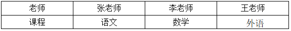

故正确答案为C。

**考点**：排除法

**来源**：2009年贵州省公务员录用考试《行测》题第96题

### 第 97 题

调查发现，内向的人不太敢在公共场合发表自己的意见，他们即使有好的建议，也往往藏在心里，或者只和自己很熟悉的朋友交流。所以，一个好的领导，除了在大会上听取各种意见之外，还需要：

A. 自己多干实事

B. 自己多了解情况

C. 多关心内向的员工

D. 和内向的人交朋友

第 97 题 · 答案与解析

**参考答案（粉笔题库参考内容）**

D

**解析**

第一步：抓住每句话中的对象及主要内容。

第一句说明内向的人发表意见的方式：藏在心里或和朋友交流，第二句说明好的领导怎么全面地听取意见。

第二步：判断整体关系。

领导要全面听取意见，两句间是包含关系，领导要听的意见也包括了内向的人发表的意见。

第三步：逐一判断选项的作用。

A、B都是从领导的自身角度进行改善，和内向的人无关；

C多关心内向的人，也不能保证就一定能听到他们的意见，因为他们发表意见的方式只有两种就是，藏在心里或和朋友交流；

D强调领导和内向的人交朋友，内向的人便可能与之交流。

故正确答案为D。

**考点**：日常结论

**来源**：2009年贵州省公务员录用考试《行测》题第97题

### 第 98 题

俗话说：不入虎穴，焉得虎子。

对这句话理解不正确的是：

A. 进了虎穴，就一定能得到虎子

B. 只有进虎穴，才可能得到虎子

C. 即使进了虎穴，也不一定就能得到虎子

D. 要得到虎子，就必须得进虎穴

第 98 题 · 答案与解析

**参考答案（粉笔题库参考内容）**

A

**解析**

第一步：翻译题干。

得虎子→入虎穴。

第二步：逐一分析选项。

A项：翻译为“进虎穴→得虎子”，是对题干条件的肯后，肯后得不到确定性的结论，无法推出，当选；

B项：翻译为“得虎子→进虎穴”，是对题干条件的肯前，肯前必肯后，可以推出，排除；

C项：“即使······也······”不是逻辑关联词，一般不翻译，根据题干“得虎子→入虎穴”可知，入虎穴是不一定能得虎子的，所以选项能推出，排除；

D项：翻译为“得虎子→进虎穴”，是对题干条件的肯前，肯前必肯后，可以推出，排除。

本题为选非题，故正确答案为A。

**考点**：常规翻译

**来源**：2009年贵州省公务员录用考试《行测》题第98题

### 第 99 题

有人认为，语言对于个人和社会都极其重要，语言不仅能方便人际间的交流，还能产生物质资料。

以下最能反驳这一观点的是：

A. 人和人之间的交流不依靠语言

B. 言谈举止体现了一个人的修养

C. 世界上很多夸夸其谈的人却是穷光蛋

D. 世界上不少富有的人能言善道

第 99 题 · 答案与解析

**参考答案（粉笔题库参考内容）**

A

**解析**

第一步：找到论点和论据。

本题论点是语言不仅能方便人际间的交流，还能产生物质资料。

第二步：判断削弱方式。

提问句是最能反驳这一观点，所以本题削弱论点。

第三步：逐一判断选项的作用。

A证明语言不能进行交流，直接削弱论点；

B、D均证明语言的重要，属于加强论点；

C题干中只说语言能产生物质资料，不是说一定会让人富裕，而且夸夸其谈的语言明显就不能产生物质资料，是无关选项。

故正确答案为A。

**考点**：削弱论点

**来源**：2009年贵州省公务员录用考试《行测》题第99题

### 第 100 题

与“并非当且仅当你认为事情是正确的，它就一定是正确的”等值的判断是：

A. 你认为事情是错误的，但它却是正确的

B. 你认为事情是正确的，它却是错误的

C. 要么你认为事情是错误的，但它却是正确的，要么你认为事情是正确的，它却是错误的

D. 或者你认为事情是错误的，但它却是正确的，或者你认为事情是正确的，它却是错误的

第 100 题 · 答案与解析

**参考答案（粉笔题库参考内容）**

D

**解析**

第一步：翻译题干。利用充分必要条件。

当且仅当等价于（“如果你认为是对的，就是对的”∧“只有你认为是对的，才是对的”），即（你认为是对的⇒是对的）且（是对的⇒你认为是对的）。并非意味是对前面“且”关系的否命题，即－（（你认为是对的⇒是对的）∧（是对的⇒你认为是对的）），利用摩根规则拆开括号即－（你认为是对的⇒是对的）∨－（是对的⇒你认为是对的），利用推导关系的矛盾命题继续推导即为（你认为是对的∧是错的）或者（是对的∧你认为是错的）。

故正确答案为D。

**考点**：常规翻译

**来源**：2009年贵州省公务员录用考试《行测》题第100题

### 第 101 题

（1）巧渡金沙江

（2）遵义会议

（3）强渡大渡河

（4）四渡赤水

（5）翻雪山，过草地

A. 5-1-2-4-3

B. 5-1-4-3-2

C. 4-2-1-3-5

D. 2-4-1-3-5

第 101 题 · 答案与解析

**参考答案（粉笔题库参考内容）**

D

**解析**

题干主要描述的是红军长征的主要事件，按照时间顺序进行排列，巧渡金沙江是1935年5月3日，遵义会议是在1935年1月15日召开的，强渡大渡河是1935年5月24日至25日，四渡赤水是1935年1月19日开始的，翻雪山，过草地是1935年6月8日开始的。

故正确答案为D。

**来源**：2009年贵州省公务员录用考试《行测》题第101题

### 第 102 题

（1）自是指物作诗立就

（2）泯然众人矣

（3）生五年，即书诗四句，并自为其名

（4）日扳仲永环谒于邑人，不使学

（5）邑人奇之，稍稍宾客其父，或以钱币乞之

A. 3-5-1-4-2

B. 3-2-4-5-1

C. 1-3-4-5-2

D. 3-1-5-4-2

第 102 题 · 答案与解析

**参考答案（粉笔题库参考内容）**

D

**解析**

本题考查的是王安石的《伤仲永》，根据原文顺序。

故正确答案为D。

**来源**：2009年贵州省公务员录用考试《行测》题第102题

### 第 103 题

（1）水面缩小

（2）围湖造田

（3）洪涝频发

（4）退耕还湖

（5）蓄洪能力下降

A. 4-5-1-3-2

B. 2-1-5-3-4

C. 2-5-3-1-4

D. 5-2-4-1-3

第 103 题 · 答案与解析

**参考答案（粉笔题库参考内容）**

B

**解析**

题干描述的是围湖造田的后续事件，（2）一定是首句，（1）（3）（5）都是（2）的结果，其中（1）是（5）的原因，（5）是（3）的原因，而最后（4）是解决措施。

故正确答案为B。

**来源**：2009年贵州省公务员录用考试《行测》题第103题

### 第 104 题

（1）滥砍滥伐

（2）土地沙漠化

（3）建防护林

（4）沙尘暴多发

（5）损失严重

A. 3-1-4-2-5

B. 1-2-4-5-3

C. 2-1-5-4-3

D. 4-5-3-1-2

第 104 题 · 答案与解析

**参考答案（粉笔题库参考内容）**

B

**解析**

题干描述的是环境恶化的一个过程。其中（1）是（2）（4）（5）发生的原因，（5）是（2）（4）的结果，而最后（3）是解决措施。

故正确答案为B。

**来源**：2009年贵州省公务员录用考试《行测》题第104题

### 第 105 题

（1）资格审查

（2）交费

（3）参加考试

（4）打印准考证

（5）填写报名表

A. 5-1-2-3-4

B. 2-5-1-4-3

C. 5-1-2-4-3

D. 2-1-5-4-3

第 105 题 · 答案与解析

**参考答案（粉笔题库参考内容）**

C

**解析**

由题可知，（5）填写报名表必然在（1）（4）（2）的前面，排除B、D两项，而（4）打印准考证一定在（3）参加考试之前，排除A项。

故正确答案为C。

**来源**：2009年贵州省公务员录用考试《行测》题第105题

### 第 106 题

14，23，34，47，（    ）

A. 50

B. 57

C. 60

D. 62

第 106 题 · 答案与解析

**参考答案（粉笔题库参考内容）**

D

**解析**

观察数列，无明显特征，优先考虑作差。后项减前项得到新数列：9，11，13，（    ），是公差为2的等差数列，则等差数列的下一项为13+2=15，故所求项为47+15=62。

故正确答案为D。

**来源**：2009年贵州省公务员录用考试《行测》题第106题

### 第 107 题

17，34，68，136，（    ）

A. 168

B. 234

C. 272

D. 257

第 107 题 · 答案与解析

**参考答案（粉笔题库参考内容）**

C

**解析**

观察数列，发现数列前后项之间存在明显的倍数关系，后一项均为前一项的2倍，是公比为2的等比数列，则所求项为。

故正确答案为C。

**来源**：2009年贵州省公务员录用考试《行测》题第107题

### 第 108 题

2，4，10，22，42，（    ）

A. 72

B. 84

C. 96

D. 78

第 108 题 · 答案与解析

**参考答案（粉笔题库参考内容）**

A

**解析**

观察数列，无明显特征，优先考虑作差。后项减前项得到数列：2，6，12，20，（    ），无明显规律，再次作差得到新数列：4，6，8，（    ），是公差为2的等差数列，则等差数列的下一项为8+2=10，故所求项为42+(20+10)=72。

故正确答案为A。

**来源**：2009年贵州省公务员录用考试《行测》题第108题

### 第 109 题

6，20，42，72，110，（    ）

A. 128

B. 140

C. 156

D. 166

第 109 题 · 答案与解析

**参考答案（粉笔题库参考内容）**

C

**解析**

观察数列，无明显特征，优先考虑作差。后项减前项得到新数列：14，22，30，38，（    ），是公差为8的等差数列，则等差数列的下一项为38+8=46，故所求项为110+46=156。

故正确答案为C。

**来源**：2009年贵州省公务员录用考试《行测》题第109题

### 第 110 题

5，13，15，27，29，45，（    ）

A. 56

B. 55

C. 47

D. 64

第 110 题 · 答案与解析

**参考答案（粉笔题库参考内容）**

C

**解析**

观察数列，无明显特征，优先考虑作差，后项减前项得到新数列：8，2，12，2，16，（    ）。交叉看新数列发现，奇数项：8，12，16，是公差为4的等差数列；偶数项：2，2，（    ），是常数数列。则新数列下一项为2，故所求项=45+2=47。

故正确答案为C。

**来源**：2009年贵州省公务员录用考试《行测》题第110题

### 第 111 题

小雪和小敏的藏书册数比是7：5，如果小雪送65本给小敏，那么他们之间的藏书册数比是3：4，则小敏原来的藏书是多少册：

A. 175

B. 245

C. 420

D. 180

第 111 题 · 答案与解析

**参考答案（粉笔题库参考内容）**

A

**解析**

方法一：方程法。根据题意，设小雪藏书7n册，小敏藏书5n册，则有，解得n=35，则小敏原来的藏书册。

方法二：代入排除法。设小敏藏书m册，由原比例7:5，可知m为5的倍数；由送书后的比例3:4，可知(m+65)是4的倍数。将四个选项直接代入，只有175满足条件，A项当选。

故正确答案为A。

**考点**：和差倍比问题

**来源**：2009年贵州省公务员录用考试《行测》题第111题

### 第 112 题

某校学生参加秋游，若每台车坐60人，则调15台车还不够，若每台车坐70人，则调14台车还空余。最后决定改乘面包车，每台可坐x人，只需调x台车正好坐满，共有多少师生参加秋游：

A. 1024人

B. 861人

C. 926人

D. 961人

第 112 题 · 答案与解析

**参考答案（粉笔题库参考内容）**

D

**解析**

由题意可知，参加秋游的师生数为人，则有，这个范围内的完全平方数只有符合。

故正确答案为D。

**考点**：和差倍比问题

**来源**：2009年贵州省公务员录用考试《行测》题第112题

### 第 113 题

一个长方形的蛋糕，沿着前后、左右、水平方向依次切了2刀、3刀、4刀，最多可以分给多少个同学吃：

A. 24

B. 40

C. 56

D. 60

第 113 题 · 答案与解析

**参考答案（粉笔题库参考内容）**

D

**解析**

由题意可知，切2、3、4刀分别将蛋糕切成3、4、5块，则最多共有块，故最多可以分给60个同学吃。

故正确答案为D。

**考点**：几何其他题型

**来源**：2009年贵州省公务员录用考试《行测》题第113题

### 第 114 题

小华4年后年龄与小丽4年前的年龄相等，3年后，她们两人的年龄和等于她们今年年龄差的3倍，小华和小丽今年的年龄分别是多少岁：

A. 10，18

B. 4，12

C. 5，13

D. 6，14

第 114 题 · 答案与解析

**参考答案（粉笔题库参考内容）**

C

**解析**

设小华今年的年龄为m岁，小丽今年的年龄为n岁，则有列表如下：

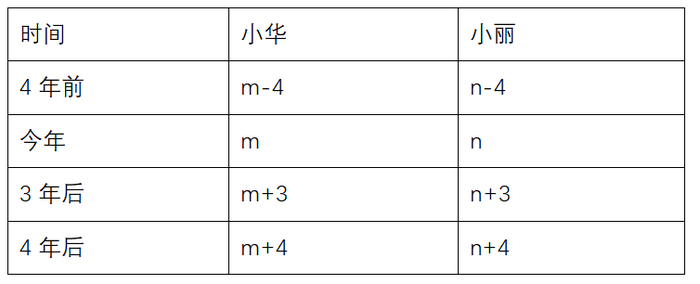

根据题意可得：m+4=n-4······①，······②

方法一：联立①②两式可得：m=5，n=13。

方法二：代入排除法。由①式可得，n-m=8，代入②式中可得，m+n=18，只有C项符合。

故正确答案为C。

**考点**：年龄问题

**来源**：2009年贵州省公务员录用考试《行测》题第114题

### 第 115 题

有一种细菌，经过1分钟，分裂成2个，再过1分钟，变成4个，这样把一个细菌放在瓶子里到充满为止，用了2个小时，如果一开始时，将2个这种细菌放入瓶子里，那么充满瓶子要多长时间：

A. 30分钟

B. 59分钟

C. 119分钟

D. 60分钟

第 115 题 · 答案与解析

**参考答案（粉笔题库参考内容）**

C

**解析**

2个细菌充满瓶子所用的时间=自1个细菌分裂成2个后开始计时直至充满瓶子所用的时间。根据“有一种细菌，经过1分钟，分裂成2个”，可知所求时间为分钟。

故正确答案为C。

**考点**：数列问题

**来源**：2009年贵州省公务员录用考试《行测》题第115题

### 第 116 题

某木器厂有38名工人，2名工人每天可以加工3张课桌，3名工人每天可以加工10把椅子，调配多少工人加工椅子才能使每天生产的桌椅配套：（1张课桌配两把椅子）

A. 18

B. 14

C. 16

D. 21

第 116 题 · 答案与解析

**参考答案（粉笔题库参考内容）**

A

**解析**

方法一：设每天安排x名工人加工椅子，则(38-x)名工人加工桌子。由题意可知，若要每天生产的桌椅配套，则每天生产的椅子数量应为桌子数量的2倍，可列式：，解得x=18，即调配18名工人加工椅子才能使每天生产的桌椅配套。

方法二：由题意可知，3名工人每天加工10把椅子，可以配套5张桌子，而2名工人每天加工3张桌子。如果要完全配套，则每天需要加工的桌子数应为3和5的最小公倍数，即15张，此时每天需要名工人加工桌子，需要名工人加工椅子，故以10+9=19人为一组，则有，可得，n最大为2，此时加工椅子的工人为人。

方法三：根据“3名工人每天可以加工10把椅子”可知，加工椅子的人数可以被3整除，排除B、C两项；代入A项：若加工椅子的人数为18人，则加工课桌的人数为38-18=20人。因此，每天可加工把椅子，每天可加工张课桌。，满足1张课桌配两把椅，符合题意。

故正确答案为A。

**考点**：和差倍比问题

**来源**：2009年贵州省公务员录用考试《行测》题第116题

### 第 117 题

水坝的横截面是一个梯形，它的面积为32.5平方米，高为5米，下底比上底的2倍多1米，梯形上底是多少米：

A. 6

B. 4

C. 5

D. 7

第 117 题 · 答案与解析

**参考答案（粉笔题库参考内容）**

B

**解析**

设上底为n米，则下底为（2n+1)米，根据梯形面积公式：，可得：，解得n=4。

故正确答案为B。

**考点**：几何公式类-平面图形

**来源**：2009年贵州省公务员录用考试《行测》题第117题

### 第 118 题

一个队伍7个人，小明首先站在第3位，那么向后转以后是第几位：

A. 3

B. 4

C. 5

D. 7

第 118 题 · 答案与解析

**参考答案（粉笔题库参考内容）**

C

**解析**

画图分析如下：

由上图很直观可以看出，倒过来数是第5位。

故正确答案为C。

**来源**：2009年贵州省公务员录用考试《行测》题第118题

### 第 119 题

计算：的值为：

A. 16

B. 30

C. 24

D. 1500

第 119 题 · 答案与解析

**参考答案（粉笔题库参考内容）**

B

**解析**

原式可变形为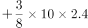。

故正确答案为B。

**来源**：2009年贵州省公务员录用考试《行测》题第119题

### 第 120 题

如图，三个图形的周长相等，则a∶b∶c是多少：

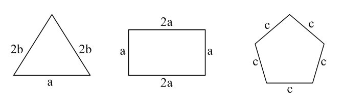

A. 4∶5∶6

B. 8∶10∶15

C. 20∶25∶24

D. 24∶25∶20

第 120 题 · 答案与解析

**参考答案（粉笔题库参考内容）**

C

**解析**

三个图形的周长分别为：2b+2b+a=4b+a，，5c。由题意可得，4b+a=6a=5c，可得，则。

故正确答案为C。

**考点**：几何公式类-平面图形

**来源**：2009年贵州省公务员录用考试《行测》题第120题

## 材料 1

**根据下列图表完成各题。**

下图是2007年我国农村居民家庭现金支出情况，图中已标明各项支出金额。请根据图中信息回答下列各题：

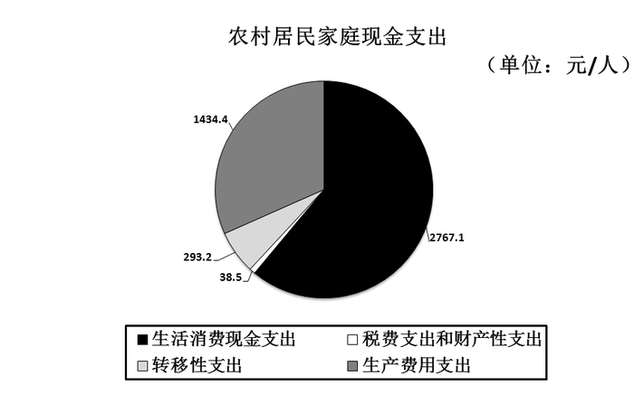

### 第 121 题

下列哪项支出在我国农村居民家庭现金支出中所占比例最大：

A. 生活消费现金支出

B. 税费支出和财产性支出

C. 转移性支出

D. 生产费用支出

第 121 题 · 答案与解析

**参考答案（粉笔题库参考内容）**

A

**解析**

定位饼形图可得：生活消费现金支出为2767.1元/人，税费支出和财产性支出为38.5元/人，转移性支出为293.2元/人，生产费用支出为1434.4元/人。故生活消费现金支出最多，即在我国农村居民家庭现金支出中所占比例最大。

故正确答案为A。

**考点**：直接找数、统计图

**来源**：2009年贵州省公务员录用考试《行测》题第121题

### 第 122 题

生产费用支出占我国农村居民家庭现金支出的比重为：

A. 61%

B. 32%

C. 6%

D. 1%

第 122 题 · 答案与解析

**参考答案（粉笔题库参考内容）**

B

**解析**

根据题干“······占······的比重······”，可判定本题为现期比重问题。定位饼形图可得：生活消费现金支出为2767.1元/人，税费支出和财产性支出为38.5元/人，转移性支出为293.2元/人，生产费用支出为1434.4元/人。则我国农村居民家庭现金支出为2767.1+38.5+293.2+1434.4=4533.2元/人，故所求占比。

故正确答案为B。

**考点**：现期比重、统计图

**来源**：2009年贵州省公务员录用考试《行测》题第122题

### 第 123 题

转移性支出占我国农村居民家庭现金支出的比重为：

A. 61%

B. 32%

C. 6%

D. 5%

第 123 题 · 答案与解析

**参考答案（粉笔题库参考内容）**

C

**解析**

根据题干“······占······的比重······”，可判定本题为现期比重问题。定位饼形图可得：生活消费现金支出为2767.1元/人，税费支出和财产性支出为38.5元/人，转移性支出为293.2元/人，生产费用支出为1434.4元/人。则我国农村居民家庭现金支出为2767.1+38.5+293.2+1434.4=4533.2元/人，故所求占比，与C项最接近。

故正确答案为C。

**考点**：现期比重、统计图

**来源**：2009年贵州省公务员录用考试《行测》题第123题

### 第 124 题

我国农村居民家庭现金支出中生活消费现金支出比转移性支出多（    ）元/人：

A. 1879.9

B. 2473.9

C. 2634.6

D. 2908.5

第 124 题 · 答案与解析

**参考答案（粉笔题库参考内容）**

B

**解析**

定位饼形图可得：生活消费现金支出为2767.1元/人，转移性支出为293.2元/人。则生活消费现金支出比转移性支出多2767.1-293.2=2473.9元/人。

故正确答案为B。

（备注：本题可以结合选项，通过末两位尾数快速锁定答案。）

**考点**：简单加减计算、统计图

**来源**：2009年贵州省公务员录用考试《行测》题第124题

### 第 125 题

我国农村居民家庭现金支出中生活消费现金支出是转移性支出的（    ）倍：

A. 9.44

B. 8.78

C. 8.12

D. 7.98

第 125 题 · 答案与解析

**参考答案（粉笔题库参考内容）**

A

**解析**

根据题干“······是······的······倍”，可判定本题为现期倍数问题。定位饼形图可得：生活消费现金支出为2767.1元/人，转移性支出为293.2元/人。则所求倍数倍，与A项最接近。

故正确答案为A。

**考点**：现期倍数、统计图

**来源**：2009年贵州省公务员录用考试《行测》题第125题

## 材料 2

**根据下列文字资料完成各题。**

        2008年以来，世界经济增长速度全面放缓。2008年美国前三季度GDP环比分别增长0.9%、2.8%和下降0.5%；欧元区第一季度GDP环比增长0.7%，第二季度和第三季度均下降0.2%；日本第一季度GDP环比增长0.6%，第二季度和第三季度分别下降1.0%和0.5%；俄罗斯、韩国、马来西亚和泰国的第三季度GDP同比增长率分别从第一季度的8.5%、5.8%、7.1%和6%回落至6.4%、3.9%、5.8%和4%；中国台湾和新加坡第三季度GDP同比分别下降1%和0.6%，均为2001年以来首次出现负增长，而一季度分别增长6.2%和6.9%。

### 第 126 题

韩国在2008年第三季度的GDP同比增长速度为：

A. 5.8%

B. 7.1%

C. 3.9%

D. 4%

第 126 题 · 答案与解析

**参考答案（粉笔题库参考内容）**

C

**解析**

定位文字材料可得：2008年······俄罗斯、韩国、马来西亚和泰国的第三季度GDP同比增长率分别从第一季度的8.5%、5.8%、7.1%和6%回落至6.4%、3.9%、5.8%和4%。则韩国在2008年第三季度的GDP同比增速为3.9%。

故正确答案为C。

**考点**：文字资料、直接找数

**来源**：2009年贵州省公务员录用考试《行测》题第126题

### 第 127 题

新加坡在2008年第一季度的GDP同比增长速度为：

A. 6.2%

B. 6.9%

C. 1%

D. 0.6%

第 127 题 · 答案与解析

**参考答案（粉笔题库参考内容）**

B

**解析**

定位文字材料可得：2008年······中国台湾和新加坡第三季度GDP同比分别下降1%和0.6%······而一季度分别增长6.2%和6.9%。故新加坡在2008年第一季度的GDP同比增长速度为6.9%。

故正确答案为B。

**考点**：文字资料、直接找数

**来源**：2009年贵州省公务员录用考试《行测》题第127题

### 第 128 题

下列叙述正确的是：

A. 美国2008年第一、第二和第三季度GDP环比增长率均为大于零

B. 欧元区2008年第二季度和第三季度的GDP环比下降幅度不相同

C. 与2008年第一季度相比，泰国的第三季度GDP同比增长率回落2个百分点

D. 中国台湾2008年第一季度GDP同比出现负增长

第 128 题 · 答案与解析

**参考答案（粉笔题库参考内容）**

C

**解析**

A项：定位文字材料可得：2008年美国前三季度GDP环比分别增长0.9%、2.8%和下降0.5%。故2008年美国第三季度的环比增长率为-0.5%，小于零，错误；

B项：定位文字材料可得：2008年······欧元区第一季度GDP环比增长0.7%，第二季度和第三季度均下降0.2%。故欧元区2008年第二季度和第三季度的GDP环比下降幅度相同，错误；

C项：定位文字材料可得：2008年······俄罗斯、韩国、马来西亚和泰国的第三季度GDP同比增长率分别从第一季度的8.5%、5.8%、7.1%和6%回落至6.4%、3.9%、5.8%和4%。故泰国2008年第三季度GDP的同比增长率较第一季度降低6%-4%=2%，即回落2个百分点，正确；

D项：定位文字材料可得：2008年······中国台湾和新加坡第三季度GDP同比分别下降1%和0.6%······而一季度分别增长6.2%和6.9%。故中国台湾2008年第一季度GDP同比并非负增长，错误。

故正确答案为C。

**考点**：文字资料、综合分析

**来源**：2009年贵州省公务员录用考试《行测》题第128题

### 第 129 题

下列叙述不正确的是：

A. 欧元区2008年第一季度GDP环比为正增长

B. 日本2008年第三季度GDP环比为负增长

C. 俄罗斯2008年第三季度GDP同比为正增长

D. 马来西亚2008年第三季度GDP同比负增长

第 129 题 · 答案与解析

**参考答案（粉笔题库参考内容）**

D

**解析**

A项：定位文字材料可得：2008年······欧元区第一季度GDP环比增长0.7%。故欧元区2008年第一季度GDP环比增速为0.7%，大于零，为正增长，正确；

B项：定位文字材料可得：2008年······日本第一季度GDP环比增长0.6%，第二季度和第三季度分别下降1.0%和0.5%。故日本2008年第三季度GDP环比增速为-0.5%，小于零，为负增长，正确；

C项：定位文字材料可得：2008年······俄罗斯、韩国、马来西亚和泰国的第三季度GDP同比增长率分别从第一季度的8.5%、5.8%、7.1%和6%回落至6.4%、3.9%、5.8%和4%。故俄罗斯2008年第三季度GDP同比增速为6.4%，大于零，为正增长，正确；

D项：定位文字材料可得：2008年······俄罗斯、韩国、马来西亚和泰国的第三季度GDP同比增长率分别从第一季度的8.5%、5.8%、7.1%和6%回落至6.4%、3.9%、5.8%和4%。故马来西亚2008年第三季度GDP同比增速为5.8%，大于零，为正增长，错误。

本题为选非题，故正确答案为D。

**考点**：文字资料、综合分析

**来源**：2009年贵州省公务员录用考试《行测》题第129题

### 第 130 题

以下国家2008年第三季度与2008年第一季度相比GDP同比增长率，差值的绝对值最大的是：

A. 俄罗斯

B. 韩国

C. 马来西亚

D. 泰国

第 130 题 · 答案与解析

**参考答案（粉笔题库参考内容）**

A

**解析**

定位文字材料可得：俄罗斯、韩国、马来西亚和泰国的第三季度GDP同比增长率分别从第一季度的8.5%、5.8%、7.1%和6%回落至6.4%、3.9%、5.8%和4%。则俄罗斯、韩国、马来西亚和泰国的第三季度与第一季度GDP同比增长率的差值绝对值分别为：8.5%-6.4%=2.1%、5.8%-3.9%=1.9%、7.1%-5.8%=1.3%、6%-4%=2%，故差值最大的是2.1%，即俄罗斯。

故正确答案为A。

**考点**：文字资料、简单加减计算

**来源**：2009年贵州省公务员录用考试《行测》题第130题

## 材料 3

**根据下表完成各题。**

下表为2002-2009年全球贸易增长率的数据，其中2008年的数据为估计值，2009年的数据为预测值。请根据下表回答下列问题：

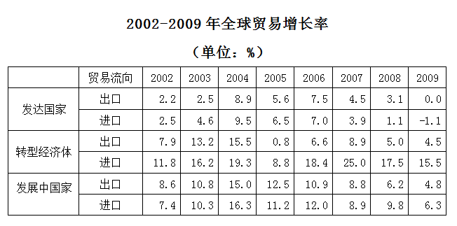

### 第 131 题

在下列哪一年中，发达国家的出口增长率最高：

A. 2004年

B. 2005年

C. 2006年

D. 2008年

第 131 题 · 答案与解析

**参考答案（粉笔题库参考内容）**

A

**解析**

定位表格可得：发达国家2004年、2005年、2006年、2008年的出口增长率分别为8.9%、5.6%、7.5%、3.1%。故2004年发达国家的出口增长率最高。

故正确答案为A。

**考点**：直接找数、统计表

**来源**：2009年贵州省公务员录用考试《行测》题第131题

### 第 132 题

下列哪种经济体在2008年的进口增长率最低：

A. 发达国家

B. 转型经济体

C. 发展中国家

D. 不确定

第 132 题 · 答案与解析

**参考答案（粉笔题库参考内容）**

A

**解析**

由表格可知，2008年发达国家的进口增长率为1.1%，转型经济体为17.5%，发展中国家为9.8%，发达国家最低。

故正确答案为A。

**考点**：排序类、统计表

**来源**：2009年贵州省公务员录用考试《行测》题第132题

### 第 133 题

发展中国家在2008年的进口增长率比2007年增长了：

A. 0.7个百分点

B. 2.1个百分点

C. 0.9个百分点

D. 1.2个百分点

第 133 题 · 答案与解析

**参考答案（粉笔题库参考内容）**

C

**解析**

定位表格可得：发展中国家在2008年和2007年的进口增长率分别为9.8%、8.9%。故发展中国家2008年的进口增长率比2007年高9.8%-8.9%=0.9%，即增长了0.9个百分点。

故正确答案为C。

**考点**：简单加减计算、统计表

**来源**：2009年贵州省公务员录用考试《行测》题第133题

### 第 134 题

与发达国家相比，转型经济体2008年的出口增长率：

A. 比发达国家高1.9个百分点

B. 比发达国家低1.9个百分点

C. 比发达国家高16.4个百分点

D. 比发达国家低16.4个百分点

第 134 题 · 答案与解析

**参考答案（粉笔题库参考内容）**

A

**解析**

定位表格可得：2008年发达国家、转型经济体的出口增长率分别为3.1%、5.0%。故2008年转型经济体的出口增长率比发达国家高5.0%-3.1%=1.9%，即高1.9个百分点。

故正确答案为A。

**考点**：简单加减计算、统计表

**来源**：2009年贵州省公务员录用考试《行测》题第134题

### 第 135 题

在2009年，发展中国家的进口增长率预计是：

A. 4.8%

B. 6.3%

C. 6.3

D. 11.1

第 135 题 · 答案与解析

**参考答案（粉笔题库参考内容）**

B

**解析**

定位表格可得：2009年，发展中国家的进口增长率预测值为6.3%。

故正确答案为B。

**考点**：直接找数、统计表

**来源**：2009年贵州省公务员录用考试《行测》题第135题

## 材料 4

**根据下图完成各题。**

        下图显示的是内蒙古、重庆、江西、陕西、吉林五个省（市）2003年与2007年地区生产总值，请根据图形回答以下的问题。

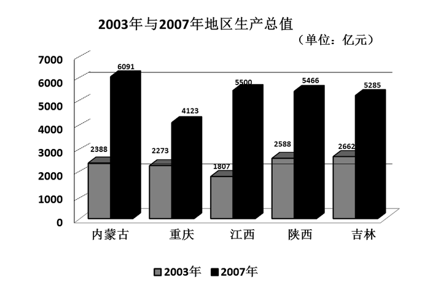

### 第 136 题

以上列举的五个省（市）中，2003年国内生产总值最大的是：

A. 内蒙古

B. 重庆

C. 江西

D. 吉林

第 136 题 · 答案与解析

**参考答案（粉笔题库参考内容）**

D

**解析**

定位图形材料可得：2003年内蒙古生产总值为2388亿元，重庆生产总值为2273亿元，江西生产总值为1807亿元，吉林生产总值为2662亿元。故2003年国内生产总值最大的是吉林。

故正确答案为D。

**考点**：直接找数、统计图

**来源**：2009年贵州省公务员录用考试《行测》题第136题

### 第 137 题

以上列举的五个省（市）中，2007年国内生产总值最小的是：

A. 江西

B. 吉林

C. 陕西

D. 重庆

第 137 题 · 答案与解析

**参考答案（粉笔题库参考内容）**

D

**解析**

定位图形材料可得：2007年重庆生产总值为4123亿元，江西生产总值为5500亿元，陕西生产总值为5466亿元，吉林生产总值为5285亿元。故2007年国内生产总值最小的是重庆。

故正确答案为D。

**考点**：直接找数、统计图

**来源**：2009年贵州省公务员录用考试《行测》题第137题

### 第 138 题

与2003年相比，陕西省2007年国内生产总值的变化为：

A. 增加2778亿元

B. 增加2777亿元

C. 增加2877亿元

D. 增加2878亿元

第 138 题 · 答案与解析

**参考答案（粉笔题库参考内容）**

D

**解析**

根据题干“与2003年相比······2007年······”，结合选项为“增加”且带单位，可判定此题为增长量计算问题。定位图形材料可知，2003年陕西省生产总值为2588亿元，2007年陕西省生产总值为5466亿元，根据增长量=现期量-基期量，可得2007年陕西省生产总值增长量为5466-2588=2878亿元。

故正确答案为D。

**考点**：增长量计算、统计图

**来源**：2009年贵州省公务员录用考试《行测》题第138题

### 第 139 题

与2003年相比，陕西省2007年国内生产总值的变化为：

A. 增长111.2%

B. 增长111.8%

C. 增长211.2%

D. 增长211.8%

第 139 题 · 答案与解析

**参考答案（粉笔题库参考内容）**

A

**解析**

根据题干“与2003年相比······2007年······”，结合选项为“增长+%”，可判定此题为一般增长率的计算问题。定位统计图材料可得，2003年、2007年陕西省生产总值分别为2588亿元、5466亿元，代入公式：。

故正确答案为A。

**考点**：一般增长率、统计图

**来源**：2009年贵州省公务员录用考试《行测》题第139题

### 第 140 题

下列叙述不正确的是：

A. 与2003年相比，江西省2007年国内生产总值的变化幅度最大

B. 与2003年相比，重庆市2007年国内生产总值增加了1850亿元

C. 与2003年相比，重庆市2007年国内生产总值变化幅度最小

D. 与2003年相比，内蒙古2007年国内生产总值增加了3603亿元

第 140 题 · 答案与解析

**参考答案（粉笔题库参考内容）**

D

**解析**

A项：定位统计图材料，可得2003年和2007年各省的生产总值，根据，可计算出各省变化幅度如下：

内蒙古变化幅度；

重庆变化幅度；

江西变化幅度；

陕西变化幅度；

吉林变化幅度。

可以看出，与2003年相比，江西省2007年国内生产总值的变化幅度最大。正确；

B项：由A项计算结果可知，与2003年相比，重庆市2007年国内生产总值增加了1850亿元。正确；

C项：由A项计算结果可知，与2003年相比，重庆市2007年国内生产总值变化幅度最小。正确；

D项：由A项计算结果可知，与2003年相比，内蒙古2007年国内生产总值增加了3703亿元。错误。

本题为选非题，故正确答案为D。

**考点**：统计图、综合分析

**来源**：2009年贵州省公务员录用考试《行测》题第140题

