# 2010年贵州省公务员录用考试《行测》题

<!-- gwy:overview:start -->
> **贵州 · 2010 · 行测 · 统考** ｜ 125 题 · 图片 93 处 · 答案随题折叠

| 题型模块 | 题量 | 题号 |
| --- | ---: | ---: |
| 数量关系 | 15 | 1–15 |
| 言语理解与表达 | 30 | 16–45 |
| 判断推理 | 40 | 46–85 |
| 常识判断 | 20 | 86–105 |
| 资料分析 | 20 | 106–125 |
| **合计** | **125** | |

导航：[题型与作答说明](#题型与作答说明) · [题目](#题目) · [材料 1](#材料-1)
<!-- gwy:overview:end -->

> 候选采集稿。参考答案及解析来自粉笔页面，不代表官方答案或真实高分答卷；来源使用许可与原卷对应关系仍需人工核实。

## 题型与作答说明

数量关系

（15题）

本部分包括数字推理与数学运算两种类型的试题。

言语理解与表达

（30题）

根据题目要求，在四个选项中选出一个正确答案。

判断推理

（40题）

本部分包括图形推理、类别推理、逻辑判断与定义判断四种类型的题目。

常识判断

（20题）

本部分要求你依据常识做出判断。请注意，似乎合理的答案可能有多种，你应选择最为合理的一个。

资料分析

（20题）

针对下列图、表或文字回答问题。你应根据资料提供的信息进行分析、比较、计算、处理。

## 题目

### 第 1 题

6，16，56，132，250，（  ）

A. 498

B. 512

C. 416

D. 524

第 1 题 · 答案与解析

**参考答案（粉笔题库参考内容）**

C

**解析**

观察数列无明显特征，考虑多级数列。后一项减前一项得：10，40，76，118，新数列没有明显特征。继续作差得：30，36，42，是公差为6的等差数列，则数列下一项为42+(6)=48。新数列下一项为118+(48)=166，则原数列所求项=250+(166)=416。

故正确答案为C。

**来源**：2010年贵州省公务员录用考试《行测》题第1题

### 第 2 题

1，5/6，3/4，7/10，2/3，9/14，()

A. 3/5

B. 5/8

C. 8/13

D. 13/22

第 2 题 · 答案与解析

**参考答案（粉笔题库参考内容）**

B

**解析**

数列中大部分为分数，可判定为分数数列，观察分子、分母，增减规律不统一，考虑反约分。将原数列转化为：4/4，5/6，6/8，7/10，8/12，9/14，（ ）。分子为：4，5，6，7，8，9，（ ）为连续的自然数，则下一项为10，故所求项分子为10；分母为：4，6，8，10，12，14，（ ）是公差为2的等差数列，则下一项为14+(2)=16，故所求项分母为16。故原数列所求项为10/16=5/8。

故正确答案为B。

**来源**：2010年贵州省公务员录用考试《行测》题第2题

### 第 3 题

2，－2，6，－10，22，（    ）

A. －36

B. －40

C. －42

D. －48

第 3 题 · 答案与解析

**参考答案（粉笔题库参考内容）**

C

**解析**

方法一：观察数列无明显特征，优先考虑多级数列。后一项减前一项得：-4，8，-16，32，观察新数列是公比为-2的等比数列。则新数列下一项为32×(-2)=-64。故原数列所求项=(-64)+22=-42。

方法二：数列无明显特征，考虑递推数列。观察题干数列，发现2×2-(-2)=6，(-2)×2-6=-10，6×2-(-10)=22，即第一项×2-第二项=第三项，故原数列所求项=(-10)×2-22=-42。

故正确答案为C。

**来源**：2010年贵州省公务员录用考试《行测》题第3题

### 第 4 题

3，2，4，5，16，（  ）

A. 45

B. 55

C. 65

D. 75

第 4 题 · 答案与解析

**参考答案（粉笔题库参考内容）**

D

**解析**

观察数列无明显特征，作差无规律，考虑递推。观察该数列：，，，可以得出规律为：第一项×第二项-修正项=第三项，修正项为2，3，4，自然数列，则修正项下一项为5。故原数列所求项。

故正确答案为D。

**来源**：2010年贵州省公务员录用考试《行测》题第4题

### 第 5 题

1，0，2，2，6，10，（  ）

A. 10

B. 16

C. 22

D. 28

第 5 题 · 答案与解析

**参考答案（粉笔题库参考内容）**

C

**解析**

观察数列，无明显特征且变化平缓，优先考虑多级数列。作差无规律，考虑作和，两两作和得到新数列1，2，4，8，16，新数列是公比为2的等比数列，故新数列下一项为16×(2)=32。则原数列所求项=32-10=22。

故正确答案为C。

**来源**：2010年贵州省公务员录用考试《行测》题第5题

### 第 6 题

(1-1/2^2)(1-1/3^2)(1-1/4^2)…(1-1/2009^2)(1-1/2010^2)=（ ）

A. 1

B. 1/2

C. 1/2010

D. 2011/4020

第 6 题 · 答案与解析

**参考答案（粉笔题库参考内容）**

D

**解析**

×…×

故正确答案为D。

**来源**：2010年贵州省公务员录用考试《行测》题第6题

### 第 7 题

某餐厅开展“每消费50元送饮料一瓶”的活动，某办公室的职员一起去该餐厅吃饭，每人花费18元，餐厅赠送了7瓶饮料。问去吃饭的人数可能是多少：

A. 17

B. 19

C. 21

D. 23

第 7 题 · 答案与解析

**参考答案（粉笔题库参考内容）**

C

**解析**

设去吃饭的人数为x，根据赠送7瓶饮料，有，解得19.4&lt;x&lt;22.2，因为人数为整数，故x取值为20、21、22，只有C项符合。

故正确答案为C。

**考点**：和差倍比问题

**来源**：2010年贵州省公务员录用考试《行测》题第7题

### 第 8 题

一个办公室有2男3女共5个职员，从中随机挑选出2个人参加培训，那么至少有一个男职员参加培训的可能性有多大：

A. 60%

B. 70%

C. 75%

D. 80%

第 8 题 · 答案与解析

**参考答案（粉笔题库参考内容）**

B

**解析**

方法一：给情况求概率，考虑公式：概率。总情况数为5名职员中选出2名，有C_5^2=10种情况；若2名全是男职员，只有1种情况，若一名男职员、一名女职员，则情况数为种，满足情况数为1+6=7种。则至少有一个男职员的概率为。

方法二：正面情况较多可以从反面考虑，至少有1个男职员的反面为没有男职员，即2人都是女职员，情况数为C_3^2=3种，总情况数为C_5^2=10种，故所求概率为：1-反面情况概率。

故正确答案为B。

**考点**：给情况求概率

**来源**：2010年贵州省公务员录用考试《行测》题第8题

### 第 9 题

要将浓度分别为20％和5％的A、B两种食盐水混合配成浓度为15％的食盐水900克。问5％的食盐水需要多少克：

A. 250

B. 285

C. 300

D. 325

第 9 题 · 答案与解析

**参考答案（粉笔题库参考内容）**

C

**解析**

设需要5%的食盐水x克，根据题意有x×5%，解得x=300。

故正确答案为C。

备注：两溶液混合，分别设两溶液质量为M_1、M_2，浓度为C_1、C_2，混合后浓度为C，则有混合公式：。

**来源**：2010年贵州省公务员录用考试《行测》题第9题

### 第 10 题

如果不堆叠，直径16厘米的盘子里最多可以放多少个边长为6厘米的正方体：

A. 1

B. 2

C. 3

D. 4

第 10 题 · 答案与解析

**参考答案（粉笔题库参考内容）**

C

**解析**

根据题意想放最多的正方体，且不堆叠，如果放四个，底面是四个正方体两两排列组成大正方形，对角线长为圆的直径16，所以不成立；放三个时，三个正方体成品字形，最长的边为12，可以放下，如图所示：

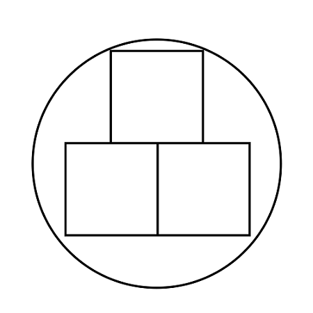

故正确答案为C。

**考点**：几何其他题型

**来源**：2010年贵州省公务员录用考试《行测》题第10题

### 第 11 题

一条河的水流速度为每小时4公里。一条船以恒定的速度逆流航行6公里后，再返回原地，共耗时2小时（不计船掉头的时间）。请问船逆流航行与顺流航行的速度之比是多少：

A. 1∶3

B. 2∶3

C. 1∶2

D. 1∶4

第 11 题 · 答案与解析

**参考答案（粉笔题库参考内容）**

A

**解析**

设船速为x，则逆流速度为x-4，顺流速度为x+4，由题意可知，等式两侧同时乘以(x+4)(x-4)，可得6(x+4)+6(x-4)=2(x+4)(x-4)，整理得，解得x=8公里/小时，即船逆流航行与顺流航行的速度之比为(8-4):(8+4)=4:12=1:3。

故正确答案为A。

**考点**：平均速度、流水行船

**来源**：2010年贵州省公务员录用考试《行测》题第11题

### 第 12 题

从钟表的12点整开始，时针与分针的第一次垂直与再一次重叠中间相隔的时间是：

A. 43分钟

B. 45分钟

C. 49分钟

D. 61分钟

第 12 题 · 答案与解析

**参考答案（粉笔题库参考内容）**

C

**解析**

方法一：

因为分针每60分钟转一圈360度，所以每分钟转6度，而时针每60分钟转30度，每分钟转0.5度，所以设经过m分钟后分针和时针第一次垂直，则有度，设经过n分钟后分针和时针再一次重合，则有度，分钟。

故正确答案为C。

**来源**：2010年贵州省公务员录用考试《行测》题第12题

### 第 13 题

某超市奶糖每斤15元，酥糖每斤13.5元，水果糖每斤10元，现超市促销，把4斤奶糖、5斤酥糖和6斤水果糖搭配成什锦糖，且什锦糖价格为各种糖搭配后价格的80％，现小王买了36块钱的什锦糖，问按搭配比例，他买到了多少奶糖：

A. 0.96斤

B. 2.4斤

C. 3斤

D. 3.6斤

第 13 题 · 答案与解析

**参考答案（粉笔题库参考内容）**

A

**解析**

根据已知，每斤什锦糖的价格为元，其中包含奶糖比例为4/15，所以36块钱可买的什锦糖中包含奶糖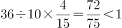。

故正确答案为A。

**考点**：和差倍比问题

**来源**：2010年贵州省公务员录用考试《行测》题第13题

### 第 14 题

两家工厂生产相同规格的运动上衣和运动裤，A厂每月用12天生产运动上衣，18天生产运动裤，每月总共可生产8640套运动服。B厂每月用16天生产运动上衣，14天生产运动裤，每月能够生产6720套运动服。两家厂商为提高效率联合生产后，每月（按30天计算）最多能够生产多少套运动服？

A. 15360

B. 16780

C. 17280

D. 21600

第 14 题 · 答案与解析

**参考答案（粉笔题库参考内容）**

C

**解析**

由题意可知：

A厂每天可生产上衣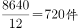，每天可生产裤子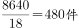；

B厂每天可生产上衣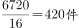，每天可生产裤子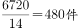。

要使产量最高，可安排A厂主要生产上衣，B厂只生产裤子，设A厂每月用x天生产上衣，剩余30－x天生产裤子，B厂整月生产裤子，可列方程720x＝480(30+30-x)，解得x＝24。故最多可生产24×720＝17280套运动服。

故正确答案为C。

**考点**：工程问题-其他、统筹规划问题

**来源**：2010年贵州省公务员录用考试《行测》题第14题

### 第 15 题

如图，有大小两个正方形，其对应边的距离均为1厘米。如果两个正方形之间部分的面积是20平方厘米，那么，小正方形的面积是多少平方厘米：

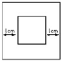

A. 4

B. 9

C. 16

D. 25

第 15 题 · 答案与解析

**参考答案（粉笔题库参考内容）**

C

**解析**

设小正方形的边长为t，则大正方形的边长为t＋2，根据题意有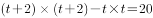，解得t＝4厘米，所以小正方形的面积为平方厘米。

故正确答案为C。

**考点**：几何公式类-平面图形

**来源**：2010年贵州省公务员录用考试《行测》题第15题

### 第 16 题

随着时代的发展，计算机技术更加（  ）地应用于机关和各种商务办公。

A. 广泛

B. 深入

C. 普及

D. 全面

第 16 题 · 答案与解析

**参考答案（粉笔题库参考内容）**

A

**解析**

此题为实词填空题。

由题干可知，括号内的词语应该与“应用”相搭配，选项C“普及”不符合搭配习惯，予以排除。

从词义上来讲，“广泛”指涉及的方面广、范围大，普遍；“深入”指研究、思考深刻、透彻；“全面”指完整、周密。根据语境，“广泛”最为恰当。

故正确答案为A。

**考点**：实词填空、对应关系-前后呼应、词的辨析-搭配对象

**来源**：2010年贵州省公务员录用考试《行测》题第16题

### 第 17 题

不要怕去学新的东西。知识没有（  ），是可以随身携带的宝藏，没有人会被它压垮，而且愈多你愈身心矫健。

A. 重量

B. 大小

C. 困难

D. 期限

第 17 题 · 答案与解析

**参考答案（粉笔题库参考内容）**

A

**解析**

此题为实词填空题。

根据题干后面的“压垮”一词即可得出答案：只有“重物”才会给人的身体造成负担，因此，“重量”最合适。

其他三项均不符合语境，予以排除。

故正确答案为A。

**考点**：实词填空、对应关系-前后呼应

**来源**：2010年贵州省公务员录用考试《行测》题第17题

### 第 18 题

我国荒漠化总体扩张的趋势还在延续，不断（  ）原本有限的生存空间，直接制约着国家社会和经济的可持续发展。

A. 侵蚀

B. 占据

C. 损害

D. 蚕食

第 18 题 · 答案与解析

**参考答案（粉笔题库参考内容）**

D

**解析**

题干主要讲的是目前荒漠化扩张使原本有限的生存空间不断减少的状况，故空缺处需填入一个体现逐渐减少语义的词语。选项中，“占据”和“损害”体现不出逐步的过程，排除B、C项；A项“侵蚀”和D项“蚕食”均可体现逐渐减少的语义。但是A项“侵蚀”是逐渐侵害使变坏；D项“蚕食”是像蚕吃桑叶那样，比喻逐步侵占。显然D项比A项更生动、形象地描绘了我国荒漠化的扩张趋势，故坚持优选原则，D项为正确答案。

故正确答案为D。

**考点**：实词填空、对应关系-前后呼应、对应关系-形象表达

**来源**：2010年贵州省公务员录用考试《行测》题第18题

### 第 19 题

横扫时尚世界的牛仔装，在美国诞生之初，就是以其野性、粗犷、豪放的风格闻名于世，后来经过（  ）后，也为其加入了休闲的元素。

A. 改装

B. 引入

C. 修饰

D. 改进

第 19 题 · 答案与解析

**参考答案（粉笔题库参考内容）**

D

**解析**

此题为实词填空题。

由“为其加入了休闲的元素”可知，牛仔装发生了改变，这种改变应当是“改进”的结果。

“引入”和“修饰”显然不符合文意；“改装”的意思是改变原来的装束或装置，也不符合文意。

故正确答案为D。

**考点**：实词填空、对应关系-前后呼应、词的辨析-搭配对象

**来源**：2010年贵州省公务员录用考试《行测》题第19题

### 第 20 题

下岗工人将获得7万美元补偿，这相当于普通蓝领工人两年的税后年薪。仅靠这笔钱，在美元疲软、物价上涨的时代并不能（  ），不过尚能维持一个家庭几年的正常生活。

A. 高枕无忧

B. 一劳永逸

C. 丰衣足食

D. 为所欲为

第 20 题 · 答案与解析

**参考答案（粉笔题库参考内容）**

C

**解析**

题干想要表达的是在物价上涨的时代，靠着7万美元的补偿，家庭生活并不会太富足，只可维持几年正常水平。故空缺处强调的是生活状况，只能对应C项，C项“丰衣足食”指穿的吃的都很丰富充足，形容生活富裕。

A项为强干扰项。“高枕无忧”是指垫高了枕头睡觉，无忧无虑，比喻平安无事，不用担忧，也可比喻放松警惕。是指摆脱了危险，不用再去担心会遇到什么危险。但空缺处修饰的是失业后的生活状态，并没有遇到危险，故“高枕无忧”用在此处不符合语境，排除；

B项“一劳永逸”指辛苦一次，把事情办好，以后就不再费事了。题干中说的是工人获得7万美元补偿金，没有体现“劳”的意思，排除；

D项“为所欲为”是贬义词。本指做自己想做的事。后指想干什么就干什么。任意而为，强调干的事。不符合语境，排除。

故正确答案为C。

**考点**：对应关系-前后呼应、成语填空

**来源**：2010年贵州省公务员录用考试《行测》题第20题

### 第 21 题

在这个世界上，真正（  ）恐惧的事很少，在很多情况下，我们是被自己吓住了，大多数的恐惧，来源于我们的（  ）。

A. 引起 经历

B. 需要 幻觉

C. 产生 猜测

D. 值得 想象

第 21 题 · 答案与解析

**参考答案（粉笔题库参考内容）**

D

**解析**

此题为实词填空题。

先看第一个空。“事情”本身并不能产生恐惧，只能是事情让人“产生”了恐惧这种情绪，因此排除C项“产生”。

再看第二个空。根据语境语意，恐惧是“我们被自己吓住了”，可知恐惧来自于人自身的想象。A项“经历”说的是人们亲身做过或遭遇过的事，人们通常只对未知的事物感到恐惧，人们并不会对“经历”感到恐惧，因此排除A选项；“幻觉”是指没有外在刺激而出现的虚假的感觉，在病态的情况下才会出现幻觉，用在此处明显不合适，因此排除B项。

故正确答案为D。

**考点**：实词填空、对应关系-前后呼应

**来源**：2010年贵州省公务员录用考试《行测》题第21题

### 第 22 题

城市既是经济载体，也是文化容器。文化资源丰富的城市，不妨好好（  ）出自己的特色，以此作为城市再定位的契机，为经济的可持续发展找寻出更好的出路。而文化资源稀缺的城市也不必着急，可以在经济的发展中（  ）属于城市的文化。

A. 演绎 弘扬

B. 创建 涵养

C. 彰显 打造

D. 提炼 培育

第 22 题 · 答案与解析

**参考答案（粉笔题库参考内容）**

D

**解析**

这道题可从第二空入手，根据文意，可知对于文化资源稀缺的城市而言，城市文化可以在经济的发展中，由无到有，逐步建立。A项“弘扬”意为发扬，是对原有事物的发扬光大，与句意不符，排除A项；B项“涵养”是指滋润养育，如涵养良好家风，一般不与“文化”搭配，排除B项。

第一空，根据文意可知，对于文化资源丰富的城市，并不是所有文化资源都要大力开发，应当在众多资源中凝聚出自己的与众不同的特色，故空缺处需填入表示“凝聚、提取”语义的词语，D项“提炼”比喻对某种事物进行去粗取精的加工、提高。符合文意，当选。C项“彰显”意为充分显示，不能体现出从丰富的文化资源中提取特色的意思，排除。

故正确答案为D。

**考点**：实词填空、对应关系-前后呼应、词的辨析-搭配对象

**来源**：2010年贵州省公务员录用考试《行测》题第22题

### 第 23 题

历史上匈奴、鲜卑、羯、氐、羌、契丹、女真等游牧民族（    ）在中原建立了政权，经过历史风雨的洗礼和涤荡，他们一部分西迁，一部分在历史中（    ），一部分融合入汉族，一部分仍保持了本民族的特征和习俗，生活在中华民族大家庭当中。

A. 全部 消亡

B. 先后 隐退

C. 一度 湮灭

D. 曾经 变迁

第 23 题 · 答案与解析

**参考答案（粉笔题库参考内容）**

C

**解析**

第一空，根据后文可知，横线处强调游牧民族历史上曾经有过在中原建立政权的阶段，但并非一直建立或全都同时建立。C项“一度”指曾经有过一次、从前有过某种情况，D项“曾经”指从前有过某种行为或情况，均符合文意，保留。A项“全部”指全体、所有，程度过重，并非这些民族全都都在中原建立过政权，与文意不符，排除；B项“先后”指前后相继、有先有后，侧重时间次序，文段并未强调时间的先后顺序，与文意侧重不符，排除。

第二空，由后文“一部分西迁······一部分融合入汉族，一部分仍保持了本民族的特征和习俗”可知，横线处应体现一部分游牧民族在历史中消失、不复存在之意。C项“湮灭”指埋没、消亡、消失不见，符合民族在历史长河中消逝无踪的语境，当选。D项“变迁”指情况或阶段的变化转移，侧重变化流转，不能体现彻底消失之意，排除。

故正确答案为C。

**考点**：实词填空、对应关系-前后呼应、词的辨析-搭配对象

**来源**：2010年贵州省公务员录用考试《行测》题第23题

### 第 24 题

影响电子书走向大众的，还是在于传统阅读习惯。手指翻过书页，会有自由的感受，电子书则是冰冷之物。传统书籍的阅读体验，是不可能（  ）的。不过，人的生存压力越来越大，很难陷入长久阅读，多是快餐、零碎式的浏览。电子书倒能填补这种零碎的时间，在（  ）中打发时间。

A. 模仿 轻描淡写

B. 移植 浮光掠影

C. 复制 删繁就简

D. 效法 浅尝辄止

第 24 题 · 答案与解析

**参考答案（粉笔题库参考内容）**

B

**解析**

此题为混搭填空题。

本题的突破口在于第二空，根据前文“快餐、零碎式的浏览”“电子书倒能填补这种零碎的时间”，可知电子书是用来打发零碎时间的浅阅读。B项“浮光掠影”比喻观察不细致，学习不深入，印象不深刻，D项“浅尝辄止”指略微尝试一下就停止，比喻不肯下功夫深入钻研，均符合电子书浅阅读的特点，保留。A项“轻描淡写”形容说话或写文章把重要问题轻轻带过，C项“删繁就简”指删除繁杂部分，使其趋于简明，均不能体现电子书浅阅读、零碎浏览的特点，排除。

第一空，通过对比传统书籍和电子书的阅读体验，传统书籍的阅读体验，是不可能拷贝到电子书上的。B项“移植”原义指将植物移动到其他地点种植，现比喻引进、借鉴别处经验、长处、做法等，用在这可以体现出电子书不能完全地借鉴、复制传统书籍的阅读体验，符合文意，当选。D项“效法”指仿照别人的做法去做，学习别人的长处，不能说效法、模仿一种“体验”，排除。

故正确答案为B。

**考点**：对应关系-前后呼应、混搭填空、词的辨析-搭配对象

**来源**：2010年贵州省公务员录用考试《行测》题第24题

### 第 25 题

一般而言，一幅大画不可能（  ），艺术家应该有一段时间收集资料、深入实地、写生采风，进而精心（  ）、反复（  ），甚至数易其稿，从而成就一件佳作。

A. 一蹴而就 准备 修改

B. 一挥而就 构思 推敲

C. 一气呵成 设计 研讨

D. 唾手可得 筹划 揣摩

第 25 题 · 答案与解析

**参考答案（粉笔题库参考内容）**

B

**解析**

此题为混搭填空题。

多个词语的选词填空题适合采用排除法。

先看第二空，A项“准备”与题干不符，前面提到的“收集资料、深入实地、写生采风”都是准备工作，不会“进而”再准备，A项排除；D项中的“筹划”是指为完成一件事情而谋划，题干中讲的是艺术家作画，“筹划”用在此处并不恰当，D项排除。

再看第三个空，“研讨”是研究讨论的意思，一般用于学术问题，不符合文意，排除C。

B项中，“一挥而就”是说一动笔就写成了，形容写字、写文章、画画快；“构思”是指写文章或制作艺术品时运用心思；“推敲”用来比喻做文章或做事时，反复琢磨、反复斟酌。这三个词语均符合语境。

故正确答案为B。

**考点**：对应关系-前后呼应、混搭填空、词的辨析-搭配对象

**来源**：2010年贵州省公务员录用考试《行测》题第25题

### 第 26 题

一位年轻的母亲因幼儿园阿姨教自己的孩子认识英文字母而向法院起诉。这位母亲认为，当她画个圆圈，孩子可以说是月亮、是鸡蛋，而一旦教孩子这是字母“Ｏ”，想象的翅膀就被剪断了。 结果，这位母亲胜诉。这段文字传递了什么样的信息：

A. 孩子的想象力常被成人忽视

B. 教育需要保护孩子们的想象力

C. 教师应该遵循学生的思维规律

D. 家长需要使用法律来保护孩子

第 26 题 · 答案与解析

**参考答案（粉笔题库参考内容）**

B

**解析**

据提问知此题为中心理解题。

题干为一则小故事，主要讲的是一位母亲因幼儿园阿姨的教育限制了孩子的想象力而向法院起诉的故事。由此可知，文段传递的信息是在教育的过程中要保护孩子的想象力。

因此，结合选项应该选择B，因为B项表述最符合文意。

A、C项在材料中并未提及；D项表述没有抓住材料的语意重点，因此排除。

故正确答案为B。

**来源**：2010年贵州省公务员录用考试《行测》题第26题

### 第 27 题

“腹有诗书气自华”。学富五车不是为了谈话时引经据典卖弄才学，也不是为了换得一纸文凭做利禄捷径，而是看重其对个人心灵的陶冶，正如朱熹所说，“问渠那得清如许？为有源头活水来”。这段文字意在说明：

A. 读书观念的演变

B. 古人读书的态度

C. 对读书价值的正确认识

D. 读书的内在和外在动机

第 27 题 · 答案与解析

**参考答案（粉笔题库参考内容）**

C

**解析**

据提问知此题为中心理解题。

根据转折关系词“而是”可以判断出，整个材料的语意重点是其后的内容，即读书最重要的作用是对个人心灵的陶冶，接下来又引用朱熹的话来论证这个观点。

因此，结合选项应该选择C，因为材料主要讲的是对读书价值的正确认识，C项表述符合文意。

A项错误，文中并没有体现出“演变”这一概念；B项错误，材料只是用朱熹的诗句来论证自己的观点，其主要内容并非是古人读书的态度；D项表述片面，没有抓住材料的语意重点，予以排除。

故正确答案为C。

**考点**：关联词-转折

**来源**：2010年贵州省公务员录用考试《行测》题第27题

### 第 28 题

英国首相丘吉尔说过：“打赢了战争、创造了历史之后，还要抢着去当第一个记录和解释历史的人。”这很好地说明了他为什么要写那十几本厚厚的历史著作。尽管历史上并没有多少人能同时成为历史的缔造者和阐释者，但获得胜利的一方总是可以按照自己的意愿来讲历史。这段文字意在说明：

A. 历史记录未必真实

B. 要谨慎评价丘吉尔的著作

C. 丘吉尔既是政治家又是历史学家

D. 掌握历史记载的话语权非常重要

第 28 题 · 答案与解析

**参考答案（粉笔题库参考内容）**

D

**解析**

据提问知此题为中心理解题。

材料引用丘吉尔的话“要抢着去当第一个记录和解释历史的人”，接下来又解释了这句话的意思即“获得胜利的一方总是可以按照自己的意愿来讲历史”，由此可见掌握历史的记载权是相当重要的。

因此，结合选项应该选择D，因为D项表述最符合文意。

其他三项都没有抓住材料的语意重点，不是材料主旨，予以排除。

故正确答案为D。

**考点**：分述句特征-引入铺垫

**来源**：2010年贵州省公务员录用考试《行测》题第28题

### 第 29 题

“春眠不觉晓”，这种逍遥，自古以来就是“悠闲阶级”独享和提倡的情怀和境界。今天看来，特别对处于竞争激烈环境下的现代人来讲，（  ）。

填入括号部分最恰当的一项是：

A. 只有欣赏的心情了

B. 只能是一种奢望了

C. 只有在周末享受了

D. 只是孩时的记忆了

第 29 题 · 答案与解析

**参考答案（粉笔题库参考内容）**

B

**解析**

此题考查语句填空。

材料中提到，“春眠不觉晓”自古以来就是“悠闲阶级”独享的情怀和境界，处于激烈竞争环境下的现代人面临着各种各样的压力，并非“悠闲阶级”，因此，“春眠不觉晓”对于现代人来说是不可能实现的，只能是一种“奢望”。

因此，结合选项应该选择B，因为B项表述最符合语境。

A项“欣赏”不符合语境；C项“周末享受”与文中“竞争激烈环境下的现代人”相悖；D项在文中没有体现。

故正确答案为B。

**考点**：横线在结尾

**来源**：2010年贵州省公务员录用考试《行测》题第29题

### 第 30 题

很少有地方比行进中的飞机、轮船和火车更容易让人倾听到内心的声音。我们眼前的景观同我们脑子里可能产生的想法之间往往存在着某种奇妙的联系：宏阔的思考常常需要壮阔的景观，而新的观点往往也产生于陌生的所在。这段文字意在说明：

A. 旅行能使人眼界开阔

B. 旅途中的景观常能引起思考

C. 旅行者的角色能使人增加人生体验

D. 人的思维角度容易受所处环境的影响

第 30 题 · 答案与解析

**参考答案（粉笔题库参考内容）**

D

**解析**

文段首先指出“行进中的飞机、轮船和火车容易让人倾听到内心的声音”这种现象，接着提出观点：我们眼前的景观与我们头脑中的想法之间有着奇妙的联系，最后通过冒号引导对观点进行解释说明，故文段的重点为观点阐述即看到的景观与想法之间存在联系，即境遇不同会导致想法不同，对应D项。

A项，文段重点强调的是环境与思想存在联系，并未提及环境能开阔眼界，排除；

B项，“引起思考”表述程度过轻，文段强调旅途中的景观可以引发“宏阔思考”，或者促使产生“新的观点”，排除；

C项，文段未提及“旅行者角色”“人生体验”，无中生有，排除。

故正确答案为D。

【文段出处】书籍《真正的旅行是倾听内心》

**考点**：分述句特征-其他

**来源**：2010年贵州省公务员录用考试《行测》题第30题

### 第 31 题

二战后，英国工党政府以《贝弗里奇报告》为蓝本建立了福利国家，随后很多欧美国家纷纷效仿，其中以瑞典为首的北欧四国更是将福利国家的概念演绎到极致。欧洲福利社会的目标之一是普享性，“从摇篮到坟墓”的福利基础建立在企业和个人的高税收之上，给很多企业造成较大的经营压力，甚至造成国家经济发展的停滞。

对这段文字的主旨概括最准确的是（  ）。

A. 呈现欧洲福利社会的发展进程

B. 介绍欧洲福利社会的基本特征

C. 揭示欧洲福利社会的基础

D. 反思欧洲福利社会的问题

第 31 题 · 答案与解析

**参考答案（粉笔题库参考内容）**

D

**解析**

本题属于中心理解题。文段首先介绍英国建立福利国家，后其他欧美国家也效仿英国建立了福利国家，甚至以“普享性”为目标之一。文段最后提出了这种福利模式存在的问题，如高税收、加大企业经营压力、造成国家经济发展的停滞等。文段的重点是揭示这种普享性福利模式的问题。结合选项，只有D项符合文意，当选。

A、B、C项，均偏离了文段的主旨，故排除。

故正确答案为D。

【文段出处】

    《论资本主义与福利国家的矛盾与共生》

**来源**：2010年贵州省公务员录用考试《行测》题第31题

### 第 32 题

职场小说在近几年间形成热潮，很多职场小说的作者不是著名的专业作家而是资深的职业白领。所以，被职场文化建构和影响的职业白领本身正是创作职场小说、倡导职场文化的核心群体。文化需求和供应主体的高度重合，决定了作为准教科书的职场小说将会长时间处于热销状态。这段文字意在说明职场小说的：

A. 产生社会背景

B. 未来发展趋势

C. 阅读和创作群体

D. 长期热销的原因

第 32 题 · 答案与解析

**参考答案（粉笔题库参考内容）**

D

**解析**

据提问“意在”一词可知此题为中心理解题。

材料前两句话主要讲的是职场小说的作者大多是被职场文化建构和影响的职业白领，在此基础上，第三句话又指出职场小说长期热销的原因就在于文化需求与供应主体（即身为职业白领的小说作者）的高度重合。由此可知，整个材料主要说明的就是职场小说长期热销的原因。

因此，结合选项应该选择D。

A、B项表述片面，没有抓住材料语意重点；C项“阅读”群体在材料中未提及，予以排除。

故正确答案为D。

**考点**：关联词-因果

**来源**：2010年贵州省公务员录用考试《行测》题第32题

### 第 33 题

月亮本身是不发光的，但皓月当空，使人感到它是个发光的天体；本来是地球围绕太阳转，但看起来却是太阳围绕地球转；电闪和雷鸣本是同时发生的，但我们总是先看到电闪然后听到雷鸣。无怪乎达尔文这样说：“大自然一有机会就要说谎。”

对画横线的文字理解正确的是：

A. 自然的奥秘需要人类不断探索

B. 自然界会给人类不断造成假象

C. 不光是人类连大自然也会说谎

D. 自然界很奇妙，人很难完全认识

第 33 题 · 答案与解析

**参考答案（粉笔题库参考内容）**

B

**解析**

阅读可知，材料整体上为分—总结构。材料首先用排比句指出大自然的本来面目与人们对自然的感官感受之间存在着矛盾，然后引用达尔文的话作为总结，即人们所感受到的有可能只是大自然给人造成的假象，“大自然一有机会就要说谎”，对应B项。

A项“不断探索”、C项“人类说谎”、D项“人类很难认识大自然”文段中均并未提及，无中生有，排除。

故正确答案为B。

**考点**：句子

**来源**：2010年贵州省公务员录用考试《行测》题第33题

### 第 34 题

近年来，汉语出现了许多新词新语。对同一事物或现象，有人愿意这样说，有人愿意那样说。对此，语言工作者应进行客观冷静地分析。看到那种盲目效仿港台语，或者为表现个性而表现个性的刻意“创新”，不闻不问是不对的。我们应规范语言运用的主流，但过分强调规范，希望纯而又纯也不行。对这段文字概括最准确的是：

A. 新词新语是人们社会生活的直接反映，折射出时代的色彩

B. 应该以科学的态度对语言运用的主流进行规范

C. 对盲目效仿和刻意“创新”的语言应进行规范

D. 对新词新语过分挑剔不利于语言的创新和发展

第 34 题 · 答案与解析

**参考答案（粉笔题库参考内容）**

B

**解析**

此题为中心理解题。

材料首先提到“汉语出现了许多新词新语”这种现象，然后指出对于这种现象语言工作者要冷静客观地分析，要规范语言运用的主流。由转折关系词“但”可知，材料的语意重点是其后的内容，即“过分强调语言运用规范”这也是不行的，也就是语言工作者应该用科学的态度对语言运用的主流进行规范，既不能放任盲目生造词语又不能过分强调追求“纯”，扼杀语言的创造性。

因此，结合选项应该选择B，因为B项表述最能概括文意。

A项不是文段所要阐述的重点；C、D两项都只从正或反单方面来阐述观点，不够全面。

故正确答案为B。

**考点**：关联词-对策、关联词-转折

**来源**：2010年贵州省公务员录用考试《行测》题第34题

### 第 35 题

中国75％的电力来自煤炭，只有2.5％来自石油，因为大部分石油都被汽车喝掉了。煤炭运输成本高，中国铁路的运力至少有一半都用来运煤了。目前很多火电厂的煤库存都坚持不了一个星期，一旦铁路运输出了问题，直接后果就是拉闸。这段文字意在强调：

A. 应增加利用石油发电的比例以规避风险

B. 过分依赖煤炭的电力生产结构存在弊端

C. 铁路运输的通畅关系着众多火电厂的生产

D. 大量使用煤炭发电增加了铁路运输的负担

第 35 题 · 答案与解析

**参考答案（粉笔题库参考内容）**

B

**解析**

此题为中心理解题。

材料首先对我国电力生产结构进行了介绍，然后指出在此种结构下有可能产生的问题，主要阐明了这种过分依赖煤炭的电力结构的不合理性。

因此，结合选项应该选择B。

A项错误，由原文“中国75%的电力来自煤炭，只有2.5%来自石油，因为大部分石油都被汽车喝掉了”无法推出“应增加利用石油发电的比例”，排除A；原文提到“铁路运输”是为了说明过分依赖煤炭的电力结构的不合理性，故C、D项都不是文段强调的重点，予以排除。

故正确答案为B。

**考点**：分述句特征-引入铺垫

**来源**：2010年贵州省公务员录用考试《行测》题第35题

### 第 36 题

法律应尊重并保障媒体的监督权利。但作为媒体，必须依法行使监督权。在监督过程中出现失误或者过错，甚至给被监督对象造成损失，则必须勇于承担责任。

这段文字的主旨是：

A. 媒体须依法监督并承担相应责任

B. 媒体行使监督权时要做到有法可依

C. 法律保障媒体权利的同时也要对其进行监督

D. 媒体出现失误或过错时责任应由其自身承担

第 36 题 · 答案与解析

**参考答案（粉笔题库参考内容）**

A

**解析**

此题为中心理解题。

根据转折关系词“但”可知，整个材料的语意重点是其后的内容，即媒体必须依法行使监督权，并且在出现失误时要勇于承担责任。

因此，结合选项应该选择A，因为A项表述最符合文意。

B、D项表述过于片面，未能准确概括文意；C项错误，题干中没有提到法律要对媒体权利进行监督。

故正确答案为A。

**考点**：关联词-转折

**来源**：2010年贵州省公务员录用考试《行测》题第36题

### 第 37 题

拉尔夫•达伦道夫在1998年写道：20世纪在相当大程度上为各种分裂所主宰，导致热战冷战不断，但20世纪同时也是一体化的起源；全球化开始主导人们的生活、想象和恐惧，人们不得不从全球的角度去思考，以回应这一日益全球化的现实。

达伦道夫在这里强调的是，20世纪：

A. 全球剧变令人忧虑

B. 国家之间对抗激烈

C. 世界联系日益密切

D. 民族矛盾逐渐缓和

第 37 题 · 答案与解析

**参考答案（粉笔题库参考内容）**

C

**解析**

此题为中心理解题。

根据转折关系词“但”可知，整个材料的语意重点是其后的内容，即20世纪是一体化的起源，人们需要从全球化的角度去思考，以回应这一日益全球化的现实。全球化的一个重要特征就是世界联系愈发密切。

因此，结合选项应该选择C，因为C项表述符合文意。

其他三项在文中均未提及，予以排除。

故正确答案为C。

**考点**：关联词-转折

**来源**：2010年贵州省公务员录用考试《行测》题第37题

### 第 38 题

形成于西周时期的礼仪制度，最早采用规范人们日常行为准则的方式，并将这一传统推行到上层社会和家居生活中。尽管西周时期“礼不下庶人”，建立礼仪制度的初衷是为了维护奴隶主贵族的利益，强化奴隶社会等级制度，以协调奴隶主阶级内部的关系，但进入春秋时期以后，随着奴隶制度“礼崩乐坏”，又出现“知识下移”、“礼下庶人”的局面，这一传统和礼仪制度也因此深入到更为广泛的社会生活中，成为社会广泛遵守的行为规范和准则。

这段文字主要说明了礼仪制度：

A. 贯穿于中国古代社会生活

B. 是统治阶级树立社会准则的工具

C. 产生的时期及进入下层社会的过程

D. 由奴隶社会保存到封建社会的原因

第 38 题 · 答案与解析

**参考答案（粉笔题库参考内容）**

C

**解析**

据提问知此题为中心理解题。

材料首先指出礼仪制度形成于西周时期，当时主要是在上层社会和家居生活中推行。接下来又提到进入春秋以后，这一传统和礼仪制度从上层社会逐步深入到更为广泛的社会生活中。

因此，结合选项应该选择C，因为选项中C项表述最为准确。

其他三项在文中均未体现，予以排除。

故正确答案为C。

**考点**：关联词-并列

**来源**：2010年贵州省公务员录用考试《行测》题第38题

### 第 39 题

现代医学科学认为：人全身血液循环的速度与肌肉及大脑神经紧张程度成反比；肌肉及神经紧张，血管受到挤压，会使血液流量减少，而造成局部缺血缺氧。当肌肉及大脑神经紧张度较平时增加60％以上时，其局部血液流动可全部中断。当今所有的疾病中，60％~80％可以从现代生活的过度紧张中去寻根溯源。这段文字旨在说明：

A. 现代医学已经找到当今疾病的绝大部分病理根源

B. 肌肉与神经的过度紧张是患心血管病的主要原因

C. 血液循环的速度与肌肉及大脑神经紧张程度有关

D. 现代人的很多疾病与紧张的生活状态相关

第 39 题 · 答案与解析

**参考答案（粉笔题库参考内容）**

D

**解析**

此题为中心理解题。

题干首先阐述“人体血液循环速度与肌肉及大脑神经紧张程度成反比”这个观点，在此基础上指出当今许多疾病都与现代生活的过度紧张有关。由此可知，材料的最后一句话是整个材料的中心句。

因此，结合选项应该选择D，因为D项表述最符合文意。

A、B项在文段中并未表明；C项是现代医学科学的一种观点，并非文段主要说明的内容。

故正确答案为D。

**考点**：分述句特征-引入铺垫

**来源**：2010年贵州省公务员录用考试《行测》题第39题

### 第 40 题

我们的企业领导者必须清醒地认识到，企业固然要顾及股东的利益，尽可能实现股东利益的最大化，但是，企业在获得社会资源进行生产的同时，也就承担了对社会各方面利益相关者的责任。是否充分考虑了这些利益相关者的利益，已日益成为评价企业绩效和企业伦理的重要尺度。对这段文字概括最准确的是：

A. 企业要兼顾股东及其他利益相关者的利益

B. 股东利益的重要性与其他社会利益相关者相当

C. 评价企业绩效和企业伦理的尺度发生了变化

D. 企业在获取利益时更要承担各种社会责任

第 40 题 · 答案与解析

**参考答案（粉笔题库参考内容）**

A

**解析**

此题为中心理解题。

材料首先提出企业要顾及股东的利益，然后用转折词“但是”引导“企业在进行生产的同时，也就承担了对社会各方面利益相关者的责任。”一个“也”强调了企业对社会各方面利益相关者的责任要与对股东的一样重要。后文进一步从“重要尺度”的角度论证前面的观点。故文段的重点就是企业要对股东和其他利益相关者的利益同样看重，对应A项。

B项“重要性”在文段中没有体现，排除；C项强调了“尺度发生了变化”但文中仅说了“日益成为······重要尺度”并没有讲尺度发生了变化，排除；D项强调的是“企业更要承担各种社会责任”但文中强调的是企业要充分考虑股东和其他利益相关者的利益而非责任，排除。

故正确答案为A。

**考点**：关联词-并列

**来源**：2010年贵州省公务员录用考试《行测》题第40题

## 材料 1

陶器的产生是和农业经济的发展联系在一起的，一般是先有了农业，然后才出现陶器。这些创造发明，无疑应归功于妇女，因为在性别分工的基础上，妇女是家里的主人，必然首先从事这些活动。这在我国某些少数民族地区还保留着一定的残余，例如云南傣族和台湾高山族的制陶都由妇女来承担，而男子仅从事挖土、运土等辅助性劳动或甚至根本不参与其事。但在有些少数民族中已开始有所变化，如云南佤族和台湾耶美族中，制陶已成为男子专有的职业，妇女则降为辅助性劳动。这些现象提供了陶器出现之后，有关男女分工的变化和社会分工发展等方面的有用资料。此外，上述少数民族制陶工艺方面的发展过程是：从泥条盘筑到慢轮修整，从露天平地堆烧到棚内平地封泥烧制，这正代表了由手制向轮制过渡的早期形态，由无窑向有窑过渡的初级形式，这些都为探讨原始制陶工艺的发展提供了极为宝贵的资料。

        详细地说明我国陶器的起源，目前尚感资料不足。不过最近在河南新郑裴李岗和河北武安磁山出土的陶器都比较原始，据碳十四断代，其年代为公元前五六千年以前，是华北新石器时代已知的最早遗存。这些发现不仅有利于探索陶器的起源问题，同时还揭示了正是在这些遗存的基础上，才发展成为后来广泛分布的仰韶文化、龙山文化，直到阶级社会的商周文明，它们在制陶工艺和器形的发展上，基本上是一脉相承的。此外，江西万年仙人洞和广西桂林甄皮岩的陶器也具有一定的原始性，其碳十四断代也在公元前四五千年以前，同样属于新石器时代较早的遗存，它们同后来华南地区的陶器发展也有着直接联系。在我国广阔的土地上，可能分布着更多的早期陶器的遗存，在不断发展和相互交流中逐渐形成统一的文化整体，并在这个基础上产生了原始瓷和瓷器，成为我国特有的创造发明，并对世界文明作出了一定的贡献。

### 第 41 题

下面哪一项符合本文对妇女从事制陶的解释：

A. 是陶器在我国起源的标志

B. 证明了我国农业文明的出现

C. 是妇女在家庭中经济地位的一种印证

D. 是造成了原始社会性别分工和社会分工的原因

第 41 题 · 答案与解析

**参考答案（粉笔题库参考内容）**

C

**解析**

此题考查细节判断。

由文章第一段前两句可知“陶器的产生是和农业经济的发展联系在一起的，······这些创造发明，无疑应归功于妇女，因为在性别分工的基础上，妇女是家里的主人，必然首先从事这些活动”，可知陶器的产生与妇女在农业社会的经济地位有关，即妇女首先从事这些活动，是由她们在家庭中的经济地位决定的对应C项，故C项是正确答案。

A项，文章第二段明确提到目前还没有足够的资料来详细说明我国陶器的起源，故“起源的标志”无中生有，排除A项；B项，材料第一句话提出先有了农业，才出现陶器，妇女制陶并不能证明农业文明的出现，排除B项；D项，妇女从事制陶是原始社会性别分工和社会分工的结果，而不是原因，因果倒置，排除D项。

故正确答案为C。

**来源**：2010年贵州省公务员录用考试《行测》题第41题

### 第 42 题

文章认为佤族和耶美族男子从事制陶说明了：

A. 陶器起源的另一特殊现象

B. 制陶辅助性劳动不利于妇女

C. 家庭的主要角色发生了变化

D. 在制陶分工上不同于其他民族

第 42 题 · 答案与解析

**参考答案（粉笔题库参考内容）**

C

**解析**

此题考查细节判断。

文章第一段中首先提到制陶是由妇女来从事的劳动，这是由其家庭经济地位决定的，男子仅从事辅助性劳动。接下来又提到佤族和耶美族制陶已成为男子专有的职业，妇女则降为辅助性劳动，这是家庭角色发生转变的体现。

因此，结合选项应该选择C。

A项错误，男子从事制陶与陶器起源没有关系；B项在文中并未提及；D项为干扰项，其内容只是文章表面信息，男子从事制陶意在说明其家庭角色的“变化”，D项没有抓住材料语意重点。

故正确答案为C。

**来源**：2010年贵州省公务员录用考试《行测》题第42题

### 第 43 题

文章通过对华北、华南不同地方的介绍，想要读者知道：

A. 两个不同地域的陶器遗存的发现

B. 这几个地方新石器时代断代的先后

C. 我国陶器的创制对人类文明作出了贡献

D. 我国在不同地域中还可能有着更多的陶器遗存

第 43 题 · 答案与解析

**参考答案（粉笔题库参考内容）**

D

**解析**

此题考查隐含主旨。

文章第二段在介绍完华北、华南地区的陶器遗存之后，在最后一句话中提到“我国广阔的土地上，可能分布着更多的早期陶器的遗存······”。由此可知，文章介绍华南、华北不同地方，意在说明早期陶器分布广泛，我国在不同地域中可能有着更多的陶器遗存，对应D项。

**来源**：2010年贵州省公务员录用考试《行测》题第43题

### 第 44 题

根据本文，下列描述中不准确的一项是：

A. 我国制陶是从少数民族开始的

B. 原始瓷器的出现受到了原始陶器的影响

C. 河南新郑裴李岗出土的陶器不能证明陶器的起源

D. 江西万年仙人洞的陶器影响了华南地区陶器的发展

第 44 题 · 答案与解析

**参考答案（粉笔题库参考内容）**

A

**解析**

此题考查细节判断。

A项表述错误，文段举出少数民族的例子只是为了解释家庭角色分工，这些分工在部分少数民族地区中还有残余，而并非指出制陶产生于少数民族；

B项表述符合文意，文章最后一句话“早期陶器的遗存······文化整体，并在这个基础上产生了原始瓷和瓷器”点出原始瓷和瓷器的出现受到了原始陶器的影响；

C项表述正确，文章第二段首句提出目前还没有足够的资料的详细说明我国陶器的起源，由此可以推知C项的描述正确；

D项表述符合文意，由“江西万年仙人洞和广西桂林甄皮岩的陶器也具有一定的原始性······同后来华南地区的陶器发展也有着直接联系”这句话可以推断得出。

本题为选非题，故正确答案为A。

**来源**：2010年贵州省公务员录用考试《行测》题第44题

### 第 45 题

根据文章内容，可以看出本文最有可能出自：

A. 介绍我国陶器、瓷器发展的一段文章

B. 考古学中一篇断定新石器时代的文章

C. 社会学中介绍少数民族制陶和文化最早出现的文章

D. 政治经济学中关于农业发展促进社会分工的一篇文章

第 45 题 · 答案与解析

**参考答案（粉笔题库参考内容）**

A

**解析**

此题考查表面主旨。

文章首段介绍了陶器制作的角色分工及其工艺发展，第二段介绍了陶器的地域分布，并指出在此基础上产生了原始瓷和瓷器，因此本文最有可能出自介绍我国陶器、瓷器发展的一段文章。

因此，结合选项应该选择A。

B、D项均未抓住整篇文章的主题词“陶器”，予以排除；C项中“少数民族”表述错误，“少数民族”并非文章阐述的重点。

故正确答案为A。

**来源**：2010年贵州省公务员录用考试《行测》题第45题

### 第 46 题

从所给四个选项中，选择最合适的一个填入问号处，使之呈现一定的规律性：

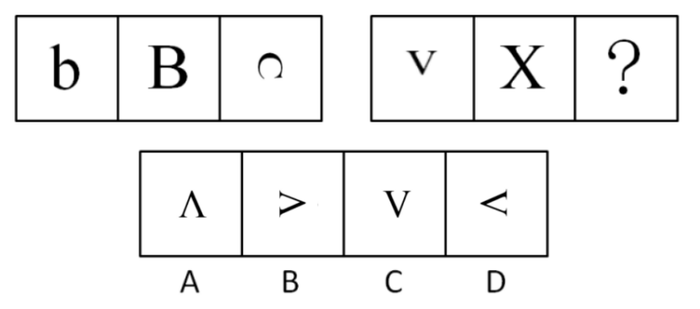

A. A

B. B

C. C

D. D

第 46 题 · 答案与解析

**参考答案（粉笔题库参考内容）**

D

**解析**

本题考查元素叠加。

已知的第一组图形中第一个图形与第二个图形叠加后去同存异后的剩余部分逆时针旋转90度得到第三个图形。第二组图形也应符合该规律，通过分析，只有D项中图形符合该规律。

故正确答案为D。

**考点**：样式规律-加减同异

**来源**：2010年贵州省公务员录用考试《行测》题第46题

### 第 47 题

从所给四个选项中，选择最合适的一个填入问号处，使之呈现一定的规律性：

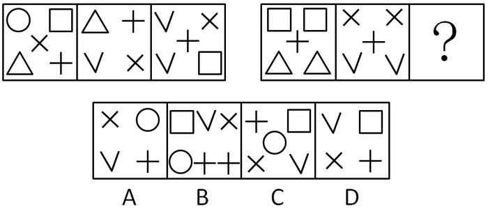

A. A

B. B

C. C

D. D

第 47 题 · 答案与解析

**参考答案（粉笔题库参考内容）**

A

**解析**

元素集合形式，数元素。本题考查元素的种类和数目。

已知的第一组图形中共有1个圆圈、2个正方形、2个三角形、3个“×”、3个“＋”、3个“V”。第二组图形也应符合该规律，第二组图形前两个图形中已经包含2个正方形、2个三角形、2个“×”、2个“＋”、2个“V”，因此第三个图形应该包含1个圆圈、1个“×”、1个“＋”、1个“V”。通过分析，符合的只有A项中图形。

故正确答案为A。

**考点**：数量规律-素

**来源**：2010年贵州省公务员录用考试《行测》题第47题

### 第 48 题

从所给四个选项中，选择最合适的一个填入问号处，使之呈现一定的规律性：

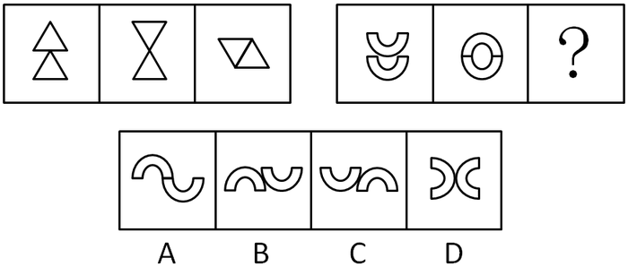

A. A

B. B

C. C

D. D

第 48 题 · 答案与解析

**参考答案（粉笔题库参考内容）**

B

**解析**

元素组成相同，优先考虑位置规律。

观察发现，第一组图形中第一个图形上面的小图形沿横轴翻转得到第二个图形；第二个图形上下两个小图形平行放置，上面的小图形置于左侧，下面的小图形置于右侧得到第三个图形。

第二组图形也应符合该规律，即第二组图形中第二个图形上下两个小图形平行放置，上面的小图形置于左侧，下面的小图形置于右侧得到第三个图形。通过分析，只有B项符合。

故正确答案为B。

**考点**：位置规律-综合

**来源**：2010年贵州省公务员录用考试《行测》题第48题

### 第 49 题

从所给四个选项中，选择最合适的一个填入问号处，使之呈现一定的规律性：

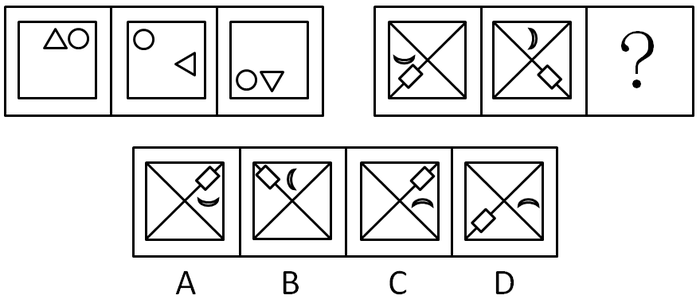

A. A

B. B

C. C

D. D

第 49 题 · 答案与解析

**参考答案（粉笔题库参考内容）**

C

**解析**

元素组成相同，考查位置规律。

本题考查元素的平移。已知的第一组图形中，小圆沿四个角（下图中1、2、3、4四个位置）逆时针移动，三角形沿四个边（下图中A、B、C、D四个位置）顺时针移动且每次移动自身沿逆时针方向旋转90度，从而由第一个图形依次得到第二个和第三个图形。第二组图形也应符合该规律，在第二组图形中把小圆换成小长方形，三角形换成月牙，按照上述规律，由第二个图形可知，第三个图形中小长方形应该在1位置，月牙应该在B位置，此时A项和C项都符合，再考虑月牙沿逆时针方向旋转90度可以判断C项正确，A项错误。

故正确答案为C。

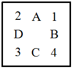

**考点**：位置规律-旋转

**来源**：2010年贵州省公务员录用考试《行测》题第49题

### 第 50 题

从所给四个选项中，选择最合适的一个填入问号处，使之呈现一定的规律性：

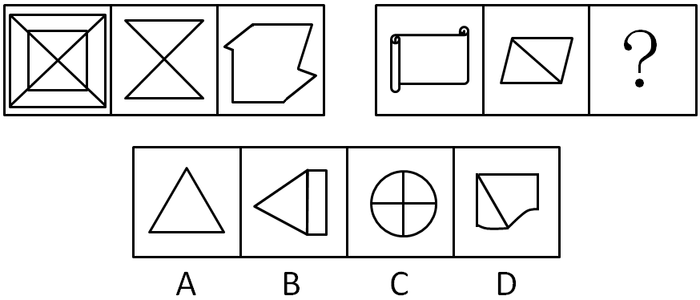

A. A

B. B

C. C

D. D

第 50 题 · 答案与解析

**参考答案（粉笔题库参考内容）**

B

**解析**

元素组成不同，且无明显属性规律，考虑数量规律。第一组图中，每幅图均有水平方向的平行线，第二组图前两幅图均有水平方向的平行线，故问号处图形需有水平方向的平行线，只有B选项符合。

故正确答案为B。

**考点**：数量规律-线

**来源**：2010年贵州省公务员录用考试《行测》题第50题

### 第 51 题

从所给四个选项中，选择最合适的一个填入问号处，使之呈现一定的规律性：

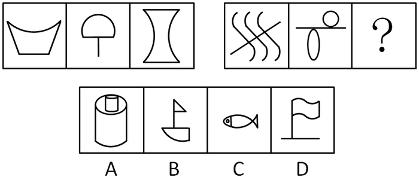

A. A

B. B

C. C

D. D

第 51 题 · 答案与解析

**参考答案（粉笔题库参考内容）**

A

**解析**

元素组成不同且无属性规律，考虑数量规律。本题考查直线和曲线的数量差。

题干图形直线和曲线的数量差分别是2、1、0；第二组图曲线和直线的数量差也应分别是2、1、0，只有A中曲线和直线的差是0。

故正确答案为A。

**考点**：数量规律-复合

**来源**：2010年贵州省公务员录用考试《行测》题第51题

### 第 52 题

从所给四个选项中，选择最合适的一个填入问号处，使之呈现一定的规律性：

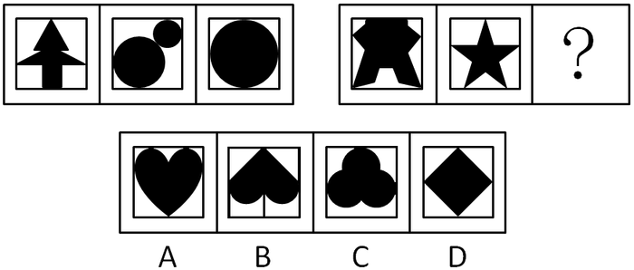

A. A

B. B

C. C

D. D

第 52 题 · 答案与解析

**参考答案（粉笔题库参考内容）**

A

**解析**

元素组成不同，且无明显属性规律，优先考虑数量规律。题干均为黑色图形，出现较多空白窟窿，可考虑数面。第一组图形面数量均为4，第二组前两幅图形面数量均为5，故问号处应选择有5个面的图形，只有A项符合。

故正确答案为A。

**考点**：数量规律-面

**来源**：2010年贵州省公务员录用考试《行测》题第52题

### 第 53 题

从所给四个选项中，选择最合适的一个填入问号处，使之呈现一定的规律性：

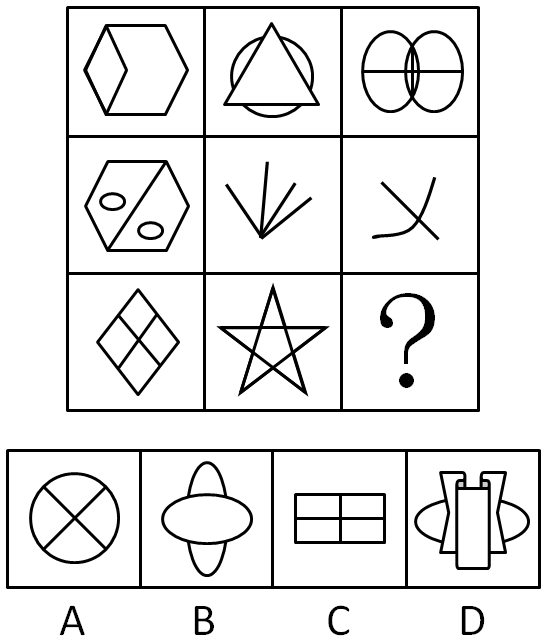

A. A

B. B

C. C

D. D

第 53 题 · 答案与解析

**参考答案（粉笔题库参考内容）**

B

**解析**

元素组成不同且无属性规律，考虑数量规律。本题考查数直线。

已知第一列图形的直线数分别是8、7、6，第二列图形的直线数分别为3、4、5，因此第三列图形的直线数分别为2、1、？，此时按纵向S型规律来看，图形直线数为8、7、6、5、4、3、2、1、？。因此，？处图形的直线数应为0，只有B项符合。

故正确答案为B。

**考点**：数量规律-线

**来源**：2010年贵州省公务员录用考试《行测》题第53题

### 第 54 题

左边给定的是一个纸盒的成型图，它可以从右边哪一项折叠而成？请把它找出来：

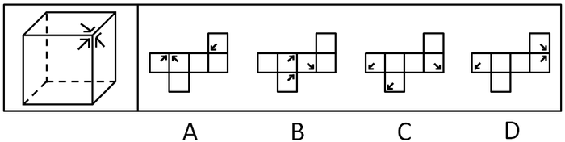

A. A

B. B

C. C

D. D

第 54 题 · 答案与解析

**参考答案（粉笔题库参考内容）**

C

**解析**

本题可采用排除法。观察立体图形可知，三个箭头指向同一个顶点。A项中最右边的箭头所指向的顶点附近有两个空白面，因此排除； B项中左边相邻的两个箭头没有指向同一个顶点，因此排除；D项中最左边的箭头折叠后指向下方，与另外两个箭头的指向不同，因此也排除。

故正确答案为C。

**考点**：空间类-空间重构-六面体

**来源**：2010年贵州省公务员录用考试《行测》题第54题

### 第 55 题

下列四个选项中，哪个可以折出左边指定的图形：

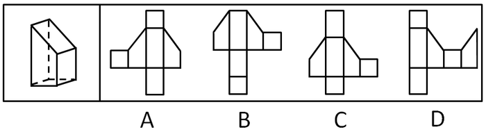

A. A

B. B

C. C

D. D

第 55 题 · 答案与解析

**参考答案（粉笔题库参考内容）**

C

**解析**

本题可采用排除法。

将题干中的图看做是一个竖立的台体。

B项中两个小方块的位置重叠，因此排除B项；

A项和D项犯了同一种错误，即将台体对应两个方形侧面的大小位置弄反了，因此A和D均错误。

故正确答案为C。

**来源**：2010年贵州省公务员录用考试《行测》题第55题

### 第 56 题

阳光：禾苗

A. 环境：森林

B. 灾民：饥饿

C. 空气：生命

D. 草原：马儿

第 56 题 · 答案与解析

**参考答案（粉笔题库参考内容）**

C

**解析**

第一步：判断题干词语间逻辑关系。

阳光是禾苗成长的必要条件。

第二步：判断选项词语间逻辑关系。

A项：环境不是森林成长的必要条件，森林是地球环境的一个组成部分；

B项：灾民不是饥饿的必要条件，没有饭吃的时候大家都会感到饥饿。是否饥饿也不是判断灾民的条件；

C项：空气是生命存在的必要条件，没有空气就没有生命；

D项：草原是马儿生活的环境，而不是必要条件，动物园里的马一样可以生存。有人认为禾苗在阳光里，马儿在草原上，这种理解是不正确的，禾苗不一定在阳光里，夜晚时候禾苗同样在生长。

故正确答案为C。

**考点**：逻辑关系-对应关系

**来源**：2010年贵州省公务员录用考试《行测》题第56题

### 第 57 题

酸奶：奶酪

A. 木头：桌子

B. 豆浆：豆腐

C. 干冰：冰块

D. 土壤：沙尘

第 57 题 · 答案与解析

**参考答案（粉笔题库参考内容）**

B

**解析**

第一步：判断题干词语间逻辑关系。

酸奶和奶酪本质上都是食品，且二者的主要原材料相同均为鲜奶。

第二步：判断选项词语间逻辑关系。

A项：木头和桌子本质上都不是食品，与题干逻辑关系不一致，排除；

B项：豆浆和豆腐本质上都是食品，且二者的主要原材料相同均为大豆，与题干逻辑关系一致，当选；

C项：干冰和冰块本质上都不是食品，且干冰的成分是二氧化碳而不是冰，与题干逻辑关系不一致，排除；

D项：土壤和沙尘本质上都不是食品，与题干逻辑关系不一致，排除。

故正确答案为B。

**考点**：逻辑关系-对应关系

**来源**：2010年贵州省公务员录用考试《行测》题第57题

### 第 58 题

春联：年画

A. 灯笼：元宵

B. 粽叶：粽子

C. 菊花：月饼

D. 灶王：腊八粥

第 58 题 · 答案与解析

**参考答案（粉笔题库参考内容）**

A

**解析**

第一步：判断题干词语间逻辑关系。

题干两词是并列关系，且是同属于一个节日下的并列关系，即“春联”和“年画”都属于春节时的所需品。

第二步：判断选项词语间逻辑关系。

与题干相同逻辑关系的即为A项，即“灯笼”和“元宵”都属于元宵节时的所需品；

B项为包容关系，“粽叶”是“粽子”的一部分；

C项中“菊花”属于重阳节的所需品，“月饼”属于中秋节的所需品；

D项中腊月二十三至除夕供奉“灶王”，“腊八粥”一般在腊月初八。

故正确答案为A。

**考点**：逻辑关系-并列关系

**来源**：2010年贵州省公务员录用考试《行测》题第58题

### 第 59 题

防守：失陷（    ）。

A. 工作：辞职

B. 进攻：占领

C. 应聘：落选

D. 求证：反驳

第 59 题 · 答案与解析

**参考答案（粉笔题库参考内容）**

C

**解析**

第一步：判断题干词语间逻辑关系。

“防守”失败的结果是“失陷”，且“失陷”是被动的。

第二步：判断选项词语间逻辑关系。

A项：“工作”失败的结果是“辞职”，但“辞职”是主动的，与题干逻辑关系不一致，排除；

B项：“进攻”成功的结果是“占领”，与题干逻辑关系不一致，排除；

C项：“应聘”失败的结果是“落选”，且“落选”是被动的，与题干逻辑关系一致，当选；

D项：“求证”和“反驳”不是结果的对应，与题干逻辑关系不一致，排除。

故正确答案为C。

**考点**：逻辑关系-对应关系

**来源**：2010年贵州省公务员录用考试《行测》题第59题

### 第 60 题

火山：岩浆

A. 小麦：面包

B. 汽车：尾气

C. 海洋：岛屿

D. 地下水：喷泉

第 60 题 · 答案与解析

**参考答案（粉笔题库参考内容）**

B

**解析**

第一步：判断题干词语间逻辑关系。

题干两词是对应关系，且是事物与其产物间的一一对应关系，即火山喷出岩浆。

第二步：判断选项词语间逻辑关系。

与题干相同逻辑关系的即为B项；

A项不是一一对应关系；

C项不是事物与其产物间的对应关系；

D项不是一一对应关系。

故正确答案为B。

**考点**：逻辑关系-对应关系

**来源**：2012年安徽省公务员录用考试《行测》题第93题

### 第 61 题

控告：辩护

A. 怀疑：相信

B. 侵犯：自卫

C. 胜利：失败

D. 鼓励：自满

第 61 题 · 答案与解析

**参考答案（粉笔题库参考内容）**

B

**解析**

第一步：判断题干词语间逻辑关系。

题干两词是对应关系，且是主动和被动两个相对行为间的对应关系，前者是主动，后者是被动。

第二步：判断选项词语间逻辑关系。

与题干相同逻辑关系的即为B项；

A项和C项均是一对反义词，D项中“自满”不是被动的行为，是主动行为。

故正确答案为B。

**考点**：逻辑关系-对应关系

**来源**：2010年贵州省公务员录用考试《行测》题第61题

### 第 62 题

花卉：花

A. 汽车：车

B. 人口：人

C. 山峰：山

D. 粮食：米

第 62 题 · 答案与解析

**参考答案（粉笔题库参考内容）**

D

**解析**

第一步：判断题干词语间逻辑关系。

花卉包含花和草，是可欣赏植物的统称。花是花卉的一种，二者是种属关系。

第二步：判断选项词语间逻辑关系。

A项： 汽车是车的一种，二者是种属关系，但顺序与题干相反，不符合题干逻辑，排除；

B项：人口是描述人数量的概念，二者是对应关系，不符合题干逻辑，排除；

C项：山峰是山的突出的尖顶，二者是组成关系，不符合题干逻辑，排除；

D项：米是粮食的一种，二者是种属关系，符合题干逻辑，当选。

故正确答案为D。

**考点**：逻辑关系-包容关系

**来源**：2010年贵州省公务员录用考试《行测》题第62题

### 第 63 题

氢：氧：水

A. 根：叶：花

B. 黄：蓝：绿

C. 陆地：海洋：天空

D. 石油：煤炭：天然气

第 63 题 · 答案与解析

**参考答案（粉笔题库参考内容）**

B

**解析**

第一步：判断题干词语间逻辑关系。

“氢”和“氧”可以生成“水”。

第二步：判断选项词语间逻辑关系。

A项：“根”“叶”“花”属于植物的一部分，三词为并列关系，与题干逻辑关系不一致，排除；

B项：“黄”和“蓝”可以合成“绿”，与题干逻辑关系一致，当选；

C项：“陆地”“海洋”“天空”三词为并列关系，与题干逻辑关系不一致，排除；

D项：“石油”“煤炭”“天然气”都为能源的一种，三词为并列关系，与题干逻辑关系不一致，排除。

故正确答案为B。

**考点**：逻辑关系-对应关系

**来源**：2010年贵州省公务员录用考试《行测》题第63题

### 第 64 题

（  ）对于  距离  相当于  扫帚  对于（  ）

A. 空间 吸尘器

B. 时间 垃圾桶

C. 位置 地面

D. 网络 灰尘

第 64 题 · 答案与解析

**参考答案（粉笔题库参考内容）**

D

**解析**

将选项逐一代入，判断各选项前后部分的逻辑关系。

A项：空间可以通过距离来表现，二者是对应关系；扫帚和吸尘器都是清洁的工具，二者是并列关系，前后逻辑关系不一致，排除；

B项：时间和距离没有明显的逻辑关系；扫帚和垃圾桶都是清洁的工具，二者是并列关系，与前后逻辑关系不一致，排除；

C项：位置影响距离，二者是对应关系；扫帚可以清扫地面，二者是对应关系，但是前后对应方式不同，前后逻辑关系不一致，排除；

D项：网络是一种工具，可以拉近距离，二者是对应关系；扫帚是一种工具，可以清扫灰尘，二者是对应关系，前后对应方式相同，前后逻辑关系一致，当选。

故正确答案为D。

**考点**：逻辑关系-对应关系

**来源**：2010年贵州省公务员录用考试《行测》题第64题

### 第 65 题

时间  对于（  ）相当于（  ）对于  压强

A. 钟表 焦虑

B. 成长 动力

C. 金钱 心理障碍

D. 效率 受力面积

第 65 题 · 答案与解析

**参考答案（粉笔题库参考内容）**

D

**解析**

逐一代入选项。

A项：钟表可以显示时间，二者为对应关系；焦虑和压强之间无明显逻辑关系，前后逻辑关系不一致，排除；

B项：时间可以促进成长，二者为对应关系；动力和压强之间无明显逻辑关系，前后逻辑关系不一致，排除；

C项：时间和金钱是两种不同的资源，二者为并列关系；心理障碍和压强之间无明显逻辑关系，前后逻辑关系不一致，排除；

D项：工作不变时，时间越长，效率越低，二者为反比关系；压力不变时，受力面积越大，压强越小，二者为反比关系，前后逻辑关系一致，当选。

故正确答案为D。

**考点**：逻辑关系-对应关系

**来源**：2010年贵州省公务员录用考试《行测》题第65题

### 第 66 题

在计算机技术高度发达的今天，我们可以借助计算机完成许多工作，但正是因为对计算机的过度依赖，青少年动手能力的发展受到抑制。他们在学习和生活中无处不使用计算机来寻找答案，而不是亲自动手解决问题。因此，过多使用计算机解决学习和生活问题的青少年实际动手能力要比其他孩子差。以下最能支持上述结论的一项是：

A. 过度依赖计算机的青少年和较少接触计算机的青少年在智力水平上差别不大

B. 大多数青少年在使用计算机解决问题的同时也会自己动手解决一些问题

C. 青少年能利用而非依赖计算机来解决实际问题，本身也是对动手能力的训练

D. 那些较少使用计算机的青少年自己动手解决学习和生活问题的能力较强

第 66 题 · 答案与解析

**参考答案（粉笔题库参考内容）**

D

**解析**

第一步：找到论点和论据。

本题论点是过多使用计算机解决学习和生活问题的青少年实际动手能力要比其他孩子差，论据是青少年在学习和生活中无处不使用计算机来寻找答案，而不是亲自动手解决问题。

第二步：判断加强方式。

论点涉及到“其他孩子”，论据没有涉及，这代表论点论据对象不一致，所以论点与论据间不存在明显因果关系，需加强论证，在论点和论据间搭桥。

第三步：逐一判断选项的作用。

A项中智力水平与实际动手能力无直接联系，属无关选项，排除；

B项中大多数青少年使用计算机解决问题与过多使用计算机解决学习和生活问题的青少年无直接联系，属无关选项，排除；

C项中青少年与过多使用计算机解决学习和生活问题的青少年无直接联系，属无关选项，排除；

D项中通过对较少使用计算机的青少年动手能力和题干结论的对比，即涉及到了较少使用计算机的青少年，在论点与论据间搭桥，可以加强，当选。

故正确答案为D。

**考点**：搭桥

**来源**：2010年贵州省公务员录用考试《行测》题第66题

### 第 67 题

智商很低的人肯定不能成名成家，但智商很高的人不一定能成名成家。在导致人成名成家的其他因素中，大部分因素属于情商。由此可以推出：

A. 只要具备很高的智商与情商便必定成功

B. 情商比智商对成名成家更重要

C. 情商很高的人不一定能成名成家

D. 智商很高的人情商一定很低

第 67 题 · 答案与解析

**参考答案（粉笔题库参考内容）**

C

**解析**

第一步：抓住题干主要信息。

智商对成名成家有重要性，其他影响因素中，情商最重要。

第二步：逐一分析选项。

A项：根据“智商很高的人不一定能成名成家”和“其他因素中，大部分属于情商”可以推知影响人成名成家的因素不只“情商”和“智商”，选项表述过于绝对，无法推出，排除；

B项：题干先强调智商对成名成家的重要性，再强调其他因素中情商最重要，并没有比较“情商”和“智商”两者的重要性，无法推出，排除；

C项：影响成名成家的因素很多，该选项仅提到了情商很高，所以不一定能成名成家，可以推出，当选；

D项：题干没有提及“智商”高低和“情商”之间的关系，选项表述过于绝对，无法推出，排除。

故正确答案为C。

**考点**：日常结论

**来源**：2010年贵州省公务员录用考试《行测》题第67题

### 第 68 题

有关专家表示，因工作中身心透支严重，一种被称为职业倦怠症的慢性职业病正入侵都市上班族。职业倦怠症是一种由工作引发的心理枯竭现象，是职业人在工作重压之下所体验到的身心俱疲、能量被耗尽的感觉。产生职业倦怠的人会出现生理、心理上的不适以及行为上的障碍，若不及时处理或找专业人士进行治疗将会出现不可预料的后果。调查显示，教师、警察、医护人员、保险代理、高科技研究者、新闻工作者等是这类疾病的高危人群。

以下最有可能从上述条件推断出来的一项是：

A. 现代人产生职业倦怠的时间越来越短，有的甚至刚参加工作就开始对工作厌倦

B. 警察在审讯中无故打伤人的事情或许不仅仅是人品和职业道德问题

C. 教师、警察、新闻工作者等职业的从业人员需要充沛的精力和良好的身体素质

D. 职业倦怠症将成为现代社会威胁人们健康的慢性职业病中最危险的一种

第 68 题 · 答案与解析

**参考答案（粉笔题库参考内容）**

B

**解析**

第一步：抓住题干主要信息。

第一句说明职业倦怠症的病因工作中身心透支严重，第二句说明职业倦怠症是一种由工作引发的心理枯竭现象，第三句说明职业倦怠症不及时处理或找专业人士进行治疗将会出现不可预料的后果，第四句说明职业倦怠症的高危人群。

第二步：逐一分析选项。

A项：题干中并没有提到产生职业倦怠的时间长短，无法推出，排除；

B项：题干最后提到“警察等是这类疾病的高危人群”，说明警察无故打人，有可能是因为职业倦怠造成的行为上的障碍，选项可以推出，当选；

C项：题干提到“职业倦怠的原因是身心透支严重”，会感觉“身心俱疲、能量被耗尽”、“教师、警察、新闻工作者等是这类疾病的高危人群”，但是并没有指出是因为这些从业人员的精力和身体素质的原因，因此选项无法推出，排除；

D项：“最危险”过于绝对，从题干中无法得知，因此选项无法推知，排除。

故正确答案为B。

**考点**：日常结论

**来源**：2010年贵州省公务员录用考试《行测》题第68题

### 第 69 题

啤酒与人类健康的关系向来受到科学家关注。由于女性的手指骨骼会最先出现骨质疏松症状，研究人员选择对她们的指骨进行超声波成像扫描。扫描结果显示，常喝啤酒的女性和不喝啤酒的女性骨密度有显著差异，前者的骨密度高于后者。所以，研究人员认为喝啤酒有助于女性预防骨质疏松。以下如果为真，最能削弱上述结论的是：

A. 有喝啤酒习惯的女性大多喜欢参加体育运动，身体健壮，骨骼密度本来就相对较高

B. 啤酒中含有的黄豆芽苷元是否能有效防止骨骼老化还有待于进一步研究

C. 啤酒中的酒精不利于钙质的吸收，而缺钙容易导致骨骼发育不良

D. 每天喝200毫升啤酒的女性，其骨骼密度高于每天喝500毫升啤酒的女性

第 69 题 · 答案与解析

**参考答案（粉笔题库参考内容）**

A

**解析**

第一步：找到论点和论据。

论点：喝啤酒有助于女性预防骨质疏松。

论据：常喝啤酒的女性和不喝啤酒的女性骨密度有显著差异，前者的骨密度高于后者。

第二步：逐一判断选项的作用。

A项：说明这些女性骨骼密度高不一定是因为喝啤酒，有可能是因为运动，为他因削弱，当选；

B项：“有待于进一步研究”也就是说现在还没有结论，属于不明确选项，且骨骼老化与骨密度和骨质疏松无关，排除；

C项：引入新概念“骨骼发育不良”，与题干中的“骨密度”之间关系不明确，属于无关选项，排除；

D项：喝啤酒的多少与是否喝啤酒是两个不同话题，属于无关选项，排除。

故正确答案为A。

**考点**：他因削弱

**来源**：2010年贵州省公务员录用考试《行测》题第69题

### 第 70 题

近年来，生物燃料需求迅速增加。2000年至2007年全球乙醇产量增长了两倍，到2017年其产量还会再翻一番；生物柴油的产量10年内也将增长一倍多。这些生物燃料是由玉米等谷物、糖类和油料作物生产的，因此其产量的扩大必然导致相关农作物价格的飙升。

如果上述观点正确，可以推出：

A. 农产品价格上涨将导致生物燃料产量降低

B. 如果农产品价格下降则说明生物燃料产量没有提高

C. 如果生物燃料产量下降则说明农产品的价格提高

D. 乙醇等生物燃料产量增加是受农产品价格过低的影响

第 70 题 · 答案与解析

**参考答案（粉笔题库参考内容）**

B

**解析**

第一步：抓住每句话中的对象及其关系。

第一句强调生物燃料需求迅速增加，第二句说明生物燃料产量的扩大使得相关农作物价格的飙升。“产量的扩大必然导致相关农作物价格的飙升”翻译为：生物燃料产量扩大→农作物价格上涨。

第二步：逐一翻译选项并判断选项的正确。

A项，农作物价格上涨→生物燃料产量扩大，“农作物价格上涨”属肯后件，无法推出绝对表达的结论，无法推出，排除；

B项，-农作物价格上涨→生物燃料产量扩大，是题干推导关系的逆否规则，可以推出，当选；

C项，-生物燃料产量扩大→农作物价格上涨，“-生物燃料产量扩大”属于否前件，无法推出绝对表达的结论，无法推出，排除；

D项，-农作物价格上涨→生物燃料产量扩大，“-农作物价格上涨”是题干推导关系的逆否，但是结论不正确，无法推出，排除。

故正确答案为B。

**考点**：常规翻译

**来源**：2010年贵州省公务员录用考试《行测》题第70题

### 第 71 题

四川省气象局气候中心最近完成的一项研究认为：未来10至30年，“干暖”将成为目前大熊猫栖息地气候变化的总体趋势，这些地区将越来越不适合大熊猫的生存繁衍，而西北方向的邛崃山系则会因为气温升高、降水明显增加，变得更适宜大熊猫生存。大熊猫栖息地气候适宜区、次适宜区将由东南向西北转移，因此大熊猫未来将会向西北迁徙。

以下哪项如果为真，最能支持上述观点：

A. 大熊猫喜欢湿润的气候

B. “干暖”气候不利于竹子生长

C. 西北地区的气候正变得越来越湿润

D. 大熊猫具备迁徙的能力

第 71 题 · 答案与解析

**参考答案（粉笔题库参考内容）**

D

**解析**

第一步：找到论点论据。

论点：大熊猫未来将会向西北迁徙。

论据：西北方向的邛崃山系则会因为气温升高、降水明显增加，变得更适宜大熊猫生存。大熊猫栖息地气候适宜区、次适宜区将由东南向西北转移。

本题论点与论据都是在说西北方向与大熊猫未来之间的关系，话题一致，无需搭桥，加强考虑补充论据，补充必要条件，或者解释为什么大熊猫未来将会向西北迁徙，因论点说的是“未来”，无法用举例子来加强。

第二步：逐一分析选项。

A项：由题干就可知熊猫喜欢湿润且温暖的地方，A项是对题干信息的重复，并不能支持论点，排除；

B项：气候不利于竹子生长与题干论点熊猫是否迁徙无关，属于无关选项，排除；

C项：西北地区的气候变的越来越湿润，有可能超过一定限度反而不利于熊猫的生存，属于不明确选项，排除；

D项：熊猫具备迁徙的能力是熊猫迁徙到西北的前提，否则即使环境再好再适宜，熊猫也不会迁徙，补充必要条件，加强论点，当选。

故正确答案为D。

**考点**：必要条件

**来源**：2010年贵州省公务员录用考试《行测》题第71题

### 第 72 题

有人曾经对城市所拥有的加油站的数量进行过统计，发现加油站总数的增长和城市人口总数的增长之间不是简单的线性关系，前者是后者的0.77次方。例如，某城市的人口总数增加10倍，其加油站总数只增加到10的0.77次方倍，也就是5.9倍；如果人口总数增加100倍，那么加油站总数就会增加到100的0.77次方倍，也就是34.7倍。

由此，可以推知：

A. 加油站数量的增长速度可能满足不了成倍增长的城市人口的需求

B. 若一个城市的出生率小于死亡率，则其加油站的总数不会增加

C. 城市人口规模越大，加油站数量增长幅度越小

D. 城市人口和总油耗之间存在非线性关系

第 72 题 · 答案与解析

**参考答案（粉笔题库参考内容）**

C

**解析**

第一步：抓住题干主要信息。

第一句说明加油站总数的增长是城市人口总数的增长的0.77次方，第二句只是对前面结论用具体数值说明。

第二步：逐一分析选项。

A项：题干只是说到加油站增长和人口增长的关系，并未提及加油站的增长是否能满足需求，无法推出，排除；

B项：出生率小于死亡率只是不会有自然增长的人口，但是可以有迁入人口，城市人口仍有可能增长，导致加油站数量增长，无法推出，排除；

C项：将题干的两组数据对比，可知城市人口规模越大，其潜在的人口增长数会越小，加油站增长幅度越小，符合“0.77次方倍关系”，可以推出，当选；

D项：引入新概念“总油耗”，而题干中总油耗与加油站之间的关系不明，无法推出，排除。

故正确答案为C。

**考点**：日常结论

**来源**：2010年贵州省公务员录用考试《行测》题第72题

### 第 73 题

已知下列三个判断为真：（  ）。

（1）要么甲出差，要么乙出差，要么丙出差。

（2）如果甲出差，那么丙就出差。

（3）丙因工作忙走不开。

由此推出的是：

A. 甲出差，而乙不出差

B. 乙出差，而甲不出差

C. 甲出差，乙也出差

D. 甲不出差，乙也不出差

第 73 题 · 答案与解析

**参考答案（粉笔题库参考内容）**

B

**解析**

第一步：翻译题干。

（1）要么甲出差，要么乙出差，要么丙出差；

（2）甲出差→丙出差；

（3）－丙出差。

第二步：进一步分析。

结合（2）（3），利用逆否规则得到－甲出差，此时甲丙均不出差。再根据（1）可知只有乙出差，对应B项。

故正确答案为B。

**考点**：常规翻译

**来源**：2010年贵州省公务员录用考试《行测》题第73题

### 第 74 题

某杂志每年都要公布当年汽车销量的排行榜。而管理咨询专家认为这个排行榜不应成为消费者决定购买哪种汽车的依据。以下如果为真，最能支持管理咨询专家观点的是：

A. 订阅该杂志的人通常是已经购买了汽车的人

B. 部分消费者对他们根据该杂志排行榜所购买的汽车不很满意

C. 价格、功能才是消费者购买汽车时需要考虑的重要因素

D. 排行榜是汽车制造商进行广告宣传的一种手段

第 74 题 · 答案与解析

**参考答案（粉笔题库参考内容）**

C

**解析**

第一步：找到论点论据。

论点：排行榜不应成为消费者决定购买哪种汽车的依据。没有明显论据。

第二步：逐一分析选项。

A项：强调“已经购买了汽车的人”，他们是否会继续购买汽车，是否会参考杂志排行榜是不知道的，属于不明确选项，排除；

B项：指出部分消费者根据杂志的排行榜购买汽车，结果不是很满意，通过举部分消费者的例子加强论点，保留；

C项： 指出“价格”和“功能”才是消费者购买汽车时考虑的重要因素，即表明排行榜不应该是消费者决定购买汽车的依据，加强论点，保留；

D项：指出排行榜是一种广告，但不知它究竟有没有参考价值，与消费者购车时是否能参考排行榜无关，属于无关项，排除。

比较BC，C项的加强力度更强，故排除B项，保留C项。

故正确答案为C。

**考点**：补充论据

**来源**：2010年贵州省公务员录用考试《行测》题第74题

### 第 75 题

一位管理者让几位员工从皱纹纸带上各裁下一段30厘米的纸带，只能用目测，不能用量具测量。然后，又要求每一位听讲者裁150厘米和600厘米长的纸带各一段。大家裁完后，这位管理者掏出卷尺，仔细地测量一条条纸带并公布结果：30厘米一组，平均误差不到6％；150厘米一组，平均误差上升到11％；600厘米一组，平均误差高达19％，个别的相差100多厘米。由此推出的是：

A. 目标越小、越集中，越容易接近目标

B. 目标越大、越宽泛，越不容易偏离目标

C. 目标大小适中，最容易接近既定目标

D. 目标大小与接近目标的程度无关

第 75 题 · 答案与解析

**参考答案（粉笔题库参考内容）**

A

**解析**

第一步：抓住题干的主要内容。

本题主要内容是实验中目标长度越短，目测得越准确，偏差越小。

第二步：逐一分析选项的正确。

题干主要说明了目标越小越容易实现。将目标的大小对应为实验中的纸带的长短，实现目标难易程度对应为误差的大小，由此很容易判断出A项表述最符合题干；

题干中只是涉及到了“目标越小、越集中”，对于“目标越大、越宽泛”和“目标大小适中”均无法判断，因此B和C项都无法推出；

由题干知道目标越小越容易实现，即目标越小越接近目标，可知目标大小与接近目标的程度有关，因此D项说法错误。

故正确答案为A。

**考点**：日常结论

**来源**：2010年贵州省公务员录用考试《行测》题第75题

### 第 76 题

政府监管是市场经济条件下政府为实现某些公共政策目标，对微观经济主体进行的规范与制约，主要通过对特定产业和微观经济活动主体的进入、退出、资质、价格及涉及国民健康、生命安全、可持续发展等行为进行监督、管理来实现。

根据上述定义，下列属于政府监管范围的是：

A. 农户根据对市场的预测调整所种植的农作物种类

B. 食品厂生产的某种食品可能含有超标的有害物质

C. 某家电企业调高了其产品的销售价格

D. 一些居民将政府发放的生活保障金用于购买股票

第 76 题 · 答案与解析

**参考答案（粉笔题库参考内容）**

B

**解析**

第一步：抓住定义中的关键词。

关键词包括“特定产业和微观经济”，“涉及国民健康、生命安全、可持续发展”。

第二步：逐一判断选项。

A项中农户调整农作物种类为根据市场规律自发调节，同时不符合关键词“涉及国民健康、生命安全、可持续发展”，因此A不属于政府监管范围；

B项中食品厂生产可能含有超标的有害物质完全符合关键词，因此B属于政府监管范围；

C项中家电企业提高价格，并不符合关键词“特定产业和微观经济”，因此C不属于政府监管范围；

D项中居民将生活保障金用于购买股票，不符合关键词“涉及国民健康、生命安全、可持续发展”，因此D不属于政府监管范围。

故正确答案为B。

**考点**：方式目的

**来源**：2010年贵州省公务员录用考试《行测》题第76题

### 第 77 题

水下文化遗产是指至少100年来，周期性地或连续性地，部分或全部位于水下的具有文化、历史或考古价值的所有人类生存的遗迹。

根据上述定义，下列属于水下文化遗产的是：

A. 澳大利亚沿海历时数百万年形成的世界上最大的珊瑚群大堡礁

B. 我国道光年间在苏门答腊和爪哇岛之间触礁沉没的商船“泰兴号”

C. 迪拜于上世纪末在海中以人工岛方式建造的世界第一座七星级观光饭店

D. 希腊克里特岛上发掘出的公元前10000年至公元前3300年新石器文化遗迹

第 77 题 · 答案与解析

**参考答案（粉笔题库参考内容）**

B

**解析**

第一步：抓住定义中的关键词。

关键词包括“至少100年”，“水下”，“人类生存的遗迹”。

第二步：逐一判断选项。

A项中是自然形成的景观，不符合关键词“人类生存的遗迹”，因此不属于水下文化遗产；

B项中沉没的商船“泰兴号”完全符合关键词，因此属于水下文化遗产；

C项中七星级观光饭店不符合关键词“至少100年”和“水下”，因此不属于水下文化遗产；

D项中新石器文化遗迹不符合关键词“水下”，因此不属于水下文化遗产。

故正确答案为B。

**考点**：大前提

**来源**：2010年贵州省公务员录用考试《行测》题第77题

### 第 78 题

白色农业是指以蛋白质工程、细胞工程、酶工程为基础，用基因工程等高科技手段开发微生物资源的工程农业。它是通过优化配置微生物资源，利用微生物惊人的繁殖生产能力，在工厂化条件下生产人类及动植物所需营养品及保健品的新型农业。

根据上述定义，下列不属于白色农业的是：

A. 使用各种农业废料制成的蛋白饲料、秸秆饲料、ＥＰ多效生物添加剂

B. 某农业示范园建成稻菇连作、无公害蔬菜生产、优质稻生产等基地和生态养殖场

C. 农业生产中应用细菌、真菌、昆虫病毒等构成的杀虫剂、杀菌剂、除草剂

D. 发挥各种技术措施的科学组合，形成宜林则林、宜牧则牧、宜水则水的高效农业群

第 78 题 · 答案与解析

**参考答案（粉笔题库参考内容）**

D

**解析**

第一步：抓住定义中的关键词。

关键词包括“开发微生物资源”。

第二步：逐一判断选项。

A项中对于农业废料的利用，B项中的农业示范园，C项中应用细菌、真菌、昆虫病毒等构成的杀虫剂、杀菌剂、除草剂，三项均符合关键词，因此都属于白色农业；

D项中发挥各种技术措施的科学组合，没有体现出关键词“开发微生物资源”，因此不属于白色农业。

本题为选非题，故正确答案为D。

**考点**：方式目的

**来源**：2010年贵州省公务员录用考试《行测》题第78题

### 第 79 题

恐怖症是指病人对某种特定的客体或处境或与人交往时而产生强烈恐惧，并主动采取回避方式来解除这种焦虑不安。根据以上定义，下列属于恐怖症的是：

A. 小红从小就怕虫子，一见到虫子就躲到父母身后，现在小红已经20岁了，仍然怕虫子，一见到都会尖叫跳起

B. 建筑工人小张一次从高的围栏上摔下，造成骨折。好了之后他一直害怕到高的地方而因此换了工作，并将家搬到了一楼，就连看电视也不敢看有关高空作业的节目

C. 于艳艳特别怕黑，快到黑天，她就得赶紧回家，除非到灯光较多的夜市区。如果需要在黑的地方，必须有人陪着她，她才敢去

D. 刘柳是个非常内向的人，一见生人就脸红，要是见异性就更严重，连话都说不出来了，所以他特别害怕到交际的场合，每逢单位组织活动他都紧张得不得了

第 79 题 · 答案与解析

**参考答案（粉笔题库参考内容）**

B

**解析**

第一步：抓住定义中的关键词。

关键词包括“强烈恐惧”，“主动采取回避方式”。

第二步：逐一判断选项。

A项中小红虽然害怕虫子，但却没有出现焦虑不安的情绪，不符合关键词“强烈恐惧”，因此不属于恐怖症；

B项中小张情况完全符合定义关键词，因此属于恐怖症；

C项中于艳艳怕黑并没有体现出“主动采取回避方式”，因此不属于恐怖症；

D项中刘柳害怕交际场合，但对此只是感到紧张，并没有回避单位组织的活动，不符合关键词“强烈恐惧”和“主动采取回避方式”，因此不属于恐怖症。

故正确答案为B。

**考点**：原因结果

**来源**：2010年贵州省公务员录用考试《行测》题第79题

### 第 80 题

劳务派遣是最近几年国内兴起的一种新的用人模式，其对象是在知识经济条件下应运而生的一个新的具有高度专业技术知识、经验与能力的特殊劳务群体，他们应不同企业之邀，在不同企业、行业、国家之间流动着。劳务派遣形式多样，对工人可以长期使用，也可以短期使用，双休日使用，还可以重点项目使用等等。根据以上定义，以下属于劳务派遣的是：

A. 小王在郑州一家科技公司上班，公司派他去北京培训半年

B. 李四在某饭店工作，干了4年后，他积累了足够的工作经验，决定自己辞职开店

C. 张三在一家电脑公司已工作8年，今年10月，公司突然和他解除合同，并且由一家劳务中介公司和张三签订合同后，张三重新在该电脑公司上班。只是，他的雇主变成了该劳务中介公司

D. 在某公司上班的小赵每个双休日去另一公司做兼职工作

第 80 题 · 答案与解析

**参考答案（粉笔题库参考内容）**

C

**解析**

第一步：抓住定义中的关键词。

关键词包括“用人模式”，“在不同企业、行业、国家之间流动着”。

第二步：逐一判断选项。

A项中的培训，B项中的开饭店，D项中的兼职都不符合关键词“用人模式”，因此均不属于劳务派遣；

C项中张三目前与劳务中介公司签约，没有固定的工作，只能由公司临时指派工作，符合关键词，因此属于劳务派遣。

故正确答案为C。

**考点**：单定义-其他句式

**来源**：2010年贵州省公务员录用考试《行测》题第80题

### 第 81 题

可恢复性评价是指突发事件后、应急管理结束前，对事件的现状恢复到基本正常状态的能力的评价以及完成恢复所需要的时间和资源的评价。

根据上述定义，下列属于可恢复性评价的是：

A. 卫生部估计H1N1流感疫苗研发所需时间

B. 汶川地震后，民政部向灾区发放救灾物资

C. 上级指示48小时内解决因大雪封路而滞留车站的乘客的交通问题

D. 重大交通事故发生后，交通管理部门估计交通事故造成的堵车时间

第 81 题 · 答案与解析

**参考答案（粉笔题库参考内容）**

D

**解析**

第一步：找出定义关键词。

“突发事件后、应急管理结束前”、“恢复到基本正常状态的能力的评价”、“及完成恢复所需要的时间和资源的评价”。

第二步：逐一分析选项。

A项：“估计H1N1 流感”是否是突发事件，这个疫苗的研发是否在应急管理结束之前，题干中未涉及，不符合定义，排除；

B项：向灾区发放救灾物资是应急措施，但不符合关键词“恢复到基本正常状态的能力的评价”，不符合定义，排除；

C项：应急管理的命令不符合关键词“恢复到基本正常状态的能力的评价”，不符合定义，排除；

D项：重大交通事故属于突发性事件，在处理完交通事故之前即应急管理结束前，估计堵车时间符合评价的要求，符合“完成恢复所需要的时间”，符合定义，当选。

故正确答案为D。

**考点**：大前提

**来源**：2010年贵州省公务员录用考试《行测》题第81题

### 第 82 题

企业道德是指在企业这一特定的社会经济组织中，依靠社会舆论、传统习惯和内心信念来维持的，以善恶评价为标准的道德原则、道德规范和道德活动的综合。按照道德活动主体的不同，可分为企业的组织道德和员工个人的职业道德。

根据以上定义，以下属于企业道德的是：

A. 企业管理者通过学习，努力加强自身的专业素质，提高员工管理效率

B. 为签订一个合同，某企业在完全合乎本国法律手续的条款中规定，要求对方企业捐款125万元建立一个儿童医院

C. 国际市场营销者在向外国市场销售产品和服务时，营销人员需要了解东道国文化的行为和规则

D. 在欧洲和阿拉伯国家的商品营销谈判中，经理人员的权威很大，因此谈判接触往往在较高层次进行

第 82 题 · 答案与解析

**参考答案（粉笔题库参考内容）**

B

**解析**

第一步：找出定义关键词。

“企业”、“依靠社会舆论、传统习惯和内心信念来维持的”、“以善恶评价为标准”。

第二步：逐一分析选项。

A项：企业管理者提高自身素质，没有体现关键词“以善恶评价为标准”，不符合定义，排除；

B项：要求对方企业捐款是“以善恶评价为标准”的道德活动，符合定义，当选；

C项：营销人员了解东道国文化，没有体现关键词“以善恶评价为标准”，不符合定义，排除；

D项：谈判的接触层次，没有体现关键词“以善恶评价为标准”，不符合定义，排除。

故正确答案为B。

**考点**：方式目的

**来源**：2010年贵州省公务员录用考试《行测》题第82题

### 第 83 题

隐私权是指在不违反法律的情况下，为了保护个人的名誉和形象，个人对其个人行为和个人材料保密，不让他人非法获知的权利。根据以上定义，下面属于隐私权的是：

A. 某明星拒绝向司法机关透露和某涉嫌贪污犯之间交往细节的权利

B. 犯罪嫌疑人向司法机关保守自己在案发时间的行为秘密的权利

C. 某涉嫌贪污犯向媒体保守自己收入来源秘密的权利

D. 某已婚官员对新闻媒体不承认和某女之间存在婚外恋的权利

第 83 题 · 答案与解析

**参考答案（粉笔题库参考内容）**

D

**解析**

第一步：抓住定义中的关键词。

关键词包括“不违反法律”，“保护个人的名誉和形象”。

第二步：逐一判断选项。

A、B项和C项中都涉及到了违反法律的行为，都不符合关键词“不违反法律”，因此均不属于隐私权；

D项中已婚官员的情况符合关键词，因此属于隐私权。

故正确答案为D。

**考点**：大前提

**来源**：2010年贵州省公务员录用考试《行测》题第83题

### 第 84 题

正当防卫是指具有社会危害性和侵害紧迫性的不法行为正在进行时，防卫人为了保护国家、公共利益、本人或者他人的人身、财产和其他权利免受不法侵害而对不法侵害者本人实施不能超过必要限度导致造成重大损害的防卫。

根据以上定义，下面哪种行为是典型的正当防卫：

A. 甲梦到乙追杀自己，醒后便认定乙欲杀自己，从家中拿一把菜刀直奔乙家中将乙殴伤

B. 甲乙二人互相斗殴，乙见自己势单力薄因而逃跑。甲穷追不舍，乙无奈又捡起一棍棒趁甲站立不稳时将其打伤

C. 刘某在学校的操场上练习骑摩托车，因技术不佳而将张某撞伤。张某经抢救无效死亡

D. 某晚刘某恰碰到一个歹徒抢劫一位妇女的钱包，于是刘某急忙捡起一块砖头扔过去，不巧砸到妇女头上而导致妇女脑部瘫痪

第 84 题 · 答案与解析

**参考答案（粉笔题库参考内容）**

B

**解析**

第一步：抓住定义中的关键词。

关键词包括“不法行为正在进行时”，“不法侵害者本人”，“不能超过必要限度”。

第二步：逐一判断选项。

A项中甲的行为不符合关键词“不法行为正在进行时”，因此不属于正当防卫；

B项中乙的行为完全符合关键词，因此属于典型的正当防卫；

C项中刘某的行为不符合关键词“不法行为正在进行时”，因此不属于正当防卫；

D项中刘某行为不符合关键词“不法侵害者本人”，因此不属于正当防卫。

故正确答案为B。

**考点**：方式目的

**来源**：2010年贵州省公务员录用考试《行测》题第84题

### 第 85 题

排中律的内容是在同一时间、同一方面、同一条件下，对于同一对象的两个相互矛盾的思想，必定有一个是真的，不会同时都是假的。矛盾律的内容是在同一思维过程中，任何一个思想不能互相冲突，不能一面肯定了一种思想，一面又否定这一思想；因为一个思想及其否定不能同时都是真的。根据以上定义，下列内容中违反排中律的是：

A. 犯罪嫌疑人王某在法庭上的陈述互相矛盾，他先说“本案所有证人的证词都是可信的”，随后又说“有些证人的证词是不可信的”

B. 有同学在评价张教授的年龄时说：“张教授今年40岁，不算年轻了；但是，在学院所有的教授中，张教授是最年轻的”

C. 某教育工作者在一次保护儿童权益的会议上说教育孩子舍己为人的思想是错误的；后来又在一次面向家长的讲座上说不教育孩子舍己为人的思想是错误的

D. 孟什维克认为，应该把社会主义意识从外面灌输到工人运动中去的说法是错误的；但是他们认为否定这个说法也是错误的

第 85 题 · 答案与解析

**参考答案（粉笔题库参考内容）**

D

**解析**

第一步：找出定义关键词。

排中律：“同一时间、同一方面、同一条件下”、“同一对象的两个相互矛盾的思想”、“必定有一个是真的，不会同时都是假的”；

矛盾律：“同一思维过程中”、“任何一个思想不能互相冲突，不能一面肯定了一种思想，一面又否定这一思想”。

第二步：逐一分析选项。

A项：王某的说法存在时间上的先后顺序，不符合排中律定义，因此不能说违反排中律，而他的说法前后冲突，因此违反的是矛盾律，排除；

B项：不算年轻和最年轻不是矛盾的，不符合“同一对象的两个相互矛盾的思想”，且同学评价张教授“不年轻”，是就其年龄而言，而张教授“最年轻”，是和学院所有教授相比，不符合关键词“同一条件”，不符合排中律定义，因此不能说违反排中律，排除；

C项：该教育工作者的行为存在时间上的先后顺序，不符合排中律定义，因此不能说违反排中律，而他的说法前后冲突，因此违反的是矛盾律，排除；

D项：孟什维克观点完全符合关键词，认为两个相互矛盾的思想同时都是假的，因此属于违反排中律，当选。

故正确答案为D。

**考点**：常规问法

**来源**：2010年贵州省公务员录用考试《行测》题第85题

### 第 86 题

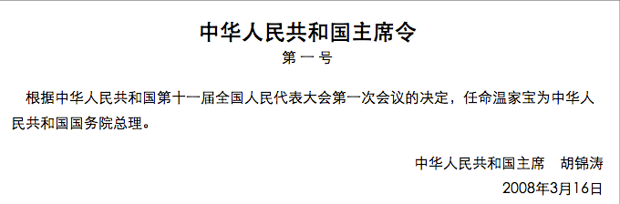

第一号主席令表明：

A. 国家主席行使决定权

B. 全国人大常委会行使决定权

C. 国家主席行使提名权与任免权

D. 全国人大行使任免权

第 86 题 · 答案与解析

**参考答案（粉笔题库参考内容）**

C

**解析**

根据《宪法》第80条规定，中华人民共和国主席根据全国人民代表大会的决定和全国人民代表大会常务委员会的决定，公布法律，任免国务院总理、副总理、国务委员、各部部长、各委员会主任、审计长、秘书长，授予国家的勋章和荣誉称号，发布特赦令，宣布进入紧急状态，宣布战争状态，发布动员令。主席令是中华人民共和国主席根据全国人民代表大会及其常务委员会的决定签署的，具有次于宪法效力的命令。在此处主席按照宪法规定任命国务院总理，行使了提名权和任免权。

故正确答案为C。

**考点**：宪法

**来源**：2010年贵州省公务员录用考试《行测》题第86题

### 第 87 题

关于新中国历史上值得纪念的“第一”，以下说法正确的是：

A. 1949年，刚成立的新中国开始实施第一个五年计划

B. 1957年，长江上第一座大桥南京长江大桥建成通车

C. 1970年，我国第一颗人造卫星长征1号在甘肃酒泉发射成功

D. 1971年，第26届联合国大会恢复了我国在联合国的合法席位

第 87 题 · 答案与解析

**参考答案（粉笔题库参考内容）**

D

**解析**

本题考查毛中特。

A项错误，第一个五年计划从1953年开始，并非1949年。

B项错误，南京长江大桥于1966年建成通车。

C项错误，第一颗卫星命名为“东方红一号”，长征一号是火箭名称，并非卫星。

D项正确，1971年10月25日联合国大会第26届会议上，就“恢复中华人民共和国在联合国组织中的合法权利问题”进行表决的决议（史称联合国第2758号决议），它恢复中华人民共和国在联合国的合法席位。

故正确答案为D。

**考点**：党的历史

**来源**：2010年贵州省公务员录用考试《行测》题第87题

### 第 88 题

“周公吐哺”一词用以形容周公：

A. 恪尽职守

B. 崇尚节俭

C. 礼待贤士

D. 爱护百姓

第 88 题 · 答案与解析

**参考答案（粉笔题库参考内容）**

C

**解析**

“周公吐哺”典出《史记·鲁周公世家》，周公是周文王姬昌第四子，周武王的弟弟。“周公吐哺”是指他为了接见来访贤士，吃饭时曾三次把吃进嘴的饭吐出来，唯恐接待贤士迟缓而失掉人才。因此，ABD项不符合题意。

故正确答案为C。

**考点**：文化常识

**来源**：2010年贵州省公务员录用考试《行测》题第88题

### 第 89 题

下列奖项对应关系正确的是：

A. 阿贝尔奖——化学

B. 普利策奖——文学

C. 图灵奖——经济学

D. 菲尔兹奖——数学

第 89 题 · 答案与解析

**参考答案（粉笔题库参考内容）**

D

**解析**

A项错误，阿贝尔奖是为了纪念数学家尼尔斯·亨利克·阿贝尔，由挪威设立的数学界大奖，每年颁发一次。

B项错误，普利策奖是由美国新闻大亨普利策创办的新闻奖，奖励媒体从业者。

C项错误，图灵奖由美国计算机协会（ACM）于1966年设立，又叫“A.M.图灵奖”，专门奖励那些对计算机事业作出重要贡献的研究人员。

D项正确，菲尔兹奖，是在国际数学家大会上颁发的奖项，颁给有卓越贡献的年轻数学家，得奖者须在该年元旦前未满四十岁，每四年颁奖一次，每次最多四人得奖，它是据加拿大数学家约翰·查尔斯·菲尔兹的要求设立的。

故正确答案为D。

**考点**：科技理论与成就

**来源**：2010年贵州省公务员录用考试《行测》题第89题

### 第 90 题

下列关于通货膨胀效应的说法不正确的是：

A. 通货膨胀降低实际利率

B. 通货膨胀提高实际收入

C. 通货膨胀改变收入分配

D. 通货膨胀形成强制储蓄

第 90 题 · 答案与解析

**参考答案（粉笔题库参考内容）**

B

**解析**

在通货膨胀时期，人们的名义货币收入与实际货币收入之间会产生差距，只有剔除物价的影响，才能看出人们实际收入的变化。由于社会各阶层人们收入的来源是不同的，因此，在物价总水平上涨时，有些人的收入水平会下降，有些人的收入水平反而会提高，这种由物价上涨造成的社会再分配，就是通货膨胀的收入分配效应。所以B项错误，C项正确。A、D两项也是通货膨胀的效应。

本题为选非题，故正确答案为B。

**考点**：市场经济

**来源**：2010年贵州省公务员录用考试《行测》题第90题

### 第 91 题

国际上用来综合考察居民间收入分配差异状况的一个重要分析指标是下面的哪一项：

A. 恩格尔系数

B. 基尼系数

C. 道·琼斯指数

D. 纳斯达克指数

第 91 题 · 答案与解析

**参考答案（粉笔题库参考内容）**

B

**解析**

A项错误，恩格尔系数（Engel's Coefficient）是食品支出总额占个人消费支出总额的比重；

B项正确，基尼系数是用来综合考察居民间收入分配差异状况的一个重要分析指标；

C、D项错误，道·琼斯指数和纳斯达克指数是美国股市的两种指数。

故正确答案为B。

**考点**：国际经济及组织

**来源**：2010年贵州省公务员录用考试《行测》题第91题

### 第 92 题

2011年是辛亥革命100周年，标志其发生的事件是：

A. 清帝退位

B. 南京临时政府成立

C. 武昌起义

D. 孙中山任临时大总统

第 92 题 · 答案与解析

**参考答案（粉笔题库参考内容）**

C

**解析**

1911年，清政府出卖铁路修筑权，激起民众反抗，四川等地爆发保路运动。10月10日，武汉地区的革命团体文学社和共进会发动武昌起义，接着各省纷纷响应，因为1911年为旧历辛亥年，故称“辛亥革命”。武昌起义标志着辛亥革命的发生。

故正确答案为C。

**考点**：中国历史

**来源**：2010年贵州省公务员录用考试《行测》题第92题

### 第 93 题

以出世的精神做入世的事情的思想源自：

A. 儒家学派

B. 法家学派

C. 老庄学派

D. 阴阳家学派

第 93 题 · 答案与解析

**参考答案（粉笔题库参考内容）**

C

**解析**

A、B、D项错误，儒家学派强调仁政爱民，法家强调律法制度，阴阳本指事物两种相互对立的方面，阴阳家则把阴阳矛盾作用引起的变化推演至神秘化，“深观阴阳消息，而作怪迂之变”，强调阴阳五行学说。A、B、D三项均强调积极入世，所以排除；

C项正确，“以出世的精神做入世的事情”是指面对现实生活中的问题，要尊重生命、尊重客观规律，既要全力以赴，又要顺其自然，以平和的心态对人，以不苛求完美的心态对事，这与老庄学派的“无为而治”的思想相吻合。

故正确答案为C。

**考点**：文化常识

**来源**：2010年贵州省公务员录用考试《行测》题第93题

### 第 94 题

下列诗句中的描述与生殖现象无关的是：

A. 春种一粒粟，秋收万颗子

B. 离离原上草，一岁一枯荣

C. 红豆生南国，春来发几枝

D. 狂风落尽深红色，绿叶成阴子满枝

第 94 题 · 答案与解析

**参考答案（粉笔题库参考内容）**

B

**解析**

生殖是由生物产生幼小的个体以繁殖后代，分有性生殖和无性生殖两种。

A、C、D三项都是生殖现象；

B项，是写野草秋枯春荣，岁岁循环，生生不已的规律，是生命的延续，不是生殖现象。

本题为选非题，故正确答案为B。

**考点**：文学常识

**来源**：2010年贵州省公务员录用考试《行测》题第94题

### 第 95 题

下列关于长江三角洲的说法错误的是：

A. 是长江和钱塘江在入海处冲积成的三角洲，广义上包括江苏、浙江和上海

B. 早在西汉时期，该地区已经是全国重要的经济中心，主要生产稻米和丝绸

C. 阖闾、顾恺之、黄道婆、孙权、苏轼等都是该地区历史上著名的人物

D. 该地区雨量充沛，土地肥沃，是中国人口最稠密的地区之一

第 95 题 · 答案与解析

**参考答案（粉笔题库参考内容）**

B

**解析**

A项正确，长江三角洲指长江和钱塘江在入海处冲积成的三角洲，包括江苏省东南部和上海市，浙江省东北部，面积约5万平方千米。在经济上指以上海为龙头的江苏、浙江经济带。

B项错误，西汉时期我国的经济中心在北方黄河流域的西安、洛阳一带，长江三角洲一带尚属荒蛮之地。而我国经济中心的南移是一个逐步的过程，始于东汉三国时期，在南宋时期才基本完成。

C项正确，吴王阖闾，春秋末期吴国君主，吴国国都前期位于梅里（今无锡梅村），后期位于吴（今江苏苏州）；顾恺之，晋陵无锡人（今江苏省无锡市）；黄道婆，松江府乌泥泾镇（今上海市徐汇区华泾镇）人，被尊为布业的始祖；孙权，吴郡富春（今浙江杭州富阳区）人，三国时代东吴的建立者；苏轼，北宋著名文学家和政治家，虽为眉州眉山（今属四川省眉山市）人，但在杭州、扬州任职，并病逝于常州。以上人物都是长江三角洲地区历史上的名人。

D项正确，长江三角洲地区，主要为亚热带季风气候，雨量充沛；由于长江和钱塘江的冲积形成冲积平原，土壤肥沃；是我国最为发达的地区之一，人口稠密。

本题为选非题，故正确答案为B。

**考点**：中国历史

**来源**：2010年贵州省公务员录用考试《行测》题第95题

### 第 96 题

下列关于血管的说法，哪一项是错误的：

A. 血管包括动脉、静脉及毛细血管三大部分

B. 动脉是血液从全身流向心脏的管道，而静脉正好相反

C. 我们平常在自己胳膊上、腿上看到的“青筋”是静脉

D. 我们平常所说的脉搏，也就是医生诊病时所摸的脉，是动脉

第 96 题 · 答案与解析

**参考答案（粉笔题库参考内容）**

B

**解析**

动脉是将从心脏流出的血液运送到身体各部位的血管，静脉正好与之相反。

本题为选非题，故正确答案为B。

**考点**：生物常识

**来源**：2010年贵州省公务员录用考试《行测》题第96题

### 第 97 题

下列现象中，其本质与其他三个现象的本质不同的现象是：

A. 在水平操场上滚动的足球，最终要停下来

B. 人走路被石头绊倒会向前倾倒

C. 锤头松了，把锤柄的一端在物体上撞击几下，锤头就能紧套在锤柄上

D. 子弹从枪膛里射出后，虽然不再受到火药的推力，但是仍然向前运动

第 97 题 · 答案与解析

**参考答案（粉笔题库参考内容）**

A

**解析**

A项，足球最终要停下来，是因为受到了与摩擦力反方向的作用力；

B项，人向前倾倒是因为人走路的时候已经有了向前的惯性；

C项，锤柄的一端在物体上撞击时锤头也跟着一起运动，当锤柄撞击停止运动时，向下的惯性会使锤头继续向下运动进而与锤柄套紧；

D项，子弹脱离子弹壳的瞬间受到火药爆炸产生的向前推力做加速运动，脱离枪膛后由于惯性做初速度不为零的减速运动。

B、C、D三项都是物体惯性的表现。

本题为选非题，故正确答案为A。

**考点**：生活常识

**来源**：2010年贵州省公务员录用考试《行测》题第97题

### 第 98 题

交通控制表示停止的灯是红灯，公共场所的安全门上是红灯，自行车、汽车的尾灯也是红灯。这些地方使用红灯的主要原因是：

A. 红光鲜艳，易识别

B. 红光波长长，穿透能力强，远处可以看到

C. 红光波长短，穿透能力强，远处可以看到

D. 从心理上分析，红光使人易警觉、兴奋

第 98 题 · 答案与解析

**参考答案（粉笔题库参考内容）**

B

**解析**

在可见光中，红光是波长最长的光，空气对红光的散射作用最弱，也就是说红光的穿透力最强，可以传得最远，特别是下雨或大雾的日子里尤甚。

故正确答案为B。

**考点**：生活常识

**来源**：2010年贵州省公务员录用考试《行测》题第98题

### 第 99 题

关于生活中的科学，下列说法正确的是：

A. 近视是较远物体的平行光线成像于视网膜的后面，所以用凹透镜做近视眼镜

B. 被加热物体发出的光的颜色随温度变化而变化，故炼钢工人能凭钢水颜色判断其温度

C. 音乐厅、电影院的立体声利用的是人左右耳与墙壁距离不等带来的“双耳效应”

D. 太阳光入射到悬浮在大气中的水滴时，经过水滴的全反射形成虹、霓

第 99 题 · 答案与解析

**参考答案（粉笔题库参考内容）**

B

**解析**

A项错误，近视是较远物体的平行光线成像于视网膜的前面。

B项正确，有温度的物体都会发射电磁波，温度越高物体内能越大，发出的辐射能量也越大。常温下物体发出的电磁波频率在红外线范围，故眼睛看不到。当温度上升电磁波频率增大达到可见光时人眼即可见，可见光中红光频率最小，故最先看见；温度继续上升时电磁波频率继续变短，颜色逐渐变为橙、黄、蓝、白等；最后频率超过可见光范围，则人眼不可见。因此，炼钢工人能凭钢水颜色判断其温度。

C项错误，双耳效应是指双耳间的音量差、时间差、音色差判断声音方位的效应，并不是基于左右耳与墙壁距离的不同。

D项错误，太阳光射入水滴后经过两次折射和一次反射形成虹，经过两次折射和两次反射形成霓。

故正确答案为B。

**考点**：生活常识

**来源**：2010年贵州省公务员录用考试《行测》题第99题

### 第 100 题

我国国务院各部、委的设立、撤销或合并，其决定权在于：

A. 全国人民代表大会

B. 国务院总理

C. 国家主席

D. 国务院全体会议

第 100 题 · 答案与解析

**参考答案（粉笔题库参考内容）**

A

**解析**

《中华人民共和国国务院组织法》第8条规定：“国务院各部、各委员会的设立、撤销或者合并，经总理提出，由全国人民代表大会决定；在全国人民代表大会闭会期间，由全国人民代表大会常务委员会决定。”

故正确答案为A。

**考点**：宪法

**来源**：2010年贵州省公务员录用考试《行测》题第100题

### 第 101 题

下列各对机关之间，存在着指导与被指导关系的是：

A. 国家公安部与北京市公安局

B. 国家环境保护部与北京市环境保护局

C. 北京市工商局与海淀区工商局

D. 北京市技术监督局与海淀区技术监督局

第 101 题 · 答案与解析

**参考答案（粉笔题库参考内容）**

B

**解析**

国家公安部与北京市公安局、北京市工商局与海淀区工商局、北京市技术监督局与海淀区技术监督局，这三者均为领导与被领导的关系。而环保部不是垂直管理，地方环保部门属于地方政府领导，但在业务上受上级环保部门的指导，所以国家环境保护部与北京市环境保护局是指导与被指导的关系。

故正确答案为B。

注：此题已经过时，不具备参考价值。

**来源**：2010年贵州省公务员录用考试《行测》题第101题

### 第 102 题

当国家公务员认为自己受到单位的不公平待遇时，可以向哪些部门提出申诉：

A. 人民法院

B. 人民代表大会及其常委会

C. 人民检察院

D. 行政监察机关

第 102 题 · 答案与解析

**参考答案（粉笔题库参考内容）**

D

**解析**

本题考查法律常识。

《公务员法》第九十五条第二、三、四款规定，对省级以下机关作出的申诉处理决定不服的，可以向作出处理决定的上一级机关提出再申诉。受理公务员申诉的机关应当组成公务员申诉公正委员会，负责受理和审理公务员的申诉案件。公务员对监察机关作出的涉及本人的处理决定不服向监察机关申请复审、复核的，按照有关规定办理。

故正确答案为D。

备注：此题已经过时，保留仅供参考。目前行政监察机关已经被合并到监察委员会，属于外部监督。

**考点**：行政法

**来源**：2010年贵州省公务员录用考试《行测》题第102题

### 第 103 题

下列说法不符合《环境保护法》规定的一项是：

A. 建设对环境有污染的项目，必须遵守国家有关建设项目环境保护管理的规定

B. 制定城市规划，应当确定保护和改善环境的目标与任务

C. 对造成环境污染事故的企业，环境保护行政主管部门可以勒令其停业、关闭

D. 完全由于不可抗拒的自然灾害，并及时采取合理措施仍不能避免的环境污染损害，当事人免予承担责任

第 103 题 · 答案与解析

**参考答案（粉笔题库参考内容）**

C

**解析**

A项正确，表述为《环境保护法》第13条之规定；

B项正确，表述为本法第22条之规定；

C项错误，环境保护行政主管部门并不能直接勒令停业、关闭，决定权在当地人民政府手中。根据《环境保护法》第39条规定，对经限期治理逾期未完成治理任务的企业事业单位，除依照国家规定加收超标准排污费外，可以根据所造成的危害后果处以罚款，或者责令停业、关闭。前款规定的罚款由环境保护行政主管部门决定。责令停业、关闭，由作出限期治理决定的人民政府决定；责令中央直接管辖的企业事业单位停业、关闭，须报国务院批准；

D项正确，表述为本法第41条第2款之规定。

本题为选非题，故正确答案为C。

**考点**：其他法律法规

**来源**：2010年贵州省公务员录用考试《行测》题第103题

### 第 104 题

李某有儿子、儿媳、孙子和未婚女儿，李某的儿子已于去年病故。依据我国《继承法》，待李某死亡时，其儿子应继承的那份遗产由下列何人代位继承：

A. 李某的儿媳

B. 李某的兄弟

C. 李某的孙子

D. 李某的女儿

第 104 题 · 答案与解析

**参考答案（粉笔题库参考内容）**

C

**解析**

根据《继承法》第11条规定，被继承人的子女先于被继承人死亡的，由被继承人的子女的晚辈直系血亲代位继承。代位继承人一般只能继承他的父亲或者母亲有权继承的遗产份额。代位继承是和本位继承相对应的一种继承制度，是法定继承的一种特殊情况，它是指被继承人的子女先于被继承人死亡时，由被继承人子女的晚辈直系血亲代替先死亡的长辈直系血亲继承被继承人遗产的一项法定继承制度。因此，在本题中，李某儿子应继承的那份财产应该由李某的孙子继承。

故正确答案为C。

**考点**：民法典

**来源**：2010年贵州省公务员录用考试《行测》题第104题

### 第 105 题

下列做法符合《劳动合同法》相关规定的是：

A. 甲经过培训仍不能胜任现工作，单位决定和他解除劳动合同

B. 劳动合同期满，丁所在用人单位不愿意续订劳动合同，该用人单位不必支付经济补偿

C. 在试用期内，单位和劳动者都可以随时通知对方解除劳动合同，而不需要承担赔偿责任

D. 乙和某单位签订了劳动合同的补充协议，约定由于该单位给乙解决了本地户口，乙必须在该单位工作满三年，否则应向单位支付违约金

第 105 题 · 答案与解析

**参考答案（粉笔题库参考内容）**

A

**解析**

A项正确，根据《劳动合同法》第40条规定，有下列情形之一的，用人单位提前三十日以书面形式通知劳动者本人或者额外支付劳动者一个月工资后，可以解除劳动合同：（二）劳动者不能胜任工作，经过培训或者调整工作岗位，仍不能胜任工作的。

B项错误，根据《劳动合同法》第44条规定，有下列情形之一的，劳动合同终止：（一）劳动合同期满的。根据《劳动合同法》第46条规定，有下列情形之一的，用人单位应当向劳动者支付经济补偿：（五）除用人单位维持或者提高劳动合同约定条件续订劳动合同，劳动者不同意续订的情形外，依照本法第四十四条第一项规定终止固定期限劳动合同的。因此，丁的劳动合同期满，丁所在用人单位不愿意续订劳动合同，应当支付经济补偿。

C项错误，根据《劳动合同法》第21条规定，在试用期中，除劳动者有本法第三十九条和第四十条第一项、第二项规定的情形外，用人单位不得解除劳动合同。用人单位在试用期解除劳动合同的，应当向劳动者说明理由。因此，在试用期中，不是任何情况下用人单位都可以随时解除劳动合同。

    D项错误，根据《劳动合同法》第25条规定，除本法第22条和第23条规定的情形外，用人单位不得与劳动者约定由劳动者承担违约金。其中，《劳动合同法》第22条规定，用人单位为劳动者提供专项培训费用，对其进行专业技术培训的，可以与该劳动者订立协议，约定服务期。劳动者违反服务期约定的，应当按照约定向用人单位支付违约金。第23条规定，用人单位与劳动者可以在劳动合同中约定保守用人单位的商业秘密和与知识产权相关的保密事项。对负有保密义务的劳动者，用人单位可以在劳动合同或者保密协议中与劳动者约定竞业限制条款，并约定在解除或者终止劳动合同后，在竞业限制期限内按月给予劳动者经济补偿。劳动者违反竞业限制约定的，应当按照约定向用人单位支付违约金。因此，本题中用人单位给乙解决本地户口问题，不属于法律规定的乙支付违约金的情形。

故正确答案为A。

**考点**：劳动法和经济法

**来源**：2010年贵州省公务员录用考试《行测》题第105题

## 材料 2

CNNIC于2008年7月发布的《第22次中国互联网络发展状况统计报告》显示，我国网民数达2.53亿，超过美国居世界首位。尽管如此，我国互联网普及率只有19.1%，仍然低于21.1%的全球平均水平。与上年同期相比，我国网民人数增加了9100万，是历年来增长最快的一年，同比增长56.2%。仅2008年上半年，我国网民数净增量就达4300万。统计表明，我国网站数量持续增长，截至2008年7月共有网站191.9万个，同比增长率为46.39%；其中CＮ域名下的网站数为136.9万个。

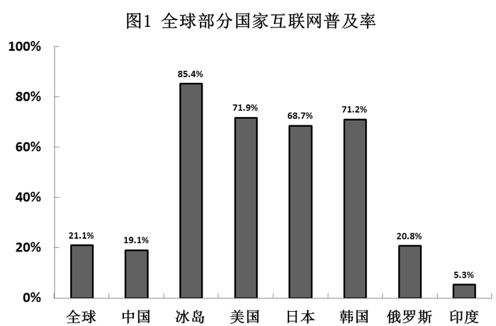

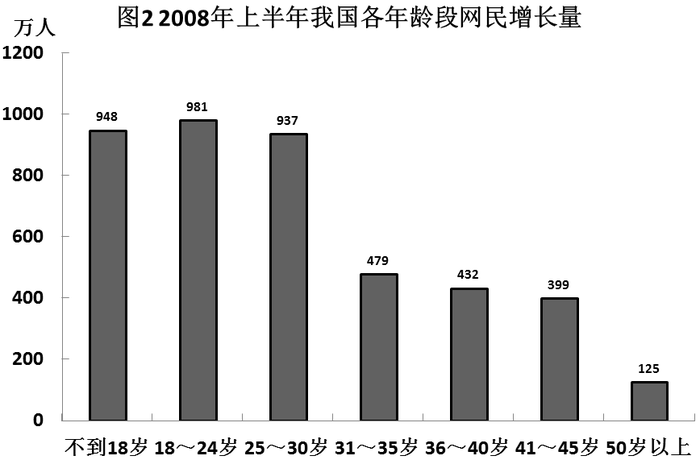

### 第 106 题

2007年7月，我国的网民数量为多少人：

A. 2.1亿

B. 2.05亿

C. 1.82亿

D. 1.62亿

第 106 题 · 答案与解析

**参考答案（粉笔题库参考内容）**

D

**解析**

由题干“2007年7月，我国的网民数量为多少人”，结合材料时间为2008年7月，可判定本题为基期计算问题。定位文字材料，“我国网民数达2.53亿”及“与上年同期相比，我国网民人数增加了9100万”，9100万=0.91亿，根据公式：基期量=现期量-增长量，所以2007年7月我国的网民数量为2.53-0.91=1.62亿。

故正确答案为D。

**考点**：基期计算、综合资料

**来源**：2010年贵州省公务员录用考试《行测》题第106题

### 第 107 题

截至2008年7月，我国CN域名下的网站数占网站总数的：

A. 71.3%

B. 69.2%

C. 67.3%

D. 63.5%

第 107 题 · 答案与解析

**参考答案（粉笔题库参考内容）**

A

**解析**

由题干“截至2008年7月，······占······”， 结合材料时间为2008年7月，可判定本题为现期比重问题。定位文字材料，“截至2008年7月共有网站191.9万个，同比增长率为46.39%；其中CN域名下的网站数为136.9万个”，那么我国CN域名下的网站数占网站总数的比重为，与A项最接近。

故正确答案为A。

**考点**：现期比重、综合资料

**来源**：2010年贵州省公务员录用考试《行测》题第107题

### 第 108 题

2008年上半年，我国平均每万人拥有网站约多少个：

A. 13

B. 14.5

C. 16

D. 17.5

第 108 题 · 答案与解析

**参考答案（粉笔题库参考内容）**

B

**解析**

由题干“2008年上半年，······平均每万人······多少个”，结合材料时间给的是2008年上半年，可判定本题为现期平均数问题。定位文字材料，“我国网民数达2.53亿······我国互联网普及率只有19.1%，”所以我国共有人口亿人，“截至2008年7月共有网站191.9万个”，所以每万人拥有网站数量为个，与B选项最接近。

故正确答案为B。

注：此题时间设置不严谨，材料中给的数据时间是2008年7月，题目所求的是2008年上半年，并且结合材料得不出2008年上半年的数据，因此对于材料中数据的理解是2008年7月份发布的截至到2008年6月底的数据。

**考点**：现期平均数、综合资料

**来源**：2010年贵州省公务员录用考试《行测》题第108题

### 第 109 题

2008年上半年的新增网民中，30岁以上者所占的比重约为：

A. 28%

B. 30%

C. 33%

D. 35%

第 109 题 · 答案与解析

**参考答案（粉笔题库参考内容）**

C

**解析**

由题干“2008年······占的比重约为”，结合材料时间为2008年上半年，可判定本题为现期比重问题。定位文字材料，仅2008年上半年，我国网民数净增量就达4300万，定位图二，2008年上半年30岁以上网民增长量为万人。因此2008年上半年的新增网民中，30岁以上者所占的比重为。

故正确答案为C。

**考点**：现期比重、综合资料

**来源**：2010年贵州省公务员录用考试《行测》题第109题

### 第 110 题

下列说法与资料相符的是：

A. 截至2008年7月，韩国的互联网普及率是我国的4倍以上

B. 截至2008年7月，我国网民中30岁以下的人占绝对多数

C. 2007年下半年，我国网民增加了4800万人

D. 2008年7月，CN域名下的网站数量同比增长率高于我国网站总体增长率

第 110 题 · 答案与解析

**参考答案（粉笔题库参考内容）**

C

**解析**

A项：定位图1，可得我国互联网普及率为19.1%，韩国互联网普及率为71.2%，则韩国的互联网普及率是我国的倍，说法错误，排除；

B项：定位图二，可以得出30岁以下的网民增长量大，但是不能得出人数最多，说法错误，排除；

C项：定位文字材料，可得“与上年同期相比，我国网民人数增加了9100万，是历年来增长最快的一年，同比增长56.2%。仅2008年上半年，我国网民数净增量就达4300万”，则2007年下半年，我国网民增加了9100-4300=4800万人，说法正确，当选；

D项：定位材料，材料并未提及“CN域名下的网站数量同比增长率”，无法得出，说法错误，排除。

故正确答案为C。

**考点**：综合分析、综合资料

**来源**：2010年贵州省公务员录用考试《行测》题第110题

## 材料 3

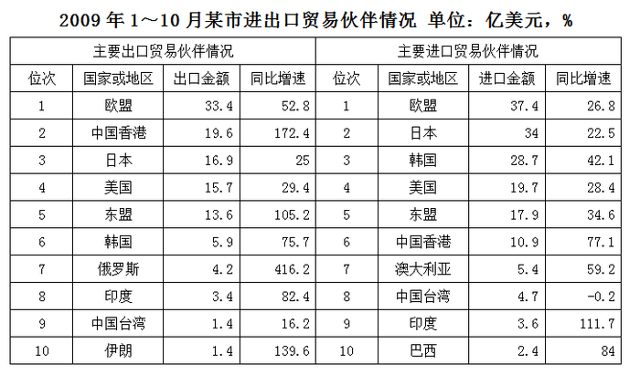

### 第 111 题

2009年1~10月，该市对俄罗斯的出口金额比2008年同期约净增多少亿美元：

A. 0.8

B. 1

C. 3.2

D. 3.4

第 111 题 · 答案与解析

**参考答案（粉笔题库参考内容）**

D

**解析**

根据题干“2009年······比2008年同期约净增多少亿美元”，可判定本题为增长量计算问题。定位表格材料可得：2009年1~10月该市对俄罗斯出口金额为4.2亿美元，比2008年同期增长416.2%。根据公式：增长量=×增长率，则该市对俄罗斯的出口金额比2008年同期约净增为=3.36亿美元，与D项最接近。

故正确答案为D。

**考点**：增长量计算、统计表

**来源**：2010年贵州省公务员录用考试《行测》题第111题

### 第 112 题

在以下贸易伙伴中，进口额与出口额相差最大的是：

A. 美国

B. 日本

C. 韩国

D. 欧盟

第 112 题 · 答案与解析

**参考答案（粉笔题库参考内容）**

C

**解析**

根据题干“······进口额与出口额相差最大的是”，结合表格中进口额和出口额数据均已给出，可判定本题为简单加减计算问题。定位表格数据可得，美国进出口差额为19.7-15.7=4亿美元；日本进出口差额为34-16.9=17.1亿美元；韩国进出口差额为28.7-5.9=22.8亿美元；欧盟进出口差额为37.4-33.4=4亿美元。因此，进口额与出口额相差最大的是韩国。

故正确答案为C。

**考点**：简单加减计算、统计表

**来源**：2010年贵州省公务员录用考试《行测》题第112题

### 第 113 题

2008年1~10月，该市对中国台湾的进口额约为多少亿美元：

A. 3.92

B. 4.69

C. 4.71

D. 5.88

第 113 题 · 答案与解析

**参考答案（粉笔题库参考内容）**

C

**解析**

根据题干“2008年1~10月，该市对中国台湾的进口额约为多少亿美元”，结合材料时间为2009年，可判定本题为基期计算问题。定位表格材料可得：2009年1~10月该市对中国台湾的进口额为4.7亿美元，比2008年同期增长-0.2%。根据公式：基期量，则该市2008年1~10月对中国台湾的进口额约为≈4.71亿美元，与C项最接近。

故正确答案为C。

**考点**：基期计算、统计表

**来源**：2010年贵州省公务员录用考试《行测》题第113题

### 第 114 题

从上表可以看出该市实现贸易顺差的国家或地区是：

A. 中国香港

B. 印度

C. 欧盟

D. 日本

第 114 题 · 答案与解析

**参考答案（粉笔题库参考内容）**

A

**解析**

根据题干“该市实现贸易顺差的国家或地区是”，且表格材料给出了相关数据，根据出口额>进口额即为贸易顺差，只需比较进出口额的大小即可。定位表格材料可知：只有对中国香港的出口贸易金额大于进口贸易金额，实现了贸易顺差。

故正确答案为A。

**考点**：直接找数、统计表

**来源**：2010年贵州省公务员录用考试《行测》题第114题

### 第 115 题

2009年1~10月，该市对欧盟、日本和美国三大贸易伙伴的出口额在地方出口额中的合计比重为49%。问地方出口额是多少亿美元：

A. 44.3

B. 114.3

C. 120.1

D. 134.7

第 115 题 · 答案与解析

**参考答案（粉笔题库参考内容）**

D

**解析**

根据题干“2009年1~10月······比重······”，结合材料时间为2009年1~10月，可判定本题为现期比重问题。定位表格材料可知，2009年1~10月，该市对欧盟、日本和美国三大贸易伙伴的出口额为33.4+16.9+15.7=66亿美元，根据公式：整体量，可得地方出口额亿美元，只有D项符合。

故正确答案为D。

**考点**：现期比重、统计表

**来源**：2010年贵州省公务员录用考试《行测》题第115题

## 材料 4

中国人民银行公布的统计数据显示，2007年全国银行卡发卡总量149995.06万张，同比增长32.63%。其中，借记卡140968.78万张，同比增长30.36%；贷记卡7161.53万张，同比增长144.08%；准贷记卡1864.75万张，同比减少7.9%。中国已被公认为世界上发展最快、潜力最大的银行卡市场。

        2007年全年共办理了银行卡业务1361185.48万笔，金额1114692.82亿元（人民币，下同），同比分别增长24.70%和57.94%。各项银行卡业务中，存现业务300832.03万笔，金额354222.26亿元，同比分别增长16.24%和46.67%；取现业务696597.58万笔，金额301498.81亿元，同比分别增长22.629%和28.76%；转账业务189637.01万笔，金额429030.88亿元，同比分别增长19.49%和103.19%；消费业务174118.86万笔，金额29940.87亿元，同比分别增长64.36%和58.11%。值得注意的是，银行卡消费额（扣除房地产和批发类交易）占同期社会商品零售总额的比重为21.9%，比上年提高4.9个百分点。

### 第 116 题

对我国2007年银行卡发卡情况描述正确的是：

A. 各类银行卡的发卡总量均实现了增长

B. 发卡总量及发卡同比增幅均最高的是贷记卡

C. 借记卡的发卡总量达到了准贷记卡的80倍以上

D. 借记卡的发卡总量及发卡同比增幅均超过准贷记卡

第 116 题 · 答案与解析

**参考答案（粉笔题库参考内容）**

D

**解析**

A项：定位材料第一段，准贷记卡1864.75万张，同比减少7.9%，不满足均实现增长，错误；

B项：定位材料第一段，借记卡发卡总量140968.78万张，贷记卡发卡总量为7161.53万张，发卡总量最高的是借记卡，错误；

C项：定位材料第一段，借记卡发卡量140968.78万张，准贷记卡发卡量1864.75万张，借记卡的发卡总量为准贷记卡的，错误；

D项：定位材料第一段，借记卡发卡总量为140968.78万张，同比增长30.36%；准贷记卡发卡总量为1864.75万张，同比减少7.9%。比较可知借记卡的发卡总量及发卡同比增幅均超过准贷记卡，正确。

故正确答案为D。

**考点**：文字资料、综合分析

**来源**：2010年贵州省公务员录用考试《行测》题第116题

### 第 117 题

2006年办理银行卡业务总额约为：

A. 70.6万亿元

B. 89.4万亿元

C. 111.5万亿元

D. 136.1万亿元

第 117 题 · 答案与解析

**参考答案（粉笔题库参考内容）**

A

**解析**

根据题干“2006年办理银行卡业务总额约为”，结合材料时间为2007年，可判定本题为基期计算问题。定位文字材料第二段可知，2007年全年共办理了银行卡业务1361185.48万笔，金额1114692.82亿元（人民币，下同），同比分别增长24.70%和57.94%。根据公式：基期量，则2006年办理银行卡业务总额为，与A项最接近。

故正确答案为A。

**考点**：基期计算、文字资料

**来源**：2010年贵州省公务员录用考试《行测》题第117题

### 第 118 题

2007年，存现业务的金额约占银行卡业务总金额的：

A. 1/5

B. 1/4

C. 1/3

D. 1/2

第 118 题 · 答案与解析

**参考答案（粉笔题库参考内容）**

C

**解析**

根据题干“2007年······占······”，结合材料时间为2007年，可判定本题为现期比重问题。定位文字材料第二段可知，2007年全年银行卡业务总金额为1114692.82亿元，存现业务金额为354222.26亿元，根据公式：比重，则2007年，存现业务的金额约占银行卡业务总金额的比重为。

故正确答案为C。

**考点**：文字资料、现期比重

**来源**：2010年贵州省公务员录用考试《行测》题第118题

### 第 119 题

2007年，在各项银行卡业务中，业务金额增长幅度低于业务笔数增长幅度的是：

A. 存现

B. 取现

C. 转账

D. 消费

第 119 题 · 答案与解析

**参考答案（粉笔题库参考内容）**

D

**解析**

定位文字材料第二段：消费业务174118.86万笔，金额29940.87亿元，同比分别增长64.36%和58.11%”，即业务金额增长幅度低于业务笔数增长幅度的是消费业务。

故正确答案为D。

**考点**：文字资料、直接找数

**来源**：2010年贵州省公务员录用考试《行测》题第119题

### 第 120 题

以下关于2007年银行卡业务的说法正确的是：

A. 转账业务的笔数比上一年度翻了一番

B. 每笔银行卡业务的平均金额超过1万元

C. 转账业务的金额是各银行卡业务中最高的

D. 取现业务的笔数不到银行卡业务总数的一半

第 120 题 · 答案与解析

**参考答案（粉笔题库参考内容）**

C

**解析**

定位材料第二段，转账业务189637.01万笔，同比增长19.49%，未翻一番，错误；

B项：定位材料第二段，“2007年全年共办理了银行卡业务1361185.48万笔，金额1114692.82亿元”，则每笔银行卡业务的平均金额为，错误；

C项：定位材料第二段，存现业务金额为354222.26亿元；取现业务金额为301498.81亿元；转账业务金额为429030.88亿元；消费业务金额为29940.87亿元。比较可知转账业务的金额是各银行卡业务中最高的，正确；

D项：定位材料第二段，取现业务696597.58万笔，银行卡业务1361185.48万笔，显然，错误。

故正确答案为C。

**考点**：文字资料、综合分析

**来源**：2010年贵州省公务员录用考试《行测》题第120题

## 材料 5

2008年上半年，全社会固定资产投资68402亿元，同比增长26.3%。其中，城镇固定资产投资58436亿元，同比增长26.8%；农村固定资产投资9966亿元，同比增长23.2%。在城镇投资中，国有及国有控股投资23554.亿元，同比增长19.3%。从项目隶属关系看，中央项目投资5123亿元，同比增长18.9%；地方项目投资53313亿元，同比增长27.6%。从产业看，第一、二、三产业投资分别为846亿元、26322亿元和31269亿元，同比分别增长69.5%、26.6%和26.2%。在全社会投资中，从行业看，煤炭开采及洗选业投资823亿元，同比增长42.0%；电力、热力的生产与供应业投资3546亿元，同比增长7.4%；石油和天然气开采业投资957亿元，同比增长19.8%；铁路运输业投资809亿元，同比增长20.4%；非金属矿采选、制品业投资1815亿元，同比增长46.7%；黑色金属矿采选、冶炼及压延加工业投资1596亿元，同比增长27.5%；有色金属矿采选、冶炼及压延加工业投资1012亿元，同比增长39.2%。

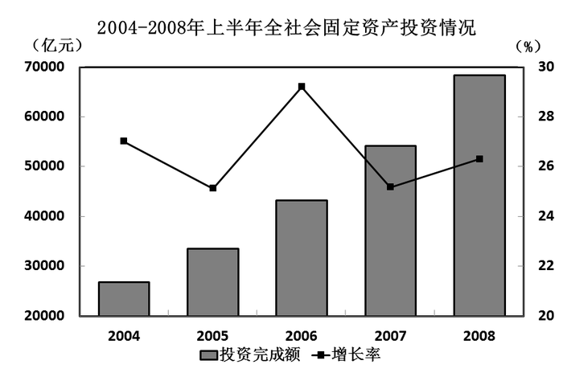

### 第 121 题

2004-2008年，上半年全社会固定资产投资同比增长率最高的年份是：

A. 2005年

B. 2006年

C. 2007年

D. 2008年

第 121 题 · 答案与解析

**参考答案（粉笔题库参考内容）**

B

**解析**

定位图形材料可知：折线代表增长率，折线点最高的为2006年，则2006年全社会固定资产投资同比增长率最高。

故正确答案为B。

**考点**：直接找数、综合资料

**来源**：2010年贵州省公务员录用考试《行测》题第121题

### 第 122 题

2007年上半年，全国城镇固定资产投资额约为多少亿元：

A. 46085

B. 48296

C. 54158

D. 58436

第 122 题 · 答案与解析

**参考答案（粉笔题库参考内容）**

A

**解析**

根据题干“2007年上半年，全国城镇固定资产投资额约为多少亿元”，结合材料时间为2008年上半年，可判定本题为基期计算问题。定位文字材料可知：2008年上半年，城镇固定资产投资58436亿元，同比增长26.8%。根据公式：基期量，则2007年上半年，全国城镇固定资产投资额为亿元，与A项最接近。

故正确答案为A。

**考点**：基期计算、综合资料

**来源**：2010年贵州省公务员录用考试《行测》题第122题

### 第 123 题

2008年上半年投资同比增长额最高的行业是：

A. 煤炭开采及洗选业

B. 石油和天然气开采业

C. 铁路运输业

D. 非金属矿采选、制品业

第 123 题 · 答案与解析

**参考答案（粉笔题库参考内容）**

D

**解析**

根据题干“2008年上半年······同比增长额最高的行业是”，可判定本题为增长量比较问题。定位文字材料：煤炭开采及洗选业投资823亿元，同比增长42.0%；石油和天然气开采业投资957亿元，同比增长19.8%；铁路运输业投资809亿元，同比增长20.4%；非金属矿采选、制品业投资1815亿元，同比增长46.7%。由文字材料数据可以看出，非金属矿采选、制品业同比增长率最高，且投资额远高于其他行业，故可确定非金属矿采选、制品业同比增长额最高。

故正确答案为D。

**考点**：增长量比较、综合资料

**来源**：2010年贵州省公务员录用考试《行测》题第123题

### 第 124 题

2007年上半年地方项目的投资额约为中央项目投资的多少倍：

A. 8

B. 10

C. 12

D. 14

第 124 题 · 答案与解析

**参考答案（粉笔题库参考内容）**

B

**解析**

根据题干“2007年上半年······为······多少倍”，结合材料时间为2008年，可判定本题为基期倍数问题。定位文字材料：“中央项目投资5123（B）亿元，同比增长18.9%（b）；地方项目投资53313（A）亿元，同比增长27.6%（a）。”则题目所求为倍，与B项最接近。

故正确答案为B。

**考点**：基期倍数、综合资料

**来源**：2010年贵州省公务员录用考试《行测》题第124题

### 第 125 题

下列说法与资料相符的是：

A. 从产业看，第一、二、三产业投资额基本相当

B. 2007年上半年，黑色金属矿采选、冶炼及压延加工业总投资额超过1000亿元

C. 2007年上半年，农村投资在全国总固定资产投资中的比重在18%至20%之间

D. 从2004-2008年，全社会固定资产投资同比增长率持续提高

第 125 题 · 答案与解析

**参考答案（粉笔题库参考内容）**

B

**解析**

A项：定位文字材料，“从产业看，第一、二、三产业投资分别为846亿元、26322亿元和31269亿元”，投资额相差较大，错误；

B项：定位材料，“（2008年上半年）黑色金属矿采选、冶炼及压延加工业投资1596亿元，同比增长27.5%”，根据公式：基期量，可知2007年上半年，黑色金属矿采选、冶炼及压延加工业总投资额为，正确；

C项：定位文字材料，2008年上半年，全社会固定资产投资68402（B）亿元，同比增长26.3%（b）。其中，农村固定资产投资9966（A）亿元，同比增长23.2%（a）。代入基期比重公式：，错误；

D项：定位图形材料可知，从2004-2008年，全社会固定资产投资同比增长率有降低有提高，错误。

故正确答案为B。

**考点**：综合分析、综合资料

**来源**：2010年贵州省公务员录用考试《行测》题第125题

