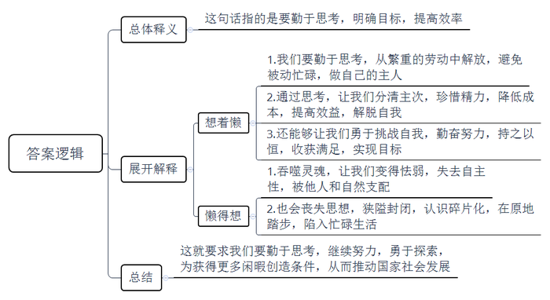
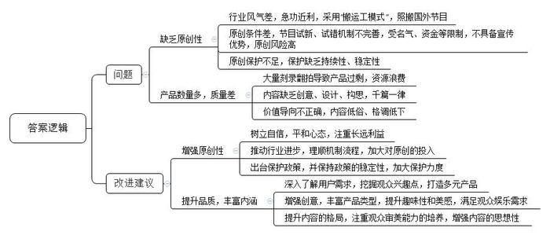
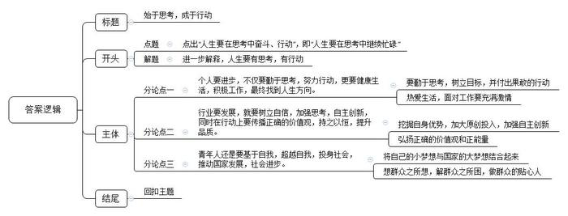

# 2017年公务员多省联考《申论》题（贵州卷）

<!-- gwy:overview:start -->
> **贵州 · 2017 · 申论 · 统考** ｜ 4 题 · 图片 4 处 · 答案随题折叠

导航：[题目](#题目)
<!-- gwy:overview:end -->

> 候选采集稿。参考答案及解析来自粉笔页面，不代表官方答案或真实高分答卷；来源使用许可与原卷对应关系仍需人工核实。

## 给定材料

### 材料 material-6e53007efec97f0e

勤能补拙似乎一直是至理名言，然而，一个著名咨询集团合伙人却不这样认为，他语出惊人：“勤可致拙。我的很多同行失败就失败在太勤奋。因为太过勤奋，而没有时间和精力去思考。我总是想着懒，而不是懒得想。”有时候这就是效率。毕竟，人生那么短，事情却这样多，不略过那些不打紧的事情，把好钢用在刀刃上，生活只会越忙越糟，越糟越忙，恶性循环。所以要养成一种好习惯，一种智慧，才能成为自己的主人。当然，这要注意区分躺在沙发上一动不动，抱怨沙发太硬的家伙和为了躺得更舒服而起身发明懒人沙发的人。

另一位网评家也表达了相同的看法：人勤于思考，才会分清事情主次轻重，珍惜自己的精力，做到低成本、高效益……总之，这样的人长于把握一切、不急不躁、有条不紊，善于从繁杂和忙乱中解脱自己，这是一种人生艺术。

有的人含着银钥匙长大，各方面都无比顺利，甚至可以用现在流行的一句话来形容——堪称人生赢家。而放弃大好前程、安逸生活不要，却选择了一条看上去无比折腾的人生道路，这不是自己找事做吗？从某种意义上来说，这确实是。然而，人生是越努力才会越幸运。每天给自己找一点事儿做，每天勤奋一点点，努力一点点，收获一点“小确幸”，终有一天会积累人生的“大满足”。而天天不做事，最后可能会没事做，或者做不了、做不完。

不去思考必须思考的问题，不去做必须做的事情，如果这发生在我们身上，就是怯弱、狭隘和封闭，是最最消极的。我们的灵魂和心会被蚕食，我们的思想将被撕裂成碎片，而我们只能在其中跌跌撞撞，疲于拾掇缝补，苟且喘息。所以，我们会在碎片中生活，会在原地踏步中越来越忙碌。

别让脑袋停止思考。人和人，甚至人和动物在肉体上都没多大区别，差的就是灵魂。若不思索，甚至没有追求，随遇而安，你就必须接受所有后果，那就是被其他人或自然支配。

我们付出了巨大的努力才看清楚我们所在的这颗蓝色星球的模样，才弄清楚我们怎样进化成人，才变得有一点点的能力和空闲去利用、去支配自然获得片刻的闲暇以实现我们心中小小的偷懒的欲念。但现在的时刻，我们的文化、我们的民族、我们的国家，需要我们忙碌起来，而不是一直在缅怀过去、一直在不经过大脑地轻松娱乐。毕竟，在人类文明的长河里，我们总是历经艰辛，万分努力，才让一切看起来不那么费劲。

### 材料 material-da19c9bde10d64ab

近年来，中国综艺节目一直处于“搬运工模式”，甚至出现了多家卫视为争夺同一个外国节目版权大打出手的情形，仿佛一个综艺节目没有点外国血统就没法在本土立足。一位电视节目制作人无奈地摇头：“为什么老用外国版权的节目呢？还不是被‘急功近利’这四个字给逼的。”的确，别人都在赚快钱，捞热钱，你还能有心思老老实实搞原创，坚持慢工出细活吗？现在引进的节目，它们的运作模式已经非常成熟了，不需要自己再砸破脑袋、抓掉头皮地去找亮点、摸门道，加入几个有争议、能聚焦的明星，很容易就吸引住了观众的眼球，拉上有实力的赞助商，就可以算作成功了。

也不是没有人愿意走心搞原创，但这些可爱的原创人往往原创不起。比起很多国家，我们的电视娱乐产业起步较晚，节目试新、试错机制建设相对于产业的井喷式的发展是滞后的。受名气、资金等限制，原创节目本来就没有宣传优势，甚至可以说占尽了后发劣势，这要是播出效果不理想，电视台遭受的损失，谁来负责？所以说，原创人根本原创不起。

“我希望对文化创意的保护不是过年送饺子式的间歇性的短暂关心，文化创意在萌芽阶段是十分脆弱的，需要强有力而稳定持久的呵护。”一位没有什么名气的综艺工作者道出自己的心声。

存在的即是合理的，“进口”“混血”的综艺节目当然有它存在的道理，这是市场选择的结果，但这并不意味着它有多么完美。一档节目，不管有多么光鲜靓丽的明星、闪亮炫目的舞台效果，如果不能从情感上与观众产生共鸣，就很难真正进入观众心里。现阶段，国内大量综艺节目有两个特点：“懒”和“急”。在创意、设计、构思方面，直接购买外国版权、搬来外国团队，原创欠奉，千人一面。而与这遥相呼应的就是制作和开播的“急”，一有节目就赶紧制作，根本不管是不是粗制滥造，不经打磨就开播，刷流量，拉收视。于是就有了这些场景：满屏选秀拼苦难讲励志、做菜谈孝顺秀恩爱，各个“明星天团”游遍世界把玩游戏渲染成西天取经般的九九八十一难，红男绿女组团相亲，各种套路各种摆拍……为迎合市场，甚至出现了一些内容低俗、格调低下、物化丑化女性的节目，给广大观众尤其是青少年儿童造成不良影响……而大量刻录翻拍、复制粘贴式的综艺节目造成了严重的产品过剩、资源浪费，直接导致观众审美疲劳，市场疲软。据统计，这样的节目，全国不下百个，而新的换汤不换药的节目还在被人们孜孜不倦地制作出来，这样只用力不用心的“勤奋”，发人深省。

而同时，一些话题清奇、审美健康的小成本网络综艺却开始在市场上崭露头角，一些取材于中国传统优秀文化、百姓现实生活的节目也引起相当一部分观众的兴趣。这些新兴的综艺并不相同，有的走的是“小而美”“新而奇”的路线，有的扬的却是“黄钟大吕”的风格，既有“琴棋诗画书酒花”，也不乏“柴米油盐酱醋茶”，它们以或深沉隽永，或灵动飘逸的独特气质吸引了观众，为嘈杂聒噪的综艺界注入了一股沉稳而坚定的泠泠清流。

多元时代，人们的兴趣爱好本就千差万别，一味强调纯粹的娱乐功能，反而会丧失亮点。大众不大，小众不小。为何不另辟蹊径发掘培育观众新的兴趣点呢？

耕耘多艰，需要勤恳、走心和颠扑不灭的自信，希望综艺节目兼具娱乐心情的“轻”和发人深思的“重”。

### 材料 material-7081b843ce204c7a

以下是几位网友的陈述：

网友A：昨晚打游戏到半夜，9点钟才起来，在激烈的思想斗争后，我没有逃课。课件太多，看不过来，笔记等到期末复习前再复印别人的吧。午饭后和舍友看美剧，看了一半就想瞌睡，那些英文左耳进、右耳出、听起来和四级考试没什么关系……躺在床上刷刷微博，看看新闻，和舍友八卦一下，差不多到吃晚饭的时间了……上晚自习，拿出课本强灌硬塞地背了一通，没好方法，要记住不容易啊，这样我能学到什么呢？将来又有什么用呢？希望期末考试能过关吧。9点半回到宿舍，大家打游戏的打游戏，看球的看球，宿舍环境不适合看书。早早洗漱，打开电脑，开始了一天真正的战斗……凌晨1点半有欧冠，不能错过。

网友B：和其他人一样，朝九晚五、双休。7:00，穿衣，洗漱，出门。去公司要经过25站，耗时80分钟。9:00-12:00，工作，按部就班地搜集资料，其实我压根没想好今天的选题，那就到网上搜搜呗，顺便上上网。好吧，其实是上上网，顺便搜搜选题。12:01，订外卖！这是一天最开心的事。我不会做饭，外卖不营养，却方便省事。12:30-13:25，午休，和同事们年纪相仿，大家有很多共同话题。13:30-17:00，撰稿，改稿，定稿。老板老说“编辑决定了读者阅读的质量”，拜托，我只是一个小编，哪有那样的本事和能量！17:01，下班，回家。夜幕降临，华灯初上，有时还是会惆怅。18:30，随意找个地方吃饭，偶尔约上朋友，来个小聚。离家很远，有时会想家。22:30，不知怎么地就到了这个时间，休息，听歌，玩玩手机电脑。困了，便睡觉。书架上那本《会计基础知识》实在来不及看啊。明天继续，加薪升职遥遥无期。

网友C：在一系列磕磕碰碰后总算找到了工作，工资还行，算是衣食无忧了，就是缺乏激情。每每碰到工作中的困难就想着逃避，不想去思考，不想去改变，逃避惯了便成了大家口中的“老油条”。感情生活一片疮痍，喜欢的人看不上自己，看得上自己的不喜欢，家里人也着急，不断介绍对象。自己平时也就喜欢打打球、拍拍照，感觉对身边的很多事儿都提不起兴趣，自己也厌恶这样的状态。

网友D：从进入大学开始，我的生活就是一个字——忙。忙得太身不由己。以前是为了“60分万岁”，现在是为了那点可怜的薪水。我很努力，每天搞到自己身心俱疲。我觉得只要够忙碌够辛苦，仿佛就可以心安理得地不去思考未来，不去规划方向。每天工作，一半时间在上网，我也不知道我上网干嘛了；一旦下班，时间就被种种鸡毛蒜皮的娱乐、发呆、刷微博给消磨掉了。我也不想这样，曾经也琢磨过改行、读研，但是一想到自己已经26岁“高龄”，怕是没有多少时间和机会重走青春路了……心很累，唯一闲得发霉的只有大脑。

据调查访问，“忙”“累”“迷茫”已成为年轻人形容自己的高频词。似乎忙然又茫然是他们的常态。

若干年前，美国一位著名心理学家对世界100位各个领域的杰出人士做了一项问卷调查，其中61%的人承认，他们所从事的职业，并不是他们最喜欢的，至少不是最理想的。一个人竟然能够在自己不太理想的领域里，取得不俗成就，除了天赋和勤奋，还有什么呢？纽约证券公司的金领苏珊给了他满意的答案：“因为我在那个位置上，那里有我应尽的职责，我必须认真对待，不管喜欢与否，都必须尽心尽力，那是对工作的负责，也是对自己负责。”

## 题目

### 第 1 题

**根据给定资料**1**，谈谈你对划线部分“想着懒，而不是懒得想”这句话的理解。（20分）**

关联材料：材料 material-6e53007efec97f0e

作答要求：

要求：全面、准确、简明、有条理。不超过300字。

第 1 题 · 答案与解析

**参考答案（粉笔题库参考内容）**

这句话指的是要勤于思考，明确目标，提高效率。

想着懒的意思是指：1.我们要勤于思考，从繁重的劳动中解放，避免被动忙碌，做自己的主人；2.通过思考，让我们分清主次，珍惜精力，降低成本，提高效益，解脱自我；3.还能够让我们勇于挑战自我，勤奋努力，持之以恒，收获满足，实现目标。

懒得想则会带来诸多问题：1.吞噬灵魂，让我们变得怯弱，失去自主性，被他人和自然支配；2.也会丧失思想，狭隘封闭，认识碎片化，在原地踏步，陷入忙碌生活。

这就要求我们要勤于思考，继续努力，勇于探索，为获得更多闲暇创造条件，从而推动国家社会发展。

**解析**

**参考答案说明：**思路方面，本参考答案按照词句解释题“总体释义+展开解释+总结”的一般答题思路展开。内容方面，本参考答案先对“想着懒，而不是懒得想”的含义进行了解释；“展开解释”部分先分析了“‘想着懒’的意义”，接着分析了“‘懒得想’的问题”；最后进而提出了总结。每条答案标注序号，满足了题干中“有条理”这一要求。

**考点**：考点词句解释类

**来源**：来源2017年公务员多省联考《申论》题（贵州卷）

粉笔申论页面对本题只提供「解析视频」入口，该入口是会员推广位，页面无视频地址与文字解析。

### 第 2 题

**给定资料**2**描述了目前国内综艺节目领域存在的一些问题。请根据给定资料**2**，指出这些问题主要体现在哪些方面，并提出相应的改进建议。（30分）**

关联材料：材料 material-da19c9bde10d64ab

作答要求：

要求：分析合理，建议可行，条理清楚，字数不超过400字。

第 2 题 · 答案与解析

**参考答案（粉笔题库参考内容）**

问题有：一、缺乏原创性，表现在：1.行业风气差，急功近利，采用“搬运工模式”，照搬国外节目；2.原创条件差，节目试新、试错机制不完善，受名气、资金等限制，不具备宣传优势，原创风险高；3.原创保护不足，保护缺乏持续性、稳定性。二、产品数量多，质量差，表现在：1.大量刻录翻拍导致产品过剩，资源浪费；2.内容缺乏创意、设计、构思，千篇一律；3.价值导向不正确，内容低俗、格调低下。

改进建议有：一、增强原创性，具体要：1.树立自信，平和心态，注重长远利益；2.推动行业进步，理顺机制流程，加大对原创的投入；3.出台保护政策，并保持政策的稳定性，加大保护力度。二、提升品质，丰富内涵，具体要：1.深入了解用户需求，挖掘观众兴趣点，打造多元产品；2.增强创意，丰富产品类型，提升趣味性和美感，满足观众娱乐需求；3.提升内容的格局，注重观众审美能力的培养，增强内容的思想性。

**解析**

**参考答案说明**：本参考答案从“问题”“改进建议”两方面进行分类撰写。“问题”部分从“缺乏原创性”“产品数量多，质量差”两方面分别进行分条撰写；“改进建议”部分从“增强原创性”“提升品质，丰富内涵”两方面分别进行分条撰写。各条要点之间在内容上是并列的且没有交叉。

**考点**：考点提出对策类

**来源**：来源2017年公务员多省联考《申论》题（贵州卷）

粉笔申论页面对本题只提供「解析视频」入口，该入口是会员推广位，页面无视频地址与文字解析。

### 第 3 题

**假如你是某大学校报的一名编辑，根据给定资料**3**、**4**，针对目前部分年轻人精神生活状况，以“充实学习生活，明确人生方向”为题，写一篇短评。（30分**）

关联材料：材料 material-7081b843ce204c7a

作答要求：

要求：针对性强，语言准确、得体。不超过300字。

第 3 题 · 答案与解析

**参考答案（粉笔题库参考内容）**

充实学习生活，明确人生方向

当前忙、累、迷茫已成为部分年轻人的常态。学习不求上进，虚度光阴；工作敷衍，逃避困难，没有规划；生活缺乏激情，感情疮痍。作为新时期年轻人，要用充实的学习生活，点亮人生方向。

一、明确目标，培养兴趣爱好，并坚持不懈为之努力。二、认真学习，合理规划时间，找准方法，分清主次，充实自我。三、热爱工作，尽职尽责，勤奋进取，精益求精。四、积极面对生活，迎难而上，热爱生活。

**解析**

**参考答案说明：**（1）格式方面，本参考答案写到了标题和正文。（2）正文部分，一方面从内容来看，围绕着“充实学习生活，明确人生方向”这一主题，本参考答案的开头先写到了“当前年轻人的人生态度消极所表现出来的问题”；主体部分从“明确目标”“认真学习”“热爱工作”“积极面对生活”等几个方面给出了具体的建议。另一方面，形式上，本参考答案做到了分段、分条撰写，整体上条理较为清晰。（3）本参考答案能够结合题目要求“语言准确、得体”，在语言表达上做到了准确、简洁、流畅。

参考答案二

充实学习生活，明确人生方向

当前年轻人普遍感到忙、累、迷茫，过得忙然又茫然。他们对学习不求上进，虚度光阴，缺乏方法，主次不分；对工作态度敷衍，缺少责任感，缺乏激情，逃避困难，拒绝思考和改变；生活中感情疮痍，缺少兴趣，对未来缺少规划，丧失斗志。对此，必须做出改变。

对待生活要热爱，珍惜时间，马上行动，培养兴趣爱好，并坚持不懈，精益求精。对待工作要认真，尽心尽力、尽职尽责。面对挫折不消沉，积极调整、适应，勇于挑战自我。落后时奋起直追，热爱学习工作，勤奋进取，找准方法，学会自我心理调适。

年轻人们，用充实的学习生活，点亮人生方向吧！

**考点**：考点评论类

**来源**：来源2017年公务员多省联考《申论》题（贵州卷）

粉笔申论页面对本题只提供「解析视频」入口，该入口是会员推广位，页面无视频地址与文字解析。

### 第 4 题

**根据你对“给定材料**6**”中划线部分“我睡去，梦见生活就是享乐。我醒来，发现生活就是劳碌。我身体力行后领悟到，原来劳碌中充满着快乐”的理解，自选角度，自拟题目，写一篇文章。（70分）**

关联材料：材料 material-6e53007efec97f0e

作答要求：

要求：结合给定材料，但不拘泥于给定材料，联系实际；观点正确，内容充实；结构完整，思路清晰，语言流畅；字数1000字左右。

第 4 题 · 答案与解析

**参考答案（粉笔题库参考内容）**

**始于思考，成于行动**

一首诗中写道，“我睡去，梦见生活就是享乐。我醒来，发现生活就是劳碌。我身体力行后领悟到，原来劳碌中充满快乐”。人生是个忙碌的舞台，忙碌的世界丰富多彩，但如果只一味地忙碌而不辅以思考，必将感到迷茫，身心俱疲。**因此，我们不仅要做行动上的巨人，还要做思想上的巨人，既要做守望者，也要做行动者，在思考中奋斗，在奋斗中有所成就！**

**个人要进步，不仅要勤于思考，努力行动，更要健康生活，积极工作，最终找到人生方向****。**当下，部分青年人缺乏人生的具体规划目标，思想懈怠，也缺乏行动的智慧和勇气，对待工作和生活浑浑噩噩，得过且过，这样的碎片式生活只会让灵魂干瘪、人生无序。青年人作为社会发展进步的中坚力量，就应该勤于思考，树立目标，分清主次，并付出积极果敢的行动。与此同时，更要培养积极阳光的心态，通过读书、健身等方式丰富生活，热爱生活，面对工作更要充满激情，迎难而上，主动思考，解决困难，不负国家、民族和时代的期望！

**行业要发展，就要树立自信，加强思考，自主创新，同时在行动上要传播正确的价值观，持之以恒，提升品质。**《非诚勿扰》等照搬国外模式的综艺节目充斥在各大卫视，原创匮乏，内容千篇一律。甚至用一些“宁可坐在宝马车里哭，也不愿意坐在自行车上笑”的拜金言论及荤段子、暧昧字眼等内容吸引观众，严重违背社会主义主流价值观，给青少年身心健康造成恶劣影响。而在抄袭和“毁三观”的夹击下，央视原创节目《朗读者》在以黑马之姿杀出重围。通过邀请嘉宾朗读一本书的方式，给观众带来文学享受以及文字以外的思考。因此，行业要发展，需要调整心态，挖掘自身优势，加大原创投入。同时，也要真正地了解消费者的需求，弘扬正确的价值观和正能量，不急躁不退缩，坚持不懈，敢于坐“冷板凳”，打造卓越品牌。

**无论是小到个人，还是大到行业，要想长远发展，不断进步，思考与行动缺一不可。但最终青年人还是要基于自我，超越自我，投身社会，推动国家发展，社会进步。**我们要将个人的价值与时代的要求、人民的呼唤结合起来，将自己的小梦想融入到国家梦当中，最终实现个人价值。当下越来越多的年轻人投身基层，服务基层，用创新的精神，不断探索解决问题的新方法。只有在工作中，真正的想群众之所想，解群众之所困，才能做群众的贴心人，发展的开路人，才能真正实现个人价值，助力中国梦的实现。

为了个人进步、行业发展、国家繁荣，我们既要忙碌起来，还要勤于思考，提升素养，善于创新，不懈奋斗，在奋斗中体悟幸福，在劳碌中收获快乐。

**解析**

**文章分析**

**始于思考，成于行动**

【**标题的优点**：首先，范文的标题“始于思考，成于行动”突出了“在思考中忙碌”这一主题。其次，它在形式上采用对称式结构。】

一首诗中写道，“我睡去，梦见生活就是享乐。我醒来，发现生活就是劳碌。我身体力行后领悟到，原来劳碌中充满快乐”。（1）人生是个忙碌的舞台，忙碌的世界丰富多彩，但如果只一味地忙碌而不辅以思考，必将感到迷茫，身心俱疲。**因此，（****2****）我们不仅****要做行动上的巨人****，还要****做思想上的巨人****，****既要做守望者****，****也要做行动者****，****在思考中奋斗****，****在奋斗中有所成就****！**

【**开头的优点：**★内容方面。范文的开头是紧扣题目给定的“我睡去，梦见生活就是享乐。我醒来，发现生活就是劳碌。我身体力行后领悟到，原来劳碌中充满着快乐”这句话展开的。首先，开头开门见山点出主题，做到了主题明确。其次，对“在思考中忙碌”这一主题进行了分析阐述，指出了（1）介绍了“人生需要忙碌”的重要性、必要性。（2）介绍了“人生需在思考中努力、奋斗”。★文字表达方面：使用了逻辑连接词，使文字表达更有逻辑性。】

**个人要进步，不仅要勤于思考，努力行动，更要健康生活，积极工作，最终找到人生方向。**当下，（1）部分青年人缺乏人生的具体规划目标，思想懈怠，也缺乏行动的智慧和勇气，对待工作和生活浑浑噩噩，得过且过，这样的碎片式生活只会让灵魂干瘪、人生无序。（2）青年人作为社会发展进步的中坚力量，就应该勤于思考，树立目标，分清主次，并付出积极果敢的行动。与此同时，（3）更要培养积极阳光的心态，通过读书、健身等方式丰富生活，热爱生活，面对工作更要充满激情，迎难而上，主动思考，解决困难，不负国家、民族和时代的期望！

【**论述段****1****的优点：**★观点句：范文的观点句是紧扣“在思考中忙碌”这一文章主题提出的。形式上，它在段首处直接写出，位置突出，容易发现。内容上，关键词突出，内容要点明确，可以明显看出它是从“个人”这一角度入手，指出了如何“在思考中忙碌”。★论述内容：（1）介绍了“青年人缺乏思考、行动”的表现以及危害；（2）介绍了“青年人应勤于思考、敢于行动”；（3）介绍了“青年人应热爱生活、积极阳光”。以上几个方面的内容都是紧扣“个人要进步，不仅要勤于思考，努力行动，更要健康生活，积极工作，最终找到人生方向”这个观点句进行分析论述的，论述的针对性强，内容层次丰富。最后，在论述方法和论据的选取上做到了讲道理与摆事实相结合，论据丰富多样。】

**行业要发展，就要树立自信，加强思考，自主创新，同时在行动上要传播正确的价值观，持之以恒，提升品质。**（1）《非诚勿扰》等照搬国外模式的综艺节目充斥在各大卫视，原创匮乏，内容千篇一律。甚至用一些“宁可坐在宝马车里哭，也不愿意坐在自行车上笑”的拜金言论及荤段子、暧昧字眼等内容吸引观众，严重违背社会主义主流价值观，给青少年身心健康造成恶劣影响。而在抄袭和“毁三观”的夹击下，（2）央视原创节目《朗读者》在以黑马之姿杀出重围。通过邀请嘉宾朗读一本书的方式，给观众带来文学享受以及文字以外的思考。因此，行业要发展，（3）需要调整心态，挖掘自身优势，加大原创投入。同时，也要真正地了解消费者的需求，弘扬正确的价值观和正能量，不急躁不退缩，坚持不懈，敢于坐“冷板凳”，打造卓越品牌。

【**论述段****2****的优点：**★观点句：范文的观点句是紧扣“在思考中忙碌”这一文章主题提出的。形式上，它在段首处直接写出，位置突出，容易发现。内容上，关键词突出，内容要点明确，可以明显看出它是从“行业发展”这一角度入手，指出了如何“在思考中忙碌”。★论述内容：（1）介绍了“行业缺乏思考、创新”的表现以及危害；（2）介绍了“行业中具备创新能力的典型”；（3）介绍了“行业应如何创新”。以上几个方面的内容都是紧扣“行业要发展，就要树立自信，加强思考，自主创新，同时在行动上要传播正确的价值观，持之以恒，提升品质”这个观点句进行分析论述的，论述的针对性强，内容层次丰富。最后，在论述方法和论据的选取上做到了讲道理与摆事实相结合，论据丰富多样。】

**无论是小到个人，还是大到行业，要想长远发展，不断进步，思考与行动缺一不可。但最终****青年人还是要基于自我，超越自我，投身社会，推动国家发展，社会进步****。**（1）我们要将个人的价值与时代的要求、人民的呼唤结合起来，将自己的小梦想融入到国家梦当中，最终实现个人价值。（2）当下越来越多的年轻人投身基层，服务基层，用创新的精神，不断探索解决问题的新方法。只有在工作中，真正的想群众之所想，解群众之所困，才能做群众的贴心人，发展的开路人，才能真正实现个人价值，助力中国梦的实现。

【**论述段****3****的优点：**★观点句：范文的观点句是紧扣“在思考中忙碌”这一文章主题提出的。形式上，它在段首处直接写出，位置突出，容易发现。内容上，关键词突出，内容要点明确，可以明显看出它是从“长远发展”入手，指出了如何“在思考中忙碌”。★论述内容：（1）介绍了“将自己的梦想与国家梦相结合”；（2）介绍了“超越自我需要想群众之所想、急群众之所急”。以上几个方面的内容都是紧扣“青年人还是要基于自我，超越自我，投身社会，推动国家发展，社会进步”这个观点句进行分析论述的，论述的针对性强，内容层次丰富。最后，在论述方法和论据的选取上做到了讲道理与摆事实相结合，论据丰富多样。】

【**论述段之间的关系：★内容的内在逻辑：**范文的论述段之间是依照递进的逻辑展开的。论述段1先从“个人”角度阐述如何在思考中忙碌，论述段2再从“行业”角度阐述如何创新，论述段3最后从“长远”角度阐述如何在思考中忙碌，以实现自我价值。**★段与段的外在衔接：**论述段3首处的“无论是小到个人，还是大到行业，要想长远发展，不断进步，思考与行动缺一不可”，起到了承接论述段1、2，引出论述段3的作用。】

（1）为了个人进步、行业发展、国家繁荣，我们既要**忙碌**起来，还要勤于思考，提升素养，善于创新，不懈奋斗，（2）在奋斗中体悟幸福，在劳碌中收获快乐。

【**结尾的优点**：范文的结尾回扣了“在思考中忙碌”这一主题。（1）再次总结了“在思考中忙碌”；（2）进行了展望、号召。】

**考点**：考点文章写作题

**来源**：来源2017年公务员多省联考《申论》题（贵州卷）

粉笔申论页面对本题只提供「解析视频」入口，该入口是会员推广位，页面无视频地址与文字解析。

