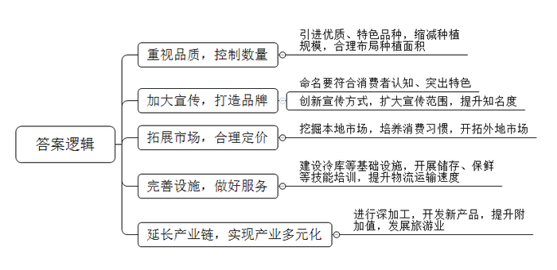
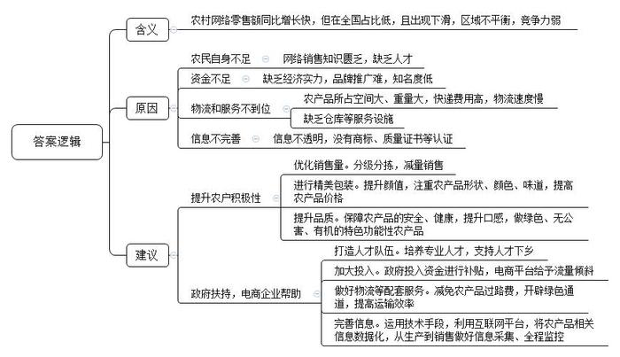
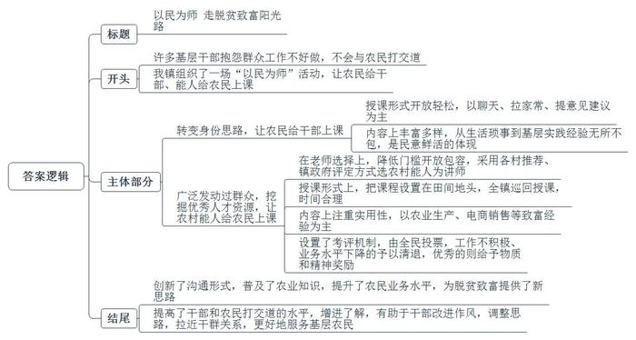
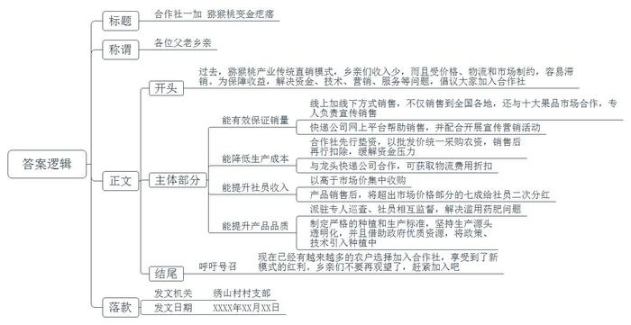

# 2018年公务员多省联考《申论》题（贵州B卷）

> 候选采集稿。参考答案及解析来自粉笔页面，不代表官方答案或真实高分答卷；来源使用许可与原卷对应关系仍需人工核实。

## 给定材料

### 材料 material-7cb9891f0a765877

Z县地处亚热带季风气候区，土壤肥沃，光照充足，降水丰富，是脐橙种植的理想之地。现在，随着生活水准的不断提高，人们对水果的需求发生了变化——口感佳、品相好、营养价值高几乎是人们挑选水果的铁律。2012年，Z县引进了一种优质脐橙在本地大规模推广种植，为了直接体现出这种脐橙品种优良，且出产自本地，Z县给它起了一个有些特别的名字：Z县美国良种脐橙。据了解，Z县出产的这种脐橙具有色泽诱人、皮薄个大、汁多肉嫩、口感甜润等诸多优点，然而，就是这样优质的水果，在2016年大面积上市后却迎来了当头一棒——整个冬季下来，脐橙的销售量竟不到预期的三分之一！以下是Z县本地论坛中“我县美国良种脐橙销售出师不捷之谜”的帖子里部分网友的回复：

●我在外地工作，只知道老家生产莼菜和小米辣椒，这个脐橙很有名吗？我怎么不知道？我爸妈就在老家，他们都不知道，何况外县，甚至是外市外省人了。

●美国良种脐橙？这个脐橙为啥叫“Z县美国良种脐橙”？听起来就像是“正宗山东川味麻辣烫”“地道闽南兰州牛肉面”一样，又别扭，又刺耳。这到底是Z县的特产，还是引进的美国货呢？土特产叫这个名字就有点不洋不土、不伦不类了。现在农产品追求原汁原味，而且“良种”两个字听起来不舒服，老让我想起化学饲料催肥的鸡鸭猪，在我们老百姓心中，良种可不等于优质哟。

●我天天在Z县走街串巷送外卖，我在本地的水果摊店、超市里都没怎么见到这种脐橙。我们本地人都不知道，招牌哪里打得出来，口碑怎么喊得响亮嘛？

●我在离老家近1000公里的城市上班，今年网上购物节时看到了家乡新脐橙的推广广告。说实话，很想支持家乡农产品，结果点进去一看，光物流就要差不多一周了。脐橙这东西要吃新鲜的，本来就坏得快，一路上再磕磕碰碰的，送到我手上时都不知道是啥样了。

●上次去镇上办事时买了几个，不便宜啊。好吃是好吃，但也太贵了嘛，比市面上的所有脐橙定价都高，但和其他好的脐橙比，也没有那么绝对的竞争优势，我觉得这个脐橙定位有些不准。

说到脐橙的滞销，种橙大户老杨也是一筹莫展：“几年前，看着脐橙卖得起价钱，大家一窝蜂地都把土地挪出来，全部种脐橙。村里、镇上，也没人来劝劝我们，而邻近的几个县都是产橙大户。我们的橙子好，但别人的也不次啊，而且人家种橙卖橙比我们早多啦，名气更响。”老杨无奈地摇了摇头，“我们县就这么点人，还不喜欢吃橙子，这么多果子，只能卖到外地去，要不然就等到天气翻暖，春天或者夏天，天气热了，大家都想吃水果。但是这些橙子娇气得很，囤到那个时候，没坏掉也霉了，干巴了。”的确，短短两年间，Z县脐橙种植面积增加了160%，产量更是提高了180%，脐橙产量的井喷式增长，更是加剧了滞销。

### 材料 material-988f75e11840b436

2017年的网络购物节，是电商和网友们共同的狂欢。然而，在这其中，农村电商却是狂欢中夹杂着孤单。据统计，2017年购物节期间，农村实现网络零售额846.08亿元，其中购物节当天实现网络零售额392.40亿元，同比增长66.53%，完全可以说得上“涨势喜人”。但同时，购物节期间，农村网络零售额在全国占比仅为15.55%，比前三季度的占比（17.14%）还低出了1.59个百分点，这显然与农村地区在集中品牌营销活动期间，与城市相比竞争力还有待提升有关；东部、中部和西部农村地区在销售额中的贡献率分别为:67%、18%及15%。农村电商，本来应该是根网线串联城乡，本该工业品到乡村，农产品去城镇，形成“工业品下乡”“农产品进城”的双向物流。但令人遗憾的是，目前农村电商下行的工业品汹涌澎湃、高歌猛进，而上行的农产品却步履蹒跚、跌跌撞撞。农民们说，他们不懂网上销售、少人帮忙；网上卖农产品要打知名度，他们经济实力不够，烧不起钱。农产品大多是又占地方又重，走不起按重量计费的快递。要是用大宗物流，可能货还没到就变质变味了，这反而影响产品口碑，砸了招牌。

一位电商从业人员则抱怨，一些农户的土特农产品，看着确实不错，但是没有商标、没有产品质量证书、没有大型仓库，根本不能在网上商店推销。“农产品必须要有身份证啊。”她总结道，“你从哪来，是什么品种，用了什么肥料，长了多长时间，谁是你的父母，这些清清楚楚的，我们才敢销售啊。”

农产品上行，目前正遭遇多重障碍，怎样逐步破除这些障碍，需要有关部门认真研究、大力扶持，需要政府、电商企业来帮助，也需要农户积极创造条件。

到底什么样的农产品受欢迎，卖得起价钱呢？这首先还是得在量上做文章，现在，农产品供应可以说已经非常充足了，随着三口之家、二口之家，甚至独居为主的家庭结构的逐渐固化，消费者对农产品的需求也越来越“小”。动不动买上200斤面粉、500斤大白菜的情景已经很难出现了，现在更有可能的是，“生菜买一颗，胡萝卜买一根”的新局面。因此，先进行分级分拣，经过包装后再出售的农产品更受青睐，而经过这样的精挑细选，真正优质的农产品也能获得更高的价值体现。

其次，农产品“颜值”要高。精美的外形包装能对品质优良的特色农产品起到锦上添花的作用。农产品的形状、颜色、味道，是消费者越来越看重的因素，高档超市、生鲜门店里卖的很多农产品，就是因为加了一层好看的包装，或者模样讨喜，价格就翻了几倍。

另外，农产品必须靠品质说话。现在，特产化对于农产品来说几乎就是优质化的代名词，居民生活水平提高了，对于食品的高品质和多样性需求日益旺盛。消费者对农产品区域性要求十分苛刻，产地稍有不适，品质、口感就会大打折扣。他们要求东西“从枝头鲜到舌头”，要吃得好，更要吃得健康；吃得安全，吃得新。因此，绿色产品、无公害产品、有机产品以及各种功能性产品等的受众市场越来越大。

### 材料 material-e9fef70ae99eb452

2017年，S镇有了一项新鲜的活动：请本镇的村民当老师。“前些年啊，不少基层干部感慨，现在的农村工作不好做，硬办法不能用、老办法不管用、新办法不会用。其实，农村是个大课堂，和乡亲们打交道也是一门学问。”S镇镇政府负责群众工作的老高介绍道，一些基层干部田间地头也跑得不少，但和乡亲们打交道的水平还是没提高。“还是要和乡亲们心连心啊，不然的话，你说的话，他们听不懂；他们说的话，你不爱听，这怎么行呢？”他感叹道。

过去，通常是干部给村民讲课；而如今，村民当老师，干部成学生。让他们的角色对换一下，这新鲜，而且效果不错。“教学”内容没有什么限制，可以话话家常，说说自己生活中的酸甜苦辣；可以给干部们讲讲意见，给政府工作提提建议。也许村民们的语言没有那么精练，但他们那些看似稀松平常的“唠”中，恰恰有最鲜活的民意，这正是基层干部照镜自省，改进工作作风，调整工作思路所必需的。这种创新的沟通形式，在无形中拉近了党群关系和干群距离，增强了相互了解，成为双方良性互动的有力推手。其实，农村是个大课堂，农民也是生活经验、基层经验、实践经验丰富的好老师。服务基层、服务农村，就是要做农民的贴心人。试想一下，如果大家都能虚心听取农民的想法、要求和意见，及时了解农民的所思所盼，吸收农民的建议和智慧，并逐步落实到实际工作中去，又何愁工作不好开展呢？

村民的学生可不止这些基层干部们。2018年年初，S镇又在全镇范围内招募了100位农村能人，在全镇巡回给农民“上课”。老高介绍说，这100个能人中，有的是种地的行家，有的是做农村电商的高手，农民“讲师”由各村推荐，镇政府评定。评定不论学历、职称，只管对脱贫致富有没有用，“我们会颁发一个证书，但讲师们可不是得到这个证书就能受用一辈子，和正规的学校一样，要是哪个讲师工作不积极了，业务水平下降了，我们是会予以清退的。当然，有新的好讲师，我们也不会错过。”老高介绍道，“我们还打算到了年底在全镇搞一次农民讲师评比活动，由全镇村民来投票。获得‘优秀’评比的讲师，我们会给予适当的物质和精神奖励。”

“每场讲课，镇里会给我们100元的‘课时费’，而且，讲课时间安排得也挺合理，不会选在农忙的时候。”种田大户老马对这样的安排赞不绝口，“以前啊，我以为上课就是大家端端正正地坐在教室里听那些老师们讲。没想到，还有这样的课堂，镇里鼓励我们把课堂设在田间地头，用现做现讲的方式给大伙们上课。”

这种以民为师的活动受到了全镇村民的热烈欢迎。“太有用了，讲的都是我们自己那些事儿，老师们有讲头、我们有听头。”村民小胡是这新课堂的“三好学生”，从开课以来，没有落下一节课。“这样的课还可以再多一些，让上堂课当学生的，下堂课也可以当老师；让上堂课当老师的，下堂课也可以当学生。”

### 材料 material-29d23f6709a5c6f8

P县气候温和，雨量适中，被誉为“中华红心猕猴桃之乡”。在该县绣山村猕猴桃农业合作社面积达108亩的种植基地内，一串串圆滚滚的猕猴桃挂在树梢，等待采摘。这些猕猴桃将被快递分发到全国各地，成为其他地区认识P县的一张名片。谈起今年猕猴桃销路，绣山村合作社负责人老杜说：“全国十大果品市场都有咱的销路，加上线上销售，全村的量10来天就卖完了！”下一步，他打算在一些果品市场派驻专人，专职宣传和销售猕猴桃和其他特产水果。

以往，将水果全部直销给水果商的传统销售模式，让果农们在辛辛苦苦地劳作了大半年后，收入少之又少，而且受价格浮动、物流和本地市场行情的影响，猕猴桃容易出现滞销。为了改变这种状况,2015年7月，村里30户农民走出了勇敢而冒险的一步：他们以108亩土地承包经营权和挂果猕猴桃园出资入股，自发组建了股份合作社，以解决他们以往生产经营中缺资金、缺技术、缺营销、缺服务等问题。

合作社所有农资，比如上什么肥、打什么药、选用哪个牌子，经合作社年度农资统供会讨论确定后，由合作社先行垫资并以批发价统一采购，所需费用在果品销售后才扣除。农户不仅无需垫钱，还享受到团购批发价的优惠。比如，合作社统一到某公司购买牛粪肥料，每吨价格40元，而个人去买的话是60元，节省的“批零差”，降低了社员的生产成本。到了秋季，无论社员的猕猴桃能否卖出，合作社都会以略高于市场价的价格集中收购。按照每亩产2000公斤猕猴桃计算，每公斤如果比市场价高出0.4元,1亩地就比非社员多收入近千元，而且根本不用再为销路发愁担心，踏踏实实种果子就可以了。所有猕猴桃销售后，在超出市场价格的部分中，合作社提取20%作为社里专职工作人员的工资，10%作为合作社基金提留，其余70%给合作社社员进行二次分红。

合作社的这种运行机制和经营方式，让社员们成了“命运共同体”，诸如偷打膨大剂和农药、化肥等问题，也因为CEO老杜每天派专人巡查、社员相互监督而彻底销声匿迹。猕猴桃质量不再参差不齐，品质大幅提升。

和很多娇气的水果一样，猕猴桃皮薄易破，保鲜不易。这就对物流提出了更高的要求。为此，合作社主动与邮政系统的两大龙头快递合作，并为两家快递的“水果优选”APP提供货源。因为走量巨大，合作社在物流费用上获得了不小的折扣。同时，因为成为其旗下“水果优选”APP的固定供货商，两家快递公司也更加重视合作社的果品，并配合合作社开展了一系列的宣传营销活动，与快递公司的深度合作，让合作社尝到了甜头。合作社深知，猕猴桃要赢得消费者青睐，品质、营销，缺一不可。为此，合作社自己制定了严格的猕猴桃种植和生产标准，包括必须全程坚持原生态，不要化肥，只用农家肥……猕猴桃刚长出果子时，就要梳果，并套袋子，隔绝污染等。同时，把猕猴桃的生长发育过程，用图文形式全部记录下来……贴上作为每一颗果子唯一标识的二维码，一扫就知道它的前世今生了。合作社用坚持生产源头透明化的手段，让消费者买得安心、吃得放心。而每每有新政策、好的农业新科技出来，合作社都会派人第一时间跑去请教学习、并及时引入到猕猴桃种植中。用巧借政府优质资源的形式，来保证所产猕猴桃的好吃和安全。

“猕猴桃适应性强、易管理，种植猕猴桃不但具有美化环境的效果，更重要的是会帮助土壤改良。现在做出品牌和名气了，我们也认准了，就它了。”老杜说。

## 题目

### 第 1 题

**根据给定资料**1**，谈谈Z县推广脐橙种植这一案例对我国发展县域特色农业经济有何启示。（30分）**

关联材料：材料 material-7cb9891f0a765877、材料 material-988f75e11840b436、材料 material-e9fef70ae99eb452、材料 material-29d23f6709a5c6f8

作答要求：

要求：全面、准确、简明，有条理；字数不超过200字。

### 第 2 题

**根据给定资料**2**，分析2017年网购节中农村电商“狂欢中夹杂着孤单”的原因，并为农村电商的发展提出合理的建议。(40分)**

关联材料：材料 material-7cb9891f0a765877、材料 material-988f75e11840b436、材料 material-e9fef70ae99eb452、材料 material-29d23f6709a5c6f8

作答要求：

要求：

（1）紧扣材料，内容全面；

（2）语言准确简明，有条理；

（3）字数不超过450字。

### 第 3 题

**假设你是S镇政府负责宣传的工作人员，请根据给定资料**3**，写一篇关于S镇“以民为师”活动的报道。（40分）**

关联材料：材料 material-7cb9891f0a765877、材料 material-988f75e11840b436、材料 material-e9fef70ae99eb452、材料 material-29d23f6709a5c6f8

作答要求：

要求:

（1）紧扣材料，内容全面；

（2）条理清晰，语言流畅；

（3）字数不超过450字。

### 第 4 题

**假设你是绣山村的一名驻村干部，请根据给定资料**4**，写一篇动员猕猴桃果农加入合作社的倡议书。(40分)**

关联材料：材料 material-7cb9891f0a765877、材料 material-988f75e11840b436、材料 material-e9fef70ae99eb452、材料 material-29d23f6709a5c6f8

作答要求：

要求：

（1）紧扣材料，内容全面；

（2）逻辑清晰，语言流畅；

（3）字数在400-500字。

## 答案与解析

第 1 题

**参考答案（粉笔题库参考内容）**

1.重视品质，控制数量。引进优质、特色品种，缩减种植规模，合理布局种植面积。

2.加大宣传，打造品牌。命名要符合消费者认知、突出特色；创新宣传方式，扩大宣传范围，提升知名度。

3.拓展市场，合理定价。挖掘本地市场，培养消费习惯，开拓外地市场。

4.完善设施，做好服务。建设冷库等基础设施，开展储存、保鲜等技能培训，提升物流运输速度。

5.延长产业链，实现产业多元化。进行深加工，开发新产品，提升附加值，发展旅游业。

**解析**

**参考答案说明**：本参考答案从“品质与数量”“品牌宣传”“市场定价”“设施服务”“产业多元化”这五个方面进行了分条撰写，各条要点之间在内容上是并列关系，没有交叉。并且撰写每条要点时，都提炼出了概括性强的总结词并前置。

**考点**：考点经验启示类

**来源**：来源2018年公务员多省联考《申论》题（贵州B卷）

粉笔申论页面对本题只提供「解析视频」入口，该入口是会员推广位，页面无视频地址与文字解析。

第 2 题

**参考答案（粉笔题库参考内容）**

农村网络零售额同比增长快，但在全国占比低，且出现下滑，区域不平衡，竞争力弱。

原因有：1.农民自身不足。网络销售知识匮乏，缺乏人才。2.资金不足。缺乏经济实力，品牌推广难，知名度低。3.物流和服务不到位。农产品所占空间大、重量大，快递费用高，物流速度慢；缺乏仓库等服务设施。4.信息不完善。信息不透明，没有商标、质量证书等认证。

建议是：一、提升农户积极性。1.优化销售量。分级分拣，减量销售。2.进行精美包装。提升颜值，注重农产品形状、颜色、味道，提高农产品价格。3.提升品质。保障农产品的安全、健康，提升口感，做绿色、无公害、有机的特色功能性农产品。二、政府扶持，电商企业帮助。1.打造人才队伍。培养专业人才，支持人才下乡。2.加大投入。政府投入资金进行补贴，电商平台给予流量倾斜。3.做好物流等配套服务。减免农产品过路费，开辟绿色通道，提高运输效率。4.完善信息。运用技术手段，利用互联网平台，将农产品相关信息数据化，从生产到销售做好信息采集、全程监控。

**解析**

**参考答案说明：**本参考答案按照含义、原因和建议进行分类。（1）首先对题干信息“狂欢中夹杂着孤单”进行了阐释；（2）原因内部按照“农民自身不足”“资金不足”“物流和服务不到位”“信息不完善”4个不同角度撰写；（3）建议内部又分别从“农户积极性”“政府扶持，电商企业帮助”这些角度撰写。每条答案标注序号，满足了题干中“有条理”这一要求。各条要点之间在内容上是并列关系，没有交叉。

**考点**：考点提出对策类

**来源**：来源2018年公务员多省联考《申论》题（贵州B卷）

第 3 题

**参考答案（粉笔题库参考内容）**

以民为师 走脱贫致富阳光路

许多基层干部抱怨群众工作不好做，不会与农民打交道，于是我镇组织了一场“以民为师”活动，让农民给干部、能人给农民上课。

转变身份思路，让农民给干部上课。授课形式开放轻松，以聊天、拉家常、提意见建议为主。内容上丰富多样，从生活琐事到基层实践经验无所不包，是民意鲜活的体现。

广泛发动群众，挖掘优秀人才资源，让农村能人给农民上课。在老师选择上，降低门槛开放包容，采用各村推荐、镇政府评定方式选农村能人为讲师。授课形式上，把课程设置在田间地头，全镇巡回授课，时间合理。内容上注重实用性，以农业生产、电商销售等致富经验为主。为提高积极性，还设置了考评机制，由全民投票，工作不积极、业务水平下降的予以清退，优秀的则给予物质和精神奖励。

“以民为师”创新了沟通形式，普及了农业知识，提升了农民业务水平，为脱贫致富提供了新思路。同时提高了干部和农民打交道的水平，增进了解，有助于干部改进作风，调整思路，拉近干群关系，更好地服务基层农民。

**解析**

**参考答案说明：**（1）格式方面，本参考答案写到了“标题”“正文”两个部分。（2）正文部分，一方面从内容来看，本参考答案的开头先写到了“‘以民为师’活动的背景”；主体部分首先从“让农民给干部上课”“让能人给农民上课”两个方面介绍了“活动内容”，其次从“创新沟通形式”“拉近干群关系”等方面给出了“活动意义”。另一方面，形式上，本参考答案做到了分段撰写，整体上条理较为清晰。（3）本参考答案能够结合报道的特点，在语言表达上做到了简洁、流畅。

**考点**：考点宣传类

**来源**：来源2018年公务员多省联考《申论》题（贵州B卷）

粉笔申论页面对本题只提供「解析视频」入口，该入口是会员推广位，页面无视频地址与文字解析。

第 4 题

**参考答案（粉笔题库参考内容）**

合作社一加 猕猴桃变金疙瘩

各位父老乡亲：

过去，猕猴桃产业传统直销模式，乡亲们收入少，而且受价格、物流和市场制约，容易滞销。为保障收益，解决资金、技术、营销、服务等问题，倡议大家加入合作社。

一、能有效保证销量。线上加线下方式销售，不仅销售到全国各地，还与十大果品市场合作，专人负责宣传销售；快递公司网上平台帮助销售，并配合开展宣传营销活动。

二、能降低生产成本。合作社先行垫资，以批发价统一采购农资，销售后再行扣除，缓解资金压力；与龙头快递公司合作，可获取物流费用折扣。

三、能提升社员收入。以高于市场价集中收购；产品销售后，将超出市场价格部分的七成给社员二次分红。

四、能提升产品品质。派驻专人巡查、社员相互监督，解决滥用药肥问题；制定严格的种植和生产标准，坚持生产源头透明化，并且借助政府优质资源，将政策、技术引入种植中。

现在已经有越来越多的农户选择加入合作社，享受到了新模式的红利。乡亲们不要再观望了，赶紧加入吧！

绣山村村支部

XXXX年XX月XX日

**解析**

**参考答案说明****:**（1）格式方面，本参考答案写到了“标题”“称谓”“正文”“落款”。（2）正文部分，一方面从内容来看，围绕着“动员果农加入合作社”这一主题，本参考答案的开头先写到了“传统销售模式存在的问题”等；主体部分从“有效保证销量”“降低生产成本”“提升社员收入”“提升产品品质”四个方面给出了加入合作社的好处；结尾部分发出了呼吁号召。另一方面，形式上，本参考答案做到了分段、分条撰写，整体上条理较为清晰。（3）本参考答案能够结合倡议书的特点，在语言表达上使用了“希望”“共创”等具有号召性、感染力的词汇。

**考点**：考点宣传类

**来源**：来源2018年公务员多省联考《申论》题（贵州B卷）

粉笔申论页面对本题只提供「解析视频」入口，该入口是会员推广位，页面无视频地址与文字解析。

