# 2018年421联考《行测》题（贵州卷）（网友回忆版）

<!-- gwy:overview:start -->
> **贵州 · 2018 · 行测 · 统考** ｜ 115 题 · 图片 77 处 · 答案随题折叠

| 题型模块 | 题量 | 题号 |
| --- | ---: | ---: |
| 常识判断 | 15 | 1–15 |
| 言语理解与表达 | 40 | 16–55 |
| 数量关系 | 10 | 56–65 |
| 判断推理 | 30 | 66–95 |
| 资料分析 | 20 | 96–115 |
| **合计** | **115** | |

导航：[题型与作答说明](#题型与作答说明) · [题目](#题目) · [材料 1](#材料-1)
<!-- gwy:overview:end -->

> 候选采集稿。参考答案及解析来自粉笔页面，不代表官方答案或真实高分答卷；来源使用许可与原卷对应关系仍需人工核实。

## 题型与作答说明

常识判断

（15题）

根据题目要求，在四个选项中选出一个最恰当的答案。

言语理解与表达

（40题）

本部分包括表达与理解两方面的内容。请根据题目要求，在四个选项中选出一个最恰当的答案。

数量关系

（10题）

在这部分试题中，每道题呈现一段表述数字关系的文字，要求你迅速、准确地计算出答案。

判断推理

（30题）

本部分包含图形推理、定义判断、类比推理和逻辑判断四个部分，根据题目的表述选择最佳选项。

资料分析

（20题）

所给出的图、表、文字或综合性资料均有若干个问题要你回答。你应根据资料提供的信息进行分析、比较、计算和判断处理。

## 题目

### 第 1 题

声音的音调、响度分别与其频率、振幅成正比。下图是甲乙丙三人的声音在示波器上相同量纲下显示的波形。据此，下列说法**错误**的是：

A. 甲、乙音调相同

B. 乙、丙响度相同

C. 丙的响度大于甲

D. 乙的音调高于丙

第 1 题 · 答案与解析

**参考答案（粉笔题库参考内容）**

D

**解析**

音调指声音的高低，是由发声体振动的频率决定，频率越高，音调越高；频率表示物体振动的快慢，物体振动的越快，频率越大。响度指声音的强弱，是由发声体振动的振幅决定，振幅越大，响度越大。

A项正确，对比甲图乙图，可以看出波峰出现的个数相同，都是3个，说明振动快慢（频率）相同，故甲、乙音调相同。

B项正确，对比乙图丙图，可以看出波振动的幅度相同，即振幅相同，都占满了整个框，故乙、丙响度相同。

C项正确，对比甲图丙图，可以看出丙振动的幅度大于甲振动的幅度，故丙的响度大于甲。

D项错误，对比乙图丙图，可以看出丙的频率高于乙的频率，故丙的音调高于乙。

本题为选非题，故正确答案为D。

**考点**：物理常识

**来源**：2018年贵州省选调高校优秀毕业生到基层工作考试《行测》试题（网友回忆版）第11题

### 第 2 题

下列选项中的现象包含了相同物理原理的是：

A. 搓手取暖：钻木采火

B. 摇扇纳凉：冰镇降温

C. 气球升空：桂花飘香

D. 水往低流：唱响全场

第 2 题 · 答案与解析

**参考答案（粉笔题库参考内容）**

A

**解析**

A项正确，冬天搓手取暖和钻木采火都是利用摩擦，使得机械能转换为内能。

B项错误，夏天摇扇体现的是空气的流动，空气的流动使人体表面的汗液蒸发加快，由于蒸发吸热，所以人感到凉快；冰镇降温体现的是熔化原理，因为冰在空气中会熔化，而熔化需要吸热，吸收人体的热量，让病人降温。

C项错误，气球升空体现的是浮力原理，桂花飘香体现的是分子在不停地做无规则运动。

D项错误，水受到地球磁场引力的作用，引力的方向是竖直向下的；唱响全场体现的是声音通过介质不断传播。

故正确答案为A。

**考点**：物理常识

**来源**：2018年贵州省选调高校优秀毕业生到基层工作考试《行测》试题（网友回忆版）第4题

### 第 3 题

在右侧的简易示意图中，问号处最可能的是：

A. 华山

B. 玉山

C. 恒山

D. 五台山

第 3 题 · 答案与解析

**参考答案（粉笔题库参考内容）**

A

**解析**

本题考查地理国情。

根据图片，狭义上的秦岭，仅限于陕西省南部、渭河与汉江之间的山地，东以灞河与丹江河谷为界，西止于嘉陵江。太行山是中国东部地区的重要山脉和地理分界线，位于山西省与华北平原之间，是中国地形第二阶梯的东缘，也是黄土高原的东部界线。因此，图片中问号位于我国地形第二阶梯，位于秦岭的东北端，太行山脉的西南端。

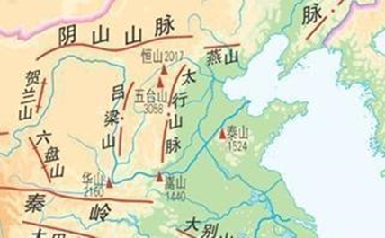

A项正确，华山古称“西岳”，为中国著名的五岳之一，位于陕西省渭南市华阴市，南接秦岭，北瞰黄渭，且位于太行山脉的西边。与题干图片位置符合。

B项错误，玉山，通常指玉山主峰，位于中国东部地区台湾省中部，是中国东部最高峰。与题干图片位置不符。

C项错误，恒山位于山西省大同市浑源县城南。北岳恒山位于太行山系的西北端。与题干图片位置不符。

D项错误，五台山属太行山系的北端，同样位于太行山脉的西北端，略南于恒山。与题干图片位置不符。

故正确答案为A。

**考点**：自然地理

**来源**：2018年贵州省选调高校优秀毕业生到基层工作考试《行测》试题（网友回忆版）第5题

### 第 4 题

下列选项中，最直接体现了生命新陈代谢的是：

A. 长江后浪推前浪，一浪高过一浪

B. 今春香肌瘦几分？缕带宽三寸

C. 江畔何人初见月？江月何年初照人

D. 中庭地白树栖鸦，冷露无声湿桂花

第 4 题 · 答案与解析

**参考答案（粉笔题库参考内容）**

B

**解析**

本题考查人文常识。

A项错误，“长江后浪推前浪，一浪高过一浪”，比喻事物的不断前进，多指新人新事代替旧人旧事，没有直接体现生命新陈代谢。

B项正确，“今春香肌瘦几分？缕带宽三寸”，出自元代王实甫的《十二月过尧民歌·别情》，意思是今年春天，我的身体瘦了多少，看衣带都宽出了三寸。诗句描写的身体消瘦，直接体现了生命新陈代谢。

C项错误，“江畔何人初见月，江月何年初照人”，出自唐代张若虚的《春江花月夜》，意思是谁在江畔第一次看到月亮，而江上的月亮又是哪时开始朗照人呢？体现了诗人面对这一轮江月深深地思考，满怀感慨和迷惘，没有直接体现生命新陈代谢。

D项错误，“中庭地白树栖鸦，冷露无声湿桂花”出自唐代王建的《十五夜望月寄杜郎中》，意思是庭院中月映地白树栖昏鸦，那寒露悄然无声沾湿桂花，描绘了自然现象，并没有直接体现生命新陈代谢。

故正确答案为B。

**考点**：文学常识

**来源**：2018年贵州省选调高校优秀毕业生到基层工作考试《行测》试题（网友回忆版）第6题

### 第 5 题

历史上，不少豪放派诗人（词人）有婉约佳作，而婉约派也不乏豪放名句，这是一种有趣的“反差”。下列选项中，**不能**体现这种“反差”的是：

A. 李清照：生当作人杰，死亦为鬼雄

B. 晏殊：无可奈何花落去，似曾相识燕归来

C. 苏轼：春宵一刻值千金，花有清香月有阴

D. 辛弃疾：众里寻他千百度，蓦然回首，那人却在，灯火阑珊处

第 5 题 · 答案与解析

**参考答案（粉笔题库参考内容）**

B

**解析**

本题考查文学常识。

A项正确，李清照，宋代女词人，婉约词派代表，有“千古第一才女”之称。“生当作人杰，死亦为鬼雄”出自李清照《夏日绝句》，意思是活着就要当人中的俊杰，死了也要做鬼中的英雄。这句诗反映出背负着亡国之恨的李清照对金人入侵和一味求安、南渡保全自己的南宋政府表示了强烈的愤慨。因此，与李清照婉约的风格不同。

B项错误，晏殊，北宋名相，婉约派著名词人。“无可奈何花落去，似曾相识燕归来”出自《浣溪沙·一曲新词酒一杯》，意思是那花儿落去我也无可奈何，那归来的燕子似曾相识。渗透在这句诗中的是一种混杂着眷恋和怅惆，既似冲澹又似深婉的人生怅触。因此，与晏殊婉约派的风格相符。

C项正确，苏轼，北宋文学家，豪放派主要代表。“春宵一刻值千金，花有清香月有阴” 苏轼的《春宵》，意思是春天的夜晚，即便是极短的时间也十分珍贵。花儿散发着丝丝缕缕的清香，月光在花下投射出朦胧的阴影。诗句华美而含蓄，耐人寻味，含蓄委婉地透露出作者对醉生梦死、贪图享乐、不惜光阴的人的深深谴责。因此，与苏轼豪放的风格不同。

D项正确，辛弃疾，南宋豪放派词人。“众里寻他千百度，蓦然回首，那人却在灯火阑珊处”出自辛弃疾的《青玉案·元夕》，意思是偶一回头，却发现自己的心上人站立在昏黑的幽暗之处。诗人通过此诗反映出自己当时不受重用，文韬武略施展不出，心中怀着一种无比惆怅之感，所以只能在一旁孤芳自赏。因此，与辛弃疾豪放的风格不同。

本题为选非题，故正确答案为B。

**考点**：文学常识

**来源**：2018年贵州省选调高校优秀毕业生到基层工作考试《行测》试题（网友回忆版）第2题

### 第 6 题

租客小赵经房东老张的同意，将自己所租的房子（租金2000元/月）其中的一个卧室以800元/月的价格租给小刘。小刘在租住期间，擅自拆除门窗造成了价值10000元的房屋损毁。据此，下列说法正确的是：

A. 小刘应向老张赔偿全部损失，但可向小赵追偿

B. 小赵应向老张赔偿全部损失，但可向小刘追偿

C. 小赵、小刘应分别赔偿老张6000元、4000元

D. 小赵在支付6000元赔偿后，可向小刘追偿

第 6 题 · 答案与解析

**参考答案（粉笔题库参考内容）**

B

**解析**

本题考查法律常识，主要考查民法知识。

首先，《中华人民共和国民法典》第七百一十六条规定：“承租人经出租人同意，可以将租赁物转租给第三人。承租人转租的，承租人与出租人之间的租赁合同继续有效，第三人造成租赁物损失的，承租人应当赔偿损失。承租人未经出租人同意转租的，出租人可以解除合同。”其次，小刘与小赵之间存在合同关系，《中华人民共和国民法典》五百七十七条规定：“当事人一方不履行合同义务或者履行合同义务不符合约定的，应当承担继续履行、采取补救措施或者赔偿损失等违约责任。”因此，基于合同关系，小赵应向老张赔偿全部损失，但可向小刘追偿。因此，B项正确，A、C、D三项错误。

故正确答案为B。

**考点**：民法典

**来源**：2018年贵州省选调高校优秀毕业生到基层工作考试《行测》试题（网友回忆版）第3题

### 第 7 题

在我国古代，很多事物往往被人们寄予特定的寓意，下列事物及其寓意对应**错误**的是：

A. 青鸟——友情

B. 桑梓——故乡

C. 仙鹤——长寿

D. 杨柳——离别

第 7 题 · 答案与解析

**参考答案（粉笔题库参考内容）**

A

**解析**

本题考查人文常识。

A项错误，“青鸟”的典故出自《山海经》。青鸟代表送达书信、消息的鸟，也可以说是信使，在古诗中常常用来指爱情信使，最著名的就是李商隐《无题·相见时难别亦难》中“蓬山此去无多路，青鸟殷勤为探看”的诗句。

B项正确，桑树的叶、果、树干、枝条、皮各有用途，梓树是一种速生树种，在古代还常被作为薪炭用材。所以，古代的人们经常在自己家的房前屋后植桑栽梓，故“桑梓”就成了故乡的象征。

C项正确，鹤为长寿仙禽，具有仙风道骨，据说，鹤寿无量，与龟一样被视为长寿之王，“仙鹤”就成了长寿的象征。

D项正确，“杨柳”最早就是柳树的意思。一到春天，柳树就会飞絮，很容易引起古人的伤感。“柳”即是“留”，折柳送别是古代的一种风俗，在抒发离愁别绪的诗词里经常出现，故“杨柳”就成了离别的象征。

本题为选非题，故正确答案为A。

**考点**：文化常识

**来源**：2018年贵州省选调高校优秀毕业生到基层工作考试《行测》试题（网友回忆版）第12题

### 第 8 题

2017年，在广东珠海成功完成首飞的我国首款大型灭火/水上救援水陆两栖飞机被命名为：

A. 鲲龙AG600

B. 蛟龙ZH215

C. 精卫CR919

D. 鲲鹏GD311

第 8 题 · 答案与解析

**参考答案（粉笔题库参考内容）**

A

**解析**

本题考查科技常识。

2017年12月24日上午9时39分许，由航空工业自主研发的我国首款大型水陆两栖飞机——“鲲龙”AG600在广东珠海金湾机场成功首飞。

A项正确，鲲龙AG600是我国为满足森林灭火和水上救援的迫切需要，首次研制的大型特种用途民用飞机，是我国首款大型灭火/水上救援水陆两栖飞机。

B项错误，蛟龙号是一艘由中国自行设计、自主集成研制的载人潜水器。

C项错误，无精卫CR919这种装备表述。

D项错误，鲲鹏号，是中国自主研发的新一代重型军用运输机，不符合题干水陆两栖飞机的表述。

故正确答案为A。

**考点**：科技理论与成就

**来源**：2018年贵州省选调高校优秀毕业生到基层工作考试《行测》试题（网友回忆版）第13题

### 第 9 题

最近几年，无需火电的即热型快餐备受人们欢迎。这种即热型快餐一般由两层铝箔（锡箔）纸包装构成，内层用于盛放需加热的食物，外层用于盛放加热材料。据此，下列最可能成为这种快餐加热材料的是：

A. 浓硫酸和水

B. 食盐和水

C. 石灰石和水

D. 生石灰和水

第 9 题 · 答案与解析

**参考答案（粉笔题库参考内容）**

D

**解析**

本题考查即热型快餐的加热材料，即分析哪一项的物质能通过化学反应放热。

A项，浓硫酸溶于水会有热量放出，但是浓硫酸有强腐蚀性，所以不能作为快餐加热材料，排除。

B项，食盐，主要成分是氯化钠，其溶于水没有明显的热量放出，所以不能作为快餐加热材料，排除。

C项，石灰石，主要成分是碳酸钙，其不溶于水，所以与水混合不会有明显的热量放出，故不能作为快餐加热材料，排除。

D项，生石灰，主要成分是氧化钙，生石灰与水反应生成氢氧化钙，并放出热量，可以作为快餐加热材料，正确。

故正确答案为D。

**考点**：化学常识

**来源**：2018年贵州省选调高校优秀毕业生到基层工作考试《行测》试题（网友回忆版）第7题

### 第 10 题

以下现象，与液体表面张力**无关**的是：

A. 雨水落到荷叶上形成水珠

B. 某些小型昆虫在水上行走

C. 回形针能够漂浮在水面上

D. 船能够在水面上航行

第 10 题 · 答案与解析

**参考答案（粉笔题库参考内容）**

D

**解析**

本题主要考查物理常识。液体表面张力，是指作用于液体表面，使液体表面积缩小的力。其产生的原因是：液体跟气体接触的表面存在一个薄层，叫做表面层，表面层里的分子比液体内部稀疏，分子间的距离比液体内部大一些，分子间的相互作用表现为引力。

A项正确，由于荷叶具有疏水、不吸水的表面，落在叶面上的雨水不会浸润展开，而会因表面张力的作用形成水珠。

B项正确，昆虫一般长着细长的脚，像一个保持平衡的支架，来帮助昆虫利用水的表面张力（其作用力小于水的张力），从而在水面上行走自如。

C项正确，回形针在水面的有效张力范围内，用水撑起一张膜，从而支撑和分摊了回形针在水面的重量，使其不至于下沉。

D项错误，船能够漂浮在水面上，跟它排开水的体积有关。物体浮力的大小等于该物体下沉时排开的液体的重力，物体排开的水越多，它所受的浮力也就越大，当船浮在水面上时，船所受到的浮力等于船自身的重力，与表面张力无关。

本题为选非题，故正确答案为D。

**考点**：物理常识

**来源**：2018年贵州省选调高校优秀毕业生到基层工作考试《行测》试题（网友回忆版）第14题

### 第 11 题

下面场景**不符合**我国医务常识的是：

A. 婴儿患吸入性肺炎，医疗人员在对其的治疗中使用了抗生素药物

B. 小红需要大量输血，但医生拒绝了她的直系血亲输血给她的要求

C. 医生严正拒绝向孕妇家属透露腹中胎儿的性别信息

D. 医生抽取了小张100立方厘米的血液用于常规体检

第 11 题 · 答案与解析

**参考答案（粉笔题库参考内容）**

D

**解析**

本题考查科技常识。

A项正确，婴儿吸入性肺炎是指婴儿意外吸入酸性物质，如食物、胃内容物以及其他刺激性液体等，引起的化学性肺炎，严重者可发生呼吸衰竭或呼吸窘迫综合征。治疗给予对症治疗，吸氧，取出异物等，出现继发细菌感染给予抗生素治疗。

B项正确，根据输血原则，直系亲属间输血有时会发生一种严重的输血反应，称为输血相关性移植物抗宿主病（TA-GVHD），这种输血反应虽然发病率低，但死亡率极高。故医生的做法是正确的。

C项正确，《中华人民共和国母婴保健法》（简称《母婴保健法》）在第三十二条第二款明确规定：“严禁采用技术手段对胎儿进行性别鉴定，但医学上确有需要的除外。”

D项错误，常规体检血常规抽取的血量一般在2-20毫升，最多不会超过50毫升，选项中100立方厘米是100ml，不符合医学常识。

本题为选非题，故正确答案为D。

**考点**：生物常识

**来源**：2018年贵州省选调高校优秀毕业生到基层工作考试《行测》试题（网友回忆版）第8题

### 第 12 题

下列说法**错误**的是：

A. 中关村位于北京市，是我国最早的高新区

B. 深圳是我国改革开放建立的第一个经济特区

C. 截至2017年年底，我国共有上海浦东新区、天津滨海新区、重庆两江新区及河北雄安新区4个国家级新区

D. 开发区包括经济技术开发区、保税区、高新技术产业开发区、国家旅游度假区等

第 12 题 · 答案与解析

**参考答案（粉笔题库参考内容）**

C

**解析**

本题主要考查国情社情的相关知识。

A项正确，中关村科技园，位于北京市海淀区，是中国第一个国家级高新技术产业开发区，被誉为“中国硅谷”。

B项正确，1980年8月，中国政府正式批准建立深圳经济特区，随后又在珠海、汕头、厦门、海南建立特区。因此深圳是我国改革开放建立的第一个经济特区。

C项错误，截至2017年年底，中国国家级新区总数共19个，分别是上海浦东新区、天津滨海新区、重庆两江新区、浙江舟山群岛新区、兰州新区、广州南沙新区、陕西西咸新区、贵州贵安新区、青岛西海岸新区、大连金普新区、四川天府新区、湖南湘江新区、南京江北新区、福建福州新区、云南滇中新区、哈尔滨新区、长春新区、江西赣江新区、河北雄安新区。

D项正确，开发区是指由国务院和省、自治区、直辖市人民政府批准在城市规划区内设立的经济技术开发区、保税区、高新技术产业开发区、国家旅游度假区等实行国家特定优惠政策的各类开发区。

本题为选非题，故正确答案为C。

**考点**：中国地理

**来源**：2018年贵州省选调高校优秀毕业生到基层工作考试《行测》试题（网友回忆版）第1题

### 第 13 题

下列说法正确的是：

A. 海拔高度即某地与海平面的高度差，我国海拔高度以东海海面为零点

B. 中国、挪威、印度尼西亚均拥有上千个大小岛屿，可称为“千岛之国”

C. 港口按照用途，可分为海港、河港、湖港及水库港四种

D. 印度半岛又称“南亚次大陆”，是世界上面积最大的半岛

第 13 题 · 答案与解析

**参考答案（粉笔题库参考内容）**

B

**解析**

本题考查地理国情。

A项错误。我国规定采用青岛验潮站求得的1956年黄海平均海水面为全国统一高程基准面，由其他不同高程基准面推算的高程均归化到统一高程基准面上，故我国海拔高度是以黄海海面为零点而非东海。

B项正确。可称为“千岛之国”是指这个国家拥有上千个大大小小各种各样的岛屿，除了选项中的中国、挪威、印度尼西亚之外，还有马尔代夫、菲律宾等国。

C项错误。港口按照用途可分为商港、渔港、工业港、军港、避风港。按港口所在的地理位置可分为海港、河港和湖港及水库港。

D项错误。印度半岛又称“南亚次大陆”，是喜马拉雅山脉以南的一大片半岛形的陆地，亚洲大陆的南延部分，是世界第二大半岛。而世界上面积最大的半岛是阿拉伯半岛。

故正确答案为B。

**考点**：自然地理

**来源**：2018年贵州省选调高校优秀毕业生到基层工作考试《行测》试题（网友回忆版）第9题

### 第 14 题

下列说法**错误**的是：

A. 大多数植物不能直接吸收氮气，需要经过氮的固定

B. 人类一氧化碳中毒的原因是血红蛋白与一氧化碳结合

C. 糖类、油脂、蛋白质、维生素、无机盐和水都属于营养素

D. 福尔马林不会对蛋白质产生变性作用，可用于动物标本防腐

第 14 题 · 答案与解析

**参考答案（粉笔题库参考内容）**

D

**解析**

本题考查科技常识。

A项正确，氮气化学性质稳定，很难跟别的物质发生反应。大多数植物不能直接吸收氮气，需要经过氮的固定。仅存在少数的例外，比如说豆科植物共生的固氮菌，有固氮酶，所以它能直接吸收。

B项正确，一氧化碳中毒是含碳物质燃烧不完全时的产物经呼吸道吸入人体从而引起的中毒现象。原因是一氧化碳与血红蛋白的亲合力比氧与血红蛋白的亲合力高很多倍，因此一氧化碳极易与血红蛋白结合，从而使血红蛋白丧失携氧的能力和作用，进而造成中毒。

C项正确，营养素是指食物中可给人体提供能量、构成机体和组织修复以及具有生理调节功能的化学成分。蛋白质、糖类、油脂、维生素、无机盐、水被称为人体所需的六大类营养素，是人类维持生命和健康的必需物。

D项错误，福尔马林能与动物标本中的蛋白质反应，破坏蛋白质的结构，避免动物标本的腐烂，而非题干中所说的不会对蛋白质产生变性作用。

本题为选非题，故正确答案为D。

**考点**：生物常识

**来源**：2018年贵州省选调高校优秀毕业生到基层工作考试《行测》试题（网友回忆版）第10题

### 第 15 题

爱因斯坦有言：在真理和认识方面，任何以权威者自居的人，必将在上帝的戏笑中垮台！

对此，下列理解正确的是：

①爱因斯坦否认世界是客观的

②爱因斯坦否认物质世界存在规律性

③爱因斯坦倾向于“意识会随着物质世界的发展而不断发展”的观点

④爱因斯坦并不一定是有神论者，他所说的上帝不是人格化的神

A. ①②

B. ②③

C. ③④

D. ①④

第 15 题 · 答案与解析

**参考答案（粉笔题库参考内容）**

C

**解析**

本题考查政治常识。

马克思主义认为：认识运动是一个实践、认识、再实践的不断反复的过程。一个正确的认识往往要经过多次反复以达到预期的结果为标志算完成，认识运动是无限发展、没有终点的。

真理是人们对客观事物及其规律的正确反映。真理具有客观性，客观性是真理的根本属性。真理具有具体性，任何真理都是在一定时间、地点、条件下主观与客观的符合，它受条件的制约，并随条件的变化而变化，一切以时间、地点和条件为转移。

爱因斯坦的名言“在真理和认识方面，任何以权威者自居的人，必将在上帝的戏笑中垮台”表述了认识是不断运动发展的，真理具有客观性与具体性。

①②表述错误，题干信息既不能推断出爱因斯坦否认世界是客观的，也不能得出爱因斯坦否认物质世界存在的规律性。

③表述正确，意识是随着物质世界的发展而不断变化发展的，任何“权威者”的认识都不是唯一的，永恒不变的，从“任何······，必将······垮台”等词就可以看出爱因斯坦倾向于“意识会随着物质世界的发展而不断发展”的观点。

④表述正确，题干中的“上帝”并非是人格化的神，爱因斯坦仅仅只是以此来说明在真理和认识方面，没有所谓的“权威者”。

故正确答案为C。

**考点**：认识论

**来源**：2018年贵州省选调高校优秀毕业生到基层工作考试《行测》试题（网友回忆版）第15题

### 第 16 题

实际上，就在反全球化思潮                的近些年，信息化、网络化仍在                ，移动互联网使地球每个角落发生的事情分秒间就传到世界各地，世界已经变成了“地球屋”。

依次填入划横线部分最恰当的一项是：

A. 泛滥成灾 一马当先

B. 甚嚣尘上 突飞猛进

C. 沸反盈天 快马加鞭

D. 无孔不入 一日千里

第 16 题 · 答案与解析

**参考答案（粉笔题库参考内容）**

B

**解析**

第一空，根据文意可知，近年来反全球化思潮日益盛行，B项“甚嚣尘上”形容消息普遍流传，议论纷纷，现多指某种言论十分嚣张，在文段中形容反全球化思潮的流行，符合文意。A项“泛滥成灾”比喻一件事物，多到了影响正常生活的地步，侧重点在数量“多”，与“反全球化思潮”搭配不当，排除；C项“沸反盈天”形容人声喧闹，乱成一片，与“反全球化思潮”无法搭配，排除；D项“无孔不入”指遇空隙就钻进去，也比喻善于四处钻营，善于利用一切机会，文段意在指出反全球化思潮盛行，而没有“四处钻营”之意，排除。初步判定正确答案为B项。

第二空，代入验证，根据“移动互联网使地球每个角落发生的事情分秒间就传到世界各地”可知，信息化、网络化发展迅猛，B项“突飞猛进”形容发展进步飞快，变化巨大，符合文意，当选。

故正确答案为B。

【文段出处】《科学认识经济全球化及其与中国的关系》

**考点**：词的辨析-搭配对象、对应关系-前后呼应、成语填空

**来源**：2018年贵州省选调高校优秀毕业生到基层工作考试《行测》试题（网友回忆版）第17题

### 第 17 题

数学研究所建立的各种计算方法和工具使得科学研究和现在一般意义上的哲学研究开始                ，而科学研究的定量化又使得科学研究的成果能够得到实际应用，定量化正是科学和哲学彻底分离的最显著标志。

填入划横线部分最恰当的一项是：

A. 各有怀抱

B. 各自为政

C. 分道扬镳

D. 分庭抗礼

第 17 题 · 答案与解析

**参考答案（粉笔题库参考内容）**

C

**解析**

横线处表示“科学研究”和“哲学研究”之间的关系，根据“定量化正是科学和哲学彻底分离的最显著标志”可知，两者之间的关系为相互分离、各有不同。C项“分道扬镳”比喻目标不同，各走各的路或各干各的事，能体现出相互分离的意思，当选。

A项“各有怀抱”指各有各的胸怀、心意，B项“各自为政”指不考虑全局，各搞一套，D项“分庭抗礼”比喻平起平坐、彼此对等的关系，三项均与文段所要表达的“彻底分离”之意不符，排除。

故正确答案为C。

【文段出处】《科学和宗教、伪科学的区别》

**考点**：对应关系-前后呼应、成语填空

**来源**：2018年贵州省选调高校优秀毕业生到基层工作考试《行测》试题（网友回忆版）第16题

### 第 18 题

地理位置不在沿线直接范围内的国家，也可以用新的形式加入到“一带一路”合作，政策沟通、设施        、贸易        、资金           、民心相通这五大合作理念与内容适用于世界上所有的国家和地区。随着形势的发展，“一带一路”也必将成为联结世界、融入全球的更为广阔的国际合作平台。

依次填入划横线部分最恰当的一项是：

A. 联通 畅通 融通

B. 畅通 联通 融通

C. 畅通 融通 联通

D. 融通 畅通 联通

第 18 题 · 答案与解析

**参考答案（粉笔题库参考内容）**

A

**解析**

本题可从第三空入手，横线处搭配“资金”，A、B项“融通”指使资金流通，“资金融通”为固定搭配，排除C、D两项。

第一空，横线处搭配“设施”，A项“联通”指关联沟通，置于此处表示设施可以相互关联，符合文意。B项“畅通”指毫无阻碍地通行或通过，与“设施”无法搭配，排除。初步判定正确答案为A。

第二空代入验证，横线处搭配“贸易”，“贸易畅通”表示贸易顺利进行，没有任何阻碍，符合文意。

故正确答案为A。

【文段出处】《“一带一路”推动开放型世界经济持续发展》

**考点**：词的辨析-词义侧重、词的辨析-搭配对象、实词填空

**来源**：2018年贵州省选调高校优秀毕业生到基层工作考试《行测》试题（网友回忆版）第18题

### 第 19 题

目前能在国际上制造大功率IGBT芯片的国家                ，中车株洲所成为国内唯一一家全面掌握IGBT芯片技术的企业，其技术可与世界顶尖的公司        ，而价格却远远低于竞争对手。

依次填入划横线部分最恰当的一项是：

A. 寥寥无几 比肩

B. 所剩无几 抗衡

C. 凤毛麟角 比拼

D. 屈指可数 媲美

第 19 题 · 答案与解析

**参考答案（粉笔题库参考内容）**

D

**解析**

第一空，根据“中车株洲所成为国内唯一一家”可知，横线处表达的意思是目前能在国际上制造大功率IGBT芯片的国家很少，A项“寥寥无几”形容稀少，没有几个；C项“凤毛麟角”比喻珍贵而稀少；D项“屈指可数”也形容数量极少，均与文意相符，保留。B项“所剩无几”表示剩下的没多少了，而第一空所表达的意思是没有几个国家能够达到，故与文意不符，排除。

第二空，根据文段“而价格却远远低于竞争对手”可知，横线处应体现其技术与世界顶尖公司同样优秀、先进，D项“媲美”指美好的程度可以相比，当选。A项“比肩”和C项“比拼”只表示两者能够相比、程度相同，不能体现美好、优秀之意，故不如“媲美”更符合文意，排除。

故正确答案为D。

【文段出处】《中国产IGBT守护高铁命脉》

**考点**：对应关系-前后呼应、混搭填空

**来源**：2018年贵州省选调高校优秀毕业生到基层工作考试《行测》试题（网友回忆版）第29题

### 第 20 题

生态好转，意味着我们能遏制库姆塔格大沙漠           的脚步，让沙漠明珠——月牙泉依然           在戈壁中，让弥足珍贵的莫高窟不会再次受到伤害。

依次填入划横线部分最恰当的一项是：

A. 侵蚀 摇曳

B. 侵吞 流淌

C. 吞并 闪烁

D. 吞噬 镶嵌

第 20 题 · 答案与解析

**参考答案（粉笔题库参考内容）**

D

**解析**

本题可从第二空入手，文段中将月牙泉比作沙漠明珠，则横线处所填词语用以修饰“明珠”。C项“闪烁”指光亮晃动不定，忽明忽暗；D项“镶嵌”指把一物体嵌入另一物体内，作为装饰。二者置于此处，均能体现月牙泉这一明珠为戈壁点缀，符合文意，保留。A项“摇曳”形容东西在风中轻轻摆动的样子；B项“流淌”形容液体流动，二者置于此处，均与“明珠”搭配不当，排除。

第一空，横线处所填词语搭配“大沙漠”，以体现沙漠扩大的特点。D项“吞噬”比喻消融，湮灭，符合文意，当选。C项“吞并”指并吞、兼并，常搭配公司、行业等，与“大沙漠”搭配不当，且文段没有体现兼并的意思，排除。

故正确答案为D。

【文段出处】《哈拉诺尔湖干涸六十年重现碧波，来敦煌戈壁滩看“海”了！》

**考点**：词的辨析-搭配对象、实词填空、对应关系-前后呼应、对应关系-形象表达

**来源**：2018年贵州省选调高校优秀毕业生到基层工作考试《行测》试题（网友回忆版）第21题

### 第 21 题

汉字自从成了汉语的书面符号，就一直是中华民族文化最重要的载体。它之所以能够              ，正是因为它的生命力来自它的内部结构。汉字是形音义三位一体的结构体，其中，表意是它的主体功能。稳定的形、义使它超越了表音能力的缺陷，尽管古今汉语和南北方言语音发生了重大变化，人们还能“由文知义”。于是，隔代的人可以           书面阅读，异地的人可以借助文字沟通。

依次填入划横线部分最恰当的一项是：

A. 长盛不衰 共享

B. 宝刀未老 超越

C. 永葆青春 凭借

D. 经久不衰 信赖

第 21 题 · 答案与解析

**参考答案（粉笔题库参考内容）**

A

**解析**

第一空，根据“一直”“正是因为它的生命力来自它的内部结构”可知，横线处所填成语应体现出长时间保持生命力之意，A项“长盛不衰”和D项“经久不衰”均能体现长时间保持旺盛的势头，符合文意，保留。B项 “宝刀未老”形容人到老年还依然威猛，不减当年，文中没有提到“年老”之意，排除；C项“永葆青春”是指长久保持年轻，文中也没有“年轻”的含义，排除。

第二空，“于是”表示结果，因为人们可以“由文知义”，所以隔代人也能跨越古今共同阅读，A项“共享”即共同分享，体现出通过汉字，人们可以阅读古今书籍，当选；D项“信赖”侧重于信任，文段并无体现，排除。

故正确答案为A。

【文段出处】《汉字的历史发展和现实观照》

**考点**：对应关系-前后呼应、混搭填空、关联关系-因果关系

**来源**：2018年贵州省选调高校优秀毕业生到基层工作考试《行测》试题（网友回忆版）第19题

### 第 22 题

社会保障关乎获得感，也等同于安全感。而放在当前的世界维度中，可以通过社会保障来           一个国家的发展诚意；发达国家的良好福利往往能对优秀青年人才产生筑巢引凤的号召效应，而一些没有迈过“中等收入陷阱”的国家，其社会保障                 ，尤其是对青年群体的全面覆盖                ，成了他国的“前车之鉴”。

依次填入划横线部分最恰当的一项是：

A. 管窥 左支右绌 力有不逮

B. 评判 相形见绌 力不能及

C. 洞悉 捉襟见肘 力屈道穷

D. 明了 寅吃卯粮 力不从心

第 22 题 · 答案与解析

**参考答案（粉笔题库参考内容）**

A

**解析**

第一空，根据文意可知，社会保障可体现出国家的发展诚意，A项“管窥”指通过竹管子的孔看天，比喻从观察到的部分，可以推测到全貌，与文段中“社会保障”和“国家的发展”部分和整体的关系对应准确，符合语境，保留；B项“评判”指进行评价或判断，不易排除，保留；C、D两项均指清楚地知道或懂得，放在此处程度过重，排除。

第二空，文段中将“发达国家”与“‘中等收入陷阱’的国家”对比，指出后者没有能力建立完善的社会保障，A项“左支右绌”指力量不足，应付了这方面，那方面又出了问题，符合文意，保留；B项“相形见绌”意思是和同类的事物相比较显出不足，置于此处语法错误，正确用法为“和发达国家相比实在是相形见绌”，单独与“社会保障”搭配不当，排除。

第三空，代入验证，A项“力有不逮”指能力达不到，能力触及不到，符合文意，当选。

故正确答案为A。

【文段出处】《保障覆盖是青年均等发展的支撑》

**考点**：对应关系-前后呼应、混搭填空

**来源**：2018年贵州省选调高校优秀毕业生到基层工作考试《行测》试题（网友回忆版）第20题

### 第 23 题

明星天价片酬已不是一件新鲜事。拍一部电影、出演一部电视剧动辄千万的酬劳一再受公众质疑和           。片酬虚高和漫天要价等不良现象，水涨船高式地搅乱着整个行业秩序。明星作为公众人物，光鲜的生活本就在聚光灯下，天价片酬以及由此带来的奢华生活不仅令公众           ，也有损整个社会的公平感和获得感。

依次填入划横线部分最恰当的一项是：

A. 批评 不齿

B. 揶揄 反感

C. 诟病 侧目

D. 审视 惊心

第 23 题 · 答案与解析

**参考答案（粉笔题库参考内容）**

C

**解析**

第一空，“和”表示并列，故横线处应与“质疑”语义相近。A项“批评”指对缺点和错误提出意见，C项“诟病”意思是指出他人的过失而加以非议，均符合文意，保留。B项“揶揄”意为嘲笑，D项“审视”表示仔细地看，反复地分析，两项均无法与“质疑”形成并列关系，排除。

第二空，根据文段“有损整个社会的公平感和获得感”可知，公众对明星的天价片酬带来的奢华生活感到愤怒、不平衡，C项“侧目”指斜着眼睛看，表示愤怒，符合文意，当选。A项“不齿”意为不愿意提到，表示极端鄙视，与文意不符，排除。

故正确答案为C。

【文段出处】《遏制明星天价片酬 政令如何落地有声》

**考点**：实词填空、对应关系-前后呼应、关联关系-并列关系

**来源**：2018年贵州省选调高校优秀毕业生到基层工作考试《行测》试题（网友回忆版）第30题

### 第 24 题

对于人工智能来说，这种学习的广度实在是\_\_\_\_\_\_\_，凡是人类社会的东西和事物，都是其学习的对象。但对它未学习过的东西，人工智能就会\_\_\_\_\_\_\_，而且不知道逻辑推理，犯错误和发生事故也在所难免。

依次填入划横线部分最恰当的一项是：

A. 巨细无遗 倍感沮丧

B. 不着边际 神经错乱

C. 广袤无边 不知所措

D. 浩如烟海 颠三倒四

第 24 题 · 答案与解析

**参考答案（粉笔题库参考内容）**

C

**解析**

第一空，搭配“广度”，根据后文“凡是人类社会的东西和事物，都是其学习的对象”可知，人工智能学习的广度很大，C项“广袤无边”，形容广阔得望不到边际，辽阔无边，比喻非常广阔，保留。A项“巨细无遗”指大小都没有遗漏，和“广度”搭配不当，排除；B项“不着边际”，在我们公考中，多指说话办事挨不上边、不切实际，排除；D项“浩如烟海”指文献、资料、书籍等多得无法计算，和“广度”搭配不当，排除。

第二空，验证，通过横线后的“而且不知道······”可知，横线处应表达出“人工智能对于没有学习过的东西不知道如何处理”的意思，对应C项“不知所措”，指不知道怎么办才好。

故正确答案为C。

【文段出处】《一起车祸暴露人工智能弱点》

**考点**：词的辨析-搭配对象、对应关系-前后呼应、成语填空

**来源**：2018年贵州省选调高校优秀毕业生到基层工作考试《行测》试题（网友回忆版）第22题

### 第 25 题

宋代真是大发宏愿的时代，绘画写实技巧                ，无论花鸟还是山水，与自然物象                。恰恰宋代又是我国古代科技发展的高峰，双峰并峙，正是“图像证史”一展身手的大舞台。

依次填入划横线部分最恰当的一项是：

A. 炉火纯青 不分轩轾

B. 目无全牛 不分畛域

C. 登堂入室 不谋而同

D. 登峰造极 不爽毫厘

第 25 题 · 答案与解析

**参考答案（粉笔题库参考内容）**

D

**解析**

第一空，由后文“科技发展的高峰，双峰并峙”，说明宋代绘画技巧达到高峰。A项“炉火纯青”指学问或技艺等达到纯熟完美的境界；B项“目无全牛”比喻技艺到了纯熟的、得心应手的境界；C项“登堂入室”比喻学问、学艺等由浅入深、循序渐进，达到很高的水平；D项“登峰造极”比喻学问、成就等达到了最高的境地。选项均符合文意。保留。

第二空，根据后文提到“图像证史”，说明宋代绘画技艺高超，画中的花鸟、山水十分逼真，可以达到证史的地步，D项“不爽毫厘”形容一点不差，可以体现出两者一点不差、很相似，符合文意，当选；A项“不分轩轾”指不分高下、轻重，比喻对待二者的态度或看法差不多，不能体现“一模一样”，排除；B项“不分畛域”指不分领域，文段并非强调花鸟画与自然景观是不同领域的事物，排除；C项“不谋而同”指事先没有商量过，意见或行动却完全一致，与文意无关，排除。

故正确答案为D。

【文段出处】《画说科技史——开篇语》

**考点**：词的辨析-搭配对象、对应关系-前后呼应、成语填空、对应关系-形象表达

**来源**：2018年贵州省选调高校优秀毕业生到基层工作考试《行测》试题（网友回忆版）第31题

### 第 26 题

白大褂在19世纪末登上历史舞台是因为它能有效隔绝细菌，而一百多年后它遭到          却是因为在隔绝细菌上做得不够好。在前一个阶段，白大褂顺应了现代医疗的发展潮流，而在后一个阶段它被一部分人视作现代医疗发展的          。人们对白大褂态度的变化，从本质上说是人类认识进一步深化，更为接近事物原貌的结果，这么看，白大褂的发展也是现代医疗事业发展的          。

依次填入划横线部分最恰当的一项是：

A. 质疑 羁绊 缩影

B. 否定 桎梏 截图

C. 挫折 壁垒 象征

D. 排斥 累赘 历史

第 26 题 · 答案与解析

**参考答案（粉笔题库参考内容）**

A

**解析**

第一空，根据后文“因为在隔绝细菌上做得不够好”可知，横线处所填词语表达人们对于白大褂的一种消极态度。A项“质疑”指提出疑问，符合文意。B项“否定”、D项“排斥”均强调完全拒绝，根据文段可知白大褂仅是做的不够好，并未达到完全无用的程度，程度过重，故排除B、D两项；C项“挫折”通常与“遭遇”“遭受”搭配，与“遭到”搭配不当，排除。答案锁定A项。

第二空，代入A项“羁绊”验证，横线处应表达白大褂限制了现代医疗发展，A项“羁绊”指束缚、牵制，符合文意。

第三空，代入A项“缩影”验证，“缩影”指能代表同一类型特征的具体而微的人或事物，文段中白大褂的发展代表了现代医疗事业的发展，符合文意。

故正确答案为A。

【文段出处】《医生为什么穿白大褂？》

**考点**：词的辨析-程度轻重、实词填空、对应关系-前后呼应

**来源**：2018年贵州省选调高校优秀毕业生到基层工作考试《行测》试题（网友回忆版）第23题

### 第 27 题

中国文人在对远古神话进行整理改造时，严格遵守“合乎伦理规范”“具有教化功能”两个原则。原本流传于民间的一个个神祇经过这两个原则筛选之后，被加工成符合规范的明君圣主，进入文字相传的文化正统；而那些不符合伦常的，就游离于史册之外，            在民间口头流传或各种                之中。

依次填入划横线部分最恰当的一项是：

A. 活跃 道听途说

B. 沉淀 逸闻琐事

C. 散落 稗官野史

D. 湮没 街谈巷议

第 27 题 · 答案与解析

**参考答案（粉笔题库参考内容）**

C

**解析**

第一空，横线处所填词语与前文“游离于史册之外”构成对应，故应表达分布、散开的含义，A项“活跃”、C项“散落”，均符合文意，保留。B项“沉淀”指聚集、积聚，与文意相悖，排除；D项“湮没”指埋没、没人知道，与“民间口头流传”不能搭配，且程度过重，排除。

第二空，根据“或”可知，表达两种不同的情况，C项“稗官野史”指旧时的小说和私人编撰的史书，符合文意，当选。A项“道听途说”指路上听来的、传播的话，与“民间口头流传”语义重复，排除。

故正确答案为C。

【文段出处】《高中语文阅读》

**考点**：词的辨析-程度轻重、对应关系-前后呼应、混搭填空

**来源**：2018年贵州省选调高校优秀毕业生到基层工作考试《行测》试题（网友回忆版）第24题

### 第 28 题

尽管每个知名品牌都具有高辨识度的独特气质，凝结着创始人                的心灵史，沉淀着消费者殷殷的情感寄托，但品牌的载浮载沉符合市场规律。即便是一些陪伴我们成长的知名品牌，也有许多水没沧海，杳然不见。从当年与柯达、富士上演“三国演义”的乐凯胶卷，到一度为人                的海鸥牌相机、回力运动鞋······一个个淡出大众视野。

依次填入划横线部分最恰当的一项是：

A. 栉风沐雨 交口赞誉

B. 呕心沥血 心驰神往

C. 鞠躬尽瘁 如数家珍

D. 筚路蓝缕 耳熟能详

第 28 题 · 答案与解析

**参考答案（粉笔题库参考内容）**

D

**解析**

第一空，搭配创始人，根据“品牌的载浮载沉符合市场规律”可知，品牌建立不易，A项“栉风沐雨”形容人经常在外面不顾风雨地辛苦奔波，B项“呕心沥血”泛指为事业、工作、文艺创作等用心的艰苦，D项“筚路蓝缕”形容艰苦创业，均符合文意，保留。C项“鞠躬尽瘁”常衔接“死而后已”，指竭尽所能，贡献出全部力量，放在此处程度过重，排除。

第二空，根据“陪伴我们成长的知名品牌”，可知横线处搭配的品牌应有较久的知名度，D项“耳熟能详”指听得多了，能够说得很清楚、很详细，符合文意，当选。A项“交口赞誉”表示异口同声地称赞，仅能体现出品牌赢得赞扬，不能体现知名度持续时间长，排除；B项“心驰神往”形容思想集中在追求和向往的事情或地方上，一心向往，与文意不符，排除。

故正确答案为D。

【文段出处】《盘活老品牌焕发新生命》

**考点**：词的辨析-程度轻重、对应关系-前后呼应、成语填空

**来源**：2018年贵州省选调高校优秀毕业生到基层工作考试《行测》试题（网友回忆版）第32题

### 第 29 题

与先进轨道交通国家比，国内APM等自动导向轨道交通系统占比还较小；因此，在未来的城市轨道交通建设中，将形成包括APM在内的多制式轨交系统。那么\_\_\_\_\_\_\_，鉴于APM300型无司机胶轮列车“小编组、大密度、高灵活”的特点，将来势必在国内机场摆渡线、城市远郊社区轨交线、景区及大型娱乐园观光线，乃至三四线城市轨道交通系统中\_\_\_\_\_\_\_，遍地开花。

依次填入划横线部分最恰当的一项是：

A. 莫此为甚 大展拳脚

B. 毋庸置疑 大马金刀

C. 未定之天 大有可观

D. 不言而喻 大有作为

第 29 题 · 答案与解析

**参考答案（粉笔题库参考内容）**

D

**解析**

第一空，由“在未来的城市轨道交通建设中，将形成包括APM在内······”、“鉴于APM······的特点，将来势必在······中遍地开花”可知，横线处表示作者对APM300型列车发展前景持积极肯定的态度，B项“毋庸置疑”指事实明显或理由充分，不必怀疑；D项“不言而喻”指不用说就可以明白，形容道理很浅显，均符合文意。A项“莫此为甚”没有什么能超过这个的了，多指不良倾向或形势严重，与文段感情色彩不符，排除；C项“未定之天”比喻事情还没有着落或还没有决定，与文意相悖，排除。

第二空，横线处所填成语与“遍地开花”构成并列关系，含义相近，“遍地开花”比喻好的事物到处涌现或普遍发展，因此横线处也要表达出发展好的意思，D项“大有作为”指能够充分发挥才能，做出很大成绩，符合文意，当选。B项“大马金刀”形容豪爽，气派大，或形容说话直率锋利，不留情面，无法与“遍地开花”构成并列，排除。

故正确答案为D。

**考点**：词的辨析-感情色彩、对应关系-前后呼应、成语填空、关联关系-因果关系、关联关系-并列关系

**来源**：2018年贵州省选调高校优秀毕业生到基层工作考试《行测》试题（网友回忆版）第28题

### 第 30 题

在实现中华文化伟大复兴的历史征程中，悠久的诗教传统具有了        的土壤与需求。诗教不仅可以“兴观群怨”，可以提升人格、净化精神世界，更可以通过今天所提倡和大力加强的“美育”与“德育”，复兴这一传统文化精神，凝聚人心，                ，推动当代伟大实践。

依次填入划横线部分最恰当的一项是：

A. 勃兴 成风化人

B. 蓬勃 春风化雨

C. 发展 和风细雨

D. 兴旺 潜移默化

第 30 题 · 答案与解析

**参考答案（粉笔题库参考内容）**

A

**解析**

第一空搭配“诗教传统”，A项“勃兴”指蓬勃兴起，C项“发展”均可用于形容“诗教传统”，符合语境；B项“蓬勃”一般不直接形容诗教传统，多见于“蓬勃发展”，例如诗教传统蓬勃发展，排除；D项“兴旺”一般与“国家、事业”等搭配，与“诗教传统”不构成搭配，排除。

第二空，所填词语与“凝聚人心”形成并列，表示“诗教通过美育与德育”，对“大众”的积极教育作用。A项“成风化人”指通过倡导树立一种社会风气来影响、教育感化社会大众，符合文意；C项“和风细雨”比喻方式和缓，不粗暴，体现不出对大众的教化作用，排除。

故正确答案为A。

【文段出处】《“诗教”的启迪》

**考点**：词的辨析-搭配对象、混搭填空、关联关系-并列关系

**来源**：2018年贵州省选调高校优秀毕业生到基层工作考试《行测》试题（网友回忆版）第25题

### 第 31 题

心为志，笔为情，见此壮阔之情，他要尽吐胸中         。他以训练有素的书写线条写其枝干，直取其势，气脉贯穿，进而求其               ，疏密交错，并能灵活应用泼墨、破墨、渴墨诸法，大胆落笔，细心收拾。在形的基础上，求其笔韵、墨韵、水韵，有时浓墨焦墨，有时淡墨渴墨，能浑然一体，又能层次分明。

依次填入划横线部分最恰当的一项是：

A. 情愫 上下起伏

B. 胸臆 浓淡均匀

C. 块垒 参差向背

D. 丘壑 高低错落

第 31 题 · 答案与解析

**参考答案（粉笔题库参考内容）**

C

**解析**

第一空，根据文意可知，横线处表达要尽吐胸中的感情、想法之意，A项“情愫”指真实的情意，C项“块垒”指郁结的愁闷或气愤，均符合文意。B项“胸臆”指胸中的感情、想法，与横线前“胸中”语义重复，排除；D项“丘壑”指山峰与河谷，亦指绘画、作文时，心中已把握到了深远的意境，通常表述为“胸中有丘壑”，与前文“吐”搭配不当，排除。

第二空，根据文意可知，横线处表达树木的特点，C项“参差向背”指不整齐，填入文段与后文“疏密交错”构成对应，形容树木枝干的特点，符合文意。A项“上下起伏”指有起有落，无法形容树木枝干的特点，排除。

故正确答案为C。

【文段出处】《淋漓大写森林颂》

**考点**：词的辨析-搭配对象、对应关系-前后呼应、混搭填空

**来源**：2018年贵州省选调高校优秀毕业生到基层工作考试《行测》试题（网友回忆版）第27题

### 第 32 题

直到3月中旬，长白山远望还是一片白雪皑皑。春天的脚步出了关外，到长白山脚下时，就有点               了。其实，立春以后没几天，长白山区的积雪就开始悄悄融化了，别看山里依旧寒风刺骨，但这与严冬腊月已经大不一样，凛冽中还夹杂着一丝潮湿、               的暖意。

依次填入划横线部分最恰当的一项是：

A. 外强中干 乍暖还寒

B. 入不敷出 犹抱琵琶

C. 踟蹰不前 若隐若现

D. 优柔寡断 东躲西藏

第 32 题 · 答案与解析

**参考答案（粉笔题库参考内容）**

C

**解析**

第一空，横线处所填词语形容“春天的脚步”，将春天拟人化，根据前文“长白山远望还是一片白雪皑皑”可知，春天并未完全到来，脚步在长白山脚下有所停滞、迟疑不前。C项“踟蹰不前”指迟疑不决，不敢前进，语义合适，保留。A项“外强中干”指外表强大，内里空虚；B项“入不敷出”指收入不够开支，形容非常贫穷，两项均与“停滞、迟疑不前”无关，排除；D项“优柔寡断”是指做事犹豫，缺乏决断，侧重强调“性格”，与“脚步”搭配不当，排除。

第二空代入验证，横线处所填词语形容长白山区寒冷中的“暖意”，对应“一丝潮湿”，需体现极少、不易察觉之意，C项“若隐若现”指隐隐约约，看不清楚，符合语境，当选。

故正确答案为C。

【文段出处】《长白山山珍 大山最美味的馈赠》

**考点**：对应关系-前后呼应、成语填空、对应关系-形象表达

**来源**：2018年贵州省选调高校优秀毕业生到基层工作考试《行测》试题（网友回忆版）第26题

### 第 33 题

近年来，我国新能源汽车的发展取得了阶段性的成果，全国各地新能源汽车的推广应用稳步推进，国内形成了从原材料供应到整车制造的一整套产业链，并形成了一定的产业规模。2016年全球年销售万辆以上的新能源汽车企业，我国占一半以上，遥遥领先其他国家。清洁能源汽车再次引发关注，一方面有利于持续推进新能源汽车产业健康可持续发展，另一方面有利于提升普通混合动力、天然气、甲醇等其他清洁能源，多种技术路线并存发展，这有利于促进我国汽车产业向低碳化、清洁化转型升级。

这段文字意在说明：

A. 我国清洁能源汽车前景光明，且已经处于世界领先地位

B. 清洁能源汽车可以推动我国汽车、能源等产业健康发展

C. 我国新能源汽车产业链逐渐完善，社会综合效益较明显

D. 清洁能源汽车将成为我国汽车行业赶超欧美国家的利器

第 33 题 · 答案与解析

**参考答案（粉笔题库参考内容）**

B

**解析**

文段首句通过“近年来”交代背景，介绍我国新能源汽车近年来取得的具体的发展成果。接下来引出“清洁能源汽车”这一核心话题，之后从两个角度集中强调清洁能源汽车产出的积极作用，既可以推动汽车产业发展，又可以提升多种能源技术并存发展。故文段重点强调清洁能源汽车对于能源、汽车等产业的积极影响，对应B项。

A项，“前景光明，且已经处于世界领先地位”对应文段开头，属于背景描述部分，非重点，排除；C项，“产业链逐渐完善”对应首句背景的表述，非重点，且文段谈论的主题词为“清洁能源汽车”，“新能源汽车”与文段主题词不符，排除；D项，“清洁能源汽车······赶超欧美国家”文段未提及，无中生有，排除。

故正确答案为B。

【文段出处】《我国清洁能源汽车2020年有望进入快速发展阶段》

**考点**：主题词

**来源**：2018年贵州省选调高校优秀毕业生到基层工作考试《行测》试题（网友回忆版）第37题

### 第 34 题

近年来，随着微博、微信等网络社交媒体的迅速发展，有关食品的谣言甚嚣尘上，给人们的日常生活带来很大困扰。在日前召开的中国食品辟谣论坛上，中国食品谣言智能预警处理平台正式上线，被寄予了破解食品谣言满天飞现状的厚望。健全和完善食品安全举报的平台和机制，把举报机制纳入食品谣言智能预警处理平台，从而对食品谣言治理进行闭环管理，才能真正建立消费者对食品安全的信心。

这段文字意在强调：

A. 有关食品的谣言甚嚣尘上，辟谣预警平台应运而生

B. 食品安全谣言泛滥，建立举报机制已经刻不容缓

C. 治理食品安全谣言，不能仅仅依靠辟谣预警平台

D. 治理食品安全谣言，须先重视其举报平台及相应机制

第 34 题 · 答案与解析

**参考答案（粉笔题库参考内容）**

D

**解析**

文段开篇通过“近年来”“随着”交代背景，提出“食品谣言”给人们的日常生活带来的问题，接下来指出食品谣言智能预警处理平台已经正式上线，接着文段尾句提出对策，“健全和完善食品安全举报的平台和机制，把举报机制纳入食品谣言智能预警处理平台”才能建立消费者信心、解决食品谣言问题。故文段重点强调治理食品安全谣言，需要建立健全举报的平台和机制这一对策，对应D项。

A项，“辟谣预警平台”为对策前表述，非文段的重点，排除；

B项，“建立举报机制”说明现在还没建立，需要建立，但文中说的是“健全和完善机制”，说明现在已经有了，只是需要再完善，时态错误，排除；

C项，“不能仅仅依靠辟谣预警平台”，与D项相比表述不明确，文段明确指出需要健全和完善举报平台及相应机制，排除。

故正确答案为D。

【文段出处】《治理食品谣言，举报机制须先完善》

**考点**：关联词-对策

**来源**：2018年贵州省选调高校优秀毕业生到基层工作考试《行测》试题（网友回忆版）第38题

### 第 35 题

英国一项研究发现，咀嚼行为能激活口腔中一种名为Th17的免疫细胞，这种免疫细胞能抵御口腔常见的细菌和真菌感染。研究人员在实验室中给小鼠喂食硬度较高的食物，增加它们进食时的咀嚼次数，结果成功导致小鼠的Th17免疫细胞数量上升，证明了咀嚼行为激活相关免疫系统的效果。与皮肤、肠道等部位的免疫细胞不同，口腔中的Th17免疫细胞的激活机制比较独特，不是因出现细菌被激活，而是通过咀嚼行为被激活，从而引发牙龈中的免疫反应。

这段文字意在说明：

A. Th17免疫细胞激活机制的独特之处在于它是被咀嚼行为激活的

B. 口腔中能抵御细菌和真菌感染的免疫细胞只能被咀嚼行为激活

C. 咀嚼行为比细菌更能唤起牙龈的免疫反应

D. 适当的咀嚼行为有助于增强口腔的免疫力

第 35 题 · 答案与解析

**参考答案（粉笔题库参考内容）**

D

**解析**

文段开篇介绍一项研究成果，咀嚼行为可以激活Th17免疫细胞，从而达到增强口腔免疫力、抵御口腔感染的目的。之后通过“小鼠实验”进一步证明了咀嚼可以激活相关免疫系统，引发免疫反应。故文段为观点+解释说明结构，重点在首句，强调咀嚼行为能增强口腔免疫力，对应D项。

A项，“Th17免疫细胞”的独特之处对应尾句的表述，非重点，文段重点强调的是“咀嚼行为可以增强口腔免疫力”，偏离中心，排除；

B项，文中仅提到通过咀嚼可以激活“Th17免疫细胞”，“只能被咀嚼行为激活”表述过于绝对，文段未提及，排除；

C项，文段并未对比谁更能激起牙龈的免疫反应，故“更能唤起”无中生有，排除。

故正确答案为D。

【文段出处】《细嚼慢咽有助增强口腔免疫力》

**考点**：分述句特征-其他、主题词

**来源**：2018年贵州省选调高校优秀毕业生到基层工作考试《行测》试题（网友回忆版）第33题

### 第 36 题

少年儿童对声音非常敏感，他们能够通过“听”轻松地记住那些语言优美的古诗文。一位著名的美学家回忆自己的学习经历时说：“我幼时全读的是《尚书》《左传》。《诗经》我没正式地读，我听了多遍，就能成诵大半。于今我记得最熟的经书，除《论语》外，就是听会的一套《诗经》。”另一位语言学家回忆儿时的学习情景时也说：“我们都觉得晚上念诗比白天念书轻松一点儿。我念的是《唐诗三百首》。我哥哥跟姊妹们另外还念《千家诗》跟别的诗集。他们念的诗，我就是没念也渐渐地背得出来了。”

这段文字意在说明：

A. 背诵诗文应该“从娃娃抓起”

B. 背诵诗文首选经典诗词名篇

C. 背诵诗文要发挥听觉记忆作用

D. 背诵诗文随意的听比刻意的念效果更好

第 36 题 · 答案与解析

**参考答案（粉笔题库参考内容）**

C

**解析**

文段开篇指出少年儿童能够通过“听”轻松地记住语言优美的古诗文，接下来通过美学家和语言学家儿时背诵诗文的经历进行举例论证，再次说明了听觉记忆对于背诵诗文的重要作用，对应C项，符合文意。

A项，“应该从娃娃抓起”强调的是幼年时期的重要性，而文段重在强调听觉记忆的重要性，偏离中心，排除。

B项，“首选经典诗词名篇”无中生有，排除。

D项，文段并未将“听”和“念”进行对比，无端比较，无中生有，排除。

故正确答案为C。

【文段出处】《古诗文背诵：是负担，还是捷径？》

**考点**：分述句特征-举例子、分述句特征-多角度论述、关联词-对策

**来源**：2018年贵州省选调高校优秀毕业生到基层工作考试《行测》试题（网友回忆版）第51题

### 第 37 题

说到海洋酸化的影响，每年渔业价值约2.2亿美元的珍宝蟹，可能会受到自身食物源减少的冲击，未来50年将面临强烈的低迷。但翼足类、桡足类、易受酸化伤害的带贝壳的微小海洋生物，可能会经历轻微的下降，因为它们十分丰富，足以抵消大部分影响。同时，海洋哺乳动物和海鸟较少受海洋酸化的影响。

从这段文字，我们可以看出作者认为：

A. 珍宝蟹的市场前景黯淡

B. 微小海洋生物的发展是乐观的

C. 海洋酸化影响海洋生物发展

D. 海洋酸化对海洋生物影响不大

第 37 题 · 答案与解析

**参考答案（粉笔题库参考内容）**

D

**解析**

文段首先引出“海洋酸化”这一话题，接下来指出海洋酸化可能对“珍宝蟹”产生不良影响，然后通过转折词“但”引出文段重点，转折之后通过“同时”引导的并列结构从“微小海洋生物”和“海洋哺乳动物和海鸟”两个方面强调海洋酸化对海洋生物的影响较小，故文段的重点对应D项。

A项，“珍宝蟹”为转折前的内容，非文段重点，排除；

B项，“微小海洋生物”只对应了文段中的一个方面，表述片面，排除；

C项，根据转折后的重点内容可知，文段强调的是海洋酸化影响较小，选项与文意相反，排除。

故正确答案为D。

【文段出处】《海洋酸化将重创珍宝蟹》

**考点**：关联词-转折

**来源**：2018年贵州省选调高校优秀毕业生到基层工作考试《行测》试题（网友回忆版）第39题

### 第 38 题

我国科普工作虽然取得了很大进步，可是科普读物，无论数量还是质量，与发达国家还有着数量级的差距。在一些社会关注的重大问题上，科学家更应该主动站出来讲话。要把科学语言转化为老百姓听得懂的语言，实事求是讲真话。如果连科学家都不愿意、不敢讲话，任由真相缺失、谣言扩散，那么势必会引起公众的恐慌和困惑。

上述文字意在强调：

A. 科普工作应该通俗化，接地气

B. 我国科普读物数量少，质量差

C. 科学家负有做科普工作的义务

D. 科学家应坚持求真务实的原则

第 38 题 · 答案与解析

**参考答案（粉笔题库参考内容）**

C

**解析**

文段开篇提出问题，“我国科普读物，无论数量还是质量，与发达国家有差距”，后文以程度词“更”引出解决问题的重点对策，“科学家更应该主动站出来讲话”，即科学家应该担负起科普工作的任务，接着具体介绍了科学家如何做好科普工作，一方面要“老百姓听得懂”，另一方面要“实事求是”，尾句通过反面论证，论证前文观点。故文段重在强调科学家应担负起科普工作的重任，对应C项。

A项，“科普工作应该通俗化、接地气”只对应具体做法中的“老百姓听得懂”，表述片面，且缺少文段主题词“科学家”，排除；

B项，“我国科普读物数量少、质量差”为问题的表述，文段重在强调对策，非重点，排除；

D项，“科学家应坚持求真务实的原则” 只对应具体做法中的“实事求是讲真话”，表述片面，且缺少“科普”这一文段主题词，排除。

故正确答案为C。

【文段出处】《科普这活儿，最该做的就是科学家》

**考点**：关联词-对策

**来源**：2018年贵州省选调高校优秀毕业生到基层工作考试《行测》试题（网友回忆版）第52题

### 第 39 题

电容指纹传感器无法隔着手机屏识别按在屏幕上的指纹，这主要是因为屏幕模组本身的厚度导致传感器收集不到足够多有用的信号。这就使得前置电容式指纹识别方案在全面屏手机上没有了用武之地。全面屏，从字面上解释就是手机的正面全部都是屏幕，采用无边框设计，追求接近100%的屏占比。但由于受限于目前的技术，业界宣称的全面屏手机暂时只是超高屏占比的手机。如果想将全面屏变得更加“全面”甚至趋近于真正的“全面屏”的话，屏下指纹识别就必须攻克。目前已知的屏下指纹识别方案主要有两种：一种是利用OLED实现，也就是光学识别；另一种是超声波式指纹识别。

下列选项中，对这段文字理解**错误**的是：

A. 目前，市面上并没有屏占比达到100%的手机

B. 前置电容式指纹识别尚未在真正的全面屏手机上实现

C. 屏下指纹识别技术是手机实现真正的全屏化的关键之一

D. 目前还没有手机能采用光学或超声波式指纹识别技术

第 39 题 · 答案与解析

**参考答案（粉笔题库参考内容）**

D

**解析**

A项，根据“追求接近100%的屏占比，业界宣称的全面屏手机暂时只是超高屏占比的手机”可知，目前并没有屏占比达到100%的手机，表述正确，排除；

B项，根据“这就使得前置电容式指纹识别方案在全面屏手机上没有了用武之地”故“前置电容式指纹识别尚未在真正的全面屏手机上实现”表述正确，排除；

C项，根据“如果想将全面屏变得更加‘全面’甚至趋近于真正的‘全面屏’的话，屏下指纹识别就必须攻克”可知，表述正确，排除；

D项，根据文段尾句“目前已知的屏下指纹识别方案主要有两种：一种是利用OLED实现，也就是光学识别；另一种是超声波式指纹识别”可知，文段仅提供了屏下指纹识别的两种方案，但并未提及“目前没有手机能采用这两种技术”，属于无中生有，当选。

本题为选非题，故正确答案为D。

【文段出处】《屏下指纹识别 全面屏新福利》

**考点**：细节判断题

**来源**：2018年贵州省选调高校优秀毕业生到基层工作考试《行测》试题（网友回忆版）第44题

### 第 40 题

研究发现，蓝毗尼地区的有机碳、元素碳、左旋葡聚糖、半乳聚糖、甘露聚糖、对羟基苯甲酸、香草酸、丁香酸和脱氢松香酸均在秋季呈现出高值而夏季最低。该地区的左旋葡聚糖含量与南亚受生物质燃烧影响严重地区的浓度水平相当，说明生物质燃烧对蓝毗尼地区的大气环境产生了重要影响。蓝毗尼大气气溶胶中的有机碳、元素碳和左旋葡聚糖具有显著的相关关系，说明生物质燃烧是该地区高浓度碳质组分的主要来源。左旋葡聚糖/甘露聚糖和香草酸/丁香酸的比值结果表明该地区生物质燃烧的种类主要是农作物残余和硬木的燃烧。

根据上述文字，下列说法正确的是：

A. 蓝毗尼地区农作物残余和硬木较多

B. 生物质燃烧增加蓝毗尼地区碳质浓度

C. 生物质燃烧不断恶化蓝毗尼地区的大气环境

D. 蓝毗尼地区的大气环境质量在秋季好，在夏季差

第 40 题 · 答案与解析

**参考答案（粉笔题库参考内容）**

B

**解析**

本题为细节判断题，需将选项与材料进行对应。

A项，根据“左旋葡聚糖/甘露聚糖······表明该地区······种类主要是农作物残余和硬木的燃烧”可知，生物质燃烧的种类主要是农作物残余和硬木的燃烧，并未提及蓝毗尼地区农作物残余和硬木较多，排除。

B项，根据“说明生物质燃烧是该地区高浓度碳质组分的主要来源”可知，生物质燃烧增加了蓝毗尼地区碳质浓度，当选。

C项，“不断恶化”在文中并无体现，无中生有，排除。

D项，根据原文第一句可知，“左旋葡聚糖含量在秋季呈现出高值而夏季最低”，而“左旋葡聚糖含量”与“生物质燃烧”浓度相当，即秋季高、夏季低，故可推知大气质量秋季差，夏季好。D项表述与之相悖，排除。

故正确答案为B。

【文段出处】科学网《科学家揭示南亚大气气溶胶中生物质燃烧的影响》

**考点**：细节判断题

**来源**：2018年贵州省选调高校优秀毕业生到基层工作考试《行测》试题（网友回忆版）第46题

### 第 41 题

发呆是跟思绪相对应的。人发呆的时候，脑子里没有思绪，是一种活在当下、沉浸在现实中的感受。而思绪关注的则是过去和未来。思绪太多，人就会逐渐失去与真实世界的联系，陷入各种情绪中。这时候，需要适时地断一断电，关掉思绪，把注意力拉回到现实，重新和这个真实世界建立联系。

这段文字意在强调：

A. 思绪是胡思乱想，发呆才是关注当下

B. 思绪太多有风险，必须时不时发发呆

C. 发呆能有效对抗那些不切实际的幻想

D. 发呆即活在当下，它具有现实的意义

第 41 题 · 答案与解析

**参考答案（粉笔题库参考内容）**

B

**解析**

文段开篇引出发呆和思绪的话题，并分别进行解释，后文引出问题，说明思绪过多会失去与真实世界的联系，尾句通过“需要”引出对策，当思绪过多时需要关掉思绪，将注意力拉回现实，即“发呆”，重新建立和这个世界的联系，故文段重点为尾句的对策，强调思绪太多时需要发发呆，对应B项。

A项，对“发呆”和“思绪”的介绍为引出话题，非重点，排除；

C项，文段强调的核心话题为“思绪”、“发呆”，选项偏离核心话题“思绪”，且“有效对抗”文中未提及，无中生有，排除；

D项，为前文“发呆”意义的介绍，引出“发呆”的话题，非重点，排除。

故正确答案为B。

**考点**：关联词-对策

**来源**：2018年贵州省选调高校优秀毕业生到基层工作考试《行测》试题（网友回忆版）第40题

### 第 42 题

荆轲，那个“风萧萧兮易水寒，壮士一去兮不复还”的勇士，在我国历史上是个特有的文化符号。然而，在手游里，“荆轲”二字变成了刺客家族世代传承的名号；刘备变成了肩扛火枪身穿风衣的黑帮教父；“刺秦”的故事也被胡编乱造得南辕北辙······在手游里，几千年来人们熟知的历史人物变得面目全非。这对缺少历史知识的少年儿童来说很容易产生迷惑，历史在这里，真成了可以“被随意打扮的小姑娘”。

最适合做以上文字标题的一项是：

A. 手游也需要尊重历史

B. 手游不该“游戏”历史

C. 对历史的演绎不能过火

D. 历史不该被手游过度消费

第 42 题 · 答案与解析

**参考答案（粉笔题库参考内容）**

B

**解析**

文段由荆轲的例子引出“在手游中，人们熟知的历史人物变得面目全非”这个问题，紧接着尾句对这个问题的危害进行了分析，因此文段重点在于问题本身，需要针对问题提对策，对应B项。且B项表述非常符合标题的特点，当选。

A项，“尊重历史”没有表述出历史在手游里被游戏的现状，排除；C项，缺少主题词“手游”，偏离文段核心话题，排除；D项，文段重点介绍手游对历史的胡编乱造，“过度消费”属于无中生有，排除；

故正确答案为B。

【文段出处】《手游不该“游戏”历史》

**考点**：标题填入题

**来源**：2018年贵州省选调高校优秀毕业生到基层工作考试《行测》试题（网友回忆版）第34题

### 第 43 题

精神上的贫困，往往比物质上的贫困更可怕。有些贫困地区和贫困村多年来扶而不起、帮而不富、助而不强，与缺乏穷则思变、穷则思勤的奋斗精神有一定关系。有些地方主动“返贫”，乐当贫困县，不愿摘穷帽子，有的贫困户发展农副产业不积极，争当低保户却很积极，从中都能发现“思想贫困”“志气贫困”的影子。“苦干不如苦熬”“等着别人送小康”，类似思想可以说都是脱贫攻坚路上的拦路虎、绊脚石。扶贫扶志，首先就要对准这些观念和心态定点滴灌、靶向治疗。

最适合做以上文字标题的一项是：

A. 广义的扶贫扶志

B. 可怕的精神贫困

C. 打好扶贫攻坚战

D. 扶贫路上的拦路虎

第 43 题 · 答案与解析

**参考答案（粉笔题库参考内容）**

B

**解析**

文段首句指出精神贫困比物质贫困更可怕，接着详细阐述了有些贫困地区多年来扶而不起与缺少奋斗精神有关，思想上的贫困是脱贫攻坚路上的拦路虎，尾句指出扶贫扶志要针对观念和心态进行治疗，再次强调精神贫困会对扶贫工作产生阻碍，对应B项。

A、C、D三项均未涉及文段的核心话题“精神贫困”，排除。

故正确答案为B。

【文段出处】《脱贫攻坚不能只是干部“独角戏”》

**考点**：标题填入题

**来源**：2018年贵州省选调高校优秀毕业生到基层工作考试《行测》试题（网友回忆版）第41题

### 第 44 题

人的身高是生物学性状之一。一直以来，人们认为身高主要是遗传、饮食和环境因素综合决定的。但是，在人类认识了基因的作用后，开始认为基因在决定身高中占主要作用，于是在人类基因组计划完成后，开始寻找与身高相关的基因，并获得其与健康、疾病等有关的信息和知识。

接下来最可能讲述的是：

A. 身高差距大的人在外貌、健康状态上差异也大

B. 饮食、环境及个人健康状况对基因有影响

C. 寻找与身高基因有关的数据并实证分析

D. 决定身高的基因还影响着健康、疾病等

第 44 题 · 答案与解析

**参考答案（粉笔题库参考内容）**

C

**解析**

根据提问方式可知，本题为接语选择题，应在阅读全文基础上，重点关注文段最后谈论的核心话题。文段开篇指出人的身高是生物学性状之一，随后指出人们认为身高主要是遗传、饮食和环境因素综合决定的，紧接着通过转折词“但是”指出基因在决定身高中占主要作用，尾句通过结论词“于是”得出结论，强调人们寻找与身高相关的基因，并获得其与健康、疾病等有关的信息和知识。文段最后引出的核心话题为“寻找与身高相关的基因，并获取相关信息”，根据核心话题一致的原则，下文应围绕这一话题具体展开论述，对应C项。

A项，文段并未涉及“外貌”,与文段最后谈论的话题不符，排除。

B项，“饮食、环境”与文段最后谈论的话题不一致，排除。

D项，“健康、疾病”虽在文段有所提及，但最后论述的内容可分为两部分，“寻找与身高相关的基因，并获得其与健康、疾病相关的信息”，根据论述逻辑，应先论述“身高基因”这一话题，其次再论述“健康、疾病等”，故D项不是下文最有可能讲述的内容，排除。

故正确答案为C。

【文段出处】《身高基因的意义》

**考点**：接语选择题

**来源**：2018年贵州省选调高校优秀毕业生到基层工作考试《行测》试题（网友回忆版）第42题

### 第 45 题

锂离子电池是一种非常重要的储能技术，广泛应用于便携电子设备和新能源汽车上，随着电动汽车、智能电网时代的到来，锂离子电池大规模发展受到锂资源短缺的瓶颈制约。与锂相比，钠储量丰富、分布广泛、成本低廉，并且与锂具有相似的理化性质，因而钠离子电池的研究再一次受到科研界和工业界的广泛关注。与锂离子电池相比，钠离子电池的能量密度通常较低，虽不太适合应用在对能量密度有较高需求的便携式电子设备和电动汽车领域，但适合应用于对能量密度要求不太高，对成本敏感的低速电动车和通信基站、家庭储能等领域。

下列选项中，与这段文字意思相符的是：

A. 从经济效益来说，钠离子电池比锂离子电池实惠

B. 锂离子电池的昂贵造价是其发展的瓶颈

C. 钠离子电池的应用范围比锂离子电池广

D. 锂离子电池不会被钠离子电池完全取代

第 45 题 · 答案与解析

**参考答案（粉笔题库参考内容）**

D

**解析**

细节判断题，与文段内容一一对应。

A项，对比两类电池的经济效益，文段中仅提到钠成本低廉，但并未提及二者的成果、成效，所以无法得知二者的经济效益谁高谁低，排除。

B项，表述错误，锂资源短缺是锂离子电池发展的瓶颈，排除。

C项，表述错误，文段只说明这两类电池的适用范围，并未对比哪个比较广，排除。

D项，根据文段“与锂离子电池相比，钠离子电池的能量密度通常较低，虽不太适合应用在对能量密度有较高需求的便携式电子设备和电动汽车领域”可知，锂离子电池在对能量密度有较高需求的领域具有优越性，因而不会被钠离子电池完全取代，当选。

故正确答案为D。

【文段出处】《无烟煤有了新用途 将加快低成本钠离子电池的开发》

**考点**：细节判断题

**来源**：2018年贵州省选调高校优秀毕业生到基层工作考试《行测》试题（网友回忆版）第47题

### 第 46 题

近年来，众筹商业模式快速兴起，股权众筹、奖励型众筹、捐赠性众筹等不同形式的众筹如雨后春笋般蓬勃发展。但是，2016年一些中小众筹平台却没有挺过“年关”，众筹联盟最近发布的研究报告显示，截至2016年年底，平台下线或众筹业务下架的平台数量达89家，占正常运营众筹平台数量的五分之一。

接下来最可能讲的是：

A. 众筹平台怎样做到“曲不断，人不散”

B. 火热上线的众筹平台缘何遇冷下架

C. 众筹市场的未来为什么不容乐观

D. 众筹市场如何应对新的严峻挑战

第 46 题 · 答案与解析

**参考答案（粉笔题库参考内容）**

B

**解析**

根据提问方式可知，本题为接语选择题，应在阅读全文基础上，重点关注文段最后谈论的核心话题。文段开篇指出近年来各种众筹形式蓬勃发展，而后由转折关键词“但是”引出2016年有一些众筹平台没有挺过“年关”，下架的众筹平台数量达正常运营众筹平台的五分之一，最后围绕众筹平台遇到的问题展开阐述。故下文应继续围绕这一话题展开论述，且提出问题之后，应该首先分析问题，再解决问题，即论述众筹平台产生问题的原因，对应B项。

A项：“怎样做到‘曲不断，人不散’”为对策表述，对比B项，应该放在B项之后，排除。

C、D两项：均围绕“众筹市场”进行论述，而文段最后则围绕“众筹平台”进行阐述，话题不一致，排除。

故正确答案为B。

【文段出处】《众筹又出事了？众筹平台怎样做到“曲终人不散”》

**考点**：接语选择题

**来源**：2018年贵州省选调高校优秀毕业生到基层工作考试《行测》试题（网友回忆版）第35题

### 第 47 题

理解视知觉工作机制的传统观点可追溯至16世纪的法国哲学家笛卡尔。笛卡尔认为，大脑会首先构建一个外部世界的镜像模型，之后在大脑内，我们像看电影一样地观察这个世界。据此观点，倒置眼镜会使内在的镜像模型也发生倒置，大脑根据这个倒置的镜像产生视知觉。但是，越来越多的人开始质疑这一解释，德根纳就是其中一个。他在实验进行到第30天时体验到的视觉现象使他彻底站到了笛卡尔镜像论的对立面。

接下来最可能讲的是：

A. 视知觉的工作机制

B. 德根纳的实验结果

C. 倒置眼镜的工作原理

D. 笛卡尔镜像论的缺陷

第 47 题 · 答案与解析

**参考答案（粉笔题库参考内容）**

B

**解析**

根据提问方式可知，本题为接语选择题，应在阅读全文基础上，重点关注文段最后谈论的核心话题。文段前部分通过对笛卡尔对视知觉观点的介绍，引出德根纳的实验。转折后，重点围绕德根纳的实验进行表述。最后一句将话题锁定在德根纳的实验上。故下文接下来讲述的内容应围绕尾句话题，即“德根纳的实验”的具体内容展开进一步论述，对应B项。

A项“视知觉的工作机制”、C项“倒置眼镜”均为前文论述过的内容，后文不会再论述，排除；D项“笛卡尔镜像论”与文段最后谈论的话题不一致，文段最后谈论的核心话题为“德根纳的实验”，排除。

故正确答案为B。

【文段出处】《世界颠倒了，大脑作何反应》

**考点**：接语选择题

**来源**：2018年贵州省选调高校优秀毕业生到基层工作考试《行测》试题（网友回忆版）第43题

### 第 48 题

放眼望去，在落日的余晖里，郁金香花田一望无际。这里的郁金香是按不同颜色分开栽种的，黄色、白色、红色、紫色······一片连着一片，充分表现了荷兰花农的艺术功力。如果花田是清一色的黄色或红色，看上去固然壮观，却不免有些单调；而像这样的一片片排列开来，真像一幅无边的油画铺在田野上，既壮观又绚丽。

从上述文字可以看出，作者认为这些郁金香花田美的关键在于：

A. 品种丰富，五彩缤纷

B. 面积广阔，壮美无边

C. 艺术搭配，分隔有致

D. 落日映照，宛如油画

第 48 题 · 答案与解析

**参考答案（粉笔题库参考内容）**

C

**解析**

文段开篇引出核心话题郁金香，接着介绍郁金香是按照不同花色分开栽种的，体现出了“艺术功力”。尾句进一步论述，如果颜色相同会变得特别单调，而像“这样”，花田会变得“壮观又美丽”。“这样”指代前文，故花田美丽的关键在于，进行合理的艺术搭配，将不同颜色的花一排排地分开栽种，对应C项。

A项，文中仅提及郁金香颜色多，并未指出其“品种丰富”，与文意不符，排除；

B项，“面积广阔”非文段重点，且未涉及“不同颜色分开排列”，排除；

D项，“落日映照”对应文段首句背景描述，本身非重点，排除。

故正确答案为C。

【文段出处】《靠一枝花支撑一个国家的主要财富来源！这花魔力真不小》

**考点**：关联词-因果

**来源**：2018年贵州省选调高校优秀毕业生到基层工作考试《行测》试题（网友回忆版）第45题

### 第 49 题

植物油的不饱和脂肪酸很多，但“不饱和”也就意味着不稳定，在烹饪中很容易被氧化，生成很多黑色有害成分，具体表现就是，油色易发黑——油炸食物最明显，外皮不再金黄，而是棕褐色；有害成分进入体内，反而比饱和脂肪酸害处更大。所以                               ，它最适合温度不太高的烹饪，比如凉拌、快炒等。

根据上述文字，填入划横线部分最恰当的是：

A. 植物油的健康是相对的

B. 植物油不一定那么健康

C. 要根据烹饪方式选择油

D. 食用植物油有很多禁忌

第 49 题 · 答案与解析

**参考答案（粉笔题库参考内容）**

A

**解析**

横线位于尾句，且为尾句的一个分句，应与尾句话题保持一致。根据横线前“所以”可知，横线处是对前文所有内容的总结。文段首先介绍植物油含有不饱和脂肪酸，接着介绍植物油在烹饪过程中容易生成有害物质，对人体有害，即不适合食用。横线之后“它”指代前文“植物油”，阐述植物油适合的食用方式。横线处内容应体现出食用植物油既有不适合的食用方式，也有适合的食用方式。对应A项“相对的”。

B项，强调植物油“不一定那么健康”，而空后表述的是植物油适合的食用方式，与文意相悖，排除；

C项，文段谈论的话题为“植物油”，而非“油”，话题不一致，排除；

D项的论述主体为“禁忌”，即“不应该做的事情”，但空后表述的是尾句强调的是植物油适合的食用方式，与文意相悖，排除。

故正确答案为A。

【文段出处】《油中的健康》

**考点**：横线在结尾

**来源**：2018年贵州省选调高校优秀毕业生到基层工作考试《行测》试题（网友回忆版）第50题

### 第 50 题

烧碱即氢氧化钠，是具有强烈腐蚀性的“高危化学品”。但烧碱也是一种“可在各类食品加工过程中使用，残留量不需限定的加工助剂”，是一种高效的酸度调节剂。但用作食品加工的烧碱需要“食品级”，而不少报道提到的是“不法商贩使用工业烧碱”。食品级烧碱和工业烧碱的区别不在于主要成分，而在于前者对于重金属杂质有监控要求，后者则没有。其实，在食品中使用氢氧化钠，危险是由工作人员来承担的。而在最终食品中，它们的“腐蚀性”早已不存在。至于使用工业烧碱，则属于使用“不合格原料”，应该打击。

下列选项中，与这段文字意思**不相符**的是：

A. 工业烧碱含有大量重金属杂质，不可在食品加工环节使用

B. 在食品加工中使用烧碱，工作人员承担着被其腐蚀的危险

C. 在食品加工中使用烧碱并不违法，甚至对其残留量都没有规定

D. 食品级烧碱和工业烧碱的主要成分基本相同，都可作为酸度调节剂

第 50 题 · 答案与解析

**参考答案（粉笔题库参考内容）**

C

**解析**

A项，对应文段“至于使用工业烧碱，则属于使用‘不合格原料’，应该打击”，排除。

B项，对应文段“在食品中使用氢氧化钠，危险是由工作人员来承担的”，排除。

C项，表述错误，根据文段“但用作食品加工的烧碱需要‘食品级’”，即“对于重金属杂质有监控要求”，所以不是在食品加工中使用任何烧碱都不违法，而是使用“食品级”的烧碱不违法，当选。

D项，根据文段可知“烧碱是一种高效的酸度调节剂”，再根据文段“食品级烧碱和工业烧碱的区别不在于主要成分”可知，两者的主要成分基本相同，排除。

本题为选非题，故正确答案为C。

【文段出处】《食品中为何会有危险的烧碱》

**考点**：细节判断题

**来源**：2018年贵州省选调高校优秀毕业生到基层工作考试《行测》试题（网友回忆版）第36题

### 第 51 题

历史表明，中国抗日战争是世界反法西斯战争的重要组成部分，中国战场是世界反法西斯战争的东方主战场。确立“十四年抗战”，更能完整地审视中国抗日战争与世界反法西斯战争的密切关联，更能完整地体现中国人民为夺取世界反法西斯战争的胜利、维护世界正义与进步事业所付出的巨大牺牲和作出的重大贡献，更能完整地讲好“中国抗战故事”。

这段文字主要介绍了：

A. 确立“十四年抗战”的重要意义

B. 中国抗日战争发挥了非凡的作用

C. 如何完整讲好“中国抗战故事”

D. 中国抗日战争在世界反法西斯战争中的重要地位

第 51 题 · 答案与解析

**参考答案（粉笔题库参考内容）**

A

**解析**

文段开篇通过“历史表明”引出“中国抗日战争”及“中国战场”在“世界反法西斯战争”中的重要地位。之后通过三个程度词“更能”并列强调了“确立十四年抗战”三个方面的意义，即“完整审视中国抗日战争与世界反法西斯战争的关系”“完整地体现中国人民的贡献”以及“完整地讲好‘中国抗战故事’”。故文段主要介绍了“确立‘十四年抗战’”的意义，对应A项。

B项“中国抗日战争的作用”、D项“重要地位”均对应首句内容，非重点，排除；

C项“完整讲好中国抗战故事”仅对应后文并列中的一个分句，表述片面，排除。

故正确答案为A。

【文段出处】《人民日报：确立“十四年抗战”的重大意义》

**来源**：2018年贵州省选调高校优秀毕业生到基层工作考试《行测》试题（网友回忆版）第53题

### 第 52 题

我们绝大多数人既不是有大笔财产可继承的“富二代”，也不是中得千万大奖的幸运儿，所以还是要咬紧牙关，去承担属于自己的那份责任，毕竟我们有父母需要赡养，有柴米油盐需要开支。但我们并非没有希望，我们希望通过今天的努力，能够得到职位的升迁，能够获得更丰厚的收入，然后让自己和家人过上更加富足的生活。                                      。他们没有甘于啃老，没有不劳而获，只是用自己的汗水和智慧来让自己和家人过上更好的生活。这种普通的劳动者所迸发出来的力量，是推动整个社会往前发展的能量，是撑起我们这个时代更加美好的基石。

根据上述文字，填入划横线部分最恰当的是：

A. 我们是非凡的普通人，都在努力生活着

B. 每个人，都有一颗坚强而勇敢的心

C. 为小小的希望努力，是踏实而幸福的

D. 一个努力生活的人，是值得尊敬的

第 52 题 · 答案与解析

**参考答案（粉笔题库参考内容）**

D

**解析**

本题为语句填空题，空在中间，横线处所填句子应与上下文构成衔接，空前阐述了对于绝大多数人而言，通过努力可以让自己和家人过上更加富足的生活，空后阐述了努力生活的人没有靠别人且能够推动社会和时代的进步，说明这是值得尊敬的。所以空处句子既要提及上文的“努力生活”又要体现下文的“值得尊敬”，因此对应D项，符合文意。

A项，后文主语是“他们”，而此选项主语是我们，主语不一致，排除。

B项，文段讨论的核心话题是“努力生活”，“坚强而勇敢的心”无中生有，排除。

C项，“踏实而幸福”与后文对社会的贡献无关，排除。

故正确答案为D。

【文段出处】《女背工的身影是“努力生活者”的缩影》

**考点**：横线在中间

**来源**：2018年贵州省选调高校优秀毕业生到基层工作考试《行测》试题（网友回忆版）第49题

### 第 53 题

①国家和社会一切发展的根本都是为了让人实现“文化的全面发展”

②人，从根本上讲是文化的存在

③“文化立国”战略要求我们不能把文化当成手段，而是当成发展的目标

④所以实行“文化立国”战略是应有之义

⑤既然坚持以人为本，促进人的全面发展，是我们改革与发展的全部目的

将以上句子重新排列，语序正确的是：

A. ②①③④⑤

B. ①③②⑤④

C. ③②①⑤④

D. ③①②④⑤

第 53 题 · 答案与解析

**参考答案（粉笔题库参考内容）**

C

**解析**

对比选项确定首句，①、②、③首句特征不明显，根据选项对比尾句，④句结论词“所以”引导结论，⑤句显然话未说完，④句更适合做尾句，排除A、D两项；③句主要介绍“文化立国”战略要求我们应把文化当成发展目标，②句介绍人是文化的存在，①句“国家和社会发展的根本是让人实现文化的全面发展”是对②③句人与文化之间的关系进行总结。根据行文脉络可判断正确顺序应为③②①，排除B项；同时“文化立国”战略出现在③④句，形成首尾呼应，对应C项。

故正确答案为C。

**考点**：确定尾句、确定顺序

**来源**：2018年贵州省选调高校优秀毕业生到基层工作考试《行测》试题（网友回忆版）第48题

### 第 54 题

①在全球化进程中，资本主义生产方式与分工体系的急速扩张，引发资源短缺、生态破坏及环境难民增加

②资源匮乏与环境污染带来的生态危机，是全球风险社会的突出问题

③然而，由于选举周期的政治考虑或经济问题优先等现实局限

④而传统地缘治理体系却无法抑制，急需寻求对环境问题的全球治理方案

⑤一些国家缺乏解决生态问题的政治意愿，使全球生态环境的可持续发展无从谈起

将以上句子重新排列，语序正确的是：

A. ②①③⑤④

B. ①②③⑤④

C. ②①④③⑤

D. ③①②④⑤

第 54 题 · 答案与解析

**参考答案（粉笔题库参考内容）**

C

**解析**

分析选项，判断首句，①句论述在全球化进程中产生的各种问题，②句具体论述全球风险社会的突出问题是什么，③句开头出现转折关联词“然而”，根据首句特征首先排除D项，①②句难以判断，寻找其他线索，观察选项发现ABC三项中③⑤均捆绑，介绍因为政治考虑、现实局限的原因，全球生态环境的可持续发展无从谈起，且③句出现转折关联词，观察可知，④句中提到“寻求对环境问题的全球治理方案”，可与③⑤中的“无从谈起”构成转折，故④③⑤捆绑，对应C项。验证全文，②①引出全球面临的一系列问题，④句引出针对这些问题，传统治理无法抑制，并说明需要全球治理方案，③⑤转折之后说明因为种种原因，全球化治理也无从谈起，语义连贯。

故正确答案为C。

**考点**：确定首句-非首句特征、确定捆绑

**来源**：2018年贵州省选调高校优秀毕业生到基层工作考试《行测》试题（网友回忆版）第54题

### 第 55 题

随着科学技术的进步，电脑的问世让人类制造这样的机器“耳朵”成为可能。20世纪60年代，科学家开始在实验室里研究声控技术的核心——语言识别技术。20世纪70年代末，微电脑的出现更是让声控技术实现了飞跃式发展——微电脑处理与存贮信息的神奇功能，以及它低廉的价格、小巧的体积，为声控技术走出实验室创造了必要条件，人们由此开启了实际应用声控技术的新时期。

这段文字主要介绍了：

A. 声控技术的发展

B. 语言识别技术的诞生

C. 应用声控技术时代的来临

D. 作为声控技术基础的电脑技术的发展

第 55 题 · 答案与解析

**参考答案（粉笔题库参考内容）**

A

**解析**

文段首句引出因为电脑的问世，人类制造机器“耳朵”成为可能，然后介绍20世纪60年代，人们在实验室里研究相关核心技术，在20世纪70年代，声控技术具备了走出实验室、被具体应用的条件，开启了实际应用声控技术的新时期。故文段按照时间顺序，围绕“声控技术”介绍了其萌芽-研发-应用过程，即阐述了声控技术的发展，对应A项。

B项，“语言识别技术”对应20世纪60年代，表述片面，排除；

C项，“应用声控技术时代”对应20世纪70年代，表述片面，排除。

D项，文段核心话题为“声控技术”，“电脑技术”为话题引入部分，非重点，排除。

故正确答案为A。

【文段出处】《声控自动化技术，让你动口不动手》

**考点**：关联词-因果

**来源**：2018年贵州省选调高校优秀毕业生到基层工作考试《行测》试题（网友回忆版）第55题

### 第 56 题

两对夫妇各带一个小孩乘坐有6个座位的游览车，游览车每排只有1个座位。为安全起见，车的首尾两座一定要坐两位爸爸；两个小孩一定要排在一起。那么，这6人的排座方法有：

A. 12种

B. 24种

C. 36种

D. 48种

第 56 题 · 答案与解析

**参考答案（粉笔题库参考内容）**

B

**解析**

由题干“排座方法有”，判断本题为排列组合问题。根据题意，先在车的首尾安排两位爸爸，考虑顺序，有A_2^2种排座方法；再将两个小孩进行捆绑排在一起，有A_2^2种方法；最后将两个小孩作为一个主体和两个妈妈排在一起，有A_3^3种方法。分步用乘法，共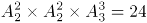种方法。

故正确答案为B。

**考点**：相邻问题

**来源**：2018年贵州省选调高校优秀毕业生到基层工作考试《行测》试题（网友回忆版）第56题

### 第 57 题

现有一种浓度为15%的盐水30千克，如果用50千克浓度更高的盐水和它混合，混合后的盐水浓度将大于20%，而小于35%。据此可知，后加入的盐水的浓度（假设浓度为x）范围是：

A. 23%<x<47%

B. 15%<x<35%

C. 15%<x<23%

D. 23%<x<50%

第 57 题 · 答案与解析

**参考答案（粉笔题库参考内容）**

A

**解析**

根据题意及溶液混合前后溶质（盐）质量不变可得：，整理得，解得：23%<x<47%。

故正确答案为A。

**考点**：两溶液混合

**来源**：2018年贵州省选调高校优秀毕业生到基层工作考试《行测》试题（网友回忆版）第57题

### 第 58 题

在一个不透明的布袋中，有红色、黑色、白色的小球共60个。小明通过足够多次摸球试验后发现其中摸到红色球、黑色球的概率分别为15%、40%。那么，口袋中白色球的个数最可能是：

A. 25

B. 26

C. 27

D. 29

第 58 题 · 答案与解析

**参考答案（粉笔题库参考内容）**

C

**解析**

根据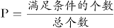，可知红色球的个数=总数×15%=60×15%=9个，黑色球的个数=总数×40%=60×40%=24个，则白色球的个数=60-9-24=27个。

故正确答案为C。

**考点**：概率问题-其他

**来源**：2018年贵州省选调高校优秀毕业生到基层工作考试《行测》试题（网友回忆版）第58题

### 第 59 题

小波通过往圆圈里投掷米粒（米粒本身长度不计，视为一个点）的方式决定自己的周末活动。经过试验，他将米粒投进圆圈内的成功率达到100%，但投掷在圆内的位置随机。如果米粒到圆心的距离大于圆半径的一半，那么他周末去看电影；若米粒到圆心的距离小于半径的1/4，他会去打篮球；否则，他将在家看书。据此可知小波周末不在家看书的概率为：

A. 13/16

B. 2/5

C. 3/5

D. 1/16

第 59 题 · 答案与解析

**参考答案（粉笔题库参考内容）**

A

**解析**

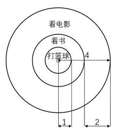

因题目中圆的半径均为比例关系，且最终所求概率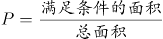，也为比例，故可设圆圈半径为4，则。如图所示：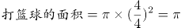；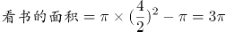，则小波周末不在家看书的概率。

故正确答案为A。

**考点**：几何公式类-平面图形、概率问题-其他

**来源**：2018年贵州省选调高校优秀毕业生到基层工作考试《行测》试题（网友回忆版）第65题

### 第 60 题

小张家养了一只大狗和一只小狗。现在，小狗的体重只有大狗的一半。如果两只狗的体重各增加5千克，那么小狗的体重将达到大狗的60%。据此可知，若两只狗的体重各增加10千克，小狗、大狗的体重比将会是：

A. 1:2

B. 2:3

C. 3:4

D. 4:5

第 60 题 · 答案与解析

**参考答案（粉笔题库参考内容）**

B

**解析**

设小狗的体重为x千克，则大狗的体重为2x千克。根据“两只狗的体重各增加5千克，那么小狗的体重将达到大狗的60%”，则有，解得x=10，则大狗的体重为20千克。此时各增加10千克，则小狗、大狗的体重分别为10+10=20千克、20+10=30千克，则小狗、大狗的体重比为20:30=2:3。

故正确答案为B。

**考点**：和差倍比问题

**来源**：2018年贵州省选调高校优秀毕业生到基层工作考试《行测》试题（网友回忆版）第59题

### 第 61 题

某公司有员工100人从事某产品的生产。现在，公司决定从这些员工中分流一些去生产新产品。分流后，继续从事老产品生产的员工平均每人每年创造产值在原有的基础上最多可增长1.2倍。若要保证老产品的年产值不减少，则最多能分流的人数是：

A. 15人

B. 16人

C. 53人

D. 54人

第 61 题 · 答案与解析

**参考答案（粉笔题库参考内容）**

D

**解析**

根据题意，公司共有100人从事生产，假设每人每年的产值为1，则总产值为100。分流后每位员工创造产值最多可增长1.2倍，即最多为。若要保证老产品的年产值不减少，则，，即最少要有46人从事老产品的生产，因此最多分流100-46=54人。

故正确答案为D。

**考点**：非典型最值问题

**来源**：2018年贵州省选调高校优秀毕业生到基层工作考试《行测》试题（网友回忆版）第63题

### 第 62 题

A、B两种规格的产品需要在甲、乙两台机器上各自加工一道工序才能成为成品。已知A产品需要在甲机器上加工3小时，在乙机器上加工1小时；B产品需要在甲机器上加工1小时，在乙机器上加工3小时。在一个工作日内，甲机器至多只能使用11小时，乙机器至多只能使用9小时。A产品每件利润300元，B产品每件利润400元。据此可知，若这两台机器只加工A、B这两种产品，那么它们在一个工作日内能创造的最大利润为：

A. 1600元

B. 1700元

C. 1800元

D. 2000元

第 62 题 · 答案与解析

**参考答案（粉笔题库参考内容）**

B

**解析**

设生产x件A产品，生产y件B产品。根据两台机器都有最大使用时间，则有

3x+y≤11……①

x+3y≤9……②

要想利润最多，则要300x+400y尽可能的大。x、y均为整数，考虑代入，x最大值为3，最小值为0：

x=3时，要满足①②两式，y最大为2，此时利润300x+400y=900+800=1700元；

x=2时，要满足①②两式，y最大为2，此时利润300x+400y=600+800=1400元＜1700元；

x=1时，要满足①②两式，y最大为2，此时利润300x+400y=300+800=1100元＜1700元；

x=0时，要满足①②两式，y最大为3，此时利润300x+400y=1200元＜1700元；

所以当x=3，y=2时，利润最大，为1700元。

故正确答案为B。

**考点**：非典型最值问题、经济利润问题

**来源**：2018年贵州省选调高校优秀毕业生到基层工作考试《行测》试题（网友回忆版）第60题

### 第 63 题

某公司将在本周一至周日连续七天举办联谊会，某员工随机地选择其中的连续两天参加联谊会，那么他在周五至周日期间连续两天参加联谊会的概率为：

A. 1/2

B. 1/3

C. 1/4

D. 1/6

第 63 题 · 答案与解析

**参考答案（粉笔题库参考内容）**

B

**解析**

满足“周五至周日期间连续两天参加联谊会”的情况数为2种，即周五周六、周六周日参加联谊会；总情况数为在本周一至周日连续七天内选择连续两天参加联谊会，有6种情况（即周一周二、周二周三、周三周四、周四周五、周五周六、周六周日6种情况）。故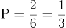。

故正确答案为B。

**考点**：给情况求概率

**来源**：2018年贵州省选调高校优秀毕业生到基层工作考试《行测》试题（网友回忆版）第61题

### 第 64 题

有一项测验由20道单选题组成，每道题有A、B、C、D四个选项。回答正确1道题得2分，回答错误1道题倒扣1分。若20道题全部选择A，得分将为-5分；若全部选B，得分将为4分；若全部选C，得分将为1分。那么该项测验中正确答案为D项的题目有多少道？

A. 0

B. 2

C. 3

D. 4

第 64 题 · 答案与解析

**参考答案（粉笔题库参考内容）**

A

**解析**

设正确答案为A项、B项、C项和D项的题量分别为a道、b道、c道和d道。根据题意可得方程组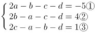，①+②+③,解得-3d=0，则d=0。

故正确答案为A。

**考点**：不定方程组

**来源**：2018年贵州省选调高校优秀毕业生到基层工作考试《行测》试题（网友回忆版）第62题

### 第 65 题

某市地铁1号线、2号线均是早上6点首发，分别间隔4分钟、6分钟发一次车。小李每天上班的路线及所需时间为：早上从家步行5分钟到达地铁1号线A站乘车（列车从1号线起点到A站需行驶15分钟），15分钟后到达B站，随后步行4分钟抵达2号线的起点站C，然后换乘2号线，20分钟后到D站，最后步行6分钟到达公司。据此，小李在保证9点能到达公司的前提下，早上最迟离家时间是：

A. 8:10

B. 8:08

C. 8:06

D. 8:04

第 65 题 · 答案与解析

**参考答案（粉笔题库参考内容）**

C

**解析**

题目复杂，考虑代入。题目问最迟离家时间，从A选项开始代入：

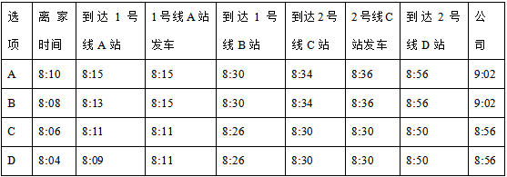

表中1号线的发车时间是根据6点首发、发车间隔为4分钟，以及运行到站需要15分钟计算所得；同理，表中2号线的发车时间是根据6点首发且发车间隔为6分钟计算所得。问题为最迟离家时间，对应C项。

故正确答案为C。

**考点**：统筹规划问题

**来源**：2018年贵州省选调高校优秀毕业生到基层工作考试《行测》试题（网友回忆版）第64题

### 第 66 题

请从所给四个选项中选择一个最合适的选项填入问号处，使之呈现一定规律性：

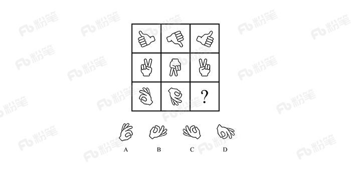

A. A

B. B

C. C

D. D

第 66 题 · 答案与解析

**参考答案（粉笔题库参考内容）**

A

**解析**

元素组成相同，优先考虑位置规律。九宫格优先看横行，第一行图1旋转180°得到图2，图2上下翻转得到图3。第二行验证规律，图1旋转180°得到图2，图2上下翻转得到图3，规律成立。则第三行应用此规律，图2由图1旋转180°得到，故？处图形由图2上下翻转得到，只有A项符合。

故正确答案为A。

**考点**：位置规律-综合

**来源**：2018年贵州省选调高校优秀毕业生到基层工作考试《行测》试题（网友回忆版）第66题

### 第 67 题

下列选项中，可以由题干图形拼凑而成的是：

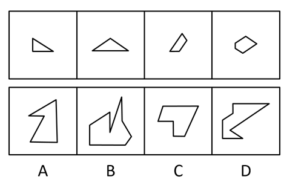

A. A

B. B

C. C

D. D

第 67 题 · 答案与解析

**参考答案（粉笔题库参考内容）**

D

**解析**

本题考查平面拼合，注意本题图形可以旋转拼成（如果不发生旋转，无法得到任何一个选项中的图形，因此本题需要旋转拼合）。可采用平行等长相消的方式解题：消除平行等长的线段后进行组合即可得到轮廓图，即为D项，如下图所示：

故正确答案为D。

**来源**：2018年贵州省选调高校优秀毕业生到基层工作考试《行测》试题（网友回忆版）第69题

### 第 68 题

下列选项中，和题干所给图形是同一个的是：

A. A

B. B

C. C

D. D

第 68 题 · 答案与解析

**参考答案（粉笔题库参考内容）**

B

**解析**

将题干展开图标上序号，如下图所示，逐一进行分析。

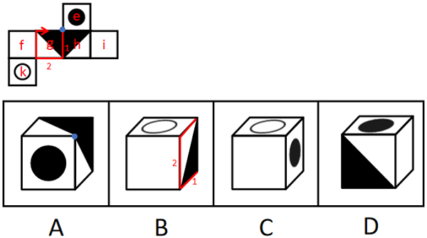

A项：选项由面e、面g、面h构成，展开图中面e与面g、面h的公共边均为黑色三角形的直角边，选项中面e与面g、面h的公共边为白色三角形的直角边，选项与题干展开图不一致，排除；

B项：选项由面k、面h、面i构成，选项与题干展开图一致，当选；

C项：选项中顶面是面k，侧面是面e，由于面k与面e为相对面，相对面不能同时出现，选项与题干展开图不一致，排除；

D项：选项中顶面是面e，正面是面g或面h，侧面是面f或面i。展开图中面e与面g、面h的公共边均为黑色三角形的直角边，选项中面e与面g或面h的公共边为白色三角形的直角边，选项与题干展开图不一致，排除。

故正确答案为B。

**考点**：空间类-空间重构-六面体

**来源**：2018年贵州省选调高校优秀毕业生到基层工作考试《行测》试题（网友回忆版）第68题

### 第 69 题

从所给四个选项中，选择最适合的一个填入问号处，使之呈现一定的规律性：

A. 形

B. 94

C. 田

D. XY

第 69 题 · 答案与解析

**参考答案（粉笔题库参考内容）**

A

**解析**

元素组成不同，且无明显属性规律，考虑数量规律。观察发现，图3、图5出现简单汉字，优先考虑笔画数。题干六幅图的笔画数依次为1、2、3、4、5、6，因此？处应选择一个7笔画图形，A项7笔画，B项2笔画，C项5笔画，D项4笔画，只有A项符合。

故正确答案为A。

**考点**：数量规律-线、文字/字母/数字类

**来源**：2018年贵州省选调高校优秀毕业生到基层工作考试《行测》试题（网友回忆版）第70题

### 第 70 题

从所给四个选项中，选择最合适的一个填入问号处，使之呈现一定的规律性：

A. A

B. B

C. C

D. D

第 70 题 · 答案与解析

**参考答案（粉笔题库参考内容）**

C

**解析**

题干图形中黑白块比较明显，考虑黑白运算，但整体进行黑白运算无规律。观察题干图形发现，第一行中，第一幅图到第二幅图右上角增加一个灰色方块，第二幅图到第三幅图左上角增加一个灰色方块；第二行中每幅图的左下角均出现了浅灰条纹方块，灰色方块的变化规律同第一行图形，对第三行图形应用此规律，则问号处图形的左上角应为浅灰方块与浅灰条纹方块的叠加，C项图形的左上角为深灰条纹方块，符合题意。

故正确答案为C。

**考点**：黑白块类、数量规律-素

**来源**：2018年贵州省选调高校优秀毕业生到基层工作考试《行测》试题（网友回忆版）第67题

### 第 71 题

比德，是指将自然物的某些特征比附于人们的某种道德情操，使自然物的自然属性人格化，人的道德品性客观化，其实质是认为自然美美在它所比附的道德伦理品格。

根据以上定义，下列**没有**包含“比德”自然审美观的是：

A. 人们总是把风儿比作叹息，那么秋天一定是最多愁善感、小性恼人的姑娘，她不可琢磨，难以讨好

B. 画家郑板桥以“咬定青山不放松，立根原在破岩中。千磨万击还坚劲，任尔东南西北风”赞美岩竹的坚韧顽强，隐喻自己藐视俗见的刚劲风骨

C. 作者在某小说中称赞生性淡泊、安分守己的少妇“宛如冬梅，风知素韵，霜晓寒姿”

D. 知者达于事理而周流无滞，有似于水，故知者乐水；仁者安于义理而厚重不迁，有似于山，故仁者乐山

第 71 题 · 答案与解析

**参考答案（粉笔题库参考内容）**

A

**解析**

第一步：找出定义关键词。

“将自然物的某些特征比附于人们的某种道德情操”。

第二步：逐一分析选项。

A项：将秋天比作多愁善感、小性恼人的小姑娘，而多愁善感、小性恼人并不是道德情操，不符合“将自然物的某些特征比附于人们的某种道德情操”，不符合定义，当选；

B项：将岩竹的坚韧顽强比作郑板桥藐视俗见的刚劲风骨，符合“将自然物的某些特征比附于人们的某种道德情操”，符合定义，排除；

C项：将冬梅的风韵姿态比作生性淡薄、安分守己的少妇，符合“将自然物的某些特征比附于人们的某种道德情操”，符合定义，排除；

D项：将循环流转、永不停滞的水比作聪慧敏捷的智者，将永恒不变的大山比作宽厚仁德的仁者，符合“将自然物的某些特征比附于人们的某种道德情操”，符合定义，排除。

本题为选非题，故正确答案为A。

**考点**：单定义-其他句式

**来源**：2018年贵州省选调高校优秀毕业生到基层工作考试《行测》试题（网友回忆版）第71题

### 第 72 题

生物识别技术，即通过计算机与光学、声学、生物传感器和生物统计学原理等高科技手段密切结合，利用人体固有的生理特征（如指静脉、人脸、虹膜、指纹等）和行为特征（如笔迹、声音、步态等）来进行个人身份的鉴定。

根据上述定义，下列最可能运用了生物识别技术的是：

A. 受害者在旁听了嫌疑人的数码电话录音后，确定了他就是当时的袭击者

B. 警方在犯罪现场找到一张外卖送货小票，通过查询网上外卖订购系统信息，锁定了几个犯罪嫌疑人

C. 某涉密场所设置了严格的门禁，人们只有在密码输入正确且在电阻屏上手写出具有进入权限的工作人员姓名后才能进入

D. 某公司为考核员工出勤情况，引进了指纹打卡机，员工上班时必须输入指纹报到

第 72 题 · 答案与解析

**参考答案（粉笔题库参考内容）**

D

**解析**

第一步：找出定义关键词。

“通过计算机与高科技手段密切结合”、“利用人体固有的生理特征（如指静脉、人脸、虹膜、指纹等）和行为特征（如笔迹、声音、步态等）”、“进行个人身份的鉴定”。

第二步：逐一分析选项。

A项：通过数码电话录音鉴定身份，不符合“通过计算机与高科技手段密切结合”，不符合定义，排除；

B项：警方通过查询网上外卖订购系统信息，锁定嫌疑人，不符合“利用人体固有的生理特征和行为特征”，不符合定义，排除；

C项：通过输入密码和手写具有权限的人员姓名鉴定身份，不符合“利用人体固有的生理特征和行为特征”，不符合定义，排除；

D项：通过指纹打卡机鉴定身份，符合“通过计算机与高科技手段密切结合”、“利用人体固有的生理特征（指纹）”、“进行个人身份的鉴定”，符合定义，当选。

故正确答案为D。

**考点**：方式目的

**来源**：2018年贵州省选调高校优秀毕业生到基层工作考试《行测》试题（网友回忆版）第72题

### 第 73 题

健康教育是为促进人们自发地、自觉地接受并采取有益于健康的行为与生活方式，根除或者减少对健康有影响的危险因素，预防疾病并达到促进身心健康和提高生活质量的目标而开展的有组织、有计划的系统的社会教育活动。

根据上述定义，下列属于健康教育的是：

A. 某公司在乡下举办健康知识讲座，并以此为机会向老人们推销保健品

B. 某高校开设的一门“心理健康”选修课非常受同学们欢迎，甚至附近的市民都来蹭课

C. 周日某医院组织医务人员在小区广场举行义诊活动，免费为居民提供测血压、量体温以及医疗咨询等服务

D. 为防范入秋以来老年人心脑血管疾病高发的现象，社区每年9月份都会聘请知名专家针对老年居民举行系列讲座，普及相关医疗知识

第 73 题 · 答案与解析

**参考答案（粉笔题库参考内容）**

D

**解析**

第一步：找出定义关键词。

“为促进人们自发地、自觉地接受并采取有益于健康的行为与生活方式”、“根除或者减少对健康有影响的危险因素”、“开展社会教育活动”。

第二步：逐一分析选项。

A项：某公司举办健康知识讲座是为了推销保健品，不符合“为促进人们自发地、自觉地接受并采取有益于健康的行为与生活方式”，不符合定义，排除；

B项：某高校开设的选修课，不符合“开展社会教育活动”，不符合定义，排除；

C项：某医院举行义诊活动，免费为居民提供服务，不符合“开展社会教育活动”，不符合定义，排除；

D项：为防范老年人心脑血管疾病高发的现象，符合“根除或者减少对健康有影响的危险因素”，社区举行讲座，普及医疗知识符合“为促进人们自发地、自觉地接受并采取有益于健康的行为与生活方式”以及“开展社会教育活动”，符合定义，当选。

故正确答案为D。

**考点**：方式目的

**来源**：2018年贵州省选调高校优秀毕业生到基层工作考试《行测》试题（网友回忆版）第73题

### 第 74 题

形象联想记忆法是把所需要记忆的材料同某些具体的事物、数字、字母、汉字或几何图形等联系起来，借助形象思维加以记忆。形象联想既有利于激发兴趣，调动学习的积极性，又有利于加深记忆。

根据上述定义，下列**没有**运用形象联想记忆法的是：

A. 新疆的地形特征“三山夹两盆”可与“疆”的右半部分联系起来：“三横”表示三山，“两田”表示两大盆地

B. 号称“时尚女鞋之国”的意大利，它的轮廓就像一只高跟靴子

C. 海参，长得就像黄瓜（cucumber），又长在海里（sea），所以它叫“sea cucumber”

D. 篮球界的迈克尔·乔丹、音乐界的迈克尔·杰克逊、赛车界的迈克尔·舒马赫······记住，这些牛人都叫“迈克尔”

第 74 题 · 答案与解析

**参考答案（粉笔题库参考内容）**

D

**解析**

第一步：找出定义关键词。

“需要记忆的材料同具体的事物、数字、字母、汉字或几何图形等联系起来”、“借助形象思维加以记忆”。

第二步：逐一分析选项。

A项：新疆的地形特征“三山夹两盆”是需要记忆的材料，与“疆”的右半部分联系起来记忆，符合“同具体的汉字联系起来”、“借助形象思维加以记忆”，符合定义，排除；

B项：意大利为“时尚女鞋之国”是需要记忆的材料，轮廓像“高跟鞋”，符合“同具体的几何图形联系起来”、“借助形象思维加以记忆”，符合定义，排除；

C项：“海参”的英文表述（sea cucumber）是需要记忆的材料，长得像黄瓜（cucumber），符合“同具体的事物联系起来”、“借助形象思维加以记忆”，符合定义，排除；

D项：篮球界、音乐界、赛车界······的这些牛人都叫“迈克尔”是需要记忆的材料，但没有体现“同具体的事物、数字、字母、汉字或几何图形等联系起来”，不符合定义，当选。

本题为选非题，故正确答案为D。

**考点**：拆词

**来源**：2018年贵州省选调高校优秀毕业生到基层工作考试《行测》试题（网友回忆版）第74题

### 第 75 题

甜柠檬效应就是个体在追求预期目标失败时，为了冲淡自己内心的不安，就百般提高现已实现的目标的价值，从而达到心理平衡的现象。

根据上述定义，下列属于“甜柠檬效应”的是：

A. 小明本来想买一台笔记本电脑，结果却在导购员的劝说下购买了平板电脑，使用后他很满意，并一直向朋友推荐

B. 这几周，小红为自己的销售业绩不断下滑而苦恼；但当她知道自己仍是公司的销售状元时，变得放心多了

C. 小文的数学成绩又让他的辅导老师失望了，老师最后只能用“比起上一次，还是有进步”来安慰自己

D. 据教练估计，小张需要减肥到60千克才能达到他想要的健身效果，可是小张在减到63千克时就放弃了，因为他觉得自己足够健美了

第 75 题 · 答案与解析

**参考答案（粉笔题库参考内容）**

C

**解析**

第一步：找出定义关键词。

“个体追求预期目标失败”、“为了冲淡自己内心的不安”、“百般提高现已实现的目标的价值”、“达到心理平衡”。

第二步：逐一分析选项。

A项：小明本来想买电脑最后买了平板电脑，没有实现预期目标，但是使用后很满意，不符合“为了冲淡自己内心的不安”、“百般提高现已实现的目标的价值”，不符合定义，排除；

B项：小红为销售业绩下滑而苦恼符合“个人追求预期目标失败”，但小红为销售状元是客观事实，不符合“为了冲淡自己内心的不安”、“百般提高现已实现的目标的价值”，不符合定义，排除；

C项：小文数学成绩让辅导老师失望，老师对小文的成绩的心理预期没有达到，符合“个体追求预期目标失败”，老师最后只能安慰自己小文比上一次进步了，符合“百般提高现已实现的目标的价值”，符合定义，当选；

D项：减肥到60千克才能达到效果是教练提出的目标，小张在63千克时放弃了，是小张自己主动放弃了，并不符合追求个人目标失败，不符合定义，排除。

故正确答案为C。

**考点**：方式目的

**来源**：2018年福建省选调生考试《行政职业能力测验》第66题

### 第 76 题

建筑∶房屋∶房间

A. 汽车∶越野车∶车窗

B. 电器∶电视机∶屏幕

C. 医院∶私立医院∶医生

D. 餐具∶盘子∶筷子

第 76 题 · 答案与解析

**参考答案（粉笔题库参考内容）**

B

**解析**

第一步：判断题干词语间逻辑关系。

房屋是一种建筑，二者是种属关系，房间是房屋的组成部分，二者是组成关系，且房屋通过房间体现作用。

第二步：判断选项词语间逻辑关系。

A项：越野车是汽车的一种，二者是种属关系，车窗是越野车的组成部分，二者是组成关系，但越野车并不是通过车窗体现作用，与题干逻辑关系不一致，排除；

B项：电视机是一种电器，二者是种属关系，屏幕是电视机的组成部分，二者是组成关系，且电视通过屏幕体现作用，与题干逻辑关系一致，当选；

C项：私立医院是一种医院，二者是种属关系，但医生与私立医院是职业与工作地点的对应关系，与题干逻辑关系不一致，排除；

D项：盘子是一种餐具，二者是种属关系，但筷子和盘子都是餐具，二者是并列关系，与题干逻辑关系不一致，排除。

故正确答案为B。

**考点**：逻辑关系-包容关系

**来源**：2018年贵州省选调高校优秀毕业生到基层工作考试《行测》试题（网友回忆版）第76题

### 第 77 题

蜘蛛∶织网∶爬行

A. 蚕∶破蛹∶吐丝

B. 蜜蜂∶酿蜜∶飞行

C. 夜莺∶筑巢∶歌唱

D. 猎豹∶奔跑∶捕食

第 77 题 · 答案与解析

**参考答案（粉笔题库参考内容）**

B

**解析**

第一步：判断题干词语间逻辑关系。

“蜘蛛”“织网”为主谓宾结构，“蜘蛛”“爬行”为主谓结构。

第二步：判断选项词语间逻辑关系。

A项：“蚕”“破蛹”为主谓宾结构，“蚕”“吐丝”也为主谓宾结构，与题干逻辑关系不一致，排除；

B项：“蜜蜂”“酿蜜”为主谓宾结构，“蜜蜂”“飞行”为主谓结构，与题干逻辑关系一致，当选；

C项：“夜莺”“筑巢”为主谓宾结构，“夜莺”“歌唱”为主谓结构，但“歌唱”是一种拟人化的表述，并非“夜莺”的生物学行为，与题干逻辑关系不一致，排除；

D项：“猎豹”“奔跑”为主谓结构，与题干逻辑关系不一致，排除。

故正确答案为B。

**考点**：语法关系

**来源**：2018年贵州省选调高校优秀毕业生到基层工作考试《行测》试题（网友回忆版）第77题

### 第 78 题

碗∶水杯

A. 玻璃∶书包

B. 光∶蜡烛

C. 沙发∶床

D. 电脑∶娱乐

第 78 题 · 答案与解析

**参考答案（粉笔题库参考内容）**

C

**解析**

第一步：判断题干词语间逻辑关系。

碗和水杯都是用来盛放东西的器具，二者为并列关系。

第二步：判断选项词语间逻辑关系。

A项：玻璃和书包没有必然的逻辑关系，与题干逻辑关系不一致，排除；

B项：蜡烛可以发出光，二者为功能对应关系，与题干逻辑关系不一致，排除；

C项：沙发和床都是可以供人休息的家具，二者为并列关系，与题干逻辑关系一致，当选；

D项：电脑可以用来娱乐，二者为功能对应关系，与题干逻辑关系不一致，排除。

故正确答案为C。

**考点**：逻辑关系-并列关系

**来源**：2018年贵州省选调高校优秀毕业生到基层工作考试《行测》试题（网友回忆版）第85题

### 第 79 题

勤奋∶学习∶进步

A. 艰苦∶创业∶失败

B. 努力∶工作∶成功

C. 喝酒∶驾车∶车祸

D. 鲁莽∶说话∶厌恶

第 79 题 · 答案与解析

**参考答案（粉笔题库参考内容）**

B

**解析**

第一步：判断题干词语间逻辑关系。

勤奋的学习可能会带来进步，勤奋用来修饰学习，进步是积极的结果。

第二步：判断选项词语间逻辑关系。

A项：艰苦的创业可能会带来失败，艰苦用来修饰创业，但是失败是消极的结果，与题干逻辑关系不一致，排除；

B项：努力工作可能会带来成功，努力用来修饰工作，成功是积极的结果，与题干逻辑关系一致，当选；

C项：喝酒后驾车可能会带来车祸，喝酒和驾车是两个不同的动作，喝酒不能用来修饰驾车，与题干逻辑关系不一致，排除；

D项：鲁莽的说话可能会让人厌恶，鲁莽用来修饰说话，厌恶是消极的结果，与题干逻辑关系不一致，排除。

故正确答案为B。

**考点**：逻辑关系-对应关系、语法关系

**来源**：2018年贵州省选调高校优秀毕业生到基层工作考试《行测》试题（网友回忆版）第78题

### 第 80 题

左顾右盼∶上下打量

A. 南来北往∶东西奔走

B. 纵横交错∶中西合璧

C. 千叮万嘱∶一心一意

D. 天高地厚∶山清水秀

第 80 题 · 答案与解析

**参考答案（粉笔题库参考内容）**

A

**解析**

第一步：判断题干词语间逻辑关系。

左顾右盼指左右来回看；上下打量指上下看，二者都有看的意思，是近义关系，并且左顾右盼中的“左右”是反义关系，上下打量中的“上下”是反义关系。

第二步：判断选项词语间逻辑关系。

A项：南来北往指南北方向来回奔走；东西奔走指东西方向来回奔走，二者都有到处奔走的意思，是近义关系，并且南来北往中的“南北”是反义关系，东西奔走中的“东西”是反义关系，与题干逻辑关系一致，当选；

B项：纵横交错指横的竖的交叉在一起；中西合璧指中国和外国的好东西和建筑、名胜合到一块，二者不是近义关系，与题干逻辑关系不一致，排除；

C项：千叮万嘱指再三叮嘱；一心一意指做事专心，一门心思只做一件事，二者不是近义关系，与题干逻辑关系不一致，排除；

D项：天高地厚指恩情深厚，也指事物的复杂、深奥程度；山清水秀指山水风景优美，二者不是近义关系，与题干逻辑关系不一致，排除。

故正确答案为A。

**考点**：语义关系-近义关系

**来源**：2018年贵州省选调高校优秀毕业生到基层工作考试《行测》试题（网友回忆版）第79题

### 第 81 题

拖鞋∶皮鞋∶场合

A. 药物∶手术∶病情

B. 川菜∶凉菜∶味道

C. 跑步∶踢球∶体力

D. 茶水∶咖啡∶爱好

第 81 题 · 答案与解析

**参考答案（粉笔题库参考内容）**

A

**解析**

第一步：判断题干词语间逻辑关系。

拖鞋和皮鞋都是鞋子的一种，二者是并列关系，且不同的场合选择的鞋子不同。

第二步：判断选项词语间逻辑关系。

A项：药物和手术都是治疗方式的一种，二者是并列关系，且不同的病情选择的治疗方式不同，与题干逻辑关系一致，保留；

B项：川菜和凉菜是交叉关系，且无法按照不同的味道选择，与题干逻辑关系不一致，排除；

C项：跑步和踢球都是运动方式的一种，二者是并列关系，但无法按照不同的体力来选择，与题干逻辑关系不一致，排除；

D项：茶水和咖啡都是饮品的一种，二者是并列关系，根据不同的爱好可以选择喝茶水和喝咖啡，与题干逻辑关系一致，保留。

对比A项和D项，场合和病情是客观的，而爱好是主观的，故A项与题干逻辑关系更近。

故正确答案为A。

注：拖鞋和皮鞋也可以看作交叉关系，与B项中川菜和凉菜的逻辑关系相同，但B项无法按照不同的味道选择川菜和凉菜，与题干逻辑关系不一致，所以不能选B项。

**考点**：逻辑关系-并列关系、逻辑关系-对应关系

**来源**：2018年贵州省选调高校优秀毕业生到基层工作考试《行测》试题（网友回忆版）第80题

### 第 82 题

品质∶好坏∶质量

A. 食物∶大小∶重量

B. 分数∶高低∶成绩

C. 旅游∶远近∶兴趣

D. 人口∶多少∶密度

第 82 题 · 答案与解析

**参考答案（粉笔题库参考内容）**

B

**解析**

第一步：判断题干词语间逻辑关系。

品质和质量是近义关系，且品质和质量都有好坏之分，为对应关系。

第二步：判断选项词语间逻辑关系。

A项：食物是有重量的，二者不是近义关系，与题干逻辑关系不一致，排除；

B项：分数和成绩是近义关系，且成绩和分数都有高低之分，为对应关系，与题干逻辑关系一致，当选；

C项： 旅游和兴趣不是近义关系，与题干逻辑关系不一致，排除；

D项：人口和密度不是近义关系，与题干逻辑关系不一致，排除。

故正确答案为B。

**考点**：语义关系-近义关系、逻辑关系-对应关系

**来源**：2018年贵州省选调高校优秀毕业生到基层工作考试《行测》试题（网友回忆版）第81题

### 第 83 题

网购∶上网

A. 读书∶书本

B. 喝水∶烧水

C. 练字∶写字

D. 唱歌∶歌唱

第 83 题 · 答案与解析

**参考答案（粉笔题库参考内容）**

C

**解析**

第一步：判断题干词语间逻辑关系。

网购必须要上网，上网是网购的必要条件。

第二步：判断选项词语间逻辑关系。

A项：书本是指装订成册的著作，不是读书的必要条件，比如可以看电子书，与题干逻辑关系不一致，排除；

B项：烧水不是喝水的必要条件，与题干逻辑关系不一致，排除；

C项：练字必须要写字，写字是练字的必要条件，与题干逻辑关系一致，当选；

D项：唱歌和歌唱是近义关系，与题干逻辑关系不一致，排除。

故正确答案为C。

**考点**：逻辑关系-对应关系

**来源**：2018年贵州省选调高校优秀毕业生到基层工作考试《行测》试题（网友回忆版）第82题

### 第 84 题

笔画：汉字

A. 语法：语序

B. 字：词

C. 音标：英文

D. 情绪：标点

第 84 题 · 答案与解析

**参考答案（粉笔题库参考内容）**

B

**解析**

第一步：判断题干词语间逻辑关系。

汉字是由笔画组成的，二者是组成关系。

第二步：判断选项词语间逻辑关系。

A项：“语法”决定“语序”，二者为对应关系，与题干逻辑关系不一致，排除；

B项：词是由字组成的，二者是组成关系，与题干逻辑关系一致，当选；

C项：英文根据音标来发音，二者为依据的对应关系，与题干逻辑关系不一致，排除；

D项：有的标点可以用来表达情绪，如感叹号，问号等，与题干逻辑关系不一致，排除。

故正确答案为B。

**考点**：逻辑关系-包容关系

**来源**：2018年贵州省选调高校优秀毕业生到基层工作考试《行测》试题（网友回忆版）第83题

### 第 85 题

领悟：大彻大悟

A. 哭泣：放声痛哭

B. 微笑：哈哈大笑

C. 昏迷：昏天暗地

D. 喝酒：纸醉金迷

第 85 题 · 答案与解析

**参考答案（粉笔题库参考内容）**

A

**解析**

第一步：判断题干词语间逻辑关系。

大彻大悟有领悟的意思，且大彻大悟是一种极致的领悟。

第二步：判断选项词间逻辑关系。

A项：放声痛哭具有哭泣的意思，且放声痛哭是一种极致的哭泣，与题干逻辑关系一致，当选；

B项：哈哈大笑就是大声笑，微笑是不显著的笑容，哈哈大笑不包含微笑的意思，且哈哈大笑不是一种极致的微笑，而是一种极致的笑，与题干逻辑关系不一致，排除；

C项：昏天暗地形容天色昏暗，也比喻社会黑暗混乱，与昏迷无明显逻辑关系，与题干逻辑关系不一致，排除；

D项：纸醉金迷形容叫人沉迷的奢侈豪华的环境，与喝酒无明显逻辑关系，与题干逻辑关系不一致，排除。

故正确答案为A。

**考点**：语义-其他

**来源**：2018年贵州省选调高校优秀毕业生到基层工作考试《行测》试题（网友回忆版）第84题

### 第 86 题

南极可以、应该，甚至是必须被视为“准全球公域”。通常认为，全球公域是指处于国家管辖范围以外的区域及其资源。它属于全人类共有，人人都可以使用。《南极条约》对南极领土主权问题的搁置奠定了南极作为“准全球公域”的法律基础，而“开放”“和平”“科研自由”等规定，实际上赋予了南极公域的性质。“南极应只用于和平目的”这一规定，使得南极地区成为冷战期间一块难得的净土：避免遭受战争摧残，而且成功实现了无核化。

以下各项如果为真，最能支持上述论点的是：

A. 南极大陆蕴藏着丰富的生物资源、水资源，市场潜能巨大

B. 南极治理的主导权长期掌握在少数科技发达的西方国家手中

C. 美国组建了南极支援特遣队，常驻新西兰负责空军的南极飞行行动

D. 若南极冰盖消融，海平面将上升57米，这直接关系到人类的共同命运

第 86 题 · 答案与解析

**参考答案（粉笔题库参考内容）**

D

**解析**

第一步：找出论点和论据。

论点：南极可以、应该，甚至是必须被视为“准全球公域”。

论据：“南极应只用于和平目的”这一规定，使得南极地区成为冷战期间一块难得的净土：避免遭受战争摧残，而且成功实现了无核化。

论点和论据讨论的均为南极是“准全球公域”，二者话题一致，加强优先考虑补充论据。

第二步：逐一分析选项。

A项：论点说的是南极应该被视为“准全球公域”，该项说的是南极大陆蕴藏着丰富的资源，话题不一致，无关选项，无法加强，排除；

B项：南极治理的主导权长期掌握在少数发达的西方国家手中，说明南极不是“准全球公域”，无法加强，排除；

C项：论点说的是南极应该被视为“准全球公域”，该项说的是美国组建了南极支援特遣队，话题不一致，无关选项，无法加强，排除；

D项：因为南极冰盖消融直接关系到人类的共同命运，所以应该是全人类共有，被视为“准全球公域”，补充论据加强，当选。

故正确答案为D。

**考点**：补充论据

**来源**：2018年贵州省选调高校优秀毕业生到基层工作考试《行测》试题（网友回忆版）第94题

### 第 87 题

某单位需选派人员参加对口扶贫工作。已知：如果小李不参加，那么就小马参加；如果小马不参加，那么小李也不参加；要么小马参加，要么小李参加。

下面各项中，符合要求的是：

A. 小马参加对口扶贫

B. 小李参加对口扶贫

C. 小马、小李都参加对口扶贫

D. 小马、小李都不参加对口扶贫

第 87 题 · 答案与解析

**参考答案（粉笔题库参考内容）**

A

**解析**

第一步：翻译题干。

①-小李→小马；

②-小马→-小李；

③要么小马，要么小李；

将②逆否可以推出④：小李→小马。

第二步：逐一分析选项。

根据①和④，无论小李是否参加，小马都会参加，再根据③可知，小马和小李只有一个参加，那么小李不参加，A项可以推出。

故正确答案为A。

**考点**：常规翻译

**来源**：2018年贵州省选调高校优秀毕业生到基层工作考试《行测》试题（网友回忆版）第86题

### 第 88 题

行驶超过60万千米的汽车都应当报废处理；有些行驶超过60万千米的汽车存在设计缺陷；在应当报废的汽车中有些不是T品牌汽车；所有T品牌汽车都不存在设计缺陷。

如果以上判断正确，则必定成立的是：

A. 有些T品牌汽车应当报废

B. 有些T品牌汽车不应当报废

C. 应当报废的汽车都行驶超过60万千米

D. 有些存在设计缺陷的汽车应当报废

第 88 题 · 答案与解析

**参考答案（粉笔题库参考内容）**

D

**解析**

第一步：翻译题干。

①超60万千米→报废；

②有些超60万千米→设计缺陷；

③有些报废→-T品牌；

④T品牌→-设计缺陷；

将②换位可得：有些设计缺陷→超60万千米，和①可以递推出：⑤有些设计缺陷→超60万千米→报废。

第二步：逐一分析选项。

A项：翻译为有些T品牌→报废，由③“有些报废→-T品牌汽车”，推不出，排除；

B项：翻译为有些T品牌→-报废，由③“有些报废→-T品牌”无法得到“有些T品牌”的情况，推不出，排除；

C项：翻译为报废→超60万千米，是对①的肯后，但肯后得不到确定性的结论，推不出，排除；

D项：翻译为有些设计缺陷→报废，是对⑤的肯前，肯前必肯后，可以推出，当选。

故正确答案为D。

**考点**：集合推理

**来源**：2018年贵州省选调高校优秀毕业生到基层工作考试《行测》试题（网友回忆版）第87题

### 第 89 题

随着新媒体技术的发展，患者在网上寻找医生信息的情况日益增多，为此有科研人员对美国28个典型医生评价商业网站展开研究。研究报告称，近60%的人在接受调查访问时表示，在选择医生时，网上评价对他们的选择非常重要。但对这28个网站的研究显示，允许用户根据“临床状况、医生性别、所说语言、所接受的保险”等条件搜寻的网站很少。研究人员得出结论说，对这些商业性医生评价网站而言，要找到相对准确的医生定量评价颇为困难。

以下各项如果为真，最能支持上述论证的是：

A. 病人通过医生评价网站能清楚了解某位医生的治疗经验

B. 美国医生评价网站存在搜索机制繁冗且评价稀缺等问题

C. 通过调查系统性地收集数据，才更有可能积累足够的评价

D. 调查发现有三分之一的抽样医生在所有网站中都没有评价

第 89 题 · 答案与解析

**参考答案（粉笔题库参考内容）**

B

**解析**

第一步：找出论点和论据。

论点：对这些商业性医生评价网站而言，要找到相对准确的医生定量评价颇为困难。

论据：对这28个网站的研究显示，允许用户根据“临床状况、医生性别、所说语言、所接受的保险”等条件搜寻的网站很少。

论点和论据都在说在这些网站上，较难找到相对准确的医生定量评价，二者话题一致，加强优先考虑补充论据。

第二步：逐一分析选项。

A项：病人通过医生评价网站能清楚了解某位医生的治疗经验，与论点找到医生定量评价的难易程度无关，无法加强，排除；

B项：美国医生评价网站存在搜索机制繁冗且评价稀缺等问题，解释了在这些网站上，较难找到相对准确的医生定量评价的原因，解释原因，可以加强，保留；

C项：通过调查系统性地收集数据，才更有可能积累足够的评价，不明确在这些网站上，是否较难找到相对准确的医生定量评价，无法加强，排除；

D项：调查发现有三分之一的抽样医生在所有网站中都没有评价，举例说明在这些网站上，较难找到相对准确的医生定量评价，举例加强，可以加强，保留。

对比B、D两项，B项为解释原因，D项为举例加强，解释原因的力度强于举例加强，故B项更为合适。

故正确答案为B。

**考点**：补充论据

**来源**：2018年贵州省选调高校优秀毕业生到基层工作考试《行测》试题（网友回忆版）第88题

### 第 90 题

微生物组在地球生态系统和人类健康中的作用超乎想象，它不仅将极大地帮助人类克服当今所面临的生存挑战，还能提供人类未来生存之道，这其中有一个道理，就是微生物之间能够互相协作，使得它们在生态系统中更加稳定、更加有效地发挥作用，并赋予微生物组具有超越单个微生物的更为强大的功能。

以下各项如果为真，最能支持上述观点的是：

A. 美国的“国家微生物组计划”正是为了在所有的生态系统、大自然及人造世界里推动最前沿的微生物科学研究

B. 作为新兴产业的生物农药和生物肥料，近年来在蓬勃发展，其在国际上的市场份额也逐年快速递增

C. 将多种微生物一起培养，其生物系统的稳定性和适应能力都大为提高，其对某些有害化合物的降解效率也提升了

D. 酿酒微生物场所提供了多种多样的微生物资源，可以从中发掘高效纤维素降解霉菌、高乙醇合成酵母等

第 90 题 · 答案与解析

**参考答案（粉笔题库参考内容）**

C

**解析**

第一步：找出论点和论据。

论点：微生物组在地球生态系统和人类健康中的作用超乎想象。

论据：微生物组不仅将极大地帮助人类克服当今所面临的生存挑战，还能提供人类未来生存之道；微生物之间能够互相协作，使得它们在生态系统中更加稳定、更加有效地发挥作用，并赋予微生物组具有超越单个微生物的更为强大的功能。

第二步：逐一分析选项。

A项：论点说的是微生物组对地球生态系统和人类健康的作用，该项说的是美国“国家微生物组计划”的研究内容，话题不一致，无法加强，排除；

B项：论点说的是微生物组对地球生态系统和人类健康的作用，该项说的是生物农药和生物肥料的市场份额，话题不一致，无法加强，排除；

C项：多种微生物一起培养，微生物系统的稳定性和适应能力提高，对有害化合物的降解效率也会提高，指出微生物之间相互协作确实可以发挥更为强大的功能，补充论据，可以加强，当选；

D项：论点说的是微生物组对地球生态系统和人类健康的作用，该项说的是酿酒的微生物可以合成酵母，并没有涉及多种微生物是否合作，是否有更强大的功能的问题，话题不一致，无法加强，排除。

故正确答案为C。

**考点**：补充论据

**来源**：2018年贵州省选调高校优秀毕业生到基层工作考试《行测》试题（网友回忆版）第89题

### 第 91 题

水熊虫是一种小型水生动物，又称缓步动物。水熊虫是地球上已知生命力最强的生物，它可以在没有防护措施的条件下在极端压力环境中生存。缓步动物的奇特能力促使研究人员对其基因组展开调查。目前，对缓步动物的第一次基因组测序结果显示，在缓步动物演化过程中，通过水平基因转移（不同物种基因组之间的DNA转移），从其他物种中获得了大量基因。

以下各项如果为真，最能**质疑**上述观点的是：

A. 基因检测发现水熊虫体内有一种基因，其蛋白质能够抵抗人类培养细胞内的DNA损伤

B. 水熊虫可以在太空真空环境中长时间生存，在冰冻30多年之后也能成功复苏

C. 水熊虫从祖先那里继承所有基因，体内遗传物质中没有发现来自植物或者微生物的

D. 水熊虫体内遗传物质存在一种非常奇怪的“混搭”法，正是这种“混搭”才使水熊虫以更复杂的方式生长和发育

第 91 题 · 答案与解析

**参考答案（粉笔题库参考内容）**

C

**解析**

第一步：找出论点和论据。

论点：在缓步动物演化过程中，通过水平基因转移（不同物种基因组之间的DNA转移），从其他物种中获得了大量基因。

论据：无。

第二步：逐一分析选项。

A项：论点说的是水熊虫从其他物种中获得了大量基因，该项说的是水熊虫体内有一种基因，其蛋白质能够抵抗人类培养细胞内的DNA损伤，话题不一致，无法削弱，排除；

B项：论点说的是水熊虫从其他物种中获得了大量基因，该项说的是水熊虫可以在太空真空和冰冻这样的极端环境中生存，话题不一致，无法削弱，排除；

C项：水熊虫从祖先那里继承了所有的基因，体内遗传物质中没有发现来自植物或者微生物的，说明水熊虫并没有从其他物种获得大量基因，否定了论点，当选；

D项：水熊虫体内遗传物质存在“混搭”，“混搭”说明水熊虫可能从其他物种获得了大量基因，支持了论点，排除。

故正确答案为C。

**考点**：削弱论点

**来源**：2018年贵州省选调高校优秀毕业生到基层工作考试《行测》试题（网友回忆版）第95题

### 第 92 题

1880~2012年间，全球气温上升0.85℃。而气温每上升1℃，粮食产量就下降约5%。1981~2002年间，由于气候变暖，全球玉米、小麦等作物产量均每年大幅下降4000万吨。因此，为了遏制全球变暖，保证全球的粮食安全，我们必须从自身做起，节能减排，控制碳排放总量。

以下各项如果为真，**不属于**以上结论必要前提的是：

A. 玉米、小麦等作物的产量下降威胁着全球的粮食安全

B. 节能减排，控制碳排放总量对遏制全球变暖有积极影响

C. 除玉米、小麦等外的其他粮食作物没有因全球变暖而增产

D. 人类活动造成的碳排放总量增多是全球日益变暖的原因之一

第 92 题 · 答案与解析

**参考答案（粉笔题库参考内容）**

C

**解析**

第一步：找出论点和论据。

论点：为了遏制全球变暖，保证全球的粮食安全，我们必须从自身做起，节能减排，控制碳排放总量。

论据：1880~2012年间，全球气温上升0.85℃。而气温每上升1℃，粮食产量就下降约5%。1981~2002年间，由于气候变暖，全球玉米、小麦等作物产量均每年大幅下降4000万吨。

第二步：逐一分析选项。

A项：论点说的是为了遏制全球变暖、保证粮食安全要节能减排，论据说的是玉米、小麦等作物产量下降，该项说的是玉米、小麦的产量下降威胁全球粮食安全，在论点论据之间建立联系，属于搭桥项，可以加强，排除；

B项：如果节能减排、控制碳排放不能遏制全球变暖，那么论点为了遏制全球变暖要节能减排就无法成立，该项是论点成立的必要条件，排除；

C项：题干说的是全球变暖会让玉米、小麦等粮食减产，该项说的是其他粮食作物没有因全球变暖而增产，其他粮食作物不增产，并不会影响玉米、小麦等粮食减产，因此不是题干成立的必要条件，当选；

D项：如果人类活动造成的碳排放总量增多不是全球日益变暖的原因之一，那么节能减排对于遏制全球变暖是没有作用的，该项是论点成立的必要条件，排除。

本题为选非题，故正确答案为C。

**考点**：加强选非题

**来源**：2018年贵州省选调高校优秀毕业生到基层工作考试《行测》试题（网友回忆版）第90题

### 第 93 题

2017年，可以说是我国电影发展的重要一年。然而，一些电影从业者则认为：中国是电影大国，但不是电影强国。

以下各项如果为真，最**不能质疑**这些电影从业者观点的是：

A. 我国电影年产量达到近800部，位居世界前列；而全年500多亿元的总票房更是稳居全球第一

B. 我国的银幕总量、观众人次已经超过电影界长期的领头羊——北美市场，并且，观众的电影需求依旧旺盛，我国电影市场的潜力还有待挖掘

C. 判断一个国家是否是电影强国的最主要依据是其电影的全球竞争力，而国产电影的市场主要在大陆，和美国等传统电影强国差距较大，国际票房甚至低于印度

D. 中国电影业受近代中国曲折坎坷的命运的决定性影响，它发展多舛，但自2002年起，我国电影以奇迹般的发展速度迅速崛起，并预计将在未来10年内超越电影头号强国美国

第 93 题 · 答案与解析

**参考答案（粉笔题库参考内容）**

C

**解析**

第一步：找出论点和论据。

论点：中国是电影大国，但不是电影强国。

论据：无。

第二步：逐一分析选项。

A项：我国电影年产量位居世界前列，总票房稳居世界第一，指出中国在电影上取得了多项成就，说明中国属于电影强国，否定了论点，排除；

B项：我国的银幕总量、观众人次已经超过行业领头羊，说明中国在电影上取得了多项成就，属于电影强国，并且观众的需求依旧旺盛，市场的潜力还有待挖掘，说明未来还有很大的发展空间，否定了论点，排除；

C项：判断一个国家是否是电影强国的最主要依据是其全球竞争力，而国产电影和传统电影强国差距较大，国际票房较低，说明中国现在的全球竞争力并不强，不属于电影强国，加强了论点，当选；

D项：我国电影以奇迹般的速度崛起，说明我国电影发展速度很快，并且我国电影预计将在未来十年内超越电影头号强国美国，说明我国电影现在已位于电影强国之列，只不过还不是头号强国，有一定的削弱力度，排除。

本题为选非题，故正确答案为C。

**考点**：削弱选非题

**来源**：2018年贵州省选调高校优秀毕业生到基层工作考试《行测》试题（网友回忆版）第91题

### 第 94 题

最近有一位科学家提出新观点：地球板块运动开始的时间不会晚于35亿年前。他的依据是：板块运动必然会让自然界深色的镁铁质岩石转变成浅色的长英质岩石。而在35亿年前，地球已经有浅色的长英质岩石出现了。

以下各项如果为真，最能**质疑**这位专家观点的是：

A. 颜色浅的长英质岩石本质上是颜色深的镁铁质岩石“再生”而来的，而在数十亿年前，镁铁质岩石在地球上占有绝对的数量优势地位

B. 以全球各地35亿年前的沉积层样品分析，其中含有长英质岩石颗粒的不足一半

C. 长英质岩石在自然界中的占比比镁铁质岩石高出很多似乎只有板块运动这一解释，但早期的板块构造运动很可能是时断时续的，局部范围的

D. 35亿年前地球火山密布，火山爆发释放的岩浆会把镁铁质岩石深深埋在地下，这些镁铁质岩石会被熔化，进而转变成长英质岩石，但板块运动不是火山爆发的唯一原因

第 94 题 · 答案与解析

**参考答案（粉笔题库参考内容）**

D

**解析**

第一步：找出论点和论据。

论点：地球板块运动开始的时间不会晚于35亿年前。

论据：板块运动必然会让自然界深色的镁铁质岩石转变成浅色的长英质岩石，而在35亿年前，地球已经有浅色的长英质岩石出现了。

第二步：逐一分析选项。

A项：题干说的是能不能通过浅色的长英质岩石出现来判断地球板块运动开始的时间，该项说的是镁铁质岩石数量的多少，话题不一致，而且数十亿年时间也不够明确，无法削弱，排除；

B项：题干说的是能不能通过浅色的长英质岩石出现来判断地球板块运动开始的时间，该项说的是长英质岩石的颗粒在沉积层的占比多少，话题不一致，无法削弱，排除；

C项：“似乎”和“可能”说明不能确定是板块运动导致镁铁质岩石转变成长英质岩石，还是板块运动直接导致长英质岩石的占比高，而且并没有提到时间，属于不明确项，无法削弱，排除；

D项：火山爆发会把镁铁质岩石转化成长英质岩石，但板块运动不是火山爆发的唯一原因，指出镁铁质岩石转变成长英质岩石并不一定与板块运动有关，拆断了论据与论点之间的联系，是拆桥项，当选。

故正确答案为D。

**考点**：拆桥

**来源**：2018年贵州省选调高校优秀毕业生到基层工作考试《行测》试题（网友回忆版）第92题

### 第 95 题

现在有一种观点认为：随着信用卡的普及以及近年来移动支付的发展，硬币将不可避免地迅速淡出流通市场。

以下各项如果为真，最能**反驳**上述观点的是：

A. 各国的硬币都是用本土的历史、文化及风俗等特色符号铸刻的微型浮雕，其本身具有很高的收藏价值

B. 在银行储蓄卡开始兴起时，人们对硬币的命运也有过相同的预测，但硬币根本没有因此淡出流通市场

C. 硬币本身的面值不高，但是正是这种“不值钱”的特性，让它在零售等方面发挥着重要的流通作用

D. 目前，一些在生活中扮演重要角色的自动贩售机等设备仍然只支持硬币支付，并且近几年这些设备不会更新换代

第 95 题 · 答案与解析

**参考答案（粉笔题库参考内容）**

D

**解析**

第一步：找出论点和论据。

论点：随着信用卡的普及以及近年来移动支付的发展，硬币将不可避免地迅速淡出流通市场。

论据：无。

第二步：逐一分析选项。

A项：论点讨论的是硬币将迅速淡出流通市场，该项讨论的是硬币在收藏方面有价值，话题不一致，无关选项，无法削弱，排除；

B项：论点讨论的是信用卡及移动支付普及时，硬币将迅速淡出流通市场，该项讨论的是银行储蓄卡兴起时，硬币没有淡出流通市场，类比削弱，保留；

C项：论点讨论的是硬币将迅速淡出流通市场，该项讨论的是硬币具有“不值钱”的特性在零售中有重要的流通作用，但是否能被替代，最终是否会淡出流通市场并不清楚，属于不明确选项，无法削弱，排除；

D项：论点讨论的是硬币将迅速淡出流通市场，该项讨论的是生活中重要的设备仍然只支持硬币，且近几年这些设备不会更新换代，因此硬币是不能被迅速替代的，削弱论点，保留；

对比B、D项，B项类比削弱，力度最弱，D项削弱论点，力度最强，择优选D。

故正确答案为D。

**考点**：削弱论点

**来源**：2018年贵州省选调高校优秀毕业生到基层工作考试《行测》试题（网友回忆版）第93题

## 材料 1

根据以下资料，回答下列小题。

2016年，全国平均气温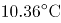，较常年平均气温偏高0.81°C，为1951年以来第三高，仅次于2015年（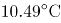）和2007年（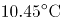）。2016年四季气温均偏高，其中夏季气温为历史最高；除1月偏低、11月接近常年同期外，其余各月均偏高，其中12月偏高2.6°C，为历史同期最高。全国31个省（区、市）中，仅黑龙江平均气温较常年偏低0.2°C，其他省（区、市）气温均偏高，其中青海、甘肃、河南和贵州4省均为1951年以来的历史最高。

2016年，全国年降水量范围为3.5毫米（新疆托克逊）～3494.4毫米（安徽黄山），全国平均降水量730.0毫米，较常年（629.9毫米）偏多16%，比2015年偏多13%，为1951年以来最多。2月和8月降水偏少，3月接近常年同期，其余各月均偏多，其中1月偏多94%，10月偏多55%，均为历史同期最多。

### 第 96 题

1951-2016年间，全国年平均气温最高的年份是：

A. 1998年

B. 2007年

C. 2015年

D. 2016年

第 96 题 · 答案与解析

**参考答案（粉笔题库参考内容）**

C

**解析**

定位文字第一段材料可知：“2016年，全国平均气温……为1951年以来第三高，仅次于2015年（）和2007年（）”，故1951-2016年间，全国年平均气温最高的年份是2015年。

故正确答案为C。

**考点**：直接找数、综合资料

**来源**：2018年贵州省选调高校优秀毕业生到基层工作考试《行测》试题（网友回忆版）第96题

### 第 97 题

2015年全国平均降水量为：

A. 730.0毫米

B. 646.0毫米

C. 629.9毫米

D. 612.6毫米

第 97 题 · 答案与解析

**参考答案（粉笔题库参考内容）**

B

**解析**

根据题干“2015年全国平均降水量为……”，结合文字材料时间为2016年，可判定本题为基期计算问题。定位文字第二段材料可知：“2016年，全国平均降水量730.0毫米……比2015年偏多13%。”故2015年全国平均降水量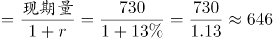毫米。

故正确答案为B。

**考点**：综合资料、基期计算

**来源**：2018年贵州省选调高校优秀毕业生到基层工作考试《行测》试题（网友回忆版）第97题

### 第 98 题

与常年同期相比，2016年降水偏少的月份是：

A. 1月和10月

B. 3月和12月

C. 2月和8月

D. 2月和10月

第 98 题 · 答案与解析

**参考答案（粉笔题库参考内容）**

C

**解析**

定位文字材料第二段可知，2016年全国年降水量，2月和8月降水偏少。

故正确答案为C。

**考点**：直接找数、综合资料

**来源**：2018年贵州省选调高校优秀毕业生到基层工作考试《行测》试题（网友回忆版）第99题

### 第 99 题

下列可由所给资料得出的数据有：

①2016年各季度气温均值

②青海、甘肃、河南和贵州4省平均气温偏高率

③2015年全国年降水范围

④2016年1月、10月月降水量之差

A. 0个

B. 1个

C. 2个

D. 3个

第 99 题 · 答案与解析

**参考答案（粉笔题库参考内容）**

A

**解析**

①：定位文字材料第一段可得，“2016年四季气温均偏高，其中夏季气温为历史最高；除1月偏低、11月接近常年同期外，其余各月均偏高，其中12月偏高2.6°C，为历史同期最高。”关于2016年各季度气温均值并无相关具体数据，故无法得出；

②：定位文字材料第一段可得，“全国31个省（区、市）······，其中青海、甘肃、河南和贵州4省均为1951年以来的历史最高”，无气温相关数据，故无法得出；

③：定位文字材料第二段可得，“2016年，全国年降水量范围为3.5毫米（新疆托克逊）～3494.4毫米（安徽黄山）”，只能得出2016年全国年降水范围，无其他相关数据，故无法得出；

④：定位文字材料第二段可得，“2月和8月降水偏少，······其中1月偏多94%、10月偏多55%，均为历史同期最高”，无2016年1月和10月降水量相关数据，故无法得出。

①②③④均无法得出。

故正确答案为A。

**考点**：综合分析、综合资料

**来源**：2018年贵州省选调高校优秀毕业生到基层工作考试《行测》试题（网友回忆版）第100题

### 第 100 题

下列能够从所给资料推出的是：

A. 2016年，青海、甘肃、河南和贵州是全国平均气温最高的省份

B. 1951～2016年，全国年均气温总体呈上升趋势

C. 1951～2016年，降水偏多的年份气温就偏低

D. 2016年全国各地年降水量差异不大

第 100 题 · 答案与解析

**参考答案（粉笔题库参考内容）**

B

**解析**

A项：定位文字材料第一段可知：“青海、甘肃、河南和贵州4省均为1951年以来的历史最高”，其平均气温为本省历史最高，并非是全国平均气温最高的省份，错误；

B项：定位第一个图形材料可知，全国年均气温总体呈上升趋势，正确；

C项：定位两个图形材料可知，2016年降水量最高，其气温也偏高，与降水偏多的年份气温就偏低矛盾，错误；

D项：定位文字材料第二段可知：“2016年，全国降水量范围为3.5毫米（新疆托克逊）-3494.4毫米（安徽黄山）”，与2016年全国各地年降水量差异不大矛盾，错误。

故正确答案为B。

**考点**：综合分析、综合资料

**来源**：河南省选调2018年优秀高校毕业生到基层工作考试（网友回忆版）第110题

## 材料 2

根据以下资料，回答以下各题。

两周就诊率被定义为每百人中两周内因病或身体不适寻求各级医疗机构治疗服务的人次数。第五次国家卫生服务调查结果显示，调查地区居民两周就诊率为13.0%，其中城市地区为13.3%，农村地区为12.8%。城市地区，东部、中部、西部两周就诊率分别为15.4%、8.8%、15.8%；农村地区，东部、中部、西部两周就诊率分别为16.1%、11.4%、11.0%。

### 第 101 题

关于第五次国家卫生服务调查中调查地区的两周就诊率，下列说法正确的是：

A. 农村地区高于城市地区

B. 东部地区最高，西部地区最低

C. 从城市地区来看，东部最高，西部最低

D. 从农村地区来看，东部最高，西部最低

第 101 题 · 答案与解析

**参考答案（粉笔题库参考内容）**

D

**解析**

A项：定位文字材料可知，城市地区的就诊率为13.3%，农村地区的就诊率为12.8%，故农村地区低于城市地区，错误；

C项：定位文字材料可知，城市地区，东部地区的就诊率为15.4%，中部地区的就诊率为8.8%，西部地区的就诊率为15.8%，故城市地区西部地区的就诊率最高，中部地区的就诊率最低，错误；

D项：定位文字材料可知，农村地区，东部地区就诊率为16.1%，中部地区就诊率为11.4%，西部地区就诊率为11.0%，故农村地区东部就诊率最高，西部地区就诊率最低，正确；

B项：根据C项和D项，城市地区西部地区就诊率最高，中部地区就诊率最低，农村地区东部地区就诊率最高，西部地区就诊率最低，由于材料并未给出东、中、西部城市地区和农村地区人数比，故无法推出就诊率东部地区最高，西部地区最低，错误。

故正确答案为D。

**考点**：直接找数、综合资料

**来源**：2018年贵州省选调高校优秀毕业生到基层工作考试《行测》试题（网友回忆版）第115题

### 第 102 题

从调查人口分年龄别进行分析，两周就诊率随年龄组从低到高的变化是：

A. 先下降而后上升

B. 持续上升

C. 持续下降

D. 保持水平不变

第 102 题 · 答案与解析

**参考答案（粉笔题库参考内容）**

A

**解析**

定位材料表格1第二列可知，0~4岁、5~14岁、15~24岁就诊率持续下降；25~34岁、35~44岁、45~54岁、55~64岁、65~岁就诊率持续上升。故两周就诊率随年龄组从低到高的变化趋势为先下降而后上升。

故正确答案为A。

**考点**：直接找数、综合资料

**来源**：2018年贵州省选调高校优秀毕业生到基层工作考试《行测》试题（网友回忆版）第111题

### 第 103 题

从调查人口分年龄别进行分析，两周就诊率最大值与最小值相差最大的地区是：

A. 东部农村地区

B. 东部城市地区

C. 西部农村地区

D. 西部城市地区

第 103 题 · 答案与解析

**参考答案（粉笔题库参考内容）**

D

**解析**

定位材料表格1结合选项可知，两周就诊率最大值与最小值相差，东部农村地区=30.9%-4.0%=26.9%，东部城市地区=32.8%-4.6%=28.2%，西部农村地区=22.4%-3.4%=19%，西部城市地区=32.8%-3.6%=29.2%。比较可得，西部城市地区两周就诊率最大值与最小值相差最大。

故正确答案为D。

**考点**：综合资料、简单加减计算

**来源**：2018年贵州省选调高校优秀毕业生到基层工作考试《行测》试题（网友回忆版）第112题

### 第 104 题

在2013年，参加职工医保的调查者两周就诊的最主要去向是：

A. 社区卫生服务中心/卫生院

B. 县/市/区级医院

C. 地市级医院

D. 省级医院

第 104 题 · 答案与解析

**参考答案（粉笔题库参考内容）**

C

**解析**

定位表格材料表2可知，2013年参加职工医保的调查者两周就诊地点中，社区卫生服务中心/卫生院、县/市/区级医院、地市级医院、省级医院就诊人数占总人数的比重分别为12.4%、14.8%、33.5%、18.4%，所以就诊人数最多的是去地市级医院，即两周就诊的主要去向是地市级医院。

故正确答案为C。

**考点**：直接找数、综合资料

**来源**：2018年贵州省选调高校优秀毕业生到基层工作考试《行测》试题（网友回忆版）第113题

### 第 105 题

下列说法错误的是：

A. 较之2008年，2013年有职工医保的调查者在县/市/区级医院医疗机构的两周内就诊比重减少是因为流向了地市级及以上级别的医院

B. 县/市/区级医院医疗机构和社区卫生服务中心/卫生院在拥有居民医保、职工医保的调查人员的两周就诊率中扮演着重要角色

C. 高年龄段的被调查者两周就诊率随年龄增长而快速增长

D. 西部地区被调查者的身体健康状况相比中、东部地区较差

第 105 题 · 答案与解析

**参考答案（粉笔题库参考内容）**

D

**解析**

A项：定位表格材料表2知，相对于2008年，2013年职工医保的各就诊地点中，只有地市级医院、省级医院和其他比重上升，其他就诊地点比重下降，所以主要流向了地市级及以上级别的医院，正确；

B项：定位表格材料表2知，2008年，县/市/区级医院医疗机构和社区卫生服务中心/卫生院的职工医保就诊率分别为27.0%、27.4%，居民医保就诊率分别为27.0%、18.3%；2013年，县/市/区级医院医疗机构和社区卫生服务中心/卫生院的职工医保就诊率分别为14.8%、12.4%，居民医保就诊率分别为19.1%、18.6%。由此可以判断县/市/区级医院医疗机构和社区卫生服务中心/卫生院在拥有居民医保、职工医保的调查人员的两周就诊率中扮演着重要角色，正确；

C项：定位表格材料表1知，35岁及以上的高年龄组随着年龄增长，就诊率是逐年增加，且快速增长，正确；

D项：定位文字材料，已知城市和农村地区东中西部每百人中两周内的就诊率，其中城市地区西部地区就诊率最高，中部地区就诊率最低，农村地区东部地区就诊率最高，西部地区就诊率最低，由于材料并未给出东、中、西部城市地区和农村地区人数比，故无法推出西部地区就诊率低于中、东部地区，也无法推出西部地区被调查者健康状况相比中、东部地区较差，错误。

本题为选非题，故正确答案为D。

**考点**：综合分析、综合资料

**来源**：2018年贵州省选调高校优秀毕业生到基层工作考试《行测》试题（网友回忆版）第114题

## 材料 3

**根据以下资料，回答下列小题。**

2016年，全年原创首演剧目1423个，扶持了100名京剧、地方戏表演艺术家向200名青年演员传授经典折子戏。第十一届中国艺术节共汇聚67台参评参演剧目和1000余件美术作品，观众达40万人次。国家艺术基金2016年共有966个项目获得立项资助，较2015年增长了32.7%，资助资金总额7.3亿元。

2016年末全国共有艺术表演团体12301个，比上年末增加1514个，从业人员33.27万人，增加3.08万人。其中各级文化部门所属的艺术表演团体2031个，占16.5%；从业人员11.52万人，占34.6%。

全年全国艺术表演团体共演出230.60万场，比上年增长9.4%，其中赴农村演出151.60万场，增长9.0%；国内观众11.81亿人次，增长23.3%，其中农村观众6.21亿人次，比上年增长6.2%；总收入311.23亿元，比上年增长20.8%，其中演出收入130.86亿元，增长39.3%。

全年全国各级文化部门所属艺术表演团体共组织政府采购公益演出13.90万场，观众1.17亿人次。利用流动舞台车演出11.31万场次，观众10381万人次。中央直属院团全年开展公益性演出1335场，其中赴老少边穷地区演出241场，面向老红军、留守儿童等演出132场。

年末全国共有艺术表演场馆2285个，观众坐席数168.93万个。全年馆内艺术演出19.09万场次，增长39.5%；艺术演出观众3098万人次，增长8.6%。其中各级文化部门所属艺术表演场馆1265个，全年共举行艺术演出6.81万场次，增长25.0%，艺术演出观众2589万人次，增长8.4%。

年末全国国有美术馆462个，比上年末增加44个，从业人员4597人，增加502人。全国共举办展览6146次，比上年增长16.8%，参观人次3237万，增长4.8%。

### 第 106 题

2015年末，全国拥有艺术表演团体的数量是：

A. 10787个

B. 12301个

C. 14237个

D. 22031个

第 106 题 · 答案与解析

**参考答案（粉笔题库参考内容）**

A

**解析**

根据题干“2015年末······的数量是”，结合材料时间是2016年末，可判定本题为基期计算问题。定位材料第二段可得：“2016年末全国艺术表演团体12301个，比上年末增加1514个”。故2015年末全国拥有艺术表演团体的数量是：基期=现期-增长量=12301-1514=10787个。

故正确答案为A。

**考点**：文字资料、基期计算

**来源**：2018年贵州省选调高校优秀毕业生到基层工作考试《行测》试题（网友回忆版）第101题

### 第 107 题

在2015年全国艺术表演团体演出场次中，赴农村演出占比约为：

A. 64.77%

B. 65.74%

C. 65.97%

D. 66.91%

第 107 题 · 答案与解析

**参考答案（粉笔题库参考内容）**

C

**解析**

根据题干“在2015年······中，······占比约为”，结合材料时间是2016年，可判定本题为基期比重问题。定位材料第三段可得：“全年全国艺术表演团体共演出230.60万场，比上年增长9.4%，其中赴农村演出151.60万场，增长9.0%”。根据基期比重公式可得：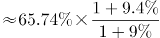，略大于1，则最终结果略大于65.74%，C项最为接近。

故正确答案为C。

**考点**：文字资料、基期比重

**来源**：2018年贵州省选调高校优秀毕业生到基层工作考试《行测》试题（网友回忆版）第102题

### 第 108 题

在2016年中，下列平均场次观众最多的是：

A. 全国艺术表演团体演出

B. 全国艺术表演团体赴农村演出

C. 全国艺术表演场馆馆内艺术演出

D. 全国各级文化部门所属艺术表演场馆艺术演出

第 108 题 · 答案与解析

**参考答案（粉笔题库参考内容）**

A

**解析**

根据题干“在2016年中······平均······最多的是”，结合材料时间是2016年，可判定本题为现期平均数问题。

A项：定位材料第三段可得：“全年全国艺术表演团体共演出230.60万场，······国内观众11.81亿人次······”。故全国艺术表演团体演出平均场次观众为：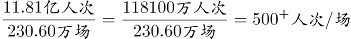；

B项：定位材料第三段可得：“······其中赴农村演出151.60万场，······其中农村观众6.21亿人次······”。故全国艺术表演团体赴农村演出平均场次观众为：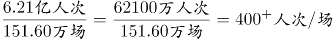；

C项：定位材料第五段可得：“······全年馆内艺术演出19.09万场次······艺术演出观众3098万人次······”。故全国艺术表演场馆馆内艺术演出平均场次观众为：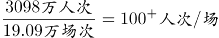；

D项：定位材料第五段可得：“······全年共举行艺术演出6.81万场次······艺术演出观众2589万人次······”。故全国各级文化部门所属艺术表演场馆艺术演出平均场次观众为：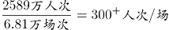。

综上比较A项最多。

故正确答案为A。

**考点**：文字资料、现期平均数

**来源**：2018年贵州省选调高校优秀毕业生到基层工作考试《行测》试题（网友回忆版）第103题

### 第 109 题

2016年，全国艺术表演团体平均从业人员数和各级文化部门所属艺术表演团体从业人员平均数之比约为：

A. 1:0.346

B. 6:1

C. 1:2

D. 2:3

第 109 题 · 答案与解析

**参考答案（粉笔题库参考内容）**

C

**解析**

根据题干“2016年，······和······之比约为······”，可判定本题为比值计算问题。定位文字材料第二段可得：“2016年末全国共有艺术表演团体12301个，从业人员33.27万人······各级文化部门所属艺术表演团体2031个，从业人员11.52万人”。故2016年全国艺术表演团体平均从业人员数和各级文化部门所属艺术表演团体从业人员平均数之比约为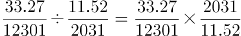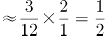，即比约为1:2。

故正确答案为C。

**考点**：比值计算、文字资料

**来源**：2018年贵州省选调高校优秀毕业生到基层工作考试《行测》试题（网友回忆版）第104题

### 第 110 题

从上述资料可以推断，在2016年：

A. 第十一届中国艺术节取得空前成功

B. 我国艺术创作演出的经济效益显著

C. 我国艺术表演团体演出收益较2015年减少

D. 平均每个文化部门所属艺术表演团体组织政府采购公益性演出场次超过60场

第 110 题 · 答案与解析

**参考答案（粉笔题库参考内容）**

D

**解析**

A项：定位文字材料第一段，“第十一届中国艺术节共汇聚67台参评参演剧目和1000余件美术作品，观众达40万人次”，未出现其他数据，无法推出，错误；

B项：材料未出现艺术创作演出的相关数据，无法推出，错误；

C项：定位文字材料第三段，“全年全国艺术表演团体······其中演出收入130.86亿元，增长39.3%”，故我国艺术表演团体演出收益较2015年增加，并非减少，且若将艺术表演团体演出收益理解为利润，材料中同样未出现相关数据，无法推出，错误；

D项：定位文字材料第二段，“······其中各级文化部门所属的艺术表演团体2031个”，及第四段“全年全国各级文化部门所属艺术表演团体共组织政府采购公益演出13.90万场”，故平均每个文化部门所属艺术表演团体组织政府采购公益性演出场次约为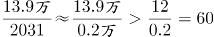，即超过60场，正确。

故正确答案为D。

**考点**：文字资料、综合分析

**来源**：2018年421联考《行测》题（甘肃卷）（网友回忆版）第115题

## 材料 4

**根据以下资料，回答下列问****题。**

某研究设计院向不同岗位级别职工支付的工资额以及该院职工人员结构资料分别如图1和图2。根据资料回答问题。

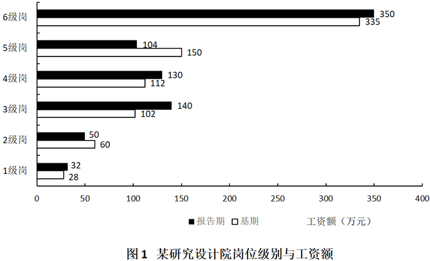

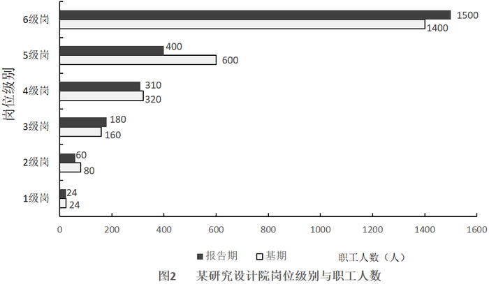

### 第 111 题

该研究设计院报告期人均工资最高的是：

A. 1级岗

B. 2级岗

C. 3级岗

D. 4级岗

第 111 题 · 答案与解析

**参考答案（粉笔题库参考内容）**

A

**解析**

根据题干“……人均工资最高”，判定为比值比较题型。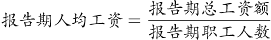。定位统计图，分别计算四个选项的报告期人均工资。

A项：1级岗报告期总工资额为32万元，报告期职工人数为24人。1级岗报告期人均工资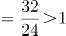

B项：2级岗报告期总工资额为50万元，报告期职工人数为60人。2级岗报告期人均工资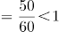

C项：3级岗报告期总工资额为140万元，报告期职工人数为180人。3级岗报告期人均工资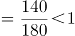

D项：4级岗报告期总工资额为130万元，报告期职工人数为310人。4级岗报告期人均工资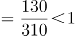

比较四个选项，报告期人均工资最高的是1级岗。

故正确答案为A。

**考点**：比值比较、统计图

**来源**：2018年贵州省选调高校优秀毕业生到基层工作考试《行测》试题（网友回忆版）第106题

### 第 112 题

该研究设计院报告期工资总额较基期的增长率为：

A. 1.2%

B. 2.4%

C. 3.3%

D. 7.3%

第 112 题 · 答案与解析

**参考答案（粉笔题库参考内容）**

B

**解析**

根据题干“……报告期工资总额较基期的增长率为”，判定为一般增长率题型。定位统计图1，分别计算报告期与基期的工资总额。报告期工资总额=32+50+140+130+104+350=806万元，基期工资总额=28+60+102+112+150+335=787万元。根据公式，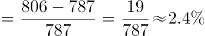。

故正确答案为B。

**考点**：一般增长率、统计图

**来源**：2018年贵州省选调高校优秀毕业生到基层工作考试《行测》试题（网友回忆版）第107题

### 第 113 题

下列岗位中，报告期职工人数较基期变化幅度最小的是：

A. 2级岗

B. 3级岗

C. 4级岗

D. 5级岗

第 113 题 · 答案与解析

**参考答案（粉笔题库参考内容）**

C

**解析**

根据题干“……变化幅度最小的是”，判定为一般增长率比较问题。根据公式，变化幅度不计正负，变化幅度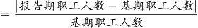。定位统计图2，分别计算四个选项职工人数变化幅度：

A项：2级岗报告期职工人数为60，基期职工人数为80，2级岗变化幅度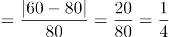；

B项：3级岗报告期职工人数为180，基期职工人数为160，3级岗变化幅度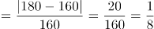；

C项：4级岗报告期职工人数为310，基期职工人数为320，4级岗变化幅度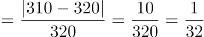；

D项：5级岗报告期职工人数为400，基期职工人数为600，5级岗变化幅度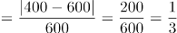。

比较四个选项，4级岗报告期职工人数较基期变化幅度最小。

故正确答案为C。

**考点**：一般增长率、统计图

**来源**：2018年贵州省选调高校优秀毕业生到基层工作考试《行测》试题（网友回忆版）第108题

### 第 114 题

在基期中，超过全院人均工资的岗位有：

A. 1、2、3级岗

B. 2、3、5级岗

C. 4、5、6级岗

D. 1、3、5级岗

第 114 题 · 答案与解析

**参考答案（粉笔题库参考内容）**

A

**解析**

根据题干“在基期中，······人均工资······”，可判定本题为平均数问题。要求超过全院人均工资的岗位，则只需要比较6级岗位中平均工资排名前三的即可。

定位图1可得：1、2、3、4、5、6级岗的工资额分别为28、60、102、112、150、335万元，定位图2可得：1、2、3、4、5、6级岗的职工人数分别为24、80、160、320、600、1400人，1级岗人均工资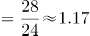万元/人，2级岗人均工资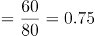万元/人，3级岗人均工资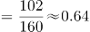万元/人，4级岗人均工资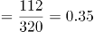万元/人，5级岗人均工资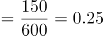万元/人，6级岗人均工资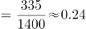万元/人，排名前三的为1级、2级、3级。

故正确答案为A。

**考点**：基期平均数、统计图

**来源**：2018年贵州省选调高校优秀毕业生到基层工作考试《行测》试题（网友回忆版）第109题

### 第 115 题

下列说法正确的是：

A. 在基期中，6级岗工资总额大于1~5级岗位工资总额之和

B. 报告期职工数较基期减少主要是因为2、4级岗位职工数的减少

C. 与各级同类数据相比，报告期的1级岗位职工数和6级岗位职工工资总额较基期变化幅度最小

D. 职工数按岗位1~6级，由上向下排列，并不呈现金字塔结构

第 115 题 · 答案与解析

**参考答案（粉笔题库参考内容）**

C

**解析**

A项，定位图1，基期6级别的工资总额为335万元，1~5级的工资总额为150+112+102+60+28=452万元，前者小于后者，错误；

B项，定位图2， 1~6级别人数的增长量分别为0、-20、20、-10、-200、100，其中2级和5级的人数减少最多，故报告期人数减少主要因为2、5级而非2、4级，错误；

C项，定位图2，1级别的职工数没有变化，即变化幅度为0，小于其他所有级别人数；定位图1，1~6级别的工资总额变化幅度分别为：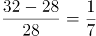；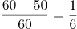；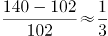；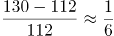；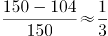；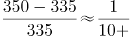；第6级别的变化幅度明显最小，正确；

D项，定位图2，报告期和基期的职工数从1~6级逐级递增，按岗位1~6级，由上向下排列，呈现金字塔结构，错误。

故本题正确答案为C。

**考点**：综合分析、统计图

**来源**：2018年贵州省选调高校优秀毕业生到基层工作考试《行测》试题（网友回忆版）第110题

