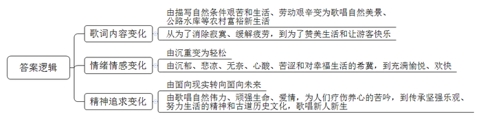
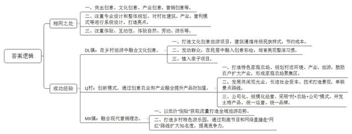
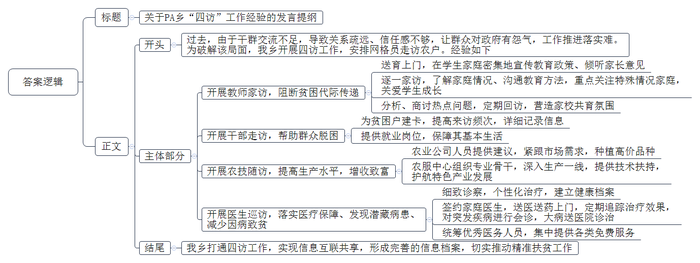
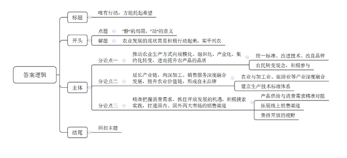

# 2019年公务员多省联考《申论》题（贵州A、普通选调卷）

> 候选采集稿。参考答案及解析来自粉笔页面，不代表官方答案或真实高分答卷；来源使用许可与原卷对应关系仍需人工核实。

## 给定材料

### 材料 material-4b000546ba3a5693

“这儿要是高速公路修通了，我们可怎么办？”十几年前，年近六旬的“背二哥”（山区的力夫）老秦问我，他的脸上写满疲惫和沧桑。老秦的家在地处川鄂茶盐古道上的CX村，因为深度贫困和交通闭塞，该村的人祖祖辈辈都是“背二哥”，靠背背篼卖力气吃饭。可公路一通，车轮一转，“背二哥”们靠什么吃饭？老秦看我没有回答，深叹了一口气，用嘶哑的喉咙唱起了歌：“长江呃，河来哟，三峡哦，峡来哟，我是三峡哟，‘背二哥’罗哈，太阳送我哟上巫山，月亮陪我哟下江河……”这就是“背二歌”。原来，三峡两岸，山高路陡，行走艰难，“背二哥”一声吼起，“背二歌”高亢激昂，以翻山越岭、穿云破雾之势，响彻川鄂茶盐古道。“背二歌”不是刻意唱给谁听的，它本身就是“背二哥”劳动的一部分。它是他们为了消除寂寞，缓解疲劳而唱的，是寂寞和艰辛之中自然升华出的歌。“背二歌”调子是豪迈、高亢、激越的，但是不得不承认，在这调子背后，它却有着沉郁、悲凉的本质。“背二歌”承载着“背二哥”的哀怨与艰辛，承载着三峡两岸的陡峭与苍凉，承载着道路的漫长和寂寞；它充满着无奈、心酸和苦涩，也包含着他们对幸福生活的希冀。在抬头见天、低头见峡的山谷里，“背二歌”和三峡古韵中的民歌、情歌、哭嫁歌、花轿歌一起，在日子里飘扬，成为包括“背二哥”在内的三峡人们心中疗伤与养心的良药。那是对自然伟力的祭歌，对顽强生命的赞歌，对爱情和生活的颂歌。

到了2018年，高速公路也延伸到这儿了，曾经害怕路通地平影响生计的“背二哥”们，如今又是何般模样？走进CX村，我发现它和三峡两岸所有村一样公路纵横。更为惊讶的是，一条条水泥板铺就的人行便道从公路两边伸向每一户村民家中，除了上坡下田的路，村里几乎看不到一条土路。见到老秦时，他正在家里教儿子和一群年轻人唱“背二歌”。“调子是老样子，但歌词被儿子他们这些年轻人改啦。”老秦告诉我，村里通了公路，河上修起了水库，老家改天换地了。儿子不再外出打工，而是回到老家买了一艘小游艇，搞起了农家乐，日子过得红红火火。生活好起来了，但关于“背二哥”的记忆不能淡忘。那种在如苦水般的日子里依旧坚强乐观、努力生活的精神不能丢。为了让更多的人来到这方古道，为了留住关于古道的深刻记忆，儿子还专门要他们这些老“背二哥”教他们唱“背二歌”。他们学会了，要唱给游客们听，让新的欢快的“背二歌”飞扬到更远的地方。

“小小游艇荡碧波，我是年轻‘背二哥’，背山背水背太阳，古道春风唱新歌……” “背二歌”在以前是一种苦吟，在新时代，它以另一种方式被新的“背二哥”们唱响。时代向前，总有新歌要唱，也总有新人要上场。

### 材料 material-ce333019765a6f47

“阳光公社”是DL镇的一个文化创意旅游项目，由著名设计师主理，其包括：创意餐厅、创意民居、创意奶场、农产品创意超市等。所有建筑都遵循当地古城的规定做成了传统的民族样式，地面均由卵石铺砌，造价低廉，却易拆卸和重修。“这个文化创意项目不仅增加了我们村旅游景点的看头，也让居民的房屋变得美观整洁。”村民老李指着自家屋子的外墙说，“那是T大学的大学生们给我们专门做的创意彩绘。有了它，我们的房子看上去更精神了，我们不打扫干净屋子都觉得对不起它。”“阳光公社”的另一个亮点是文化创意奶场。其牛奶生产基地中植入了亲子项目，亲子家庭可以在这里体验牛奶生产，同时亲近自然和土地。“阳光公社”对外营业后，DL镇的游客量较去年增加200%，旅游营收提高了260%。县政府更是对这种融合了文化创意的乡村旅游模式给予“美人居、添看点、促旅游、增收益”的高度评价。

LJ村有适合发展现代农业的低丘缓坡近万亩，有毛竹林8000亩，还有一些从事野猪、山羊养殖和茶叶、铁皮石斛种植的小型农场。2013年中央一号文件提出发展家庭农场，并且鼓励和引导工商资本投入农业农村。LJ村决定因地制宜建设18个家庭农场，形成家庭农场聚集区，以家庭农场为龙头带动休闲观光业发展。为此，村里请设计公司对整村进行村庄环境规划、产业规划和旅游规划，打造了18个各具特色的家庭农场，鼓励本村现有农户扩大产业。比如种植白茶、铁皮石斛，饲养野猪、野山羊等；同时引进社会资本，打造花海世界、百亩竹园等景观，以小火车作为观光载体，串联起各景点路线。LJ村采用“村+农场+公司”模式，成立乡土农业发展有限公司，开发土特产品，统一包装，统一定价，打响品牌，形成乡村农业、旅游收益互补。孤立的农业种植不会提升土地的附加值，发展创意农业，把田园变乐园，村庄变旅游景区，就能大幅提高土地的收益！孤立的加工生产也不会提升产品的附加值。要让生产劳动更具乐趣、让加工生产更具体验性，就会提升产品价值。现在，LJ村集体资产已达到1.2亿元，村民人均年收入增至3.3万元。

0.5元一个的馒头，0.8元一瓶的矿泉水，2元一碗的面条……MX镇乡村游乐园里商品的“亲民”价格，无疑是吸引游客的最大卖点。对此，不少人质疑：“一个馒头成本1元，你才卖0.5元。这么‘倒贴’，不傻么？”殊不知，这样的“倒贴”，正体现了游乐园营销的高明之处。“旅游从总量上来说，低消费倾向的客人通常占到80%-90%。如果人为地抬高消费门槛，不就等于自绝财路？”这就是“平民经济学”的要义：通过“倒贴”部分旅游产品来进行营销，给游客留下好印象，形成全域旅游的良好态势，让不同消费层次的游客都愿意来，让他们玩得起、玩得开心。“我从来不觉得‘营销’是个贬义词。我觉得我们的乡村旅游融合现代的营销理念很有必要。我们这里没有什么名山古刹，靠的就是这个自己呕心沥血打造出来的游乐园。要想营利，当然要靠‘流量’。承诺永不涨价的食品、别开生面的动物运动会、惊险刺激的网络直播，都为我们吸引着大家的注意力。大家能来最好，不能来的，至少也知道了我们这儿的名字。”MX乡村游乐园运营公司的经理Q先生说，“通过这样，我们走‘网红’路线，成功地在竞争激烈的乡村旅游市场中杀出了一条血路。”

### 材料 material-df2fa8f3941de83b

为了开辟“第二课堂”，阻断贫困代际传递，PA乡全面开展了教师家访工作。老师们送“育”上门，在学生家庭密集的院坝、楼栋等地，召开“院坝家长会”“楼栋家长会”，宣传教育政策、倾听家长意见。58名教师利用下班、双休日等，送“爱”上门，对学生逐一进行家访，了解家庭情况、沟通教育方法，把孤儿、单亲、留守等特殊情况家庭作为重点家访对象，通过举办关爱活动、微信视频连线等方式，关爱学生成长。其后，他们还开展了“家访问题分析会”，对家长意见、建议、相对集中的热点问题逐条进行分析，商讨解决方案，并定期回访，营造家庭、学校、社会“三位一体”的“家校共育”氛围。

而如此细致的家访工作的背景又是什么呢?“前些年，我们调研时发现，不少群众对政府有怨气，使得危房改造、厕所改造等不少利国利民的工作推进落实难。”F县县委书记说，之所以出现这种情况，在于干部和群众走动少了、交流少了，干群没有打成一片，没有建立起“骨肉相连”的信任感。2016年，F县开始探索干部走访、教师家访、医生巡访、农技随访的“四访”机制。

PA乡正是该县“四访”工作的示范代表。在PA乡，全乡划分为50个网格，有112名网格员，他们负责走访7016户农户。以下是关于PA乡“四访”工作的部分情况：

“要不是党的关心，哪能住新屋？”老熊在自家新房里对记者感叹道。往昔在他眼前浮现：自己因骨髓炎截肢而痛不欲生；土坯房钻风漏雨更是让人度日如年……多年来，老熊与妻子都想改变家里境况，却力不从心。自“四访”工作开展以来，老熊家的困境，在慢慢改变。从被列入建卡贫困户起，老熊就发现来访的干部多了，不仅来得勤，还问得细：每个家庭成员的年龄、文化程度、就业、身体状况，厨房、厕所、猪圈，土地是流转还是自己种，现有条件能发展哪些产业……事无巨细，都详细记录在了他们为老熊家建的台账里。老熊当上了护林员，妻子也成了村里的保洁员，两个人的工资让全家的基本生活有了保障……

夏大妈2018年种了近3亩的辣椒，收入两万余元。在2017年她也种了半亩小米椒，却只卖了千余元钱。究竟发生了什么，会有这样巨大的差别?“关键就是农技员来指导。”PA乡党委书记老文说，乡里引进了农业公司，建起了蔬菜基地。在公司人员的建议下，夏大妈从小米椒改种市场需求量大、价格也更高的二荆条辣椒。在种植中，负责农业技术指导的农服中心主任老任常到夏大妈的辣椒地里进行技术指导。“他们说用农家肥，我就用养的猪、鸡的粪便拌着草木灰来施肥；说要防虫害，我就按他们说的打药。”在农业技术人员指导下，夏大妈的二荆条辣椒获得了丰收，农业公司又以高价全部收购。文书记介绍，为了帮助农民提高生产水平，增收致富，全乡开展了农技随访。乡农服中心先后组织专业骨干75人次，深入农业基地、田间地头，传技术、教方法，为农民提供产业发展上的技术扶持，护航乡镇特色产业发展。

“我有胃病，要经常检查，但大医院太远了。小丁她们定期过来，真是很感谢。”目送医务车在雨中远去，刘阿姨慢慢走回屋内，“现在，我的病情稳定了。通过几次细致的诊察，乡里给我们制定了个性化治疗方案，建立了健康档案。和我家签约的家庭医生每月到我家来问诊至少2次，不仅送医送药上门，还会定期追踪治疗效果。”除了为刘阿姨这样的贫困户落实签约家庭医生外，PA乡还实行村医常态化入户送诊，对小病小患及时送诊送药，对突发性疾病由村医通过电话与签约医生等进行会诊，病情严重的由村医联系驻村工作队共同送往医院住院诊疗。这样的巡访，为村民提供了基本的医疗保障，也能及时发现村民潜藏的病患，减少因病致贫。PA乡的医生巡访工作并不局限于这些。为深化巡访，PA乡进一步统筹乡镇中心卫生院和口碑较好的私人诊所的医务人员，利用群众会、赶场天等，在镇街、各村便民服务中心等人群聚集地，免费为全乡群众进行健康体检，提供基本医疗、基本公共卫生、健康教育、个性化健康管理等服务。

“我们的‘四访’工作可不是各做各的，而是实现了信息的互联共享。教育、健康、技术都和收入息息相关。通过两年多的工作，我们已经形成了较为完善的信息档案，这对我们这个深度贫困乡的精准脱贫工作有重要意义。”文书记说道。

## 题目

### 第 1 题

**请根据“给定资料**1**”，谈谈随着时代变迁，“背二歌”内涵意义的变化。（20分）**

关联材料：material-4b000546ba3a5693

作答要求：

要求：全面、准确、简明、有条理；字数不超过200字。

### 第 2 题

**根据“给定资料**3**”，分析三个村镇旅游发展的相同之处，并概括其各自的成功经验。（30分）**

关联材料：material-ce333019765a6f47

作答要求：

要求：紧扣资料，内容全面；条理清楚，层次分明；字数不超过400字。

### 第 3 题

**F县将开展一次关于“四访”工作的中期总结大会，假设你是PA乡发言代表，请你根据“给定资料**4**”，写出介绍PA乡“四访”工作经验的发言提纲。（40分）**

关联材料：material-df2fa8f3941de83b

作答要求：

要求：紧扣资料，全面，简明，有条理，语言流畅；字数不超过500字。

### 第 4 题

**根据你对“给定资料**5**”中划线部分“之于世间事，‘静’会给予很多‘如果’的假想，可唯有‘动’能带来‘但是’的希望”的理解，自选角度，自拟题目，写一篇文章。（60分）**

关联材料：material-4b000546ba3a5693

作答要求：

要求：

（1）主题明确，立意深远；

（2）联系实际，不拘泥于“给定资料”；

（3）思路清晰，语言流畅；

（4）总字数1000字左右。

## 答案与解析

第 1 题

**参考答案（粉笔题库参考内容）**

一、歌词内容由描写自然条件艰苦和生活、劳动艰辛变为歌唱自然美景、公路水库等农村富裕新生活。从为了消除寂寞、缓解疲劳，到为了赞美生活和让游客快乐。

二、情绪情感由沉重变为轻松。由沉郁、悲凉、无奈、心酸、苦涩和对幸福生活的希冀，到充满愉悦、欢快。

三、精神追求由面向现实转向面向未来。由歌唱自然伟力、顽强生命、爱情，为人们疗伤养心的苦吟，到传承坚强乐观、努力生活的精神和古道历史文化，歌唱新人新生。

**解析**

**参考答案说明**：本参考答案从“歌词内容”“情绪情感”“精神追求”三个方面，对“背二歌”内涵意义的“变化”进行了说明，各条答案要点之间在内容上相互并列，没有交叉。

**考点**：考点变化类

**来源**：来源2019年公务员多省联考《申论》题（贵州A、普通选调卷）

粉笔申论页面对本题只提供「解析视频」入口，该入口是会员推广位，页面无视频地址与文字解析。

第 2 题

**参考答案（粉笔题库参考内容）**

相同之处：一、突出创意。文化创意、产业创意、营销创意等。二、注重专业设计和整体规划。对村社建筑、产业、营利模式等进行系统设计，打造亮点。三、注重体验、互动性。体验自然、劳动、游乐等。

成功经验：

DL镇：在乡村旅游中融合文化创意。一、打造文化创意旅游项目，建筑遵循传统民族样式，节约成本。二、发动群众，在民居中融入创意彩绘，培育美观整洁习惯。三、植入亲子项目。

LJ村：创新模式，通过创意农业和产业融合提升产品附加值。一、打造特色家庭农场。规划村庄环境、产业、旅游，鼓励农户扩大产业，形成家庭农场聚集区。二、发展休闲观光业。引进社会资本、技术打造景观，串联景点路线。三、公司化、规模化经营。采用“村+农场+公司”模式，开发土特产品，统一运营、统一品牌。

MX镇：融合现代营销理念。一、以低价“倒贴”获取流量打造全域旅游态势。二、打造乡村特色游乐园，通过刺激节目和网络直播走“网红”路线扩大知名度，提高竞争力。

**解析**

**参考答案说明：**本参考答案从宏观上分为“相同之处”“成功经验”两个部分。微观上，“相同之处”分别从“突出创意”“注重设计和规划”“注重体验”三个方面展开；“成功经验”针对“DL镇”“LJ村”“MX镇”三个村镇进行了分类、分条撰写。各条要点之间在内容上相互并列，没有交叉。

**考点**：考点多要素组合类

**来源**：来源2019年公务员多省联考《申论》题（贵州A、普通选调卷）

粉笔申论页面对本题只提供「解析视频」入口，该入口是会员推广位，页面无视频地址与文字解析。

第 3 题

**参考答案（粉笔题库参考内容）**

关于PA乡“四访”工作经验的发言提纲

过去，由于干群交流不足，导致关系疏远、信任感不够，让群众对政府有怨气，工作推进落实难。为破解该局面，我乡开展四访工作，安排网格员走访农户。经验如下：

一、开展教师家访，阻断贫困代际传递。送育上门，在学生家庭密集地宣传教育政策、倾听家长意见；逐一家访，了解家庭情况、沟通教育方法，重点关注特殊情况家庭，关爱学生成长；分析、商讨热点问题，定期回访，营造家校共育氛围。

二、开展干部走访，帮助群众脱困。为贫困户建卡，提高来访频次，详细记录信息；提供就业岗位，保障其基本生活。

三、开展农技随访，提高生产水平，增收致富。农业公司人员提供建议，紧跟市场需求，种植高价品种；农服中心组织专业骨干，深入生产一线，提供技术扶持，护航特色产业发展。

四、开展医生巡访，落实医疗保障、发现潜藏病患、减少因病致贫。细致诊察，个性化治疗，建立健康档案；签约家庭医生，送医送药上门，定期追踪治疗效果，对突发疾病进行会诊，大病送医院诊治；统筹优秀医务人员，集中提供各类免费服务。

我乡打通四访工作，实现信息互联共享，形成完善的信息档案，切实推动精准扶贫工作。

**解析**

**参考答案说明：**（1）格式方面，本参考答案写到了“标题”“正文”两个部分。（2）正文部分，一方面从内容来看，围绕“PA乡‘四访’工作”这一主题，本参考答案的开头先写了PA乡开展“四访”工作的背景；主体部分从“开展教师家访”“开展干部走访”“开展农技随访”“开展医生巡访”四个方面给出了具体经验。另一方面，形式上，本参考答案做到了分段、分条撰写，整体上条理较为清晰。

**考点**：考点总结类

**来源**：来源2019年公务员多省联考《申论》题（贵州A、普通选调卷）

粉笔申论页面对本题只提供「解析视频」入口，该入口是会员推广位，页面无视频地址与文字解析。

第 4 题

**参考答案（粉笔题库参考内容）**

**唯有行动，方能托起希望**

沉思过往，总结经验教训，憧憬明天，规划未来的蓝图。这本是一件好事，但现实却是，不少人只是囿于在静思中寻求“如果”，流于假设，甚至不切实际地假想、空想。**千百度地思忖，不如勇敢迈出第一步，行动才是一切认知的落脚点。新时代的美好蓝图、幸福愿景，只有靠实干才能实现。**

今天，我们为什么一直强调实干精神？因为当今中国经济社会发展进入新常态，各类领域下行压力都很大，唯有“上进”地干才能化压力为动力。尤其是农业，它作为基础性产业，关系国民经济的根本。然而，**当前我国农业发展模式粗放、产品长期处于产业链底端、国际竞争压力与日俱增，已经到了不转变方式就难以持续稳定发展的重要关口。**

农业的转型升级需要实干来搭梯。**这就需要农业走上规模化、组织化、产业化、集约化发展之路，提升农产品的品质****。**当前，农产品产能过剩的实质是低品质农产品比重太大。究其原因，主要是我国农业以家庭为单位的小农生产模式过于粗放、低效，让产品质量没有保障。因此，要加快转变农业生产方式，从粗放式转为集约型，实现农产品生产由数量扩张向质量提升转变。这既需要农业管理者从政策层面统一标准、改进技术、改良品种，也需要农业生产者能够转变观念，摒弃简单粗暴的生产方式，种植符合市场需求的品种，积极加入到规模化生产和经营的大军中。

**农业转型升级不能只停留于传统种植业，还要延长产业链，向深加工、销售服务深度融合发展，提升农业价值链，形成自主品牌，这才是农村产业兴旺的应有之义。**传统种植业再怎么精耕细作，农民还只是温饱刚好、小康奢望。这主要是由于农业产业链短、附加值偏低。作为传统农业大国，在稳定粮食产能的基础上，各地都积极探索创新，为农民寻求了更多增收渠道，比如农业与加工业、旅游业等产业深度融合。农民获得多渠道收入的同时，也创造出了多元化的产品。而产品价格的增值主要依靠品牌建设，但是标准不成体系是品牌建设上亟待补齐的一块短板。有鉴于此，各利益方须摒弃成见、统一思想，立足国情，对标世界，建立各个门类产品生产技术标准体系。

高品质、多元化的产品支撑起中国农业品牌崛起。而将品牌优势转化为市场竞争优势，还**需要我们精准把握消费需求、抓住开放发展的机遇，积极摸索实践，打通国内、国外两大市场的销售渠道**。信息化时代，我们既要主动利用大数据，让产品供给精准对接个性、多变的消费需求，也要善于借助“互联网+”技术，搭建电商平台，拓展线上销售渠道。技术是社会进步赋予的发展机遇，而政策则是顺势而为的契机。比如，“一带一路”政策促进了云南省咖啡出口贸易井喷式增长。这也启示我们要秉持开放的视野，加强与沿线各国的贸易合作，在国际市场上抢占一席。

一叶知秋，见微知著。一颗咖啡豆“静”与“动”的演绎，引人思考，给人启迪。就此领悟，我们须实干、须创新，方能推动农业现代化精于产品品质，贵于产业融合，赢在市场竞争力。

**解析**

**文章分析：**

**唯有行动，方能托起希望**

【**标题的优点：**首先，范文的标题“唯有行动，方能托起希望”突出了“实干兴农”这一主题。其次，形式上，文字简洁明快。】

沉思过往，总结经验教训，憧憬明天，规划未来的蓝图。这本是一件好事，（1）但现实却是，不少人只是囿于在静思中寻求“如果”，流于假设，甚至不切实际地假想、空想。（2）**千百度地思忖****，****不如勇敢迈出第一步****，****行动才是一切认知的落脚点****。新时代的美好蓝图、幸福愿景，只有靠实干才能实现。**

【**开头的优点：**★内容方面。范文的开头是紧扣题目给定的“实干兴农”这一主题展开的。首先，开头即点出主题，做到了主题明确。其次，对“实干兴农”这一主题进行了分析阐述，指出了（1）“‘静’的局限”。（2）“‘动’的意义”。★文字表达方面：使用了“只是”“才是”“只有……才能”等关联词，使语言表达更有逻辑性。】

今天，我们为什么一直强调实干精神？因为当今中国经济社会发展进入新常态，各类领域下行压力都很大，唯有“上进”地干才能化压力为动力。尤其是农业，它作为基础性产业，关系国民经济的根本。然而，**当前我国农业发展模式粗放****、****产品长期处于产业链底端****、****国际竞争压力与日俱增****，已经到了不转变方式就难以持续稳定发展的重要关口。**

**【****过渡段的优点：**范文过渡段分析了“实干兴农”的背景和必要性等**方面的内容**，此外，还要注意过渡段末尾的“已经到了不转变方式就难以持续稳定发展的重要关口”是用来引起下文的过渡句。**】**

农业的转型升级需要实干来搭梯。**这就需要农业走上规模化、组织化、产业化、集约化发展之路，提升农产品的品质****。**（1）当前，农产品产能过剩的实质是低品质农产品比重太大。究其原因，主要是我国农业以家庭为单位的小农生产模式过于粗放、低效，让产品质量没有保障。因此，（2）要加快转变农业生产方式，从粗放式转为集约型，实现农产品生产由数量扩张向质量提升转变。（3）这既需要农业管理者从政策层面统一标准、改进技术、改良品种，也需要农业生产者能够转变观念，摒弃简单粗暴的生产方式，种植符合市场需求的品种，积极加入到规模化生产和经营的大军中。

【**论述段****1****的优点：**★观点句：范文的观点句是紧扣“实干兴农”这一文章主题提出的。形式上，它在段首处直接写出，位置突出，容易发现。内容上，内容要点明确，可以明显看出它是从“生产方式”入手，指出了“如何实干兴农”。★论述内容：（1）介绍了“我国农业发展现状”；（2）介绍了“加快转变农业生产方式”；（3）介绍了“统一标准、改进技术、改良品种、转变观念”。注意：以上三个方面的内容都是紧扣“推动农业生产方式向规模化、组织化、产业化、集约化转变，进而提升农产品的品质”这个观点句进行分析论述的，论述的针对性强，内容层次丰富。在论述方法的选取上以道理论证为主，论述透彻有力。】

**农业转型升级不能只停留于传统种植业，还要延长产业链，向深加工、销售服务深度融合发展，提升农业价值链，形成自主品牌，这才是农村产业兴旺的应有之义。**（1）传统种植业再怎么精耕细作，农民还只是温饱刚好、小康奢望。这主要是由于农业产业链短、附加值偏低。（2）作为传统农业大国，在稳定粮食产能的基础上，各地都积极探索创新，为农民寻求了更多增收渠道，比如农业与加工业、旅游业等产业深度融合。农民获得多渠道收入的同时，也创造出了多元化的产品。（3）而产品价格的增值主要依靠品牌建设，但是标准不成体系是品牌建设上亟待补齐的一块短板。有鉴于此，各利益方须摒弃成见、统一思想，立足国情，对标世界，建立各个门类产品生产技术标准体系。

【**论述段****2****的优点：**★观点句：范文的观点句是紧扣“实干兴农”这一文章主题提出的。形式上，它在段首处直接写出，位置突出，容易发现。内容上，内容要点明确，可以明显看出它是从“产业发展”入手，指出了“如何实干兴农”。★论述内容：（1）介绍了“传统农业的弊端”；（2）介绍了“产业融合”；（3）介绍了“建立产品生产技术标准体系”。注意：以上三个方面的内容都是紧扣“延长产业链，向深加工、销售服务深度融合发展，提升农业价值链，形成自主品牌”这个观点句进行分析论述的，论述的针对性强，内容层次丰富。在论述方法和论据的选取上做到了讲道理和举例子相结合，做到了丰富多样。】

高品质、多元化的产品支撑起中国农业品牌崛起。而将品牌优势转化为市场竞争优势，**还需要我们精准把握消费需求、抓住开放发展的机遇，积极摸索实践，打通国内、国外两大市场的销售渠道。**（1）信息化时代，我们既要主动利用大数据，让产品供给精准对接个性、多变的消费需求，（2）也要善于借助“互联网+”技术，搭建电商平台，拓展线上销售渠道。技术是社会进步赋予的发展机遇，而政策则是顺势而为的契机。比如，“一带一路”政策促进了云南省咖啡出口贸易井喷式增长。（3）这也启示我们要秉持开放的视野，加强与沿线各国的贸易合作，在国际市场上抢占一席。

【**论述段****3****的优点：**★观点句：范文的观点句是紧扣“实干兴农”这一文章主题提出的。形式上，它在段首处直接写出，位置突出，容易发现。内容上，内容要点明确，可以明显看出它是从“品牌建设”入手，指出了“如何实干兴农”。★论述内容：（1）介绍了“产品供给与消费者需求精准对接”；（2）介绍了“拓展线上销售渠道”；（3）介绍了“秉持开放视野”。注意：以上三个方面的内容都是紧扣“将品牌优势转化为市场竞争优势，还需要我们精准把握消费需求、抓住开放发展的机遇，积极摸索实践，打通国内、国外两大市场的销售渠道”这个观点句进行分析论述的，论述的针对性强，内容层次丰富。在论述方法和论据的选取上做到了讲道理和举例子相结合，做到了丰富多样。】

【**论述段之间的关系：**★内容的内在逻辑：范文的论述段之间是并列关系。论述段1先写了“转变生产方式”，论述段2再写了“产业融合发展”，论述段3最后写了“品牌建设”。★段与段的外在衔接：论述段2的段首处的过渡句“农业转型升级不能只停留于传统种植业……形成自主品牌”，起到了承接论述段1、引出了论述段2的作用。论述段3的段首处的过渡句“高品质、多元化的产品支撑起中国农业品牌崛起”，起到了承接论述段2、引出了论述段3的作用。】

一叶知秋，见微知著。一颗咖啡豆“静”与“动”的演绎，引人思考，给人启迪。就此领悟，我们须实干、须创新，方能推动农业现代化精于产品品质，贵于产业融合，赢在市场竞争力。

【**结尾的优点：**范文的结尾回扣了“实干兴农”这一主题。阐述了“实干兴农”的深远意义。】

**考点**：考点文章写作题

**来源**：来源2019年公务员多省联考《申论》题（贵州A、普通选调卷）

粉笔申论页面对本题只提供「解析视频」入口，该入口是会员推广位，页面无视频地址与文字解析。

