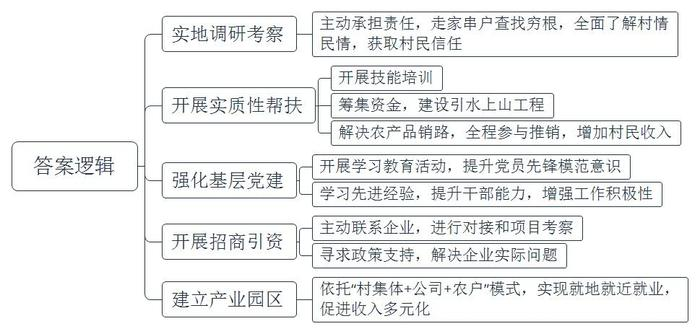
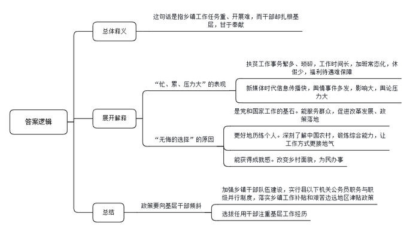
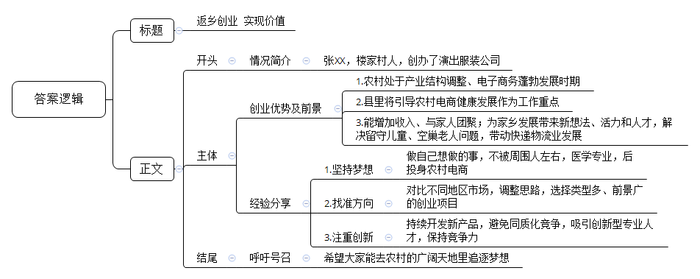

# 2020年0822公务员多省联考《申论》题（贵州A卷）

> 候选采集稿。参考答案及解析来自粉笔页面，不代表官方答案或真实高分答卷；来源使用许可与原卷对应关系仍需人工核实。

## 给定材料

### 材料 material-22f8ae2202a1eab8

只因看了一眼岩山，从此她就与岩山结缘。她就是D市岩山驻村帮扶工作组组长、驻村第一书记小孙。几年前，小孙从一所名牌大学硕士研究生毕业，来到D市商务局工作。有一次，市委、市政府组织“机关干部下基层”社会实践活动，她随着实践小组来到了岩山。

“太美了！”小孙被岩山美丽的风景深深震撼，花红柳绿，山清水秀，真是如诗如画。当地淳朴的民风，热情好客的村民更令她印象深刻。不过，令她同样印象深刻的还有岩山的贫困。岩山共有1345户、4130口人，其中贫困户占60%，人均耕地不足0.8亩，村民收入主要依靠传统农业和外出务工，是典型的国家级贫困村。脱贫是这里的村民一代又一代的梦想。如果能帮助岩山村这样长期贫困的地方摆脱贫困，人生该是多么有价值啊！小孙的心里涌起一个强烈的念头。

此时，D市正深入开展脱贫攻坚行动。巧合的是，岩山村正是商务局的对口扶贫村。小孙主动请缨，担任岩山驻村帮扶工作组组长。“作为名校研究生，有更好的机会，为什么选择到偏远乡村？”面对不解的目光，小孙没有回答，只是报以微笑。

从驻村工作开始的第一天起，帮助岩山这个贫困村脱贫致富沉甸甸的责任，便落在了小孙的肩上。刚入村时，小孙准备先找村民了解情况。但却听到了这样的风凉话：“咋还派个女干部？一个城里女人能干啥？”

为了开好头，获取村民的信任，她和工作组同事，到田间地头了解情况，走家串户查找穷根，入村不到两个月，就完成了全村所有贫困户的走访，做到村里的“大事小情、家长里短”都了然于心。

随后小孙与工作组同事组织村民参加手工纺织、月嫂服务等培训班。与此同时，他们筹集资金，在全村开工建设引水上山工程，彻底改变了村里几十年来缺水的落后状况。春节前，贫困户饲养的年猪还在愁销路，工作组全程参与推销，终于换来了80多万元沉甸甸的过年钱……一连串雪中送炭的实质性帮扶拉近了村民和工作组的距离，村民们被小孙这位“女干部”的真情付出深深打动。

“农村富不富，关键在支部。如何发挥基层党组织的战斗堡垒作用是驻村帮扶的首要工作。”小孙深有感触地说。为此，她和工作组同事带着村民党员积极开展学习教育活动，提升党员的先锋模范意识。为了提高村干部、村民代表引领产业发展、带领群众致富的能力，小孙多次带领他们到先进地区学习考察，“明显感觉到岩山的民心齐了，村干部的干劲足了、水平高了。”小孙帮助村民脱贫致富的信心更强了。

如何用工业化理念改变村民传统的生产生活方式，尽快引进增收产业项目为村民创造具有长期稳定收益的就业岗位，实现更多人的致富奔小康，是驻村帮扶工作组和村两委班子每天都要琢磨的“大事情”。工作组得知外省一家大型现代纺织企业老总是D市人，有回乡投资的想法，便第一时间与他取得联系，进行对接和项目考察。小孙在充分了解到该纺织项目是非常适合岩山村的好项目后，便积极与企业老总沟通招商想法。针对企业提出的十几条落实投资的实际问题，工作组到市、县、乡各项目主管单位咨询政策、寻求支持。仅仅5个多月的时间，工作组就协助企业完成了项目选址、各项手续办理、厂房建设、员工培训等一系列重要工作。村干部介绍说，目前，一个依托“村集体+公司+农户”的模式建立起的纺织产业园区，正在岩山渐渐成型。不久的将来，这里的村民不仅可以在家门口就业，而且可以实现既拿薪金又领股金还得租金的长效增收，岩山村的脱贫梦正在逐步实现。

“咱们岩山再也不是那个靠天吃饭的穷地方了，现在不少在外打工的年轻人都回来了。”村民喜滋滋地指着驻村工作组的办公室说，“变化就是从孙书记和她的组员到咱村来的那一天开始的。”

“我们的目标是成为北方最大的坯布集散地。”一个更大的梦想在小孙心中一点点描绘。环境越来越好，梦想越来越大，“但是，作为一个共产党员，我的信念和情怀不会变。”

### 材料 material-88767a38d78a67d4

“真希望自己是‘三头六臂’就好了！”M乡王乡长快人快语。王乡长正在负责完善贫困户档案，要了解家庭人员构成、住房改造前后照片对比、种植养殖种类及数量、扶持项目公示、会议记录、入户走访、满意度调查等内容。一方面，因为建档的需要，要填写大量的表格等资料。另一方面，表格的内容很细致，不到贫困户家中实地调查那是不行的。看似简单的事情其实很繁琐，有时候要来回跑很多趟。

基层工作千头万绪，事务繁多，而且一旦某件事成为舆情热点，不仅会极大增加基层工作量，而且让基层干部倍感压力。经历过几次舆情热点事件，M乡宣传干事小陈已经略有心得：尽快披露事实，优先回应网友质疑……然而，小陈却坦言工作不易：“国家强调依法治国，事情处理起来都有程序，需要时间。但新媒体时代信息传播越来越快，造成舆论影响迅速放大。”一次该地出现旅游纠纷，消息在网上飞快传开，网友一边倒地批评当地，可是通过调查却发现，其实是游客挑衅。“虽然最后真相大白，可还是给我们造成了很大的压力。”小陈说。

基层，是整个社会的“地基”，这个“地基”是社会的主体，也是时代的主流。基层干部，是党和国家工作的“基石”，他们奋战在改革发展的主战场、服务群众的最前沿。目前绝大多数政策落地都在县乡，从脱贫攻坚到民生保障，再到招商引资、产业发展、入户做群众工作，都离不开基层干部。基层干部忙得脚打后脑勺，加班是常态，但干部们几乎都没加班费。R市有关部门对一些乡镇的调查显示，乡镇干部平均每天工作10到11个小时，不少乡镇干部五六年没休过假。

王乡长说：“乡镇工作虽然忙、累、压力大，但也是我们无悔的选择。”

C乡党委李书记从1998年至今已在5个乡镇工作过，乡镇的每个岗位几乎都干过。“乡镇是最基层的行政机构，麻雀虽小但五脏俱全。产业发展、土地问题、安全生产……能最深刻地了解中国农村，最全面地锻炼干部能力。”李书记说。基层工作经历让乡镇干部的综合能力得到迅速提升，工作方式也更接地气，他们也很感谢这样的历练。

2017年，中共中央办公厅、国务院办公厅发文，强调要加强乡镇干部队伍建设，实行县以下机关公务员职务与职级并行制度，落实乡镇工作补贴和艰苦边远地区津贴政策。“而且现在干部的选拔任用更加注重基层工作经历，相关政策也更多向基层干部倾斜。”李书记说，“干部想更长远发展，基层工作其实也是一个重要的经历。”

不过，在李书记看来，最重要的还是乡镇工作独特的成就感。“我们很多人都是农村出身，很多亲戚朋友都在农村。改变家乡面貌，帮助农民做点事，这是我们肩负的使命。”C乡地处贫困地区，李书记带领群众克服海拔高、交通条件差、缺工人、缺材料等困难情况，在三个月内改造了71栋房子，“看着很多贫困户欢欢喜喜搬进新房，我忍不住流下眼泪。想到靠自己的努力能够改造一方水土，有一种梦想正在一点点地实现的感觉，那个时候，你就会觉得所有的付出都值了。”

### 材料 material-b2d3558eadf9b4ca

因为早就敏锐地发现了农村创业的机遇，2010年小张大学一毕业就果断选择了返乡创业，投身农村电子商务。如今小张已成为村里的“创业榜样”，家里的奖状堆满了一箱。

小张的父亲做了30多年的乡村医生，希望他能接班，所以把他送进了一所医学院。但对自己的未来，小张有不一样的梦想，他觉得自己不适合做医生，应该做点和父亲不一样的事情，才能更好地实现自己的价值。其实在高考填志愿时，他就想学电子商务专业，但被父亲阻止了。毕业后，没人能再反对他做自己想干的事儿，他决定开网店。

当时电子商务还没有那么火。小张的家乡是N县的楼家村，这是个传统意义上的农业村，当时整个村子接入宽带的都没有几户人家，也没有工业基础。90年代后期，村子里有人开始做起影楼服饰的生意，以家庭作坊居多，并未规模化。销售方式也都是在村里做好后，挑到城里去卖。这种上门推销的手工作坊模式发展非常缓慢。

村子里有传统，小张最初想把这种影楼服饰搬到网上去卖。于是，他购买了几台缝纫机和一台电脑，租赁了门面进行服装加工，并在电商平台上注册了网店。刚开始，由于缺乏经验，生意并没有做起来。“我原来是学医的，专业离这个比较远。而且学校也没教过我们怎么创业，我对此非常陌生，完全是凭着一股热情闯进来的。”小张说，自己一开始并没有对影楼服饰的市场进行过调查，后来才发现影楼服饰市场很小，3个月下来，小张并没有赚到钱，还一度到了交不起房租的窘境。

不过，这个年轻人不服输，他决定去南方市场看看，了解不同地区的服装制造市场。经过考察，他发现相比于原先狭窄的影楼服饰市场，演出服装要好做得多，类型比较多样，市场能拓展开。就这样，小张调整思路，铆着一股劲，开始转做演出服装的生意。4年过去了，小张成立了自己的公司，建起了2000余平方米的车间，光各类服装设备就有106台。

小张带起的星星之火逐渐发展成了燎原之势。眼看着小张生意越做越好同村的很多年轻人也陆续仿照着开起了网店。目前，全村300户家庭全都开有网店，年销售收入超100万元的服饰加工户达30多家，青年回乡创业，除了带来新想法，还有年轻人的生机和活力，留守儿童、空巢老人的问题不复存在。与电子商务相关的周边产业、配套设施也被带动起来，最大的改变是快递物流的出现。一家大型物流公司在村里设点，每天定时收发快件。这也给村里人生活带来了极大的便利。回首过去，小张觉得当初返乡创业是一个非常恰当的选择，顺应了农村产业结构调整和电子商务蓬勃发展的时代潮流。他认为农村为大学生提供了追逐梦想的广阔天地，大学生返乡创业不仅经济收入可观，还能和家人团聚，同时也为农村带来了活力和人才。

不过，返乡创业的大学生们享受着家乡电子商务“野蛮发展”带来的红利时，也有了新的烦恼。小张明显感觉生意没以前好做了。“前两年一件演出服装能赚20至30块钱，现在10块钱吧。”与其他村依山靠山卖土特产不同，楼家村的演出服装似乎没有那么接地气，而开服装网店成本低，一台电脑，再找到一家可靠的代加工厂商就可以“创业”了，很容易造成同质化竞争。小张认为目前保持竞争力的唯一方法就是不停地开发新品，让别人赶不上。“演出服装想创新很难，你得自己设计、打板，抄袭成本却很低。”凑巧的是，小张的妻子是服装学院毕业的，妻子便成为家里创新的主力。但小张说，“这显然是不够的，我现在迫切需要专业的设计师过来帮助做创新。”

N县也在类似楼家村这样的村子带动下，发展出了很多“网店村”。这种飞快的发展速度也引起了县委县政府的关注。县委县政府明确提出把引导“网店村”健康发展作为政府服务增效的重要工作内容。“我们正在联系一家大型电商平台，争取双方在跨境电子商务、人才培训、云计算和大数据应用等方面早日开展深入合作。”县委负责人说。

### 材料 material-ce0a3b6988e05e3e

“我们都在努力奔跑，我们都是追梦人。”是的，我们都是追梦人。追梦，我们收获满满；追梦，我们希望满满。

正如习近平总书记所说，中国人民具有伟大梦想精神。改革开放40多年的征程，就是一个追梦之旅。改革开放之初，我们党以非凡的胆略、坚定的自信设计了用70多年、分三步走基本实现社会主义现代化的宏伟蓝图。改革开放40多年的追梦路上，我们咬定青山不放松，风雨无阻朝着这个伟大目标前进。

从站起来、富起来到强起来，这是奋斗的力量，也是梦想的力量。

党的十九大对我国发展提出了更高的奋斗目标，形成了从全面建成小康社会到基本实现现代化、再到全面建成社会主义现代化强国的战略安排，发出了实现中华民族伟大复兴中国梦的最强音。

但是，船到中流浪更急，人到半山路更陡，并且“愈进愈难、愈进愈险而又不进则退、非进不可”。在这样的关键时刻，我们要心怀梦想、奋勇拼搏，一步一个脚印，一棒接着一棒，在新时代创造中华民族新的更大奇迹！

梦想是拼出来的，奇迹是干出来的。改革开放的辉煌成就背后，是40多年的不懈努力。未来中国梦的实现，同样需要汗水的浇灌。没有人能随随便便成功。改革开放40多年的历程告诉我们：伟大事业都始于梦想，基于创新，成于实干。梦想是激发活力的源泉，只要有梦想，就会有力量。只要有梦想，则时光不弃，未来可期。

## 题目

### 第 1 题

**根据****“给定资料**2**”归纳小孙为带领村民脱贫致富做了哪些工作？（20分）**

关联材料：材料 material-22f8ae2202a1eab8

作答要求：

要求：准确、全面、有条理、不超过300字。

### 第 2 题

**给定资料**3**中提到“****乡镇工作虽然忙、累、压力大，但也是我们无悔的选择****”请你谈谈对这句话的理解。（30分）**

关联材料：材料 material-88767a38d78a67d4

作答要求：

要求：准确、全面、有条理，不超过300字。

### 第 3 题

**根据****“给定资料**4**”假如小张的母校拟举办一场大学生返乡创业座谈会，邀请小张出席，请你为小张写一篇发言提纲。（40分）**

关联材料：材料 material-b2d3558eadf9b4ca

作答要求：

要求：

（1）紧扣资料，内容具体；

（2）语言准确，有逻辑性；

（3）不超过300字。

### 第 4 题

**“给定资料**5**”中提到，“这是奋斗者的奖杯，这个奖杯上不仅有我的名字，还有我们团队的名字，其实还应该有国家的名字。”根据你的理解，参考给定资料，以“人生的奖杯”为主题，联系实际，自拟题目，写一篇文章。（60分）**

关联材料：材料 material-ce0a3b6988e05e3e

作答要求：

要求：

（1）自选角度，立意明确；

（2）思路清晰，语言流畅；

（3）参考给定资料，但不拘泥于“给定材料”；

（4）总字数1000-1200字。

## 答案与解析

第 1 题

**参考答案（粉笔题库参考内容）**

1.实地调研考察。主动承担责任，走家串户查找穷根，全面了解村情民情，获取村民信任。

2.开展实质性帮扶。开展技能培训；筹集资金，建设引水上山工程；解决农产品销路，全程参与推销，增加村民收入。

3.强化基层党建。开展学习教育活动，提升党员先锋模范意识；学习先进经验，提升干部能力，增强工作积极性。

4.开展招商引资。主动联系企业，进行对接和项目考察；寻求政策支持，解决企业实际问题。

5.建立产业园区。依托“村集体+公司+农户”模式，实现就地就近就业，促进收入多元化。

**解析**

**参考答案说明：**本参考答案从“实地调研考察”“开展实质性帮扶”“强化基层党建”“开展招商引资”“建立产业园区”等不同的角度进行了分条撰写；各条答案要点之间在内容上相互并列，没有交叉。

**考点**：考点概括措施类

**来源**：来源2020年0822公务员多省联考《申论》题（贵州A卷）

粉笔申论页面对本题只提供「解析视频」入口，该入口是会员推广位，页面无视频地址与文字解析。

第 2 题

**参考答案（粉笔题库参考内容）**

这句话是指乡镇工作任务重、开展难，而干部却扎根基层，甘于奉献。

“忙、累、压力大”表现在：1.扶贫工作事务繁多、琐碎，工作时间长，加班常态化，休假少，福利待遇难保障；2.新媒体时代信息传播快，舆情事件多发，影响大，舆论压力大。

“无悔的选择”指基层工作意义重大：1.是党和国家工作的基石。能服务群众，促进改革发展、政策落地；2.更好地历练个人。深刻了解中国农村，锻炼综合能力，让工作方式更接地气；3.能获得成就感。改变乡村面貌，为民办事。

因此，政策要向基层干部倾斜，加强乡镇干部队伍建设，实行县以下机关公务员职务与职级并行制度，落实乡镇工作补贴和艰苦边远地区津贴政策；选拔任用干部注重基层工作经历。

**解析**

**参考答案说明：**思路方面，本参考答案按照词句解释题“总体释义+展开解释+总结”的一般答题思路展开。内容方面，本参考答案首先解释了题干给定句子的含义；接着分别给出了“忙、累、压力大”的具体表现和“无悔的选择”体现的重大意义；最后给出了对策作为总结。词句表达方面，本参考答案加上了“因此”等连接词来承接上下文。

**考点**：考点词句解释类

**来源**：来源2020年0822公务员多省联考《申论》题（贵州A卷）

粉笔申论页面对本题只提供「解析视频」入口，该入口是会员推广位，页面无视频地址与文字解析。

第 3 题

**参考答案（粉笔题库参考内容）**

返乡创业 实现价值

一、情况简介：张XX，楼家村人，创办了演出服装公司。

二、创业优势及前景：1.农村处于产业结构调整、电子商务蓬勃发展时期。2.县里将引导农村电商健康发展作为工作重点。3.能增加收入、与家人团聚；为家乡发展带来新想法、活力和人才，解决留守儿童、空巢老人问题，带动快递物流业发展。

三、经验分享：1.坚持梦想。做自己想做的事，不被周围人左右，医学专业，后投身农村电商。2.找准方向。对比不同地区市场，调整思路，选择类型多、前景广的创业项目。3.注重创新。持续开发新产品，避免同质化竞争，吸引创新型专业人才，保持竞争力。

四、呼吁号召：希望大家能去农村的广阔天地里追逐梦想。

**解析**

**参考答案说明：**（1）本题虽然是“提纲”，不必考虑格式，但是为了保险起见，建议加上标题。（2）正文部分，一方面从内容来看，围绕着“大学生返乡创业”这一主题，本参考答案从“情况简介”“创业优势及前景”“经验分享”“呼吁号召”四个方面展开。其中“经验分享”从“坚持梦想”“找准方向”“注重创新”三个层次进行说明。另一方面，形式上，本参考答案做到了分条撰写、标清了序号，整体上条理较为清晰。

**考点**：考点宣传类

**来源**：来源2020年0822公务员多省联考《申论》题（贵州A卷）

粉笔申论页面对本题只提供「解析视频」入口，该入口是会员推广位，页面无视频地址与文字解析。

第 4 题

**参考答案（粉笔题库参考内容）**

**勇敢追逐梦想，托起人生奖杯**

**这是一个追梦的时代，我们都是追梦人**。梦想，是我们人生起航的方向，是追梦路上星星点点的希望，亦是华夏儿女不懈奋斗的最终目标。正如习总书记所说，中国人民具有伟大梦想精神。只要有梦想，就会有改革的活力；只要有梦想，就会有发展的动力；只要有梦想，则时光不弃，未来可期。**在追梦的路上，个人、企业、国家都需要积极作为，勇敢前行，共同托起人生的奖杯。**

**为梦想不懈奋斗者，向来都不乏从头开始的勇气，****他们充满家国情怀，敢于担当，无私又无畏，用厚重的社会责任心托起沉甸甸的人生奖杯。**王安石为梦想变法革新，不畏权贵；玄奘为梦想万里跋涉，西天取经；王淦昌为梦想隐姓埋名，以身许国；丁先生为梦想放弃高薪，毅然回国……凡此种种，都在告诉我们，追梦途中要有奉献一切的担当与勇气。放眼当下，正因为胸怀天下，心系百姓，才会有“甘于寂寞勇创新”的科研工作者，才会有“黄沙百战穿金甲”的最美逆行者，才会有“不胜疫情终不还”的医务工作者。

**为梦想奋斗不止于个人的无私无畏，****企业也****要****奋勇开拓，埋头实干，以创新为抓手，坚持自主研发，百折不挠，加强合作，凝****聚****力量，不断****提****升****市场竞争力。**奋勇开拓不是单打独斗的蛮干，也不是追随大流的盲从，而是要跟随时代前行的脚步，学会合作，善于创新。面对美国的多次打压，华为之所以能够顶住压力，绝地求生，正是在于其团结一心，持续创新。然而，当下很多企业只愿做跟随者，而不愿做开拓者，长此以往必将无法适应竞争激烈的外部环境，更不利于创新氛围的形成。面向未来，企业应该凝聚力量，加强自主研发，积极寻求合作，实干苦干，以超凡的格局迎接风险和挑战。

“人民有梦想，国家有力量。”中华民族生生不息，恰在于人们追梦的脚步从未停滞。在追梦的路上，政府更要积极作为，为个人和企业的发展护航。

**除了****提供政策扶持****外，政府还要营造良好环境，激励大众创新创业，****为奋斗者保驾护航**。当前社会环境复杂，如果干事创业只凭一腔热血，缺少规划和引导，很可能会滑入失败的深渊。为此，国家要加大扶持力度，出台减税降费、证照合一等政策，营造公平的竞争环境，打造良好的科研环境，以创业园区、创业孵化器等为创业者提供发展空间，以创业培训、创业贷款等缓解他们资金上的燃眉之急。良好的政策环境不仅可以提升效率，促进创新成果的转化，还可以使创业创新者保持定力，增强信心，让创新源泉充分涌流，不断为国家高质量发展提供动力。

作为新时代的追梦人，我们要不忘初心和使命，勇敢前行，奋勇开拓，携手唱响“我辈岂是蓬蒿人”的时代颂歌。

**解析**

**文章分析**

**勇敢追逐梦想，托起人生奖杯**

【**标题的优点：**标题中含有“梦想”“人生奖杯”等主题词，使文章主题更突出、清晰。】

**这是一个追梦的时代，我们都是追梦人**。（1）梦想，是我们人生起航的方向，是追梦路上星星点点的希望，亦是华夏儿女不懈奋斗的最终目标。正如习总书记所说，中国人民具有伟大梦想精神。只要有梦想，就会有改革的活力；只要有梦想，就会有发展的动力；只要有梦想，则时光不弃，未来可期。（2）在追梦的路上，个人、企业、国家都需要积极作为，勇敢前行，共同托起人生的奖杯。

【**开头的优点：**★内容方面：范文的开头是紧扣“人生的奖杯（梦想）”这一主题展开的。首先，开篇点出主题，做到了主题明确。其次，对“人生的奖杯（梦想）”这一主题进行了分析阐述：（1）指出梦想的重要性和意义；（2）指出追梦路上需要个人、企业和政府的积极作为。★文字表达方面：使用了“……是……亦是……”“只要……就会……”等句式，使语言表达有逻辑性。】

**为梦想不懈奋斗者，向来都不乏从头开始的勇气，他们充满家国情怀，敢于担当，无私又无畏，用厚重的社会责任心托起沉甸甸的人生奖杯。**王安石为梦想变法革新，不畏权贵；玄奘为梦想万里跋涉，西天取经；王淦昌为梦想隐姓埋名，以身许国；丁先生为梦想放弃高薪，毅然回国……凡此种种，都在告诉我们，（1）追梦途中要有奉献一切的担当与勇气。（2）放眼当下，正因为胸怀天下，心系百姓，才会有“甘于寂寞勇创新”的科研工作者，才会有“黄沙百战穿金甲”的最美逆行者，才会有“不胜疫情终不还”的医务工作者。

【**论述段****1****的优点**：★观点句：范文的观点句是紧扣“人生的奖杯（梦想）”这一文章主题提出的。形式上，它在段首处直接写出，位置突出，容易发现；内容上，关键词突出，内容要点明确，可以明显看出它是从“勇气”“家国情怀”“担当”“无私无畏”“社会责任心”等角度入手，指出追梦路上个人应如何作为。★论述内容：（1）追梦要有奉献一切的担当与勇气；（2）当下涌现出大量为梦想奋斗的先进典型。注意：以上两个方面的内容都是紧扣观点句“为梦想不懈奋斗者，向来都不乏从头开始的勇气，他们充满家国情怀，敢于担当，无私又无畏，用厚重的社会责任心托起沉甸甸的人生奖杯”进行分析论述的，针对性强、内容层次丰富。】

**为梦想奋斗不止于个人的无私无畏，****企业也要****奋勇开拓，埋头实干，以创新为抓手，坚持自主研发，百折不挠，加强合作，凝****聚****力量，不断提升市场竞争力。**（1）奋勇开拓不是单打独斗的蛮干，也不是追随大流的盲从，而是要跟随时代前行的脚步，学会合作，善于创新。面对美国的多次打压，华为之所以能够顶住压力，绝地求生，正是在于其团结一心，持续创新。然而，（2）当下很多企业只愿做跟随者，而不愿做开拓者，长此以往必将无法适应竞争激烈的外部环境，更不利于创新氛围的形成。面向未来，（3）企业应该凝聚力量，加强自主研发，积极寻求合作，实干苦干，以超凡的格局迎接风险和挑战。

【**论述段****2****的优点**：★观点句：范文的观点句是紧扣“人生的奖杯（梦想）”这一文章主题提出的。形式上，它在段首处直接写出，位置突出，容易发现；内容上，关键词突出，内容要点明确，可以明显看出它是从“奋勇开拓”“实干”“创新”“百折不挠”“合作”等角度入手，指出追梦路上企业应如何作为。★论述内容：（1）奋勇开拓的含义；（2）当下企业存在的问题及其危害；（3）企业应采取的措施。注意：以上三个方面的内容都是紧扣观点句“为梦想奋斗不止于个人的无私无畏，企业也要奋勇开拓，埋头实干，以创新为抓手，坚持自主研发，百折不挠，加强合作，凝聚力量，不断提升市场竞争力”进行分析论述的，针对性强、内容层次丰富。】

“人民有梦想，国家有力量。”中华民族生生不息，恰在于人们追梦的脚步从未停滞。在追梦的路上，政府更要积极作为，为个人和企业的发展护航。

【**过渡段的优点**：过渡段承上启下，先指出了人们追梦的脚步从未停止，然后用“在追梦的路上，政府更要积极作为，为个人和企业的发展护航”引出下文政府方面的对策。】

**除了提供政策扶持外，政府还要营造良好环境，激励大众创新创业，为奋斗者保驾护航。**（1）当前社会环境复杂，如果干事创业只凭一腔热血，缺少规划和引导，很可能会滑入失败的深渊。为此，（2）国家要加大扶持力度，出台减税降费、证照合一等政策，营造公平的竞争环境，打造良好的科研环境，以创业园区、创业孵化器等为创业者提供发展空间，以创业培训、创业贷款等缓解他们资金上的燃眉之急。（3）良好的政策环境不仅可以提升效率，促进创新成果的转化，还可以使创业创新者保持定力，增强信心，让创新源泉充分涌流，不断为国家高质量发展提供动力。

【**论述段****3的优点**：★观点句：范文的观点句是紧扣“人生的奖杯（梦想）”这一文章主题提出的。形式上，它在段首处直接写出，位置突出，容易发现；内容上，关键词突出，内容要点明确，可以明显看出它是从“政策扶持”“营造良好环境”“激励大众创新创业”等角度入手，指出追梦路上政府要为奋斗者保驾护航。★论述内容：（1）政府为奋斗者保驾护航的必要性；（2）政府应如何积极作为；（3）政府积极作为的意义。注意：以上三个方面的内容都是紧扣观点句“除了提供政策扶持外，政府还要营造良好环境，激励大众创新创业，为奋斗者保驾护航”进行分析论述的，针对性强、内容层次丰富。】

【**论述段之间的关系**：★内在逻辑上：范文的论述段之间呈现递进关系，按照“先说个人，再说企业，最后说国家”的逻辑展开的。★外在衔接上：论述段2开头处的“为梦想奋斗不止于个人的无私无畏，企业也要……”，起到了承接论述段1，引出论述段2的作用；论述段2之后的过渡段“‘人民有梦想，国家有力量。’中华民族生生不息，恰在于人们追梦的脚步从未停滞。在追梦的路上，政府更要积极作为，为个人和企业的发展护航”，起到了承接论述段1、2，引出论述段3的作用。】

作为新时代的追梦人，我们要不忘初心和使命，勇敢前行，奋勇开拓，携手唱响“我辈岂是蓬蒿人”的时代颂歌。

【**结尾的优点**：范文的结尾回扣了“人生的奖杯（追梦）”这一主题词，语言精悍，不拖沓。】

**考点**：考点文章写作题

**来源**：来源2020年0822公务员多省联考《申论》题（贵州A卷）

粉笔申论页面对本题只提供「解析视频」入口，该入口是会员推广位，页面无视频地址与文字解析。

