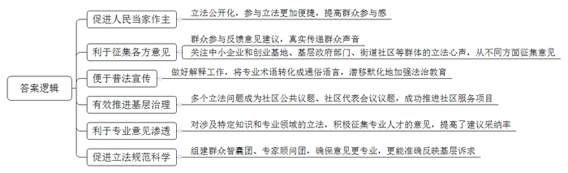
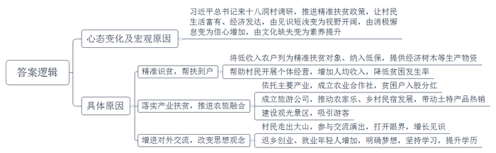
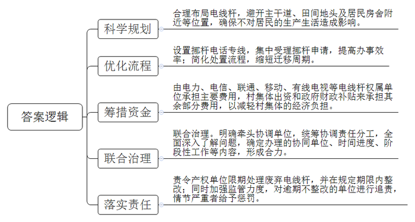
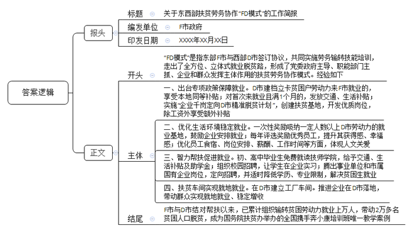

# 2020年0822公务员多省联考《申论》题（贵州C卷）

> 候选采集稿。参考答案及解析来自粉笔页面，不代表官方答案或真实高分答卷；来源使用许可与原卷对应关系仍需人工核实。

## 给定材料

### 材料 material-94ad4c8fdeee66ab

从2015年9月开始，在S市H街道洪储小区当了近30年居委会主任的老朱，又多了一个新身份——基层立法联系点信息员。“立法的神秘感一下子被打破了，立法工作就在家门口，每个人都可以参与，这就是人民当家作主。”

2019年，垃圾分类成为百姓讨论的热点话题。“生活垃圾，究竟怎么分？垃圾分类标准不仅直接关系到管理效果，而且关乎民生，立法过程备受关注。在这一背景下，我们作为市人大常委会基层立法联系点，承担了《S市生活垃圾管理条例》制定的意见收集工作，目的就是要把老百姓的建议原汁原味地提上去。”朱主任说。

79岁的老夏是洪储社区的居民，对垃圾分类立法非常热心。“在条例草案的听证会上，关于垃圾分类标准的问题讨论十分热烈。”老夏记忆犹新，“我从老年人的视角发表了意见，建议按照大多数市民熟悉的四分法来分，分类搞得太复杂，老年人记不住。”“真没想到，我的建议最终被采纳入法了。”老夏激动地说，“这说明立法联系点的意见征集不是摆样子，老百姓的想法能在立法中切实得到体现。”

不仅要传递群众好声音，还要关注好不同群体的立法心声。“比如，在中小企业促进法修订草案征求意见阶段，对于中小企业和创业基地、基层政府部门，服务企业的街道社区等，都要从不同方面征集意见。”H街道人大工委龚主任介绍，基层立法联系点还要注重向人民群众做好解释工作，善于把“法言法语”转化成群众通俗易懂的语言，潜移默化地加强法治教育。“两年多来，1800余人次参与立法意见征询，10余个立法问题成为社区公共议题，其中两个进入2018年H街道社区代表会议议题，并成功推进了多个社区服务项目。”龚主任说。

“让专业的意见渗透到法律条款中。”S市人大常委会研究室刘主任表示，对于一些涉及特定知识和专业领域的立法，在广泛征集基层民意的同时，积极征集专业人才的意见，对于提高立法建议的采纳率大有益处。在制定反家庭暴力法时，某律师事务所的吴律师正好办理过一起老年人遭女儿虐待的案件。“反家庭暴力法草案中保护妇女、儿童权益的内容比较明显，而家庭还应该包括老年人，特别是与子女同居的老年人。”吴律师说，在基层立法联系点征集意见时，她提出了这项建议，最终被采纳。

作为基层立法联系点的S市C镇人大，共设立了36个采集点，各采集点着重吸纳退休或者在职法律工作者、教师、工程师等各行各业有一定专业知识储备的热心人，组建了群众智囊团。“目前，群众智囊团有150人，C镇人大还专门聘请了4位专家学者组成了专家顾问团。”C镇人大钱主席介绍，这样收集上来的意见更专业，也更能反映基层群众的诉求，促进立法工作更加规范、科学。“农村集体聚餐场所很多，如果发生食物中毒，处罚对象是谁？是聚餐的承办者、举办者，还是场所提供者？还要明确被追责主体的法律地位。”在《S市食品安全条例》征求意见时，C镇人大针对农村地区的实际情况提出了完善建议，并得到了采纳，促进了农村聚餐管理更加规范。

### 材料 material-865913b5c844bada

云雾缭绕、山高路远，十八洞村就在大山深处。作为偏远山区的一个苗族村落，十八洞村原本少人知晓，2013年11月3日，习近平总书记来到这里考察调研、访贫问苦，首次提出精准扶贫战略思想，十八洞村由此声名远播。

“再过多少年我也忘不了那一天！”石大娘回忆说，“那天下午，村里来了好多人，不一会儿，一群人走到我家门前，走在前面的那位身材魁梧，面带微笑，问我这是不是你屋？我讲是的。他问可不可以到屋里坐下子？我说可以可以，稀客稀客！”那时，石大娘真不知道来她家的是习近平总书记。

石大娘没有读过一天书，不认识一个字，嫁到十八洞村后，尽管一天到晚勤劳辛苦，但由于自然条件差，穷乡僻壤，薄田寡地，一家人生活贫困。“我和老伴本来以为这辈子就这样过下去了，也认命了。”石大娘说。习近平总书记的到来和精准扶贫政策的推进，彻底改变了老人一家的命运。县扶贫工作队将她家列为精准扶贫对象，纳入了低保，送来了榉木苗、梨树苗，帮着各种了3亩。来参观的游客越来越多，工作队帮她在家开了个小商店，卖些饮料、方便面、书籍和纪念品等。“现在的日子，过去做梦都不敢想！”石大娘顺手向火塘里续了几块柴，火烧得更旺了。

2016年，十八洞村人均纯收入由2013年的1686元增加到8313元，贫困发生率由2013年的56.75%下降到1.28%。2017年，该村的当家产业猕猴桃挂果，全村人均收入首次突破万元。石大娘家作为建档立卡贫困户，成了村里猕猴桃合作社的原始股东，2017年分红2000元，2018年分红2400元。“我现在一年四季餐餐有肉吃，神仙过的日子也就是这样了！”石大娘说。2019年，十八洞旅游公司正式营运，截至年底，游客超60万人次，带动全村农家乐、乡村民宿大发展，猕猴桃、黄桃、腊肉、蜂蜜、苗绣、山泉水等村里土特产品热销。2020年，十八洞村溶洞景区将建设完成并对外开放，预计年游客量可达100万人次。

2019年国庆节前几天，石大娘和村里农民艺术团的40多个姐妹到了北京，参加中央民族歌舞团的一场大型文艺晚会，献上了苗族情景表演《十八洞的今天变了样》。在十八洞村，像石大娘这样走出大山，到外面开眼界、见世面的村民越来越多。从城市回到家乡寻求发展的年轻人也越来越多，他们在十八洞村开起了农家乐、当起了导游。这天，石大娘22岁的外孙女小龙正好在家，她已取得学前教育专业的大专文凭，正自考本科。“以后我要在十八洞村开一家幼儿园，梦想总是要有的。”她自信而爽朗。

“以前十八洞村是袋子空、家里空、寨子空、精神空。”县扶贫工作队的伍副队长说，“现在，村民收入多了，年轻人多了，全村人致富奔小康的心气足足的！”“对十八洞村来说，最大的变化是人的变化。”县委宣传部周副部长说。

### 材料 material-19b3d1a7a5555951

乡间公路，两米多宽，刚好供一辆轿车通行。不巧的是，路中“长”出一根电线杆，占了路面近半米。车行至此，弯转不得，直行也不畅，一长段出村的道路成了摆设，J县星火村的村民们没少为废旧电线杆的事儿烦心。

“开车到这里，傻眼，只好倒回去。”顺着星火村党总支马副书记指的方向看过去——道路两旁、宅前屋后、田间地头，架空线杆不时见到，分布极不规则，还有不少已经闲置废弃。最近的杆子离村民家宅不过数米，村民们开玩笑抱怨：道路拓宽、房屋翻建，还都得看杆子的“脸色”。

废旧电线杆碍事，为啥不给挪个地儿？“想请走，没那么容易。”星火村党总支奚书记细数电线杆的“娘家”，“电力、电信、联通、移动、有线电视……就连小灵通的杆子现在还竖着呢！”这么多单位的电线杆，要挪，得一家一家打电话咨询、打报告申请，电话那头听完诉求，都是先报价格，估算下来，废弃不用的杆，拔走，3000块钱一根；挪地方，更贵，一根得1万多块钱，而且流程走下来，移杆周期至少也得两三个月。星火村共34根废弃空杆要拔除，81根尚在使用的电线杆要迁移，算算账，这笔钱对基层来说可不是个小数目。

在星火村，为这件事，村民们常有反映，可几年来，也只解决了几根。拔根电线杆，事本不大，却因“杆出多门”，多头管理，在基层治理中反倒成了“盲区”。据县建设局调研统计，辖区内农村地区95%以上的架空线杆竖在村民的宅前屋后、村主干道旁或田间地头，有的废弃线杆权属单位为减少处理废杆的成本，任由废杆随意丢弃，而线杆申请移动周期长、费用高，给村里带来较大经济压力。“解决不好这个问题，村子村容村貌受影响，会给整个美丽乡村建设拖后腿。”奚书记说。

去年J县大调研，乡村废弃电线杆的处理问题被县建设局上报到了县里的大调研办公室，定性为典型的跨地区、跨部门、跨事权的“三跨”问题。“县里立即启动复杂重大问题处理机制，迅速进入上报、流转、解决流程。”J县大调研办公室相关负责人说，“三跨”问题多出现在基层治理的薄弱区域、盲点区域，通过大调研解决复杂重大问题的过程，也是推动建立健全体制机制的过程。

打开J县探索建立的复杂重大问题统筹协调推进“流程图”，这类疑难问题有着明确的流转规定。在“流程图”上可以看到，问题进入上报环节后，需立即在有关会议上进行统筹协调、责任分工；随后进入流转环节，协调单位对问题进行全面深入了解，确定问题办理的协同单位、时间进度、阶段性工作等内容；然后由协调相关单位依据授权发挥牵头协调作用，多方攥起拳头，形成解决问题的合力。

### 材料 material-56d2e7acc1f7b222

2017年2月，东部F市与西部D市两地政府签订《东西部扶贫协作框架协议》，确定共同实施劳务输转技能培训暨大中专生就业协作计划。3年来，F市走出了一条帮助D市群众全方位、立体式的就业脱贫路，探索出F、D两地扶贫劳务协作模式，入选了110个“全球减贫案例”。

32岁的小周与他的妻子小张，是D市建档立卡贫困户。在两地有关部门的组织下，夫妇俩于2019年年初来F市务工，现在是某塑胶有限公司的员工。“我一个月工资五六千元吧，我老婆也差不多。这样下去，我们的日子有奔头了！”说起这份工作，小周十分满意。他说，除了工资，只要务工半年以上，还可以享受到F市为每人发放的一万多元的各种补贴，十分可观。目前他们每人已经领取到了4500元补贴，其余补贴将陆续发放。此外，公司专门为他们安排了免费的夫妻房，洗手间、厨房、空调等配套设施一应俱全，让他们在F市安下了一个温暖的家。像小周夫妇这样的D市贫困劳动力，3年来，F市已输转了近万人次。

F市和D市相距2000多公里，为实现“输转一人、就业一人、脱贫一户”的目标，F市多措并举，从政策保障、薪酬待遇等方面，为务工人员提供良好的务工环境。针对D市建档立卡贫困户劳动力普遍年龄偏大、缺乏技能、工作效率低、工资待遇不高等实际情况，F市出台政策规定：D市建档立卡贫困户劳动力来F市就业的，认定为F市就业困难对象，享受F市本地建档贫困户同等的社保补贴、职业培训补贴等政策；首次来F市就业且就业满1个月的，发放交通补贴500元和一次性生活补贴1000元；借鉴公益性岗位开发扶贫经验，探索以劳务补助方式实施“企业千岗定向D市精准脱贫计划”，每年在F市扶贫就业基地，企业新开发2000个优质岗位，定向招聘D市建档立卡贫困户劳动力，除企业工资外，在最初6个月内每人每月补贴600元。到2019年，务工半年以上的D市贫困家庭劳动力，每人可享受F市各类补贴13500元。

为了鼓励企业安排D市户籍务工人员就业，F市遴选一批企业创建了就业扶贫示范基地，对吸纳一定人数以上D市劳动力的就业基地（企业），予以一次性奖励。F市还开展D市优秀员工评选表彰奖励，每年评选100名D市优秀员工并给予奖励，目前已有200名员工获评，进一步提升了他们的获得感、幸福感。为了让D市员工吃得惯、住得好、留得下，F市在食宿条件、岗位安排、薪酬待遇、工作时间等方面进一步提升优化，体现对他们的特别关爱，真正做到“感情留人、待遇留人、政策留人、环境留人”。

贫困劳动力可以到F市务工，他们的子女如何帮扶？F市坚持渔鱼兼授，实施智力扶贫。针对部分建档立卡户学生初中、高中毕业后辍学在家、缺乏技能等问题，F市发挥技师学院优势，资助D市户籍建档立卡贫困家庭初、高中毕业生到技师学院免费就读，使他们能够学到一技之长，更好地建设和服务家乡，帮助家乡人民早日脱贫。这些学生在F市上学期间，可以免交学费、学杂费和住宿费，每位学生每年还可以享受交通往返补贴2000元、生活补助8000元、国家助学金2000元。对于一些即将毕业的技校学子，F市积极搭建平台，组织多家企业开展校园招聘活动，为他们学习锻炼和就业创造条件。目前已有200多名学生在多家企业顶岗实习。F市每年还腾出一批事业单位和市属国有企业岗位，面向D市建档立卡贫困家庭高校毕业生招聘，并根据实际情况适当降低学历、放宽专业限制，目前已招聘近300名贫困学子来F市工作。“我要扎根F市努力工作，以良好的工作业绩回报当地人民的关爱。”D市贫困学子小黄感动地说。

对于离乡外出有难度的贫困户，F市将工厂车间“搬”到他们家门口，让他们实现就地就业、稳定增收。说起在某服装公司扶贫车间上班，贫困户小何满心欢喜：“原来出去打工，照顾不到家里，现在在家门口打工，每月4000多元工资，老婆也有2000多元，我们俩既赚了钱，也顾了家。”目前在这家服装公司的扶贫车间已安排了140名当地群众就业，其中建档立卡贫困户100人。截至2019年底，F市已推进25家企业在D市落地，建设“扶贫车间”89个，带动1800多名建档立卡贫困户就近就地就业。

F市与D市结对帮扶以来，两地扶贫劳务协作工作取得显著成效，初步形成了党委政府主导、职能部门主抓、企业和群众发挥主体作用的扶贫劳务协作“FD模式”。目前，已累计组织输转D市贫困劳动力就业上万人次，直接带动2万多名D市贫困人口脱贫，组织输转建档立卡贫困劳动力占东部地区帮扶贫困地区总数近一半。

FD扶贫劳务协作模式，成为国务院扶贫办举办的全国携手奔小康培训班唯一教学案例，为推动全国东西部扶贫工作优化升级贡献了“东部智慧”。

## 题目

### 第 1 题

**根据给定资料**1**，请谈谈建立基层立法联系点制度在该市发挥了哪些积极作用？****(30****分****)**

关联材料：material-94ad4c8fdeee66ab、material-865913b5c844bada、material-19b3d1a7a5555951、material-56d2e7acc1f7b222

作答要求：

要求：准确、全面、有条理，不超过300字。

### 第 2 题

**从****“过去做梦都不敢想”到现在“梦想总是要有的”，请你根据给定资料**2**，谈谈十八洞村村民的心态为什么会发生这样的变化。****(30****分****)**

关联材料：material-94ad4c8fdeee66ab、material-865913b5c844bada、material-19b3d1a7a5555951、material-56d2e7acc1f7b222

作答要求：

要求：准确、全面，有条理，不超过300字。

### 第 3 题

**根据给定资料**3**，请你提出整治****J****县乡村电线杆乱象的具体措施。（****40****分）**

关联材料：material-94ad4c8fdeee66ab、material-865913b5c844bada、material-19b3d1a7a5555951、material-56d2e7acc1f7b222

作答要求：

要求：

（1）紧扣资料，内容完整；

（2）条理清晰，措施可行；

（3）字数不超过400字。

### 第 4 题

**根据给定资料**4**，请就东西部扶贫劳务协作“****FD****模式”的基本做法拟写一份工作简报。****(50****分****)**

关联材料：material-94ad4c8fdeee66ab、material-865913b5c844bada、material-19b3d1a7a5555951、material-56d2e7acc1f7b222

作答要求：

要求：

（1）紧扣资料，内容完整；

（2）条理清晰，语言准确；

（3）字数在500～600字。

## 答案与解析

第 1 题

**参考答案（粉笔题库参考内容）**

1.促进人民当家作主。立法公开化，参与立法更加便捷，提高群众参与感。

2.利于征集各方意见。群众参与反馈意见建议，真实传递群众声音；关注中小企业和创业基地、基层政府部门、街道社区等群体的立法心声，从不同方面征集意见。

3.便于普法宣传。做好解释工作，将专业术语转化成通俗语言，潜移默化地加强法治教育。

4.有效推进基层治理。多个立法问题成为社区公共议题、社区代表会议议题，成功推进社区服务项目。

5.利于专业意见渗透。对涉及特定知识和专业领域的立法，积极征集专业人才的意见，提高了建议采纳率。

6.促进立法规范科学。组建群众智囊团、专家顾问团，确保意见更专业，更能准确反映基层诉求。

**解析**

**参考答案说明：**本参考答案从“促进人民当家作主”“利于征集各方意见”“便于普法宣传”“有效推进基层治理”“利于专业意见渗透”“促进立法规范科学”等六个方面进行了分条撰写。各条答案要点之间在内容上相互并列，没有交叉。

**考点**：考点影响类

**来源**：来源2020年0822公务员多省联考《申论》题（贵州C卷）

粉笔申论页面对本题只提供「解析视频」入口，该入口是会员推广位，页面无视频地址与文字解析。

第 2 题

**参考答案（粉笔题库参考内容）**

习近平总书记来十八洞村调研，推进精准扶贫政策，让村民生活富有、经济发达，由见识短浅变为视野开阔，由消极懈怠变为信心增加，由文化缺失变为素养提升。究其原因：

一、精准识贫，帮扶到户。将低收入农户列为精准扶贫对象、纳入低保，提供经济树木等生产物资；帮助村民开展个体经营，增加人均收入，降低贫困发生率。

二、落实产业扶贫，推进农旅融合。依托主要产业，成立农业合作社，贫困户入股分红；成立旅游公司，推动农家乐、乡村民宿发展，带动土特产品热销；建设观光景区，吸引游客。

三、增进对外交流，改变思想观念。村民走出大山，参与交流演出，打开眼界，增长见识；返乡创业、就业年轻人增加，明确梦想，坚持学习，提升学历。

**解析**

**参考答案说明：**本参考答案先对村民的心态变化进行了阐释，并从宏观层面指出了原因，又从“精准识贫，帮扶到户”“落实产业扶贫，推进农旅融合”“增进对外交流，改变思想观念”这三个方面对十八洞村村民心态变化的具体原因进行了分条介绍。各条要点之间在内容上相互并列，没有交叉。

**考点**：考点原因类

**来源**：来源2020年0822公务员多省联考《申论》题（贵州C卷）

粉笔申论页面对本题只提供「解析视频」入口，该入口是会员推广位，页面无视频地址与文字解析。

第 3 题

**参考答案（粉笔题库参考内容）**

整治电线杆乱象的具体措施如下：

第一、科学规划。合理布局电线杆，避开主干道、田间地头及居民房舍附近等位置，确保不对居民的生产生活造成影响。

第二、优化流程。设置挪杆电话专线，集中受理挪杆申请，提高办事效率；简化处置流程，缩短迁移周期。

第三、筹措资金。由电力、电信、联通、移动、有线电视等电线杆权属单位承担主要费用，村集体出资和政府财政补贴来承担其余部分费用，以减轻村集体的经济负担。

第四、联合治理。明确牵头协调单位，统筹协调责任分工，全面深入了解问题，确定办理的协同单位、时间进度、阶段性工作等内容，形成合力。

第五、落实责任。责令产权单位限期处理废弃电线杆，并在规定期限内整改；同时加强监管力度，对逾期不整改的单位进行追责，情节严重者给予惩罚。

**解析**

**参考答案说明：**本参考答案从“科学规划”“优化流程”“筹措资金”“联合治理”“落实责任”等不同的方面进行了分条撰写。各条要点之间在内容上相互并列，没有交叉。

**考点**：考点提出对策类

**来源**：来源2020年0822公务员多省联考《申论》题（贵州C卷）

粉笔申论页面对本题只提供「解析视频」入口，该入口是会员推广位，页面无视频地址与文字解析。

第 4 题

**参考答案（粉笔题库参考内容）**

关于东西部扶贫劳务协作“FD模式”的工作简报

F市政府 XXXX年XX月XX日

“FD模式”是指东部F市与西部D市签订协议，共同实施劳务输转技能培训，走出了全方位、立体式就业脱贫路，形成了党委政府主导、职能部门主抓、企业和群众发挥主体作用的扶贫劳务协作模式。经验如下：

一、出台专项政策保障就业。D市建档立卡贫困户劳动力来F市就业的，享受本地同等补贴；对首次来就业且满1个月的，发放交通、生活补贴；实施“企业千岗定向D市精准脱贫计划”，创建扶贫基地，开发优质岗位，除工资外享受额外补贴。

二、优化生活环境稳定就业。一次性奖励吸纳一定人数以上D市劳动力的就业基地，鼓励企业安排就业；每年评选奖励优秀员工，提升其获得感、幸福感；优化员工食宿、岗位安排、薪酬、工作时间等方面，体现人文关爱。

三、智力帮扶促进就业。初、高中毕业生免费就读技师学院，给予交通、生活补贴及助学金；组织校园招聘，让学生在企业实习；腾出事业单位和市属国有企业岗位，定向招聘，并适时降低学历、专业限制，解决贫困生就业。

四、扶贫车间实现就地就业。在D市建立工厂车间。推进企业在D市落地，带动群众实现就地就业、稳定增收。

F市与D市结对帮扶以来，已累计组织输转贫困劳动力就业上万人，带动2万多名贫困人口脱贫，成为国务院扶贫办举办的全国携手奔小康培训班唯一教学案例。

**解析**

**参考答案说明：**（1）本题要求写“工作简报”，一般格式为：报头（包括标题、编发单位、印发日期等）+正文（一般包括开头、主体、结尾）。（2）正文部分，一方面从内容来看，围绕着“东西部扶贫劳务协作‘FD模式’”这一主题，本参考答案的开头先介绍了“FD模式”；主体部分分别从“专项政策保障就业”“优化生活环境稳定就业”“智力帮扶促进就业”“扶贫车间实现就地就业”四个方面写到了“FD模式”的基本做法；结尾对“FD模式”进行了总结。另一方面，形式上，本参考答案做到了分段、分条撰写，整体上条理较为清晰。

**参考答案二**

关于东西部扶贫劳务协作“FD模式”的工作简报

F市政府 XXXX年XX月XX日

“FD模式”是指东部F市与西部D市签订协议，共同实施劳务输转技能培训，走出了全方位、立体式就业脱贫路，形成了党委政府主导、职能部门主抓、企业和群众发挥主体作用的扶贫劳务协作模式。经验如下：

一、提供良好务工条件。出台扶持政策，规定D市建档立卡贫困户劳动力来F市就业的，享受本地同等补贴，对首次来就业且满1个月的，发放交通、生活补贴；实施“企业千岗定向D市精准脱贫计划”，创建扶贫基地，一次性奖励吸纳D市劳动力达标的就业基地，开发优质岗位；评选并表彰奖励优秀员工，提升其获得感、幸福感；优化员工生活和工作条件，体现人文关爱。

二、智力扶贫，帮扶D市贫困户子女。资助贫困家庭初、高中毕业生免费就读技师学院，给予交通、生活补贴及助学金；搭建平台，组织校园招聘，让技校生在企业实习；腾出事业单位和市属国有企业岗位，定向招聘，放宽学历、专业限制，解决贫困生就业。

三、帮助贫困户就近就地就业。F市推进企业在D市落地，建设扶贫车间，带动群众实现就地就业、稳定增收，使其兼顾家庭和就业。

F市与D市结对帮扶以来，已累计组织输转贫困劳动力就业上万人，带动2万多名贫困人口脱贫，成为国务院扶贫办举办的全国携手奔小康培训班唯一教学案例，也入选了全球减贫案例。

**考点**：考点总结类

**来源**：来源2020年0822公务员多省联考《申论》题（贵州C卷）

粉笔申论页面对本题只提供「解析视频」入口，该入口是会员推广位，页面无视频地址与文字解析。

