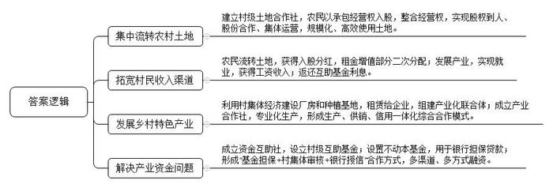
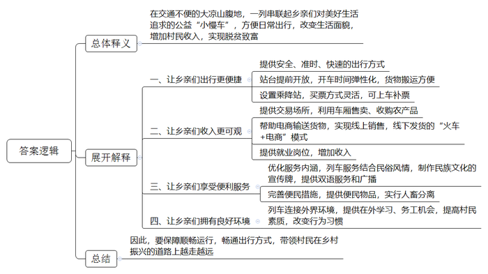
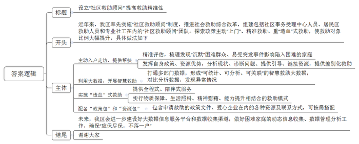
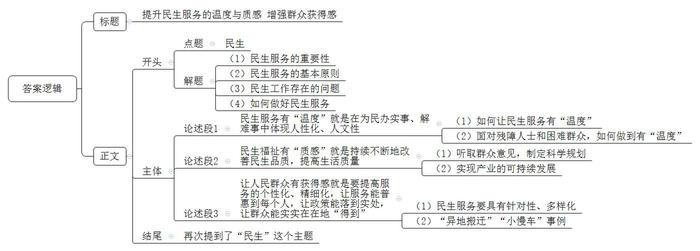

# 2021年公务员多省联考《申论》题（贵州A卷）

> 候选采集稿。参考答案及解析来自粉笔页面，不代表官方答案或真实高分答卷；来源使用许可与原卷对应关系仍需人工核实。

## 给定材料

### 材料 material-d3686c17771a6ab7

近年来，长茂村围绕破解人、财、地三个难题，积极推进系列要素联动改革，逐步从一个发展落后的农业村蝶变为远近闻名的“明星村”。

以前的长茂村是一个传统的农业村，农作物一年两季，一季烤烟，一季稻谷，粗放式耕种方式抗风险能力弱，市场竞争力不强。“一旦遇上了台风，基本就是颗粒无收。”长茂村党支部书记刘振华说，“我们村地处世界长寿之乡，土壤富含‘长寿元素’硒，空气与水质好、温差大，但为何农业却成为‘跛脚’产业？”曾十余次到此走访的农业大学王教授直言，欠发达地区的资源禀赋优势本来就不明显，若是以分散的土地、少量的资金延续传统农业生产形态，收益自然一般。

32岁的黄波是长茂村的致富能手。去年上半年，他一口气向村里的股份合作经济联合社租下40亩地发展木耳种植，“这40亩地，涉及几十户人家，我现在不用一一去谈，只要找村里股份合作经济联合社就行，省去大量沟通成本。”去年以来，为解决承包地分散化、碎片化和低效使用等问题，长茂村建立村级土地合作社。“农民以承包经营权入股，以求将分散在每家每户的耕地经营权‘化零为整’，实现股权到人、股份合作、集体运营。”刘振华介绍，“村级土地合作社以合适的价格集约土地，并将集约后的土地以竞价方式承租出去。对于土地租金增值部分，土地合作社进行二次分配。50%返还给土地出租农户，50%归作集体，用于村里产业发展、关爱老人等公益事业。”

黑木耳产业园是长茂村近些年发展“一村一品”特色产业的缩影。该产业园由长茂村利用集体经济扶持资金与产业帮扶资金投资兴建，总投资约500万元，占地约10亩，实行生产、加工、销售一体化经营。记者在黑木耳产业园看到，几十个村民忙着栽培菌种、制作菌棒、养菌，柳琴就是其中一位。“在这儿上班，一个月有4000元左右的工资，也能照顾家里。”她笑言。据了解，在前期土地流转基础上，长茂村利用村集体经济建设厂房和种植基地，然后每年以20万元价格租赁给企业，探索“党支部+公司+基地+专业合作社+农户”形式，联手组建产业化联合体。同时，村党支部组织农户成立产业合作社，发展专业化生产，形成生产、供销、信用“三位一体”综合合作模式，有效解决农户传统种植模式风险大、竞争力较弱的问题，为村民提供内有技术、外有销路的产业链服务。

随着乡村振兴战略的推进，农村发展产业有资金需求，但金融机构有规避风险的责任，“钱从哪儿来，怎么才能用好”的问题愈发突出。为此，长茂村按照因地制宜、入社自愿的原则，探索成立长茂村资金互助社，并设立村级互助基金。“互助基金的资金来源为村民自筹、财政支持和社会捐赠三部分，我们实际筹款103万元。”刘振华说。之后，在互助基金中设置100万不动本基金，用于村集体、农业合作社及村民在银行担保贷款，担保贷款总额度为300万元。不动本基金的利息，一部分归村集体，一部分返还给资金互助社社员。“基金担保+村集体审核+银行授信”合作方式，为长茂村带来多渠道、多方式的融资服务，有助于满足农户短期种养、技术设备购买与更新、产业投资等方面的资金需求，也为长茂村股份合作经济联合社开展项目投资提供资金支持。

推进乡村振兴战略，如何释放沉淀资源、推动产业兴旺，是不少乡村遇到的现实难题。在王教授看来，只要思路和方法得当，就能找到适合本地的致富之路，就像把米、红豆、红枣等熬制成八宝粥，能得到更多附加值。长茂村走的正是这样一条路。

### 材料 material-86a27805ba17c7c6

77岁的彝族老阿妈克迟莫，乘坐5619次列车从下普雄前往上普雄走访亲戚。阿妈很爱笑，也很健谈，因为牙齿几乎掉光，她笑着的时候总是害羞地抿着双唇。她说：“1968年，25岁从上普雄嫁到了下普雄，走了一天多的山路，才到夫家。两年后的1970年，‘小慢车’开了，40多分钟就可以回娘家。”尽管最近几年山里的大多数村子都修了公路，但是大凉山区经常出现落石、滑坡和泥石流等地质灾害阻断公路，冬季也经常封路。对于大凉山深处的彝族老乡们来说，“小慢车”还是最安全、时间最有保障的出行方式，很多时候也是唯一的出行方式。“即使某些区段因为各种原因无法通行，我们也会保障其他区段的运行。”乘务员阿霞说。

在过去的几十年间，这趟被称为“小慢车”的列车早已彻底融入当地人的日常生活。作为孩子们的校车，当地人的赶集车、公交车、婚车……这趟列车也在用“润物无声”的方式支持着大凉山区的脱贫攻坚。即使是普通话不流利的彝族老乡，也会在听到“小慢车”三个字时，第一时间吐出一个“好”字。

2020年是成昆铁路通车50周年，作为服务民族地区、助推地方经济、巩固国防建设的钢铁大动脉，成昆铁路串起了沿线群众的幸福生活，5619/20次和5633/4次两对公益性“小慢车”与成昆线同龄，在悠长岁月里传承“铸道精神”，穿行于大凉山腹地，最长运行里程353公里，停靠26个车站，自1995年以来票价从未变过，最高25.5元，最低2元。5619次、5633次“小慢车”串联起彝族老乡们对美好生活的追求。一张张朴实无华的笑脸，让小慢车充满了阳光和温度。

3月开始，正是大凉山采收蕨菜、青岗藤、蒲公英、党参等土特产的季节。5633次尼波站开车后，各车厢大件行李处都堆满了农产品。有的时候，这些土特产在“小慢车”上完成了交易，老乡们在车厢里拿出秤杆子，当场称重交易，省时又省力，在到达终点前就已经把手上的土特产出售一空。阿莫此次乘车目的是收购蕨菜，他的随身物品很简单，一个皮质挎包、一杆秤。他穿梭在车厢里，不断寻找心仪之物，终于在8号车厢的大件行李处找到了几大包新鲜水嫩的蕨菜，在与货主沟通后，阿莫拿出秤杆子，一袋一袋地称了起来，这一趟阿莫收购了300多斤蕨菜。与阿莫同村的阿西，选择了“火车+电商”的新路，不再依靠坐火车运输货物赚钱了。他开办猪场，制作凉山猪腊肉，在电商平台销售，然后用火车把腊肉运到县城去发快递。今年春节，他的几千斤腊肉几乎销售一空，挣了几万块钱。

为了供阿树上学，父母通过“小慢车”销售家里种植的烤烟、土豆、玉米，他们最大的心愿就是阿树能找到一份稳定的工作。2017年，铁路部门履行扶贫承诺来到学校招工，阿树与另外5名彝族同学脱颖而出，成为“小慢车”的乘务员，得知儿子能够在“铁路部门”上班的消息，一家人都高兴坏了。阿树的妈妈说：“这下阿树既找到了稳定的工作，又缓解了家里的经济压力。”从乘客变为铁路职工，“小慢车”一直温暖着这位青年的心。

近年来，“小慢车”列车党支部围绕精神文明建设和精准扶贫，积极促进民族团结进步，不断优化“彝乡情”服务内涵，完善便民利民措施，将民俗风情与列车服务举措结合，设计制作了带有彝族文化元素的揭示揭挂，列车方向牌和车内引导标识都标注了彝汉双语。同时，班组服务小分队坚持到车厢、到座位进行安全服务和文明乘车宣传，一并提供针线包、胶带、捆扎绳等便民物品，车内乘务员“彝语”“汉语”双语言上岗，列车广播增加了彝汉双语播报服务。为了方便日常彝族老乡运输家禽、牲口，“小慢车”贴心地在行李车厢增设了牲畜拴挂处，每趟车进行消毒，实现了牲畜与旅客分开，让车厢环境更卫生、整洁。

为了让彝族老乡能把所有东西搬上车，有的车站还会提前开放站台，让老乡先把货物堆在车门前，有时这趟列车的开车时间会推迟几分钟。“我们这种车时间弹性大，不像高铁，都是按秒计算的。”列车员称，“和多数人熟悉的先买票再上火车的流程略有不同，‘小慢车’一路停靠的大多数车站都只能被称为乘降站，也就是可以上下车但不具有售票资格的车站，乘客从乘降站上车后再在车上补票。”

在阿霞看来，教育是阻断贫困的最重要的途径。现在更多彝族孩子能够走进教室，更多年轻人能够走出大山到外面学习、务工，这些都是让当地更快发展的希望。教育进步带来的最直接的变化就是在列车上随地吐痰、乱扔果皮、在车厢里抽烟的人少了，即使有，列车员的劝告也会被听进去。“以前打扫车厢卫生都是用铁铲的，甘蔗上市的时候，地上全是甘蔗渣滓，黏脚。”阿霞已在5633/4次列车上工作了20多年。“工作的时候，其实就像在串亲戚，讲讲自家的喜事和烦心事，更能看到家乡正走在乡村振兴的路上。”她说，她喜欢在列车上的工作和生活。“小慢车”是一辆开往春天的列车，为乡亲们带来了温暖和希望。

### 材料 material-142890e34c21bc3a

“把她的家粉刷一新，给独自生活的她更多支持。”

某公益平台上，为女孩小珊修缮房屋的公益计划得到不少爱心网友的参与。1元、10元、100元……不到一个月，爱心捐款就超过了修缮所需。

小珊家住C市N区。唯一的亲人去世，自己又身患多种疾病，让她一度有轻生念头，是N区“社区救助顾问”团队把她从疾病与孤独中拉了出来。

“我们希望为她‘粉刷’的不仅是墙面，也是内心。”为小珊修缮房屋正是为其定制的救助“组合拳”中的一步：修缮后的房屋腾出一间出租，能有效缓解其家庭债务。同时，提供专业心理咨询、继续教育、就业指导等服务，帮助她重拾生活信心。

小珊的故事是C市N区近年在全国率先推出“社区救助顾问”制度及社会救助综合改革的一个缩影。在党的十九届四中全会提出“建立解决相对贫困的长效机制”的背景下，N区探索政策主动“上门”、精准救助、重“造血”的救助方式，取得了较好效果。

尽管C市已建立较完备的现代社会救助体系，但因救助工作涉及部门较多、政策内容较复杂，总有少数困难群众不熟悉政策而未得到应有救助。唯有变“人找政策”为“政策找人”，才能彻底解决救助工作“最后一公里”难题。2020年9月，C市宣布在全市全面实施“社区救助顾问”制度。N区作为全国社会救助综合改革试点区，在C市最先探索此项制度。2019年，该区试点组建一支由社区事务受理中心人员、居民区救助人员和专业社工组成的300余人“社区救助顾问”团队。团队在主动发现极少数“沉默”困难群众的同时，充分发挥熟悉各项救助政策、能够调配各项救助资源的优势，就近帮助困难群众分析现状、诊断问题、提供指引、链接资源，最终找到符合他们实际需要的差别化救助方式。“社区救助顾问”制度推出至今，N区已对7000多户居民进行了精准评估，梳理出高度困境家庭重点服务对象1300多户，其中不少为原本“沉默”的困难人群。

新冠肺炎疫情下，那些本就脆弱的家庭是否会面临更大的风险？N区红桥路街道救助顾问主动到居民区开展走访。他们发现，从外地来N区的苏先生的公司因疫情无法开工，妻子无业在家，还有三胞胎女儿需要照顾，家庭基本生活难以维持。救助顾问以最快速度制定救助方案，除发放临时帮扶金外，还链接外部资源，帮助苏先生妻子找到了线上工作岗位。

在N区华新路街道，近年来通过打通民政、人社、卫健、医保、残联等部门数据，形成了“可统计、可分析、可关联”的智慧救助大数据。街道服务办何主任举例说，救助顾问在比对居民医保与工会数据时，发现陈女士家庭医药费突然增大，上门走访后得知陈女士最近做了一场大手术，丈夫又生病在家。儿子也找不到工作。救助顾问随即为陈女士一家对接救助政策，不仅解决了大部分自费医药费，还帮助其儿子找到临时工作，使这个家庭走出了困境。

“我们还将进一步建设好大数据信息服务平台和数据收集渠道，做好低保家庭、低收入家庭、支出型贫困家庭和特殊困难家庭的动态信息收集、数据管理分析工作，确保‘应保尽保，不落一户'。”N区民政局申局长说。

“贫困有时候不是光靠钱就能解决，社区救助顾问就是要分析每个个体或家庭的致贫原因，以‘一户一方案’原则设计救助计划，并提供全程式、陪伴式服务，把过去‘供血式’的物质救助转变为物质保障、生活照料、精神慰藉、能力提升等相结合的‘造血’式救助。”N区民政局社会救助科科长说。

N区每名救助顾问都有一个“政策包”和一个“资源包”，“政策包”里装着为困难群众申请救助的政策文件，“资源包”里则有包括爱心企业、群团组织、基金会等在内的各种资源和联系方式。救助顾问可根据救助对象实际所需及时匹配相应救助资源。

“社区救助顾问”制度在N区试点两年来，越来越多的困难人群被救助顾问发现，并得到相关救助。数据显示，N区救助目标对象占全区户籍人口的比例已从1%升至约6%。

### 材料 material-469a815de4e308e2

2020年，L省民生工程推进跑出“加速度”，一系列保障和改善民生的惠民之举纷纷落地——稳定就业岗位880.8万个；开工改造老旧小区50.8万户、棚户区14.75万套，开工建设公租房4312套，改善群众居住条件；改造敬老院155个、护理型养老床位1.8万张。今年的省政府工作报告中，L省又明确提出要聚力在保障和改善民生上求突破、见实效，注重普惠性、基础性、兜底性，尽力而为、量力而行，努力把群众关心的事情切实办好。如何让老年群体“老有所养”，也是代表委员们普遍关心的问题。T市市委书记谭洪在参加分组讨论时，着重提出要进一步办好民生实事，其中最迫切的一条就是把老年食堂办好，“实现老年人困难的不交钱，条件好的少交钱，不用去赶集买菜、动火动电，就能吃上热汤热饭。”

省人大代表李智水在接受采访时表示：“2021年是‘十四五’开局之年，在继续统筹抓好疫情防控和社会经济发展的大背景下，L省将从交通、教育、医疗、就业、健康等多个方面办好更多民生实事，在改善民生品质上干出一番新气象。报告有温度，为民情怀浓，就是要以政府的紧日子换取群众的好日子，努力让民生服务更有‘温度’，民生福祉更有‘质感’，让人民群众的获得感更足。”

## 题目

### 第 1 题

**根据“给定资料**2**”，请你谈谈长茂村由发展落后的农业村蝶变为远近闻名的“明星村”的原因。****（20****分）**

关联材料：material-d3686c17771a6ab7

作答要求：

要求：全面、准确、有条理。不超过300字。

### 第 2 题

**请结合“给定资料**4**”，谈谈对划线句子****“****‘小慢车’****是一辆开往春天的列车，为乡亲们带来了温暖和希望”的理解。****（30****分）**

关联材料：material-86a27805ba17c7c6

作答要求：

要求：全面准确，有条理。不超过400字。

### 第 3 题

**C****市准备召开社区救助工作经验交流座谈会****，****如果由你代表****N****区在座谈会上作简要发言****，****请根据“给定资料**5**”，拟写一份座谈会上的发言提纲。****（40****分）**

关联材料：material-142890e34c21bc3a

作答要求：

要求：内容全面，有逻辑性，语言流畅，不超过500字。

### 第 4 题

**“给定资料**1**”中提到“努力让民生服务更有‘温度’****，****民生福祉更有‘质感’****，****让人民群众的获得感更足”。请你深入思考这句话****，****联系实际****，****自选角度，自拟题目****，****写一篇文章。****（60****分）**

关联材料：material-469a815de4e308e2

作答要求：

要求：

（1）观点明确，立意深刻；

（2）思路清晰，语言流畅；

（3）参考给定资料，但不拘泥于给定资料；

（4）字数1000-1200字。

## 答案与解析

第 1 题

**参考答案（粉笔题库参考内容）**

1.集中流转农村土地。建立村级土地合作社，农民以承包经营权入股，整合经营权，实现股权到人、股份合作、集体运营，规模化、高效使用土地。

2.拓宽村民收入渠道。农民流转土地，获得入股分红，租金增值部分二次分配；发展产业，实现就业，获得工资收入；返还互助基金利息。

3.发展乡村特色产业。利用村集体经济建设厂房和种植基地，租赁给企业，组建产业化联合体；成立产业合作社，专业化生产，形成生产、供销、信用一体化综合合作模式。

4.解决产业资金问题。成立资金互助社，设立村级互助基金；设置不动本基金，用于银行担保贷款；形成“基金担保+村集体审核+银行授信”合作方式，多渠道、多方式融资。

**解析**

**参考答案说明：**本参考答案在内容上从“集中流转农村土地”“拓宽村民收入渠道”“发展乡村特色产业”“解决产业资金问题”四个方面分类概括要点；形式上，对要点按照四个分类进行了整合，并且将每类中具有总括性的要点前置，符合题干中“有条理”这一要求。

**考点**：考点原因类

**来源**：来源2021年公务员多省联考《申论》题（贵州A卷）

粉笔申论页面对本题只提供「解析视频」入口，该入口是会员推广位，页面无视频地址与文字解析。

第 2 题

**参考答案（粉笔题库参考内容）**

这句话的意思是在交通不便的大凉山腹地，一列串联起乡亲们对美好生活追求的公益“小慢车”，方便日常出行，改变生活面貌，增加村民收入，实现脱贫致富。表现为：

一、让乡亲们出行更便捷。提供安全、准时、快速的出行方式；站台提前开放，开车时间弹性化，货物搬运方便；设置乘降站，买票方式灵活，可上车补票。

二、让乡亲们收入更可观。提供交易场所，利用车厢售卖、收购农产品；帮助电商输送货物，实现线上销售，线下发货的“火车+电商”模式；提供就业岗位，增加收入。

三、让乡亲们享受便利服务。优化服务内涵，列车服务结合民俗风情，制作民族文化的宣传牌，提供双语服务和广播；完善便民措施，提供便民物品，实行人畜分离。

四、让乡亲们拥有良好环境。列车连接外界环境，提供在外学习、务工机会，提高村民素质，改变行为习惯。

因此，要保障顺畅运行，畅通出行方式，带领村民在乡村振兴的道路上越走越远。

**解析**

**参考答案说明：**思路方面，本参考答案按照词句解释题“总体释义+展开解释+总结”的一般答题思路展开。内容方面，本参考答案首先解释了“‘小慢车’是一辆开往春天的列车，为乡亲们带来了温暖和希望”这句话；接着给出了“温暖和希望”的具体体现；最后，给出了对策作为总结。词句表达方面，本参考答案加上了“表现为”“因此”等连接词来承接上下文。

**考点**：考点词句解释类

**来源**：来源2021年公务员多省联考《申论》题（贵州A卷）

粉笔申论页面对本题只提供「解析视频」入口，该入口是会员推广位，页面无视频地址与文字解析。

第 3 题

**参考答案（粉笔题库参考内容）**

设立“社区救助顾问” 提高救助精准性

近年来，我区率先实施“社区救助顾问”制度，推进社会救助综合改革，组建包括社区事务受理中心人员、居民区救助人员和专业社工在内的“社区救助顾问”团队。探索政策主动“上门”、精准救助、重“造血”式救助，使救助对象比例大幅提升，具体做法如下：

一、主动入户走访，提供帮扶。精准评估，梳理发现“沉默”困难群众、易受突发事件影响陷入困难的家庭；发挥自身政策、资源优势，分析现状、诊断问题、提供引导、链接资源，提供差别化救助。二、利用大数据，开展智慧救助。打通多部门数据，形成“可统计、可分析、可关联”的智慧救助大数据，对比分析数据，发现异常情况。三、实施“造血”式救助。提供全程式、陪伴式服务；实行物质保障、生活照料、精神慰藉、能力提升相结合的救助模式。四、配备“政策包”和“资源包”。包含申请救助的政策文件、爱心企业在内的各种资源及联系方式，可按需搭配。

未来，我区会进一步建设好大数据信息服务平台和数据收集渠道，做好困难家庭的动态信息收集、数据管理分析工作，确保“应保尽保，不落一户”。谢谢大家！

**解析**

**参考答案说明：**格式上，本参考答案包括标题+正文，标题为保险起见加上。内容上，开头先整体介绍了N区社会救助的情况；主体部分分别从“主动入户走访，提供帮扶”“利用大数据，开展智慧救助”“实施‘造血’式救助”“配备‘政策包’和‘资源包’”这四个层面展开；结尾表明了未来的发展方向。做到了分条、分段，且各条答案要点之间在内容上相互并列，没有交叉。

**考点**：考点总结类

**来源**：来源2021年公务员多省联考《申论》题（贵州A卷）

粉笔申论页面对本题只提供「解析视频」入口，该入口是会员推广位，页面无视频地址与文字解析。

第 4 题

**参考答案（粉笔题库参考内容）**

**提升民生服务的温度与质感** **增强群众获得感**

党的十九大报告指出：“增进民生福祉是发展的根本目的。必须多谋民生之利、多解民生之忧，在发展中补齐民生短板。”民生服务保障工作必须谨遵“群众至上”的原则，需要一代又一代人的不断奋斗与努力。但是如今还是存在就业不稳定、教育缺失、交通拥堵等问题，政府的民生工作和群众的民生需求出现了“错位”，说明在一定程度上政府工作脱离了群众、脱离了实际。

因此，**只有让群众有更稳定的工作、更可靠的保障、更舒适的居住条件、更满意的收入等，才能展现民生服务的****“****温度****”****与****“****质感****”****，让群众有获得感。**

**民生服务有****“****温度****”****就是在为民办实事、解难事中体现人性化、人文性，要考虑到多数人的需求，也要重视少数群体的利益诉求，满足不同人群的多样化需求。**有“温度”的民生服务要贴近群众实际，获得群众支持，遵从群众意愿。比如面对残障人士，一方面要积极主动学习，提升自身服务水平；另一方面可创建“无声服务室”，帮助听障居民找到工作，解决实际困难。对于困难群众，可联合居民区主动走访、调查，快速制定救助方案，发放临时帮扶资金，对接外部资源帮助就业等。

**民生福祉有****“****质感****”****就是持续不断地改善民生品质，提高生活质量，****要听取群众意见，制定科学规划，还要因地制宜，发展特色、优势产业。**制度、规划是提升服务质量的保障，深入实地的走访调查，换位思考的沟通交流，不仅能快速反馈群众意见建议，还能提高政策、方案的落实效率和性价比；实现产业的可持续发展是提高生活品质的有效途径，要变被动为主动，创新融资方式、完善融资服务，整合土地、劳动力、技术、市场等多种要素资源，组建产业化联合体，进行专业化、集约化、规模化发展。

**让人民群众有获得感就是要提高服务的个性化、精细化，让服务能普惠到每个人，让政策能落到实处，让群众能实实在在地****“****得到****”****。**民生服务涉及到群众生活的各个方面，包括教育、就业、住房、健康等诸多领域，要注重服务的针对性、多样化。帮助异地搬迁群众融入城市生活，为其开办“夜校”，讲解法律法规、国家政策、生活常识、本地方言等，鼓励大家放下乡情、主动拥抱新生活；“小慢车”开进大山深处，不但是山村最安全、时间最有保障的出行方式，还能切实帮助群众实现就业，缓解经济压力。

民生无小事。“保障和改善民生没有终点，只有连续不断的新起点。”这是对群众的承诺，是对国家的负责，不但温暖亿万群众心田，还能保障国家发展节节高。用政府的紧日子换取群众的好日子，同时带动中国经济“芝麻开花节节高”。

**解析**

**文章分析**

**提升民生服务的温度与质感** **增强群众获得感**

【**标题的优点**：首先，范文的标题突出了“民生服务的温度与质感”“群众获得感”这些关键词。其次，从形式上来说，前半句是大主题，后半句点明意义，使标题更加完整、饱满，且与文章结构对应，富有逻辑性。】

（1）党的十九大报告指出：“增进民生福祉是发展的根本目的。必须多谋民生之利、多解民生之忧，在发展中补齐民生短板。”（2）民生服务保障工作必须谨遵“群众至上”的原则，需要一代又一代人的不断奋斗与努力。（3）但是如今还是存在就业不稳定、教育缺失、交通拥堵等问题，政府的民生工作和群众的民生需求出现了“错位”，说明在一定程度上政府工作脱离了群众、脱离了实际。

（4）因此，只有让群众有更稳定的工作、更可靠的保障、更舒适的居住条件、更满意的收入等，才能展现民生服务的“温度”与“质感”，让群众有获得感。

【**开头的优点**：★内容方面：范文的开头是紧扣题目给定的“民生服务”这一主题展开的。首先，开头第一句话点出了“民生”，非常明确。其次，对“民生服务”这一主题词进行了分析阐述，指出了：（1）民生服务的重要性；（2）民生服务的基本原则；（3）民生工作存在的问题；（4）如何做好民生服务。★文字表达方面：使用了“只有……才”等关联词，让语言更有逻辑。】

**民生服务有****“温度”就是在为民办实事、解难事中体现人性化、人文性，要考虑到多数人的需求，也要重视少数群体的利益诉求，满足不同人群的多样化需求。**（1）有“温度”的民生服务要贴近群众实际，获得群众支持，遵从群众意愿。（2）比如面对残障人士，一方面要积极主动学习，提升自身服务水平；另一方面可创建“无声服务室”，帮助听障居民找到工作，解决实际困难。对于困难群众，可联合居民区主动走访、调查，快速制定救助方案，发放临时帮扶资金，对接外部资源帮助就业等。

【**论述段****1****的优点**：★观点句：范文的观点句是紧扣“民生服务”这一文章主题词提出的。形式上，它在段首处直接写出，位置突出，容易被发现；内容上，关键词突出，内容要点明确，可以明显看出它是从“民生服务的‘温度’”这一角度入手，指出了为民办事要体现人性化、人文性，既要考虑多数人的需求，也要考虑少数人的需求。★论述内容：本段主要围绕“民生服务”这一主题词进行分析阐述，指出了：（1）如何让民生服务有“温度”；（2）面对残障人士和困难群众，如何做到有“温度”。注意：以上两个方面的内容都是紧扣观点句“民生服务有‘温度’就是在为民办实事、解难事中体现人性化、人文性，要考虑到多数人的需求，也要重视少数群体的利益诉求，满足不同人群的多样化需求”进行分析论述的，针对性强、内容层次丰富。在论证方法和论据选取方面，讲道理和举例子相结合，做到了丰富多样。】

**民生福祉有****“质感”就是持续不断地改善民生品质，提高生活质量，****要听取群众意见，制定科学规划，还要因地制宜，发展特色、优势产业。**（1）制度、规划是提升服务质量的保障，深入实地的走访调查，换位思考的沟通交流，不仅能快速反馈群众意见建议，还能提高政策、方案的落实效率和性价比；（2）实现产业的可持续发展是提高生活品质的有效途径，要变被动为主动，创新融资方式、完善融资服务，整合土地、劳动力、技术、市场等多种要素资源，组建产业化联合体，进行专业化、集约化、规模化发展。

【**论述段****2****的优点**：★观点句：范文的观点句是紧扣“民生服务”这一文章主题词提出的。形式上，它在段首处直接写出，位置突出，容易被发现；内容上，关键词突出，内容要点明确，可以明显看出它是从“民生福祉有‘质感’”这一角度入手，指出了要改善民生品质，提高生活质量。★论述内容：本段主要围绕“民生服务”这一主题词进行分析阐述，指出了：（1）制定科学合理的制度；（2）实现产业的可持续发展。注意：以上两个方面的内容都是紧扣观点句“民生福祉有‘质感’就是持续不断地改善民生品质，提高生活质量，要听取群众意见，制定科学规划，还要因地制宜，发展特色、优势产业”进行分析论述的，针对性强、内容层次丰富。在论证方法和论据选取方面，讲道理和举例子相结合，做到了丰富多样。】

**让人民群众有获得感就是要提高服务的个性化、精细化，让服务能普惠到每个人，让政策能落到实处，让群众能实实在在地****“得到”。**（1）民生服务涉及到群众生活的各个方面，包括教育、就业、住房、健康等诸多领域，要注重服务的针对性、多样化。（2）帮助异地搬迁群众融入城市生活，为其开办“夜校”，讲解法律法规、国家政策、生活常识、本地方言等，鼓励大家放下乡情、主动拥抱新生活；“小慢车”开进大山深处，不但是山村最安全、时间最有保障的出行方式，还能切实帮助群众实现就业，缓解经济压力。

【**论述段****3****的优点**：★观点句：范文的观点句是紧扣“民生服务”这一文章主题词提出的。形式上，它在段首处直接写出，位置突出，容易被发现；内容上，关键词突出，内容要点明确，可以明显看出它是从“让人民群众有获得感”这一角度入手，指出了要提高服务的个性化、精细化。★论述内容：本段主要围绕“民生服务”这一主题词进行分析阐述，指出了：（1）民生服务要具有针对性、多样化；（2）介绍了“异地搬迁”“小慢车”两个事例。注意：以上两个方面的内容都是紧扣观点句“让人民群众有获得感就是要提高服务的个性化、精细化，让服务能普惠到每个人，让政策能落到实处，让群众能实实在在地‘得到’”进行分析论述的，针对性强、内容层次丰富。在论证方法和论据选取方面，讲道理和举例子相结合，做到了丰富多样。】

【**论述段之间的关系**：★内容的内在逻辑：范文的论述段之间是依照并列逻辑展开的。论述段1先写了“民生服务的温度”，论述段2又写了“民生福祉的质感”，论述段3再写了“让群众有获得感”。★段与段的外在衔接：论述段1、2、3都在开头段直接点题，使文章整体上看起来逻辑清晰。】

民生无小事。“保障和改善民生没有终点，只有连续不断的新起点。”这是对群众的承诺，是对国家的负责，不但温暖亿万群众心田，还能保障国家发展节节高。用政府的紧日子换取群众的好日子，同时带动中国经济“芝麻开花节节高”。

【**结尾的优点**：范文结尾是回扣题目给定的“民生服务”这一主题词展开的，再一次强调了“民生”的深远意义。】

**考点**：考点文章写作题

**来源**：来源2021年公务员多省联考《申论》题（贵州A卷）

粉笔申论页面对本题只提供「解析视频」入口，该入口是会员推广位，页面无视频地址与文字解析。

