# 2022年贵州省公务员录用考试《行测》题（网友回忆版）

<!-- gwy:overview:start -->
> **贵州 · 2022 · 行测 · 统考** ｜ 115 题 · 图片 137 处 · 答案随题折叠

| 题型模块 | 题量 | 题号 |
| --- | ---: | ---: |
| 常识判断 | 15 | 1–15 |
| 言语理解与表达 | 38 | 16–53 |
| 数量关系 | 12 | 54–65 |
| 判断推理 | 30 | 66–95 |
| 资料分析 | 20 | 96–115 |
| **合计** | **115** | |

导航：[题型与作答说明](#题型与作答说明) · [题目](#题目) · [材料 1](#材料-1)
<!-- gwy:overview:end -->

> 候选采集稿。参考答案及解析来自粉笔页面，不代表官方答案或真实高分答卷；来源使用许可与原卷对应关系仍需人工核实。

## 题型与作答说明

常识判断

（15题）

根据题目要求，在四个选项中选出一个最恰当的答案。

言语理解与表达

（38题）

本部分包括表达与理解两方面的内容。请根据题目要求，在四个选项中选出一个最恰当的答案。

数量关系

（12题）

在这部分试题中，每道题呈现一段表述数字关系的文字，要求你迅速、准确地计算出答案。

判断推理

（30题）

本部分包括图形推理、定义判断、类比推理与逻辑判断四种类型的试题，在四个选项中选出一个最恰当的答案。

资料分析

（20题）

所给出的图、表、文字或综合性资料均有若干个问题要你回答。你应根据资料提供的信息进行分析、比较、计算和判断处理。

## 题目

### 第 1 题

下列关于中国共产党百年奋斗历史意义的说法，正确的有几项？

①锻造了走在时代前列的中国共产党

②从根本上改变了中国人民的前途命运

③开辟了实现中华民族伟大复兴的正确道路

④展示了马克思主义的强大生命力，并深刻影响了世界历史进程

A. 1

B. 2

C. 3

D. 4

第 1 题 · 答案与解析

**参考答案（粉笔题库参考内容）**

D

**解析**

本题考查政治常识。

2021年11月11日，中国共产党第十九届中央委员会第六次全体会议通过的《中共中央关于党的百年奋斗重大成就和历史经验的决议》（以下简称《决议》）全面回顾总结了党的百年奋斗历程和重大成就，高度总结了党百年奋斗的历史意义。

①正确，《决议》在“五、中国共产党百年奋斗的历史意义”部分指出：“（五）党的百年奋斗锻造了走在时代前列的中国共产党。一百年来，党坚持性质宗旨，坚持理想信念，坚守初心使命，勇于自我革命，在生死斗争和艰苦奋斗中经受住各种风险考验、付出巨大牺牲，锤炼出鲜明政治品格，形成了以伟大建党精神为源头的精神谱系，保持了党的先进性和纯洁性，党的执政能力和领导水平不断提高，正领导中国人民在中国特色社会主义道路上不可逆转地走向中华民族伟大复兴，无愧为伟大光荣正确的党。”

②正确，《决议》在“五、中国共产党百年奋斗的历史意义”部分指出：“（一）党的百年奋斗从根本上改变了中国人民的前途命运。一百年来，党领导人民经过波澜壮阔的伟大斗争，中国人民彻底摆脱了被欺负、被压迫、被奴役的命运，成为国家、社会和自己命运的主人，人民民主不断发展，十四亿多人口实现全面小康，中国人民对美好生活的向往不断变为现实。”

③正确，《决议》在“五、中国共产党百年奋斗的历史意义”部分指出：“（二）党的百年奋斗开辟了实现中华民族伟大复兴的正确道路。近代以后，创造了灿烂文明的中华民族遭遇到文明难以赓续的深重危机，呈现在世界面前的是一派衰败凋零的景象。一百年来，党领导人民不懈奋斗、不断进取，成功开辟了实现中华民族伟大复兴的正确道路。中国从四分五裂、一盘散沙到高度统一、民族团结，从积贫积弱、一穷二白到全面小康、繁荣富强，从被动挨打、饱受欺凌到独立自主、坚定自信，仅用几十年时间就走完发达国家几百年走过的工业化历程，创造了经济快速发展和社会长期稳定两大奇迹。今天，中华民族向世界展现的是一派欣欣向荣的气象，巍然屹立于世界东方。”

④正确，《决议》在“五、中国共产党百年奋斗的历史意义”部分指出：“（三）党的百年奋斗展示了马克思主义的强大生命力。一百年来，党坚持把马克思主义写在自己的旗帜上，不断推进马克思主义中国化时代化，用博大胸怀吸收人类创造的一切优秀文明成果，用马克思主义中国化的科学理论引领伟大实践。（四）党的百年奋斗深刻影响了世界历史进程。一百年来，党既为中国人民谋幸福、为中华民族谋复兴，也为人类谋进步、为世界谋大同，以自强不息的奋斗深刻改变了世界发展的趋势和格局。”

由此可知，①②③④均正确。

故正确答案为D。

**考点**：其他建设、重要文件

**来源**：2022年云南公务员录用考试《行测》题（网友回忆版）第1题

### 第 2 题

实现碳达峰碳中和目标，是贯彻新发展理念、构建新发展格局、推动高质量发展的内在要求。下列关于“双碳”工作的说法错误的是（ ）。

A. 推进“双碳”工作是破解资源环境约束突出问题、实现可持续发展的迫切需要

B. 要倡导简约适度、绿色低碳、文明健康的生活方式，引导绿色低碳消费，鼓励绿色出行

C. 推进“双碳”工作，必须坚持全国统筹、节约优先、双轮驱动、内外畅通、防范风险的原则

D. 要坚决遏制钢铁、有色、石化、化工、建材等高耗能、高排放、低水平项目发展，严把新上项目的碳排放关

第 2 题 · 答案与解析

**参考答案（粉笔题库参考内容）**

D

**解析**

本题考查政治常识。

2022年1月，习近平主持中共中央政治局第三十六次集体学习并发表重要讲话。

A项正确，习近平总书记在讲话中指出：“党的十八大以来，党中央贯彻新发展理念，坚定不移走生态优先、绿色低碳发展道路······推进‘双碳’工作是破解资源环境约束突出问题、实现可持续发展的迫切需要，是顺应技术进步趋势、推动经济结构转型升级的迫切需要，是满足人民群众日益增长的优美生态环境需求、促进人与自然和谐共生的迫切需要，是主动担当大国责任、推动构建人类命运共同体的迫切需要。”

B、C两项正确，习近平总书记在讲话中指出：“推进‘双碳’工作，必须坚持全国统筹、节约优先、双轮驱动、内外畅通、防范风险的原则，更好发挥我国制度优势、资源条件、技术潜力、市场活力，加快形成节约资源和保护环境的产业结构、生产方式、生活方式、空间格局。第一，加强统筹协调······第二，推动能源革命······第三，推进产业优化升级······巩固和提升生态系统碳汇能力。要倡导简约适度、绿色低碳、文明健康的生活方式，引导绿色低碳消费，鼓励绿色出行······第四，加快绿色低碳科技革命······第五，完善绿色低碳政策体系。”

D项错误，习近平在讲话中指出：“推进‘双碳’工作，必须坚持全国统筹······要严把新上项目的碳排放关，坚决遏制高耗能、高排放、低水平项目盲目发展。要下大气力推动钢铁、有色、石化、化工、建材等传统产业优化升级，加快工业领域低碳工艺革新和数字化转型。要加大垃圾资源化利用力度，大力发展循环经济，减少能源资源浪费。”故强调坚决遏制高耗能、高排放、低水平项目盲目发展。

本题为选非题，故正确答案为D。

**考点**：重要会议讲话、生态文明建设

**来源**：2022年云南公务员录用考试《行测》题（网友回忆版）第5题

### 第 3 题

下列画家与其作品的对应关系不正确的是：

A. 德国画家米勒——《拾穗者》

B. 元代画家赵孟頫——《秋郊饮马图》

C. 西班牙画家毕加索——《格尔尼卡》

D. 五代南唐画家顾闳中——《韩熙载夜宴图》

第 3 题 · 答案与解析

**参考答案（粉笔题库参考内容）**

A

**解析**

本题考查人文常识。

A项错误，《拾穗者》是法国巴比松派画家让·弗朗索瓦·米勒于1857年创作的一幅布面油画，现存放在巴黎的奥塞美术馆中。该画描绘了农村秋季收获后，人们从地里拣拾剩余麦穗的情景。

B项正确，《秋郊饮马图》是元代画家赵孟頫创作的绢本设色画，现收藏于北京故宫博物院。此幅作品描绘的是初秋时节，牧马人在荒野牧马的情景。

C项正确，《格尔尼卡》是西班牙立体主义画家帕勃洛·鲁伊斯·毕加索于20世纪30年创作的一幅巨型油画。该画以法西斯纳粹轰炸西班牙北部巴斯克的重镇格尔尼卡为主题，表现了法西斯战争给人类的灾难。

D项正确，《韩熙载夜宴图》是五代十国时期南唐画家顾闳中的绘画作品，描绘了官员韩熙载家设夜宴载歌行乐的场面。此画描绘的是一次完整的韩府夜宴过程，即琵琶演奏、观舞、宴间休息、清吹、欢送宾客五段场景。

本题为选非题，故正确答案为A。

**考点**：文化常识

**来源**：2022年河南省公务员录用考试《行测》题（网友回忆版）第96题

### 第 4 题

下列关于我国石窟的说法错误的是：

A. 麦积山石窟因其精美的泥塑艺术闻名

B. 龙门石窟的造像多为皇家贵族所建

C. 大足石刻开凿于秦汉时期

D. 大象山石窟位于甘肃省

第 4 题 · 答案与解析

**参考答案（粉笔题库参考内容）**

C

**解析**

本题考查人文常识。

A项正确，麦积山石窟，位于甘肃省天水市麦积区，因山形酷似农家麦垛之状，故名麦积山石窟。麦积山石窟存有221座洞窟、10632身泥塑石雕、1300余平方米壁画，以其精美的泥塑艺术闻名世界，被誉为“东方雕塑艺术陈列馆”。

B项正确，龙门石窟，位于河南省洛阳市，是世界上造像最多、规模最大的石刻艺术宝库，其造像多为皇家贵族所建，是世界上绝无仅有的皇家石窟，如孝文帝为冯太后凿古阳洞、李泰为长孙皇后造宾阳南洞等，是北魏、唐代皇家贵族发愿造像最集中的地方。

C项错误，大足石刻，位于重庆市大足区境内，是唐末、宋初时期宗教摩崖石刻，现存大足石刻作品中，最早的为凿于公元650年（初唐永徽元年）的尖山子摩崖造像。其以佛教题材为主，儒、道教造像并陈，是著名的艺术瑰宝、历史宝库和佛教圣地，有“东方艺术明珠”之称。

D项正确，大象山石窟，位于甘肃省天水市甘谷县，自山脚石级而上至巅，总长1.5公里，占地面积约640亩，是古丝绸之路上甘肃东南部融石窟和古建为一体的重要文化遗存之一。

本题为选非题，故正确答案为C。

**考点**：文化常识

**来源**：2022年甘肃公务员录用考试《行测》题（网友回忆版）第7题

### 第 5 题

下列关于文化遗址、出土文物和遗址所在地对应关系正确的是：

A. 仰韶村遗址——人面鱼纹彩陶盆——湖南

B. 龙山文化遗址——中华第一龙——山东

C. 殷墟遗址——后母戊大方鼎——河南

D. 三星堆遗址——青铜神树——重庆

第 5 题 · 答案与解析

**参考答案（粉笔题库参考内容）**

C

**解析**

本题考查人文常识。

A项错误，人面鱼纹彩陶盆一般指新石器时代人面鱼纹彩陶盆，于1955年出土于陕西省西安市半坡。仰韶文化遗址，位于河南省三门峡市渑池县城北9公里处的仰韶村。仰韶文化距今大约7000年左右，是中国新石器时代彩陶最丰盛繁华的时期。

B项错误，“中华第一龙”是指1971年内蒙古赤峰市博物馆从三星他拉村征集的青玉大龙，属于红山文化的代表玉器。龙山文化遗址，位于山东省济南市章丘区龙山街道附近，距今约4000-4600年。注：1987年在位于河南省濮阳县城西水坡仰韶文化址中发现一条由贝壳砌成的龙，也被称为“中华第一龙”。

C项正确，后母戊大方鼎又称司母戊大方鼎，是商后期（约前十四世纪至前十一世纪）铸品，于1939年出土于河南省安阳市武官村。武官村位于安阳市西北3千米的洹河北岸、殷城宫殿宗庙区和王陵区之间，属于殷墟遗址重点保护区。

D项错误，青铜神树一般指商青铜神树，1986年在四川省广汉市三星堆遗址二号祭祀坑出土，现藏于三星堆博物馆。

故正确答案为C。

**考点**：文化常识

**来源**：2022年云南公务员录用考试《行测》题（网友回忆版）第10题

### 第 6 题

下列关于中国特色社会主义法治道路的说法错误的是：

A. 中国社会主义法治之魂是依规治党

B. 党的领导是我国法治与西方资本主义法治最大的区别

C. 中国特色社会主义法治道路是建设社会主义法治国家的唯一正确道路

D. 坚持依法治国首先要坚持依宪治国、坚持依法执政首先要坚持依宪执政

第 6 题 · 答案与解析

**参考答案（粉笔题库参考内容）**

A

**解析**

本题考查政治常识。

A项错误，B项正确，习近平总书记2020年11月16日在中央全面依法治国工作会议上的讲话中指出：“党的领导是我国社会主义法治之魂，是我国法治同西方资本主义国家法治最大的区别。”

C项正确，《中共中央关于全面推进依法治国若干重大问题的决定》提出了“全面推进依法治国的总目标”。提出这个总目标，既明确了全面推进依法治国的性质和方向，又突出了全面推进依法治国的工作重点和总抓手。向国内外鲜明宣示我们将坚定不移走中国特色社会主义法治道路。中国特色社会主义法治道路，是社会主义法治建设成就和经验的集中体现，是建设社会主义法治国家的唯一正确道路。

D项正确，《中共中央关于全面推进依法治国若干重大问题的决定》中“二、完善以宪法为核心的中国特色社会主义法律体系，加强宪法实施”部分的“（一）健全宪法实施和监督制度”指出：“宪法是党和人民意志的集中体现，是通过科学民主程序形成的根本法。坚持依法治国首先要坚持依宪治国，坚持依法执政首先要坚持依宪执政。全国各族人民、一切国家机关和武装力量、各政党和各社会团体、各企业事业组织，都必须以宪法为根本的活动准则，并且负有维护宪法尊严、保证宪法实施的职责。一切违反宪法的行为都必须予以追究和纠正。”

本题为选非题，故正确答案为A。

**考点**：其他建设

**来源**：2022年云南公务员录用考试《行测》题（网友回忆版）第7题

### 第 7 题

下列关于能量与温度之间关系的说法正确的是：

A. 亘古不化的冰山没有能量

B. 温度高的物体其能量一定也高

C. 绕地卫星在近地点时的势能最大

D. 水被用来做汽车冷凝剂是因为其比热容较大

第 7 题 · 答案与解析

**参考答案（粉笔题库参考内容）**

D

**解析**

本题考查科技常识。

能量是物质所具有的基本物理属性之一，可以用来表征物理系统做功的本领，以多种不同的形式存在。按照物质的不同运动形式分类，能量可分为机械能、化学能、热能、电能、辐射能、核能等。这些不同形式的能量之间可以通过物理效应或化学反应而相互转化。

A项错误，一切物体，不论温度高低，都具有内能。炙热的铁水具有内能；冰冷的冰块，温度虽然低，其中的水分子仍然在做热运动，所以也具有内能。因此，冰山是有内能的。

B项错误，内能的大小与物体的质量、温度、状态等有关，单比较物体的温度不能判断内能的大小。

C项错误，人造卫星绕地球运行时，在近地点势能最小，在远地点势能最大，从远地点向近地点运行的过程中，动能增大，势能减小。

D项正确，水的比热容大，升高相同的温度时，吸收的热量多，所以能很好地降低温度。而汽车发动机工作时产生大量热量，所以利用水的比热容大的特点，把这些热量迅速吸收，使发动机的温度不致升得太高。

故正确答案为D。

**考点**：物理常识

**来源**：2022年云南公务员录用考试《行测》题（网友回忆版）第2题

### 第 8 题

下列诗句所描述的现象与其原理对应正确的有几项：

①飞流直下三千尺——能量守恒定律

②满架蔷薇一院香——分子的运动

③潭清疑水浅——光沿直线传播

④长河落日圆——光的反射

A. 1

B. 2

C. 3

D. 4

第 8 题 · 答案与解析

**参考答案（粉笔题库参考内容）**

B

**解析**

本题考查科技常识。

①正确，能量守恒定律是指能量既不会凭空产生，也不会凭空消失，它只会从一种形式转化为另一种形式，或者从一个物体转移到其它物体，而能量的总量保持不变。“飞流直下三千尺”意思是高崖上飞腾直落的瀑布好像有几千尺，水从高处落下，重力势能转换为动能，符合能量守恒定律。

②正确，分子的运动是指分子永不停息地做无规则运动。“满架蔷薇一院香”意思是满架蔷薇惹得一院芳香，是因为蔷薇花香中含有的分子是在不断运动的，向四周扩散，使人们闻到蔷薇花香，符合分子的运动。

③错误，“潭清疑水浅”意思是潭水清澈见底，感觉潭水很浅，原因是光线发生折射，当光线从水中斜射入空气中时，折射光线会远离法线，因此，人会感觉池底的位置上升，潭水变浅，与光沿直线传播无关。

④错误，“长河落日圆”意思是无尽黄河上落日浑圆，诗人观察到的落日并不是太阳的实际位置，而是光线经过不均匀的大气时发生了折射形成的虚像，太阳的实际位置在地平线以下。

故①②对应正确，③④对应错误。

故正确答案为B。

**考点**：物理常识

**来源**：2022年河南省公务员录用考试《行测》题（网友回忆版）第99题

### 第 9 题

下列现象中光的性质与其他三项不同的是：

A. 物体经过小孔能够成倒立的像

B. 肥皂泡在阳光下呈现出彩色条纹

C. 观看立体电影时需要佩戴3D眼镜

D. 光线经过不透光圆屏会在中心轴线上形成亮斑

第 9 题 · 答案与解析

**参考答案（粉笔题库参考内容）**

A

**解析**

本题考查科技常识。

A项错误，用一个带有小孔的板遮挡在墙体与物之间，墙体上就会形成物的倒立的实像，这就是小孔成像现象。前后移动中间的板，墙体上像的大小也会随之发生变化，这种现象说明了光沿直线传播的性质。光具有波粒二相性，光沿直线传播是光的粒子性的体现。

B项正确，当太阳光照射在肥皂膜的表面时，会分别被薄膜的上、下两个表面反射。如此，一束光就变为两束相互干涉的反射光线。由于肥皂膜在各处的厚度并不均匀，阳光中的7种单色光在肥皂膜厚度不同的地方，就会出现有的会加强，有的会减弱，有的甚至会相互抵消。就这样，肥皂膜把阳光分解，呈现出五颜六色的图案。体现的是光的干涉现象，是光的波动性的体现。

C项正确，3D眼镜即立体眼镜，立体眼镜的左眼和右眼分别装上横偏振片和纵偏振片，横偏振光只能通过横偏振片，纵偏振光只能通过纵偏振片。这样就保证了左边相机拍摄的东西只能进入左眼，右边相机拍摄到的东西只能进入右眼，于是乎就立体了。体现的是光的偏振现象，是光的波动性的体现。

D项正确，当单色光照射在直径恰当的小圆板或圆珠时，会在之后的光屏上出现环状的互为同心圆的衍射条纹，并且在所有同心圆的圆心处会出现一个极小的亮斑，这个亮斑就被称为泊松亮斑。体现的是光的衍射现象，是光的波动性的体现。

本题为选非题，故正确答案为A。

**考点**：物理常识

**来源**：2022年云南公务员录用考试《行测》题（网友回忆版）第11题

### 第 10 题

下列关于冰的说法错误的是：

A. 战国青铜冰鉴被称为“世界上最早的冰箱”

B. 在常压环境下，水冻结成冰时，体积会增大

C. 天然冰中水分子结合是按六方晶系规则排列起来的

D. 用电灯的强光照射冰，其外部会融化出现雪结晶的形状

第 10 题 · 答案与解析

**参考答案（粉笔题库参考内容）**

D

**解析**

本题考查科技常识。

A项正确，战国青铜冰鉴是战国时期青铜酒器，出土于湖北省随州市擂鼓墩曾侯乙墓，被称为“世界上最早的冰箱”。青铜冰鉴由方鉴和方缶两部分组成，方缶置于方鉴正中，组合为一个整体。夏季，在鉴和缶之间装上冰，缶内装酒，可使酒凉，起到“冰箱”的作用。

B项正确，冰的密度比液态水的密度小，所以冰能漂浮在水面上。在常压环境下水结冰的温度是，当水冻结成冰时，体积会增大。

C项正确，天然冰中水分子的结合是按六方晶系的规则排列起来的。所谓结晶格子，最简单的例子是紧密地堆砌的砖块，如果在这些砖块的中心处代之以一个假设的原子，便得到了一个结晶格子。冰的晶格为一个带顶锥的三棱柱体，六个角上的氧原子分别为相邻六个晶胞所共有。三个棱上氧原子各为三个相邻晶胞所共有，二个轴顶氧原子各为二个晶胞所共有，只有中央一个氧原子算是该晶胞所独有。

D项错误，如果用电灯等的强光照射，冰的内部就会融化，浮现出称为“冰花”的类似雪结晶的形状。因此是内部融化，而非外部。

本题为选非题，故正确答案为D。

**考点**：物理常识

**来源**：2022年云南公务员录用考试《行测》题（网友回忆版）第12题

### 第 11 题

“二十四节气”是古代农耕文明的产物，是中华民族悠久历史文化的重要组成部分。下列关于二十四节气的说法错误的是：

A. “小阳春”是指立冬至小雪之间风和日丽、温暖舒适的天气

B. 霜降是一年中昼夜温差最大的节气，此后冷空气逐渐频繁南下

C. “乍暖还寒时候”用来形容的是雨水节气前后天气变化不定的特点

D. 谷雨作为春季最后一个节气，雨水增多，南方地区人们忙着插秧播种

第 11 题 · 答案与解析

**参考答案（粉笔题库参考内容）**

B

**解析**

本题考查人文常识。

A项正确，“小阳春”指的是孟冬（立冬至小雪节令）期间一段温暖如春的天气，在此期间一些果树会开二次花，呈现出好似春三月的暖和天气。

B项错误，自白露开始，夏季风逐渐被冬季风所接管，冷空气南下逐渐频繁，加上太阳直射地面的位置南移，北半球日照时间变短，日照强度减弱，夜间常晴朗少云，地面辐射散热快，因此温度下降也逐渐加速，有“白露秋分夜，一夜凉一夜”一说。从白露节气开始，按气候学划分四季的标准，各地陆续开始进入到秋天。这时，我国各地昼夜温差可达8℃-16℃，所以白露也是一年中温差最大的节气。（另有一种说法：霜降是一年中温差最大的节气）

C项正确，“乍暖还寒时候”出自宋代李清照的《声声慢·寻寻觅觅》，意思是一时觉暖一时觉凉。雨水节气时段一般从公历2月18日至20日开始，到3月4日或5日结束。时至雨水节气，太阳的直射点也由南半球逐渐向赤道靠近了，这时的北半球，日照时数和强度都在增加，气温回升较快，来自海洋的暖湿空气开始活跃，并渐渐向北挺进与冷空气相遇，形成降雨。雨水时节，天气变化不定，是全年寒潮过程出现最多的时节之一，忽冷忽热，乍暖还寒。（此项也存在瑕疵，根据《声声慢·寻寻觅觅》中“雁过也”“满地黄花堆积”“更兼梧桐细雨”等句可知，该词描绘的是残秋之景，若从这个角度，“乍暖还寒时候”用来形容雨水并不妥当，因为雨水属于春季的节气）

D项正确，谷雨，是二十四节气之第六个节气，春季的最后一个节气。谷雨取自“雨生百谷”之意，谷雨时节，在中国南方地区，往往开始明显多雨，极适合谷类作物生长，人们都忙着插秧播种。

本题为选非题，故正确答案为B。

因本题题目设置存在问题，建议您把握知识点即可，不必过于纠结答案！

**考点**：文化常识

**来源**：2022年云南公务员录用考试《行测》题（网友回忆版）第13题

### 第 12 题

下列有关爱国精神和民族气节的诗词按其时间先后顺序排列正确的是：

①位卑未敢忘忧国，事定犹须待阖棺

②苟利国家生死以，岂因祸福避趋之

③人生自古谁无死，留取丹心照汗青

④先天下之忧而忧，后天下之乐而乐

⑤保国者，其君其臣肉食者谋之；保天下者，匹夫之贱与有责焉耳矣

A. ④①③⑤②

B. ③④①②⑤

C. ④②⑤③①

D. ①②④⑤③

第 12 题 · 答案与解析

**参考答案（粉笔题库参考内容）**

A

**解析**

本题考查人文常识。

①“位卑未敢忘忧国，事定犹须待阖棺”出自南宋诗人陆游的《病起书怀》。此诗是作者被免官后于淳熙三年（1176年）在成都所作，表达了诗人的爱国情怀以及忧国忧民之心。

②“苟利国家生死以，岂因祸福避趋之”出自清代林则徐的《赴戍登程口占示家人》。1842年，林则徐被遣戍新疆伊犁，在西安与家人告别时作了此诗，表达了林则徐强烈的爱国之心。

③“人生自古谁无死，留取丹心照汗青”出自南宋文天祥的《过零丁洋》。南宋末年，文天祥在潮州与元军作战时被俘，次年（1279年）途经零丁洋时写下了此诗，表达了诗人慷慨激昂的爱国热情和视死如归的高风亮节。

④“先天下之忧而忧，后天下之乐而乐”出自北宋范仲淹的《岳阳楼记》，是范仲淹应好友巴陵郡太守滕子京之请，于北宋庆历六年（1046年）为重修岳阳楼而创作的一篇散文。

⑤“保国者，其君其臣肉食者谋之；保天下者，匹夫之贱与有责焉耳矣”出自明末清初顾炎武的《日知录·正始》，后梁启超将其概括为“天下兴亡，匹夫有责”八个字。顾炎武是明末清初的杰出的思想家，与黄宗羲、王夫之并称为明末清初“三大启蒙思想家”。

故按其时间先后顺序排列正确的是④①③⑤②。

故正确答案为A。

**考点**：文学常识

**来源**：2022年云南公务员录用考试《行测》题（网友回忆版）第14题

### 第 13 题

下列语句与其作者的对应关系正确的有几项？

①要恢复民族的地位，便先要恢复民族的精神——孙中山

②我自横刀向天笑，去留肝胆两昆仑——谭嗣同

③面壁十年图破壁，难酬蹈海亦英雄——周恩来

④如烟往事俱忘却，心底无私天地宽——陶铸

A. 1

B. 2

C. 3

D. 4

第 13 题 · 答案与解析

**参考答案（粉笔题库参考内容）**

D

**解析**

本题考查人文常识。

①正确，纪念辛亥革命110周年大会于2021年10月9日在人民大会堂举行，习近平总书记出席大会并发表重要讲话。他强调：“辛亥革命110年来的历史启示我们，实现中华民族伟大复兴，中国人民和中华民族必须同舟共济，依靠团结战胜前进道路上一切风险挑战。孙中山先生说过：‘要恢复民族的地位，便先要恢复民族的精神。’近代以来，中国人民和中华民族弘扬伟大爱国主义精神，心聚在了一起、血流到了一起，共同书写了抵御外来侵略、推翻反动统治、建设人民国家、推进改革开放的英雄史诗。”

②正确，“我自横刀向天笑，去留肝胆两昆仑”出自近代政治家、思想家谭嗣同在狱中所作的七言绝句《狱中题壁》，意思是：即使屠刀架在了脖子上，我也要仰天大笑，出逃或留下来的同志们，都是昆仑山一样的英雄好汉。

③正确，“面壁十年图破壁，难酬蹈海亦英雄”出自周恩来的《无题》，意思是：用十年苦功，学成以后要回国干一番事业，挽救中国。即使理想无法实现，投海殉国也是英雄。

④正确，“如烟往事俱忘却，心底无私天地宽”出自陶铸的《赠曾志》，意思是：往事犹如过眼云烟，都忘记吧，心里没有私心，这样人生的天地才宽阔无边。

综上所述，对应关系正确的有4项。

故正确答案为D。

**考点**：文学常识

**来源**：2022年云南公务员录用考试《行测》题（网友回忆版）第15题

### 第 14 题

下列关于自然现象的说法错误的是：

A. 拉尼娜现象表现为赤道太平洋中东部海水大范围持续异常变冷

B. 龙卷风是一种强对流天气，主要出现在中纬度地区的春季和夏季

C. 凌汛是冰凌对水流产生阻力而引起的江河水位明显上涨的水文现象

D. 霾是大气中因悬浮的水汽凝结而导致能见度低于1千米的天气现象

第 14 题 · 答案与解析

**参考答案（粉笔题库参考内容）**

D

**解析**

本题考查地理国情。

A项正确，拉尼娜现象就是太平洋中东部海水异常变冷的情况。东南信风将表面被太阳晒热的海水吹向太平洋西部，西部海水温度增高，气压下降，潮湿空气积累形成台风和热带风暴，东部底层海水上翻，致使东太平洋海水变冷。

B项正确，龙卷风是发生于直展云系底部和下垫面之间的直立空管状旋转气流。龙卷风主要出现在中纬度地区。一般发生在春夏过渡季节或夏秋之交（4至10月），以前者居多。

C项正确，凌汛是冰凌堵塞河道，对水流产生阻力而引起的江河水位明显上涨的水文现象。水面结冰的河道，上游河冰先融，下游河道尚未解冻，易出现“凌汛”。

D项错误，雾是由大量悬浮在近地面空气中的微小水滴或冰晶组成的、能见度降低到1千米以内的自然现象。霾又称灰霾，是大量极细微的干尘粒等均匀地浮游在空中，使水平能见度小于10千米的空气普遍有混浊现象，使远处光亮物微带黄、红色，使黑暗物体微带蓝色。

本题为选非题，故正确答案为D。

**考点**：自然地理

**来源**：2022年云南公务员录用考试《行测》题（网友回忆版）第18题

### 第 15 题

下列关于滑坡的说法错误的是：

A. 滑动过程中，滑坡体内各物质组成部分的相对位置基本不变

B. 地下水浸入滑坡体后，能够增加滑坡体的重量，加大下滑力

C. 山区河流的凹岸受流水侵蚀，易使斜坡上部软弱面产生滑坡

D. 产生滑坡的基本条件是有坡，坡度越大越有利于滑坡的形成

第 15 题 · 答案与解析

**参考答案（粉笔题库参考内容）**

D

**解析**

本题考查地理国情。

A项正确，滑坡是指斜坡上岩、土体，由于环境的改变或影响，在以重力为主的力的作用下，沿着一定的滑动面（带）整体下滑，其主滑段的垂直位移与水平位移之比与滑动带倾斜值一致的坡体变形。发生变形破坏的岩土体以水平位移为主，除滑坡体边缘存在为数较少的崩离碎块和翻转现象外，滑坡体上各部分的相对位置在滑动前后基本不变。

B项正确，地下水对滑坡的影响体现在：一方面，地下水会直接增加滑坡体的重量，增大边坡下滑力；另一方面，地下水会润滑和软化土体，降低边坡滑动面处岩体的力学参数，减小抗滑力，致使滑坡发生。

C项正确，河流一开始流动，便会受到地转偏向力的影响，发生偏转（北半球向右、南半球向左）。偏转的河流便会冲蚀河岸，使之慢慢凹进去，变为凹岸。同时在另一岸的河水流速较慢，发生沉积，变为凸岸。凹岸受流水侵蚀，斜坡土地强度降低，形成软弱面，易发生滑坡。

D项错误，凡是有斜坡的地方就有可能产生滑坡，滑坡发生的有利地形是山区。下陡中缓上陡、上部成环状的坡形有利于发生滑坡。据统计，坡度大于10度、小于45度的斜坡发生滑坡的可能性最大。

本题为选非题，故正确答案为D。

**考点**：自然地理

**来源**：2022年云南公务员录用考试《行测》题（网友回忆版）第20题

### 第 16 题

儿童多动症的注意力缺陷症状延续到成人期，表现为做事拖延、时间管理能力差、组织性差、效率低等；而儿童期的多动或冲动症状，也常常以“            ”的形式表现出来，比如计划多却难以坚持、频繁辞职更换工作、情绪控制能力差等。

填入画横线部分最恰当的一项是：

A. 顾此失彼

B. 似是而非

C. 莫名其妙

D. 改头换面

第 16 题 · 答案与解析

**参考答案（粉笔题库参考内容）**

D

**解析**

根据横线前的“也”可知，横线处与前文构成近义并列，由前文“注意力缺陷症状······表现为做事拖延、时间管理能力差、组织性差、效率低等”可知，前文表明儿童多动症的注意力缺陷症状延续到成人期会以其他不同形式表现出来，故横线处所在句子也应体现儿童期的多动或冲动症状以“其他形式”表现出来，D项“改头换面”多比喻只改外表和形式，内容实质不变，置于此处可以体现出症状不同但本质上都是多动症，符合文意，当选。

A项“顾此失彼”指顾了这个，顾不了那个，侧重强调不能兼顾，文段并无“兼顾”的语境，排除；

B项“似是而非”指好像是对的，实际上不对，而文段想表达“表现形式不同，实则都是同一症状”，与文意不符，排除；

C项“莫名其妙”指事情很奇怪，说不出道理来，侧重强调奇怪，与文意无关，排除。

故正确答案为D。

【文段出处】果壳网《“你静下来心来学习啊”，对不起，这对我来说有点难》

**考点**：词的辨析-词义侧重、成语填空、关联关系-并列关系

**来源**：2022年河南省公务员录用考试《行测》题（网友回忆版）第2题

### 第 17 题

关注受众、研究受众、服务受众，是互联网思维的一个鲜明特点。这与政治工作倡导以人为本的理念            。政治工作本质上是做人的工作，其实质就是一种受众至上的思维理念。

填入画横线部分最恰当的一项是：

A. 一脉相承

B. 相辅相成

C. 不谋而合

D. 并行不悖

第 17 题 · 答案与解析

**参考答案（粉笔题库参考内容）**

C

**解析**

横线前的指代词“这”指代前文中重视受众是互联网思维的鲜明特点，后文提到政治工作的实质同样也是一种受众至上的思维。由此可知，互联网思维和政治工作倡导以人为本的理念是一致的，二者是相契合的，均是在强调受众至上。C项“不谋而合”意为事前没有商量过而彼此意见或行动却完全一致，能够体现出互联网思维和政治工作的理念的高度一致性，符合文意，当选。

A项“一脉相承”意为由一个血统或一个派别世代相传承袭下来，强调人或事物间的传承关系，文段中互联网思维与政治工作是在同一时期内进行探讨，未体现时间上的代际传承，与文意不符，排除；

B项“相辅相成”强调两种事物互相辅助，互相促成，缺一不可，文中并未体现，排除；

D项“并行不悖”指的是同时实行，互相之间不冲突，“不冲突”与“高度一致”并非同一概念，排除。

故正确答案为C。

【文段出处】人民网《互联网时代政治工作的思维转换》

**考点**：对应关系-前后呼应、成语填空

**来源**：2022年云南公务员录用考试《行测》题（网友回忆版）第22题

### 第 18 题

中国在脱贫、减贫事业方面取得的巨大成就，为解决人类问题提供了智慧，可以在一定程度上为其他国家的脱贫、减贫事业提供经验参考。但在国际经验交流过程中，要        考虑并尊重不同国家的特殊性，意识到中国制度并不具有广泛的            ，尽量避免“抄作业”等不当话语的出现。

依次填入画横线部分最恰当的一项是：

A. 时刻 可移植性

B. 充分 可复制性

C. 尽量 可扩展性

D. 始终 可普及性

第 18 题 · 答案与解析

**参考答案（粉笔题库参考内容）**

B

**解析**

本题可从第二空入手，根据“抄作业”可知，横线所在句子应表达中国制度并不能直接不加改动地被照搬照抄之意，B项“可复制性”，复制指依照原件制作成同样的，符合文意，保留。A项“可移植性”，移植本意为把播种在苗床或秧田里的幼苗拔起或连土掘起种在田地里，多表示将某物体移到别处，仍可存活或使用，并非照搬照抄，与文意不符，排除；C项“可扩展性”，扩展指向外伸展，扩大，并非照搬照抄，与文意不符，排除；D项“可普及性”，普及指普遍推广，使大众化，并非全照搬照抄，与文意不符，排除。

第一空，代入验证，“充分考虑”为常见搭配，且符合文意，B项当选。

故正确答案为B。

【文段出处】光明网《构建中国话语体系，传播国家立体形象》

**考点**：实词填空、对应关系-前后呼应

**来源**：2022年云南公务员录用考试《行测》题（网友回忆版）第24题

### 第 19 题

“互联网+党史学习教育”不是将党史与互联网简单        ，而是运用辩证思维，根据互联网的特点，选择恰当的网络载体，            ，实现互联网和党史从“你是你、我是我”变成“你中有我、我中有你”。

依次填入画横线部分最恰当的一项是：

A. 叠加 量体裁衣

B. 拼接 点石成金

C. 嫁接 有的放矢

D. 堆叠 单刀直入

第 19 题 · 答案与解析

**参考答案（粉笔题库参考内容）**

A

**解析**

本题可从第二空入手，由“根据互联网的特点，选择恰当的网络载体”可知，横线处表示根据具体情况进行选择之意，A项“量体裁衣”比喻根据实际情况办事，符合文意，保留。B项“点石成金”指神话故事中仙人用手指一点使铁变成金子，比喻善于修改文字，能化腐朽为神奇，党史学习教育并非是平凡或者腐朽的事物，与文意不符，排除；C项“有的放矢”比喻说话、做事都有明确的目的，体现不出根据情况进行选择之意，排除；D项“单刀直入”原意是勇猛前进，现在则比喻说话直截了当，锋芒甚锐，与文意无关，排除。

第一空，代入验证，根据“不是······而是······”可知，横线处词语与“根据互联网的特点，选择恰当的网络载体”构成反义并列，表示将党史与互联网直接结合，A项“叠加”意为使一物与另一物占有相同位置并与之共存，符合文意，当选。

故正确答案为A。

【文段出处】光明网《发挥好互联网在党史学习教育中的重要作用》

**考点**：对应关系-前后呼应、混搭填空

**来源**：2022年云南公务员录用考试《行测》题（网友回忆版）第32题

### 第 20 题

就我国而言，汉语受到英语等其他外语的影响是不可避免的，但我们也不必过于            ，语言自有其净化        的内在机制，它会在与其他语言的交流中，取其精华，去其糟粕。

依次填入画横线部分最恰当的一项是：

A. 惴惴不安 提升

B. 谈虎色变 创新

C. 杞人忧天 筛选

D. 心灰意冷 融合

第 20 题 · 答案与解析

**参考答案（粉笔题库参考内容）**

C

**解析**

第一空，根据“汉语受到······影响是不可避免的”“语言自有其净化······机制”可知，语言有净化的内在机制，对于其他外语的影响，横线所在句子应整体表达不必忧虑之意。A项“惴惴不安”形容因担心或害怕而不安，C项“杞人忧天”指为不必要忧虑的事情而忧虑，均符合文意，保留。B项“谈虎色变”指一提到可怕的事物连脸色都变了，置于此处程度过重，且与横线前的“过于”搭配不当，排除；D项“心灰意冷”指灰心失望，意志消沉，与文意无关，排除。

第二空，根据“净化”“取其精华，去其糟粕”可知，横线处应体现清除杂质使物体变好之意。C项“筛选”指通过淘汰的方法挑选，符合文意，当选。A项“提升”指提高，常搭配职位、等级等，与后文无法对应，排除。

故正确答案为C。

【文段出处】光明日报《“人人可译”时代到来，翻译如何兼顾本意与诗意》

**考点**：对应关系-前后呼应、混搭填空

**来源**：2022年甘肃公务员录用考试《行测》题（网友回忆版）第26题

### 第 21 题

术语在学术交流过程中发挥着重要的，甚至是            的作用，它一方面节省了人们沟通交流的时间，另一方面也在一定程度上强化了共同体的集体认知。“隔行如隔山”，如果你不是某个领域的专业人士，那么你可能真就不明白某些术语到底是什么意思。但是，当我们把学术交流转变为大众传播时，就需要        对专业术语的使用。

依次填入画横线部分最恰当的一项是：

A. 独一无二 禁止

B. 不可替代 警惕

C. 一言九鼎 减少

D. 非同小可 放弃

第 21 题 · 答案与解析

**参考答案（粉笔题库参考内容）**

B

**解析**

第一空，搭配“作用”，且根据“甚至”可知，横线处所填成语与上文构成递进关系，应比“重要的”程度更重。A项“独一无二”比喻最突出或极少见，没有可比或相同的，B项“不可替代”指不能被替换掉，很重要，均搭配恰当且符合文意，保留。C项“一言九鼎”比喻说话分量大，起决定作用，多搭配言论、人等，与“作用”搭配不当，排除；D项“非同小可”形容情况严重或事情重要，不能小看，与“重要”程度无明显差异，不能构成递进关系，排除。

第二空，根据“那么你可能真就不明白某些术语到底是什么意思······学术交流转变为大众传播时”可知，横线处所填词语应体现对术语使用要慎重之意。B项“警惕”指对可能发生的危险情况或错误倾向保持敏锐的感觉，符合文意，当选。A项“禁止”指不准许，不许可，不能因为非专业人士可能不了解某些术语，就禁止使用术语，置于此处程度过重，排除。

故正确答案为B。

【文段出处】光明网《【谈科论普】科普要尽量用公众能够理解的语言》

**考点**：词的辨析-搭配对象、词的辨析-程度轻重、对应关系-前后呼应、混搭填空

**来源**：2022年甘肃公务员录用考试《行测》题（网友回忆版）第25题

### 第 22 题

与人们想象中孤独挖掘内心或者寻找灵感的传统写作不同，网络文学生产仿佛一场在相同时空里不断发生的          ，作者和读者之间存在大量互动，写作与阅读过程紧密结合。读者        至关重要，读者对创作的参与性也大大增强，作者和读者共同汇聚“创意”，实现作品的创造、更新和进化。

依次填入画横线部分最恰当的一项是：

A. 对抗赛 沉浸

B. 接力赛 反馈

C. 擂台赛 服务

D. 淘汰赛 感受

第 22 题 · 答案与解析

**参考答案（粉笔题库参考内容）**

B

**解析**

第一空，横线处修饰“网络文学生产”，根据后文“作者和读者之间存在大量互动，写作与阅读过程紧密结合”可知，网络文学生产是在作者和读者的互动下，汇聚共同创意而完成的。B项“接力赛”指团体运动竞赛项目，在规定的距离中，选手于接力区内传递接力棒，接替跑完全程，主要考查团队合作，能够对应“互动、紧密结合”的特点，保留。A项“对抗赛”、C项“擂台赛”、D项“淘汰赛”均强调相互对抗、比试，与“网络文学生产”互动、合作的特点不相符，排除。

第二空，代入验证。对应前文的“大量互动”，根据后文的“读者对创作的参与性”可知，网络文学创作中读者的意见、反应很重要，B项“反馈”指（信息、反应等）返回，符合文意，当选。

故正确答案为B。

【文段出处】中国青年网《网络文学：既要秩序 也要活力》

**考点**：实词填空、对应关系-前后呼应

**来源**：2022年河南省公务员录用考试《行测》题（网友回忆版）第3题

### 第 23 题

处于农耕时代、以农为本的古人，农业生产活动和日常生活易受气候变化、时令更替的制约，对季节、月令变换的细微不同的感受远较今人        。在传统的“天人合一”“天人感应”等观念的影响下，他们将日常生活细节和天地时令结合起来，在四时流转中过着一种审美诗意的生活，节日成为平常生活里            的重要节点。

依次填入画横线部分最恰当的一项是：

A. 细腻 寥寥可数

B. 直接 念念不忘

C. 强烈 孜孜以求

D. 敏感 熠熠生辉

第 23 题 · 答案与解析

**参考答案（粉笔题库参考内容）**

D

**解析**

本题可从第二空入手，根据“他们将日常生活细节和天地时令结合起来，在四时流转中过着一种审美诗意的生活”可知，横线处应体现节日为平常生活带来诗意，增添美感之意，D项“熠熠生辉”形容光彩闪耀的样子，符合文意，保留。A项“寥寥可数”形容很少，数得出来，侧重数量少，B项“念念不忘”形容牢记于心，时刻不忘，C项“孜孜以求”指不知疲倦地探求，侧重勤勉，均与文意无关，排除。

第一空，代入验证，横线处搭配“细微不同的感受”，根据“处于农耕时代、以农为本的古人，农业生产活动和日常生活易受气候变化、时令更替的制约”可知，气候变化、时令更替对古人的影响很大，因此对变换的细微不同的感受自然更为“敏感”，D项符合文意，当选。

故正确答案为D。

【文段出处】三联生活周刊《如何把一年四季过得诗意盎然？》

**考点**：对应关系-前后呼应、混搭填空

**来源**：2022年河南省公务员录用考试《行测》题（网友回忆版）第4题

### 第 24 题

音乐是什么？也许永远无法得出        的答案，但是这个问题本身就有不可忽视的哲学分量。也许“做音乐”回应了人类比创造更        的需求：交流。声音向另一个人证明了我们的存在，转变成人际互动的形式，就是歌唱。

依次填入画横线部分最恰当的一项是：

A. 确切 深刻

B. 公认 普遍

C. 精确 基本

D. 公允 迫切

第 24 题 · 答案与解析

**参考答案（粉笔题库参考内容）**

A

**解析**

第一空，横线处搭配“答案”，根据前文的问题以及后文的论述可知，横线所在句子强调我们很难表述清楚音乐是什么，A项“确切”指准确、恰当，B项“公认”指公众所承认，C项“精确”指非常准确、正确，均符合文意，保留。D项“公允”指公正、适当，“音乐是什么”不涉及公平问题，与文意无关，排除。

第二空，横线处搭配“需求”，根据“更”和“声音向另一个人证明了我们的存在”可知，“交流”是一种比“创造”程度更深、更重要的需求。A项“深刻”指深入透彻，能够体现“交流”这种需求的重要性，符合文意，当选。B项“普遍”侧重于横向需求范围更广，C项“基本”体现一种相对低端的需求，均无法体现程度的加重，排除。

故正确答案为A。

【文段出处】凤凰网《如果没有音乐 人类该有多无聊呀》

**考点**：词的辨析-搭配对象、词的辨析-程度轻重、实词填空、对应关系-解释说明

**来源**：2022年甘肃公务员录用考试《行测》题（网友回忆版）第30题

### 第 25 题

沙发、台灯、水杯、音箱、灯罩、咖啡壶······生活中充斥着大量“非规则平面”物体，它们中的一些未来可能会智能化，其智能化后的人机交互不再是通过一块平面屏幕，而是会实现物体本身可感知、可        、可对话，而要做到这一点，柔性电子技术            。

依次填入画横线部分最恰当的一项是：

A. 显示 大有可为

B. 触摸 迫在眉睫

C. 输出 永无止境

D. 操控 前途无量

第 25 题 · 答案与解析

**参考答案（粉笔题库参考内容）**

A

**解析**

本题可从第二空入手，横线处所填词语搭配“柔性电子技术”，且根据横线前“未来可能会智能化”“而要做到这一点，柔性电子技术”可知，横线处应体现为了在未来实现物体本身可感知、可对话的智能化目标，柔性电子技术值得研究或将会发挥重要作用。A项“大有可为”指事情很有发展前途，很值得做，可以体现柔性电子技术将会发挥重要作用，与文意相符，且搭配得当，保留。B项“迫在眉睫”比喻事情已逼近眼前，非常紧迫，文段未体现“非常紧迫”，与文意不符，排除；C项“永无止境”指永远没有尽头，置于此处用法错误，与“柔性电子技术”搭配不当，应为“柔性电子技术发展永无止境”，排除；D项“前途无量”指一个人的前途没有限量，与“柔性电子技术”搭配不当，排除。

第一空，代入验证，A项“显示”指明显地表示，可与横线前后“可感知”“可对话”构成并列，且与文意相符，体现物体本身的智能化，当选。

故正确答案为A。

【文段出处】《AIoT爆发前夜，柔宇如何“掰弯世界”？》

**考点**：词的辨析-搭配对象、对应关系-前后呼应、混搭填空

**来源**：2022年甘肃公务员录用考试《行测》题（网友回忆版）第33题

### 第 26 题

过去你可能有想不起要买什么的时刻，现在不会了，每一样内容里都        了营销，别人购物发了朋友圈会启发你也想买，还有各种各样的广告。现代人就像转笼里的仓鼠，在工作、消费的循环里            。

依次填入画横线部分最恰当的一项是：

A. 嵌入 乐此不疲

B. 融入 周而复始

C. 植入 疲于奔命

D. 插入 殚精竭虑

第 26 题 · 答案与解析

**参考答案（粉笔题库参考内容）**

C

**解析**

本题可从第二空入手，根据“现代人就像转笼里的仓鼠”可知，文段将现代人比作转笼里的仓鼠，形象地表达了现代人在工作和消费的循环里不停忙碌的状态。C项“疲于奔命”指忙于奔走应付，弄得非常疲乏，符合文意，保留。A项“乐此不疲”形容对某事特别爱好而沉浸其中，文段并未体现出“乐于做”的意思，排除；B项“周而复始”形容不断循环，与前文的“在······循环里”语义重复，排除；D项“殚精竭虑”形容用尽心思，常用在积极的语境中，而“转笼里的仓鼠”体现的是一种被限制、被控制的状态，感情色彩偏消极，与文段感情色彩不符，排除。

第一空，代入验证，横线处想要体现每一样内容里都“加入”了营销，C项“植入”即加入，插入，符合文意，当选。

故正确答案为C。

【文段出处】三联生活周刊《互联网消灭的40件事》

**考点**：词的辨析-感情色彩、对应关系-前后呼应、混搭填空

**来源**：2022年河南省公务员录用考试《行测》题（网友回忆版）第7题

### 第 27 题

过去一百年，党向人民、向历史交出了一份优异的答卷。现在，党团结带领中国人民又踏上了实现第二个百年奋斗目标新的赶考之路。让我们更加紧密地团结在以习近平同志为核心的党中央周围，全面贯彻习近平新时代中国特色社会主义思想，坚定理想信念，牢记初心使命，勠力同心、攻坚克难、勇毅前行，以                    的执着奋力实现既定目标，以                    的清醒不懈推进中华民族伟大复兴！

依次填入画横线部分最恰当的一项是：

A. 任尔东西南北风 长风破浪会有时

B. 不破楼兰终不还 风物长宜放眼量

C. 粉身碎骨浑不怕 万里长征第一步

D. 咬定青山不放松 行百里者半九十

第 27 题 · 答案与解析

**参考答案（粉笔题库参考内容）**

D

**解析**

第一空，根据“执着奋力实现既定目标”可知，横线处所填内容与“执着”构成对应。A项“任尔东西南北风”出自郑板桥的《竹石》，比喻任凭你刮东西南北风依然顽强执着，B项“不破楼兰终不还”出自王昌龄的《从军行七首》，指不打败进犯之敌，誓不返回家乡，比喻做一件事情坚持到底，自始至终，不达目的绝不罢休，D项“咬定青山不放松”出自郑板桥的《竹石》，指竹子抓住青山一点也不放松，比喻顽强执着的精神，均可体现坚韧执着之意，符合文意，保留。C项“粉身碎骨浑不怕”出自于谦的《石灰吟》，意思是即使粉身碎骨也完全不害怕，表达了一种坚强不屈、不怕牺牲的精神，与文意不符，排除。

第二空，根据“清醒不懈推进中华民族伟大复兴”可知，横线处所填内容与“清醒”以及“不懈推进”构成对应。D项“行百里者半九十”出自刘向的《战国策·秦策五·谓秦王》，意思是一百里的路程，走到九十里也只能算是才开始一半而已，比喻做事愈接近成功愈困难，越要坚持到最后，可与文段构成对应，符合文意，当选。A项“长风破浪会有时”出自李白的《行路难》，意思是相信总有一天，能乘长风破万里浪，比喻对未来要乐观，B项“风物长宜放眼量”出自毛泽东的《七律·和柳亚子先生》，意思是对一切风光景物要放开眼界去衡量，比喻开阔视野，着眼大局，均与文段内容无关，无法构成对应，排除。

故正确答案为D。

【文段出处】新华社《深刻领悟加强党的政治建设这个鲜明特征和政治优势——论学习贯彻党的十九届六中全会精神》

**考点**：对应关系-前后呼应、成语填空

**来源**：2022年云南公务员录用考试《行测》题（网友回忆版）第27题

### 第 28 题

传统的文化艺术偏小众，某种程度上是因为传播渠道有限。而互联网及云技术的出现，为文艺作品开辟了        的传播空间和传播渠道，从而大大刺激了文艺生产力。如今，线上艺术不像以往那样坐“冷板凳”，而成为“        ”。数字科技的发展和公众文化艺术审美的提高，使得“云艺术”迎来新的发展机遇。

依次填入画横线部分最恰当的一项是：

A. 无限 香饽饽

B. 庞大 风向标

C. 多元 弄潮儿

D. 广阔 聚光灯

第 28 题 · 答案与解析

**参考答案（粉笔题库参考内容）**

A

**解析**

本题可从第二空入手，根据“不像以往”“而成为”可知，横线处所填词语应与“冷板凳”的含义相反，“冷板凳”比喻无人理会或不受重用，故横线处应体现出受欢迎或受重用之意，A项“香饽饽”比喻受欢迎的人或物，与文意相符，保留。B项“风向标”本意为一种测定风来向的设备，后来引申为某种事物的发展趋势和方向，引领某种事物发展的一种潮流，C项“弄潮儿”比喻有勇敢进取精神的人，D项“聚光灯”指舞台上用来集中光线所用的灯，可比喻大众的关注，均无法与“冷板凳”构成反义对应，排除。

第一空，代入验证，横线处所填词语与“传播空间和传播渠道”搭配，A项“无限”指数量多，范围广，没有限量，置于此处搭配得当，且与前文的“传播渠道有限”构成对应，符合文意，当选。

故正确答案为A。

【文段出处】《线上艺术会成为“刚需”吗》

**考点**：实词填空、关联关系-并列关系

**来源**：2022年云南公务员录用考试《行测》题（网友回忆版）第30题

### 第 29 题

从十九世纪末至今的一个多世纪里，西方世界的科幻小说作家和电影编剧导演们，几乎            地在反思科学的纲领下进行科幻创作。在这个纲领之下，西方科幻作品中普遍展示科学技术过度发展后的荒谬后果，        滥用科学技术对社会的危害。

依次填入画横线部分最恰当的一项是：

A. 出乎意料 反省

B. 异口同声 避免

C. 不约而同 警示

D. 突如其来 杜绝

第 29 题 · 答案与解析

**参考答案（粉笔题库参考内容）**

C

**解析**

本题可从第二空入手，根据文意可知，横线处所填词语应体现出“西方科幻作品中普遍展示科学技术过度发展后的荒谬后果”所带来的影响。C项“警示”指警告，启示，填入文段可以体现出西方科幻作品中的这种展示对滥用科学技术而给社会造成危害起到了提醒、警告的作用，符合文意，保留。A项“反省”指回想自己的言行，检查其中的错误，通常为已经做过的事或说过的话，而文段为“西方科幻作品”中展示的后果，并没有实际发生，与文意不符，排除；B项“避免”指设法不使某种情形发生，D项“杜绝”指彻底防止、消灭（坏事），程度均过重，排除。

第一空，代入验证，C项“不约而同”指没有事先商量而彼此见解或行动一致，填入文段可体现出这些作家和编剧导演们都在反思科学的纲领下进行创作，与后文“普遍展示”对应恰当，符合文意，当选。

故正确答案为C。

【文段出处】光明网《中国科幻 繁荣可期》

**考点**：词的辨析-程度轻重、对应关系-前后呼应、混搭填空

**来源**：2022年甘肃公务员录用考试《行测》题（网友回忆版）第35题

### 第 30 题

大脑由数十亿个神经细胞组成，这些        的细胞需要在一个受保护的环境中才能正常工作，这个        的环境被400英里长的特殊血管系统保护着，这些血管能        与大脑接触的物质，这就是血脑屏障，它对于保护脑组织免受毒素和病原体的侵害至关重要。

依次填入画横线部分最恰当的一项是：

A. 脆弱 微妙 限制

B. 高效 复杂 阻挡

C. 散乱 神奇 过滤

D. 微小 灵敏 抑制

第 30 题 · 答案与解析

**参考答案（粉笔题库参考内容）**

A

**解析**

第一空，根据后文“需要在一个受保护的环境中才能正常工作”可知，横线处表明神经细胞具有弱小、需要保护的特点，A项“脆弱”指禁不起挫折，D项“微小”指极小，均可体现弱小之意，保留。B项“高效”指效率高的，C项“散乱”指凌乱不整齐，均无法与后文形成对应，排除。

第二空，搭配“环境”，A项“微妙”指复杂深奥，难以捉摸，与“环境”搭配恰当，保留。D项“灵敏”形容对极其微弱的刺激能迅速地作出反应来，常与“仪器”“反应”等搭配，与“环境”搭配不当，排除。

第三空，代入验证，A项“限制”指规定范围，不许超过，置于此处表示血管可以控制大脑接触的物质，使这些物质都在安全的范围内，体现出“血脑屏障”的作用，符合文意，当选。

故正确答案为A。

【文段出处】中国科学报《科学家可能打开了血脑屏障》

**考点**：词的辨析-搭配对象、实词填空、对应关系-前后呼应

**来源**：2022年云南公务员录用考试《行测》题（网友回忆版）第31题

### 第 31 题

稳定的体温是恒温动物适应复杂多变环境的重要生理基础。恒温动物可以利用自身代谢        体温、维持体温        ，进而拓展生存空间。长期以来，恒温曾被认为是哺乳类和鸟类所特有的。近年来，越来越多的研究发现恒温在其他脊椎动物谱系中同样存在，仅在鱼类中就至少独立        了六次。

依次填入画横线部分最恰当的一项是：

A. 改变 稳固 演变

B. 调整 固定 进化

C. 控制 恒定 演绎

D. 调节 稳定 演化

第 31 题 · 答案与解析

**参考答案（粉笔题库参考内容）**

D

**解析**

第一空，搭配“体温”，A项“改变”指使改变，C项“控制”指掌握住，使其不能任意活动或超出一定范围，D项“调节”指在一定的数量或程度范围内进行调整、节制，使符合要求，均与“体温”搭配恰当，保留。B项“调整”指重新调配或安排，使适合于新的情况，常搭配“费用”“价格”等，与“体温”搭配不当，排除。

第二空，搭配“体温”，且根据“稳定的体温是恒温动物适应复杂多变环境的重要生理基础”可知，横线处需体现体温无太大变动之意，C项“恒定”指长久固定不变，D项“稳定”指固定，没有变动，均与“体温”搭配恰当，且符合文意，保留。A项“稳固”指安稳而牢固，与“体温”搭配不当，排除。

第三空，根据“恒温在其他脊椎动物谱系中同样存在”可知，横线处围绕在鱼类谱系发展过程中也发展出恒温的生理机能展开，D项“演化”指演变（多用于自然界的变化），符合文段中鱼类自然生物发展变化的语境，当选。C项“演绎”指推演铺陈，与文意不符，排除。

故正确答案为D。

【文段出处】中国科学报《海中“牛排”月亮鱼为何恒温》

**考点**：词的辨析-搭配对象、实词填空、对应关系-前后呼应

**来源**：2022年河南省公务员录用考试《行测》题（网友回忆版）第14题

### 第 32 题

兰科植物全球现有接近30000个物种，我国约有1600余种。它们与中国社会有着深远而        的联系。公元元年以前的《神农本草经》，已有关于石斛、天麻等兰科植物的药用记录；而将兰科植物用于观赏的        ，可能始于三国时期的贵族阶层，并        到了当代。

依次填入画横线部分最恰当的一项是：

A. 确切 习俗 影响

B. 密切 传统 延续

C. 广泛 情形 波及

D. 紧密 做法 沿袭

第 32 题 · 答案与解析

**参考答案（粉笔题库参考内容）**

B

**解析**

第一空，搭配“联系”，B项“密切”指关系近，C项“广泛”指（涉及的）范围广、面积大、普遍，D项“紧密”指密不可分，均与“联系”搭配得当，保留。A项“确切”指准确、恰当，可以说确切的消息，与“联系”搭配不当，排除。

第二空，根据横线后“可能始于三国时期的贵族阶层，并······到了当代”可知，横线处应与之形成对应，体现出“从古到今都有”之意，B项“传统”指世代相传具有特点的社会因素，如文化、思想、制度等，符合文意，保留。C项“情形”指事物呈现出来的样子，D项“做法”指制造东西或处理事情的方法，均与文意不符，排除。

第三空，代入验证，搭配“当代”，结合前文“始于三国时期的贵族阶层”可知，横线处应体现“流传至今”之意。B项“延续”指延长或继续下去，符合文意，当选。

故正确答案为B。

【文段出处】澎湃新闻·澎湃号·湃客《天价交易下历尽劫难的野生兰花，终于有了“护身符”》

**考点**：词的辨析-搭配对象、实词填空、对应关系-前后呼应

**来源**：2022年甘肃公务员录用考试《行测》题（网友回忆版）第38题

### 第 33 题

快门是相机中一个相当重要的装置，它以        的态度面对分分秒秒不停变化的现实，以及无法        的时间，最后，对着时间拉出一条线，决定我们所见的事物。这个动作，把现实中模糊存在的实像，转化为具有         方向性和意义的虚像，定影在底片上。

依次填入画横线部分最恰当的一项是：

A. 果断 捕捉 明确

B. 忠实 回忆 清晰

C. 冷静 复制 唯一

D. 严谨 定格 准确

第 33 题 · 答案与解析

**参考答案（粉笔题库参考内容）**

A

**解析**

第一空，搭配“态度”，根据后文“面对分分秒秒不停变化的现实”可知，横线处应体现快速做出反应、不犹豫的意思，A项“果断”意为有决断，不犹豫，符合文意，保留。B项“忠实”意为忠诚可靠、真实，C项“冷静”意为沉着而不感情用事，D项“严谨”意为严肃而谨慎，均不能体现出要迅速抓住不停变化的现实世界之意，排除。

第二空，代入验证，A项“捕捉”与“时间”搭配恰当，且与文段的话题“相机快门”相呼应，保留。

第三空，代入验证，横线处所填词语与“模糊”语义相反，且根据“定影在底片上”可知，横线处应体现这种方向性是能够确定下来的，A项“明确”意为清晰明白而确定不移，符合文意，当选。

故正确答案为A。

【文段出处】书籍《直到长出青苔》

**考点**：词的辨析-搭配对象、实词填空、对应关系-前后呼应

**来源**：2022年甘肃公务员录用考试《行测》题（网友回忆版）第39题

### 第 34 题

数据安全是全球性问题，没有哪个国家可以            。放眼当今世界，信息化、数字化、网络化、智能化已是            ，但规则        是当前全球数字治理领域面临的突出挑战，应对数据安全风险，需要凝聚全球数字治理合力。

依次填入画横线部分最恰当的一项是：

A. 明哲保身 势不可挡 空缺

B. 袖手旁观 蓬勃发展 滞后

C. 置身事外 方兴未艾 漏洞

D. 独善其身 大势所趋 缺失

第 34 题 · 答案与解析

**参考答案（粉笔题库参考内容）**

D

**解析**

第一空，根据文意可知，数据安全是全球性问题，没有哪个国家可以漠不关心、不管不顾。B项“袖手旁观”比喻人置身事外、不帮助别人，C项“置身事外”指把自己放在事情之外，毫不关心，D项“独善其身”指只顾自己，不管别人，均符合文意，保留。A项“明哲保身”指因怕连累自己而回避原则斗争的处世态度，文段并没有体现连累之意，排除。

第二空，根据文意可知，文段意在强调当今世界，信息化、数字化、网络化、智能化已经发展的情况。D项“大势所趋”指整个局势发展的必然趋向，符合文意，保留。B项“蓬勃发展”指发展的势态很迅速、很积极，但通常不能与“已”搭配，排除；C项“方兴未艾”指事物正在发展，尚未达到止境，通常不能与“已”搭配，排除。

第三空，代入验证，D项“规则缺失”符合文意，当选。

故正确答案为D。

【文段出处】人民网《人民时评：让数据安全托起美好数字生活》

**考点**：对应关系-前后呼应、混搭填空

**来源**：2022年云南公务员录用考试《行测》题（网友回忆版）第28题

### 第 35 题

苏轼一生树敌甚多，他的政敌不但包括整个新党，也有不少旧党中人，事实上苏轼从未进入过旧党的权力中枢，但是他那名震天下的声望和直言无忌的性格不但使新党将他视同敌方的党魁，而且使旧党中的不端之士将他看成通向宰执宝座的最大障碍，从而不约而同地将他视若仇雠，进行无休无止的诬陷与迫害。如果说从友人的身上可以发现苏轼的某种性格特征，那么在敌人的身上就可以反衬出苏轼的这些特征。忠谠与奸邪、直率与狡诈、坦荡与阴险、善良与凶恶，这些互相对立的性格特征，往往分属于势不两立的双方。

这段文字接下来最可能讲的是：

A. 苏轼的敌人是些什么人

B. 党争对苏轼造成的影响

C. 天才苏轼为何一生坎坷

D. 乐天派苏轼的豁达人生

第 35 题 · 答案与解析

**参考答案（粉笔题库参考内容）**

A

**解析**

根据提问方式可知，本题为接语选择题。文段首句指出苏轼一生树敌甚多，敌人既包括新党又包括旧党，随即具体解释到，苏轼由于声望和性格使得新旧党都将其视为敌人，进而进行诬陷与迫害。后文通过从友人身上发现苏轼的性格特征引入，强调在敌人身上可以反衬苏轼的性格特征，文段最后具体列举出了一些互相对立的性格特征，包括忠谠与奸邪、直率与狡诈等。整个文段围绕“苏轼的敌人”这一话题展开论述，且文段最后提到了一些对立的性格特征，故接下来应论述苏轼的敌人所具有的性格特征，对应A项。

B项，对应文段“新党将他视同敌方的党魁，而且使旧党中的不端之士将他看成通向宰执宝座的最大障碍，从而不约而同地将他视若仇雠”，属于文段已经论述过的内容，后文不会再论述，排除；

C项，对应文段“他那名震天下的声望和直言无忌的性格”，属于文段已经论述过的内容，后文不会再论述，排除；

D项，“乐天派苏轼的豁达人生”与文段核心话题不一致，排除。

故正确答案为A。

【文段出处】知网空间《苏轼的敌人》

**考点**：接语选择题

**来源**：2022年贵州省公务员录用考试《行测》题（网友回忆版）第35题

### 第 36 题

绝妙与糟糕，是人生中不断涌现的高峰与低谷，我们被生活的铁拳一次次打倒在地，又凭借蕴藏在体内的强大“复原力”，一次次地爬起来，擦干泪水，重新前行。“复原力”是人生的宝藏，但并非取之不尽、用之不竭，就像不断输出的基础是不停输入一样，它也需要我们不断进行储蓄，而这种储蓄的关键时期，就在我们的人生观、世界观尚且模糊不清、摇摆不定的童年时期。父母的悉心陪伴与支持、孩童眼界的增长与扩充、均衡的营养能够使大脑化学物质及肠道菌群保持平衡，这三点要素是构筑“复原力”宝藏的关键。

这段文字意在强调：

A. 要在童年为孩子筑牢“复原力”的基础

B. “复原力”是父母给予孩子的重要宝藏

C. 激发强大“复原力”才有勇气面对生活

D. “复原力”的养成取决于多种复杂因素

第 36 题 · 答案与解析

**参考答案（粉笔题库参考内容）**

A

**解析**

文段开篇引出“复原力”的话题，介绍人生中会有高峰和低谷，“复原力”能帮助我们在倒地后爬起来。接着通过转折词“但”提出问题，即“复原力”并非取之不尽、用之不竭，并通过“需要”引出对策，强调要抓住关键时期——童年时期储蓄“复原力”，尾句具体介绍构筑童年时期“复原力”的三点要素。故文段主题词为“复原力”和“童年”，对应A项。

B项，“重要宝藏”对应转折词“但”之前的内容，非重点，排除；

C项，“有勇气面对生活”文段未提及，无中生有，排除；

D项，“复原力的养成因素”对应文段尾句解释说明部分，非重点，且缺少文段主题词“童年”，排除。

故正确答案为A。

【文段出处】东方财富网《如何在童年构筑孩子的复原力？》

**考点**：主题词

**来源**：2022年云南公务员录用考试《行测》题（网友回忆版）第35题

### 第 37 题

说起唐诗，总绕不过当时都城所在的陕西。从西安蓝田蜿蜒而出的一条“唐诗古道”，曾经吸引230多位诗人，留下400多首诗篇，而平平无奇的浙东，虽然在当时并不靠近政治经济中心，文化输出却毫不逊色。翻开九百卷的《全唐诗》，有451位诗人在此留下足迹，比“唐诗古道”多了一倍。他们咏物抒怀，洋洋洒洒的1500多首诗文，落满浙东的青山碧水。这条由唐诗铺就的路线，以水为线，以山野、古刹为珠，蜿蜒两百多公里，串联起越州（绍兴）、明州（宁波）、处州（丽水）、婺州（金华）、台州、温州、衢州的浙东七州，成为“浙东唐诗之路”。

这段文字接下来最可能讲的是：

A. 唐代政治格局对诗歌创作的影响

B. 浙东地区在唐代诗歌繁荣的原因

C. 山水诗在古代诗歌发展史上的地位

D. 唐诗的流传与《全唐诗》成书过程

第 37 题 · 答案与解析

**参考答案（粉笔题库参考内容）**

B

**解析**

文段开篇引出“唐诗”话题，接下来通过对比西安“唐诗古道”与浙东地区留下的唐诗，强调在浙东地区留下的唐诗更多，尾句则介绍了“浙东唐诗之路”的特点及组成。故接下来论述的核心话题应仍然围绕“浙东唐诗”，B项“浙东地区在唐代诗歌繁荣的原因”符合文意，当选。

A、C、D三项，均缺少核心话题“浙东”，无法衔接，排除。

故正确答案为B。

【文段出处】凤凰网《中国最诗意的高铁，坐完我升华了》

**考点**：接语选择题

**来源**：2022年云南公务员录用考试《行测》题（网友回忆版）第36题

### 第 38 题

如果我们乐观地认为互联网可以解决边缘性群体等社会问题，就是典型的技术决定论。假如技术决定论成立，那么所有社会问题都可以转化为技术问题，世界其实会简单许多，但这并非事实，任何技术问题的解决都会伴随着新问题的产生，比如无人机送外卖可能解决了劳动力短缺的问题，但无人机能不能进入小区？如果能进入，这是否侵犯了隐私？谁有权利允许它进入？我们面对的新问题一点儿也不比旧问题少。技术从不会自动承诺给我们一个更好的未来。技术的发展可以辅助我们解决社会问题，但社会问题的本质是社会而不是技术。

这段文字意在说明：

A. 社会的发展不可能永远一帆风顺

B. 边缘性群体问题有着复杂的原因

C. 必须警惕技术发展对隐私的侵犯

D. 单纯依赖技术无法解决社会问题

第 38 题 · 答案与解析

**参考答案（粉笔题库参考内容）**

D

**解析**

文段开篇指出认为互联网可以解决边缘性群体等社会问题属于典型的技术决定论，并分析指出如果技术决定论成立的话，世界其实会简单很多，接着通过“但这并非事实”否定前文观点，指出任何技术问题的解决都会带来新的问题，并以“无人机送外卖”为例进行解释说明，最后指出技术的发展对解决社会问题起到辅助作用，并通过转折关联词“但”强调技术并非社会问题的本质。故文段重点为尾句转折之后的内容，对应D项。

A项，缺少文段主题词“技术”，排除；

B项，“边缘性群体”对应文段首句话题引入部分，非重点，且缺少文段主题词“技术”，排除；

C项，“隐私”对应文段“无人机送外卖”的举例部分，非重点，排除。

故正确答案为D。

【文段出处】南方人物周刊《董晨宇：我们不是在使用社交媒体，而是活在其中》

**考点**：主题词、关联词-转折

**来源**：2022年云南公务员录用考试《行测》题（网友回忆版）第37题

### 第 39 题

大约公元前450年，古希腊哲学家阿那克萨哥拉提出一个有趣的问题：只用直尺和圆规，能否作出一个与给定圆面积相等的正方形？这个看似简单的“化圆为方”问题成为尺规作图领域的经典题目，在此后的两千多年中，许多数学家尝试解答却都未能成功。这个问题之所以难以解答，在于它不仅是一个几何学问题，还是一个代数学问题。在尺规作图问题中，给定若干角度或线段长度，实质是给出了若干实数；只用直尺和圆规作图这条规则，保证了作出的角度或线段的长度，是给定实数的和、差、积、商、平方根的组合。因此每个尺规作图问题，其实都对应着一个代数问题。

关于“化圆为方”问题，文中没有谈到：

A. 提出问题的具体背景

B. 关于问题实质的分析

C. 问题难以解答的原因

D. 对该问题的大体描述

第 39 题 · 答案与解析

**参考答案（粉笔题库参考内容）**

A

**解析**

A项，文段并未提及“提出问题的具体背景”，无中生有，当选；

B项，根据“在尺规作图问题中，给定若干角度或线段长度，实质是给出了若干实数；只用直尺和圆规作图这条规则，保证了作出的角度或线段的长度，是给定实数的和、差、积、商、平方根的组合。因此每个尺规作图问题，其实都对应着一个代数问题”可知，“关于问题实质的分析”文段有所论述，排除；

C项，根据“这个问题之所以难以解答，在于它不仅是一个几何学问题，还是一个代数学问题”可知，“问题难以解答的原因”文段有所论述，排除；

D项，根据“大约公元前450年，古希腊哲学家阿那克萨哥拉提出一个有趣的问题：只用直尺和圆规，能否作出一个与给定圆面积相等的正方形”可知，“对该问题的大体描述”文段有所论述，排除。

本题为选非题，故正确答案为A。

【文段出处】腾讯网《如何把圆等面积地变成正方形？这个问题困扰了数学家数千年》

**考点**：细节判断题

**来源**：2022年河南省公务员录用考试《行测》题（网友回忆版）第20题

### 第 40 题

哺乳动物繁荣多样，蝙蝠又是哺乳动物中颇为独特的一支。它们是唯一能自主飞行的哺乳动物，还具有惊人的物种多样性：蝙蝠至少有1440个物种，每5个哺乳动物物种中就有一个是蝙蝠。蝙蝠另一重要生物演化特征是它们的回声定位系统。                    ，必须有特化的发声结构和高灵敏听觉感观的功能，使其在黑暗中也能“听”清楚周围的环境，寻找食物或躲避障碍。我们常常将蝙蝠与回声定位划上等号，但事实上，并非所有蝙蝠物种都具备这一能力。蝙蝠动物回声定位的功能，在物种间也有差异。蝙蝠回声定位特征的出现，比先前认为的更复杂。

填入画横线部分最恰当的一项是：

A. 蝙蝠是演化过程中的巨大成功

B. 回声定位是非常特殊的行为功能

C. 漫长的演化赋予蝙蝠回声定位系统

D. 蝙蝠的内耳有密集多变的神经纤维束

第 40 题 · 答案与解析

**参考答案（粉笔题库参考内容）**

B

**解析**

本题为语句填空题，横线位于文段中间，应根据上下文内容进行分析。横线前通过哺乳动物引出蝙蝠的话题，接着介绍蝙蝠的物种多样性，并强调其回声定位系统是其重要生物演化特征，观察横线后内容，根据“必须有特化的发声结构”以及转折后强调的“并非所有蝙蝠物种都具备这一能力”可知，蝙蝠的回声定位系统是较为特殊的，需要具备特定条件，并非普遍存在的，故横线处应围绕“回声定位”及其特殊性展开阐述，对应B项。

A、D两项，未提及文段核心话题“回声定位”，与前后文衔接不当，排除；

C项，“漫长的演化”文段并未提及，与前后文衔接不当，排除。

故正确答案为B。

【文段出处】自然杂志《在意想不到的地方，华人科学家揭开蝙蝠回声定位之谜》

**考点**：横线在中间

**来源**：2022年云南公务员录用考试《行测》题（网友回忆版）第33题

### 第 41 题

与其它生命形式一样，适宜、稳定的自然环境，是人类文明得以存在和延续的重要外部条件。纵观地球生命的进化史，仅仅由于温度、水汽循环或者氧气含量的变化超出了当时地球生命的承受范围，就造成了四次生物大灭绝事件。我们人类的形成历史仅有500万年，在此期间，虽然没有发生过像前四次生物大灭绝那样剧烈的环境变化，但是作为文明程度日益提升的人类，即使拥有了其它生物无法比拟的改造环境能力，却仍然在适应环境上表现出了极大的弱点，比如对温度的耐受性不高、对光照十分敏感、容易因环境的变化引发各种疾病等等，可以说人类在大自然面前仍然非常脆弱。

这段文字主要说的是：

A. 人类文明的发展是个漫长的过程

B. 人类文明的形成与存在并不容易

C. 自然环境是人类文明存在的基础

D. 人类将面临着大自然的严峻考验

第 41 题 · 答案与解析

**参考答案（粉笔题库参考内容）**

B

**解析**

文段开篇提出，适宜、稳定的自然环境是人类文明得以存在和延续的重要外部条件。后文话锋一转，介绍了并不适宜稳定的自然环境造成了四次生物大灭绝事件。接着通过转折关系强调人类在适应环境上仍然有极大的弱点，之后通过“比如”举例说明，最终以“可以说”引导得出结论，即人类在大自然面前非常脆弱。文段为“分总”结构，通过人类在大自然面前的脆弱，强调人类存续的不易，对应B项。

A项重在强调人类文明发展的漫长，偏离文意重点，排除；

C项虽然提到了自然环境，但文段强调的是“适宜、稳定的自然环境”才是人类文明存在的基础，缺少了“适宜、稳定”这一重要限定，自然环境也有可能导致人类的灭绝，因此该选项表述不够准确，排除；

D项“将面临着大自然的严峻考验”中的这一将来时，文段中并未提及，排除。

故正确答案为B。

【文段出处】《自然环境：HR6819黑洞的发现，让我们更加体会到地球上人类文明存在的艰辛》

**考点**：关联词-因果、分述句特征-引入铺垫

**来源**：2022年云南公务员录用考试《行测》题（网友回忆版）第41题

### 第 42 题

综合危险策略可以很容易把人群预防效果提高5倍、10倍甚至更多，大大优化成本效果。冠心病和中风的危险因素有很多，简单地以一两个危险因素的高低决定如何治疗，不是最精准的策略。恶性高血压一定需要药物控制，对于大部分高血压病人来说，                    ，需要治疗的迫切性就越高，降压药、叶酸、阿司匹林治疗的好处就越大，效益就越高，治疗就越精准。

填入画横线部分最恰当的一项是：

A. 一个人的血压越高，罹患心血管疾病可能性越大

B. 越不健康的饮食和生活方式越易引发高血压疾病

C. 高血压患病时间越长，未来中风的风险性就越高

D. 具有的心血管危险因素越多，未来发病风险越高

第 42 题 · 答案与解析

**参考答案（粉笔题库参考内容）**

D

**解析**

横线在文段中间，需考虑与前后文的衔接。横线前引出综合危险策略的话题，指出其可提高人群预防效果，优化成本效果，随后指出冠心病和中风这两种疾病的危险因素有很多，以少量危险因素决定如何治疗不是最精准的策略，据此可知，前文围绕“综合危险策略”“多个危险因素”展开，并介绍其效果。接着后文介绍另一疾病“恶性高血压”，根据话题的衔接可知，后文同样应围绕“综合危险策略”“多个危险因素”这一话题展开，且根据横线后“迫切性就越高”“好处就越大，效益就越高，治疗就越精准”可知，横线处应表达出高血压病人危险因素多之意，对应D项。

A、B、C三项，均缺少“危险因素多”这一核心话题，与文段话题不一致，排除。

故正确答案为D。

【文段出处】搜狐网《香港中文大学专家告诉你，药物对每个高血压病人作用不同》

**考点**：横线在中间

**来源**：2022年河南省公务员录用考试《行测》题（网友回忆版）第26题

### 第 43 题

①1994年，贝尔实验室的科学家肖尔发现，使用量子计算机可以让大数分解变得很快

②人们能想出来的大数分解算法都有很高的复杂度，以至于人们认为也许大数分解这个计算问题本质上就很难

③不同的计算问题难度不一样，比如两个数字相乘并不难

④计算困难成为了现代密码学的基础，广泛应用于互联网和电子商务等领域

⑤计算可以理解为，有一个输入，也有一个指定的输出，中间环节是计算的过程

⑥反过来，把一个大的数字分解成两个数字，难度就大大增加了

将以上6个句子重新排列，语序正确的一项是：

A. ⑤④②③⑥①

B. ⑤③⑥②④①

C. ①④②③⑥⑤

D. ①⑤②③④⑥

第 43 题 · 答案与解析

**参考答案（粉笔题库参考内容）**

B

**解析**

对比选项，确定首句。①句指出科学家肖尔发现使用量子计算机可提高大数分解速度，⑤句介绍对于计算的理解，引出计算的话题，按照逻辑顺序，应先引出计算的话题，再介绍如何提高计算速度，故⑤句更适合作首句，排除C、D两项。

继续观察发现，⑤句之后分别为③句和④句，③句介绍不同的计算问题难度不一样，与⑤句衔接恰当，B项当选。④句介绍计算困难的应用，与⑤句衔接不当，且按照逻辑顺序，应先论述不同的计算问题难度不一样，再围绕计算困难的应用进行论述，故排除A项。

故正确答案为B。

【文段出处】人民网《用量子计算机探索自然》

**考点**：确定首句-首句特征、确定顺序

**来源**：2022年湖南省公务员录用考试《行测》题（网友回忆版）第50题

### 第 44 题

①科学技术发展也呈现出明显的大科学、定量化特点，创新将越来越依赖科学数据

②新兴数字技术大幅降低了数据流通和利用的成本，也促进了对数据资源价值的发掘

③与此同时，数字增加值在价值链中所占比重将显著提升，仅依靠低成本劳动要素参与全球价值链的国家和地区或将受到冲击

④越来越多的设备与网络建立连接，生产对数据的依赖程度在不断上升

⑤随着数据逐步成为企业、产业乃至国家的战略性资源，数据驱动的技术研发和应用创新能力将直接影响一国的长期竞争优势

⑥数据资源产生并扩散到经济社会各领域，有助于生产率的提升；其作为新的关键生产要素，也有助于减少传统要素投入

将以上6个句子重新排列，语序正确的一项是：

A. ②④①⑥⑤③

B. ②⑥④①⑤③

C. ⑥④①⑤③②

D. ⑥②①④③⑤

第 44 题 · 答案与解析

**参考答案（粉笔题库参考内容）**

B

**解析**

观察选项，确定首句。②句通过介绍新兴数字技术引出数据资源价值发掘的话题，⑥句介绍了数据资源产生后的具体意义，根据日常逻辑，应当先论述数据资源价值被发掘，再讲述具体意义，因此②句在⑥句前，⑥句不适合作为首句，排除C、D两项。

对比A、B两项，②句后面分别为④句和⑥句，②句提出新兴数字技术促进数据资源价值的发掘，④句强调了数据对生产的重要性，⑥句介绍了数据资源产生后的具体意义，②⑥两句话题更为一致，句间联系更为紧密，故排除A项，B项当选。

故正确答案为B。

【文段出处】《全球科技创新趋势的研判与应对》

**考点**：确定捆绑、确定顺序

**来源**：2022年云南公务员录用考试《行测》题（网友回忆版）第45题

### 第 45 题

某人每天上下班，公司和家之间的距离有15公里。他可以选择的交通工具包括出租车、公交车、地铁、自驾车、共享单车，以及这些工具的组合。如果他去问导航软件，导航软件可以根据他的要求以及实时路况，给出一个最优的出行方案。这在现实中往往是很有用的。然而，虽然有不少人会选择在工作地点附近买房或租房来解决通勤问题，导航软件却绝不会给出搬家的方案。因为导航软件的运行程序，或者说运行框架没有这种手段可供选择，但人却不会受既有框架的约束。

这段文字主要说的是：

A. 人工智能无法主动确定需解决的问题

B. 人工智能是在人类给定的框架下运行

C. 人类行为决策不能完全依靠人工智能

D. 人类的思想和行为具有最独特的部分

第 45 题 · 答案与解析

**参考答案（粉笔题库参考内容）**

B

**解析**

文段开头通过“某人”举例引入，在上下班时可以选择哪些交通工具以及这些工具的组合，然后引出导航软件可以根据他的要求以及实时路况给出最优出行方案，在现实生活是有用的。接着通过转折词“然而”提出观点，即导航软件可以解决通勤问题却给不出搬家方案，接着通过“因为”指出导航软件的运行程序或者说运行框架无法提供这种选择，而人不受既有框架的约束。故文段重在强调导航软件这种人工智能都是在既有框架下运行的，对应B项。

A项，根据文意可知，人工智能能够确定需要解决的问题，但重点是解决方案是在框架内，表述偏离文段重点，排除；

C项，文段重在强调人工智能提出解决方案的有限性，而非人类行为决策是否依靠人工智能，与文段重点不符，排除；

D项，人类思想行为最独特的部分，无中生有，排除。

故正确答案为B。

【文段出处】中国经济网《人工智能为什么不能代替人类》

**考点**：关联词-转折

**来源**：2022年河南省公务员录用考试《行测》题（网友回忆版）第31题

### 第 46 题

近年来，在科技的加持下，从3D扫描、3D打印再到AR沉浸式体验，“沉睡”千年的历史文物不断被“唤醒”，走入大众视野。“考古盲盒”的走红、《唐宫夜宴》的惊艳和“博物院元宵奇妙夜”的新奇，都离不开技术的支撑。虚拟现实、增强现实等数字“黑科技”，为沉浸式展览和体验提供了发展空间，让古今对话成为可能，也让时空的穿透力变得真实可感。同时，短视频和社交平台等传播领域的新技术，也让文化产品能够以更快的速度、更强的力度在新媒体平台迅速传播并维持热度。

最适合做这段文字标题的是：

A. 科技赋能让文物重新“活起来”

B. “黑科技”成就文物的古今对话

C. 沉浸式体验让文物再度“热起来”

D. 把握新技术，加速文物的大众传播

第 46 题 · 答案与解析

**参考答案（粉笔题库参考内容）**

A

**解析**

本题为标题填入题。文段开篇提出观点，指出科技唤醒了历史文物，并通过“考古盲盒”、《唐宫夜宴》等举例论证，接着说明虚拟现实等数字“黑科技”让古今对话成为可能，并通过“同时”表示并列，列举短视频等传播领域的新技术让文化产品传播速度更快、力度更强，属于对前文观点的进一步解释说明，故文段意在说明科技唤醒了历史文物，对应A项。

B项“黑科技”、D项“新技术”均对应文段解释说明部分，非重点，且表述片面，排除；

C项，“沉浸式体验”是科技带来的体验效果，并非技术本身，偷换概念，排除。

故正确答案为A。

【文段出处】中国文物报《代表委员专访|马萧林委员:<唐宫夜宴>和“考古盲盒”文物大众传播的有益探索》

**考点**：标题填入题

**来源**：2022年云南公务员录用考试《行测》题（网友回忆版）第40题

### 第 47 题

在传统的文化消费中，无论是阅读书籍、聆听音乐还是欣赏影视作品，都是单向度的，创作与消费是两个独立的环节。在体验式文化消费中，消费者不仅参与创作，也是作品的组成部分，这让消费者的主观能动性得到更加充分的发挥。独一无二的作品背后，是独一无二的经历与体验。体验式文化消费因而具有唯一性、当下性与不可复制性。另外，体验式文化消费中的互动过程，综合利用包括VR、AR在内的多媒体数码技术，提供跨媒介的多感官体验——如温度、质感、震动等在传统文化产品中很难体验到的综合感官效果，为叙事与审美提供了更多维度。

这段文字意在说明：

A. 体验式文化消费会更受消费者青睐

B. 现代技术对体验式文化消费的促进作用

C. 体验式文化消费中消费者主动参与的重要性

D. 体验式文化消费带给消费者与众不同的体验感

第 47 题 · 答案与解析

**参考答案（粉笔题库参考内容）**

D

**解析**

文段开篇指出传统的文化消费，都是单向度的，创作与消费是两个独立的环节，紧接着引出“体验式文化消费”这一概念，论述在体验式文化消费中，消费者不仅参与创作，也是作品的组成部分，可以充分发挥消费者的主观能动性，接着通过结论标志词“因而”对上文进行总结，重点强调了体验式文化消费的“唯一性、当下性与不可复制性”三个特性。然后，通过并列关联词“另外”从另一个角度，着重介绍了在体验式文化消费中，利用各种多媒体数码技术可以体验到传统文化产品中很难体验到的综合感官效果，也提供了更多的维度。故整个文段是通过两方面的并列，重点强调体验式文化消费给消费者带来的独特的体验，对应D项。

A项，“会更受消费者青睐”文段并未提及，无中生有，排除；

B项，“现代技术”仅能对应“另外”之后的内容，表述片面，排除；

C项，“主动参与的重要性”对应“因而”之前的内容，非重点且表述片面，排除。

故正确答案为D。

【文段出处】人民网《体验式文化消费——正在崛起的文化新业态》

**考点**：关联词-并列

**来源**：2022年湖南省公务员录用考试《行测》题（网友回忆版）第52题

### 第 48 题

传统戏曲具有悠久的发展历史，并以其独特的表演风格和大众审美取向，在很长一段时期都有着深厚的群众基础。随着社会的快速发展，人们的娱乐方式发生了较大变化，在多元文化形态的冲击下，传统戏曲自身存在的不足也被放大，致使观众群不断减少，剧目创作逐渐萎缩，优秀演员也逐渐流失，传统戏曲受到极大冲击，一度生存艰难，尽管近些年来在政府和社会各界的帮助与扶持下，传统戏曲艺术的生存状况有所好转，但仍旧比较弱势。

这段文字意在说明：

A. 传统戏曲面临的生存困境

B. 传统戏曲发展的制约因素

C. 传承传统戏曲的现实意义

D. 传统戏曲生存状况的好转

第 48 题 · 答案与解析

**参考答案（粉笔题库参考内容）**

A

**解析**

文段首先提出传统戏曲的话题，指出其具有深厚的群众基础，接着指出在多元文化形态的冲击下，传统戏曲自身存在的不足也被放大，一度生存艰难，后文指出传统戏曲的生存状况有所好转，最后通过转折关联词“但”强调传统戏曲依旧处于弱势，故文段重在强调传统戏曲面临的生存困境，对应A项。

B项，“发展的制约因素”对应转折之前的内容，非重点，排除；

C项，“传承传统戏曲的现实意义”文段并未提及，无中生有；且“现实意义”表述偏积极，与文段感情倾向不符，排除；

D项，“生存状况的好转”对应文段转折之前的内容，非重点，排除。

故正确答案为A。

【文段出处】中国艺术报《新时代地方戏曲的文旅融合发展之路》

**考点**：关联词-转折

**来源**：2022年云南公务员录用考试《行测》题（网友回忆版）第39题

### 第 49 题

苔藓是地衣、苔类植物和藓类植物的非正式统称。它们属于非维管植物，没有根部或维管组织，而是通过表面（即叶片）吸收空气中的水分和养分。大多数苔藓只能长到几厘米高。此外，由于苔藓没有根部，它们可以生长在其它植物无法生存之处，比如砖块、墙壁、人行道表面等等。苔藓植物喜欢潮湿阴暗的环境，但它们的栖息地其实十分丰富多样，有些甚至颇为极端，从沙漠到极地都有它们的身影。

关于苔藓，这段文字未提及：

A. 苔藓生长处其它植物或无法生存

B. 苔藓植物具有比较顽强的生命力

C. 极地能够为苔藓提供合适的环境

D. 非维管构造限制了苔藓生长高度

第 49 题 · 答案与解析

**参考答案（粉笔题库参考内容）**

C

**解析**

A项，根据“由于苔藓没有根部，它们可以生长在其它植物无法生存之处，比如砖块、墙壁、人行道表面等等”可知，苔藓生长处其它植物可能无法生存，表述正确，排除；

B项，根据“苔藓植物喜欢潮湿阴暗的环境，但它们的栖息地其实十分丰富多样，有些甚至颇为极端，从沙漠到极地都有它们的身影”可知，苔藓可以在沙漠、极地等极端环境中生存，生命力比较顽强，表述正确，排除；

C项，根据“苔藓植物喜欢潮湿阴暗的环境，但它们的栖息地其实十分丰富多样，有些甚至颇为极端，从沙漠到极地都有它们的身影”可知，极地是苔藓能够生存的极端环境，而非合适的环境，无中生有，当选；

D项，根据“它们属于非维管植物，没有根部或维管组织，而是通过表面（即叶片）吸收空气中的水分和养分。大多数苔藓只能长到几厘米高”可知，苔藓属于非维管植物，没有根部或维管组织，所以大多数苔藓只能长到几厘米高，即苔藓的非维管构造会限制其生长高度，表述正确，排除。

本题为选非题，故正确答案为C。

【文段出处】科普中国《苔藓——宏大世界中的小小植物》

**考点**：细节判断题

**来源**：2022年云南公务员录用考试《行测》题（网友回忆版）第43题

### 第 50 题

石窟造像和刻经在千百年风吹日晒等自然营力影响下，由于卸荷裂隙、风化裂隙切穿石窟岩体，裂隙成为水的渗流通道。降雨时，雨水沿裂隙进入石窟内，水沿经文岩体石壁漫流，对经文题刻造成严重溶蚀、软化等侵蚀破坏；或在石窟内形成积水，使石窟长期处于潮湿状态，加剧经文的风化破坏。严重风化破坏的面积约80平方米。遭受渗水侵蚀的43、44、59、60等窟刻经造像风化破坏严重。石刻经文由发现初的40万字到目前保存较好的仅24万字，若再不进行科学抢险大修，20年内这处经窟将风化不存。

这段文字主要介绍了：

A. 石窟抢险大修应着力于加固

B. 风化是石窟急需解决的问题

C. 风吹日晒使石窟受损程度严重

D. 渗水严重是石窟面临的大问题

第 50 题 · 答案与解析

**参考答案（粉笔题库参考内容）**

D

**解析**

文段开篇指出石窟造像和刻经在风吹日晒等自然营力的影响下会形成水的渗流通道，后又通过“分号”引导并列，分别介绍了雨水对经文题刻造成的侵蚀破坏以及积水会加剧经文的风化破坏。接着通过列举数据说明了风化对石窟影响的严重程度。最后通过反面论证说明科学抢修的必要性。故整个文段意在强调“渗水”给石窟带来的种种消极影响，对应D项。

A项，文段未提及应对石窟进行加固，无中生有，排除；

B项，根据“或在石窟内形成积水，使石窟长期处于潮湿状态，加剧经文的风化破坏”可知，“风化”并非文段讨论的核心问题，文段的核心问题是“渗水”，排除；

C项，“风吹日晒”对应文段首句引入话题部分，非重点，且未提及文段的核心问题“渗水”，排除。

故正确答案为D。

【文段出处】澎湃新闻《唐代存世最大刻经窟群抢险大修：安岳卧佛院谜团知多少》

**考点**：主题词

**来源**：2022年河南省公务员录用考试《行测》题（网友回忆版）第19题

### 第 51 题

“双11购物狂欢节”时，个体的感性思维通常居于主导地位，一些本没有特定目标的消费者容易受到直观行动思维的影响，发生冲动购买行为。同时，在网购过程中，由于支付方式为无现金支付，在感性思维的影响下，很多消费者并没有“支付现金”的感受，认为价格只不过是一个数字，                    。

填入画横线部分最恰当的一项是：

A. 从而更迫切地积极购买

B. 反而主动减少购买行为

C. 进而更容易产生购买行为

D. 因而更频繁产生购买行为

第 51 题 · 答案与解析

**参考答案（粉笔题库参考内容）**

C

**解析**

文段是由“同时”引导的并列结构，横线出现在“同时”之后，故需衔接第二个分句。“同时”之前指出“双11购物狂欢节”时，由于感性思维的主导，一些本没有特定目标的消费者会发生冲动购买行为，故“同时”之后也应表达“在感性思维的影响下，很多消费者并没有‘支付现金’的感受”，更容易发生冲动购买行为，对应C项。

A项“更迫切”强调购买行为十分急切，D项“更频繁”强调多次购买，文段均未体现，与前文衔接不当，排除；

B项，“减少购买行为”与文意相悖，排除。

故正确答案为C。

【文段出处】科普中国《“双11”群体心理现象解读：是谁动了你的钱包？》

**考点**：横线在结尾

**来源**：2022年河南省公务员录用考试《行测》题（网友回忆版）第29题

### 第 52 题

科学家抱着极大的期望，发射了许多太空望远镜，如哈勃望远镜、开普勒望远镜等。经过这几十年的努力，科学家用望远镜在银河系里找到了700到800个比较像地球的行星。那上面是不是有外星人呢？这虽然引起了科学家极大的兴趣，但是很遗憾，由于距离太遥远了，无法进行探测。比如开普勒望远镜找到了一个地球的表兄弟——开普勒186f。它离地球有500光年，这意味着我们用望远镜看到的形貌，是它500年前的情况，光从它那儿传到地球要经过500年的时间。

这段文字意在说明：

A. 科学家发射了很多太空望远镜

B. 开普勒186f离地球有500光年

C. 外星人的发现受限于探测距离

D. 银河系里存在很多类地行星

第 52 题 · 答案与解析

**参考答案（粉笔题库参考内容）**

C

**解析**

文段先介绍了近几十年太空望远镜的发射情况，并引出是否存在外星人的话题，随后通过转折指出“由于距离太遥远了，无法进行探测”，接下来举“开普勒望远镜”的例子解释说明，体现出较远的距离给太空探测带来了困难，故文段转折之后为重点，强调距离限制了太空探测，进而限制了外星人的发现，对应C项。

A项，对应转折前的内容，非重点，排除；

B项，“开普勒186f”对应文段举例说明的内容，非重点，排除；

D项，对应转折前的内容，非重点，排除。

故正确答案为C。

【文段出处】《欧阳自远：向太阳系的星辰大海挺进》

**考点**：分述句特征-举例子、分述句特征-引入铺垫、关联词-转折

**来源**：2022年云南公务员录用考试《行测》题（网友回忆版）第42题

### 第 53 题

一部科幻电影史，记录了科学技术日新月异的发展，人工智能、量子力学、基因科技······凡此种种，皆能在其中找到影像化的足迹。科学发展必然推动社会形态以不可思议的速度更新，随之产生的社会、伦理和道德问题等在科幻电影中也可管窥一二。无边的想象力在科学与哲学的双重加持下天马行空，科幻电影展示出人类在特定历史时期的心灵图景，以及面对这些前沿问题的尝试性思考。

这段文字意在说明：

A. 科幻电影带来科技以外的景象和思考

B. 贯穿在电影中的情感才是永恒的底色

C. 科学发展必然推动社会形态以不可思议的速度更新

D. 一部科幻电影史记录下了科学技术日新月异的发展

第 53 题 · 答案与解析

**参考答案（粉笔题库参考内容）**

A

**解析**

文段开篇指出科幻电影史记录了科学技术的发展，随后举“人工智能、量子力学”等例子进行解释说明，接下来通过“也”引导并列，指出在科幻电影中对社会、伦理和道德问题等也可管窥一二。尾句“在科学与哲学的双重加持下”对前文进行概括总结并得出结论，即科幻电影展示出人类的心灵图景及对前沿问题的思考，故文段重点在尾句，强调科幻电影展现人类心灵图景及思考，对应A项。

B项，“电影”范围扩大，文段主要论述“科幻电影”，排除；

C项，未提到文段的主题词“科幻电影”，排除；

D项，“科学技术日新月异的发展”对应文段首句，非重点，排除。

故正确答案为A。

【文段出处】人民网《记录时代的科幻电影（五洲茶亭）》

**考点**：主题词、分述句特征-引入铺垫

**来源**：2022年河南省公务员录用考试《行测》题（网友回忆版）第35题

### 第 54 题

甲、乙两家大型医疗公司的负责人各带一名助手参加展会订购医疗器械。最终订单显示：每人各自订购了不同种类医疗器械，且其订购的每种医疗器械台数恰巧等于他所订医疗器械的种类数。每人订购的医疗器械种类数都未超过15类，并且两位负责人所订购的医疗器械台数不同，但都比自己的助手多购45台。问甲、乙两公司一共订购了多少台医疗器械？

A. 150

B. 170

C. 210

D. 240

第 54 题 · 答案与解析

**参考答案（粉笔题库参考内容）**

B

**解析**

方法一：设甲负责人、甲助手、乙负责人、乙助手分别订购a、b、c、d种器械，四人每种器械分别订购a、b、c、d台，四人分订购总数分别为a^2、b^2、c^2、d^2台。由题意可知，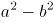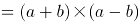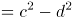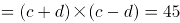，因a、b、c、d各不相同且均是不超过15的整数，根据倍数特性，45=1×45=3×15=5×9，若a+b=45，此时a或b必有一个大于15，不符合题干条件。则a+b=15······①，a-b=3······②，联立①②，解得a=9，b=6，同理c+d=9······③，c-d=5······④，联立③④，解得c=7，d=2。故甲、乙两公司一共订购了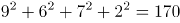台医疗器械。

方法二：设甲负责人、甲助手、乙负责人、乙助手分别订购a、b、c、d种器械，四人每种器械分别订购a、b、c、d台，四人分订购总数分别为a^2、b^2、c^2、d^2台。由题意可知，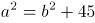，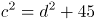，则甲、乙两个公司订购总台数为：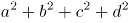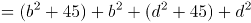，代入选项依次验证：

A项：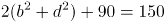，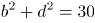，1~15中不存在两个整数的平方相加等于30，排除；

B项：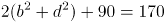，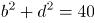，1~15中只有b=6，d=2符合，进而解得a=9，c=7，符合题干条件，其余选项无需验证，此时甲、乙两公司一共订购了台医疗器械。

故正确答案为B。

**考点**：和差倍比问题

**来源**：2022年云南公务员录用考试《行测》题（网友回忆版）第46题

### 第 55 题

兔子和乌龟举行一场跑步比赛，终点位于起点正北方500米处。兔子和乌龟同时出发，均保持匀速奔跑，且兔子的速度是乌龟的5倍。兔子先向正东方跑了一会后发现自己跑错了方向，马上直奔终点，速度不变，结果兔子和乌龟同时到达终点。那么兔子发现跑错方向时已经跑了多少米？

A. 600

B. 1200

C. 2400

D. 3000

第 55 题 · 答案与解析

**参考答案（粉笔题库参考内容）**

B

**解析**

设兔子发现跑错方向时已经跑了x米。由题意可知，兔子和乌龟所用时间相同，根据时间相同，路程与速度成正比，可知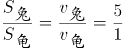，兔子整个比赛跑了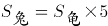\=500×5=2500米，即掉头后所跑路程为（2500-x）米。整个比赛过程路线如图所示：

根据勾股定理可列式：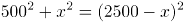，解得x=1200，故兔子发现跑错方向时已经跑了1200米。

故正确答案为B。

**考点**：几何结论类-三角形相关、普通行程

**来源**：2022年云南公务员录用考试《行测》题（网友回忆版）第47题

### 第 56 题

甲、乙、丙三个工程队接到A、B两个工程的施工任务，若由甲单独完成B工程需要30天；若甲乙两队合作施工，则完成A工程需要30天，完成B工程需要20天；乙丙合作完成A工程则需要24天。现在三个工程队合作完成A、B两个工程，多少天可以完工？（不足1天按1天计算）

A. 24

B. 25

C. 26

D. 27

第 56 题 · 答案与解析

**参考答案（粉笔题库参考内容）**

D

**解析**

赋值B工程总量为30、20的最小公倍数60，则甲的效率为60/30=2，甲乙的效率和为60/20=3，可知乙的效率为3-2=1。由“若甲乙两队合作施工，则完成A工程需要30天”，可知A工程总量为30×3=90，由“乙丙合作完成A工程则需要24天”，可得乙丙的效率和为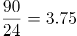，则丙的效率为3.75-1=2.75。故所求时间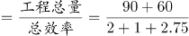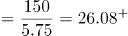，需27天。

故正确答案为D。

**考点**：给完工时间型

**来源**：2022年河南省公务员录用考试《行测》题（网友回忆版）第37题

### 第 57 题

7名防疫人员负责甲、乙两个社区的居民排查工作，已知每人走访一户居民的用时为固定值，若5人负责甲社区、2人负责乙社区，则完成乙社区排查的时间比甲社区要晚5天；若3人负责甲社区、4人负责乙社区，则乙社区完成排查后，只需6人共同工作4天就能完成甲社区的排查。那么如果要在6天内完成两个社区的排查工作，至少需要额外增加多少人？

A. 5

B. 6

C. 7

D. 8

第 57 题 · 答案与解析

**参考答案（粉笔题库参考内容）**

B

**解析**

由题意可知，每名防疫人员每天走访的居民户数均相同，为方便计算，赋值每名防疫人员每天走访的居民户数为1。设甲社区有x户居民，乙社区有y户居民，根据题意可列方程：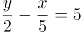······①，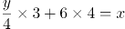······②，联立①②解得：x=45，y=28。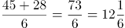，则要想在6天内完成两个社区的排查工作至少需要13人，至少需要额外增加13-7=6人。

故正确答案为B。

**考点**：给效率比例型

**来源**：2022年河南省公务员录用考试《行测》题（网友回忆版）第41题

### 第 58 题

2020年时，李某的年龄是自己工龄的4倍，且正好是张某年龄的2/3。到2024年时，张某的年龄正好是自己工龄的2倍。已知张某参加工作时李某10岁，那么李某参加工作时的年龄是多少？

A. 18岁

B. 21岁

C. 24岁

D. 27岁

第 58 题 · 答案与解析

**参考答案（粉笔题库参考内容）**

C

**解析**

设2020年时李某的工龄为x年，则李某的年龄为4x岁，张某的年龄为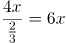岁，则2024年张某的年龄为（6x+4）岁。根据“到2024年时，张某的年龄正好是自己工龄的2倍”，则2024年张某的工龄为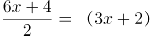岁，张某参加工作时的年龄为6x+4-（3x+2）=（3x+2）岁，根据“年龄差不变”可得，张某参加工作时，两人的年龄差为3x+2-10=3x-8，2020年，两人年龄差为6x-4x=2x，即3x-8=2x，解得x=8。即李某参加工作时的年龄为4x-x=3x=24岁。

故正确答案为C。

**考点**：年龄问题

**来源**：2022年浙江省公务员录用考试《行测》题（C类）（网友回忆版）第20题

### 第 59 题

企业引入投资人甲注入资金5000万元，投资完成后原企业董事长所持有的股份从60%下降到40%。又过了一段时间后董事长将自己所持股份的一半卖给投资人乙，同时投资人乙为企业注入资金1.2亿元，此时董事长所持有的股份下降到15%。问此时投资人甲如果卖出所持股份，能获利多少亿元？

A. 0.9

B. 0.8

C. 0.7

D. 0.6

第 59 题 · 答案与解析

**参考答案（粉笔题库参考内容）**

C

**解析**

设投资人甲注入资金后的企业总资金为100x万，则现在董事长持有40x万，由题意可知，解得x=150万，则企业现在总资金为100×150万=15000万元=1.5亿元，董事长持有40×150=6000万元=0.6亿元。一段时间后，设该企业股份变为之前的n倍，则企业总资金变为1.5n亿元，董事长的一半股份为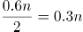亿元，可得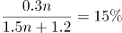，解得n=2.4。故投资人甲卖出所持股份能获利5000×2.4-5000=7000万元=0.7亿元。

故正确答案为C。

**考点**：经济利润问题

**来源**：2022年云南公务员录用考试《行测》题（网友回忆版）第50题

### 第 60 题

小张、小王、小刘、小李和小陈5人随机分配给A、B、C、D四个任务组，要求每组至少分配1人，小张不分配在A组，小李必须分配在C组，且D组只分配1人。那么小张和小王分配在一组的概率为：

A. 不到5%

B. 5%~10%之间

C. 10%~15%之间

D. 超过15%

第 60 题 · 答案与解析

**参考答案（粉笔题库参考内容）**

B

**解析**

对总的情况数进行分类讨论：

情况一：A组分配2人：因小张不分配在A组，且小李必须分配在C组，则先从其余3人中选2人分配在A组，有C_3^2=3种情况；再将剩余2人分配到B组和D组，有A_2^2=2种情况，故共有3×2=6种情况。

情况二：A组分配1人：因小张不分配在A组，且小李必须分配在C组，则先从其余3人中选1人分配在A组，有C_3^1=3种情况；再考虑包括小张在内的3人分配到B组、C组和D组的情况，因D组只分配1人，故需从3人中选出1人分配到D组，共有C_3^1=3种情况；剩余2人可以都分到B组，有1种情况，也可以一个人分配到B组一个人分配到C组，有A_2^2=2种情况，故共有3×3×（1+2）=27种情况。

故总的情况数为6+27=33种。

根据题意，满足条件的情况即小张和小王只能同时分配在B组，因小李必须分配在C组，则再将小刘和小陈分配到A组和D组，有A_2^2=2种情况。故满足条件的情况数为1×1×2=2种。

根据公式：概率，故小张和小王分配在一组的概率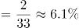，在B项范围内。

故正确答案为B。

**考点**：给情况求概率

**来源**：2022年云南公务员录用考试《行测》题（网友回忆版）第52题

### 第 61 题

某单位有甲、乙、丙三个存放着电脑的库房，已知甲库房比乙库房多4台电脑，乙库房比丙库房多2台，丙库房和甲库房共22台。现在要将三个库房的所有电脑发放给单位不同部门，要求每个部门获得的电脑数量均不相同，那么最多可以发放给几个部门？

A. 6

B. 7

C. 8

D. 9

第 61 题 · 答案与解析

**参考答案（粉笔题库参考内容）**

B

**解析**

根据题意可列式：甲=乙+4······①，丙=乙-2······②，丙+甲=22······③，联立①②③式，解得乙=10台，则甲+乙+丙=10+22=32台。要将这32台电脑发放给尽可能多的部门，且每个部门获得的电脑数量均不相同，则每个部门获得的电脑数量应从最小值1开始算起，1+2+3+4+5+6+7=28台，还剩32-28=4台，这4台不能再单独发放给1个部门，否则会有重复，故最多可以发放给7个部门。

故正确答案为B。

**考点**：构造数列

**来源**：2022年云南公务员录用考试《行测》题（网友回忆版）第53题

### 第 62 题

ABCD四个学校分布在矩形的四个顶点上，小李早上骑自行车从A校出发去D校学习，半个小时后到达D校，学习3个小时后立即由D校去C校，小李离开A校4个小时后妈妈驾车沿A→B→C的路线去C校接小李，已知小李骑车速度为15千米/小时，妈妈驾车速度为50千米/小时，最终二人同时到达C校。若妈妈11点出发，那么到达C校的时间在以下哪个范围内？

A. 11：25之前

B. 11：25～11：30之间

C. 11：30～11：35之间

D. 11：35之后

第 62 题 · 答案与解析

**参考答案（粉笔题库参考内容）**

B

**解析**

设妈妈驾车到C校用时为x分钟，因小李离开A校4小时后妈妈出发，且小李在D校学习3小时，最终二人同时到达C校，则小李到C校时的总骑行时间=（4-3）小时+x分钟=（60+x）分钟。又因为ABCD四个学校分布在矩形的四个顶点上，小李从A→D→C与妈妈从A→B→C的路程相同，此时速度和时间成反比。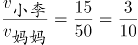 ，则 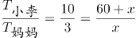，解得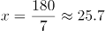分钟。若妈妈11点出发，那么到达C校的时间为11点25.7分，在B项范围内。

故正确答案为B。

**考点**：普通行程

**来源**：2022年云南公务员录用考试《行测》题（网友回忆版）第55题

### 第 63 题

一件工作由甲、乙、丙三人完成，若甲、乙合作先干10小时，丙再单干1小时可以完成。已知乙单干用的时间比甲多4小时，丙单干用的时间是甲的1/2还多2小时，问甲单干需多少小时？

A. 20

B. 25

C. 30

D. 35

第 63 题 · 答案与解析

**参考答案（粉笔题库参考内容）**

A

**解析**

方法一：设甲单干需x小时，则乙单干需（x+4）小时，丙单干需（x/2+2）小时。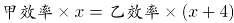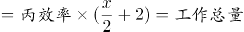，则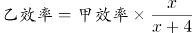······①，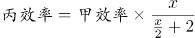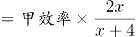······②。又因“若甲、乙合作先干10小时，丙再单干1小时可以完成”，则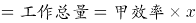······③，将①②代入③，可化简为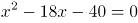，解得x=20或-2。工作时间为正数，则甲单干需20小时。

方法二：结合选项，考虑代入排除法。代入A项，则甲单干需20小时，乙单干需20+4=24小时，丙单干需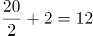小时。赋值工作总量为20、24、12的最小公倍数120，则甲的效率为，乙的效率为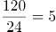，丙的效率为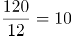。又因“若甲、乙合作先干10小时，丙再单干1小时可以完成”，则（6+5）×10+10×1=120，恰好完成工作总量，满足题意。

故正确答案为A。

**考点**：工程问题-其他

**来源**：2022年云南公务员录用考试《行测》题（网友回忆版）第49题

### 第 64 题

一个高为10厘米，底面半径为5厘米的圆锥体塑料零件置于水中，底面朝上且与水面平行，其浮出水面部分的高为2厘米。那么当该零件底面朝下且与水面平行置于水中时，浮出水面部分的高在以下哪个范围内？（零件始终不接触水底）

A. 不到6厘米

B. 6～7厘米之间

C. 7～8厘米之间

D. 超过8厘米

第 64 题 · 答案与解析

**参考答案（粉笔题库参考内容）**

C

**解析**

圆锥体塑料零件的体积V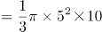=250π/3立方厘米。当圆锥体塑料零件底面朝上且与水面平行时，根据立体几何“相似比的立方=体积比”，则水下部分的零件体积为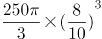=128π/3立方厘米。当该零件底面朝下且与水面平行置于水中时，根据圆锥体塑料零件所受浮力不变，即排开水的体积是不变的，则水下部分的零件体积不变，故浮出水面部分圆锥体的体积为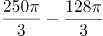=122π/3立方厘米。设浮出水面部分圆锥体的高为x厘米，根据立体几何“相似比的立方=体积比”，则有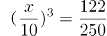，解得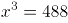。已知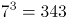，，故浮出水面部分的高在7～8厘米之间。

故正确答案为C。

**考点**：几何公式类-立体图形、几何结论类-相似图形

**来源**：2022年云南公务员录用考试《行测》题（网友回忆版）第54题

### 第 65 题

某学习软件要求用户使用字母和数字组合的8位密码。赵某使用D、E、F、W4个大写字母（不重复使用）和4个不同非零数字的组合作为自己的密码，要求数字放在后四位，且4个数字的乘积须是320的倍数。那么这样的密码有多少种不同的可能？

A. 不到1000种

B. 1000～3000种之间

C. 3000～8000种之间

D. 超过8000种

第 65 题 · 答案与解析

**参考答案（粉笔题库参考内容）**

B

**解析**

4个不同的非零数字的乘积为320的倍数，而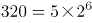，则这4个不同的非零数字只有两种可能，即（2、4、5、8）和（4、5、6、8）。4个大写字母放在前四位，有种可能，4个数字放在后四位，有种可能，则这样的密码有24×48=1152种可能，在B项范围内。

故正确答案为B。

**考点**：基础排列组合

**来源**：2022年河南省公务员录用考试《行测》题（网友回忆版）第43题

### 第 66 题

从所给的四个选项中，选择最合适的一个填入问号处，使之呈现一定的规律性（ ）。

A. A

B. B

C. C

D. D

第 66 题 · 答案与解析

**参考答案（粉笔题库参考内容）**

C

**解析**

元素组成不同，且无明显属性规律，考虑数量规律。观察发现，题干图形由小黑球、小白球、空白菱形和黑菱形构成，故优先考虑元素的种类和个数。题干图形为九宫格图形，优先横行看，第一行图1为6个小黑球，图2为1个空白菱形，图3为6个空白菱形+1个小黑球，由此发现，图1元素个数+图2元素个数=图3元素个数，同时图3两种元素的数量发生了互换；验证第二行，规律相同；故第三行也应遵循此规律，“？”处图形应该有4个小白球，只有C项符合。

故正确答案为C。

**考点**：数量规律-素

**来源**：2022年河南省公务员录用考试《行测》题（网友回忆版）第49题

### 第 67 题

把下面的六个图形分为两类，使每一类图形都有各自的共同特征或规律，分类正确的一项是（ ）。

A. ①②⑥，③④⑤

B. ①③④，②⑤⑥

C. ①③⑥，②④⑤

D. ①④⑥，②③⑤

第 67 题 · 答案与解析

**参考答案（粉笔题库参考内容）**

C

**解析**

本题为分组分类题目。观察发现，题干图形均是由多个封闭面组合而成，考虑图形间关系。图①③⑥中封闭面相包含，图②④⑤中封闭面相交。即图①③⑥一组，图②④⑤一组。

故正确答案为C。

**考点**：特殊规律-图形间关系

**来源**：2022年河南省公务员录用考试《行测》题（网友回忆版）第51题

### 第 68 题

把下面的六个图形分为两类，使每一类图形都有各自的共同特征或规律，分类正确的一项是：

A. ①②③，④⑤⑥

B. ①②④，③⑤⑥

C. ①③④，②⑤⑥

D. ①③⑥，②④⑤

第 68 题 · 答案与解析

**参考答案（粉笔题库参考内容）**

B

**解析**

本题为分组分类题目。元素组成不同，且无明显属性规律，考虑数量规律。观察发现，题干均为封闭图形被分割，考虑面数量，但整体数面无规律，考虑面的细化。进一步观察发现，图①②④的封闭面均由曲线和直线围成，图③⑤⑥的封闭面除由曲线和直线围成外，还存在全由直线围成的面。即①②④一组，③⑤⑥一组。

故正确答案为B。

**考点**：数量规律-面

**来源**：2022年云南公务员录用考试《行测》题（网友回忆版）第60题

### 第 69 题

从所给的四个选项中，选择最合适的一个填入问号处，使之呈现一定的规律性：

A. A

B. B

C. C

D. D

第 69 题 · 答案与解析

**参考答案（粉笔题库参考内容）**

D

**解析**

元素组成不同，优先考虑属性规律。观察发现，题干图形出现箭头及多个等腰元素图形，考虑对称性。题干每幅图形都由两个单对称轴图形组成，因此分别画出每个图形的对称轴。第一组图形中，图1的两条对称轴平行，图2的两条对称轴相交45°，图3的两条对称轴垂直。第二组图形应遵循此规律，故？处图形应两条对称轴垂直，只有D项符合。

故正确答案为D。

**考点**：属性规律-对称性

**来源**：2022年河南省公务员录用考试《行测》题（网友回忆版）第53题

### 第 70 题

从所给的四个选项中，选择最合适的一个填入问号处，使之呈现一定的规律性（ ）。

A. A

B. B

C. C

D. D

第 70 题 · 答案与解析

**参考答案（粉笔题库参考内容）**

D

**解析**

元素组成不同，且无明显属性规律，考虑数量规律。观察发现，题干已知图形均为多圆相切变形图，考虑笔画数。题干中所有图形均由一笔画成，故？处应为一笔画图形。A、B、C三项均有4个奇点，由两笔画成，D项有2个奇点，由一笔画成。

故正确答案为D。

**考点**：数量规律-线

**来源**：2022年云南公务员录用考试《行测》题（网友回忆版）第57题

### 第 71 题

下列选项为4个正方体纸盒的外表面展开图，其中哪一个折叠成的纸盒与其他三个不一样？

A. A

B. B

C. C

D. D

第 71 题 · 答案与解析

**参考答案（粉笔题库参考内容）**

D

**解析**

将选项展开图标上序号，如下图所示（各选项面都相同，故相同的面用相同字母表示），逐一进行分析。

A项：以面b内黑色扇形的圆心为起点进行顺时针画边（如下图所示），边1对应面c，边2对应面f，边3对应面e；

B项：以面b内黑色扇形的圆心为起点进行顺时针画边（如下图所示），边1对应面c，边2对应面f，边3对应面e；

C项：以面b内黑色扇形的圆心为起点进行顺时针画边（如下图所示），边1对应面c，边2对应面f，边3对应面e；

D项：以面b内黑色扇形的圆心为起点进行顺时针画边（如下图所示），边1对应面f，边2对应面e，边3对应面a。

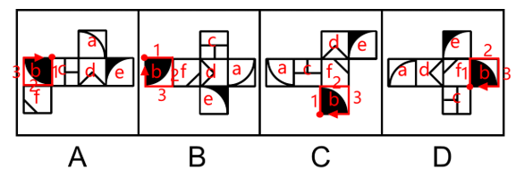

综上，只有D项与其他三项不同。

本题为选非题，故正确答案为D。

**考点**：空间类-空间重构-六面体

**来源**：2022年云南公务员录用考试《行测》题（网友回忆版）第59题

### 第 72 题

自由联想和控制联想是联想实验的基本方法。自由联想实验中，主试者以听觉或视觉方式呈现一个刺激后（通常为词或图片），要求被试者尽快地说出头脑中浮现的词或事实，不管是什么东西，属于什么性质。与自由联想实验不同的是，控制联想实验中主试者会对被试者的联想作出一定的控制。

根据上述定义，下列属于控制联想的是（ ）。

A. 在一个安静且光线适宜的房间里，心理咨询师让来访者躺在沙发上，完全放开地讲述自己童年的委屈与怨恨

B. 在一项针对外国留学生对中国形象认知的研究中，研究者要求被试者在听到“中国”一词时，写下联想到的10个词语

C. 美术课上在鉴赏《昭陵六骏图》时，老师让学生想象画中的马是否在运动，一名学生答到：它的四蹄是腾空的，这只马像是在飞奔

D. 警察在提审嫌犯时，让他在听到一个词后马上报出所想到的其他词，一开始是正常对答，然后警察突然提到“蜡烛”，嫌犯答以“牛奶瓶”，暴露了他将蜡烛插在牛奶瓶内照明的盗窃手段

第 72 题 · 答案与解析

**参考答案（粉笔题库参考内容）**

C

**解析**

第一步：找出定义关键词。

自由联想：“要求被试者尽快地说出头脑中浮现的词或事实”、“不管联想的是什么东西，属于什么性质”；

控制联想：“主试者对被试者的联想作出一定的控制”。

第二步：逐一分析选项。

A项：心理咨询师让来访者完全放开地讲述自己童年的委屈与怨恨，没有对被试者的联想进行控制，不符合“主试者对被试者的联想作出一定的控制”，不符合“控制联想”定义，排除；

B项：要求被试者在听到“中国”一词时，写下联想到的10个词语，对10个词语没有任何限制，符合“要求被试者尽快地说出头脑中浮现的词或事实”、“不管联想的是什么东西，属于什么性质”，符合“自由联想”定义，不符合“控制联想”定义，排除；

C项：老师让学生想象画中的马是否在运动，“是否运动”即是对学生关于马的想象进行了限制，符合“主试者对被试者的联想作出一定的控制”，符合“控制联想”定义，当选；

D项：警察让嫌犯在听到一个词后马上报出所想到的其他词，对嫌犯想到的词没有任何限制，符合“要求被试者尽快地说出头脑中浮现的词或事实”、“不管联想的是什么东西，属于什么性质”，符合“自由联想”定义，不符合“控制联想”定义，排除。（D项的表述也是“自由联想”词条下面的典型例子，如下图）

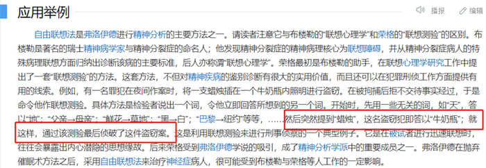

故正确答案为C。

**考点**：常规问法

**来源**：2022年河南省公务员录用考试《行测》题（网友回忆版）第59题

### 第 73 题

仿拟是按照已有的语言表达形式，临时造出新的语言形式的一种辞格。仿拟所模仿的一般为固定词语或短语，也可以扩大到句子、段落、篇章，甚至语体、风格。根据仿照的对象，仿拟可分为仿词、仿句、仿篇、仿体和仿调。

根据上述定义，下列不属于仿拟的是（ ）。

A. 走别人的路，让别人无路可走

B. 新事业从头做起，旧现象一手推平

C. 给你开一服爱情灵药：真心一片，温柔二钱，尊重三分

D. 满心“婆理”而满口“公理”的绅士们的名言暂且置之不论不议之列

第 73 题 · 答案与解析

**参考答案（粉笔题库参考内容）**

B

**解析**

第一步：找出定义关键词。

“按照已有的语言表达形式”、“临时造出新的语言形式”。

第二步：逐一分析选项。

A项：“走别人的路，让别人无路可走”仿拟了意大利文学家但丁的代表作长诗《神曲》中的“走自己的路，让别人说去吧”，符合“按照已有的语言表达形式”、“临时造出新的语言形式”，符合定义，排除；

B项：“新事业从头做起，旧现象一手推平”既表述了理发的情景，同时又寄托着人们除旧布新的愿望和喜迎新社会的感情，这是“双关”的修辞手法，并没有体现出根据已有的语言表达形式来创造新的语言形式，不符合“按照已有的语言表达形式”、“临时造出新的语言形式”，不符合定义，当选；

C项：“真心一片，温柔二钱，尊重三分”，这句话仿拟的原型是中药方剂中的药方，其中“片”、“钱”、“分”是古代的计量单位，符合“按照已有的语言表达形式”、“临时造出新的语言形式”，符合定义，排除；

D项：“满心‘婆理’而满口‘公理’”中的“婆理”是仿拟“公理”这个词创造而成的，符合“按照已有的语言表达形式”、“临时造出新的语言形式”，符合定义，排除。

本题为选非题，故正确答案为B。

**考点**：单定义-其他句式

**来源**：2022年甘肃公务员录用考试《行测》题（网友回忆版）第75题

### 第 74 题

参考价格效应是指商品的价格相对于消费者认知的其他替代商品越高，消费者对价格就越敏感。反之，消费者则对价格不敏感。

根据上述定义，下列体现了参考价格效应的是（ ）。

A. 消费者购买了一件原价为2300元、现价为999元的衣服时，感到了一种在价格促销中省钱的喜悦

B. 某高端电脑的价格高出同类产品20%以上，但消费者却很愿意购买，这是因为担心普通产品的性能无法令人满意

C. 百货公司一楼大多是高档化妆品柜台，价格之高让普通人难以接受，但在看过这些几乎全是千元起步的价目牌后，消费者反而觉得二楼售价500元一件的衬衫也不贵

D. 杂货店老板经常会将价格较低但毛利率较高的大众品牌放在顾客第一眼看不到的地方，而将价格较高的品牌放在显眼的位置，这样顾客看到大众品牌的价格时就会觉得便宜而购买

第 74 题 · 答案与解析

**参考答案（粉笔题库参考内容）**

D

**解析**

第一步：找出定义关键词。

“其他替代商品”、“价格越高（商品与其他替代商品相比）”、“消费者对价格敏感”。

第二步：逐一分析选项。

A项：原价为2300元、现价为999元的商品，为同一件商品，并未体现“其他替代商品”，不符合定义，排除；

B项：消费者愿意购买高端电脑是因为普通产品的性能不能和高端电脑相比，说明消费者看重产品性能，对产品性能敏感，不满足“消费者对价格敏感”，不符合定义，排除；

C项：看过高档化妆品后觉得500元的衬衫不贵，“化妆品”和“衬衫”是两种功能不一致的商品，不存在替代关系，不满足“其他替代商品”，不符合定义，排除；

D项：“价格较低的大众品牌”“价格较高的品牌”说明是同一种商品存在替代性，符合“其他替代商品”，并且“价格低”和“价格高”可以体现两者之间的价格比较，“顾客看到大众品牌的价格时就会觉得便宜而购买”说明顾客购买是因为价格，符合“价格越高（商品与其他替代商品相比）”、“消费者对价格敏感”，符合定义，当选。

故正确答案为D。

**考点**：单定义-其他句式

**来源**：2022年河南省公务员录用考试《行测》题（网友回忆版）第57题

### 第 75 题

“舍本求末”基模描述了当系统出现棘手问题时，人们往往急于求成，采取短期的应急措施，反而延误了长期的根本解决问题方案的系统行为模式。

根据上述定义，下列属于“舍本求末”基模的是：

A. 两家公司为了争夺更高的市场占有率，均采用了降价销售的策略，结果陷入了竞相压价的恶性循环，导致双方都严重亏损

B. 某奶茶公司一度发展为行业龙头，几年后进入瓶颈期。为谋求出路，公司高层就是否裁撤门店发生严重内斗，导致业绩断崖式下滑

C. 某高新技术公司产品去年的市场占有额有所下降，为挽救这一态势，该公司把重点放在了改进现有产品来继续占有市场，放弃了研发新产品的计划

D. 两家煤化厂合作共同开发当地的煤炭资源，几年内均赚得盆满钵满。为提高收益水平，两家企业均加大了煤炭开采力度，导致有限的煤炭资源在短时间内消耗殆尽

第 75 题 · 答案与解析

**参考答案（粉笔题库参考内容）**

C

**解析**

第一步：找出定义关键词。

“当系统出现棘手问题时”、“采取短期的应急措施”、“延误了长期的根本解决问题方案”。

第二步：逐一分析选项。

A项：为争夺市场占有率而采用降价销售的策略，“降价销售”是为了获得更高市场占有率，不是为了解决出现的问题，不符合“当系统出现棘手问题时”，不符合定义，排除；

B项：奶茶公司进入瓶颈期，符合“当系统出现棘手问题时”，高层为谋求出路发生严重内斗，没有提到为解决问题而采取“措施”，不符合“采取短期的应急措施”，不符合定义，排除；

C项：产品去年的市场占有额下降，符合“当系统出现棘手问题时”，改进现有产品占有市场，放弃研发新产品，符合“采取短期的应急措施”、“延误了长期的根本解决问题方案”，符合定义，当选；

D项：为提高收益水平加大煤炭开采力度，没有体现“当系统出现棘手问题时”，不符合定义，排除。

故正确答案为C。

**考点**：大前提

**来源**：2022年河南省公务员录用考试《行测》题（网友回忆版）第64题

### 第 76 题

删失数据是指在观察或试验中，由于人力或其他原因未能观察到所感兴趣的事件发生，因而停止观察后得到的数据。如果删失发生的时刻是事先知道的，称之为第一类删失；如果删失发生的数量是事先预定的，称之为第二类删失；由随机因素引起的删失称为随机删失。

根据上述定义，下列说法正确的是：

A. 灯泡在500小时的寿命试验中没有损坏，这属于第一类删失

B. 无线电信号因突然受到强烈干扰而无法接收，这属于随机删失

C. 机器从今天上午6时到现在已经出现了3次故障，这属于随机删失

D. 吃了有毒物质的小白鼠到4月2日早晨8时尚无明显反应，这属于第二类删失

第 76 题 · 答案与解析

**参考答案（粉笔题库参考内容）**

A

**解析**

第一步：找出定义关键词。

删失数据：“未能观察到所感兴趣的事件发生”、“停止观察后得到的数据”；

第一类删失：“删失发生的时刻是事先知道的”；

第二类删失：“删失发生的数量是事先预定的”；

随机删失：“由随机因素引起的删失”。

第二步：逐一分析选项。

A项：该项中灯泡在500小时的寿命试验中没有损坏，满500小时的时刻是删失发生的时刻，首先符合“停止观察后得到的数据”，符合“删失数据”的定义，同时500小时是试验前就设定好的，也符合“删失发生的时刻是事先知道的”，符合“第一类删失”的定义，当选；

B项：该项中无线电信号因突然受到强烈干扰而无法接收，“突然”的干扰是意外情况，其是否影响了整个过程的数据记录并不明确，不符合“停止观察后得到的数据”，不符合“删失数据”的定义，也不符合“随机删失”的定义，排除；

C项：该项中机器从今天上午6时到现在已经出现了3次故障，机器出现故障是不是由随机因素引起的不明确，不符合“由随机因素引起的删失”，不符合“随机删失”的定义，排除；

D项：该项中吃了有毒物质的小白鼠到4月2日早晨8时尚无明显反应，4月2日早晨8时这个时刻是事先设定的，符合“删失发生的时刻是事先知道的”，符合“第一类删失”的定义，不符合“第二类删失”的定义，排除。

故正确答案为A。

**考点**：特殊问法

**来源**：2022年云南公务员录用考试《行测》题（网友回忆版）第63题

### 第 77 题

“茧居族”是指那些如虫子般缩在狭小的壳里不见天日的人。这些人有以下几个特征：几乎不出门，即使偶尔出门也是去最近的商店购买生活必需品；与他人零交流，即使与家人联系也是因为生存需要；以上两点持续时间在半年以上。

根据上述定义，下列属于“茧居族”的是：

A. 小李原为某公司的业务员，2020年因不适应公司业务转型而被解聘。被解聘后，小李感到非常沮丧，经常通宵达旦上网打游戏，想以此来疏解心中的苦闷

B. 小田小时候就发现自己不愿与人接触，但她依然试着去上学，找工作，找男朋友。27岁那年，她辞掉工作，和男朋友分手，开始“宅”在家里，这让她感到从未有过的轻松

C. 小张大学毕业后没有找到工作，由于自卑，小张退出了同学群和朋友圈，过起了几乎不出门、不与社会接触、整天与电视、电脑和漫画书为伴的生活。直到第二年毕业招聘季，小张才在父母的劝说下尝试着找工作

D. 小王是某市的高考状元，被一所重点大学录取。入学后，大学全新的生活方式与学习模式让小王很难适应，高考状元光环也逐渐消退，这使得小王越发地感到失落和自卑，变得越来越不愿意与同学交流，也不愿意参与班级活动

第 77 题 · 答案与解析

**参考答案（粉笔题库参考内容）**

C

**解析**

第一步：找出定义关键词。

“几乎不出门”、“与他人零交流”、“以上两点持续时间在半年以上”。

第二步：逐一分析选项。

A项：小李经常通宵达旦上网打游戏，但不确定小李是在家打游戏，还是在网吧打游戏，不符合“几乎不出门”，并且打游戏有时需要与他人交流，也不符合“与他人零交流”，不符合定义，排除；

B项：小田只是与男朋友分手，但不确定是否会与他人交流，不符合“与他人零交流”，不符合定义，排除；

C项：小张的生活是几乎不出门、不与社会接触，符合“几乎不出门”，也符合“与他人零交流”，并且毕业后直到第二年毕业招聘季才开始尝试找工作，说明“以上两点持续时间在半年以上”，符合定义，当选；

D项：小王不愿意与同学交流，但不确定他是否与同学之外的人交流了，不符合“与他人零交流”，并且不愿意参与班级活动，不确定是否是几乎不出门，不符合“几乎不出门”，不符合定义，排除。

故正确答案为C。

**考点**：单定义-其他句式

**来源**：2022年云南公务员录用考试《行测》题（网友回忆版）第64题

### 第 78 题

污染效应是指在消费环境下，当某个人、事、物等源头将其特定或抽象的属性转移到某个产品上时，消费者会根据属性转移的结果来判断产品的价值，从而决定增加还是降低购买意愿。

根据上述定义，下列属于污染效应的是：

A. 某培训机构举行报名即可获赠名师签名的活动，尽管现场气氛热烈，但报名人数寥寥

B. 虽然演唱会门票被黄牛党炒高了好几倍，但仍阻挡不了铁粉前往现场与偶像互动的热情

C. 小张在旧书网看中一本稀缺专业书籍，尽管该书籍有些污渍且价格较高，他还是决定购买

D. 小刘花5000元购买了一双某球星穿过的普通版球鞋，而这双旧鞋的价格远远高于同款新鞋

第 78 题 · 答案与解析

**参考答案（粉笔题库参考内容）**

D

**解析**

第一步：找出定义关键词。

“在消费环境下”、“某个人、事、物等将其某些属性转移到某个产品上”、“消费者会根据属性转移的结果来判断产品的价值”、“从而决定增加还是降低购买意愿”。

第二步：逐一分析选项。

A项：某培训机构举行报名即可获赠名师签名的活动，某培训机构将名师签名附加到课程上，符合“某个人、事、物等将其某些属性转移到某个产品上”，报名人数寥寥，说明签名未影响报名的意愿，不符合“消费者会根据属性转移的结果来判断产品的价值”、“从而决定增加还是降低购买意愿”，不符合定义，排除；

B项：演唱会门票被黄牛党炒高了好几倍，只是在说门票本身价格被炒高，并没有其他属性转移到门票上，不符合“某个人、事、物等将其某些属性转移到某个产品上”，不符合定义，排除；

C项：小张在旧书网看中一本专业书籍，稀缺性、有污染和价格较高均是目前这本书籍本身的属性，不符合“某个人、事、物等将其某些属性转移到某个产品上”，不符合定义，排除；

D项：小刘花5000元购买某球星穿过的球鞋，球星将他的名气转移到了穿过的球鞋上，符合“在消费环境下”、“某个人、事、物等将其某些属性转移到某个产品上”，这双旧鞋的价格远远高于同款新鞋，但小刘依然选择了购买，符合“消费者会根据属性转移的结果来判断产品的价值”，符合定义，当选。

故正确答案为D。

**考点**：大前提

**来源**：2022年云南公务员录用考试《行测》题（网友回忆版）第65题

### 第 79 题

吸纳效应是指一个地区最初不管由于什么原因得到加速发展，一旦步入经济高速增长的快车道，就会产生很大的“磁性”，不断吸纳各种生产要素，将其他地区甚至国外市场的资本、技术、信息、人才和物质资源不断地吸纳到本地区来，使本地区具有丰裕的经济资源，从而突破区域经济发展过程中的资本短缺、技术落后、人才不足、信息不畅等瓶颈，为进一步发展创造条件。即使原先赖以发展的优势已经丧失，它仍然可以向前发展。

根据上述定义，下列属于吸纳效应的是（ ）。

A. 浦东是最早成立的国家级新区，1990年浦东新区成立之初人口仅133万，2020年常住人口达到568万，增长率超过300%

B. 在资源红利的诱导下，资金、装备等各种经济要素汇聚到了煤炭及其相关产业领域，促进了煤炭经济的繁荣，但在后期经济转型的大背景下，煤炭业逐渐衰落

C. 某地在开发建设新区后，颁布了一系列创业扶持政策，多家科技巨头纷纷在该地建厂办公，全国各地毕业生到该地就业，即使是在全国范围内的抢人大战中也不落下风

D. 某地处于工业化快速发展阶段时人口逐渐集聚，而商业设置配套却严重不足，以外来人口为主的流动摊贩应运而生，形成了繁荣的夜市。近年来，夜市遭到周边居民投诉而被限制

第 79 题 · 答案与解析

**参考答案（粉笔题库参考内容）**

C

**解析**

第一步：找出定义关键词。

“一个地区”、“经济高速增长”、“吸纳各种生产要素”、“突破区域经济发展过程中的瓶颈”、“为进一步发展创造条件”。

第二步：逐一分析选项。

A项：浦东新区从1990年到2020年人口增长率超过300%，只涉及当地人口的增长，没有体现具体的经济发展，不符合“经济高速增长”，同时也没有体现“突破区域经济发展过程中的瓶颈”，不符合定义，排除；

B项：各种经济要素汇聚到了煤炭及其相关产业领域，强调的是产业领域，没有体现具体地区，不符合“一个地区”，不符合定义，排除；

C项：某地在开发建设新区后颁布扶持政策，多家科技巨头建厂办公，全国各地毕业生到该地就业，能够体现各种生产要素的聚集，符合“一个地区”、“吸纳各种生产要素”，即使在抢人大战中也不落下风，符合“为进一步发展创造条件”，符合定义，当选；

D项：某地商业设置配套严重不足，最终形成了繁荣的夜市，但是夜市遭到周边居民投诉而被限制，证明经济发展中出现了问题，不符合“为进一步发展创造条件”，不符合定义，排除。

故正确答案为C。

**考点**：单定义-其他句式

**来源**：2022年河南省公务员录用考试《行测》题（网友回忆版）第60题

### 第 80 题

排练：演出：节目

A. 革命：建设：改革

B. 起草：发表：文章

C. 发烧：咳嗽：感冒

D. 调查：走访：问卷

第 80 题 · 答案与解析

**参考答案（粉笔题库参考内容）**

B

**解析**

第一步：判断题干词语间逻辑关系。

排练和演出是两个动作，分别可以和节目构成动宾结构，且存在先后顺序，即先排练节目，后演出节目。

第二步：判断选项词语间逻辑关系。

A项：革命和建设是两个动作，但与改革都不构成动宾结构，与题干逻辑关系不一致，排除；

B项：起草和发表是两个动作，分别可以和文章构成动宾结构，且存在先后顺序，即先起草文章，后发表文章，与题干逻辑关系一致，当选；

C项：感冒时可能会伴随着发烧和咳嗽，发烧和咳嗽是两个不同的症状，二者为并列关系，与题干逻辑关系不一致，排除；

D项：走访和问卷可以是两种不同的调查方式，二者为并列关系，与题干逻辑关系不一致，排除。

故正确答案为B。

**考点**：逻辑关系-对应关系、语法关系

**来源**：2022年云南公务员录用考试《行测》题（网友回忆版）第66题

### 第 81 题

莫愁前路无知己：天下谁人不识君

A. 纸上得来终觉浅：绝知此事要躬行

B. 商女不知亡国恨：隔江犹唱后庭花

C. 春色满园关不住：一枝红杏出墙来

D. 不识庐山真面目：只缘身在此山中

第 81 题 · 答案与解析

**参考答案（粉笔题库参考内容）**

D

**解析**

第一步：判断题干词语间逻辑关系。

题干诗句的意思是不要担心前路茫茫没有知己，普天之下都认识你。因为“普天之下都认识你”，所以“不要担心前路茫茫没有知己”。“天下谁人不识君”为因，“莫愁前路无知己”为果，二者为因果对应关系。

第二步：判断选项词语间逻辑关系。

A项：诗句的意思是从书本上得来的知识毕竟是不够完善的，因此如果想要深入理解其中的道理，必须要亲自实践才行。因为“从书本上得来的知识不够完善”，所以“必须要亲自实践才行”。“纸上得来终觉浅”是因，“绝知此事要躬行”是果，顺序与题干相反，与题干逻辑关系不一致，排除；

B项：诗句的意思是卖唱的歌女不懂什么叫亡国之恨，所以隔着江水还高唱着《玉树后庭花》。因为“歌女不懂什么叫亡国之恨”，所以“隔着江水还能高唱”。“商女不知亡国恨”是因，“隔江犹唱后庭花”是果，顺序与题干相反，与题干逻辑关系不一致，排除；

C项：诗句的意思是一扇柴门虽然关住了游人，却关不住满园春色，一枝红色的杏花早已探出墙来。“一枝红杏出墙来”侧面体现了“春色满园”，不是“春色满园”的原因，与题干逻辑关系不一致，排除；

D项：诗句的意思是我之所以认不清庐山真正的面目，是因为我人身处在庐山之中，因为“我人身处在庐山之中”，所以“认不清庐山真正的面目”。“只缘身在此山中”是因，“不识庐山真面目”是果，二者为因果对应关系，与题干逻辑关系一致，当选。

故正确答案为D。

**考点**：逻辑关系-对应关系

**来源**：2022年云南公务员录用考试《行测》题（网友回忆版）第67题

### 第 82 题

动静：是非

A. 大小：多少

B. 生死：曲直

C. 古今：长短

D. 轻重：贵贱

第 82 题 · 答案与解析

**参考答案（粉笔题库参考内容）**

B

**解析**

第一步：判断题干词语间逻辑关系。

词语间无明显语义关系，考虑词语拆分。拆分后，动与静是并列关系，是与非同样是并列关系，且都是并列关系中的矛盾关系。

第二步：判断选项词语间逻辑关系。

A项：大与小是并列关系，多与少也是并列关系，但都是并列中的反对关系，与题干逻辑关系不一致，排除；

B项：生与死是并列关系，曲与直是并列关系，且都是并列关系中的矛盾关系，与题干逻辑关系一致，当选；

C项：古与今是并列关系，长与短也是并列关系，但都是并列中的反对关系，与题干逻辑关系不一致，排除；

D项：轻与重是并列关系，贵与贱也是并列关系，但都是并列中的反对关系，与题干逻辑关系不一致，排除。

故正确答案为B。

**考点**：逻辑关系-并列关系、拆分思维

**来源**：2022年云南公务员录用考试《行测》题（网友回忆版）第69题

### 第 83 题

水落：石出

A. 理屈：词穷

B. 狼奔：豕突

C. 枕戈：待旦

D. 求全：责备

第 83 题 · 答案与解析

**参考答案（粉笔题库参考内容）**

A

**解析**

第一步：判断题干词语间逻辑关系。

因为水面落下，所以水底的石头漏了出来，“水落”导致“石出”，二者为因果关系。

第二步：判断选项词语间逻辑关系。

A项：因为理亏，所以无言以对，“理屈”导致“词穷”，二者为因果关系，与题干逻辑关系一致，当选；

B项：“狼奔”指像狼一样奔跑，“豕突”指像猪一样冲撞，二者为并列关系，与题干逻辑关系不一致，排除；

C项：“枕戈”指枕着武器睡觉，“待旦”指等待天明，二者不是因果关系，与题干逻辑关系不一致，排除；

D项：“求全”指希望所做的事完美，“责备”指要求完备、完美，二者不是因果关系，与题干逻辑关系不一致，排除。

故正确答案为A。

**考点**：拆分思维、逻辑关系-对应关系

**来源**：2022年河南省公务员录用考试《行测》题（网友回忆版）第67题

### 第 84 题

脱贫攻坚：转移就业：经济

A. 简政放权：大众创业：市场

B. 资源保护：竭泽而渔：环境

C. 抗击疫情：核酸检测：民生

D. 人才培养：体育竞技：教育

第 84 题 · 答案与解析

**参考答案（粉笔题库参考内容）**

C

**解析**

第一步：判断题干词语间逻辑关系。

转移就业可以达到脱贫攻坚的目的，脱贫攻坚可以达到促进经济发展的目的。

第二步：判断选项词语间逻辑关系。

A项：通过简政放权可以达到促进大众创业的目的，但两词顺序与题干相反，与题干逻辑关系不一致，排除；

B项：竭泽而渔的意思是排尽湖水或池水捉鱼，比喻只图眼前利益，不作长远打算，竭泽而渔不是资源保护的方式，与题干逻辑关系不一致，排除；

C项：核酸检测可以达到抗击疫情的目的，抗击疫情可以达到保障民生的目的，与题干逻辑关系一致，当选；

D项：体育竞技是一种制度化、体系化的竞争性体育活动，体育竞技不是人才培养的方式，与题干逻辑关系不一致，排除。

故正确答案为C。

**考点**：逻辑关系-对应关系

**来源**：2022年云南公务员录用考试《行测》题（网友回忆版）第68题

### 第 85 题

潮汐能：生物质能：可再生

A. 小米：核桃：可助眠

B. 手套：围巾：可防寒

C. 洗手液：消毒液：可除菌

D. 易拉罐：塑料瓶：可回收

第 85 题 · 答案与解析

**参考答案（粉笔题库参考内容）**

D

**解析**

第一步：判断题干词语间逻辑关系。

潮汐能和生物质能是两种可再生能源，二者为并列关系，同时二者均有可再生的特点，因此均与可再生构成属性对应关系。

第二步：判断选项词语间逻辑关系。

A项：小米和核桃是两种食物，二者为并列关系，同时二者均可助眠，因此均与可助眠构成功能对应关系，与题干逻辑关系不一致，排除；

B项：手套和围巾是两种配饰，二者为并列关系，同时二者均可防寒，因此均与可防寒构成功能对应关系，与题干逻辑关系不一致，排除；

C项：洗手液和消毒液是两种清洁用品，二者为并列关系，同时二者均可除菌，因此均与可除菌构成功能对应关系，与题干逻辑关系不一致，排除；

D项：易拉罐和塑料瓶是两种可回收容器，二者为并列关系，同时二者均有可回收的特点，因此均与可回收构成属性对应关系，与题干逻辑关系一致，当选。

故正确答案为D。

**考点**：逻辑关系-并列关系、逻辑关系-对应关系

**来源**：2022年河南省公务员录用考试《行测》题（网友回忆版）第69题

### 第 86 题

柳暗花明：峰回路转

A. 天长地久：物是人非

B. 天翻地覆：日新月异

C. 风和日丽：碧空如洗

D. 和蔼可亲：语重心长

第 86 题 · 答案与解析

**参考答案（粉笔题库参考内容）**

C

**解析**

第一步：判断题干词语间逻辑关系。

“柳暗花明”指绿柳成荫、繁花似锦的景象，也比喻经过一番曲折后，出现新的局面；“峰回路转”形容山峰迂回，道路曲折，也比喻事情经历曲折后，出现新的转机，二者是近义关系。

第二步：判断选项词语间逻辑关系。

A项：“天长地久”意思是像天地一样长久，多比喻爱情永久不变；“物是人非”指景物依旧，而人已变更，多用以形容对故人的怀念。二者不是近义关系，与题干逻辑关系不一致，排除；

B项：“天翻地覆”形容变化极大或闹得很凶，侧重于变动得剧烈；“日新月异”指天天都有更新，月月都在变化，形容进步、发展很快，新事物、新气象不断出现，侧重于变化得快。二者不是近义关系，与题干逻辑关系不一致，排除；

C项：“风和日丽”指微风柔和，阳光明媚，形容天气晴好；“碧空如洗”指蓝色的天空像洗过一样的明净，形容天气晴朗。二者是近义关系，与题干逻辑关系一致，当选；

D项：“和蔼可亲”指说话或待人的态度很和气，使人感到亲近；“语重心长”指言辞诚恳，情意深长。二者不是近义关系，与题干逻辑关系不一致，排除。

故正确答案为C。

**考点**：语义关系-近义关系

**来源**：2022年云南公务员录用考试《行测》题（网友回忆版）第72题

### 第 87 题

（ ） 对于 吹尽狂沙始到金 相当于 （ ） 对于 绝知此事要躬行

A. 聚少成多；纸上谈兵

B. 持之以恒；身体力行

C. 无坚不摧；力学笃行

D. 水滴石穿；实事求是

第 87 题 · 答案与解析

**参考答案（粉笔题库参考内容）**

B

**解析**

逐一代入选项。

A项：“聚少成多”意思是一点一滴的积累，就会由少变多，“吹尽狂沙始到金”出自刘禹锡的《浪淘沙》，其完整诗句为“千淘万漉虽辛苦，吹尽狂沙始到金”，意思是要经过千遍万遍的过滤，历尽千辛万苦，最终才能淘尽泥沙得到闪闪发光的黄金，比喻坚持到底、永不放弃，二者无明显逻辑关系；“纸上谈兵”意思是在文字上谈用兵策略，比喻不联系实际情况，空发议论，“绝知此事要躬行”出自陆游的《冬夜读书示子聿》，其完整诗句为“纸上得来终觉浅，绝知此事要躬行”，意思是从书本上得来的知识，毕竟是不够完善的，如果想要深入理解其中的道理，必须要亲自实践才行，指出实践的重要性，二者为反义关系，前后逻辑关系不一致，排除；

B项：“持之以恒”意思是长久地坚持下去，“吹尽狂沙始到金”比喻坚持到底、永不放弃，二者为近义关系；“身体力行”意思是亲身体验，努力实行，“绝知此事要躬行”是指做事必须亲身去实践，方能有所成功，二者为近义关系，前后逻辑关系一致，当选；

C项：“无坚不摧”意思是没有任何坚固的东西不能摧毁，形容力量强大，“吹尽狂沙始到金”比喻坚持到底、永不放弃，二者无明显逻辑关系；“力学笃行”意思是刻苦学习并认真的实践，“绝知此事要躬行”是指做事必须亲身去实践，方能有所成功，二者为近义关系，前后逻辑关系不一致，排除；

D项：“水滴石穿”比喻力量虽小，只要坚持不懈，事情就能成功，“吹尽狂沙始到金”比喻坚持到底、永不放弃，二者为近义关系；“实事求是”意思是从实际情况出发，不夸大，不缩小，正确地对待和处理问题，“绝知此事要躬行”是指做事必须亲身去实践，方能有所成功，二者无明显逻辑关系，前后逻辑关系不一致，排除。

故正确答案为B。

**考点**：语义关系-近义关系

**来源**：2022年云南公务员录用考试《行测》题（网友回忆版）第75题

### 第 88 题

甲、乙、丙、丁四位同学正在商量小组作业的分工，他们当中一个人负责宣传资料，一个人负责收集素材，一个人负责写发言稿，一个人负责录制短视频。已知：

①乙不负责宣传资料，也不负责写发言稿

②甲不负责宣传资料，也不负责录制短视频

③丁不负责写发言稿，也不负责录制短视频

④丙不负责录制短视频，也不负责宣传资料

⑤如果甲不负责写发言稿，那么丁不负责宣传资料

那么负责收集素材的是：

A. 甲

B. 乙

C. 丙

D. 丁

第 88 题 · 答案与解析

**参考答案（粉笔题库参考内容）**

C

**解析**

第一步：分析题干条件。

①甲、乙、丙、丁四人中一个人负责宣传资料，一个人负责收集素材，一个人负责写发言稿，一个人负责录制短视频；

②乙不负责宣传资料，也不负责写发言稿；

③甲不负责宣传资料，也不负责录制短视频；

④丁不负责写发言稿，也不负责录制短视频；

⑤丙不负责录制短视频，也不负责宣传资料；

⑥甲不负责写发言稿→丁不负责宣传资料。

第二步：根据题干条件进行推理。

“宣传资料”出现次数最多，为最大信息，可作为突破口。根据条件①、②、③和⑤可知，乙、甲和丙都不负责宣传资料，则只能是丁负责宣传资料。再结合条件⑥可知，丁负责宣传资料是对条件⑥的否后，根据否后必否前，可得甲负责写发言稿。此时，还剩乙、丙两人，一个人负责收集素材，一个人负责录制短视频。根据条件⑤可知，丙不负责录制短视频，则丙负责收集素材，乙负责录制短视频，对应C项。

故正确答案为C。

**考点**：从最大信息开始推

**来源**：2022年云南公务员录用考试《行测》题（网友回忆版）第76题

### 第 89 题

线上阅读建立起四通八达的内容传播渠道，让我们获取信息的种类和数量更多了，但其并非唯一的阅读形式。事实上，传统的纸质阅读仍是一种不可或缺、具有独特优势、更适合进行深度阅读的重要阅读形式。

以下哪项如果为真，最能支持上述观点？

A. 纸质书在设计、排版等各方面，更能给读者带来许多独特、珍贵的阅读体验

B. 在数字时代，培养主动阅读的习惯和能力，才能过上更充实、有效的阅读生活

C. 对于文本篇幅长、内容丰富的经典作品，纸质书更容易使读者形成系统思维、专注能力

D. 在我国成年读者中，大多数人选择的阅读形式有纸质阅读、网络阅读、新媒体音频听书阅读等

第 89 题 · 答案与解析

**参考答案（粉笔题库参考内容）**

C

**解析**

第一步：找出论点和论据。

论点：传统的纸质阅读仍是一种不可或缺、具有独特优势、更适合进行深度阅读的重要阅读形式。

论据：无。

本题只有论点，没有论据，加强优先考虑补充论据。

第二步：逐一分析选项。

A项：选项指出纸质书在设计、排版等各方面更给读者独特、珍贵的阅读体验，说明纸质阅读在设计、排版等方面具有“独特优势”，补充论据，可以加强，保留；

B项：选项指出培养主动阅读的习惯和能力非常重要，但这和论点中纸质阅读的优势和重要性无关，无法加强，排除；

C项：选项指出对于经典作品来说，纸质书更容易使读者形成系统思维、专注能力，说明对于经典作品来说，纸质阅读更适合“深度阅读”，补充论据，可以加强，保留；

D项：选项指出我国成年读者有多种阅读形式，但未说明纸质阅读是不是重要阅读形式，无法加强，排除；

对比A、C两项，论点说了3个优点，不可或缺和独特优势都比较笼统，但更适合深度阅读，这个“深度阅读”相对来讲，是比较具体的；

A项只是在强调纸质书在设计、排版等形式上的优势，过于表面，而C项的“形成系统思维、专注能力”是跟论点“深度阅读”更为贴切的，故C项优于A项；

另外，有学生会觉得A项是解释原因，C项是举例，按照理论解释原因大于举例，但其实A项也算是举例，A项的措辞：在······方面，更······，也是常见的举例表述，解释和举例有时候没有绝对的界限的，不同的理解角度加强方式也就不一样。换句话说，也就是两个选项都能加强时，咱们首先要比的，不是加强方式（因为这个角度有时不好界定），而是应该比谁说的跟论点核心更贴切，更是一回事儿。

故正确答案为C。

**考点**：补充论据

**来源**：2022年云南公务员录用考试《行测》题（网友回忆版）第78题

### 第 90 题

小孔、小吴、小邓、小丁、小洪5人是某街道志愿者，某日他们被安排到南山、东江和北苑3个小区进行社区服务。每个小区安排1至2人，每人只在一个小区服务。已知：

①安排在南山小区的志愿者最少

②若小邓、小丁中至少有1人安排在南山小区，则小吴安排在北苑小区

③若小孔、小邓、小丁中至少有1人安排在东江小区，则在北苑小区服务的只有小洪

由此可以推出：

A. 小吴安排在南山小区

B. 小丁、小洪安排在东江小区

C. 小吴、小邓安排在北苑小区

D. 小邓、小丁安排在北苑小区

第 90 题 · 答案与解析

**参考答案（粉笔题库参考内容）**

D

**解析**

第一步：分析题干条件。

①小孔、小吴、小邓、小丁、小洪5人被安排到南山、东江和北苑3个小区。每个小区安排1至2人，每人只在一个小区；

②南山小区的志愿者最少；

③小邓 或 小丁在南山小区→小吴在北苑小区；

④小孔 或 小邓 或 小丁在东江小区→只有小洪在北苑小区。

第二步：根据题干条件进行推理。

根据条件①和②可知，5名志愿者被安排到3个小区，每个小区安排1至2人，且南山小区的志愿者最少，则南山小区志愿者人数为1，东江小区和北苑小区志愿者人数均为2。结合条件④可知，北苑小区不可能只有小洪1人，根据否后必否前，可得小孔、小邓和小丁均不在东江小区，故小吴和小洪在东江小区。再结合条件③可知，小吴不在北苑小区，根据否后必否前，可知小邓和小丁不在南山小区，故小孔在南山小区，则小邓和小丁在北苑小区，只有D项符合。

故正确答案为D。

**考点**：从确定信息开始推

**来源**：2022年云南公务员录用考试《行测》题（网友回忆版）第80题

### 第 91 题

正常生活中的抑郁情绪是基于一定的客观事物，事出有因，同时程度较轻，来得快去得也快。而抑郁症患者的抑郁情绪是莫名出现的，如果任其发展会严重影响工作、学习和生活。生活中几乎每个人都会出现抑郁情绪，但长时间有抑郁情绪就要及时就医。

要使上述论证成立，还需基于以下哪一前提？

A. 抑郁情绪会影响医生的判断，降低诊断的准确性

B. 正常抑郁情绪与病理性抑郁情绪的处理方式不同

C. 正常的抑郁情绪不会发展为抑郁症

D. 病理性抑郁通过及时治疗可以康复

第 91 题 · 答案与解析

**参考答案（粉笔题库参考内容）**

B

**解析**

第一步：找出论点和论据。

论点：长时间有抑郁情绪就要及时就医。

论据：正常生活中的抑郁情绪来得快去得也快，但抑郁症患者的抑郁情绪是莫名出现的，如果任其发展会严重影响工作、学习和生活。

本题论点说的是“长时间有抑郁情绪”应该“就医”，论据说的是抑郁症患者的抑郁情绪是莫名出现的且任其发展会“严重影响工作、学习和生活”，“严重影响工作、学习和生活”与“就医”之间关系紧密，可以理解为话题一致，且提问为“前提假设”，故优先考虑必要条件。

第二步：逐一分析选项。

A项：指出“抑郁情绪”对于“医生诊断”的影响，而论点说的是“长时间有抑郁情绪”如何应对，话题不一致，无法加强，排除；

B项：指出正常抑郁情绪与病理性抑郁情绪处理方式不同，否定代入，如果处理方式相同，那么病理性抑郁情绪（抑郁症）应该与来得快去得也快的正常抑郁情绪一样无需处理，此时论点不成立，即选项不成立论点也不成立，故该选项为必要条件，当选；

C项：该项说的是正常抑郁情绪不会发展为抑郁症，而论点中讨论的是长时间有抑郁情绪是否需要就医，为无关项，无法加强，排除；

D项：该项说的是病理性抑郁通过及时治疗可以康复，否定代入，即使病理性抑郁通过及时治疗不能康复，但只要能缓解症状，减轻痛苦，同样需要及时就医，即选项不成立论点依然可以成立，所以该项不是论点成立的必要条件，无法加强，排除。

故正确答案为B。

**考点**：必要条件

**来源**：2022年云南公务员录用考试《行测》题（网友回忆版）第81题

### 第 92 题

一项国际研究发现，如果在儿童和青少年时期身体质量指数、血压、胆固醇、甘油三酯等指标超出正常水平，再染上吸烟等不良生活习惯，那么成年后患心血管疾病风险就会大大增加。

以下哪项如果为真，最能加强上述论证？

A. 儿童和青少年时期肥胖的人，成年后易患各类心血管疾病

B. 该研究对超过3.8万名芬兰和美国儿童跟踪随访达十年之久

C. 对心血管疾病病例的数据分析显示，大部分病例在青少年时期有不良生活习惯

D. 对儿童和青少年生活习惯、健康状况等进行早期干预，有助于降低整体患病风险

第 92 题 · 答案与解析

**参考答案（粉笔题库参考内容）**

D

**解析**

第一步：找出论点和论据。

论点：如果在儿童和青少年时期身体质量指数、血压、胆固醇、甘油三酯等指标超出正常水平，再染上吸烟等不良生活习惯，那么成年后患心血管疾病风险就会大大增加。

论据：无。

本题只有论点，没有论据，加强优先考虑补充论据。

第二步：逐一分析选项。

A项：该项说的是“儿童和青少年时期肥胖的人” 成年后易患各类心血管疾病，儿童和青少年时期肥胖，说明其身体质量指数超标，属于举例加强，保留；

B项：该项说的是该研究调查的人数多、持续的时间久，但是其结果是否准确不确定，属于不明确项，无法加强，排除；

C项：该项说的是患有心血管疾病的病例，大部分在青少年时期有不良生活习惯，由果溯因，说明青少年时期的不良生活习惯可能会导致心血管疾病风险增加，增加了论点成立的可能性，有加强作用，保留；

D项：该项说的是“干预”儿童和青少年的“生活习惯”“健康状况”有助于“降低整体患病风险”，整体患病风险降低说明儿童和青少年心血管疾病的患病风险也是降低的，属于举反面例子加强，保留。

对比A、C、D三项，A项只说了“身体质量指数超标”和“心血管疾病”的关系，C项只说了“不良习惯”和“心血管疾病”的关系，都相对比较片面，属于同构选项，而D项说了“生活习惯”、“健康状况”和“心血管疾病”的关系，更加全面，D项的加强力度＞A项的加强力度＞C项的加强力度，故选择D项。

故正确答案为D。

**考点**：补充论据

**来源**：2022年云南公务员录用考试《行测》题（网友回忆版）第83题

### 第 93 题

近日一项研究结果显示，无论亲生父母中的哪一位患有I型糖尿病，孩子的认知发展都可能受到影响。该研究首次表明，孩子学习成绩较差可能与父母患有I型糖尿病等慢性疾病有关，而不是与母亲在胎儿发育期间的高血糖有关。

以下哪项如果为真，最能加强上述论证？

A. 孕期母亲患有I型糖尿病对儿童认知发展有不利影响

B. 母体过高的葡萄糖穿过胎盘输送给胎儿，会影响其发展

C. 妊娠期糖尿病对其子女认知功能的影响已有明确研究结论

D. 母亲或父亲患有I型糖尿病的孩子，数学平均成绩要低于其他儿童

第 93 题 · 答案与解析

**参考答案（粉笔题库参考内容）**

D

**解析**

第一步：找出论点和论据。

论点：孩子学习成绩较差可能与父母患有I型糖尿病等慢性疾病有关，而不是与母亲在胎儿发育期间的高血糖有关。

论据：无。

本题只有论点，没有论据，加强优先考虑补充论据，即解释或举例证明“孩子学习成绩较差可能与父母患有I型糖尿病等慢性疾病有关”。

第二步：逐一分析选项。

A项：该项说的是“孕期”母亲患有I型糖尿病对儿童认知发展有不利影响，不明确对认知造成影响的究竟是“母亲在胎儿发育期间的高血糖”还是“母亲患有I型糖尿病”，为不明确项，无法加强，排除；

B项：该项说的是胎儿发育期间，母体过高的葡萄糖会影响其发展，但并不明确具体影响哪方面的发展，无法加强，排除；

C项：该项说的是“妊娠期糖尿病”对子女的认知功能存在影响，而论点讨论的是I型糖尿病对孩子的影响，话题不一致，为无关项，无法加强，排除；

D项：该项说的是母亲或父亲患有I型糖尿病的孩子，数学平均成绩低于其他儿童，举例说明父母任一方患有I型糖尿病的确会导致子女成绩较差，补充论据，可以加强，当选。

故正确答案为D。

**考点**：补充论据

**来源**：2022年河南省公务员录用考试《行测》题（网友回忆版）第85题

### 第 94 题

有学者基于从食物成分和卡路里摄入等各个方面研究所谓的长寿饮食，指出长寿饮食在当今现实生活中的样子：大量的豆类、全谷物和蔬菜；没有瘦肉或加工肉和极少量的肥肉；一定量的坚果和橄榄油等。其研究报告认为，长寿饮食的关键特征是从非精制来源中摄入碳水化合物，从主要以植物为基础的来源中摄入少量但足够的蛋白质，以及足够的植物脂肪来提供大约30％的能量需求，这些食物能带来更长寿、更健康的生活。

以下哪项如果为真，最能削弱上述论证？

A. 意大利撒丁岛、日本冲绳岛等地区素来以长寿老人闻名，饮食通常以植物或鱼肉等为主

B. 古代人主要以植物为基础饮食从中摄入足够的蛋白质，以及靠植物脂肪来提供自身能量需求

C. 有研究表明，年龄超过65岁的老年群体需大量摄入蛋白质以对抗身体虚弱及肌肉、骨质损失

D. 每隔3—4个月进行为期5天的禁食可能有助于降低胰岛素抵抗、血压和其他疾病风险

第 94 题 · 答案与解析

**参考答案（粉笔题库参考内容）**

C

**解析**

第一步：找出论点和论据。

论点：长寿饮食的关键特征是从非精制来源中摄入碳水化合物，从主要以植物为基础的来源中摄入少量但足够的蛋白质，以及足够的植物脂肪来提供大约30％的能量需求，这些食物能带来更长寿、更健康的生活。

论据：有学者基于从食物成分和卡路里摄入等各个方面研究所谓的长寿饮食，指出长寿饮食在当今现实生活中的样子：大量的豆类、全谷物和蔬菜；没有瘦肉或加工肉和极少量的肥肉；一定量的坚果和橄榄油等。

本题论点说的是长寿饮食包含哪些营养物质，论据是通过食物成分和卡路里摄入等方面对长寿饮食展开研究，并发现了长寿饮食都包含哪些食物，论点论据都在研究长寿饮食应该吃什么、吃多少，二者话题一致，削弱优先考虑削弱论点。

第二步：逐一分析选项。

A项：选项说的是意大利撒丁岛、日本冲绳岛等地区的长寿老人的饮食情况，但并未说明具体的摄入量，属于不明确项，不能削弱，排除；

B项：选项说的是古代人的饮食方式，而论点说的是现代人的饮食方式，主体不一致，不能削弱，排除；

C项：选项说的是年龄超过65岁的老年群体需大量摄入蛋白质，才能对抗身体虚弱及肌肉、骨质损失，也就是对于老人来说，需要摄入大量蛋白质维持身体健康，而非论点中涉及的少量的蛋白质，削弱论点，当选；

D项：选项说的是禁食可能有助于降低疾病风险，而论点说的是长寿饮食包含哪些营养物质，二者话题不一致，不能削弱，排除。

故正确答案为C。

**考点**：削弱论点

**来源**：2022年云南公务员录用考试《行测》题（网友回忆版）第84题

### 第 95 题

耳机为我们的生活带来了许多便利，但长时间、高分贝、睡觉佩戴等不良习惯，却正在“悄无声息”地将耳朵的健康偷走。专家表示，噪声对听力的损伤程度与噪声的强度和持续时间有关，噪声的暴露量越大，对听力的影响就越严重。

以下哪项如果为真，最能支持上述观点？

A. 许多听力受损的人都喜欢持续使用耳机，并且将音量调到80分贝以上

B. 如果每天以超过80分贝的音量听音乐且时长达到1小时，持续数年就会损伤听力

C. 降噪耳机可以适当降低背景噪声，让使用者能够以相对比较低的音量听清耳机声音

D. 除个人音频设备音量过大之外，不良生活习惯和心血管疾病等因素也会造成听力损伤

第 95 题 · 答案与解析

**参考答案（粉笔题库参考内容）**

B

**解析**

第一步：找出论点和论据。

论点：噪声对听力的损伤程度与噪声的强度和持续时间有关，噪声的暴露量越大，对听力的影响就越严重。

论据：无。

本题只有论点，没有论据，加强考虑补充论据。

第二步：逐一分析选项。

A项：该项指出许多听力受损的人都喜欢以超过80分贝的音量持续使用耳机，但未明确说明听力受损和持续高音量地使用耳机之间存在必然的因果关系，有可能是听力受损之后喜欢上持续高音量地使用耳机，为不明确项，无法加强，排除；

B项：该项指出如果每天以超过80分贝的音量听音乐且时长达到1小时，持续数年就会损伤听力，而正常说话的声音在40-60分贝，说明持续高音量、长时间地接触噪声对听力是有损伤的，为补充论据，可以加强，当选；

C项：该项指出降噪耳机通过降低背景噪声从而达到较低的使用音量，与论点讨论的噪声的强度和持续时间对听力的损伤程度无关，为无关项，无法加强，排除；

D项：该项指出有其他原因也会造成听力损伤，与论点讨论的噪声的强度和持续时间对听力的损伤程度无关，为无关项，无法加强，排除。

故正确答案为B。

**考点**：补充论据

**来源**：2022年云南公务员录用考试《行测》题（网友回忆版）第77题

## 材料 1

### 第 96 题

若垃圾无害化处理率=无害化处理量÷总清运量×100%，那么2020年全国城市生活垃圾无害化处理率约比2011年高：

A. 10%

B. 15%

C. 20%

D. 25%

第 96 题 · 答案与解析

**参考答案（粉笔题库参考内容）**

C

**解析**

根据题干“······2020年全国城市生活垃圾无害化处理率约比2011年高”，结合垃圾无害化处理率（即无害化处理量占总清运量的比重），可判定本题为两期比重问题。定位统计表可知：2020年、2011年全国城市生活垃圾无害化处理量分别为23452万吨、13090万吨；2020年、2011年总清运量分别为23512万吨、16395万吨。根据公式：比重=部分/整体，则2020年全国城市生活垃圾无害化处理率比2011年高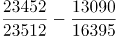。

故正确答案为C。

**考点**：两期比重、统计表

**来源**：2022年云南公务员录用考试《行测》题（网友回忆版）第91题

### 第 97 题

2016~2020年间，全国城市生活垃圾总清运量约比2011~2015年间高多少亿吨？

A. 2

B. 2.5

C. 3

D. 3.5

第 97 题 · 答案与解析

**参考答案（粉笔题库参考内容）**

B

**解析**

定位统计表可得2011~2020年间各年全国城市生活垃圾总清运量。则2016~2020年间全国城市生活垃圾总清运量比2011~2015年间高：（20362+21521+22802+24206+23512）-（16395+17081+17239+17860+19142）≈（20400+21500+22800+24200+23500）-（16400+17100+17200+17900+19100）=24700万吨=2.47亿吨，与B项最接近。

故正确答案为B。

**考点**：统计表、简单加减计算

**来源**：2022年云南公务员录用考试《行测》题（网友回忆版）第92题

### 第 98 题

2012~2020年间，全国城市生活垃圾无害化处理量同比增长超过1200万吨的年份有几个？

A. 4

B. 5

C. 6

D. 7

第 98 题 · 答案与解析

**参考答案（粉笔题库参考内容）**

C

**解析**

根据题干“······同比增长超过1200万吨······”，可判定本题为增长量计算问题。定位表格最后一列，结合公式：增长量=现期量-基期量，可得2012~2020年全国城市生活垃圾无害化处理量的同比增长量分别为：

2012年：14490-13090=1400万吨>1200万吨；

2013年：万吨<1200万吨；

2014年：16394-15394=1000万吨<1200万吨；

2015年：万吨>1200万吨；

2016年：万吨>1200万吨；

2017年：万吨>1200万吨；

2018年：万吨>1200万吨；

2019年：万吨>1200万吨；

2020年：23452-24013<1200万吨。

综上可得，2012~2020年间，全国城市生活垃圾无害化处理量同比增长超过1200万吨的年份有6个。

故正确答案为C。

**考点**：增长量计算、统计表

**来源**：2022年云南公务员录用考试《行测》题（网友回忆版）第93题

### 第 99 题

2020年，全国平均每座无害化处理场的无害化处理能力约为多少？

A. 27万吨/年

B. 41万吨/年

C. 58万吨/年

D. 79万吨/年

第 99 题 · 答案与解析

**参考答案（粉笔题库参考内容）**

A

**解析**

根据题干“2020年······平均每座······”，可判定本题为现期平均数问题。定位统计表可得：2020年，全国无害化处理场为1287座，无害化处理能力为96.35万吨/日。故2020年，全国平均每座无害化处理场的无害化处理能力万吨/年，与A项最接近。

故正确答案为A。

**考点**：现期平均数、统计表

**来源**：2022年云南公务员录用考试《行测》题（网友回忆版）第94题

### 第 100 题

关于全国城市生活垃圾清运和无害化处理状况，能够从上述资料中推出的是：

A. 2016年，总清运量同比增速快于上年水平

B. 2020年，无害化处理场数量比2011年翻了一番

C. 2018~2020年，每年的无害化处理能力同比增速都超过10%

D. 2017年总清运量与无害化处理量均超过2016年1500万吨以上

第 100 题 · 答案与解析

**参考答案（粉笔题库参考内容）**

C

**解析**

A项：定位统计表可知2014~2016年全国城市生活垃圾总清运量的数据，根据公式：增长率，可得2016年总清运量同比增速为，2015年总清运量同比增速为，故2016年，总清运量同比增速低于上年水平，错误；

B项：定位统计表可得：2011年、2020年全国城市生活垃圾无害化处理场数量分别为677座、1287座。由于，故2020年，无害化处理场数量并未比2011年翻一番，错误；

C项：定位统计表可知2017~2020年全国城市生活垃圾无害化处理能力的数据，根据公式：增长率，可得2018年无害化处理能力同比增速为>10%，2019年无害化处理能力同比增速为>10%，2020年无害化处理能力同比增速为>10%，故2018~2020年，每年的无害化处理能力同比增速都超过10%，正确；

D项：定位统计表可知2016年、2017年全国城市生活垃圾总清运量与无害化处理量的数据，根据公式：增长量=现期量-基期量，可得2017年总清运量超过2016年：1100^+万吨<1500万吨，2017年无害化处理量超过2016年：万吨<1500万吨，故2017年总清运量与无害化处理量均未超过2016年1500万吨以上，错误。

故正确答案为C。

**考点**：综合分析、统计表

**来源**：2022年云南公务员录用考试《行测》题（网友回忆版）第95题

## 材料 2

### 第 101 题

2011～2020年，全国城市建成区绿化覆盖率同比上升的年份有几个？

A. 7

B. 8

C. 9

D. 10

第 101 题 · 答案与解析

**参考答案（粉笔题库参考内容）**

C

**解析**

定位统计图可知，2011~2020年全国城市建成区绿化覆盖率同比上升的有2011年（39.22%）、2012年（39.59%）、2013年（39.70%）、2014年（40.22%）、2016年（40.30%）、2017年（40.91%）、2018年（41.11%）、2019年（41.51%）、2020年（42.06%），共9年。

故正确答案为C。

**考点**：统计图、直接找数

**来源**：2022年云南公务员录用考试《行测》题（网友回忆版）第96题

### 第 102 题

以下年份中全国城市建成区绿化覆盖率与建成区绿地率数值相差最大的是：

A. 2017年

B. 2018年

C. 2019年

D. 2020年

第 102 题 · 答案与解析

**参考答案（粉笔题库参考内容）**

C

**解析**

定位统计图可得，各年份全国城市建成区绿化覆盖率与建成区绿地率的差值分别为：

2017年=40.91%-37.11%=3.80%；

2018年=41.11%-37.34%=3.77%；

2019年=41.51%-37.63%=3.88%；

2020年=42.06%-38.24%=3.82%。

综上，数值相差最大的为2019年。

故正确答案为C。

**考点**：统计图、简单加减计算

**来源**：2022年云南公务员录用考试《行测》题（网友回忆版）第97题

### 第 103 题

表中全国城市建成区绿地率首次超过35%的年份，当年人均公园绿地面积同比约上升了：

A. 4%

B. 6%

C. 8%

D. 10%

第 103 题 · 答案与解析

**参考答案（粉笔题库参考内容）**

B

**解析**

根据题干“表中全国城市建成区绿地率首次超过35%的年份，当年······同比约上升了”，结合选项均为百分数，可判定本题为一般增长率问题。定位统计图可得：表中全国城市建成区绿地率首次超过35%的年份为2011年。2011年全国人均公园绿地面积为11.80平方米，2010年为11.18平方米。根据公式：增长率，故所求为。

故正确答案为B。

**考点**：一般增长率、统计图

**来源**：2022年云南公务员录用考试《行测》题（网友回忆版）第98题

### 第 104 题

以下折线图反映了哪一时间段内全国城市人均公园绿地面积同比增量的变化趋势？

A. 2011～2014年

B. 2013～2016年

C. 2015～2018年

D. 2017～2020年

第 104 题 · 答案与解析

**参考答案（粉笔题库参考内容）**

D

**解析**

根据题干“······同比增量的变化趋势”，可判定本题为增长量计算问题。定位统计图可得：2010-2020年全国城市人均公园绿地面积依次为11.18平方米、11.80平方米、12.26平方米、12.64平方米、13.08平方米、13.35平方米、13.70平方米、14.01平方米、14.11平方米、14.36平方米、14.78平方米。根据公式：增长量=现期量-基期量。则2011-2020年全国城市人均公园绿地面积同比增量分别为：

2011年=11.80-11.18=0.62平方米；

2012年=12.26-11.80=0.46平方米；

2013年=12.64-12.26=0.38平方米；

2014年=13.08-12.64=0.44平方米；

2015年=13.35-13.08=0.27平方米；

2016年=13.70-13.35=0.35平方米；

2017年=14.01-13.70=0.31平方米；

2018年=14.11-14.01=0.10平方米；

2019年=14.36-14.11=0.25平方米；

2020年=14.78-14.36=0.42平方米。

比较可知，满足题干折线图先下降再上升变化趋势的为2017～2020年，对应D项。

故正确答案为D。

**考点**：增长量计算、统计图

**来源**：2022年云南公务员录用考试《行测》题（网友回忆版）第99题

### 第 105 题

关于全国城市绿化状况，能够从上述资料中推出的是:

A. 2014年，城市建成区绿化覆盖区域面积是未覆盖区域面积的1.5倍以上

B. 以2009年为基期计算，2009～2020年城市建成区绿地率年均上升0.4个百分点以上

C. 如城市总人口保持不变，则2020年城市公园绿地面积比2009年增长了50%以上

D. 如按全国城市平均数计算，2020年一个800万人口的城市拥有公园绿地超过100平方千米

第 105 题 · 答案与解析

**参考答案（粉笔题库参考内容）**

D

**解析**

A项：定位统计图可知：2014年全国城市建成区绿化覆盖率为40.22%。则2014年全国城市建成区绿化未覆盖率为1-40.22%=59.78%，所求为，错误；

B项：定位统计图可知：2009年和2020年全国城市建成区绿地率分别为34.17%和38.24%。根据公式：年均增长量，所求为，即年均上升了不到0.4个百分点，错误；

C项：定位统计图可知：2009年和2020年全国城市人均公园绿地面积分别为10.66平方米和14.78平方米。根据公式：城市公园绿地面积=城市人口×城市人均公园绿地面积，由于城市总人口保持不变，则所求增长率为，错误；

D项：定位统计图可知：2020年全国城市人均公园绿地面积为14.78平方米。根据公式：城市公园绿地面积=城市人口×城市人均公园绿地面积，则所求为800×14.78=11824万平方米=118.24平方千米>100平方千米，正确。

故正确答案为D。

**考点**：综合分析、统计图

**来源**：2022年云南公务员录用考试《行测》题（网友回忆版）第100题

## 材料 3

### 第 106 题

2020年中国钓鱼钩、竿、轮进出口贸易总额同比：

A. 增长了不到5%

B. 增长了5%以上

C. 减少了不到5%

D. 减少了5%以上

第 106 题 · 答案与解析

**参考答案（粉笔题库参考内容）**

B

**解析**

根据题干“2020年······同比”，结合选项为“增长/减少+%”，可判定本题为一般增长率问题。定位统计表可得2019年、2020年中国钓鱼钩、竿、轮的进口贸易额和出口贸易额。则2019年中国钓鱼钩、竿、轮进出口贸易总额为万美元，2020年为万美元。根据公式：增长率，则2020年中国钓鱼钩、竿、轮进出口贸易总额同比增长率，属于B项范围。

故正确答案为B。

**考点**：一般增长率、统计表

**来源**：2022年河南省公务员录用考试《行测》题（网友回忆版）第106题

### 第 107 题

2014-2020年，中国钓鱼竿进口总额约为：

A. 1.5亿美元

B. 1.7亿美元

C. 1.9亿美元

D. 2.1亿美元

第 107 题 · 答案与解析

**参考答案（粉笔题库参考内容）**

D

**解析**

定位统计表可得2014-2020年每一年我国钓鱼竿的进口额。则2014-2020年，中国钓鱼竿进口总额为2222+2317+2316+2184+2727+3674+5081≈2200+2300+2300+2200+2700+3700+5100=20500万美元≈2.1亿美元。

故正确答案为D。

**考点**：统计表、简单加减计算

**来源**：2022年河南省公务员录用考试《行测》题（网友回忆版）第107题

### 第 108 题

2015-2020年，中国钓鱼钩进、出口额均同比增长的年份有几个？

A. 2

B. 3

C. 4

D. 5

第 108 题 · 答案与解析

**参考答案（粉笔题库参考内容）**

A

**解析**

定位统计表可得：2014-2020年，中国钓鱼钩进口额依次为1058万美元、1156万美元、938万美元、748万美元、903万美元、993万美元、1070万美元；出口额依次为10667万美元、9455万美元、9525万美元、9280万美元、10110万美元、10279万美元、9935万美元。比较可知，2015-2020年中国钓鱼钩进口额同比增长的年份有2015年、2018年、2019年、2020年；出口额同比增长的年份有2016年、2018年、2019年。则2015-2020年，中国钓鱼钩进、出口额均同比增长的年份有2018年、2019年，共2个。

故正确答案为A。

**考点**：统计表、直接找数

**来源**：2022年河南省公务员录用考试《行测》题（网友回忆版）第108题

### 第 109 题

以下折线图反映了2018-2020年中国哪项钓具贸易额同比增量的变化趋势？

A. 钓鱼竿进口额

B. 钓鱼竿出口额

C. 钓线轮进口额

D. 钓线轮出口额

第 109 题 · 答案与解析

**参考答案（粉笔题库参考内容）**

C

**解析**

根据题干“以下折线图反映了······同比增量的变化趋势”，可判定本题为增长量比较问题。定位统计表可知钓鱼竿和钓线轮2017年-2020年每年的进出口贸易额。根据公式：增长量=现期量-基期量，可得各选项2018-2020年每年的同比增量：

A项：2018年，2727-2184=543万美元；2019年，3674-2727=947万美元；2020年，5081-3674=1407万美元。即2018-2020年钓鱼竿进口额同比增量的变化趋势为逐渐递增，不符合折线图趋势，排除。

B项：2018年，60617-55934=4683万美元；2019年，58234-60617=-2383万美元；2020年，61267-58234=3033万美元。即2018-2020年钓鱼竿出口额同比增量的变化趋势为先降低再增加，不符合折线图趋势，排除。

C项：2018年，2443-1903=540万美元；2019年，5323-2443=2880万美元；2020年，7623-5323=2300万美元。即2018-2020年钓线轮进口额同比增量的变化趋势为先增加再降低，符合折线图趋势，当选。

D项：2018年，31163-28676=2487万美元；2019年，27426-31163=-3737万美元；2020年，31215-27426=3789万美元。即2018-2020年钓线轮出口额同比增量的变化趋势为先降低再增加，不符合折线图趋势，排除。

故正确答案为C。

**考点**：增长量比较、统计表

**来源**：2022年河南省公务员录用考试《行测》题（网友回忆版）第109题

### 第 110 题

关于中国部分钓具进出口贸易状况，能从上述资料中推出的是：

A. 2017-2020年，进口额年均同比增速钓鱼竿快于钓线轮

B. 2014-2020年，每年钓鱼钩进出口总额都超过1亿美元

C. 2017-2020年，每年出口额钓线轮都超过钓鱼竿的一半

D. 2014-2020年，钓鱼钩和钓鱼竿进口额最低的年份不同

第 110 题 · 答案与解析

**参考答案（粉笔题库参考内容）**

B

**解析**

A项：定位统计表，可知2017年钓鱼竿、钓线轮的进口额分别为2184万美元、1903万美元；2020年中国钓鱼竿、钓线轮的进口额分别为5081万美元、7623万美元。根据年均增长率公式：，当年份差相同时，现期量/基期量越大，年均同比增速越大。则钓鱼竿：现期量/基期量；钓线轮：现期量/基期量，故2017-2020年进口额年均同比增速钓鱼竿慢于钓线轮，错误；

B项：定位统计表，可知2014-2020年每年钓鱼钩进口额与出口额数据。故2014-2020年钓鱼钩进出口总额分别为：2014年，10667万美元+1058万美元＞1.1亿美元；2015年，9455万美元+1156万美元＞1.0亿美元；2016年：9525万美元+938万美元＞1.0亿美元；2017年：9280万美元+748万美元＞1.0亿美元；2018年：10110万美元+903万美元＞1.1亿美元；2019年：10279万美元+993万美元＞1.1亿美元；2020年：9935万美元+1070万美元＞1.1亿美元，正确；

C项：定位统计表，可知2017-2020年每年钓线轮、钓鱼竿的出口额。2019年钓线轮出口额（27426万美元）＜钓鱼竿出口额的一半（万美元），错误；

D项：定位统计表，可知2014-2020年钓鱼钩进口额最低的年份为2017年（748万美元），钓鱼竿进口额最低的年份也为2017年（2184万美元），错误。

故正确答案为B。

**考点**：综合分析、统计表

**来源**：2022年河南省公务员录用考试《行测》题（网友回忆版）第110题

## 材料 4

2021年全国共有138个国家级区域性良种繁育基地，其中山东、黑龙江分别有16和12个基地，云南、湖北均以10个居于其后，2021年全国通过国审的水稻品种有677个，其中湖南有169个；玉米通过国审的919个品种中，134个来自北京，其后是吉林99个、河南95个；与水稻、玉米相比，大豆种源高度依赖进口，2021年仅有86个国审品种，其中黑龙江18个、山东14个；棉花39个国审品种中，最多的是新疆，有12个，其次为河南，有6个。

2021年，我国农作物自主选育品种面积占比超95%，水稻、小麦两大口粮作物品种100%自给。大豆种子对外依赖度高达86%，胡萝卜、茄子、菠菜、洋葱、高端品种番茄及甜菜等种子的进口依赖度超过90%。

### 第 111 题

2014-2021年间，我国农作物种子进出口贸易逆差超2亿美元的年份有几个？

A. 3

B. 4

C. 5

D. 6

第 111 题 · 答案与解析

**参考答案（粉笔题库参考内容）**

C

**解析**

定位统计图可得：2014-2021年中国农作物种子进口额分别为3.24亿美元、3.62亿美元、2.87亿美元、4.17亿美元、4.75亿美元、4.35亿美元、5.7亿美元、6.8亿美元；出口额分别为2.61亿美元、2.43亿美元、2.13亿美元、2亿美元、2.19亿美元、2.11亿美元、2.9亿美元、3.3亿美元。则2014-2021年间，我国农作物种子进出口贸易逆差分别为：

2014年：3.24-2.61=0.63亿美元；

2015年：3.62-2.43=1.19亿美元；

2016年：2.87-2.13=0.74亿美元；

2017年：4.17-2=2.17亿美元；

2018年：4.75-2.19=2.56亿美元；

2019年：4.35-2.11=2.24亿美元；

2020年：5.7-2.9=2.8亿美元；

2021年：6.8-3.3=3.5亿美元。

因此，2014-2021年间，我国农作物种子进出口贸易逆差超2亿美元的年份有2017年、2018年、2019年、2020年、2021年，共5个。

故正确答案为C。

**考点**：综合资料、简单加减计算

**来源**：2022年云南公务员录用考试《行测》题（网友回忆版）第86题

### 第 112 题

2014-2021年间，我国农作物种子贸易进出口总量同比增长的年份有几个？

A. 4

B. 5

C. 6

D. 7

第 112 题 · 答案与解析

**参考答案（粉笔题库参考内容）**

A

**解析**

根据题干“2014-2021年间······同比增长的年份有几个”，可判定本题为增长量计算问题。定位统计图可得，2014-2021年我国各年农作物种子贸易的进口量与出口量。则2014-2021年我国农作物种子贸易进出口总量分别为：

2014年，6.29+2.86=9.15万吨；

2015年，6.85+2.7=9.55万吨；

2016年，4.99+3.46=8.45万吨；

2017年，7.45+2.33=9.78万吨；

2018年，7.27+2.86=10.13万吨；

2019年，6.6+2.56=9.16万吨；

2020年，7.27+2.28=9.55万吨；

2021年，6.6+2.47=9.07万吨。

根据公式：增长量=现期量-基期量，若我国农作物种子贸易进出口总量实现同比增长，则需增长量＞0，即现期量-基期量＞0，故直接找出现期量大于基期量的年份即可。由此可知，2014-2021年间，我国农作物种子贸易进出口总量大于上年的有：2015年（9.55万吨）＞2014年（9.15万吨）；2017年（9.78万吨）＞2016年（8.45万吨）；2018年（10.13万吨）＞2017年（9.78万吨）；2020年（9.55万吨）＞2019年（9.16万吨），共4个年份。

故正确答案为A。

**考点**：增长量计算、综合资料

**来源**：2022年云南公务员录用考试《行测》题（网友回忆版）第87题

### 第 113 题

如按2021年我国农作物种子出口量同比增速推算，2022年我国农作物种子出口量约为多少万吨？

A. 2.58

B. 2.68

C. 2.78

D. 2.88

第 113 题 · 答案与解析

**参考答案（粉笔题库参考内容）**

B

**解析**

根据题干“如按2021年······同比增速推算，2022年······出口量约为多少万吨”，结合材料时间为2021年，可判定本题为现期计算问题。定位统计图可知：2021年与2020年中国农作物种子出口量分别为2.47万吨、2.28万吨，根据公式：增长率，可得2021年中国农作物种子出口量同比增速。根据公式：现期量=基期量×（1+增长率），可得2022年中国农作物种子出口量≈2.68万吨。

故正确答案为B。

**考点**：现期计算、综合资料

**来源**：2022年云南公务员录用考试《行测》题（网友回忆版）第88题

### 第 114 题

2021年，我国农作物种子出口额占进出口总额的比重较上年（ ）。

A. 增加了2个百分点以上

B. 减少了2个百分点以上

C. 增加了不到2个百分点

D. 减少了不到2个百分点

第 114 题 · 答案与解析

**参考答案（粉笔题库参考内容）**

D

**解析**

根据题干“2021年······占······比重较上年”，结合选项为增加/减少+百分点，可判定本题为两期比重计算问题。定位统计图可得：2021年和2020年我国农作物种子出口额分别为3.3亿美元和2.9亿美元，进口额分别为6.8亿美元和5.7亿美元。根据公式：比重，可得2021年农作物种子出口额占进出口总额的比重；2020年比重，则所求=32.7%-33.7%=-1%，即减少了不到2个百分点。

故正确答案为D。

**考点**：两期比重、综合资料

**来源**：2022年云南公务员录用考试《行测》题（网友回忆版）第89题

### 第 115 题

不能从上述资料推出的是（ ）。

A. 2021年我国大豆种子自给率不足15%

B. 2021年棉花国审品种中新疆占比最大

C. 2021年我国自主甜菜种子占国内市场份额低于10%

D. 2021年玉米通过国审品种最多，国内玉米需求已能自给

第 115 题 · 答案与解析

**参考答案（粉笔题库参考内容）**

D

**解析**

A项：定位文字材料第二段可知，2021年我国······大豆种子对外依赖度高达86%，则2021年我国大豆种子的自给率应为1-86%=14%＜15%，正确；

B项：定位文字材料第一段可知，（2021年）棉花国审品种中最多的是新疆，有12个，其次为河南，有6个。因此新疆占比最大，正确；

C项：定位文字材料第二段可知，2021年我国······胡萝卜、茄子、菠菜、洋葱、高端品种番茄及甜菜等种子的进口依赖度超过90%，则2021年我国甜菜种子的自给率应＜1-90%=10%，故我国自主甜菜种子占国内市场份额低于10%，正确；

D项：定位文字资料第一段可知，2021年全国通过国审的玉米品种有919个，但并未说明已经列出了所有种子通过国审的品种的数量，故无法确定玉米通过国审的品种是否最多；定位文字资料第二段可知，水稻、小麦两大口粮作物品种100%自给，并没有提到玉米，因此不能确定国内玉米需求是否已能自给。综上，D项表述不能从资料中推出，错误。

本题为选非题，故正确答案为D。

**考点**：综合分析、综合资料

**来源**：2022年云南公务员录用考试《行测》题（网友回忆版）第90题

