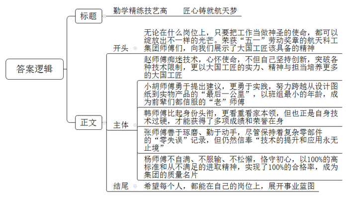
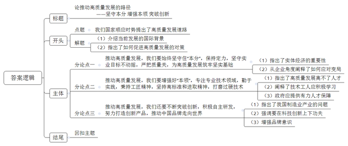

# 2023年公务员多省联考《申论》题（贵州A卷）

> 候选采集稿。参考答案及解析来自粉笔页面，不代表官方答案或真实高分答卷；来源使用许可与原卷对应关系仍需人工核实。

## 给定材料

### 材料 material-d16f0e6d8573d1cd

近年来，X省先后成功申报并创建葡萄、棉花等6个优势特色产业集群，聚焦全省范围内基础好、规模大、有特色、比较优势显著的主导产业，推动主导产业由县域的“块状经济”向全省“带状经济”转变。

2022年6月，第29届国际葡萄酒大奖赛全球榜单公布，夜光杯葡萄酒业公司旗下产品荣获3项金奖。“依托T县的气候环境优势，积极布局葡萄酒产业，公司目前已研发生产干红、桃红两大系列七个葡萄酒产品，并通过线上线下渠道销往世界各地。”夜光杯葡萄酒业公司谭董事长说，“我们整合产业链上下游，在生产端采用标准化栽培技术，提升酿酒葡萄的品质，通过领办合作社带动周边千余户农民增收。同时，还依托酒庄开发酒庄旅游业态，年均接待游客3万人次。”

在棉花主产区L县的依力村高标准农田建设现场，装载机、推土机、挖掘机等大型机械相互配合，一块块小地块变成了平整的大条田。棉农小艾种了248亩地，看着眼前平整好的大条田，他说：“以前棉花地都是小地块，高低不平，平整后就可以使用大型机械了，不仅减少了投入，还能提高棉花产量。”“截至2022年底，全县高标准农田面积已达100万亩，比十年前增加5倍，棉花产效增长40%；农民也从土地上解放出来，收入渠道更加多元了。”L县耿副县长说高标准农田建设为全县棉花产业持续补链强链打下了坚实基础。

“我们先后成立了制种公司、轧花厂、纺织厂，不断提高棉花产业发展效益。”守信集团郭董事长说，集团将继续开发家纺、服装等产品，完成从一粒棉种到一件衣服的全产业链发展。目前，L县近50%的棉花已就地转化为纺织产品，规模化经营、标准化生产、机械化作业，棉花全产业链发展集群已初步形成。

在C县塔格村，村民阿力正在播种冬小麦，“北斗导航无人驾驶播种机下种均匀、播得直，同步铺设滴灌带，方便了后期我们的管理和采收。”塔格村党支部刘书记说：“这几年，我们村用北斗导航无人驾驶播种机播种的小麦高产稳产，村民种植冬小麦的积极性很高。”

“现在种地与原来相比，说轻松又不轻松。”Q县河子村种植大户老马2022年种植了1500亩冬小麦，“种地都机械化了，不再像原来那样拼体力，而是多动脑子，努力学习和掌握新知识。”

截至2022年，X省农作物综合机械化水平达到87.5%，农林牧渔综合机械化水平达到72.6%。

塔河流域的人们，至今依然对去年夏天的一场洪水记忆犹新。塔河进入夏季汛期不久，就形成了60年不遇的大洪水。汛期的主河道大水翻涌，向下游行进。“当叶尔羌河山区段来水剧增时，阿尔塔什水利枢纽一面拦截洪峰，一面加大下泄水量。我们积极利用这一股洪水，通过叶尔羌河沿线6个分水枢纽，把水高效引入农区和胡杨林区。”塔河流域K县管理局夏局长说，“洪水来了，流域管理机构怎么分，我们怎么接，接后怎么分配使用，都有具体的实施方案。”

“2022年以来，塔河流域水资源管理体制进行了一系列改革，实现了从注重供给侧向满足需求侧转变，从关注大河来水向深入灌区服务转变，从管住灌区用水向千方百计保障灌区需求转变，塔河流域各大灌区水资源利用率明显提高。”塔河流域管理局王副局长说，得益于塔河流域各地的科学应对，洪水静悄悄流过农田、村庄和胡杨林，80%都得到了有效利用。

“作为X省特种乳产业的知名企业，我们持续健全产业链、构建融合发展格局，企业不仅生产鲜驼奶、驼奶粉、奶片，还研发了驼绒制品、驼乳化妆品、保健品，今后还将继续延伸骆驼产业链，走出一条以科技为基础的骆驼产品深加工发展之路。”源旺生物科技集团潘董事长说，集团还在品质、工艺、服务三个方面同步发力，攻克驼奶保鲜等相关核心技术，还在F县积极布局集旅游、康养、文化等于一体的骆驼小镇项目，带动当地农牧民增收致富。

“正在深刻改变农业内涵的高质量发展，将成为不可阻挡的时代趋势。”省农业农村厅王副厅长深有感触地说。

### 材料 material-7d9370eb0a9d04b8

2022年，航天科工集团有多名航天技术工人荣获全国“五一”劳动奖章。为宣传先进，激励集团广大干部职工，《航天科工集团报》近日刊发了关于他们的专题报道，以下是报道的主要内容：

集团一分厂工人小陈说：“我师傅对技术的追求近乎痴迷。他夜以继日研究、总结出的一套‘听声辨量’绝活，靠听觉就能分辨出切削用量的合理性，高效解决了多项航天重器研制难题。跟着我师傅干，永远都有动不完的脑子学不完的技术。”小陈口中的师傅就是该厂车工专业技术带头人赵师傅，他带领的团队承担并圆满完成了多项航天产品机械结构件、骨架类核心结构件的研制和生产任务。尽管赵师傅本人在团队中获得的技术专利是最多的，但他还是心怀紧迫感、使命感：“航天技术日新月异，不创新、不敢于突破各种各样的技术限制，现在好不容易积累起来的发展优势就要消耗殆尽。”作为团队乃至整个集团的技术核心骨干，他担任了集团创新工作室的技术传承人，多年致力于工作室和高技能人才队伍建设，以一名大国工匠的实力、精神与担当培养更多的大国工匠。

数控维修工小胡在集团二分厂的数控维修班组年龄最小，但在众多前辈眼里“他是一个随时随地都勇于提出自己合理意见的‘建议达人’”，而小胡的回应是，“光有嘴说还远远不够，重要的是亲自尝试亲手做，没有实践就没有发言权。”他努力跨越从设计图纸到实物产品的“最后一公里”，为生产制造高技术、高质量、高可靠性的航天装备产品提供有力保障。他研制的气体置换保压安全装置改变了过去的测试模式，将测试时间缩短了一半。他改进的自动化轴承涂脂设备改变了现有人工涂脂方式，在大幅缩减人力的同时，效率提升了200%。班组的老张说，“大家都叫他小胡师傅，但这个年轻人真的是个‘老’师傅，我们这些老师傅都愿意跟着他干。”

2020年，集团三分厂接到一项批量大、工期紧、焊接要求高、操作难度大的不锈钢材料焊接任务，正当大伙儿一筹莫展之际，该厂的高级焊接技师韩师傅大胆建议用熔化极惰性气体保护焊（MIG焊），并和组员们多次优化焊接参数，几经调试和改进，焊缝内部和外观质量都满足了设计要求，圆满完成了任务。从此以后，韩师傅改进的MIG焊陆续在集团得到推广与应用。韩师傅还凭借自己的过硬技术，被聘为“国家高级职业技能鉴定考评员”“国家职业技能竞赛裁判员”“焊接技术特级教练”，韩师傅认为，不管是裁判员还是教练员，在自己的专业技术领域，比身份头衔更重要的是要有让人服气、让人愿意学习和接受的看家本领。

张师傅自2020年入职以来，先后在钳工、精密镗工、数控铣工等多个班组岗位工作锻炼。作为科研生产战线上的多面能手，领导安排他负责复杂个性化零部件的快速定制工作。他凭借深厚的技术功底，一直保持着复杂零部件加工的“零失误”记录。工作之余，他还常常自己动手加工一些生活中的小物件，比如衣柜的撑杆头、洗衣机的转接头、手电钻的扩展支架、手机支架等都是他用自己研制的3D打印设备制作的。张师傅的座右铭是：技术的提升和应用永无止境。他说：“无论工作还是生活，只要善于琢磨、勤于动手，实实在在地干，哪个岗位、哪种生活，都能成就自己。”

“如果满足于已经取得的100%，这个数字很快就会往下滑、只有不自满、不服输、不松懈，恪守航天匠人的初心，才能将航天工匠的人生写圆满。”杨师傅正是以这种100%的高标准和从不满足的进取精神，既成就了自己，也成就了他长期从事的大型钛合金、高强度钢、铝合金等难加工材料薄壁零件的数控车削加工技术。他总结提出的超大、超薄平板铝合金无变形数车加工技术、盲腔内深孔无切削对刀技术、组合配车技术等，都是工艺创新的典范。以他的名字命名的“杨师傅数控加工五步法”得到广泛应用，使全厂关键工序质量合格率连续十年稳定保持在100%的水平，促进了生产效率与产品质量的双提升。工作20多年来，杨师傅加工的4000余台产品关键部件的合格率达到了100%，他也连续多年被集团授予“质量免检岗”“质量三星级职工”，成为集团的质量名片。

### 材料 material-501fd671a351271e

“虽然我们的办公地点还在深圳，但我们可以享受到千里之外的D市‘云端’服务和税收等优惠政策。”启程科技王总经理高兴地对记者说。启程科技所享受的服务和优惠，源于D市积极布局打造跨越物理边界的虚拟产业园。近日，《D市日报》记者专门对虚拟产业园发展现状进行了一次调研走访。

据记者了解，加入D市虚拟产业园，已成为不少企业的新选择。相较于传统产业园区，企业只需把公司注册到虚拟产业园，不用入驻指定地理区域生产经营，可自由选择办公城市和地点，也就是说，虚拟产业园内的企业可以分布在全国各地。

前不久，布拉电商科技有限公司成为D市虚拟产业园的新成员。“我们在四川通过网络提交了相关材料，D市虚拟产业园的工作人员随即帮我们完成了工商注册，非常方便。”公司陈总经理说。

“截至目前，虚拟产业园招商入驻企业近100家，主要为互联网企业、电商企业、高科技企业等，初步促成了企业在线规模化集聚。”D市虚拟产业园负责人石主任向记者介绍。目前，D市虚拟产业园为入驻企业提供了合作需求发布、企业资源交换、信息共享、互动交流等多方面服务。“我们掌握着比较丰富的数据，利用这些信息流，可以有效促进上下游、产供销协同联动。最近，我们正在帮助园区内的一些电商企业与相关企业对接、合作，拓展渠道。”石主任说，“但是我们发现，部分企业入驻产业园的主要目的是减税，与平台产业链上下游进行联动的意愿不强，创新链、服务链与产业链之间的有机衔接没有达到预期，产业链供应链还缺乏稳定性。”

在D市工业经济研究所何研究员看来，目前选择入驻虚拟产业园的大多数为初创型企业，这些企业往往资金规模较小，除了基础的政务服务需求外，也希望能够以较低的成本获取法律、人力、财务、营销、金融、品牌等专业服务。部分企业因为行业特性还会衍生出不少个性化的需求，例如电商企业对客服、营销服务的需求，文创企业对设计、美工服务的需求。“虚拟产业园原本就有平台优势，可以把具有相似需求的企业聚集在一起，共同与服务提供商进行洽谈，从而节省成本，现在的关键问题是如何把这个优势发挥好。”

“虚拟产业园要发展，需在盈利模式上有所突破。与传统产业园区相比，虚拟产业园在房地产方面的销售和租赁收入很少，目前主要依靠税收返还、政府补贴等渠道获取收入，但这并非长久之计！”市经信委袁副主任说，以D市虚拟产业园为例，市里不仅为入驻企业和个人提供地方留存税收的80%作为奖励，还外加人才最高补贴600万元、企业上云补贴等奖励。“我觉得有必要加快培育一批具有运营管理能力的市场化主体，构建市场化的投入和盈利模式，比如向企业收取一定的园区管理费或场地租用费来增加园区收入。”

“作为新业态新模式的虚拟产业园打破行政边界后，如何实现有效监管对虚拟产业园发展至关重要。”D大学贺教授表示，要打破传统业态按区域、按行业治理的惯性思维，探索创新监管模式。“从企业的角度来看，我认为虚拟产业园还应该在推动产业集聚、上下游联动方面多做工作，同时要多一些有针对性的设计，在增值服务方面也还有进一步提升的空间。”君和咨询公司游经理向记者表示，D市虚拟产业园应该探索拓展盈利新渠道和新模式，如通过入股园区内企业、为企业嫁接资源等方式参与企业经营，既为入驻企业发展提供支撑，也能实现产业园自身的发展。

“虚拟产业园的监管是一个全新的课题。”何研究员说，“市经信委正委托我们开展专题研究，主要聚焦在健全触发式监管机制，构建依靠企业、社会组织等多元主体参与的多方协同治理体系，促进其健康发展。”

市经信委袁副主任不久前才去了沿海某城市，考察了当地的网商虚拟产业园建设。“他们为入驻企业提供了安全、稳定、快速和优惠的云服务，以及专属服务器运维服务。此外，产业园还以技术入股或低于市场价格的方式为入驻企业提供技术开发服务，如平台系统搭建、APP开发、网站开发、公众号开发等。”袁副主任感慨地说，“他们在产业园建设了产学研一体化、培训实训孵化一条龙的‘众创空间’，并邀请知名企业家、教授为创业团队提供专业意见和建议。产业园已成功孵化项目超过30个。我很受启发。”

## 题目

### 第 1 题

**请根据****“给定资料**1**”，谈谈X省推进农业高质量发展的举措。****（****20分****）**

关联材料：material-d16f0e6d8573d1cd

作答要求：

要求：全面、准确、有条理；不超过300字。

### 第 2 题

**请根据****“给定资料**2**”，为《航天科工集团报》的专题报道写一篇短评。****（****30分****）**

关联材料：material-7d9370eb0a9d04b8

作答要求：

要求：

（1）观点明确，简明深刻；

（2）紧扣资料，重点突出；

（3）有逻辑性，思路流畅；

（4）不超过400字。

### 第 3 题

**请根据****“给定资料**3**”，梳理D市虚拟产业园发展中存在的问题，并提出解决问题的建议。****（****40分****）**

关联材料：material-501fd671a351271e

作答要求：

要求：

（1）问题梳理全面、准确；

（2）所提建议与问题对应，具体明确、切实可行；

（3）不超过500字。

### 第 4 题

**“给定资料**5**”提到，“在大变局的喧嚣中始终坚守住‘本分’，切实增强好‘本领’，不断突破创新，推动高质量发展的步伐就能坚实稳健，我们就能走向广阔的未来。”请结合对这句话的理解，参考给定资料，联系实际，自选角度，自拟题目，写一篇文章。****（****60分****）**

关联材料：material-d16f0e6d8573d1cd

作答要求：

要求：

（1）观点明确，见解深刻；

（2）参考给定资料，但不拘泥于给定资料；

（3）思路清晰，语言流畅；

（4）字数1000~1200字。

## 答案与解析

第 1 题

**参考答案（粉笔题库参考内容）**

打造优势特色产业集群，聚焦主导产业，发展带状经济。

1.依托自然条件布局葡萄酒产业：整合产业链上下游，标准化栽培，领办合作社，研发葡萄酒产品，拓宽销售渠道和市场；发展酒庄旅游。

2.做强棉花产业：建设高标准农田，降本增产；规模化经营，标准化生产，机械化作业，打造全产业链发展集群。

3.机械化种植小麦：北斗导航无人驾驶机播种，配套滴灌带，方便管理采收，实现高产稳产。

4.改革水资源管理体制：满足需求侧，深入灌区服务，保障灌区需求，科学应对、利用洪水，提升灌区水资源利用效率。

5.健全骆驼产业链：持续健全、延伸产业链，构建融合发展格局，走深加工发展道路，提升品质、工艺、服务，攻克核心技术，布局文旅康养一体小镇项目。

**解析**

**参考答案说明：**本参考答案先介绍了X省推进农业高质量发展的总体对策，随后具体对策从“依托自然条件布局葡萄酒产业”“做强棉花产业”“机械化种植小麦”“改革水资源管理体制”“健全骆驼产业链”这五个方面展开进行了分条撰写。各条要点之间在内容上相互并列，没有交叉。

**考点**：考点概括措施类

**来源**：来源2023年公务员多省联考《申论》题（贵州A卷）

粉笔申论页面对本题只提供「解析视频」入口，该入口是会员推广位，页面无视频地址与文字解析。

第 2 题

**参考答案（粉笔题库参考内容）**

勤学精练技艺高 匠心铸就航天梦

无论在什么岗位上，只要把工作当做神圣的使命，都可以绽放出不一样的光芒。荣获“五一”劳动奖章的航天科工集团师傅们，向我们展示了大国工匠该具备的精神。

赵师傅痴迷技术，心怀使命，不但自己坚持创新，突破各种技术限制，更以大国工匠的实力、精神与担当培养更多的大国工匠。小胡师傅勇于提出建议，更勇于实践，努力跨越从设计图纸到实物产品的“最后一公里”，以班组最小的年龄，成为前辈们都信服的“老”师傅。韩师傅比起身份头衔，更看重看家本领，但也正是自身技术过硬，才能获得了多项成绩和荣誉在身。张师傅善于琢磨、勤于动手，尽管保持着复杂零部件的“零失误”记录，但仍然信奉“技术的提升和应用永无止境”。杨师傅不自满、不服输、不松懈，恪守初心，以100%的高标准和从不满足的进取精神，实现了100%的合格率，成为集团的质量名片。

希望每个人，都能在自己的岗位上，展开事业蓝图！

**解析**

**参考答案说明：**（1）格式方面，本参考答案写到了“标题”“正文”两个部分。（2）正文部分，一方面从内容上来看，围绕着“航天”这一主题，本参考答案的开头先介绍了评论的对象，并且进行了表态；接着主体部分介绍了赵师傅、小胡师傅、韩师傅、张师傅和杨师傅五位技术工人的事例；最后结尾部分进行了总结呼吁。另一方面，形式上，本参考答案做到了分段、分层撰写，整体上条理较为清晰。

**考点**：考点评论类

**来源**：来源2023年公务员多省联考《申论》题（贵州A卷）

粉笔申论页面对本题只提供「解析视频」入口，该入口是会员推广位，页面无视频地址与文字解析。

第 3 题

**参考答案（粉笔题库参考内容）**

一、问题：产业链供应链缺乏稳定性。部分企业仅为减税入驻，上下游联动意愿不强，创新链、服务链与产业链衔接不紧密。建议：对入驻企业加强审核，设定进入标准，筛除联动不紧密的企业；通过宣传倡导、政策激励等方式增强企业合作意愿，促进产业集聚、上下游联动。

二、问题：服务压力大。专业服务企业预算少，个性化需求增多。建议：利用平台优势，聚集相似需求企业，与服务提供商集体洽谈；多做针对性的设计，提供增值服务；为入驻企业提供质优价廉的多种服务，技术入股；为创业企业提供专业指导，促进项目孵化。

三、问题：盈利模式待突破。主要依靠返税、补贴等政策优惠获取收入，销售和租赁收入少。建议：培育具有运营管理能力的市场化主体，构建市场化的投入和盈利模式，如向企业收取园区管理费或场地租用费；拓展盈利新渠道和新模式，如入股、嫁接资源等方式参与企业经营。

四、问题：缺少有效监管。虚拟产业园作为新业态、新模式打破行政边界。建议：探索创新监管模式，打破传统业态按区域、按行业治理的惯性思维，健全触发式监管机制，构建依靠企业、社会组织等多元主体参与的多方协同治理体系，促进其健康发展。

**解析**

**参考答案说明：**本参考答案从“产业链”“服务”“盈利”“监管”四个方面展开，每个方面内部先阐释问题，再给出相应的解决建议，做到了所提建议与问题相对应。各条答案要点之间在内容上相互并列，没有交叉。

**考点**：考点提出对策类

**来源**：来源2023年公务员多省联考《申论》题（贵州A卷）

粉笔申论页面对本题只提供「解析视频」入口，该入口是会员推广位，页面无视频地址与文字解析。

第 4 题

**参考答案（粉笔题库参考内容）**

**参考答案一：**

**论推动高质量发展的路径**

**——坚守本分 增强本领 突破创新**

当今世界正处于百年未有之大变局，新一轮科技革命风起云涌，产业变革深入发展。如何于变局中开新局，中国智慧彰显出力量，我们国家顺应时势提出了高质量发展道路。前进的方向已经明确、前行的道路已经开拓，我们必须以坚守本分为原则，以增强本领为手段，以突破创新为核心动力，大力推动经济高质量发展，为全面建设社会主义现代化强国开好局起好步。

**推动高质量发展，我们要始终坚守住****“本分”，保持定力，坚守实业目标不动摇，严把质量关，为高质量发展筑牢坚实基础。**实体经济是国民经济的基础和命脉，是国家强盛和民族复兴的重要支柱。而在实体经济的主战场上，质量是企业的立身之本。变局之下，大环境的不确定性、不稳定性增加，做实业考验着企业的定力。如何应对变局？格力给出了自己的答案。“好空调格力造”，这句脍炙人口的广告是格力三十年如一日坚持做实业、“锱铢必较”严把质量关的生动写照。因此，迎战变局，企业一方面需要拿出“咬定青山不放松”的定力，迎难而上、攻坚克难，聚焦目标、聚焦实业。另一方面要严把材料关、生产关、检验关，确保产品质量过硬，用高品质立身。

**推动高质量发展，我们要增强好****“本领”，专注专业技术领域，勤于实践，秉持工匠精神，坚持高标准和进取精神，打磨过硬技术。**众所周知，高质量发展离不开大量专业技术人才，他们是支撑中国制造、中国创造的重要基础。因此，一方面，“三百六十行，行行出状元。”作为一名技术工人要积极投身工作洪流，不断学习新知识，立足岗位精耕细作，练就一身真本领，掌握一手好技术，为加快建设制造强国发光发热。另一方面，政府要通过创新“导师帮带制”、完善技术工人的评价、激励制度等，持续培养优秀的工人队伍，提高其待遇水平，畅通其职业发展渠道，为中国高质量发展提供有力的人才保障。

**推动高质量发展，我们还要不断突破创新，积极自主研发，努力打造创新产品，推动中国品牌走向世界。**曾几何时，中国山寨品牌遍布大江南北，代工企业多如牛毛。我们被冠以“制造大国”等称号，却迟迟尚未跨入“制造强国”的行列，这无疑与高质量发展目标背道而驰。因此，面对“大而不强”的痛点，我们一方面要在科技创新上下足功夫，鼓励企业建立研发中心，加强研发投入等，推出更具市场竞争力的产品。例如华为不断加强对智能手机、5G网络等领域的研发，近年来市场占有率越来越高。另一方面，我们也要顺应消费升级趋势，通过增强品牌识别，打造品牌形象等，促使本土品牌走向国际舞台。例如李宁通过打造“中国李宁”的品牌认知，让中国原创享誉全球。

潮平岸阔催人进，风正扬帆正当时。高质量发展是全面建设社会主义现代化国家的首要目标，我们要在坚守实业本分、增强技术本领、突破研发创新中实现高质量发展！

**解析**

**文章分析**

**论推动高质量发展的路径**

**——坚守本分 增强本领 突破创新**

【**标题的优点：**标题中含有主题词，使文章主题更突出、清晰。其次，采用主副标题的形式，明确文章观点。】

（1）当今世界正处于百年未有之大变局，新一轮科技革命风起云涌，产业变革深入发展。如何于变局中开新局，中国智慧彰显出力量，我们国家顺应时势提出了高质量发展道路。前进的方向已经明确、前行的道路已经开拓，（2）我们必须以坚守本分为原则，以增强本领为手段，以突破创新为核心动力，大力推动经济高质量发展，为全面建设社会主义现代化强国开好局起好步。

【**开头的优点：**★内容方面。范文的开头是紧扣题目给定的“高质量发展”这一主题展开的。首先，介绍当前发展的国际背景；其次，指出了如何促进高质量发展的对策。★文字表达方面。运用了排比的修辞手法，使语言表达有逻辑性、并增强文章气势。】

**推动高质量发展，我们要始终坚守住****“本分”，保持定力，坚守实业目标不动摇，严把质量关，为高质量发展筑牢坚实基础。**（1）实体经济是国民经济的基础和命脉，是国家强盛和民族复兴的重要支柱。而在实体经济的主战场上，质量是企业的立身之本。变局之下，大环境的不确定性、不稳定性增加，做实业考验着企业的定力。（2）如何应对变局？格力给出了自己的答案。“好空调格力造”，这句脍炙人口的广告是格力三十年如一日坚持做实业、“锱铢必较”严把质量关的生动写照。因此，迎战变局，企业一方面需要拿出“咬定青山不放松”的定力，迎难而上、攻坚克难，聚焦目标、聚焦实业。另一方面要严把材料关、生产关、检验关，确保产品质量过硬，用高品质立身。

【**论述段****1的优点：**★观点句：范文的观点句是紧扣“高质量发展”这一文章主题提出的。形式上，它在段首处直接写出，位置突出，容易发现。内容上，关键词突出，内容要点明确，可以明显看出主要论述从“坚守住‘本分’”方面入手。★论述内容：（1）先指出了实体经济的重要性；（2）再从企业角度阐释了如何应对变局。注意：以上几个方面的内容都是紧扣“推动高质量发展，我们要始终坚守住‘本分’，保持定力，坚守实业目标不动摇，严把质量关，为高质量发展筑牢坚实基础”这个观点句进行分析论述的，论述的针对性强，内容层次丰富。在论述方法上主要采用了讲道理与举例子结合，论述清晰透彻。】

**推动高质量发展，我们要增强好****“本领”，专注专业技术领域，勤于实践，秉持工匠精神，坚持高标准和进取精神，打磨过硬技术。**众所周知，（1）高质量发展离不开大量专业技术人才，他们是支撑中国制造、中国创造的重要基础。因此，一方面，“三百六十行，行行出状元。”（2）作为一名技术工人要积极投身工作洪流，不断学习新知识，立足岗位精耕细作，练就一身真本领，掌握一手好技术，为加快建设制造强国发光发热。（3）另一方面，政府要通过创新“导师帮带制”、完善技术工人的评价、激励制度等，持续培养优秀的工人队伍，提高其待遇水平，畅通其职业发展渠道，为中国高质量发展提供有力的人才保障。

【**论述段****2的优点：**★观点句：范文的观点句是紧扣“高质量发展”这一文章主题提出的。形式上，它在段首处直接写出，位置突出，容易发现。内容上，关键词突出，内容要点明确，可以明显看出主要论述从“增强好‘本领’”方面入手。★论述内容：（1）指出了高质量发展离不了人才；（2）阐释了技术工人应积极学习；（3）政府应提供有力人才保障。注意：以上几个方面的内容都是紧扣“推动高质量发展，我们要增强好‘本领’，专注专业技术领域，勤于实践，秉持工匠精神，坚持高标准和进取精神，打磨过硬技术”这个观点句进行分析论述的，论述的针对性强，内容层次丰富。在论述方法上主要采用了讲道理的方式，论述内容贴切合理。】

**推动高质量发展，我们还要不断突破创新，积极自主研发，努力打造创新产品，推动中国品牌走向世界。**（1）曾几何时，中国山寨品牌遍布大江南北，代工企业多如牛毛。我们被冠以“制造大国”等称号，却迟迟尚未跨入“制造强国”的行列，这无疑与高质量发展目标背道而驰。因此，面对“大而不强”的痛点，（2）我们一方面要在科技创新上下足功夫，鼓励企业建立研发中心，加强研发投入等，推出更具市场竞争力的产品。例如华为不断加强对智能手机、5G网络等领域的研发，近年来市场占有率越来越高。（3）另一方面，我们也要顺应消费升级趋势，通过增强品牌识别，打造品牌形象等，促使本土品牌走向国际舞台。例如李宁通过打造“中国李宁”的品牌认知，让中国原创享誉全球。

【**论述段****3的优点：**★观点句：范文的观点句是紧扣“高质量发展”这一文章主题提出的。形式上，它在段首处直接写出，位置突出，容易发现。内容上，关键词突出，内容要点明确，可以明显看出主要论述从“不断突破创新”方面入手。★论述内容：（1）指出了我国制造业产业的问题；（2）强调要在科技创新上下功夫；（3）增强品牌意识。注意：以上几个方面的内容都是紧扣“推动高质量发展，我们还要不断突破创新，积极自主研发，努力打造创新产品，推动中国品牌走向世界”这个观点句进行分析论述的，论述的针对性强，内容层次丰富。在论述方法上主要采用了讲道理与举例子结合，论述清晰透彻。】

潮平岸阔催人进，风正扬帆正当时。高质量发展是全面建设社会主义现代化国家的首要目标，我们要在坚守实业本分、增强技术本领、突破研发创新中实现高质量发展！

【**结尾的优点：**范文的结尾回扣了“高质量发展”这个主题，并且进行了总结提升。】

**参考答案二：**

坚守本分强基础 增强本领谋发展

当今世界正处于百年未有之大变局，新一轮科技革命风起云涌，产业变革深入发展。如何于变局中开新局，中国智慧彰显出力量，我们国家顺应时势提出了高质量发展道路。前进的方向已经明确，前行的道路已经开拓，我们必须以坚守本分为原则，以增强本领为手段，以突破创新为核心动力，大力推动经济高质量发展，为全面建设社会主义现代化强国开好局起好步。

推动高质量发展，我们要始终坚守住“本分”，保持定力，坚守实业目标不动摇，严把质量关，为高质量发展筑牢坚实基础。实体经济是国民经济的基础和命脉，是国家强盛和民族复兴的重要支柱。而在实体经济的主战场上，质量是企业的立身之本。变局之下，大环境的不确定性、不稳定性增加，做实业考验着企业的定力。如何应对变局？格力给出了自己的答案。“好空调格力造”，这句脍炙人口的广告是格力三十年如一日坚持做实业、“锱铢必较”严把质量关的生动写照。因此，迎战变局，企业一方面需要拿出“咬定青山不放松”的定力，迎难而上、攻坚克难，聚焦目标、聚焦实业。另一方面要严把材料关、生产关、检验关，确保产品质量过硬，用高品质立身。

高质量发展的实现需要增强好“本领”，打好科技革命战。要秉持高标准和进取精神，打磨过硬技术，还要突破创新，积极自主研发，推动中国品牌走向世界。技术创新是推动企业发展的核心驱动力。通过不断提升技术水平，企业能够生产出更具竞争力的产品和提供更优质的服务，从而满足消费者需求。无论是对企业自身的提升，还是对整体经济的发展，打磨过硬技术都是不可或缺的。另一方面，在全球化竞争日益激烈的背景下，依靠模仿和跟随的发展模式已经无法适应市场需求。只有通过自主研发和创新，才能在国际竞争中脱颖而出。通过不断推陈出新，中国品牌能够树立起自身的技术和品牌优势，并逐步赢得全球市场的认可。

而增强“本领”还体现在要实现产业变革，一方面要努力推动主业高位发展，另一方面也要健全产业链条，打造新业态、新模式。主业是企业发展的核心竞争力，只有不断提升主业水平，才能在市场竞争中立于不败之地。通过加大科研投入、培养专业人才、提高技术创新能力，企业可以不断突破自身的局限，实现产业变革的目标。与此同时，一个完整的产业链条能够形成合理的分工和协同发展，提高资源利用效率和降低生产成本。通过与上下游企业的合作，可以实现资源共享、互利共赢，进而推动整个产业的升级变革。只有具备这些“本领”，企业才能在激烈的市场竞争中脱颖而出，向上发展。

君子务本，本立而道生。坚守物质技术基础，增强创新能力，我们就一定能于变局之中开新局，在危机之中育先机。不断推进高质量发展，把我国建设成为社会主义现代化强国。

**考点**：考点文章写作题

**来源**：来源2023年公务员多省联考《申论》题（贵州A卷）

粉笔申论页面对本题只提供「解析视频」入口，该入口是会员推广位，页面无视频地址与文字解析。

