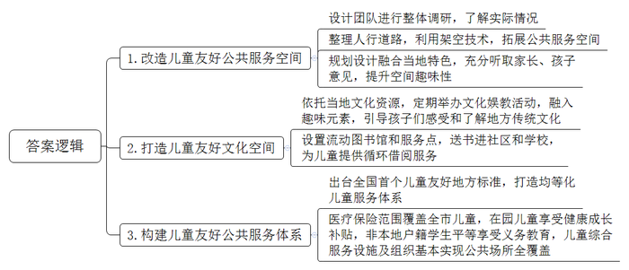
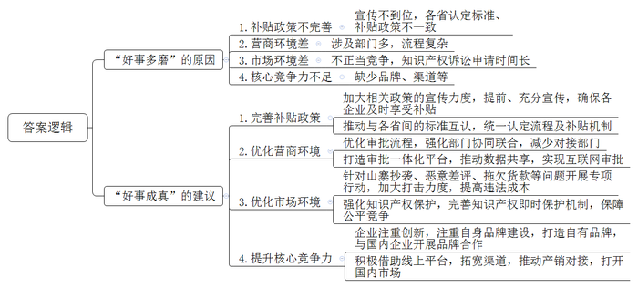
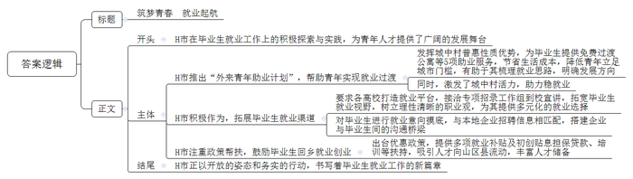
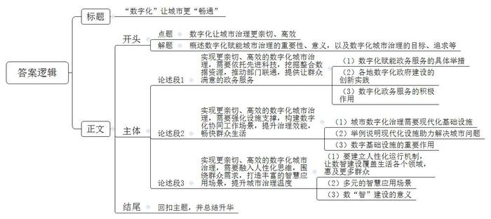

# 2024年公务员多省联考《申论》题（贵州A卷）

<!-- gwy:overview:start -->
> **贵州 · 2024 · 申论 · A类** ｜ 4 题 · 图片 4 处 · 答案随题折叠

导航：[题目](#题目) · [材料 1](#材料-1)
<!-- gwy:overview:end -->

> 候选采集稿。参考答案及解析来自粉笔页面，不代表官方答案或真实高分答卷；来源使用许可与原卷对应关系仍需人工核实。

## 给定材料

### 材料 1

“这顶凉帽是我在2023年暑假跟着师傅学着做的。他教我们编织凉帽的时候，还给我们讲凉帽民俗和客家历史。”恬恬自豪地说。来自华成区凉帽新村的恬恬亲手编织的客家凉帽在N市首届儿童友好博览会上引起了围观，大人小孩纷纷试戴合影。

凉帽新村是一个典型的城中村，村里有500余名儿童，占总人口的16%。在N市儿童友好空间改造工作之前，华成区城管局活力城中村项目负责人小青带领设计团队做了整体调研，发现诸如凉帽新村这样的城中村普遍存在空间狭小、安全隐患多、环境差、儿童游乐设施少等问题。

为此，设计团队重新整理了凉帽新村西侧人行道路，利用架空技术，将人行道从1米多宽的步道拓展出3800平方米的公共服务空间。“其中有一处红色的儿童无动力设施——空中乐园最受孩子欢迎，每天一放学，这里就会‘长满’孩子。”小青说，设施的顶是形似竹编的钢结构，契合了凉帽新村的竹编特色。“设计过程中，我们专门听了家长和孩子们的意见，尽量避免过度设计可能带来的千篇一律、剥夺孩子想象空间的问题。对孩子而言，随处有一滩水、一处沙、一个捉迷藏的空间，比安装一个固定的滑梯更友好。”

“以前接小孩子放学后就要寸步不离看着他，村里的车乱开乱停，小孩子跑来跑去很危险。现在孩子们都喜欢去空中乐园玩，我们都很放心。”一位孩子妈妈开心地说。除了有形的友好空间，凉帽新村也为儿童打造了友好的文化空间。村里以市级非遗凉帽编织技艺为主题，定期举办科普、彩绘等亲子文化娱教活动，并融入趣味元素，引导孩子们感受和了解当地传统文化。“不仅在凉帽新村，打造儿童友好空间已经成为N市2135个城中村改造升级的重要内容之一。”N市妇联钟主席表示。

“妈妈，流动图书馆大巴怎么开到这里来了！”看到儿童友好博览会场外停着的一辆彩绘大巴，安化区中心小学的一菡同学激动地说，“我已经从流动图书馆里借阅了快100本书了，上幼儿园开始看绘本，现在上小学看书，我会讲好多故事！每次大巴开到家门口，我都约了好朋友一起上车挑选，我太喜欢流动图书馆了。”

“安化区城中村比较多，有的村没有条件建设图书馆，于是我们就用大巴车将书带到孩子身边。”安化区图书馆姚馆长说，“大巴车按社区路线走，每个小朋友一次可以借阅20本书，两个月内大巴车会循环回来，届时小朋友可以还书再借新书。”安化区流动图书馆自2020年在N市率先启用以来，已在8个社区和16所学校设置服务点，已累计投入儿童书籍11万余册，借阅量超过7万册次。

2022年，N市出台全国首个儿童友好地方标准《儿童友好公共服务体系建设指南》，明确八个方面构建儿童友好公共服务体系。“作为一座移民城市，N市一直致力打造无户籍地域差异的均等化儿童公共服务体系，来了就是N市人，来了就是N市的娃，让改革发展成果更公平惠及所有儿童。”N市妇联钟主席说。N市的医疗保险范围已覆盖全市中小学、托幼机构在册的儿童，3至6岁在园儿童均可享受健康成长补贴，每年有58万名孩子受益。51%的义务教育学位提供给了非本地户籍学生，使这些孩子作为与户籍学生平等的主体，更好地融入这座城市。

截至2023年底，N市已建成市级儿童友好基地452个、友好公园1260座、儿童议事组织580个、社区儿童之家761个，建成母婴室1270间，基本实现公共场所全覆盖，创新推广移动母婴室，让儿童出行更为便利。

“去年，我们在湖华小学调研时，曾询问孩子们什么是‘儿童友好’，一位6年级学生想了想，说是‘尊重’。我觉得最容易被忽略的，就是对孩子的尊重，这也是‘儿童友好’的本源，<u>只有学会以‘一米’的高度看城市，才能让儿童真正感受到城市的关怀与温暖。”</u>N市妇联钟主席感慨地说，“八年来，N市正在把‘儿童友好’从一个概念变成一项项真正落下来的设施、服务。”

### 材料 2

2023年1月，N省入选国家首批内外贸一体化试点地区名单。按照计划，N省准备用三年左右的时间培育具有国际竞争力、内外贸融合发展的产业基地100家，内外贸一体化“领跑者”企业1000家。日前，为了解全省内外贸一体化试点工作中存在的问题和不足，省商务厅组织部分企业代表、专家学者以及有关部门负责人进行了座谈。以下是座谈会发言摘录：

省商务厅张副厅长：在国家构建以国内大循环为主体、国内国际双循环相互促进的新发展格局背景下，我省积极探索推动内外贸一体化试点工作，取得了一定的成效。通过内外贸产品“同线同标同质”的“三同”行动推动实现内外贸标准对接、内外贸产品质量一致。目前，全省已有400多家企业获得“三同”产品认证，并获得了相应补贴。

某新兴企业负责人张总：企业刚起步时，我们确实从政府那里获得了一些发展补贴，但“三同”这个事儿我们是在开会前才知道的，听说一些同行去年上半年就享受到了补贴。如果早一点儿知道政府的相关政策举措，我们就能少走一些弯路。

某儿童用品公司负责人林总：我们创立时是一家专门生产儿童安全座椅的外向型企业，2019年才开始布局国内市场，并在多个省市建立了分公司。近年来，我们的产品行销全国，但在外省，“三同”需要重新认定，认定程序、认定标准、申报材料都不太一样，且各地认定后所使用的相关产品标识也不尽相同，导致各分公司都需要“另起炉灶”申报。认定标准搞好了，各分公司所在省享受的补贴政策又不一样，若放弃这个补贴，产品又缺少了价格优势。

某代工企业负责人钱总：我们做外贸代工20多年了，一直感觉订单量大、销售省事、货款到位及时。近几年兼顾国内市场，发现不仅竞争对手多、营商环境存隐忧，订单还不稳、货款常被拖欠。当然，企业自身也有问题，多年来习惯外贸代工，几乎没有形成核心竞争力，缺少自己的品牌、渠道，只能通过低价竞争、压低利润率来获得订单。全省很多做外贸代工的企业还未涉足内销业务，宁愿去海外扩展低起点的新兴市场，也不想在国内市场建品牌、“卷”渠道。

某交通设备企业负责人孙总：我们生产的交通设备主要用于出口，一般只需要与商务、海关、税务等部门打交道。现在一部分产品转内销，却要与商务、发改、经信、税务、公安、交运、市场监管等10多个部门打交道，有点儿“分身乏术”。

省市场监管局赵处长：最近，我们在处理一起投诉。某内外贸一体化公司在电商“大促”期间遇到竞争对手恶意刷差评，该公司前期为宣传促销活动投入了大量成本，结果却打了个“水漂”。据我们了解，遭遇这种情况的企业不在少数，净化市场环境还需要大家的共同参与。

某大学法学院罗教授：我们调研时发现，国内中高端羽绒服品牌越来越受国际市场欢迎，而在国内，新开发的原创款式上市一周左右就可能出现高仿款。而传统的外观设计专利、著作权保护等知识产权诉讼手段一般很难在短时间内生效，容易让不法厂商利用时间差钻空子、牟暴利。如果有原创款式登记备案或其他即时保护机制，他们或许就无机可乘了。

省商务厅张副厅长：感谢大家今天针对内外贸一体化发展工作开诚布公地摆问题、提建议。下一步，我们将深入分析内外贸一体化“好事多磨”的根源，进一步打好“组合拳”，用实实在在的举措让内外贸一体化“好事成真”。

### 材料 3

洛家庄是H市最大的城中村，居住着近2万名外来者，这里被网友戏称为“落脚桩”。2023年初，H市西山区交给洛家庄一个试点课题：打造“外来青年第一站”。7月，洛家庄推出“外来青年助业计划”，向外来青年提供免费过渡公寓等5项助业服务。H大学公共管理学院龚教授表示，城中村是具有普惠性质的“就业第一站”。城中村的建设发展需要大批青年人才，其较为低廉的生活成本也为年轻人立足城市提供了较低门槛，如果城中村的活力被充分激发，就会成为稳就业的重要助力。

小王就是被洛家庄的免费过渡公寓吸引而来的。她所居住的公寓，由一栋5层民居改建，风格上很“讨好年轻人”。在创业街，分布着数十家餐饮店，重庆火锅、东北烧烤、沙县小吃……不论来自何方的游子，都能在这里找到家的“味道”。不远处的北山科创园，汇聚了多家知名企业，成为不少毕业生职业起航的“第一站”。住满7天免费公寓后，小王决定接过社区抛来的“绣球”，参与社区育养中心的筹建。待中心正式运行后，她将承担对外联络工作。

目前，西山区9个镇街和产业平台已摸排出一批房源，免费提供给毕业3年内的大专及以上学历的青年人才过渡使用。龚教授认为：“如果没有明确的就业目标，在城中村这样的地方停留、过渡一段时间，有助于梳理就业思路，更好了解自己。”社会上也有一些类似的情况，比如画家村、陶艺村、乡村青年创客中心等，都曾发挥了很好的作用。

近年来，H市还要求各大学积极打造就业平台，拓展毕业生就业渠道。2023年4月，在学校的积极接洽下，外地多个专项招录工作组到校宣讲。在一场活动中，毕业生小哲被新疆壮阔的风景、丰富的物产和独特的民族风情深深吸引。彼时，小哲手中已握有一家国企的录用通知，但思索再三，他选择到新疆去。这份工作吸引小哲的另一点，是切实的保障和明确的职业发展。学校提供的就业经验分享视频显示，在新疆工作的师兄师姐都有单人宿舍和额外的补贴，上岗后还有3个月的培训期，帮助他们熟悉岗位、了解风土人情、打破语言障碍。

2023年2月，E县人社局对1000多名E县籍应届大学生进行就业意向摸底，结合个人专长、就业意向等，与本地企业招聘信息相匹配，为企业与毕业生牵线。小陈的专业是高分子材料与工程，被民企山美化工看中并上门邀请，通过面试和实习后正式上岗。

2023年初，H市出台《关于支持山区12县就业创业高质量发展的若干意见》，E县配套推出《完善人才住房和生活保障政策实施办法》等政策，从特色产业带动就业、引进培养各类人才等方面发力，鼓励更多人才到山区县施展才华。根据政策，小陈可领到3000元/年人才补贴、企业一次性补贴，工作第一年收入就能达到8万元。像小陈这样的大学生，E县引进了百余名，都被纳入人才储备库重点培养。

前不久，研学旅行指导师小高刚带完研学团，这是他入职后的第一个任务。小高说：“我既负责带学生出行，又负责课程研发，有点像教师、导游结合的双重角色。”小高的这个新职业，是人社部刚公布的158个新职业之一。“多亏政策上的明确支持。去年7月，H市发布《关于进一步做好高校毕业生等青年就业创业工作的通知》（下简称《通知》），对毕业2年以内的高校毕业生实现灵活就业的，按规定给予社会保险补贴。”

H农林大学毕业的小舒，“第一站”选择回到家乡创业，投身“农门”。“我这个决定，不仅是看好农业农村发展，还有市政府和母校对大学生自立创业的支持。”《通知》明确，在校大学生和高校毕业生初次创业的，可享受多项补贴、贴息担保贷款、税费减免以及由相关高校提供的就业培训、技术支持等。小舒说：“能预想到未来的路很难，但想到有后盾有支撑，无论如何也要坚持自己的初心走下去。”

### 材料 4

“我们早上9点提交申请，不到半小时就收到资料检查通过的短信，10点签了个字，下午3点企业就注册成功了。”12月1日，创业者小苏在网上提交“企业开办一件事”申请，轻松完成了企业开办手续。

“今天，像这样在网上申请开办企业的有50多例，几乎当日就能办结。如果申请人勾选了社保、公积金等其它事项，还能一并办结。”D县政务服务中心周主任表示，随着Q市一体化智能化公共数据平台的持续打造，企业、群众“足不出户”就能办成的事将越来越多，办事体验越来越好。

“2023年以来，围绕提升一体化智能化公共数据平台服务支撑能力，我们重点抓好了数据归集、提升数据设施支撑能力、共建共享能力组件体系、联通升级两大政务平台端口等4方面工作。”Q市大数据发展局王局长说，目前，一体化平台形成数据要素“一组库”，共编目52346类数据，为76个市级部门、41个区县开通数据仓环境；建成全市物联感知系统，投入摄像头、传感器、卫星、无人机等117类、157万个设备；实现303项上架能力组件，能力组件调用量达到1070万次；“快办”平台精细化梳理了2866个政务服务事项，支撑53项“一件事一次办”上线运行，“快政”平台形成16项协同功能，日均活跃用户40万。

走进H区双桂镇基层治理指挥中心，一块智慧大屏映入眼帘，可以实时查看辖区内场镇各处路口、森林河道、公路、铁路等多个监控点位的高清画面。“我们将原有办公场地改造为基层治理指挥中心，形成党建统领、经济生态、平安法治和公共服务4个板块，沟通更便捷，协作更高效。”覃镇长表示，全镇共划为176个网格，全覆盖建立网格党支部或党小组，采取整合、招聘、下沉等方式，配备专职网格员176人。“在应用场景建设方面，我们通过搭建智治平台，以网格为单元，核准‘人、房、地、事、物’等信息，实现全镇网格一屏统览。一旦发生紧急事件，网格地图将立即变色并闪烁预警，实现即时感知、及时处理。”智治平台投用半月来，累计处理矛盾纠纷、突发险情等各类事件378起。不少居民表示，现在天天看得见网格员，他们上报的事情很快就有回音。

Q市现有3000多万常住人口，兼具“大城市”与“大农村”特点，体系错综、结构复杂、运行治理难度大。2023年初，Q市启动部署市、区县、镇街数字化城市运行和治理中心。市级中心作为治理“大脑”，负责感知发现、决策指挥等数字化治理中枢工作；区县中心聚焦“实战”，承载市级应用，谋划本级特色应用，支撑公共安全等事件的快速响应；镇街中心聚焦“联勤联动”，负责服务群众、推动发展等。王局长说，全市90%的镇街目前已建成“一中心四板块”和智治平台，形成网格7万余个，并通过三级数字化城市运行和治理中心，构建起全局“一屏掌控”、政令“一键智达”、执行“一贯到底”、监督“一览无余”的数字化协同工作场景。“如果说传统的城市治理是织农家土布的话，那么数字时代的城市治理就是江南刺绣。”

“驾车行驶在经开大道上，你可能会疑惑，曾经拥堵的路段为何变得如此通畅？”Q市公安局经开分局夏局长说，这是全市首个交通信号配时中心高效运行的结果。作为本级特色应用，交通信号配时中心发现道路拥堵后，会立即切换到相应道路的视频监控摄像头，借助智能算法进行深度分析，针对拥堵问题给出“最优解”，打造一条条“绿波带”，提升道路通行效率。

数字，让道路更畅通。这些道路有些是有形的，有些是无形的。

全市842家医疗机构已实现影像检查结果互认，医生可以跨院调阅患者的影像检查结果，避免患者重复检查，让医生的诊断更加高效；B区智慧养老服务中心对居家养老群体的居住环境进行适老化改造，装上一键呼叫、燃气监测等设备，一旦出现异常，工作人员会第一时间联系处理；在革命纪念馆，游客借助数字技术手段，便能“穿越”时空，沉浸式感受红色文化……

2023年初，Q市召开数字城市建设大会，对标“数字中国”战略部署，提出加快建设“1361”数字城市建设整体构架，打造引领新时代的数字文明市域范例。一年多来，Q市把数字化、一体化、现代化贯穿到党建、政务、经济、社会、文化、法治建设全过程各方面，着力构建“六大应用系统”，编制应用重大需求清单、多跨场景清单、重大改革清单，并以“一件事”思维谋划场景930个。

<u>“数字时代的城市治理，不只需要冷冰冰的数据、硬邦邦的机器，而且要通过海量的数据资源、完善的基础设施、先进的科学技术、人性化的运行机制等</u><u>，</u><u>让整个城市更加亲切、更有效率。”</u>王局长说，数字化场景应用正渐渐改变着人们生活的方方面面，赋予城市发展生生不息的力量。Q市加“数”前行，数字化运行和治理的想象和场景还在不断拓展……

## 题目

### 第 1 题

**“给定资料**1**”中提到：“只有学会以‘一米’的高度看城市，才能让儿童真正感受到城市的关怀与温暖。”请你谈谈N市围绕这个方面做了哪些工作****？（****20分****）**

关联材料：材料 1

作答要求：

要求：全面、准确、有条理。不超过300字。

第 1 题 · 答案与解析

**参考答案（粉笔题库参考内容）**

1.改造儿童友好公共服务空间。设计团队进行整体调研，了解实际情况；整理人行道路，利用架空技术，拓展公共服务空间；规划设计融合当地特色，充分听取家长、孩子意见，提升空间趣味性。

2.打造儿童友好文化空间。依托当地文化资源，定期举办文化娱教活动，融入趣味元素，引导孩子们感受和了解地方传统文化；设置流动图书馆和服务点，送书进社区和学校，为儿童提供循环借阅服务。

3.构建儿童友好公共服务体系。出台全国首个儿童友好地方标准，打造均等化儿童服务体系；医疗保险范围覆盖全市儿童，在园儿童享受健康成长补贴，非本地户籍学生平等享受义务教育，儿童综合服务设施及组织基本实现公共场所全覆盖。

**参考答案说明：**本参考答案从“改造儿童友好公共服务空间”“打造儿童友好文化空间”“构建儿童友好公共服务体系”三个方面介绍了N市在儿童友好城市建设中的有益探索。每条答案要点之间在内容上是并列关系，没有交叉。

**解析状态：unknown（来源未提供）**

### 第 2 题

**请根据****“给定资料**2**”，谈谈N省在加快推动内外****贸一****体化发展过程中为什么会****“好事多磨”，并提出推动“好事成真”的建议。****（****30分****）**

关联材料：材料 2

作答要求：

要求：

（1）分析全面准确，建议切实可行；

（2）条理清晰，语言精炼；

（3）不超过400字。

第 2 题 · 答案与解析

**参考答案（粉笔题库参考内容）**

“好事多磨”的原因：1.补贴政策不完善。宣传不到位，各省认定标准、补贴政策不一致。2.营商环境差。涉及部门多，流程复杂。3.市场环境差。不正当竞争，知识产权诉讼申请时间长。4.核心竞争力不足。缺少品牌、渠道等。

“好事成真”的建议：1.完善补贴政策。加大相关政策的宣传力度，提前、充分宣传，确保各企业及时享受补贴；推动与各省间的标准互认，统一认定流程及补贴机制。2.优化营商环境。优化审批流程，强化部门协同联合，减少对接部门；打造审批一体化平台，推动数据共享，实现互联网审批。3.优化市场环境。针对山寨抄袭、恶意差评、拖欠货款等问题开展专项行动，加大打击力度，提高违法成本；强化知识产权保护，完善知识产权即时保护机制，保障公平竞争。4.提升核心竞争力。企业注重创新，注重自身品牌建设，打造自有品牌，与国内企业开展品牌合作；积极借助线上平台，拓宽渠道，推动产销对接，打开国内市场。

**参考答案说明：**本参考答案分为“原因”和“建议”两个部分。其中，“原因”部分，从“补贴政策不完善”“营商环境差”“市场环境差”“核心竞争力不足”四个方面展开；“建议”部分，从“完善补贴政策”“优化营商环境”“优化市场环境”“提升核心竞争力”四个方面展开。各条答案要点之间在内容上相互并列，没有交叉。

**解析状态：unknown（来源未提供）**

### 第 3 题

**请根据****“给定资料**3**”，自拟标题，为《H市日报》拟写一篇关于H市做好毕业生就业工作的短评。****（****40分****）**

关联材料：材料 3

作答要求：

要求：

（1）观点明确，简明深刻；

（2）紧扣资料，重点突出；

（3）逻辑清晰，语言精炼；

（4）不超过500字。

第 3 题 · 答案与解析

**参考答案（粉笔题库参考内容）**

筑梦青春 就业起航

H市在毕业生就业工作上的积极探索与实践，为青年人才提供了广阔的发展舞台。

H市推出“外来青年助业计划”，帮助青年实现就业过渡。发挥城中村普惠性质优势，为毕业生提供免费过渡公寓等5项助业服务，节省生活成本，降低青年立足城市门槛，有助于其梳理就业思路，明确发展方向；同时，激发了城中村活力，助力稳就业。

H市积极作为，拓展毕业生就业渠道。要求各高校打造就业平台，接洽专项招录工作组到校宣讲，拓宽毕业生就业视野，树立理性清晰的职业观，为其提供多元化的就业选择；对毕业生进行就业意向摸底，与本地企业招聘信息相匹配，搭建企业与毕业生间的沟通桥梁。

H市注重政策帮扶，鼓励毕业生回乡就业创业。出台优惠政策，提供多项就业补贴及初创贴息担保贷款、培训等扶持，吸引人才向山区县流动，丰富人才储备。

H市正以开放的姿态和务实的行动，书写着毕业生就业工作的新篇章。

**参考答案说明：**（1）格式方面，本参考答案写到了“标题”“正文”两个部分。（2）正文部分，一方面从内容上来看，围绕着“H市做好毕业生就业工作”这一主题，本参考答案的开头指出了H市为毕业生就业工作进行探索与实践并给出评价；接着主体部分从“H市推出‘外来青年助业计划’，帮助青年实现就业过渡”“H市积极作为，拓展毕业生就业渠道”“H市注重政策帮扶，鼓励毕业生回乡就业创业”三个方面展开；最后结尾部分进行了总结、展望。另一方面，形式上，本参考答案做到了分段、分层撰写，整体上条理较为清晰。

**解析状态：unknown（来源未提供）**

### 第 4 题

**“给定资料**4**”提到：“数字时代的城市治理，不只需要冷冰冰的数据、硬邦邦的机器，而****且要****通过海量的数据资源、完善的基础设施、先进的科学技术、人性化的运行机制等，让整个城市更加亲切、更有效率。****”请深入思考这句话，参考给定资料，联系实际，自选角度，自拟题目，写一篇文章。****（****60分****）**

关联材料：材料 1、材料 2、材料 3、材料 4

作答要求：

要求：

（1）观点明确，见解深刻；

（2）参考给定资料，但不拘泥于给定资料；

（3）思路清晰，语言流畅；

（4）字数1000~1200字。

第 4 题 · 答案与解析

**参考答案（粉笔题库参考内容）**

**“数字化”让城市更“畅通”**

党的十八大以来，借助5G、大数据、云计算、人工智能等新技术，各大城市纷纷出台相关政策，加快推进智慧城市建设，城市治理水平稳步提升。数字化建设是推动经济社会高质量发展重要抓手，也是推动城市治理和服务水平能力现代化的关键“利器”。数字化的城市治理，其真正的目标和出发点是让城市治理更亲切、高效，需要利用数据、硬件、技术等工具和手段，从而实现更好的服务、更高的城市运行效率。

**实现更亲切、高效的数字化城市治理，****需要依托先进科技****，****挖掘整合数据资源，****推动****部门****联通，****提供让群众满意的政务****服务**。以数字技术为支撑，搭建线上服务平台，梳理服务事项，打通系统、数据等壁垒，推动部门协同，实现一体化服务。“最多跑一次”“一网通办”“一网统管”“一网协同”“接诉即办”……各地数字化政府建设的创新实践不断涌现，有效推动政府向服务型政府转变，一步一步实现了让数据“跑腿”代替群众“跑路”的目的。既减轻了基层政府工作的压力，提高工作效率，也让政府服务效能大幅提升，提高了群众、企业办事的体验感。

**实现更亲切、高效的数字化城市治理，****需要****强化设施支撑，构建数字化协同工作场景，****提升治理效能，畅快群众生活**。城市数字化治理需要现代化的基础设施，通过建设城市智治平台，以及城市运行和治理中心，构建起全局“一屏掌控”、政令“一键智达”、执行“一贯到底”、监督“一览无余”的数字化协同工作场景，提升沟通和协作效率。各种摄像头、传感器、卫星、无人机等现代化装备被引入城市治理的细微角落，生产生活中的矛盾纠纷、突发险情等得以及时预警、妥善处置；城市道路装配交通信号配时中心，借助智能算法实时深度分析给出“治堵”方案，提升通行效率。数字化基础设施不仅为治理效率提升提供保障，也给人们带来了安心的生活和畅快的心情。

**实现更亲切、高效的数字化城市治理，****需要****融入人性化思维，围绕群众需求，打造丰富的智慧应用场景，提升城市治理温度**。以数治城，要建立人性化运行机制，让“数治”渗透到生活的每个领域，使数字建设惠及到更多群众。通过分析水电气运行数据，对空巢独居老人实现全链条安全监护服务；“义务教育入学一件事”，整合接入多部门基础数据，实现入学报名“零证明”“零跑腿”；“九·一八”历史博物馆将“文化+科技”相融合，让红色资源“活”起来，提供沉浸式红色文化体验……数“智”建设，提升了治理的精度、力度，也给城市增添了新的温度。

新时代新征程，要加快数据赋能、技术赋能，提升城市治理运行效能，让更多“道路”畅通，更好满足人民对美好生活的新期待。

**文章分析**

**“数字化”让城市更“畅通”**

【**标题的优点：**首先，范文的标题突出了“数字化让城市治理更亲切、高效”这一主题。其次，形式上，文字简洁明快，不拖沓。】

（1）党的十八大以来，<u>借助5G</u>、<u>大数据</u>、<u>云计算</u>、<u>人工智能等新技术</u>，<u>各大城市纷纷出台相关政策</u>，<u>加快推进智慧城市建设</u>，<u>城市治理水平稳步提升</u>。（2）数字化建设<u>是推动经济社会高质量发展重要抓手</u>，也是<u>推动城市治理和服务水平能力现代化的关键</u>“<u>利器</u>”。（3）数字化的城市治理，其<u>真正的目标和出发点是让城市治理更亲切</u>、<u>高效</u>，需要<u>利用</u><u>数据</u>、<u>硬件</u>、<u>技术等工具和手段</u>，<u>从而实现</u><u>更好的服务</u>、<u>更高的城市运行效率</u>。

【**开头的优点：**★内容方面。范文的开头是紧扣“数字化让城市治理更亲切、高效”这一主题展开的。首先，开头点出主题，做到了主题明确。其次，对“数字化让城市治理更亲切、高效”这一主题进行了分析阐述，指出了（1）各地积极推进智慧城市建设的背景；（2）数字化建设的重要性；（3）数字化城市治理的目标和措施。★文字表达方面。使用了“是……也是……”“让……从而……”等连接词，使语言表达更有气势。】

**实现更亲切、高效的数字化城市治理，****需要依托先进科技****，****挖掘整合数据资源，****推动****部门****联通，****提供让群众满意的政务****服务**。（1）<u>以数字技术为支撑</u>，<u>搭建线上服务平台</u>，<u>梳理服务事项</u>，<u>打通系统</u>、<u>数据等壁垒</u>，<u>推动部门协同</u>，<u>实现一体化服务</u>。（2）“最多跑一次”“一网通办”“一网统管”“一网协同”“接诉即办”……<u>各地数字化政府建设的创新实践不断涌现</u>，<u>有效推动政府向服务型政府转变</u>，一步一步<u>实现了让数据</u>“<u>跑腿</u>”<u>代替群众</u>“<u>跑路</u>”<u>的目的</u>。（3）既<u>减轻了基层政府工作的压力</u>，<u>提高工作效率</u>，也<u>让政府服务效能大幅提升</u>，<u>提高了群众</u>、<u>企业办事的体验感</u>。

【**论述段****1的优点：**★观点句：范文的观点句是紧扣“数字化让城市治理更亲切、高效”这一文章主题提出的。形式上，它在段首处直接写出，位置突出，容易发现。内容上，关键词突出，内容要点明确，可以明显看出是从“优化政务服务”的角度展开论述。★论述内容：（1）先介绍了数字化赋能政务服务的具体举措；（2）接着指出了各地数字化政府建设的创新实践；（3）最后介绍了数字化政务服务的积极作用。注意：以上三个方面的内容都是紧扣“实现更亲切、高效的数字化城市治理，需要依托先进科技，挖掘整合数据资源，推动部门联通，提供让群众满意的政务服务”这个观点句进行分析论述的，论述的针对性强，内容层次丰富。在论述方法上主要采用了讲道理的方式，论述清晰透彻。】

**实现更亲切、高效的数字化城市治理，****需要****强化设施支撑，构建数字化协同工作场景，****提升治理效能，畅快群众生活**。（1）城市数字化治理<u>需要现代化的基础设施</u>，<u>通过建设城市智治平台</u>，以及<u>城市运行和治理中心</u>，<u>构建起全局</u>“一屏掌控”、<u>政令</u>“一键智达”、<u>执行</u>“一贯到底”、<u>监督</u>“一览无余”<u>的数字化协同工作场景</u>，<u>提升沟通和协作效率</u>。（2）各种摄像头、传感器、卫星、无人机等<u>现代化装备被引入城市治理的细微角落</u>，<u>生产生活中的矛盾纠纷</u>、<u>突发险情等得以及时预警</u>、<u>妥善处置</u>；城市道路装配<u>交通信号配时中心</u>，借助智能算法实时深度分析给出“治堵”方案，<u>提升通行效率</u>。（3）数字化基础设施<u>不仅为治理效率提升提供保障</u>，<u>也</u><u>给人们带来了</u><u>安心的</u><u>生活和畅快的心情</u>。

【**论述段****2的优点：**★观点句：范文的观点句是紧扣“数字化让城市治理更亲切、高效”这一文章主题提出的。形式上，它在段首处直接写出，位置突出，容易发现。内容上，关键词突出，内容要点明确，可以明显看出是从“强化数字基础设施”的角度展开论述。★论述内容：（1）先介绍了城市数字化治理需要现代化基础设施；（2）接着举例说明现代化设施助力解决城市问题；（3）总结指出数字基础设施的重要作用。注意：以上三个方面的内容都是紧扣“实现更亲切、高效的数字化城市治理，需要强化设施支撑，构建数字化协同工作场景，提升治理效能，畅快群众生活”这个观点句进行分析论述的，论述的针对性强，内容层次丰富。在论述方法上主要采用了讲道理、举例子相结合的方式，论述清晰充分。】

**实现更亲切、高效的数字化城市治理，****需要****融入人性化思维，围绕群众需求，打造丰富的智慧应用场景，提升城市治理温度**。（1）<u>以数治城</u>，<u>要建立人性化运行机制</u>，<u>让</u>“<u>数治</u>”<u>渗透到生活的每个领域</u>，<u>使数字建设惠及到更多群众</u>。（2）通过<u>分析水电气运行数据</u>，对空巢独居老人<u>实现全链条安全监护服务</u>；“义务教育入学一件事”，整合接入多部门基础数据，<u>实现入学报名</u>“<u>零证明</u>”“<u>零跑腿</u>”；“九·一八”历史博物馆将“<u>文化+科技</u>”<u>相融合</u>，<u>让红色资源</u>“<u>活</u>”<u>起来</u>，提供沉浸式红色文化体验……（3）<u>数</u>“<u>智</u>”<u>建设</u>，<u>提升了治理的精度</u>、<u>力度</u>，<u>也给城市增添了新的温度</u>。

【**论述段****3的优点：**★观点句：范文的观点句是紧扣“数字化让城市治理更亲切、高效”这一文章主题提出的。形式上，它在段首处直接写出，位置突出，容易发现。内容上，关键词突出，内容要点明确，可以明显看出是从“城市人性化治理”的角度展开论述。★论述内容：（1）先指出要建立人性化运行机制，让数智建设覆盖生活各个领域，惠及更多群众；（2）接着介绍了多元的智慧应用场景；（3）介绍了数“智”建设的意义。注意：以上三个方面的内容都是紧扣“实现更亲切、高效的数字化城市治理，需要融入人性化思维，围绕群众需求，打造丰富的智慧应用场景，提升城市治理温度”这个观点句进行分析论述的，论述的针对性强，内容层次丰富。在论述方法上主要采用了举例子和讲道理的方式，论述清晰有力。】

【**论述段之间的关系：**三个论述段分别从“优化政务服务”“强化数字基础设施”“城市人性化治理”的角度，对文章主题“数字化让城市治理更亲切、高效”展开了论述，彼此之间呈现出并列的逻辑。】

新时代新征程，要加快数据赋能、技术赋能，提升城市治理运行效能，让更多“道路”畅通，更好满足人民对美好生活的新期待。

【**结尾的优点：**范文的结尾回扣了“数字化让城市治理更亲切、高效”这个主题，并且进行了总结升华。】

**解析状态：unknown（来源未提供）**

