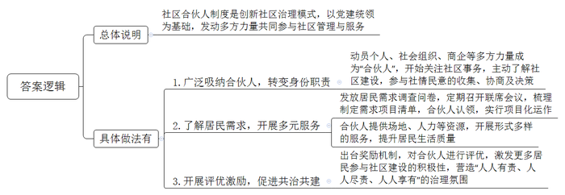
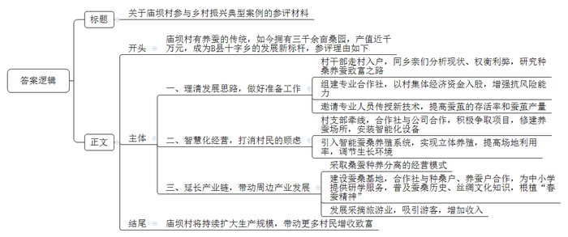
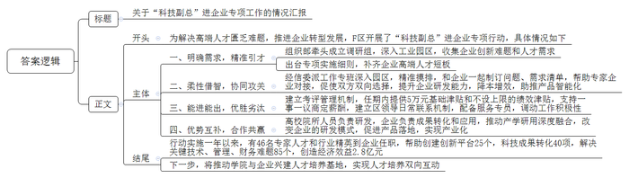
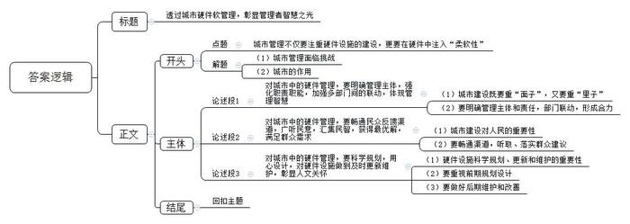

# 2024年公务员多省联考《申论》题（贵州B卷）

<!-- gwy:overview:start -->
> **贵州 · 2024 · 申论 · B类** ｜ 4 题 · 图片 4 处 · 答案随题折叠

导航：[题目](#题目) · [材料 1](#材料-1)
<!-- gwy:overview:end -->

> 候选采集稿。参考答案及解析来自粉笔页面，不代表官方答案或真实高分答卷；来源使用许可与原卷对应关系仍需人工核实。

## 给定材料

### 材料 1

“能不能针对老年人开展一些通俗易懂的反诈宣传？”“我们不在父母身边，有人帮老人理发吗？”“能否在社区组织大家一起下棋，玩一玩？”……

2023年9月，光华街道各社区在征集民意过程中发现，大家最关心的还是居民“身边那点事”。在光华街道辖区，有60岁以上老人占比超过50%的“银发社区”——老厂社区，也有成立两年多的“年轻社区”——乐天社区……街道党工委高书记坦言，各社区既面临缺钱、缺人、缺资源等现实困难，又存在居民参与自治的积极性不高、邻里关系疏远、矛盾纠纷多等突出问题。为此，光华街道创新社区治理模式，以党建统领为基础，发动多方力量共同参与社区管理与服务，在所辖8个社区探索推行“社区合伙人”制度。“所有愿意参与社区共建共治、愿意为社区发展作贡献的个人或群体，都可以成为‘合伙人’。”

“真没想到大家这么热情。”高书记激动地说。在她展示的一份“社区合伙人”名单中，既有退役运动员等“个人合伙人”，也有像友好社会工作服务中心这样的“社会组织合伙人”，更有包括老厂商会等在内的“商企合伙人”。

高书记介绍，各社区通过发放居民需求调查问卷，梳理社区内有特殊需求或共同需求较为强烈的事项，以项目化运作为主要方式，陆续开展公共服务、文化教育、矛盾调处以及助残扶困在内的十大服务项目。项目“张榜”后，老厂商会党支部率先“揭榜”。“既然‘揭榜’了，咱就得出实招。你看，我们把老厂商会的传达室改成了‘光华红’党建会客厅，现在这儿可热闹了！”老厂商会党支部负责人介绍说，昔日闲置的传达室，如今已成为政务便民快捷区、青年志愿活动区、金融助企惠民区。

这两年，乐天社区的“老漂族”越来越多。由于没有熟识的朋友，且方言不通、生活习惯不适应，他们逐渐成为社区的边缘人。如何让“老漂族”快乐起来？

借助“社区合伙人”的力量，乐天社区开展了形式多样的服务。例如，由社区出场地，爱宁养老服务公司入驻社区居家养老照料中心，为老年人提供居家照料等服务；市老年大学为“老漂族”开设了声乐、舞蹈、书画等课程，丰富老年人的业余生活。

周大妈是乐天社区的“老漂族”，曾经因为人生地不熟而感到孤独。自从加入声乐班，她不仅结交了一群老伙伴，心情变得开朗起来，还自荐当上了楼道小组长。因为热心社区公益，她报名成为“社区合伙人”。前不久，周大妈又被社区推选为“最美乐天人”。

“对于‘社区合伙人’，我们出台了奖励机制。例如，对居民个人可优先评选为‘最美乐天人’，优先获得老年大学免费课程名额等。”高书记说。随着越来越多的居民成为“社区合伙人”，社区治理“人人有责、人人尽责、人人享有”的氛围日渐浓厚。

“江春茗悦、风雅苑两个小区周边断头路多，需绕道才能到地铁站，上班族很不方便……”在一次小区楼道长会议上，有居民向社区反映。很快，在社区、业委会、物业以及居民“合伙人”等多方协调下，促成开通了公交地铁接驳线，将原先二十分钟的路程缩短到了三四分钟，居民出行更方便了。

“居民成为‘合伙人’后，开始关注社区事务，主动了解社区建设，成为社情民意的收集者、协商议事的参与者。”高书记说，“凡是社区遇到重大决策，我们都会邀请居民‘合伙人’全程参与。”不仅如此，各社区每个月都会召开一次“社区合伙人”联席会议，制订需求项目清单，由“社区合伙人”认领。

区消防应急救援中心进驻老厂社区微型消防站，认领了“全家总动员”消防安全项目；超越运动中心运营百姓健身房，提供普惠性健身服务，年费仅需365元；在隆兴社区，省师范大学的学生组成志愿服务队伍，为辖区儿童开设书法、英语等兴趣班……如今，“社区合伙人”的队伍不断壮大，服务内容也在不断扩展。

看到“社区合伙人”个个给力，居民群众笑意盈盈，高书记对未来充满了信心。她说：“接下来，街道将通过购买服务、共建共享、资源共筹等多种途径，以街道这块‘磁石’吸引各类资源，变‘旁观者’，为‘建设者’，引领更多‘社区合伙人’在小社区中发挥大作用。让基层治理更具活力、更可持续。”

### 材料 2

早上不到8点，庙坝村村民小刘已经开始忙碌了，只见他背着背篓穿梭在桑园中采桑叶。“桑叶太热，蚕就会不吃，所以一定要趁着早晨凉爽时采摘。”拥有3000余亩桑园，300余户蚕农，围绕“一只蚕”衍生出近1000万元产值……如今庙坝村的桑蚕产业已经成为B县十字乡的发展新标杆，但在过去，谁也没有想到一只蚕竟然能吐出乡村振兴新“丝路”。

庙坝村历来有养蚕的传统，这里的温度和湿度非常适合种桑养蚕，几乎家家户户都在养蚕。“但在很长一段时间里，对于乡亲们而言，养蚕并不是一个‘划算’的买卖。”庙坝村党支部王书记坦言，“桑蚕产业属于劳动密集型产业，季节性强，劳动强度大，一户人家最多养两张蚕，一年卖三批，算下来大约有1.2万元的收入，如果外出打工一年至少挣两三万元。”

近几年村里动员村民们种植过茶叶、中药材，发展过养牛、养羊产业，但都没有成功。眼见在家挣不到钱，越来越多的村民选择外出务工，庙坝村渐渐少了烟火气。

如何让庙坝村发展得更好，让村民留在家里也能过好日子？

2018年村党支部厘清发展思路。“经过调研，我们决定重走‘蚕桑路’。”王书记说，“村子本就有养蚕的基础，只是以前各自为政，比较散乱，如果能统一起来，发展空间很大。”

于是王书记带领村干部挨家挨户同乡亲们分析现状，权衡利弊，与村民一道研究种桑养蚕致富之路。为增强抗风险能力，村党支部决定组建蚕桑专业合作社，拿出50万村集体经济资金入股。为提高蚕茧的存活率和蚕茧产量，村里邀请农业大学专家和市里的农技人员向村民传授新的种桑养蚕技术。“但收入是否能够达到预期目标，销售渠道有无保障，村民们依然有顾虑。”王书记回忆道。

如何打消村民的顾虑？经过调研，由村党支部牵线，合作社决定与龙翔茧丝绸有限公司合作。“他们也在探索如何将桑蚕产业做大做强，这与我们的发展理念不谋而合。”王书记高兴地说。同时村党支部积极争取项目，在村里修建养蚕场所，安装智能化设备，支持合作社参与智能化养蚕经营。

2022年4月，由龙翔茧丝绸有限公司研发的智能蚕桑养殖系统正式投入使用。“这套系统，让养蚕从横向养殖变为立体养殖。”王书记称。

在传统养蚕业中，蚕筐通常被放置在地上，如果扩大养蚕规模，则需要扩大场地规模。但现在，通过这套系统，幼蚕搭乘“电梯”，住进了12层高的“楼房”，极大提高了场地的利用率。不仅如此，该系统还集互联网、自动控制、养蚕技术、人工智能于一体，有效保证了蚕茧的产量和质量。

“幼蚕的生长对环境要求很高，必须要控制好温度、湿度等，这套系统能为幼蚕调整到最适宜生长的环境，幼蚕成活率更高。”庙坝村智能蚕房车间技术工人老刘称，“目前，我们已经实现一年养殖10批次，是传统养蚕的3倍。”

除了带动本地的发展，庙坝村还带动了周边村（社区）发展桑蚕产业。

“我们采取桑蚕种养分离的经营模式，针对有能力种植桑叶但没有能力养蚕的村民，我们会收购他们的桑叶。”王书记称，“这比种土豆的收入要高，老百姓也愿意种。”

“蚕子成熟以后就会吐丝，然后作茧自缚变成蛹，再破茧而出化为蛾，所以有句古诗叫‘春蚕到死丝方尽’。”蚕桑基地中，带队老师正向学员讲述蚕桑历史、丝绸文化等知识，增进孩子们对中国养蚕抽丝历史的了解。随后，基地工作人员带领学员来到智能养蚕车间，近距离观察蚕宝宝和蚕茧，孩子们带着好奇和疑问，这里摸摸，那里嗅嗅，一边喂桑叶，一边七嘴八舌交流着自己研学的感受，“春蚕精神”润物无声地根植在了心间。合作社与种桑户、养蚕户合作，为中小学提供研学服务，受到了孩子、家长、学校的一致欢迎。

“只要天气好，每天下午来的游客最多，要到晚上八点多天黑了，人才走完……”4月初，桑葚园迎来了桑葚成熟期，红的、黑的桑葚密密麻麻地“趴”在壮硕的桑树上。天朗气清，前来采摘桑葚的游客越来越多，大家沉浸在采摘和品尝的喜悦中。

“走这边来，那边的没有这边的甜。”“快来这边，这里的桑葚是最多的。”“我们来比比哪个先摘满。”……大家有说有笑，热闹非凡。去年有2万多名游客来庙坝摘果，创造收入300万元，桑蚕产业的产业链也得以延长。

6月17日至19日，2023中国（重庆）蚕桑丝绸产业高质量发展大会在奉节县举行，专家的建议让王书记看到了更多可能。

“今年，我们力争在2022年的规模上扩大一倍，带动更多村民增收致富。”对此，王书记信心满满。

### 材料 3

F区有工业企业5000多家，规模以上企业588家，中小企业数量庞大。但由于规模小、资源少、实力弱、发展前景有限，大部分中小企业都面临高端人才匮乏的问题。

“200多名员工，本科学历专业人才仅15人。”尚志摩托张总感叹，尚志摩托一直无法对生产工艺进行改造，摆脱不了劳动密集型生产方式，更没有能力研发高端产品，长期处于低利润率甚至亏损状态。“再不转型迟早会被市场淘汰，但没有高端人才，我们转型难度也很大。”

2022年5月，F区委组织部牵头成立调研组，深入4个工业园区，广泛收集企业的创新难题和人才需求。7月，出台《F区“科技副总”进企业专项实施细则（试行）》，明确从高校院所引进专家教授到企业担任“科技副总”，补齐企业高端人才短板。

9月，张总收到区经信委发来的专家人才情况介绍清单。几乎同一时间，交通大学机电工程学院孙教授也收到了首批企业的用才需求。由于孙教授的研究方向与尚志摩托瞄准的转型目标非常契合，双方不约而同选择了对方。

孙教授很快就加入企业的技术攻关中。他和尚志摩托的技术人员花了两个月时间，自主研制出制动踏板性能测试平台。这一测试平台让尚志摩托具备了制动踏板智能检测能力，产品合格率提升到99.99%，生产效率提高20%，相较外包平台检测降低成本70%。孙教授的加入，让尚志摩托的转型升级多了底气和信心。目前，公司正在加速由生产传统的制动踏板、离合踏板等产品转向研发生产具有更高附加值的智能化产品。

F区建立“柔性借智、协同攻关”工作机制，由区经信委派出工作专班深入园区、企业精准摸排，和企业一起制订问题清单和需求清单，给予企业最大的自主选择权，帮助它们按需引进“科技副总”。同时，畅通“能进能出”通道，对“科技副总”建立优胜劣汰的考评管理机制。F区经信委胡主任说：“两年任期内，每位‘科技副总’可享受区里提供的5万元人才基础津贴和不设上限的绩效津贴，支持他们与企业‘一事一议’商定薪酬，建立区领导日常联系机制，配备人才服务专员……”

“我曾和其他‘科技副总’交流过，大家都认为，‘科技副总’这个身份及其背后的政策支持，极大调动了我们的积极性。”孙教授说，许多“科技副总”已经把自己当作企业的一分子。

“我平均每周要到公司1至2次。适合山地丘陵地形的电动履带式无人农机动力平台，就是在这种交流碰撞中诞生的。”广田机械制造有限公司“科技副总”、中科院绿色智能技术研究院杨教授说，该平台目前已经应用到多个地区的田间地头。“高校院所科研人员擅长‘从0到1’的突破，企业擅长‘从1到100’的成果转化和应用。‘科技副总’正好将双方的优势结合了起来，互为对方补齐了短板。”

“‘科技副总’在一定程度上改变了企业的研发模式，过去企业单纯向高校院所购买专利，或与高校开展短期项目合作，现在双方实现了深度融合，围绕需求端进行联合研发、设计、生产，产品更容易落地，实现产业化。”广田机械王总经理说。

中建桥梁“科技副总”、工业大学刘教授的研究方向是大跨度桥梁智能监测。“我之前与中建桥梁有过一些合作，但都是短期项目制的。”刘教授说，“科技副总”进企业专项行动启动后，双方再续前缘。“跟之前相比，最大的变化就是双方能开展长期、全方位的合作，进一步推动了‘产学研用’的深度融合。”再度牵手后，刘教授和中建桥梁不断碰撞出新的研究方向，并申请了两个发明专利，还为其成功申报了“政府间国际科技创新合作”国家重点研发项目。

为了进一步深化校企合作，刘教授还邀请同校的林教授到中建桥梁调研，希望促成更多的合作。“一次工程会遇到很多问题，涉及许多细分领域，这需要更多专家参与其中。”刘教授说，下一步，他们要借助“科技副总”这一模式，推动学院与企业兴建人才培养基地，让学生到中建桥梁实习，企业的技术人员可以依托学院的平台和资源开展培训，实现人才培养的双向互动。

“今年我们主动链接‘科技副总’的科研团队、专家人脉等人力资源，柔性引进工程院院士等专家到F区实施创业。”负责人说，“科技副总”进企业专项行动实施一年以来，已经有46名专家人才和行业精英受聘到企业任职，帮助创建创新平台25个，实现科技成果转化40个，解决长链技术、管理、财务难题85个，创造直接经济效益2.8亿元。

### 材料 4

“橙事互动”APP，是D市报业集团旗下重点打造的新型融媒体传播平台，设有“橙事直通车”“橙友圈”等10余个功能模块，致力于提供全方位的城市新闻资讯、互动娱乐和同城社交服务，深受市民欢迎。

近日，有橙友在“橙事直通车”发帖称：“今天上午9点，青年路一饭店门口，一位老太太被石墩子绊倒，右前臂骨折。”

“橙事直通车”记者赶往事发现场，发现青年路靠近解放路一段，沿途设置了许多石墩子，底部宽约70厘米，高约30厘米。该路段辅道正在施工改造，安装石墩子是为了防止车辆误入施工路段。

据附近饭店的店员讲：“年轻人过这些石墩子都很小心，更别说老人了。石墩子颜色与地面几乎一样，又比一般的石墩要大很多，如果视力不好很容易被绊倒，尤其是晚上更难注意到，我昨晚差点儿就被绊倒了。”

刚好路过的毛大伯指着解放路方向对记者说：“那边也有一些石墩子设在人行道上，可能是不让车辆上人行道停放，也没有警示颜色，还做成了比较高的锥子形，看着都吓人，你们可以去那边看看。”

在青年路社区，工作人员告诉记者：“我们也了解了这个事，石墩子对维护交通秩序用处很大，但对过往行人确实不太友好。目前，我们正准备协调相关部门先拆除部分非必要的石墩，后续怎么办，还需要进一步协商。”

看到隔离石墩绊倒老人的报道，不少橙友在“橙事互动”App“橙友圈”的吐槽建议论坛留言……

橙友A：弄石墩等这种障碍物还不如放几盆花。我老公在小区里走，晚上打电话没有看清路，脚上撞了大乌青差点摔跤，去物管提了意见没当回事。

橙友B：用花箱做隔离，外箱的颜色和周边相似。既有隔离功能，又有绿化功能。

橙友C：原来的圆柱形石柱也比这个新搞的好，没听说过谁被圆柱子绊倒。

橙友D：把隔离墩涂成醒目的颜色，与地面有色差区别，可能会好一点。

橙友E：拦了车子，绊了人，又有碍观瞻，这一现象很普遍，要从根本上解决问题，还是要从加强开车人的管理、提高人的素质入手。

歌曲《梦想天堂》的词曲作者Y先生事发时路过青年路，看到了现场情况，说了他的看法：“既然是为了起到隔断的作用，为什么不可以做得高一点，类似于小凳子一样的东西，下面是石头，上面是一个宽一些的黄色防腐木板，这样既在色彩上起到醒目提示的作用，又可以让平时走过的老人临时歇歇脚，看着也能感觉到人性化的温暖。”

“橙事直通车”回应，希望大家积极分享自己的想法。分享想法只需两分钟——下载“橙事互动”App，点击“橙事互动”首页“橙友圈”—直通车—“我的建议”论坛发帖。好的意见建议，“橙事直通车”会递交给相关部门评估参考。

随着橙友们对城市各种隔离硬件的讨论越来越热烈，“橙友圈”晒出的相关帖文、照片、视频也越来越多。

橙友F：良山百路是双向两车道，为防止车辆占道违停，路两边和中间都安装了隔离栏，导致道路变窄，经常发生拥堵和剐蹭，附近居民怨声载道。

橙友G：新建的花海小区门前人行道原本很宽阔，居民常在此散步休闲。随着小区入住的人越来越多，在人行道乱停车的情况越来越严重，对过往的行人造成了极大的不便，也存在安全隐患。现在安了石墩子，人行道又恢复了以往的整洁有序。

橙友H：商城路地铁修建时，为分流车辆，专门加了些小石墩。可地铁通车都这么久了，小石墩却还在那杵着。昨天上午开车转弯时，一不小心，车子就被小石墩顶了。小石墩贴有反光条，晚上很醒目，白天反而不容易看到。

橙友I：我们这边的石墩子“更狠”，不管白天晚上，不管贴不贴反光条，很多第一次开车来这儿的，都被剐蹭到了。也不知道是谁放的石墩子，又矮又乱！上次，有人打电话到住建局投诉，住建局说归城管部门管，与城管局联系，对方说这是交警的事儿。

橙友J：改造数年的两江交汇码头终于对外开放了。我带孩子们去码头步道看江景，结果发现步道临江的石墙护栏至少有1.6米高，我都得踮起脚来才看得到江景。孩子们看不到都急了，想和其他游客一样爬到石墙上去看，我可不敢让他们做这么危险的事。听说石墙护栏可以防止涨水时江水浸到路上来，是真的吗？

橙友K：城改的三合水库山清水秀，周边修建了很多娱乐休闲设施，我们经常带孩子去玩。但几乎每次去都会听说“又发生一起失足落水事件”。水库堤坝边没有任何防护栏，小孩游玩时一不小心就可能落水。这事儿谁来管管啊！

D市工业大学城市管理学院吴教授认为，<u>城市管理中，硬件也要“柔软”一些，如何平衡好，是对城市管理者的考验。</u>

## 题目

### 第 1 题

**请根据****“给定资料**1**”，谈谈光华街道是如何通过社区合伙人制度变旁观者为建设者的。（20分）**

关联材料：材料 1

作答要求：

要求：全面、准确，有条理。不超过300字。

第 1 题 · 答案与解析

**参考答案（粉笔题库参考内容）**

社区合伙人制度是创新社区治理模式，以党建统领为基础，发动多方力量共同参与社区管理与服务。具体做法有：

1.广泛吸纳合伙人，转变身份职责。动员个人、社会组织、商企等多方力量成为“合伙人”，开始关注社区事务，主动了解社区建设，参与社情民意的收集、协商及决策。

2.了解居民需求，开展多元服务。发放居民需求调查问卷，定期召开联席会议，梳理制定需求项目清单，合伙人认领，实行项目化运作；合伙人提供场地、人力等资源，开展形式多样的服务，提升居民生活质量。

3.开展评优激励，促进共治共建。出台奖励机制，对合伙人进行评优，激发更多居民参与社区建设的积极性，营造“人人有责、人人尽责、人人享有”的治理氛围。

**解析**

**参考答案说明：**本参考答案先对“社区合伙人制度”进行了总体说明，接着具体介绍了“广泛吸纳合伙人，转变身份职责”“了解居民需求，开展多元服务”“开展评优激励，促进共治共建”三方面的做法。每条答案要点之间在内容上是并列关系，没有交叉。

### 第 2 题

**市里拟评一批乡村振兴典型案例，请根据****“给定资料**2**”，为庙坝村拟写一份参评材料。（30分）**

关联材料：材料 2

作答要求：

要求：紧扣资料，内容全面，逻辑清晰，语言精练。不超过400字。

第 2 题 · 答案与解析

**参考答案（粉笔题库参考内容）**

关于庙坝村参与乡村振兴典型案例的参评材料

庙坝村有养蚕的传统，如今拥有三千余亩桑园，产值近千万元，成为B县十字乡的发展新标杆，参评理由如下：

一、理清发展思路，做好准备工作。村干部走村入户，同乡亲们分析现状、权衡利弊，研究种桑养蚕致富之路；组建专业合作社，以村集体经济资金入股，增强抗风险能力；邀请专业人员传授新技术，提高蚕茧的存活率和蚕茧产量。二、智慧化经营，打消村民的顾虑。村支部牵线，合作社与公司合作，积极争取项目，修建养蚕场所，安装智能化设备；引入智能蚕桑养殖系统，实现立体养殖，提高场地利用率，调节生长环境。三、延长产业链，带动周边产业发展。采取桑蚕种养分离的经营模式；建设蚕桑基地，合作社与种桑户、养蚕户合作，为中小学提供研学服务，普及蚕桑历史、丝绸文化知识，根植“春蚕精神”；发展采摘旅游业，吸引游客，增加收入。

庙坝村将持续扩大生产规模，带动更多村民增收致富。

**解析**

**参考答案说明：**（1）格式方面，本参考答案写到了“标题”“正文”两个部分。（2）正文部分，一方面从内容上来看，围绕“乡村振兴”这一主题，本参考答案的开头先阐述了庙坝村桑蚕产业发展的背景；主体部分从“理清发展思路，做好准备工作”“智慧化经营，打消村民的顾虑”“延长产业链，带动周边产业发展”三个方面展开。另一方面，形式上，本参考答案做到了分段、分条撰写，整体上条理较为清晰。

### 第 3 题

**为进一步优化****“科技副总”进企业专项工作，请根据“给定资料**3**”，写一份F区开展专项工作的情况汇报，供领导参阅。（40分）**

关联材料：材料 3

作答要求：

要求：

（1）紧扣资料，内容全面；

（2）逻辑清晰，语言精练；

（3）不超过500字。

第 3 题 · 答案与解析

**参考答案（粉笔题库参考内容）**

关于“科技副总”进企业专项工作的情况汇报

为解决高端人才匮乏难题，推进企业转型发展，F区开展了“科技副总”进企业专项行动，具体情况如下：

一、明确需求，精准引才。组织部牵头成立调研组，深入工业园区，收集企业创新难题和人才需求；出台专项实施细则，补齐企业高端人才短板。二、柔性借智，协同攻关。经信委派工作专班深入园区，精准摸排，和企业一起制订问题、需求清单，帮助专家企业对接，促使双方双向选择，提升企业研发能力，降本增效，助推产品智能化。三、能进能出，优胜劣汰。建立考评管理机制，任期内提供5万元基础津贴和不设上限的绩效津贴，支持一事一议商定薪酬，建立区领导日常联系机制，配备服务专员，调动工作积极性。四、优势互补，合作共赢。高校院所人员负责研发，企业负责成果转化和应用，推动产学研用深度融合，改变企业的研发模式，促进产品落地，实现产业化。

行动实施一年以来，有46名专家人才和行业精英到企业任职，帮助创建创新平台25个，科技成果转化40项，解决关键技术、管理、财务难题85个，创造经济效益2.8亿元。下一步，将推动学院与企业兴建人才培养基地，实现人才培养双向互动。

**解析**

**参考答案说明：**（1）格式方面，本参考答案写到了“标题”“正文”两个部分。（2）正文部分：一方面从内容来看，围绕着“‘科技副总’进企业专项工作”这一主题，开头部分介绍了F区这一专项工作的目标；主体部分写到了“明确需求，精准引才”“柔性借智，协同攻关”“能进能出，优胜劣汰”“优势互补，合作共赢”这四个方面的对策；结尾部分写出了专项行动实施的成果以及下一步的工作计划；另一方面从形式来看，本参考答案做到了分段、分条撰写，各条要点在内容上各自独立，没有交叉。

### 第 4 题

**“给定资料**4**”中提到“城市管理中，硬件也要‘柔软’一些，如何平衡好，是对****城市****管理者的考验****”。请深入理解这句话，参考给定资料，联系实际，自选角度，自拟标题，写一篇文章。（60分）**

关联材料：材料 1、材料 2、材料 3、材料 4

作答要求：

要求：

（1）观点明确，见解深刻；

（2）参考给定资料，但不拘泥于给定资料；

（3）思路清晰，语言流畅；

（4）字数800-1000字。

第 4 题 · 答案与解析

**参考答案（粉笔题库参考内容）**

**透过城市硬件软管理，彰显管理者智慧之光**

在快速发展的城市化进程中，城市管理者面临着前所未有的挑战。城市不仅仅是钢筋水泥的森林，更是承载人民对美好生活期待的空间。因此，城市管理不仅要注重硬件设施的建设，更要在硬件中注入“柔软性”，以实现城市的可持续发展。

**对城市中的硬件管理，要明确管理主体，强化职责职能，加强多部门间的联动，体现管理智慧。**城市建设既要重“面子”，又要重“里子”。“面子”是城市的硬件设施，是城市给外界的第一印象，而“里子”是全面而高效的管理体系。唯有做好“里子”，才会有“面子”，才能确保城市基础设施顺畅运行，提升居民生活质量。在管理过程中，要清晰界定各管理主体，责任到人，避免管理盲区和推诿扯皮现象，同时硬件管理涉及多个部门，如交通、市政、环保、公安等，可通过信息共享、联合执法、协同处置等方式，形成管理合力，共同应对复杂的管理挑战。

**对城市中的硬件管理，要畅通民众反馈渠道，广听民意，汇集民智，获得最优解，满足群众需求。**人民城市人民建，人民城市为人民。城市硬件设施的建设与管理直接关乎市民的幸福感，不能“一建了之”。因此，要畅通人民建议渠道，引导群众建言献策，并充分尊重群众意见，以“边听边建、边听边管”的方式，做到全过程人民参与。更需确保群众的意见条条有记录、件件有落实、事事有回音，将市民群众的“金点子”转化为硬件管理的“金钥匙”，实现“配良方，抓良药”。

**对城市中的硬件管理，要科学规划，用心设计，对硬件设施做到及时更新维护，彰显人文关怀。**城市硬件设施的科学规划、及时更新和维护是提升城市整体功能的关键，更是促进城市经济发展的前提。因此，对于城市的硬件设施，一方面要高度重视前期规划的科学引领，以群众实际需要为出发点，以高水平的规划设计，创造高品质的美好生活。另一方面，还需做好设施建设后续的持续优化和改善，移走不合时宜的石墩、修复破损坑洼的道路、定期检修水管电路……以“小修小补”，保障城市有机体健康有序运行。

立足新时代，城市管理要注重硬件设施的人性化，平衡好城市硬件与群众诉求的“度”，用“硬实力和软功夫”做好令人民满意的答卷，绣一幅安居乐业、锦绣山河的城市发展新蓝图。

**文章分析**

**透过城市硬件软管理，彰显管理者智慧之光**

【**标题的优点：**首先，标题中含有主题词，使文章主题更突出、清晰。其次，形式上采用对称式结构，使标题更加完整、饱满。】

（1）在快速发展的<u>城市化进程</u>中，城市管理者面临着前所未有的<u>挑战</u>。（2）城市不仅仅是<u>钢筋水泥的森林</u>，更是<u>承载人民对美好生活期待</u>的空间。（3）因此，城市管理不仅要注重<u>硬件设施</u>的<u>建设</u>，更要<u>在硬件中注入“柔软性”</u>，以<u>实现城市的可持续发展</u>。

【**开头的优点：**★内容方面。范文的开头是紧扣“城市硬件管理”这一主题展开的。首先，开头点出主题，做到了主题明确。其次，对“城市硬件管理”这一主题进行了分析阐述，指出了：（1）城市管理面临挑战。（2）城市的作用。（3）亮明文章观点，指出城市硬件管理要注入“柔软性”。★文字表达方面：使用了“不仅仅”“更是”“因此”等连接词，使语言表达有逻辑性。】

**对城市中的硬件管理，要明确管理主体，强化职责职能，加强多部门间的联动，体现管理智慧。**（1）<u>城市建设既要重“面子”</u>，<u>又要重“里子”</u>。“面子”是城市的<u>硬件设施</u>，是<u>城市给外界的第一印象</u>，而“里子”是全面而高效的<u>管理体系</u>。唯有做好“里子”，才会有“面子”，才能<u>确保城市基础设施顺畅运行</u>，<u>提升居民生活质量</u>。（2）在管理过程中，要清晰<u>界定各管理主体</u>，<u>责任到人</u>，避免<u>管理盲区和推诿扯皮</u>现象，同时硬件管理<u>涉及多个部门</u>，如交通、市政、环保、公安等，可通过<u>信息共享</u>、<u>联合执法</u>、<u>协同处置</u>等方式，形成<u>管理合力</u>，共同应对复杂的管理挑战。

【**论述段****1的优点：**★观点句：范文的观点句是紧扣“城市硬件管理”这一文章主题提出的。形式上，它在段首处直接写出，位置突出，容易发现。内容上，关键词突出，内容要点明确，可以明显看出主要从“明确管理主体，加强部门联动”的角度展开论述。★论述内容：（1）城市建设既要重“面子”，又要重“里子”；（2）要明确管理主体和责任，部门联动，形成合力。注意：以上两个方面的内容都是紧扣“对城市中的硬件管理，要明确管理主体，强化职责职能，加强多部门间的联动，体现管理智慧”这个观点句进行分析论述的，论述的针对性强，内容层次丰富。在论述方法上主要采用了讲道理、举例子相结合的方式，论述清晰深刻。】

**对城市中的硬件管理，要畅通民众反馈渠道，广听民意，汇集民智，获得最优解，满足群众需求。**（1）<u>人民城市人民建</u>，<u>人民城市为人民</u>。城市硬件设施的建设与管理直接关乎<u>市民的幸福感</u>，不能“一建了之”。（2）因此，要<u>畅通人民建议渠道</u>，<u>引导群众建言献策</u>，并充分<u>尊重群众意见</u>，以“边听边建、边听边管”的方式，做到<u>全过程人民参与</u>。更需确保<u>群众的意见条条有记录、件件有落实、事事有回音</u>，将市民群众的“金点子”转化为<u>硬件管理的“金钥匙”</u>，实现“配良方，抓良药”。

【**论述段****2****的优点：**★观点句：范文的观点句是紧扣“城市硬件管理”这一文章主题提出的。形式上，它在段首处直接写出，位置突出，容易发现。内容上，关键词突出，内容要点明确，可以明显看出主要从“畅通反馈渠道，广听民意”的角度展开论述。★论述内容：（1）城市建设对人民的重要性；（2）要畅通渠道，听取、落实群众建议。注意：以上两个方面的内容都是紧扣“对城市中的硬件管理，要畅通民众反馈渠道，广听民意，汇集民智，获得最优解，满足群众需求”这个观点句进行分析论述的，论述的针对性强，内容层次丰富。在论述方法上主要采用了讲道理的方式，论述清晰透彻。】

**对城市中的硬件管理，要科学规划，用心设计，对硬件设施做到及时更新维护，彰显人文关怀。**（1）城市<u>硬件设施的科学规划</u>、<u>及时更新和维护</u>是提升城市整体功能的关键，更是<u>促进城市经济发展</u>的前提。（2）因此，对于城市的硬件设施，一方面要高度<u>重视前期规划</u>的科学引领，<u>以群众实际需要为出发点</u>，以<u>高水平的规划设计</u>，创造高品质的美好生活。（3）另一方面，还需做好<u>设施建设后续的持续优化和改善</u>，移走不合时宜的石墩、修复破损坑洼的道路、定期检修水管电路……以“小修小补”，<u>保障城市有机体健康有序运行</u>。

【**论述段****3****的优点：**★观点句：范文的观点句是紧扣“城市硬件管理”这一文章主题提出的。形式上，它在段首处直接写出，位置突出，容易发现。内容上，关键词突出，内容要点明确，可以明显看出主要从“科学规划，更新维护设施”的角度展开论述。★论述内容：（1）硬件设施科学规划、更新和维护的重要性；（2）要重视前期规划设计；（3）要做好后期维护和改善。注意：以上三个方面的内容都是紧扣“对城市中的硬件管理，要科学规划，用心设计，对硬件设施做到及时更新维护，彰显人文关怀”这个观点句进行分析论述的，论述的针对性强，内容层次丰富。在论述方法上主要采用了讲道理、举例子相结合的方式，论述充实深刻。】

【**论述段****之间的关系****：**★内容的内在逻辑：范文的论述段之间是依照“并列”的逻辑展开的。论述段1先写了“对城市中的硬件管理，要明确管理主体，强化职责职能，加强多部门间的联动，体现管理智慧”，论述段2再写了“对城市中的硬件管理，要畅通民众反馈渠道，广听民意，汇集民智，获得最优解，满足群众需求”，论述段3接着写了“对城市中的硬件管理，要科学规划，用心设计，对硬件设施做到及时更新维护，彰显人文关怀”。整体论述思路清晰。】

立足新时代，<u>城市管理要注重硬件设施的人性化</u>，平衡好城市硬件与群众诉求的“度”，用“硬实力和软功夫”做好令人民满意的答卷，绣一幅安居乐业、锦绣山河的城市发展新蓝图。

【**结尾的优点：**范文的结尾回扣了“城市硬件管理”这一主题，并且进行了总结提升。】

**解析状态：unknown（来源未提供）**

