# 2024年贵州省公务员录用考试《行测》题（网友回忆版）

<!-- gwy:overview:start -->
> **贵州 · 2024 · 行测 · 统考** ｜ 110 题 · 图片 151 处 · 答案随题折叠

| 题型模块 | 题量 | 题号 |
| --- | ---: | ---: |
| 常识判断 | 15 | 1–15 |
| 言语理解与表达 | 32 | 16–47 |
| 数量关系 | 13 | 48–60 |
| 判断推理 | 30 | 61–90 |
| 资料分析 | 20 | 91–110 |
| **合计** | **110** | |

导航：[题型与作答说明](#题型与作答说明) · [题目](#题目) · [材料 1](#材料-1)
<!-- gwy:overview:end -->

> 候选采集稿。参考答案及解析来自粉笔页面，不代表官方答案或真实高分答卷；来源使用许可与原卷对应关系仍需人工核实。

## 题型与作答说明

常识判断

（15题）

根据题目要求，在四个选项中选出一个最恰当的答案。

言语理解与表达

（32题）

本部分包括表达与理解两方面的内容。请根据题目要求，在四个选项中选出一个最恰当的答案。

数量关系

（13题）

在这部分试题中，每道题呈现一段表述数字关系的文字，要求你迅速、准确地计算出答案。

判断推理

（30题）

本部分包括图形推理、定义判断、类比推理与逻辑判断四种类型的试题，在四个选项中选出一个最恰当的答案。

资料分析

（20题）

所给出的图、表、文字或综合性资料均有若干个问题要你回答。你应根据资料提供的信息进行分析、比较、计算和判断处理。

## 题目

### 第 1 题

“周虽旧邦，其命维新”。习近平总书记指出，中国式现代化是中华民族的旧邦新命，必将推动中华文明重焕荣光。下列关于中国式现代化说法正确的有几项？

①中国式现代化深深植根于中华优秀传统文化，体现科学社会主义的先进本质

②中国式现代化借鉴吸收一切人类优秀文明成果，是一种全新的人类文明形态

③中国式现代化是中国共产党领导的社会主义现代化，是文明更新的结果

④中国式现代化蕴含的独特世界观、价值观、历史观、文明观、民主观、生态观等及其伟大实践，是对世界现代化理论和实践的重大创新

⑤中华文明赋予中国式现代化以深厚底蕴，走中国式现代化道路，赋予中华文明以现代力量

A. 2

B. 3

C. 4

D. 5

第 1 题 · 答案与解析

**参考答案（粉笔题库参考内容）**

D

**解析**

本题考查政治常识。

①②正确，习近平总书记在学习贯彻党的二十大精神研讨班开班式上的重要讲话中指出：“中国式现代化，深深植根于中华优秀传统文化，体现科学社会主义的先进本质，借鉴吸收一切人类优秀文明成果，代表人类文明进步的发展方向，展现了不同于西方现代化模式的新图景，是一种全新的人类文明形态。”

③正确，党的二十大报告指出：“中国式现代化是中国共产党领导的社会主义现代化，既有各国现代化的共同特征，更有基于自己国情的中国特色。”习近平总书记在文化传承发展座谈会的讲话中指出：“中国式现代化是赓续古老文明的现代化，而不是消灭古老文明的现代化；是从中华大地长出来的现代化，不是照搬照抄其他国家的现代化；是文明更新的结果，不是文明断裂的产物。”

④正确，习近平总书记在学习贯彻党的二十大精神研讨班开班式上指出：“中国式现代化蕴含的独特世界观、价值观、历史观、文明观、民主观、生态观等及其伟大实践，是对世界现代化理论和实践的重大创新。”

⑤正确，习近平总书记在文化传承发展座谈会的讲话中指出：“中国式现代化赋予中华文明以现代力量，中华文明赋予中国式现代化以深厚底蕴。中国式现代化是赓续古老文明的现代化，而不是消灭古老文明的现代化；是从中华大地长出来的现代化，不是照搬照抄其他国家的现代化；是文明更新的结果，不是文明断裂的产物。中国式现代化是中华民族的旧邦新命，必将推动中华文明重焕荣光。”

故①②③④⑤正确，有5项。

故正确答案为D。

### 第 2 题

党的二十大报告指出，我们要坚持以推动高质量发展为主题，把实施扩大内需战略同深化供给侧结构性改革有机结合起来，增强国内大循环内生动力和可靠性。下列关于扩大内需说法正确的有几项？

①建立和完善扩大居民消费的长效机制，使居民有稳定收入能消费、没有后顾之忧敢消费、消费环境优获得感强愿消费

②加快发展贸易新业态新模式，进一步发挥进出口对我国经济的支撑作用

③深化供给侧结构性改革，形成供给牵引需求、需求创造供给的更高水平动态平衡

④通过政府投资和政策激励有效带动全社会投资，形成有本金和债务约束的金融需求

⑤鼓励和吸引更多民间资本参与国家重大工程和补短板项目建设，激发民间投资活力

A. 2

B. 3

C. 4

D. 5

第 2 题 · 答案与解析

**参考答案（粉笔题库参考内容）**

B

**解析**

本题考查政治常识。

①正确，习近平总书记在中共中央政治局就加快构建新发展格局进行第二次集体学习上强调，坚决贯彻落实扩大内需战略规划纲要，尽快形成完整内需体系，着力扩大有收入支撑的消费需求、有合理回报的投资需求、有本金和债务约束的金融需求。建立和完善扩大居民消费的长效机制，使居民有稳定收入能消费、没有后顾之忧敢消费、消费环境优获得感强愿消费。

②错误，《国务院办公厅关于加快发展外贸新业态新模式的意见》中指出：“加快发展外贸新业态新模式，有利于推动贸易高质量发展。”可知，正确表述应是“外贸新业态新模式”，而非“贸易新业态新模式”。

③错误，习近平总书记在中共中央政治局就加快构建新发展格局进行第二次集体学习上强调，要搞好统筹扩大内需和深化供给侧结构性改革，形成需求牵引供给、供给创造需求的更高水平动态平衡，实现国民经济良性循环。

④正确，习近平总书记在《当前经济工作的几个重大问题》一文“（一）着力扩大国内需求”部分指出：“二是通过政府投资和政策激励有效带动全社会投资。当前，民间投资预期较弱，政府投资必须发挥好引导作用，这是应对经济周期性波动的有力工具······”在中共中央政治局就加快构建新发展格局进行第二次集体学习时又强调，坚决贯彻落实扩大内需战略规划纲要，尽快形成完整内需体系，着力扩大有收入支撑的消费需求、有合理回报的投资需求、有本金和债务约束的金融需求。

⑤正确，2023年政府工作报告指出：“政府投资和政策激励要有效带动全社会投资，今年拟安排地方政府专项债券3.8万亿元，加快实施‘十四五’重大工程，实施城市更新行动，促进区域优势互补、各展其长，继续加大对受疫情冲击较严重地区经济社会发展的支持力度，鼓励和吸引更多民间资本参与国家重大工程和补短板项目建设，激发民间投资活力。”

综上所述，①④⑤均说法正确，共3项。

故正确答案为B。

### 第 3 题

无农不稳，无粮则乱。习近平总书记指出，农业强，首要是粮食和重要农产品供给保障能力必须强，下列举措属于提升粮食产能的有几项？

①切实把种业振兴行动抓出成效，加快生物育种产业化步伐

②完善农资保供稳价应对机制，稳定农民预期、降低生产风险

③逐步把永久基本农田全部建成高标准农田，确保建一块成一块

④制止“舌尖上的浪费”，深入开展“光盘行动”，提倡健康饮食

⑤坚决守住18亿亩耕地红线，坚决遏制“非农化”，有效终止“非粮化”

A. 2

B. 3

C. 4

D. 5

第 3 题 · 答案与解析

**参考答案（粉笔题库参考内容）**

C

**解析**

本题考查政治常识。

2023年3月16日，第6期《求是》杂志发表习近平的重要文章《加快建设农业强国 推进农业农村现代化》。

①③⑤正确，《加快建设农业强国 推进农业农村现代化》在“二、保障粮食和重要农产品稳定安全供给始终是建设农业强国的头等大事”部分指出：“提升粮食产能仍然是首要任务。我国粮食产量已经连续8年保持在1.3万亿斤高平台上，越往前走难度越大。要实施新一轮千亿斤粮食产能提升行动，抓紧制定实施方案，把任务落实下去。提产能关键还是抓耕地和种子两个要害。要坚决守住18亿亩耕地红线，坚决遏制‘非农化’、有效防止‘非粮化’。坚持良田粮用大原则，良田好土要优先保粮食，果树苗木尽量上山上坡，蔬菜园艺更多靠设施农业和工厂化种植。治理‘非粮化’政策性很强，要统筹考虑粮食生产和重要农产品保障、农民增收的关系，留出一定过渡期，加强政策引导。要逐步把永久基本农田全部建成高标准农田，尽快提出落实办法，该拿的钱要拿到位，建设质量和管护机制也要到位，确保建一块成一块。抓种子要选准突破口，持续发力、协同攻关，把种业振兴行动切实抓出成效，把当家品种牢牢攥在自己手里。生物育种是大方向，要加快产业化步伐。”

②正确，《加快建设农业强国 推进农业农村现代化》在“二、保障粮食和重要农产品稳定安全供给始终是建设农业强国的头等大事”部分指出：“农民种粮能挣钱，粮食生产才有保障。要健全种粮农民收益保障机制，完善价格、补贴、保险‘三位一体’的政策体系，完善农资保供稳价应对机制，稳定农民预期、降低生产风险。”

④错误，《加快建设农业强国 推进农业农村现代化》在“二、保障粮食和重要农产品稳定安全供给始终是建设农业强国的头等大事”部分指出：“保障粮食安全，要在增产和减损两端同时发力······消费环节大有文章可做，不仅要制止‘舌尖上的浪费’，深入开展‘光盘行动’，还要提倡健康饮食。”

综上，①②③⑤四项属于提升粮食产能的措施。

故正确答案为C。

### 第 4 题

习近平法治思想是对中国共产党领导法治建设丰富实践和宝贵经验的科学总结，是一个内涵丰富、论述深刻、逻辑严密、系统完备的科学理论体系。下列关于习近平法治思想说法正确的有几项？

①自由是秩序的目的，秩序是自由的保障

②党的领导是社会主义法治之魂，是我国法治与西方资本主义国家法治最大的区别

③发挥领导干部示范带头作用，努力使尊法学法守法用法在全社会蔚然成风

④新闻媒体要加强对执法司法工作的监督，但对执法司法部门的正确行动，要予以支持，加强解疑释惑，进行理性引导

⑤加强重点领域、新兴领域、涉外领域立法，统筹推进国内法治和涉外法治，以良法促进发展、保障善治

A. 2

B. 3

C. 4

D. 5

第 4 题 · 答案与解析

**参考答案（粉笔题库参考内容）**

D

**解析**

本题考查政治常识。

①正确，习近平总书记在第二届世界互联网大会开幕式上的讲话中指出：“推进全球互联网治理体系变革，应该坚持以下原则······构建良好秩序。网络空间同现实社会一样，既要提倡自由，也要保持秩序。自由是秩序的目的，秩序是自由的保障。我们既要尊重网民交流思想、表达意愿的权利，也要依法构建良好网络秩序，这有利于保障广大网民合法权益······”

②正确，习近平总书记于2020年11月16日在中央全面依法治国工作会议上讲话的“第一，坚持党对全面依法治国的领导”中指出：“党的领导和依法治国不是对立的，而是统一的。我国法律充分体现了党和人民意志，我们党依法办事，这个关系是相互统一的关系。全党同志必须牢记，党的领导是我国社会主义法治之魂，是我国法治同西方资本主义国家法治最大的区别······”

③正确，中共二十大报告在“七、坚持全面依法治国，推进法治中国建设”中指出：“（四）加快建设法治社会。法治社会是构筑法治国家的基础······推进多层次多领域依法治理，提升社会治理法治化水平。发挥领导干部示范带头作用，努力使尊法学法守法用法在全社会蔚然成风。”

④正确，习近平总书记于2014年1月7日在中央政法工作会议上的讲话中强调：“政法机关要自觉接受媒体监督，以正确方式及时告知公众执法司法工作情况，有针对性地加强舆论引导。新闻媒体要加强对执法司法工作的监督，但对执法司法部门的正确行动，要予以支持，加强解疑释惑，进行理性引导，不要人云亦云，更不要在不明就里的情况下横挑鼻子竖挑眼······”

⑤正确，中共二十大报告在“七、坚持全面依法治国，推进法治中国建设”中指出：“（一）完善以宪法为核心的中国特色社会主义法律体系······加强宪法实施和监督，健全保证宪法全面实施的制度体系，更好发挥宪法在治国理政中的重要作用，维护宪法权威。加强重点领域、新兴领域、涉外领域立法，统筹推进国内法治和涉外法治，以良法促进发展、保障善治······”

故符合题意的是①②③④⑤，共5项。

故正确答案为D。

### 第 5 题

习近平总书记强调，要用好红色资源，传承好红色基因，把红色江山世世代代传下去。下列红色基地与主题党课开设搭配最合理的是：

①北大红楼：红色序章

②南湖红船：清正廉洁

③遵义会议会址：伟大转折

④延安革命根据地：革命摇篮

A. ①②

B. ①③

C. ②④

D. ③④

第 5 题 · 答案与解析

**参考答案（粉笔题库参考内容）**

B

**解析**

本题考查毛中特。

①正确，北京大学红楼是中国近代史上李大钊、陈独秀、毛泽东最早传播马克思主义和民主科学进步思想的重要场所，具有重要历史价值。2021年“光辉伟业 红色序章——北大红楼与中国共产党早期北京革命活动”主题展览就在北大红楼召开。故在北大红楼与“红色序章”主题党课开设搭配合理。

②错误，南湖红船是中国共产党第一次全国代表大会的会场，是中国共产党的诞生地。2005年6月21日，时任中共浙江省委书记的习近平同志在《光明日报》发表《弘扬“红船精神” 走在时代前列》的重要文章，首次提出并阐述了红船精神，红船精神的主要内涵是开天辟地、敢为人先的首创精神，坚定理想、百折不挠的奋斗精神，立党为公、忠诚为民的奉献精神，并明确指出红船精神是中国革命精神之源。故在南湖红船与“清正廉洁”主题党课开设搭配并不合理。

③正确，1935年1月15日至17日，中共中央决定在黔北重镇遵义召开会议，总结第五次反“围剿”的经验教训。遵义会议确立了毛泽东在党和红军中的领导地位，在极其危急的情况下挽救了党，挽救了红军，挽救了中国革命。遵义会议是党的历史上一个生死攸关的转折点，以毛泽东为核心的党中央的正确领导开始确立，标志着中国共产党在政治上走向成熟。故在遵义会议会址与“伟大转折”主题党课开设搭配合理。

④错误，1927年，轰轰烈烈的大革命失败后，中国共产党为挽救革命、寻找革命新道路开始了新的奋斗历程。10月，毛泽东率领湘赣边界秋收起义的工农革命军，开始为创建以宁冈为中心的井冈山农村革命根据地而斗争。井冈山是中国革命的摇篮。习近平总书记在赴江西考察时曾深刻指出：“井冈山斗争的伟大实践，对中国革命道路的探索和抉择、对中国共产党和人民军队成长具有关键意义。”故“革命摇篮”的主题党课在井冈山开设更为合理。

综上所述，①③表述正确。

故正确答案为B。

### 第 6 题

货币不仅是固定充当一般等价物的特殊商品，更是人类文明发展史中各个阶段的里程碑，下列语句中关于货币的发展按时间先后排序正确的是：

①氓之蚩蚩，抱布贸丝

②青钱白璧买无端，丈夫快意方为欢

③农工商交易之路通，而龟贝金钱，刀布之币兴焉

④蜀川老觉家潼川，怀中交子是铁钱

A. ①④②③

B. ②④①③

C. ③②①④

D. ①③②④

第 6 题 · 答案与解析

**参考答案（粉笔题库参考内容）**

D

**解析**

本题考查经济常识。

货币的发展经历了偶然的物物交换，扩大的物物交换，以一般等价物为媒介的交换，以金属货币为媒介的物物交换这四个阶段。

①出自先秦《诗经·卫风·氓》，意思是憨厚的农家小伙子，怀抱布匹来换丝。偶然的物物交换发生在原始社会末期，是在部落双方都有剩余产品这种极其偶然的情况下发生的。“抱布贸丝”则反映了在当时随着生产力和社会分工的发展，物物交换的范围扩大且次数频繁，即扩大的物物交换。

②出自唐代李贺的《相劝酒》，意思是纵有青钱白璧无数，买不到光阴半寸，身为伟岸丈夫，要的是快意欢颜。青钱即青铜钱，白璧是平圆形而中有孔的白玉，这里代指的就是流通的金属货币。

③出自《史记·平准书》，意思是龟贝金钱刀布的货币的流通会促进农工商交易之路通畅。龟是龟甲，贝是贝壳，金在商周时期主要指的是青铜，钱指铁铲，刀则指的是兵器，而布则是布匹。体现了以一般等价物为媒介的物物交换。

④出自宋代释慧空的《送僧三首·其一》，交子是宋代发行的一种纸币，可以兑现，便于流通，也是世界上最早的纸币。纸币产生于一般等价物固定在金银上之后，是代替金属货币执行流通手段的价值符号。

故正确排序为①③②④。

故正确答案为D。

### 第 7 题

下列关于自首的判断说法正确的是：

A. 甲和乙共同实施盗窃犯罪，后甲因为内心害怕，主动到公安机关交代，并独自承担了全部罪行，甲构成自首

B. 甲和乙共同实施诈骗犯罪，后甲因酒驾被公安机关讯问时，主动交代乙曾经实施的故意杀人行为，甲构成自首

C. 王某交通肇事逃逸，其父知道后将其扭送至公安机关，王某主动交代了其肇事逃逸行为，王某构成自首

D. 甲公司非法集资且规模很大，该公司总经理李某因为害怕，瞒着其他高管偷偷到公安机关交代了相关情况，李某作为单位犯罪的直接责任人不能单独成立自首

第 7 题 · 答案与解析

**参考答案（粉笔题库参考内容）**

C

**解析**

本题考查法律常识。

根据《中华人民共和国刑法》第六十七条规定：“犯罪以后自动投案，如实供述自己的罪行的，是自首。对于自首的犯罪分子，可以从轻或者减轻处罚。其中，犯罪较轻的，可以免除处罚。被采取强制措施的犯罪嫌疑人、被告人和正在服刑的罪犯，如实供述司法机关还未掌握的本人其他罪行的，以自首论。犯罪嫌疑人虽不具有前两款规定的自首情节，但是如实供述自己罪行的，可以从轻处罚；因其如实供述自己罪行，避免特别严重后果发生的，可以减轻处罚。”

A项错误，根据《最高人民法院关于处理自首和立功具体应用法律若干问题的解释》第一条规定：“······共同犯罪案件中的犯罪嫌疑人，除如实供述自己的罪行，还应当供述所知的同案犯，主犯则应当供述所知其他同案犯的共同犯罪事实，才能认定为自首······”题中，甲独自承担了全部罪行，并未如实供述同案犯，不构成自首。

B项错误，根据《最高人民法院关于处理自首和立功具体应用法律若干问题的解释》第五条规定：“根据刑法第六十八条第一款的规定，犯罪分子到案后有检举、揭发他人犯罪行为，包括共同犯罪案件中的犯罪分子揭发同案犯共同犯罪以外的其他犯罪，经查证属实；提供侦破其他案件的重要线索，经查证属实；阻止他人犯罪活动；协助司法机关抓捕其他犯罪嫌疑人（包括同案犯）；具有其他有利于国家和社会的突出表现的，应当认定为有立功表现。”题中，甲主动交代乙的其他罪行，构成立功，不构成自首。

C项正确，根据《最高人民法院关于处理自首和立功具体应用法律若干问题的解释》第一条规定：“······并非出于犯罪嫌疑人主动，而是经亲友规劝、陪同投案的；公安机关通知犯罪嫌疑人的亲友，或者亲友主动报案后，将犯罪嫌疑人送去投案的，也应当视为自动投案······”题中，王某虽被扭送至公安机关，但主动交代罪行，构成自首。

D项错误，根据《中华人民共和国刑法》第三十一条规定：“单位犯罪的，对单位判处罚金，并对其直接负责的主管人员和其他直接责任人员判处刑罚。本法分则和其他法律另有规定的，依照规定。”《办理走私刑事案件适用法律若干问题的意见》第二十一条规定：“关于单位走私犯罪案件自首的认定问题在办理单位走私犯罪案件中，对单位集体决定自首的，或者单位直接负责的主管人员自首的，应当认定单位自首。认定单位自首后，如实交代主要犯罪事实的单位负责的其他主管人员和其他直接责任人员，可视为自首，但对拒不交代主要犯罪事实或逃避法律追究的人员，不以自首论。”因此，司法实践中认可单位自首的情形。题中，李某作为单位直接负责人，虽然瞒着其他高管单独到公安机关交代相关情况，但仍构成单位自首。

故正确答案为C。

### 第 8 题

2023年9月1日，江某在广东某酒店购买高档月饼1盒，付款3000元。江某食用后出现严重腹泻，花费2000元治疗，后查明，该月饼外包装标识均为繁体字，保质期限截止到2023年8月30日。对此，下列说法错误的是：

A. 该月饼外包装必须依法标注简体中文

B. 该酒店出售明知不符合食品安全标准的食品，应当对其予以行政处罚

C. 江某有权要求某酒店赔偿2000元损失，并要求支付30000元的赔偿金

D. 江某已知该月饼已经超过保质期仍然购买，其自身也有问题，只能要求某酒店退还购买月饼的3000元

第 8 题 · 答案与解析

**参考答案（粉笔题库参考内容）**

D

**解析**

本题考查法律常识。

A项正确，根据《中华人民共和国国家通用语言文字法》第十四条第五项规定：“下列情形，应当以国家通用语言文字为基本的用语用字：（五）在境内销售的商品的包装、说明。”第二条规定：“本法所称的国家通用语言文字是普通话和规范汉字。”而规范汉字，是指经过整理简化并由国家以《简化字总表》与《通用规范汉字表》的形式，正式公布的简化字与传承字。不规范字主要指：繁体字与异体字。因此，该月饼外包装必须依法标注简体中文。

B项正确，根据《中华人民共和国食品安全法》第一百二十四条第五项：“违反本法规定，有下列情形之一，尚不构成犯罪的，由县级以上人民政府食品安全监督管理部门没收违法所得和违法生产经营的食品、食品添加剂，并可以没收用于违法生产经营的工具、设备、原料等物品；违法生产经营的食品、食品添加剂货值金额不足一万元的，并处五万元以上十万元以下罚款；货值金额一万元以上的，并处货值金额十倍以上二十倍以下罚款；情节严重的，吊销许可证：（五）生产经营标注虚假生产日期、保质期或者超过保质期的食品、食品添加剂”题中，该月饼保质期限截止到2023年8月30日，而2023年9月1日该酒店仍向江某出售超过保质期的食品，应当依法对其予以行政处罚。

C项正确，根据《中华人民共和国产品质量法》第四十三条规定：“因产品存在缺陷造成人身、他人财产损害的，受害人可以向产品的生产者要求赔偿，也可以向产品的销售者要求赔偿······”第四十条第二项规定：“售出的产品有下列情形之一的，销售者应当负责修理、更换、退货；给购买产品的消费者造成损失的，销售者应当赔偿损失：（二）不符合在产品或者其包装上注明采用的产品标准的；”第四十四条规定：“因产品存在缺陷造成受害人人身伤害的，侵害人应当赔偿医疗费、治疗期间的护理费、因误工减少的收入等费用······”根据《中华人民共和国食品安全法》第一百四十八条第二款规定：“生产不符合食品安全标准的食品或者经营明知是不符合食品安全标准的食品，消费者除要求赔偿损失外，还可以向生产者或者经营者要求支付价款十倍或者损失三倍的赔偿金；增加赔偿的金额不足一千元的，为一千元。但是，食品的标签、说明书存在不影响食品安全且不会对消费者造成误导的瑕疵的除外。”题中，受害人江某因月饼存在缺陷造成身体损害，花费治疗费2000元，有权要求销售者该酒店赔偿损失，另外该酒店明知月饼不符合食品安全标准仍出售给江某，江某还可以向酒店要求支付价款十倍或者损失三倍的赔偿金，题中月饼的价款是3000元，则江某有权要求该酒店支付30000元的赔偿金。

D项错误，根据《最高人民法院关于审理食品药品纠纷案件适用法律若干问题的规定》第三条规定：“因食品、药品质量问题发生纠纷，购买者向生产者、销售者主张权利，生产者、销售者以购买者明知食品、药品存在质量问题而仍然购买为由进行抗辩的，人民法院不予支持。”由此说明，即消费者江某明知月饼过期而购买，也并不能排除江某依法向食品的销售者该酒店进行索赔的权利。

本题为选非题，故正确答案为D。

### 第 9 题

下列关于我国科技成就说法正确的是：

①“三峡氢舟1号”——助推我国首次在南海海域成功开采可燃冰

②“可持续发展科学卫星1号”——专门服务联合国2030年可持续发展议程的科学卫星

③“蓝鲸1号”——我国首艘氢燃料电池动力示范船

④“耕海1号”——将渔业养殖、海上旅游、科技研发等功能相结合的海洋牧场综合体

A. ①③

B. ②③

C. ①④

D. ②④

第 9 题 · 答案与解析

**参考答案（粉笔题库参考内容）**

D

**解析**

本题考查科技常识。

①③错误，“三峡氢舟1”号由三峡集团长江电力等单位共同研发建造，是国内首艘入级中国船级社氢燃料电池动力船。我国首艘氢燃料电池动力示范船“三峡氢舟1”号于2023年10月11日在长江三峡起始点湖北宜昌首航。这标志着氢燃料电池技术在我国内河船舶应用实现零的突破。2017年5月18日，在距离祖国大陆300多公里的我国南海北部神狐海域“蓝鲸一号”海上钻井平台，国土资源部部长、党组书记、国家土地总督察姜大明宣布，我国进行的首次可燃冰（天然气水合物）试采实现连续稳定产气，取得天然气水合物试开采的历史性突破，首次可燃冰试采宣告成功。

②正确，2021年11月5日，我国在太原卫星发射中心成功发射可持续发展科学卫星1号（SDGSAT-1）。SDGSAT-1是全球首颗专门服务联合国2030年可持续发展议程的科学卫星，也是中国科学院首颗地球科学卫星。

④正确，“耕海1号”是由山东海洋集团投资建造的全国首座综合性、示范性、集成性的智能化大型现代生态海洋牧场综合体平台，犹如一朵海上花绽放在烟台美丽的“四十里湾”海域。项目采用一、三产业深度融合的运营模式，在国内首次将渔业养殖、智慧渔业、休闲渔业、科技研发、科普教育等功能集成在统一平台，是装备型省级海洋牧场示范项目，装备型海洋牧场建设“山东标准”的唯一试点项目。

综上，②④正确。

故正确答案为D。

### 第 10 题

下列文句与蕴含的哲理对应正确的是：

A. 竭泽而渔，岂不获得，而明年无鱼——事物是不断发展的

B. 井蛙不可以语于海，夏虫不可以语于冰——尊重客观规律

C. 吾生也有涯，而知也无涯。以有涯随无涯，殆已——勤学善记

D. 兵无常势，水无常形，能因敌变化而取胜者，谓之神——学会审时度势

第 10 题 · 答案与解析

**参考答案（粉笔题库参考内容）**

D

**解析**

本题考查政治常识。

A项错误，“竭泽而渔，岂不获得，而明年无鱼”出自《吕氏春秋·览·孝行览》，把池水抽干去捕鱼，哪能捉不到呢，只是第二年就没鱼了。比喻取之不留余地，只图眼前利益，不作长远打算。没有用发展的眼光看问题，而是用孤立、静止的思维思考问题，属于形而上学的观点。

B项错误，“井蛙不可以语于海，夏虫不可以语于冰”出自《庄子·外篇·秋水》，意思是对井里的蛙不可与它谈论关于海的事情，对夏天生死的虫子不可与它谈论关于冰雪的事情。这是因为井蛙的眼界受空间限制，夏虫的眼界受到时令的制约，体现了认识来源于实践的哲学原理。

C项错误，“吾生也有涯，而知也无涯。以有涯随无涯，殆已”出自《庄子·内篇·养生主》，意思是我的生命是有限的，而知识是无限的。用有限的生命去追求无限的知识，真是累人啊！体现了认识是在实践基础上不断向前发展的。人们在实践中追求和发展真理是一个永无止 境的过程。

D项正确，“兵无常势，水无常形，能因敌变化而取胜者，谓之神”出自《孙子兵法·虚实篇》，意思是用兵作战没有固定不变的方法态势，如同水流没有固定的形状，能够依据敌情的变化而取胜，可称得上用兵如神了。体现了一切事物都是不断运动、变化、发展的，要用发展的眼光看问题，学会审时度势。

故正确答案为D。

注：本题存在瑕疵，D项不是哲理的表述，但前后所反映的哲理一致。

### 第 11 题

关于我国历史上的科技著作，下列说法错误的是？

A. 《天工开物》——中国17世纪的工艺百科全书

B. 《坤舆万国全图》——中国最早的彩绘世界地图

C. 《水经注》——介绍了欧洲先进的水利技术和工具

D. 《徐霞客游记》——世界最早关于石灰岩地貌研究的文献

第 11 题 · 答案与解析

**参考答案（粉笔题库参考内容）**

C

**解析**

本题考查人文常识。

A项正确，《天工开物》初刊于1637年（明崇祯十年），作者是明朝科学家宋应星。这是世界上第一部关于农业和手工业生产的综合性著作，外国学者称它为“中国17世纪的工艺百科全书”。

B项正确，《坤舆万国全图》是明朝万历年间利玛窦和李之藻合作绘制的世界地图，是中国最早的彩绘世界地图，推动了中国地理学的发展和中西方文化交流，是中国乃至世界地图发展史上的珍品。

C项错误，《水经注》是古代中国地理名著，作者是北魏晚期的郦道元。《水经注》以《水经》为纲，详细记载了中国一千多条大小河流及有关的历史遗迹、人物掌故、神话传说等，是中国古代最全面、最系统的综合性地理著作。不涉及欧洲先进的水利技术和工具。

D项正确，《徐霞客游记》是明代地理学家徐霞客创作的一部散文游记，主要按日记述作者1613年至1639年间旅行观察所得，对地理、水文、地质、植物等现象，均做了详细记录。其书中对石灰溶蚀地貌的观察和记述，早于欧洲约两个世纪，是世界最早关于石灰岩地貌研究的文献。

本题为选非题，故正确答案为C。

### 第 12 题

下列情景在历史上最有可能发生的是：

A. 西汉末年，某将军与谋士在探讨夷陵之战的胜败之因

B. 唐朝初期，市面上流通带有“开元通宝”的字样的钱币

C. 魏晋时期，某官员家中收藏了褚遂良的众多书法作品

D. 宋朝时期，农民在耕作时参考《王祯农书》里的内容

第 12 题 · 答案与解析

**参考答案（粉笔题库参考内容）**

B

**解析**

本题考查人文常识。

A项错误，夷陵之战，是三国时期蜀汉昭烈帝刘备对东吴发动的大规模战役，以蜀汉战败为结束。此战是中国古代战争史上一次著名的积极防御的成功战例，也是三国“三大战役”的最后一场。故在西汉末年，不可能有将军与谋士探讨夷陵之战的胜败之因。

B项正确，唐高祖时期，为整治混乱的币制，废隋钱，效仿西汉五铢的严格规范，开铸“开元通宝”，取代社会上遗存的五铢。故唐朝初期，可能在市面上流通带有“开元通宝”的字样的钱币。

C项错误，褚遂良，字登善，唐朝宰相、政治家、书法家，弘文馆学士褚亮之子。其与欧阳询、虞世南、薛稷并称“初唐四大家”，传世墨迹有《孟法师碑》《雁塔圣教序》等。魏晋时期是指东汉瓦解后，三国到两晋的时期。故魏晋时期，不可能有官员家中收藏了褚遂良的众多书法作品。

D项错误，《王祯农书》作者为王祯，成书于元朝，此书分为《农桑通诀》《百谷谱》和《农器图谱》三大部分。此书兼论中国北方农业技术和中国南方农业技术，在中国古代农学遗产中占有重要地位。故宋朝时期，不可能有农民在耕作时参考《王祯农书》。

故正确答案为B。

### 第 13 题

下列关于我国之“最”说法错误的是：

A. 东北平原是我国最大平原，北部为松嫩平原，南部为辽河平原

B. 三沙市成立于2012年，隶属海南省，是我国位置最南的地级市

C. 台湾岛位于东海南部，是我国第一大岛，有“东海瀛洲”之称

D. 新疆维吾尔自治区是我国陆地面积最大、交界邻国最多的省级行政区

第 13 题 · 答案与解析

**参考答案（粉笔题库参考内容）**

C

**解析**

本题考查地理常识。

A项正确，东北平原，是中国三大平原之一，也是中国最大的平原，位于中国东北部，由三江平原、松嫩平原、辽河平原组成，地跨黑龙江、吉林、辽宁和内蒙古四个省区。根据东北平原不同的区域特征，可分为三个亚区平原，即东北角的三江平原、北部的松嫩平原和南部的辽河平原。

B项正确，三沙市于2012年7月24日正式揭牌成立，是中国位置最南、面积最大、陆地面积最小及人口最少的地级市。三沙市为海南省辖地级市，地处中国南海中南部，海南省南部，辖西沙群岛、中沙群岛、南沙群岛的岛礁及其海域，陆地面积20多平方千米，陆海面积约200万平方千米。

C项错误，台湾岛是我国第一大岛，战略要地，位于东海南部，西依台湾海峡。面积约3.588万平方公里，占到整个台湾省面积的99%，南北跨度近400公里，东西跨度约145公里，有长达1150多公里的海岸线。崇明岛，是长江三角洲东端长江口处的冲积岛屿，也是中国第三大岛屿、中国最大的河口冲积岛、中国最大的沙岛，其成陆历史有1300多年，被誉为“长江门户、东海瀛洲”。

D项正确，新疆维吾尔自治区位于中国西北地区，面积166.49万平方千米，是中国陆地面积最大的省级行政区，约占中国国土总面积的六分之一。新疆维吾尔自治区地处亚欧大陆腹地，陆地边境线5600多千米，周边与俄罗斯、哈萨克斯坦、吉尔吉斯斯坦、塔吉克斯坦、巴基斯坦、蒙古、印度、阿富汗八国接壤，是我国国境线最长、交界邻国最多的省级行政区。

本题为选非题，故正确答案为C。

### 第 14 题

下列古籍中描述的现象与所体现的物理原理对应正确的是（ ）。

A. 《论衡》中提到摩擦过的琥珀能吸引像草芥一样的轻小物体——分子引力

B. 《考工记》中提到马拉车时，虽然马不再施力了，车仍能向前移动一段距离——惯性

C. 《墨子》中提到天平一端加重物，另一端必得加重物，两者必须相等才能平衡——力的相互作用

D. 《异苑》中提到有户人家的铜盆经常发出声音，后来发现是与宫中撞钟相应，用锉刀锉了铜盆后，声音就消失了——多普勒效应

第 14 题 · 答案与解析

**参考答案（粉笔题库参考内容）**

B

**解析**

本题考查科技常识。

A项错误，中国学者王充在《论衡》一书写下“顿牟掇芥”，意为摩擦过的琥珀能吸引轻小草芥。摩擦后的琥珀得到了带负电的电子，它能吸引轻小草芥说明带电体具有吸引轻小物体的性质，体现了摩擦起电效应，和分子引力无关。

B项正确，《考工记》中记载“马力既竭，辀（指车轮）犹能一取焉”，意思是没有了马的拉力以后，马车车轮仍然能往前行驶一段距离。马车原来是前进的，当马的拉力消失后，因为马车具有惯性，仍然要保持原来的前进状态，因此马车还可以继续向前移动一段距离。

C项错误，《墨经》中记载：“衡，加重于其一旁，必捶，权重相若也。”这句话的意思是：天平衡量的一臂加重物时，另一臂则要加砝码，且两者必须等重，天平才能平衡。这句话解释的是杠杆的原理，和力的相互作用无关。

D项错误，《异苑》中记载一个人来向张华请教，说他家有一个洗澡用的大铜盆，每日早晚总会嗡嗡作响，就像有人在敲打一般。张华答：这只铜盆和洛阳宫中大钟的音调相谐，宫中每天早晚都要撞钟，所以使铜澡盆有声相应。张华还告诉他只要把铜盆锉掉一点，使其变轻，便不会再作响。这体现了共鸣原理，和多普勒效应无关。多普勒效应是由于波源与观测者相对运动而出现的观测者测得的波频率与波源频率不同的现象。

故正确答案为B。

### 第 15 题

下列诗词中包含的生物学现象说法错误的是（ ）。

A. 野火烧不尽，春风吹又生——草原生态系统具有稳定性

B. 群雁辞归鹄南翔，念君客游思断肠——候鸟通过迁徙适应气候变化

C. 停车坐爱枫林晚，霜叶红于二月花——植物开花受温度和光照影响

D. 落红不是无情物，化作春泥更护花——微生物的分解作用及物质的循环

第 15 题 · 答案与解析

**参考答案（粉笔题库参考内容）**

C

**解析**

本题考查科技常识。

A项正确，“野火烧不尽，春风吹又生”出自唐代诗人白居易的《赋得古原草送别》。诗句的意思是：野火不能烧尽野草，春天一到野草会长出来。生态系统稳定性即为生态系统所具有的保持或恢复自身结构和功能相对稳定的能力。这句诗通过描述野火燃烧和春风吹拂后植被再生的情景，体现了草原生态系统在面对破坏时的恢复和重生能力，展现了其具有一定的稳定性。

B项正确，“群雁辞归鹄南翔，念君客游思断肠”出自魏晋时期诗人曹丕的《燕歌行二首·其一》。诗句的意思是：燕群辞归，天鹅南飞。思念出外远游的良人啊，我肝肠寸断。这句诗描写了候鸟离开北方迁徙到南方的场景。候鸟是指栖息地和繁殖地之间在不同季节之间往返的鸟类，它们通常会根据气候和资源的变化而进行周期性的迁徙，以适应气候变化，寻找适宜的生存条件。

C项错误，“停车坐爱枫林晚，霜叶红于二月花”出自唐朝诗人杜牧的《山行》。诗句的意思是：停下车来，是因为喜爱这深秋的枫林晚景，那经霜的枫叶竟比二月的鲜花还要火红。夏天的枫叶是绿色的，这是因为枫叶中含有大量的叶绿素。叶绿素对绿光的吸收少、反射多导致叶片呈现绿色；当秋天到来天气温度变低，叶绿素被降解，叶片就会呈现出花青素的颜色。花青素又称红色素，位于叶片细胞的液泡内，使叶片呈现红色。所以该句诗主要体现了温度对色素的影响。

D项正确，“落红不是无情物，化作春泥更护花”出自清代龚自珍的《己亥杂诗·其五》。诗句的意思是：从枝头上掉下来的落花不是无情之物，即使化作春泥，也甘愿化作养料，滋养美丽的花朵生长。这是由于在自然界中，土壤中的微生物可以分解落叶、枯枝、落花等有机物质，将这些有机物质转化为土壤中的无机盐等物质，使土壤更加肥沃，为植物提供养分。通过分解者的分解，这些有机物质回归到环境中并被再次利用，促进了自然界的物质循环。

本题为选非题，故正确答案为C。

### 第 16 题

汉语溯源，我们主张从造字义入手，揭示其特征义、结合训诂材料和文献例证，从语素相互选择和古今沟通的角度，探讨词语产生的构词理据和意义变化等。只有这样，才有可能真正找到字词产生的源头，在纷繁复杂的词义系统里            ，层层深入，探明真相。

填入画横线部分最恰当的一项是：

A. 去伪存真

B. 去粗取精

C. 抽丝剥茧

D. 按图索骥

第 16 题 · 答案与解析

**参考答案（粉笔题库参考内容）**

C

**解析**

根据文意可知，文段核心话题为“溯源”，且根据横线后“层层深入”可知，横线处应体现出在纷繁复杂的词义系统里有层次地分析之意，C项“抽丝剥茧”形容分析事物极为细致，而且一步一步很有层次，符合文意，当选。

A项，“去伪存真”指除掉虚假留存真实，文段不涉及虚假和真实，排除；

B项，“去粗取精”指舍去粗糙的部分，取其精华部分，文段并无筛选之意，排除；

D项，“按图索骥”比喻按照线索去寻求事物，也可比喻做事墨守成规，无法体现在纷繁复杂的词义系统里有层次地分析，也无法与文段主题词“溯源”形成对应，且文段并未提及线索，排除。

故正确答案为C。

【文段出处】光明网《溯源汉语字词 讲好文化故事》

### 第 17 题

要解决一个大问题，往往要有好的工具。工具的发展是一个            的过程，新工具能够促进学问的继续发展，提升我们看待问题的深度，又反过来促进我们进一步发展工具。每一次工具的进步，都会带动有意义的、重要的、突破性的学问的发展。

填入画横线部分最恰当的一项是：

A. 锦上添花

B. 精益求精

C. 千锤百炼

D. 精雕细琢

第 17 题 · 答案与解析

**参考答案（粉笔题库参考内容）**

B

**解析**

根据“要解决一个大问题”“新工具能够促进学问的继续发展，提升我们看待问题的深度，又反过来促进我们进一步发展工具”可知，在解决一个大问题的过程中，工具在不断地发展进步，形成了正向循环，即工具的发展是越来越好的过程，B项“精益求精”意为好了还求更好，符合文意，当选。

A项“锦上添花”比喻好上加好，美上添美，侧重在已有的事物上，再添加其他美好的事物，文段强调工具自身的进步发展，与文意不符，排除；

C项“千锤百炼”比喻经历多次的艰苦斗争和考验，文段并未提及艰苦的斗争和考验，与文意不符，排除；

D项“精雕细琢”指精心细致地雕刻，多形容做事认真细致，文段并未强调认真细致在工具进步中的重要作用，与文意不符，排除。

故正确答案为B。

【文段出处】《丘成桐：学“问”》

### 第 18 题

许多自媒体采取“流量至上”的经营模式，为追求流量，可能并不会审查所推送的信息是否失真，但对于大量面临“信息茧房”障碍的读者来说，一般不会去思考和辨别言论的真伪，即便有疑虑也难以去辨别，所以，实践中            的情形较多。

填入画横线部分最恰当的一项是：

A. 偏听偏信

B. 亦步亦趋

C. 人云亦云

D. 盲从盲信

第 18 题 · 答案与解析

**参考答案（粉笔题库参考内容）**

D

**解析**

根据横线前“对于大量面临‘信息茧房’障碍的读者来说，一般不会去思考和辨别言论的真伪，即便有疑虑也难以去辨别”可知，横线处所填成语应体现对于自媒体推送的信息，读者一般不会去思考和辨别其真伪，而是盲目相信。D项“盲从盲信”意为盲目地相信，附合随从，符合文意，当选。

A项“偏听偏信”意思是片面地听了一方面的话就信以为真，多指处理事情的态度不公正，与文意不符，排除；B项“亦步亦趋”比喻处处模仿、追随别人，与“言论”搭配不当，排除；C项“人云亦云”形容遇事无主见，顺随别人的意见，侧重从众，而文段侧重不辨真伪，不如D项更加契合文意，排除。

故正确答案为D。

【文段出处】长安理论《自媒体时代如何保障“自证清白”的权利》

### 第 19 题

从道理上讲，科普和科幻都可以            ，但实际上，科普的范围更广，科普可以涉及天文、地理、数学、物理、人工智能等多个学科，可以多方面铺开，而且科普的形式包括写科普文章、出版科普书籍、办科普讲座等，但科幻的载体主要是小说、电影，科幻作品的范围较为        和集中。

依次填入画横线部分最恰当的一项是：

A. 一应俱全 局限

B. 应有尽有 狭隘

C. 无所不包 有限

D. 包罗万象 狭窄

第 19 题 · 答案与解析

**参考答案（粉笔题库参考内容）**

D

**解析**

第一空，搭配“科普”“科幻”，且根据“但实际上，科普的范围更广”可知，横线处应体现科普和科幻包含的内容、范围都很广的意思。D项“包罗万象”指内容丰富，与“科普”“科幻”搭配恰当，且符合文意，保留。A项“一应俱全”指一切齐全、应有尽有，B项“应有尽有”指该有的全都有，形容很齐全，均侧重全、不缺，而文段侧重范围广，与文意不符，且置于此处与“科普”“科幻”搭配不当，正确表述应为“从学科上讲，科普和科幻一应俱全/应有尽有”，排除；C项“无所不包”指没有什么不被包括进去的，语义较之“包罗万象”过重，排除。

第二空，代入验证，根据“但”及前文“科普的范围更广······等”可知，对比之下，科幻作品的范围较小，D项“狭窄”指范围小，符合文意，当选。

故正确答案为D。

【文段出处】文摘报《科普与科幻的区别》

### 第 20 题

中国的岁时节日既情意盎然又韵味绵长，以其深厚的旨趣，令人            ，堪称中国人的精神原乡。作为人类非物质文化遗产，如今的中国岁时节日，早已把中国与世界紧密地联系到一起，世界各地都有中国的节庆文化，华夏民族的古老智慧，在            中滋润着这个世界。

依次填入画横线部分最恰当的一项是：

A. 心向往之 春风化雨

B. 心旌摇荡 继往开来

C. 心驰神往 历久弥新

D. 心旷神怡 经久不衰

第 20 题 · 答案与解析

**参考答案（粉笔题库参考内容）**

C

**解析**

第一空，搭配“中国的岁时节日”，且根据前文“中国的岁时节日既情意盎然又韵味绵长，以其深厚的旨趣”可知，横线处所填成语应体现人们被中国的岁时节日所吸引之意，A项“心向往之”意为对某个人或事物心里很向往，C项“心驰神往”形容思想集中在追求和向往的事情或地方上，一心向往，均符合文意，保留。B项“心旌摇荡”形容面对自己想要或想得到的东西拿不定主意，犹豫不决，文中并无犹豫不决之意，与文意不符，排除；D项“心旷神怡”意为心情愉快，精神舒畅，常与“景色”等搭配，与“中国的岁时节日”搭配不当，排除。

第二空，搭配“华夏民族的古老智慧”，且根据前文“如今的中国岁时节日······世界各地都有中国的节庆文化”可知，横线处所填成语应表达古老的中国文化在与世界的交流中不断发展之意，C项“历久弥新”形容经过长久的时间，（事物）不但没有衰败、陈旧，反而更新、更好，且“久”对应“古老智慧”，“新”对应“如今的中国岁时节日”，符合文意，当选。A项“春风化雨”指适宜草木生长的风雨，多用在人或事，比喻良好的熏陶和教育，与文意无关，排除。

故正确答案为C。

【文段出处】重庆日报《节日文化也是一种精神原乡》

### 第 21 题

电影黄金档期票房以及年度总票房在整个经济总量中占比不高，但电影产业的经济影响            ，因为人们会通过这一数字，来        经济、社会的运转状况，尝试从中寻找规律、得到启发。

依次填入画横线部分最恰当的一项是：

A. 毋庸置喙 分析

B. 不容小觑 管窥

C. 举足轻重 估量

D. 兹事体大 洞察

第 21 题 · 答案与解析

**参考答案（粉笔题库参考内容）**

B

**解析**

第一空，形容“电影产业的经济影响”，根据横线前“但”表转折可知，应与前文“在整个经济总量中占比不高”意思相反，即表达“影响较大”之意。B项“不容小觑”指不能小看，不能轻视，C项“举足轻重”形容有实力，所处的地位很重要，一举一动都对全局有重大影响，均符合文意，保留。A项“毋庸置喙”指不用别人插嘴，不需要多话，与文意不符，排除；D项“兹事体大”指这件事的体制规模非常大，也指这件事关系重大，一般直接搭配某个事件本身，而非某事件产生的“影响”，排除。

第二空，横线搭配“运转状况”，根据“通过这一数字······从中寻找规律、得到启发”可知，横线处需表示人们通过电影票房数字这一小部分可以知晓经济、社会运转这一整体情况之意。B项“管窥”指通过竹管子的孔看天，置于此处可表达从观察到的部分推测全貌之意，与文段中“这一数字”和“经济、社会的运转状况”部分和整体的关系对应准确，当选。C项“估量”指估计衡量，与“运转状况”搭配不当，且无法对应文中通过一小部分看出整体之意，与文意不符，排除。

故正确答案为B。

【文段出处】经济观察网《信心比“票房重回百亿”更重要》

### 第 22 题

文旅开发需注重对古镇自然环境的呵护，避免简单        其他文旅项目大广场、大草坪、大展馆等设计，应当留住古镇清幽、古朴的历史风貌，而大规模迁移原住居民、过度引入商业设施的开发模式，已经让众多注重旅游体验的游客“用脚投票”，尤当            。

依次填入画横线部分最恰当的一项是：

A. 移植 引以为戒

B. 复制 居安思危

C. 参考 防微杜渐

D. 借鉴 慎之又慎

第 22 题 · 答案与解析

**参考答案（粉笔题库参考内容）**

A

**解析**

第一空，根据“应当留住古镇清幽、古朴的历史风貌”和“简单”提示可知，横线处应表达文旅开发不能简单、盲目、不经思考地照抄、挪用其他项目的设计之意，A项“移植”指把幼苗拔起种在田地里，可引申理解为直接挪用，B项“复制”指仿原样品制造，均符合文意，保留。C项“参考”指参证有关材料来帮助研究和了解，D项“借鉴”指把别的人或事当镜子，对照自己，以便吸取经验或教训，均侧重于学习经验、汲取别人的优点之意，并非直接照搬，与文意不符，排除。

第二空，根据“大规模迁移原住居民、过度引入商业设施的开发模式，已经让众多注重旅游体验的游客‘用脚投票’”可知，这些开发模式无法吸引游客，带来了严重的后果，故横线处应表达应当避免类似的开发模式之意，A项“引以为戒”指把过去犯错误的教训拿来作为警戒，避免重犯，符合文意，当选。B项“居安思危”指随时有应付意外事件的思想准备，侧重在问题发生之前要有忧患意识，而文段该问题已经发生了，故与文意不符，排除。

故正确答案为A。

【文段出处】中国青年报《古镇旅游何时不再“抄作业”》

### 第 23 题

对于热议的“网约车订单饱和”情况不能            ，部分城市部分时段或部分月份可能出现短暂性动态饱和，回归到市场供求来说，网约车平台的多少，尤其是网约车车辆的多少，最终还是取决于公众出行需求多寡。市场具有自主调节能力，相关部门适时        风险，对于动态调整市场供求关系也将发挥积极作用。

依次填入画横线部分最恰当的一项是：

A. 简而言之 防范

B. 一概而论 预警

C. 予以臧否 调控

D. 妄下结论 评估

第 23 题 · 答案与解析

**参考答案（粉笔题库参考内容）**

B

**解析**

第一空，根据后文“部分城市部分时段或部分月份可能出现短暂性动态饱和”可知“网约车订单饱和”这一结论不够准确，应该谨慎对待“网约车订单饱和”问题，并且具体情况具体分析。B项“一概而论”指处理事情或问题不分性质，不加区别，用同一标准来对待或处理，D项“妄下结论”指在没有掌握所有事实的情况下就判断或决定某事，从而得出毫无根据的结论，填入文段与“不能”连用均可体现出谨慎、具体情况具体分析的语义，保留。A项“简而言之”指简括地说，长话短说，一般不应用于否定句，排除；C项“予以臧否”指给予事物褒贬地评论，侧重评价人物好坏，文段并非强调好坏而是对这一结论仍存在质疑，与文意不符，排除。

第二空，横线搭配“风险”，依据后文“对于动态调整市场供求关系也将发挥积极作用”可知，相关部门对于风险所采取的措施能够对于市场发展起到积极作用。B项“预警”指预先告警，相关部门对于风险提前发出警示信息可对市场发展提供帮助，当选。D项“评估”指评价和估量，不如B项“预警”所体现出的提前告知的作用更加积极，排除。

故正确答案为B。

【文段出处】长江日报《旱涝不均，网约车平台困局如何破？》

### 第 24 题

近日，被称作“宝宝巴士”的新能源小车火出圈，与其说是可爱的形象俘获了大众的芳心，倒不如说是新的生活审美态度在这几年间        发生了转变，回归于事物的本质功能。人们日益发觉，简单、温暖地生活着，其实就是一种            的幸福。

依次填入画横线部分最恰当的一项是：

A. 蓦然 不可多得

B. 豁然 无可替代

C. 全然 难以名状

D. 悄然 弥足珍贵

第 24 题 · 答案与解析

**参考答案（粉笔题库参考内容）**

D

**解析**

第一空，根据“新的生活审美态度在这几年间”以及“人们日益发觉，简单、温暖地生活着······的幸福”可知，横线处应体现大众的生活审美态度逐渐发生改变之意，D项“悄然”形容在进行某项活动或发生变化时寂静无声，符合文段语境，保留。A项“蓦然”指突然，猛然，B项“豁然”指一下子彻底晓悟，均与“这几年间”对应不恰当，文段强调的是逐渐发生变化之意，而非一下转变，均排除；C项“全然”指完全地，由“日益发觉”可知，人们并未完全转变态度，与文意不符，排除。

第二空，代入验证，D项“弥足珍贵”指十分珍贵，与“幸福”搭配恰当，当选。

故正确答案为D。

【文段出处】《满大街的宝宝巴士，像极了朴实好用的我》

### 第 25 题

竞技体育的天才型选手，胜利对于他们似乎是            的。他们将其他人远远甩在身后的同时，或许反而会有淡淡的失落。有的天才选手因此会迷失，不再沉心训练，仅仅闪光了几个瞬间，就被时代抛弃，        于众人。

依次填入画横线部分最恰当的一项是：

A. 驾轻就熟 无异

B. 天公地道 泯然

C. 信手拈来 混迹

D. 唾手可得 湮没

第 25 题 · 答案与解析

**参考答案（粉笔题库参考内容）**

D

**解析**

第一空，根据“竞技体育的天才型选手”可知，横线处所填成语应体现出对于天才型选手来说胜利是比较容易得到的之意，D项“唾手可得”比喻不用费力，很容易就可得到，符合文意，保留。A项“驾轻就熟”比喻对事情清楚、熟悉，办起来容易，文段并未体现出“熟悉”之意，且与“胜利”搭配不当，排除；B项“天公地道”指像天地一样公道，形容十分公平合理，文段并未体现出“公平”之意，与文意不符，排除；C项“信手拈来”形容写文作画时能熟练地运用各种丰富的材料，与文段语境不符，排除。

第二空，代入验证，根据“有的天才选手……被时代抛弃”可知，横线处所填词语应体现出有的天才选手不再突出，逐渐落寞，最后变得和大众一样之意，D项“湮没”指埋没，符合文意，当选。

故正确答案为D。

【文段出处】潮新闻《孤独的赛者，挑战的是自我和人类极限》

### 第 26 题

就常理而言，阳春白雪似乎和下里巴人“            ”，除非下里巴人能够在绵延的历史长河中不断升级，最后跻身阳春白雪之列。可下里巴人转化为阳春白雪，往往又是以失去大量受众为代价的，这仿佛已是艺术史上一条            的定律。

依次填入画横线部分最恰当的一项是：

A. 南辕北辙 亘古不变

B. 势不两立 颠扑不破

C. 判若云泥 屡试不爽

D. 各自为阵 毋庸置疑

第 26 题 · 答案与解析

**参考答案（粉笔题库参考内容）**

B

**解析**

第一空，横线处体现“阳春白雪”和“下里巴人”的关系，且根据“除非下里巴人能够在绵延的历史长河中不断升级，最后跻身阳春白雪之列”可知，两者在某种程度上是对立的或不同的，B项“势不两立”指敌对的双方不能同时存在，比喻矛盾不可调和，C项“判若云泥”指高低差别就像天上的云彩和地下的泥土那样悬殊，均符合文意，保留。A项“南辕北辙”比喻行动和目的正好相反，“阳春白雪”和“下里巴人”并非行动和目的关系，排除；D项“各自为阵”比喻不考虑全局，各搞一套，与文意无关，排除。

第二空，搭配“定律”，且根据“艺术史”可知，此定律存在时间之久，B项“颠扑不破”意思是无论怎样震动摔打都破不了，比喻言论、学说等牢固可靠，经得起检验，当选。C项“屡试不爽”指经过很多次试验都没有差错，通常搭配一种做法，且无法体现该定律存在时间之久，排除。

故正确答案为B。

【文段出处】光明网《高雅艺术不应高冷》

### 第 27 题

县域是连接农村和城市的重要        ，也是未来城镇化的重要载体。然而，虽然县域流动户籍限制取消，农民工落户意愿却并未显著        。究其原因，县域产业聚集力弱、公共服务滞后等因素，都影响了其落户意愿。因此，进一步提升县域农民工市民化质量，关键是        “稳定就业难、体面居住难、安心落户难”三大难题。

依次填入画横线部分最恰当的一项是：

A. 纽带 增加 解决

B. 枢纽 增强 破解

C. 关节 加强 分解

D. 节点 上涨 解答

第 27 题 · 答案与解析

**参考答案（粉笔题库参考内容）**

B

**解析**

本题可从第三空入手，横线处所填词语搭配“难题”，A项“解决”指处理使有结果，B项“破解”指解开、解决，均与“难题”搭配恰当，保留。C项“分解”指一个整体分成它的各个组成部分，与文意无关，排除；D项“解答”指解释回答，由文意可知，“稳定就业难、体面居住难、安心落户难”是民生问题，是政府需要从根本上解决的问题，而不能仅仅是解释回答， 故“解答”置于此处与文意不符，排除。

第一空，由横线前的“重要”以及后文的“重要载体”可知，横线处所填词语意在表达县域在农村和城市之间起到了重要的连接作用，B项“枢纽”指事物相互联系的中心环节、事物的关键之处，符合文意，保留。A项“纽带”比喻起联系作用的人或事物，置于此处搭配得当，但仅能体现连接之意，无法突出县域的重要性，排除。

第二空，代入验证，横线处所填词语搭配“意愿”，根据横线前关联词“却”可知，横线处与前文构成转折关系，应体现虽然县域流动户籍限制取消，但农民工落户意愿并未显著提升之意，B项“增强”指增进加强，与“意愿”搭配恰当且语义合适，当选。

故正确答案为B。

【文段出处】文摘报《加快提升县域农民工市民化质量》

### 第 28 题

阿尔茨海默病（AD）可能始于        症状出现前的几年甚至几十年，但是过去我们缺少被广泛        的方法，能在AD最早期将其识别出来，2023年公布的新版AD诊断标准修订草案，将血浆生物标志物        生物标志物分类，疾病诊断和分期等条目，早发现、早诊断、早治疗或不再是一句空话。

依次填入画横线部分最恰当的一项是：

A. 明显 接受 纳入

B. 典型 运用 列入

C. 严重 普及 收入

D. 确切 认可 载入

第 28 题 · 答案与解析

**参考答案（粉笔题库参考内容）**

A

**解析**

第一空，横线后出现转折关联词“但是”，转折后强调过去无法在AD最早期将其识别出来，转折前应表达AD在出现能够识别的症状前就已经产生了，故横线处应表达能够识别出来，即能看出来之意，A项“明显”指清楚地显露出来，容易让人看出或感觉到，与文意相符，保留。B项“典型”指具有代表性的人物或事件，侧重具有代表性，而非强调容易看出来，与文段对应不及A项恰当，排除；C项“严重”指程度深、影响大，D项“确切”指准确、恰当，均不强调能够看出来之意，与文意不符，排除。

第二空，代入验证，A项“接受”指对事物容纳而不拒绝，置于文段可表达过去的方法没有被大家广泛认同，语义恰当，保留。

第三空，代入验证，横线前搭配“生物学将标志物”，A项“纳入”指归入，置于此处，表示将血浆生物标志物归入到生物标志物分类和条目等范畴，当选。

故正确答案为A。

【文段出处】医学界《验血查阿尔茨海默病：早发现20年，能拦住痴呆吗？》

### 第 29 题

一款零食以前能靠独特口味畅销十几年，这在今天几乎是天方夜谭。新爆款横空出世，模仿者很快            ，消费者的新鲜感被迅速透支。当朝生暮死成为网红食品的常态，相比于            的零食巨头，轻资产的中小品牌反而更容易在时代变幻莫测的风向中            。

依次填入画横线部分最恰当的一项是：

A. 蜂拥而至 尾大不掉 闪转腾挪

B. 后来居上 作茧自缚 捷足先登

C. 青出于蓝 因循守旧 稳操胜券

D. 龙争虎斗 老气横秋 脱颖而出

第 29 题 · 答案与解析

**参考答案（粉笔题库参考内容）**

A

**解析**

第一空，搭配主语“模仿者”，根据“新鲜感被迅速透支”可知，横线处意在指出模仿者很快进行模仿，出现很多相似的产品，A项“蜂拥而至”意思是像一窝蜂似地拥来，形容很多人乱哄哄地朝一个地方聚拢，符合文意，保留。B项“后来居上”比喻后来的人和事，进步很快，赶上或超过了先前的，文段没有指出模仿者“超越了”先前的，且如果是超越前人的积极语义，就不会有后文“新鲜感被迅速透支”的不良后果，排除；C项“青出于蓝”比喻学生超过老师或后人胜过前人，感情色彩不符，排除；D项“龙争虎斗”比喻大家都在争斗，场面激烈，侧重“争斗”，文段强调人们纷纷模仿，并未强调“争斗”，排除。

第二空、第三空，代入验证，文段中“零食巨头”与“中小品牌”构成对比，A项“尾大不掉”比喻部下势力太大，不易指挥调度，突出零食巨头存在不易调度、不够灵活的问题；“闪转腾挪”指在困境中快速转移、灵活应对的能力，突出中小品牌轻资产的优势，均符合语境，当选。

故正确答案为A。

【文段出处】《90后的童年零食，没人愿意吃了》

### 第 30 题

蜱虫具有恐怖的吸血能力，它会找到皮肤上隐蔽的角落            地吸血好几天，人却无法察觉。这是因为蜱虫的唾液就像鸡尾酒一样，由各种蛋白质“        ”而成，其中一些让人不痛不痒，一些让血液不会凝固，还有一些保证不会        人的免疫系统。多种病原体便会趁机入侵人体。

依次填入画横线部分最恰当的一项是：

A. 不声不响 搅拌 启动

B. 堂而皇之 调配 惊扰

C. 明目张胆 凝结 触发

D. 有恃无恐 混合 唤醒

第 30 题 · 答案与解析

**参考答案（粉笔题库参考内容）**

B

**解析**

第一空，横线处应体现蜱虫吸血时的特点，且根据“人却无法察觉”可知，横线处与后文构成转折，体现蜱虫吸血时或可能光明正大之意。B项“堂而皇之”指公开或不加掩饰，C项“明目张胆”指公开地、无所顾忌地做坏事，D项“有恃无恐”指因有所依仗而不害怕，填入文段均可体现出蜱虫吸血时光明正大之意，符合文意，保留。A项“不声不响”指不说话、不出声，与后文“无法察觉”无法构成转折，排除。

第二空，根据“这是因为蜱虫的唾液就像鸡尾酒一样”可知，横线处形容鸡尾酒的特点，B项“调配”指调制配比，符合鸡尾酒的特点且生动形象，D项“混合”指各种物品掺杂在一起，均符合文意，保留。C项“凝结”指由气体变成液体或由液体变成固体，与“鸡尾酒”无法对应，排除。

第三空，根据“多种病原体便会趁机入侵人体”可知，横线处体现蜱虫不会使免疫系统发生反应之意，B项“惊扰”指惊动扰乱，符合文意，当选。D项“唤醒”指从沉睡状态叫醒，文段并无人体免疫系统原本在沉睡之意，排除。

故正确答案为B。

【文段出处】环球科学《你可能已被这种昆虫吸血数天，感染了数种危险病原体，但毫无知觉》

### 第 31 题

正所谓沧海桑田，6000年前的撒哈拉可能并非大沙漠，而是一片大草原。19世纪中叶，德国探险家海因里希·巴特在        的撒哈拉沙漠中意外发现史前岩画，数10万幅精美的图像描绘着种族繁盛的大象、长颈鹿、河马和羚羊被猎人追捕的        场景，可以推想，史前人类        了撒哈拉由草原变成沙漠的过程。

依次填入画横线部分最恰当的一项是：

A. 沉寂 神秘 见证

B. 干燥 震撼 记录

C. 荒凉 生动 经历

D. 广袤 壮观 目睹

第 31 题 · 答案与解析

**参考答案（粉笔题库参考内容）**

C

**解析**

第一空，根据前文“沧海桑田”即世事变化巨大，以及后文“描绘着种族繁盛的······场景”可知，横线处应与后文“种族繁盛”语义相反，A项“沉寂”即十分寂静，听不见一丝声音，C项“荒凉”指人烟少，冷清，均符合文意，保留。B项“干燥”即没有水分或水分很少，D项“广袤”指辽阔无边，均无法与后文形成对应，排除。

第二空，根据前文“种族繁盛的大象、长颈鹿、河马和羚羊被猎人追捕”可知，图像描绘的是较为形象的生活化场景，C项“生动”意为具有活力，能感动人，符合文意，保留。A项“神秘”意为使人摸不透，高深莫测，画像是具体的生活场景并不高深，与文意不符，排除。

第三空，代入验证，C项“经历”指亲身见过、遇到过，与“过程”搭配恰当，当选。

故正确答案为C。

【文段出处】地球知识局《这片比印度还大的草原，变成了沙漠！》

### 第 32 题

数字媒介是现代文明尤其是科学技术文明的最新成果，它本身就是现代文明的一部分，在数字媒介上人们不断创造新的文化样态，传承并创新传统文化形式；文明交流过程中的文化遗产、思想观念、文化艺术等内容都可以被数字化，交流过程也被存储于云端，时间与空间问题不再制约文明交流，能否数字化则是影响文明交流互鉴的关键；文明交流主体间的关系是多向度的，既是现实的交往也是虚拟的交往，既是在场的交往又是离身的交往，文化族群之间的交往更加频繁。

这段文字意在强调：

A. 文化交流途径依赖数字化传播

B. 数字技术不断创造文明新样式

C. 数字化的交流不再受时空限制

D. 数字媒介多维度影响文明交流

第 32 题 · 答案与解析

**参考答案（粉笔题库参考内容）**

D

**解析**

文段开篇引出“数字媒介”的话题，并指出人们可以在数字媒介上传承并创新传统文化形式，之后引出“文明交流”的话题，指出文明交流的内容及过程被存储于云端，数字化使文明交流不再受时间与空间的制约，之后通过“关键”强调数字化对文明交流的影响重大，接着后文进行详细解释说明。故文段强调“数字媒介”对“文明交流”的重要影响，对应D项。

A项，缺少主题词“数字媒介”，偏离文段核心话题，排除；

B、C两项，均缺少主题词“文明交流”，偏离文段核心话题，排除。

故正确答案为D。

【文段出处】中国社会科学网《涂凌波：数字时代的世界交往与文明交流新图景》

### 第 33 题

人类特别喜欢读到和关注有关他人和社会的负面信息，媒体从业者则是顺应这种喜好，这使人们接触到更多的负面信息而非正面信息。这种“有偏见的暴露效应”解释了为什么人们认为当前的道德水平相对较低。而当人们回忆过去时，负面事件更可能被遗忘，这是由于大脑的内在机制要求不良事件引起的负面反应情绪必须被平复，因此时过境迁，再大的悲剧也可以慢慢放下。这种“有偏见的记忆效应”又解释了为什么人们认为过去的道德水平相对较高。

这段文字意在说明：

A. “世风日下”可能是一种群体心理错觉

B. 心理层面人们更愿记住过去美好的事件

C. 道德水平的高低取决于负面事件的影响

D. 媒体传播强化了人们对负面信息的接收

第 33 题 · 答案与解析

**参考答案（粉笔题库参考内容）**

A

**解析**

文段开篇指出人类有关注他人和社会负面信息的喜好，媒体则顺应这种喜好导致人们接触到更多的负面信息，这种“有偏见的暴露效应”解释了人们认为当前道德水平低的原因，随后指出当人们回忆过去时负面事件更可能被遗忘，这种“有偏见的记忆效应”解释了人们认为过去道德水平较高的原因，故文段通过 “有偏见的暴露效应”以及“有偏见的记忆效应”两种心理学机制，解释了为什么人们认为当前道德水平低而过去道德水平高。而这两种心理学机制都是带有偏见的，因此最终得出的结论也并不令人信服，对应A项。

B项，“人们更愿记住过去美好的事件”对应并列后“有偏见的记忆效应”的内容，表述片面，排除；

C项，“道德水平的高低”说法错误，文段道德水平的高低只是人们的主观认知，而非客观事实，排除；

D项，“媒体传播”对应首句的部分内容，表述片面且非重点，排除。

故正确答案为A。

【文段出处】《世风日下人心不古？这可能只是一种群体心理幻觉》

### 第 34 题

1万多年前进入新石器时代后，中国中东部地区形成五大文化系统，彼此之间已有一些联系，经过几千年的文化交流，中国大部地区整合成四个文化系统并开始接触融合：受上山文化的陶壶等泥质陶器的影响，中原地区裴李岗文化出现泥质陶，裴李岗文化人群的西进催生了白家文化，而且向北对磁山文化、向南对彭头山文化都有影响。裴李岗文化发挥了纽带作用，四个文化系统初步联结为一个相对的文化共同体，从而有了早期中国文化圈或文化上早期中国的起源。

这段文字旨在强调：

A. 中国文化共同体源于新石器时代

B. 中国文化圈地理范围不断演变发展

C. 裴李岗文化是早期中国文化圈的核心

D. 文化上早期中国源于各文化系统的交融

第 34 题 · 答案与解析

**参考答案（粉笔题库参考内容）**

D

**解析**

文段开篇介绍进入新石器时代后，中国大部地区经过几千年的文化交流后整合成了四个文化系统并开始融合，随后通过冒号对文化系统之间接触融合的过程进行解释，接着指出在裴李岗文化的作用下，多个文化系统逐渐形成了一个相对的文化共同体，从而构成了早期的中国文化。故文段意在强调多个文化系统融合之后形成了早期的中国文化，对应D项。

A项，对应文段开篇部分，非重点，文段重在强调各文化系统融合是早期中国文化的起源，而非强调“新石器时代”的重要性，排除；

B项，“地理范围不断演变发展”对应解释说明部分，非重点，排除；

C项，“裴李岗文化”对应结论之前，非重点，排除。

故正确答案为D。

【文段出处】人民论坛网《文化上和政治上早期中国的起源与形成》

### 第 35 题

很多手工艺材料是因其所成之物原本的功能在现代社会中弱化或消失，才造成选材方向的改变，由此，治物不再依据客观需求，而是更多地转向主观的、表达个性的艺术创作。例如，古人对砚材评介的首要标准是适于研墨而非为雕刻观玩，于墨材而言，首要则是适于书写而非为模印赏鉴。回溯历史，由古人之物及用物文化可见，传统手工艺的发展是不断发现和使用合用的材料治物以为人服务，而不是仅仅围绕某种物质存在的技术活动。

关于手工艺材料，文段中传统观点认为：

A. 选材应趋向多元化

B. 发掘材质本身之美

C. 材料之美源于适用

D. 治物基于艺术表现

第 35 题 · 答案与解析

**参考答案（粉笔题库参考内容）**

C

**解析**

文段开篇指出随着社会的发展手工艺材料的选材发生了改变，治物由传统的依据客观需求转向了主观艺术创作，并以“砚材”和“墨材”为例，指出古人对手工艺材料的首要要求是“适用”，随后指出从古人的物品和用物文化可以看出，传统手工艺的发展目标是适合人使用，而不是仅仅围绕某种物质存在的技术活动。故文段中所介绍的传统观点认为手工艺材料关键是要适用，对应C项。

A项“选材多元化”、B项“发掘材质之美”和D项“基于艺术表现”，均未体现出手工艺材料的适用性，与文段观点不符，排除。

故正确答案为C。

【文段出处】“中国非物质文化遗产”微信公众号《吴南：透过物质看“非遗”——中国传统手工艺的材料观》

### 第 36 题

开发前沿技术应用场景的实践价值在于，通过将前沿技术落地转化为生产力。高技能人才的可贵之处不在于突破核心技术，而在于为产业痛点、难点问题找到核心技术的最佳实践运用场景。例如，将智能技术引入水、电、煤等公用事业领域，但不同行业在应用场景选择上存在差异，电力企业重点推进智能电网建设，燃气行业的建设重点是智能表具系统······这些前沿技术的应用场景不是原始创新，而是技术的跨界融合，需要一线技术人员基于行业特点寻找适合的前沿技术实现赋能和融合。

最适合做这段文字标题的是：

A. 智能技术的开发与利用具有行业选择性

B. 技术落地的基础——突破创新，跨界融合

C. 找准问题——开发前沿技术应用场景的核心

D. 高技能人才——前沿技术应用落地的“嫁接者”

第 36 题 · 答案与解析

**参考答案（粉笔题库参考内容）**

D

**解析**

文段开篇介绍了将前沿技术落地转化为生产力是开发前沿技术应用场景的实践价值，接着引出“高技能人才”这一话题，并提出观点，强调其重要作用在于能将核心技术应用于产业问题的解决，使这些核心技术得以转化为生产力。后文通过“例如”列举了智能技术在水、电、煤等公用事业领域应用的例子，表示其在不同行业的应用具有差异性，随后指出这些前沿技术的应用场景需要一线技术人员来实现赋能和融合，对前文观点进行论证。故文段重点论述高技能人才在前沿技术应用落地中的融合作用，对应D项，“高技能人才”为文段核心话题，“嫁接者”可体现将技术融合之意。

A项，缺少文段主题词“高技能人才”，且“行业选择性”仅能对应举例说明的内容，非重点，排除；

B项，缺少文段主题词“高技能人才”，且“技术落地的基础”文段并未提及，无中生有，排除；

C项，缺少文段主题词“高技能人才”，且“开发前沿技术应用场景的核心”文段并未提及，无中生有，排除。

故正确答案为D。

【文段出处】工人日报 《技术赋能、跨界融合：新时代大国工匠的技能新特质》

### 第 37 题

在确定是否认识一个人时，我们的大脑会做出三个反应。首先，我们会确认这个人的面部特征，例如他是双眼皮还是单眼皮，高鼻梁还是薄嘴唇；之后，大脑根据这些特征进行人脸识别，判定我们是否认得这张脸；最后再回忆他的名字。简而言之，我们在看到一张脸后，大脑只需简单地识别是否见过；而人的名字藏在记忆的某个角落，我们需要通过检索、回忆等过程，才能最终确定答案，比识别更加复杂。所以                    。

填入画横线部分最合适的一项是：

A. 大脑确定是否认识一个人的过程非常地复杂

B. 记住一个人的名字比记住他的长相要难得多

C. 大脑根据一个人的面部特征来回忆他的名字

D. 记忆名字需要与对词语、句子的记忆相联系

第 37 题 · 答案与解析

**参考答案（粉笔题库参考内容）**

B

**解析**

横线位于文段结尾，且横线前出现“所以”，所填句子应对前文内容进行总结。文段开篇指出，我们确定是否认识一个人时，大脑会有三个反应，接下来通过“首先”“之后”和“最后”对三个反应进行具体解释说明。随后通过“简而言之”进行总结，并通过“；”引导并列，指出我们看到一张脸时，大脑是简单识别，而人的名字需要检索、回忆等复杂过程。故横线处所填句子应对“记住名字”和“识别长相”之间的难度对比进行总结，即记住名字比记住长相更复杂、更难，对应B项。

A项，“是否认识一个人”对应文段首句内容，与“简而言之”总结后论述的话题无法衔接，排除；

C项，“根据一个人的面部特征来回忆他的名字”前文并未论述，无法衔接，排除；

D项，“与对词语、句子的记忆相联系”文段并未提及，无中生有，排除。

故正确答案为B。

【文段出处】今日文摘《名字和脸，哪个更好记》

### 第 38 题

众多民间手艺、戏曲等非物质文化遗产的遗失，与文化传承人缺乏丰厚的收入有关。即便以外部力量进行保护性抢救，往往也只是将其“标本化”，难以恢复其原生活力。                    。比如，《中国通史》等纪录片在视频平台上收费观看，使传统文化释放出可观的商业价值，纪录片创作方、版权方、播出方实现商业共赢；有花丝镶嵌技艺非遗传承人入驻电商平台，一年多来售出超20万件工艺产品。

填入画横线部分最恰当的一项是：

A. 文化产业在新的发展能量集聚下将释放出更多精彩

B. 正是对传统文化的创新演绎成就了文化产业的发展

C. 只有新媒体技术的加持，才能推动传统文化的传播

D. 只有文化消费市场活跃，传统文化创作才能有动力

第 38 题 · 答案与解析

**参考答案（粉笔题库参考内容）**

D

**解析**

横线出现在文段中间，需结合前后文内容进行分析。文段开篇指出部分非物质文化遗产的遗失与文化传承人缺乏丰厚的收入有关，接着指出通过外部力量难以恢复其原生活力。横线后通过“比如”进行举例论证，分别以“《中国通史》”“花丝镶嵌技艺”为例，论证“收费观看”“释放商业价值”“实现商业共赢”“入驻电商平台”等一系列举措对于拯救非遗起到的重要作用。故前后文围绕“收入”“收费”“经济价值”进行论述，此类话题均可体现出经济效益的含义，故横线处所填内容需包含核心话题“经济效益”，对应D项“文化消费市场活跃”，且“只有······才······”的句式也体现出文化消费市场的活跃对于拯救非遗至关重要，与前后文衔接恰当。

A项“新的发展能量”、B项“创新演绎”、C项“新媒体技术”均与“收入”“经济效益”等核心话题无关，排除。

故正确答案为D。

【文段出处】光明日报《用数字技术为优秀传统文化赋新能》

### 第 39 题

“中华”一词始于胡汉的区分，却终于胡汉的融合。所以产生这样的结果，根本原因在于“中华”一词并不是一个狭义的“汉人”概念，而是一个较宽泛的文化概念，既不对胡族设限，胡族对其也无明显的抵触与排斥。特别是“中华”之“华”所具有的以“衣冠礼乐”来喻指文化的象征意义，给“中华”这一概念带来了极大的包容度。入唐以后，“中华”一词作为唐朝别称与中国名号被广泛使用的事实，清楚地告诉我们，“中华”概念的实质是“华夷融合”。从很大意义上说，这正是后来历史发展中被“中华”所称谓的人们共同体得以不断扩大的原因。

根据这段文字，“中华”一词的特点是：

A. 文化性

B. 历时性

C. 模糊性

D. 开放性

第 39 题 · 答案与解析

**参考答案（粉笔题库参考内容）**

D

**解析**

文段围绕“中华”一词展开论述。首先通过转折指出“中华”一词终于胡汉的融合，紧接着分析其产生的原因，即“中华”一词本身就是一个较宽泛的文化概念，具有极大的包容度，随后又介绍入唐以后“中华”概念的实质是“华夷融合”。最后通过“从很大意义上说”再次强调“中华”的包容度和融合性使得被“中华”所称谓的人们共同体不断扩大。由此可知，文段强调“中华”一词的特点即是包容、融合，对应D项“开放性”。

A项“文化性”、B项“历时性”、C项“模糊性”均与“包容、融合”的特点无关，排除。

故正确答案为D。

【文段出处】清华大学学报 2022年第4期 《东晋南北朝至隋唐胡汉融合与“中华”词义嬗变》

### 第 40 题

科创企业往往轻资产、高风险，缺乏担保资金和抵质押物，与银行传统的信贷模式不匹配。科创企业在发展过程中还存在研发资金投入大、技术转化周期长等问题。当前，大多数银行的科创金融产品依赖于传统信贷模式，对于大量科技创新企业信贷融资存在不敢贷、不愿贷的情况。实践中，金融机构对于企业知识产权质押融资的应用依然存在一定阻碍，现有产品仍以短期为主，缺乏针对科创企业的中长期贷款产品。

这段文字意在强调：

A. 科创企业的贷款不足

B. 科创企业创业风险高

C. 缺少适合科创企业的金融产品

D. 金融机构对科创企业信心不足

第 40 题 · 答案与解析

**参考答案（粉笔题库参考内容）**

C

**解析**

文段开篇介绍科创企业与银行传统的信贷模式不匹配的现状，接着介绍科创企业发展面临的问题，而后指出当前大多数银行的金融产品无法满足科创企业的信贷融资需求，尾句从金融机构角度论述实践中缺少针对科创企业的中长期贷款产品，故文段重点强调目前银行和金融机构所提供的金融产品难以满足科创企业的融资需要，对应C项。

A项，文段强调缺少能够适应科创企业需要的金融产品，“贷款不足”偏离核心话题，排除；

B项，“创业风险高”对应文段首句介绍的科创企业现状，非重点，且表述片面，排除；

D项，“信心不足”对应银行金融产品无法满足科创企业需要的部分原因，表述片面，排除。

故正确答案为C。

【文段出处】《金观平：协同发力破解科技企业融资难》

### 第 41 题

天文学家用基尼系数来描述星系的面亮度分布不均（用星光替代社会学基尼系数定义中的人类财富）：基尼系数越大，意味着亮度越集中分布在少数区域，星系越倾向为椭圆（年老）星系。年轻和年老星系的分界线就在0.5-0.6左右，即如果一个星系的亮度分布不均匀程度超过0.5，则该星系很大概率近似椭圆星系，已失去了制造新恒星的能力了（变成年老星系）。基尼系数在区分不同类星系中的巨大成功使其成为研究星系及星系形态的一个重要参数。

根据这段文字，基尼系数在区分不同类星系中的成功表现是：

A. 区别不同星系表面的明亮程度

B. 演示不同星系从年轻到年老的过程

C. 可以用来描述不同星系与恒星的形状

D. 判断不同星系是否失去制造新恒星的能力

第 41 题 · 答案与解析

**参考答案（粉笔题库参考内容）**

D

**解析**

A项，根据“天文学家用基尼系数来描述星系的面亮度分布不均（用星光替代社会学基尼系数定义中的人类财富）”可知，基尼系数被用来描述“亮度分布”，“明亮程度”偷换概念，排除；

B项，根据“年轻和年老星系的分界线就在0.5-0.6左右”可知，文段仅论述两者的分界线，而非“星系从年轻到年老的过程”，表述错误，排除；

C项，根据“基尼系数越大，意味着亮度越集中分布在少数区城，星系越倾向为椭圆（年老）星系······则该星系很大概率近似椭圆星系”可知，“恒星的形状”无中生有，排除；

D项，根据“如果一个星系的亮度分布不均匀程度超过0.5，则该星系很大概率近似椭圆星系，已失去了制造新恒星的能力了（变成年老星系）”可知，基尼系数在区分不同类星系中的成功表现即为“判断不同星系是否失去制造新恒星的能力”，表述正确，当选。

故正确答案为D。

【文段出处】中科院物理所《宇宙社会学：宇宙与人》

### 第 42 题

在真空蒸发器内，卤水在外来蒸汽的作用下加热沸腾，水分的蒸发使卤水得到浓缩，卤水蒸发出的二次蒸汽温度低于外来输入蒸汽的温度，但仍然携带较多热量，二次蒸汽中的热量会被输入到下一级蒸发器中，二次蒸汽的温度相对较低，为了有效利用其中的热量，此时会降低蒸发器中的压力，水的沸点会随之降低，卤水会在更低的温度下沸腾，其产生的蒸汽又能够被用于气压更低的下一级蒸发器中。如此，通过多个蒸发器联用，不断回收蒸汽来进行加热，可以大大节省蒸汽的消耗量。

根据这段文字，为了节省蒸汽消耗量需采取的措施是：

A. 降低卤水的浓度

B. 提高蒸汽的温度

C. 降低蒸发器中气压

D. 增加蒸发器的数量

第 42 题 · 答案与解析

**参考答案（粉笔题库参考内容）**

C

**解析**

文段首先介绍了在真空蒸发器内，卤水在外来蒸汽的作用下加热沸腾，接着指出卤水蒸发出的二次蒸汽仍然携带较多热量，可通过降低蒸发器中的压力，让水的沸点随之降低，从而使得卤水在更低的温度下再次沸腾，进而达到节省蒸汽消耗量的目的，即外来蒸汽—卤水加热沸腾—二次蒸汽（卤水）—降低压力—水沸点降低—卤水再次沸腾，故节省蒸汽消耗量的举措为“降低蒸发器中的压力”，对应C项。

A项，根据“在真空蒸发器内，卤水在外来蒸汽的作用下加热沸腾，水分的蒸发使卤水得到浓缩······”可知，降低卤水浓度的做法与节省蒸汽消耗量的举措无关，排除；

B项，“提高蒸汽温度”的做法文段并未提及，无中生有，排除；

D项，根据“如此，通过多个蒸发器联用，不断回收蒸汽来进行加热，可以大大节省蒸汽的消耗量”可知，为了节省蒸汽消耗量，主要是通过降低蒸发器当中的气压，再将多个蒸发器联用，使得蒸汽不断被回收，而非增加蒸发器的数量，排除。

故正确答案为C。

【文段出处】科技日报《陶瓷膜过滤、多效真空蒸发······小盐粒蕴含大科技》

### 第 43 题

近年来，为建设便民生活圈，北京、上海、杭州等多地兴办了不少社区食堂。除了老年人，一些年轻人、附近社区居民也逐渐成为忠实的消费者。数据显示，截至2022年底，上海市已累计建成社区（长者）食堂305家，老年助餐点1303家。不过，在一些社区食堂备受追捧的同时，也有部分食堂出现运营困难，客源单一、饭菜质量不高是其乏人问津的主要原因。社区食堂的经营需通过科学布局、集约建设和精细化运营实现，要避免脱离社区实际盲目配置食堂，浪费公共资金。经营者也须有市场化竞争意识，在长期运营上拿出“绣花功夫”。

最适合做这段文字标题的是：

A. 社区食堂的“小餐桌”与“大民生”

B. 统筹社区食堂“公益”与“效益”

C. 激发活力，创新社区食堂运营新模式

D. 办好食堂，让社区居民共享幸福“食”光

第 43 题 · 答案与解析

**参考答案（粉笔题库参考内容）**

B

**解析**

文段开篇指出多地兴办社区食堂的背景，并通过数据论证社区食堂数量众多，接着通过转折关联词“不过”指出部分食堂出现运营困难的问题，并分析了问题产生的原因，后文通过对策标志词“需”强调应根据社区实际配置食堂，避免浪费公共资金，最后通过“也”表达并列，指出经营者要有市场化竞争意识，故整个文段为背景铺垫+提出问题+解决问题的结构，重点强调经营社区食堂的并列两方面的对策，即社区食堂的经营既要避免浪费公共资金，对应B项中的“公益”，也要有市场化竞争意识，对应B项中的“效益”，二者统筹兼顾，对应B项。

A项，仅强调社区食堂的重要性，并非围绕社区食堂的经营困难提出对策，偏离文段中心，排除；

C项，“创新社区食堂运营新模式”表述过于宽泛，不及B项对应准确，且文段并非仅论述“运营”时应如何做，还强调了在运营之前需要做好前期的科学布局，排除；

D项，“办好食堂”表述不明确，文段已经给出“既要避免浪费公共资金，也要有市场化竞争意识”的具体措施，排除。

故正确答案为B。

【文段出处】经济日报《统筹社区食堂“公益”与“效益”》

### 第 44 题

发展现代设施农业是转变农业发展方式的重要内容。相较于传统农业，现代设施农业把保护环境、低碳节能作为发展的前提条件，按照循环发展理念，通过运用人工智能技术、物联网技术等，不仅可以节约大量水资源、土地资源和人力资源，还能有效降低污染物的排放量，减少资源浪费和环境污染。此外，现代设施农业使用高科技技术和先进设备，通过农业生产标准化、精准化、智能化，让土地利用率、劳动产出率更高，资源能耗、生产成本更低，产品更有品质、生态更加安全，助力农业增效和农民增收。

关于现代设施农业，这段文字未提及：

A. 推动传统农业向现代农业转型升级

B. 减少资源消耗将促进农民收入增长

C. 有效降低环境污染有利于保护环境

D. 运用人工智能实现农业无人化生产

第 44 题 · 答案与解析

**参考答案（粉笔题库参考内容）**

D

**解析**

A项，根据“发展现代设施农业是转变农业发展方式的重要内容。相较于传统农业······”可知，发展现代设施农业可以推动农业由传统农业转变为现代农业，文段已提及，排除；

B项，根据“此外，现代设施农业······资源能耗、生产成本更低，产品更有品质、生态更加安全，助力农业增效和农民增收”可知，文段已提及，排除；

C项，根据“相较于传统农业，现代设施农业······不仅可以节约大量水资源、土地资源和人力资源，还能有效降低污染物的排放量，减少资源浪费和环境污染”可知，文段已提及，排除；

D项，“实现农业无人化生产”文段并未提及，当选。

本题为选非题，故正确答案为D。

【文段出处】光明日报《用现代设施打造富农强农新引擎》

### 第 45 题

语言规划学的研究告诉我们，什么样的语言生活，塑造什么样的语言样态，也就培育什么样的语言能力。古诗词和复杂灵动的修辞有其恒久的价值与魅力，但不要忘记，在唐诗宋词滥觞的岁月，它们也是因适应当时的文人语言生活才获得发展的。回到今天，不论线上线下，我们都很难要求话语里也三句一成语、五句一典故。恰恰相反，不同于直接生硬的引用，在这个网络时代，有恒久魅力的经典语言文化正在以新的方式焕发生机。如把古诗词咏唱出来，新造成语用四字格描述今人情绪······如此种种不胜枚举。

这段文字意在说明：

A. 经典的文化元素在每个时代都会流行

B. 每个时代都有其独特的语言生活和样态

C. 语言文化必须适应语言生活才能获得发展

D. 经典文化元素在不同时代会有不同的表现形式

第 45 题 · 答案与解析

**参考答案（粉笔题库参考内容）**

C

**解析**

文段开篇指出语言生活影响语言样态和语言能力，强调语言生活的重要性，后文首先通过转折指出古诗词和修辞是适应当时的语言生活才得以发展的，随后指出在今天的环境下，我们很难要求出口就是成语或典故，经典语言文化在网络时代正以新的方式焕发生机，即经典语言文化适应了现在的语言生活，有新的表现形式，随后进行举例论证。故文段重在强调语言文化需要语言生活，二者具有适配性，对应C项。

A、D两项，均未提及文段主题词“语言文化”“语言生活”，偏离文段中心，排除；

B项，未体现“语言文化”和“语言生活”的关系，且缺少“语言文化”这一核心话题，偏离文段中心，排除。

故正确答案为C。

【文段出处】《让网络激发语言热情》

### 第 46 题

①而一些飞鸟会凭借着敏锐的感知能力发现这一变化

②为了逃生，这些动物就会表现出异常的举动

③地震发生之前发出的次声波，能够被许多动物提前感知到

④地震出现之前，地球的磁场也会发生变化

⑤地震的出现，是板块随着时间的推移，进行不断的挤压和碰撞形成的自然现象

⑥所以在地震来临之前，鸟类就会因为磁场的变化，而率先感知到了危险，并做出异于平常的行为

将以上6个句子重新排列，语序正确的一项是：

A. ⑤③②④①⑥

B. ⑤④①⑥③②

C. ③②④①⑥⑤

D. ③⑤⑥①④②

第 46 题 · 答案与解析

**参考答案（粉笔题库参考内容）**

A

**解析**

观察选项，对比首句。⑤句对地震下定义，引出地震的话题，③句论述许多动物能够感知地震发生前的次声波，⑤句更加适合作为首句，故排除C、D两项。

继续观察选项，对比⑤句后接③句还是④句，③句论述许多动物能够感知地震发生前的次声波，可与⑤句衔接，对应A项。④句通过并列关联词“也”指出地震出现之前，磁场发生了变化，由此可知④句之前的句子应表明地震发生前的其他变化，而⑤句是对地震进行下定义，无法构成关联词捆绑，排除B项。

验证A项，⑤句通过下定义引出“地震”的话题，③②指出许多动物能提前感知到地震之前发出的次声波，并表现出异常的举动，④①⑥通过“也”表并列，又指出一些鸟类通过地震之前磁场的变化感知到了危险，并做出异常举动。整个文段介绍了地震的定义引入话题之后，从两方面介绍动物对其的提前感知与异常行为，逻辑顺畅。

故正确答案为A。

【文段出处】《飞鸟聚集、撞树是地震前兆吗？》

### 第 47 题

①作为研究文化遗存的一门学科，考古学无法与人相割裂，在科研中，应力求“透物见人”，抓住人类历史进程的发展规律

②公共考古学应积极搭建考古知识的传播与共享平台，加快考古学文化的普及化与大众化，促进考古学知识与民众的沟通交流

③以公众为中心，进行考古和文化遗产的公共文化传播是考古工作者的社会责任

④在这一过程中，考古工作者只是启蒙者，公众才是真正的践行者

⑤坚持考古学的大众化，以公众为中心是应该坚持的原则之一

⑥在共享中，更要以人为中心，以多方式、多角度、多层次对考古学知识进行阐释，提供更多的“文明的碎片”和观点，拉近公众与考古的距离，帮助公众完成自己的“文明拼图”

将以上6个句子重新排列，语序正确的一项是：

A. ③②⑤①⑥④

B. ⑤④③②①⑥

C. ③⑤⑥②①④

D. ⑤②④③①⑥

第 47 题 · 答案与解析

**参考答案（粉笔题库参考内容）**

A

**解析**

对比选项，确定首句。③句介绍“以公众为中心”是考古工作者的社会责任，⑤句指出“以公众为中心”是考古学的大众化的原则之一，二者均可作为首句，不易判断。

继续寻找其他线索，④句出现指代词“这一过程中”，考虑捆绑解题。④句指出“考古工作者只是启蒙者，公众才是真正的践行者”，故前文应体现两者的具体做法。④句之前分别为①句、②句、⑤句及⑥句，⑥句中的“对考古学知识进行阐释”对应考古工作者，“公众完成自己的‘文明拼图’”对应公众，与④句衔接恰当，保留。

①句论述“在科研中······抓住人类历史进程的发展规律”，②句论述“考古学应积极搭建······”，以及⑤句强调“以公众为中心”的原则，这三句均只对应“考古工作者”的做法，未提及“公众”的做法，与④句衔接不当，排除B、C、D三项。

验证A选项的逻辑，③②⑤三句话均围绕考古工作以公众为中心，进行考古学文化的传播和普及展开。①⑥两句话分别从科研的角度和共享的角度详细论述了考古学要抓住人类历史进程的发展规律，以人为中心帮助公众完成自己的“文明拼图”。④句“在这一过程中”指代上文做出总结，得出结论：考古工作者只是启蒙者，公众才是真正的践行者。逻辑顺畅，当选。

故正确答案为A。

【文段出处】《文化自觉视域下的公共考古学》

### 第 48 题

高校管理学院某期培训班有不到100名学员参加，期中、期末两次考试平均分分别为68分和75分，期中考试不及格学员平均分为53分，及格学员平均分为74分；期末考试不及格学员平均分为47分、及格学员平均分为83分。问这期培训班有多少名学员参加？

A. 42

B. 54

C. 63

D. 77

第 48 题 · 答案与解析

**参考答案（粉笔题库参考内容）**

C

**解析**

方法一：设该期培训班期中考试及格人数和不及格人数分别为x、y人，期末考试及格人数和不及格人数分别为a、b人，根据题意可知，期中考试总成绩为74x+53y=68（x+y），化简可得2x=5y，所以x/y=5/2，则总人数x+y为7的倍数；期末考试总成绩为83a+47b=75（a+b），化简可得2a=7b，所以a/b=7/2，则总人数a+b为9的倍数。综上，总人数为7和9的公倍数，即为63的倍数，结合总人数不到100人，则总人数为63人。

故正确答案为C。

方法二：由期中考试不及格学员平均分为53分，及格学员平均分为74分，期中考试平均分为68分，根据线段法口诀“距离与量成反比”可得，，解得，则总人数为7的倍数；由期末考试不及格学员平均分为47分、及格学员平均分为83分，期末考试平均分为75分，根据线段法口诀“距离与量成反比”可得，，解得，则总人数为9的倍数。综上，总人数为7和9的公倍数，即为63的倍数，结合总人数不到100人，则总人数为63人。

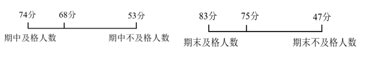

故正确答案为C。

### 第 49 题

企业将12个技术培训名额分配给甲、乙、丙三个研发团队。要求乙团队分配的培训名额比甲团队少，但比丙团队多，且每个团队至少分配1个名额。问有多少种不同的分配方式？

A. 6

B. 7

C. 36

D. 42

第 49 题 · 答案与解析

**参考答案（粉笔题库参考内容）**

B

**解析**

根据题干条件，各团队分配的培训名额甲>乙>丙，采用枚举法，情况如下：

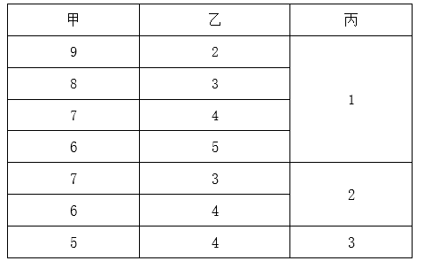

由上表可知，共有7种不同的分配方式。

故正确答案为B。

### 第 50 题

运动会招募志愿者，第一次招募了不到100人，其中男女比例为11：7；补招若干女性志愿者后，男女比例变为4：3。问最多可能补招了多少名女性志愿者？

A. 3

B. 5

C. 6

D. 10

第 50 题 · 答案与解析

**参考答案（粉笔题库参考内容）**

B

**解析**

根据“男女比例为11：7”“补招若干女性志愿者后，男女比例变为4：3”可知，男生人数既是11的倍数，又是4的倍数，男生人数为44n。结合“第一次招募了不到100人”可知，男生人数是44人，原来女生人数为44÷11×7=28人；补招后女生人数变为44÷4×3=33人。可知女生最多可能补招人数为33-28=5人。

故正确答案为B。

### 第 51 题

商店销售甲、乙、丙、丁四种商品，每件分别盈利15元、9元、4元和1元。某日销售这四种商品共40件，共盈利201元。四种商品每种至少销售1件，且甲、丁商品销量相同。问当天丙商品的销量为多少件？

A. 21

B. 27

C. 29

D. 31

第 51 题 · 答案与解析

**参考答案（粉笔题库参考内容）**

D

**解析**

根据“甲、丁商品销量相同”，设甲、乙、丙、丁四种商品销量分别为x件、y件、z件、x件。根据“这四种商品共40件”可得，2x+y+z=40······①；根据“共盈利201元”可得，15x+9y+4z+x=201······②。令①×8-②可消去x，得4z-y=119。因为四种商品每种至少销售1件，可得4z＞119，即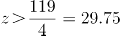，排除A、B、C三项。代入D项验证，若z=31，则y=4z-119=124-119=5，2x=40-31-5=4，x=2，符合题干所有条件。

故正确答案为D。

### 第 52 题

c地为a、b两地直线道路上的一点，甲、乙两人9：00分别自a、b两地同时出发匀速相向而行，甲的速度是乙的1.5倍，甲9：40到达c地休息10分钟后继续向b地前进；乙全程不休息，在10：40到达c地，问甲、乙相遇的时间为：

A. 10：00

B. 10：10

C. 10：20

D. 10：30

第 52 题 · 答案与解析

**参考答案（粉笔题库参考内容）**

B

**解析**

方法一：赋值甲每分钟的速度为3，乙每分钟的速度为2。根据甲9：40到达c地，则；乙全程不休息，在10：40到达c地，则，因此ab的路程。设甲、乙两人从9：00开始出发t分钟后相遇，则，解得t=70，因此甲、乙相遇的时间为9：00+70分钟=10：10。

方法二：赋值甲每分钟的速度为3，乙每分钟的速度为2。根据乙9：00出发，在10：40到达c地，可得乙从b地到c地的路程为2×100=200。当甲9：50离开c地继续向b地前进时，乙已走的路程为2×50=100，此时甲、乙继续相向而行所需的相遇时间分钟，则甲、乙相遇时间为9：50+20分钟=10：10。

故正确答案为B。

### 第 53 题

部队射击比赛中，5名参赛的战士共击中了88次目标。已知任意2人击中的目标数量均互不相同，问射击成绩排前两名的战士至少击中了多少次目标？

A. 37

B. 39

C. 58

D. 82

第 53 题 · 答案与解析

**参考答案（粉笔题库参考内容）**

B

**解析**

根据题意，要使排前两名的战士击中的次数尽可能少，则其他战士击中的次数要尽可能多。设第二名击中x次，又因任意2人击中的目标数量均互不相同，可得击中次数如下：

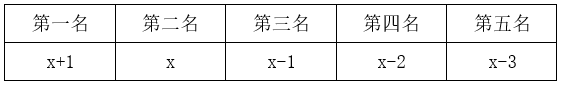

根据“5名战士共击中了88次目标”，可列式：x+1+x+x-1+x-2+x-3=88，解得x=18.6，则第二名至少击中19次目标，第一名为x+1=20次，可得前两名至少击中了20+19=39次目标。

故正确答案为B。

### 第 54 题

王师傅加工零件，他可同时操作4台仪器对零件进行抛光，每个零件需2面抛光才能加工完成，抛光1面需2分钟，问6个零件最少用多少分钟才能加工完成（换零件时间不计）？

A. 5

B. 6

C. 7

D. 8

第 54 题 · 答案与解析

**参考答案（粉笔题库参考内容）**

B

**解析**

根据题意，6个零件共需抛光6×2=12面，4台仪器同时工作，每次共抛光4面，耗时2分钟。至少需要抛光12÷4=3次，即最少用2×3=6分钟加工完成。

故正确答案为B。

### 第 55 题

某校园围墙外的道路形成一个边长为300米的正方形（如图所示），甲、乙两人分别从正方形的两个对角沿逆时针方向同时出发，甲、乙的步行速度比为9：7。问甲、乙两人第一次处于同一条边是在哪一条边上？

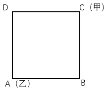

A. AB

B. BC

C. CD

D. DA

第 55 题 · 答案与解析

**参考答案（粉笔题库参考内容）**

D

**解析**

根据题意，设甲的速度为9v，则乙的速度为7v。甲、乙初始路程差为CD+DA=300+300=600米，若甲、乙两人第一次处于同一条边，即两人路程差≤300米。根据追及公式：，当甲与乙相差300米时，可列式：300=（9v-7v）×t，解得vt=150，则此时甲所走路程=9v×t=1350米（走完一圈300×4=1200米多150米），甲在CD中点；此时乙所走路程=7v×t=1050米（还差150米走完一圈），乙在DA中点。因，故当甲到达D点时，乙未到达A点，此时甲、乙两人均在DA边，且为第一次处于同一条边。

故正确答案为D。

### 第 56 题

安排A、B、C、D共4个研发团队参与甲、乙、丙3个课题的研究，要求每个课题至少有1个团队参与，每个团队必须且只能参与1个课题，如甲课题参与的团队数超过1个，则A、B都不参与甲课题，问共有多少种不同的安排方式？

A. 24

B. 26

C. 36

D. 42

第 56 题 · 答案与解析

**参考答案（粉笔题库参考内容）**

B

**解析**

根据题意可知，甲课题参与的团队数可能为1个或2个，分情况讨论如下：

（1）甲课题参与的团队数为1个，先从4个研发团队中任意选择1个有C\_4^1=4种情况，再让剩下3个团队参与乙、丙2个课题有种情况，分步用乘法，共有4×6=24种情况。

（2）甲课题参与的团队数为2个，则只能C、D参与甲课题，剩下A、B2个团队参与乙、丙2个课题有种情况。

分类用加法，则共有24+2=26种安排方式。

故正确答案为B。

### 第 57 题

一个白色圆柱体零件的底面半径是高的1.5倍，现将其表面涂上黑漆之后，沿下图所示虚线方向切割为4个完全相同的部分。问单个部分的黑色面积是白色面积的多少倍？（）

A. 不到1.1倍

B. 1.1-1.2倍之间

C. 1.2-1.3倍之间

D. 1.3倍以上

第 57 题 · 答案与解析

**参考答案（粉笔题库参考内容）**

B

**解析**

根据题意，赋值该圆柱零件高为2，则底面半径为3，；切割后单个部分如图所示，其黑色面积，其白色面积，则所求倍数为倍，在B项范围内。

故正确答案为B。

### 第 58 题

某单位从所有职工中选出若干人参加培训，如果选择4人，可能的选择方式正好是选择3人时的10倍，问该单位有多少名职工？

A. 32

B. 33

C. 42

D. 43

第 58 题 · 答案与解析

**参考答案（粉笔题库参考内容）**

D

**解析**

设该单位有x名职工，根据题意可知：，即，解得x=43。

故正确答案为D。

### 第 59 题

某羽毛球俱乐部推出充值会员优惠活动，具体为月卡会员费用打八折，年卡会员费用打七折，充值总时长1年的月卡比1年的年卡所需费用，打折前后分别多88元和100元，问打折后充值18个月的会员最少需要：

A. 不到340元

B. 340-400元之间

C. 400-460元之间

D. 460元以上

第 59 题 · 答案与解析

**参考答案（粉笔题库参考内容）**

B

**解析**

设打折前月卡和年卡的会员费用分别为x和y，根据题意可列：12x-y=88······①，······②，联立①②两式，解得x=32，y=296。打折后充值18个月的会员可以采取1张年卡+6张月卡花费最少，总费用=296×0.7+32×6×0.8=207.2+153.6=360.8元，在B项范围内。

故正确答案为B。

### 第 60 题

从甲地到乙地的全价机票为2000元，购买全价或折扣机票，每张都要支付120元税费，从甲地到乙地的高铁票价为680元，企业要安排20人当日从甲地前往乙地出差，单程总预算不超过2万元，已知当日高铁票、机票都充足，2折、3折和5折机票分别还剩余2张、3张和5张，其余为全价机票，问在预算范围内最多能安排多少人乘飞机前往乙地？

A. 11

B. 12

C. 13

D. 14

第 60 题 · 答案与解析

**参考答案（粉笔题库参考内容）**

C

**解析**

题干要求预算范围内安排乘飞机前往乙地的人数最多，结合选项可知乘飞机的人数大于折扣机票的剩余张数2+3+5=10张，则题干中的折扣机票应全部购买，购买折扣机票的费用为2000×0.2×2+2000×0.3×3+2000×0.5×5+120×10=8800元；设购买全价机票的人数为n人，根据题意可列方程：，解得，则n=3人。故在预算范围内最多能安排乘飞机前往乙地的人数为10+3=13人。

故正确答案为C。

### 第 61 题

从所给的四个选项中，选择最适合的一个填入问号处，使之呈现一定的规律性：

A. A

B. B

C. C

D. D

第 61 题 · 答案与解析

**参考答案（粉笔题库参考内容）**

A

**解析**

解析一：元素组成相同，优先考虑位置规律。观察发现，题干相邻两幅图形中，左侧三列元素整体向右平移1列，最右侧一列元素移动到最左侧后，又整体向下平移1行（如下图所示），只有A项符合规律。

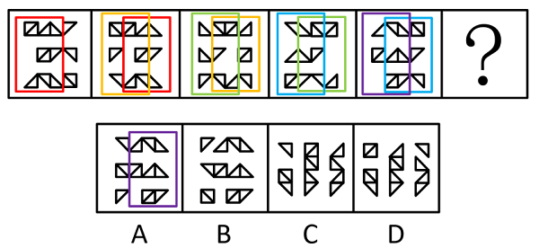

解析二：元素组成相同，优先考虑位置规律。观察发现，题干所有图形均向右平移一格，走到头换到下一行，最后一行走完又走到第一行，所有图形首尾相连，循环往复，如图箭头所示。

图中标记1的图形，问号处位置如图，排除C、D两项；

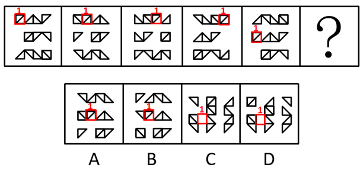

A、B两项的区别在于标记1的图形前面的图形，如图画圈图形，观察发现，只有A符合。

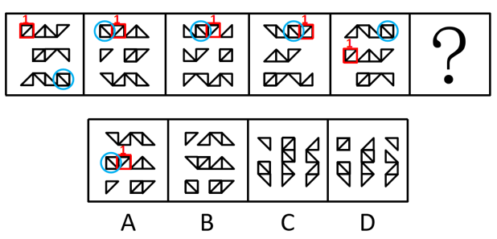

故正确答案为A。

### 第 62 题

从所给的四个选项中，选择最合适的一个填入问号处，使之呈现一定的规律性：

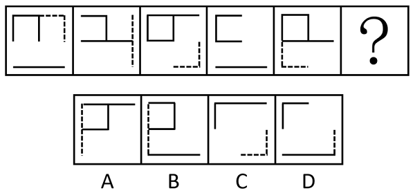

A. A

B. B

C. C

D. D

第 62 题 · 答案与解析

**参考答案（粉笔题库参考内容）**

A

**解析**

元素组成基本相同，优先考虑位置规律。观察发现，如下图所示，题干每幅图中的虚线依次顺时针移动其半条边长的距离，长实线依次向上循环移动其半条边长的距离，“U”字形图形依次顺时针旋转90°，只有A项符合规律。

故正确答案为A。

### 第 63 题

从所给的四个选项中，选择最合适的一个填入问号处，使之呈现一定的规律性：

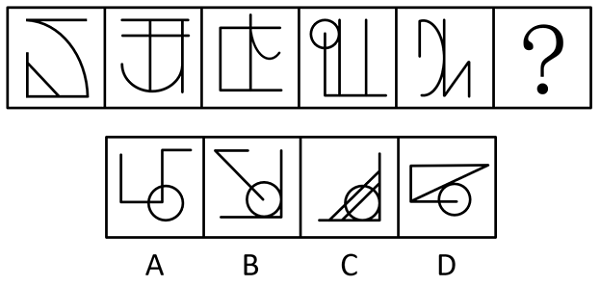

A. A

B. B

C. C

D. D

第 63 题 · 答案与解析

**参考答案（粉笔题库参考内容）**

D

**解析**

元素组成不同，且无明显属性规律，考虑数量规律。观察发现，题干图形线条交叉明显，且每幅图都有相切，考虑切点数。题干图形切点数均为1，故？处图形切点数也应为1，只有D项符合。

故正确答案为D。

### 第 64 题

下列纸盒的外表面展开图中，哪一个折叠成的纸盒和其他三个不一样？

A. A

B. B

C. C

D. D

第 64 题 · 答案与解析

**参考答案（粉笔题库参考内容）**

B

**解析**

将选项展开图标上序号，如下图所示（各选项面都相同，故相同的面用相同字母表示），逐一进行分析。

A项：面b、面c相邻，公共边紧邻面b与面c的黑块（如上图所示）；

B项：面b、面c相邻，公共边没有紧邻面b的黑块（如上图所示）；

C项：面b、面c相邻，公共边紧邻面b与面c的黑块（如上图所示）；

D项：面b、面c相邻，公共边紧邻面b与面c的黑块（如上图所示）。

综上，只有B项与其他三项不同。

本题为选非题，故正确答案为B。

### 第 65 题

下图为15个白色和5个灰色正方体组合而成的多面体，将其经A、B、C三个顶点切开后，正确的截面是：

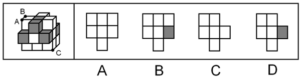

A. A

B. B

C. C

D. D

第 65 题 · 答案与解析

**参考答案（粉笔题库参考内容）**

C

**解析**

本题考查截面图。根据平面公理“过不在一条直线上的三点，有且只有一个平面”可以得出，A、B、C三个顶点可以确定一个唯一的截面，如下图所示：

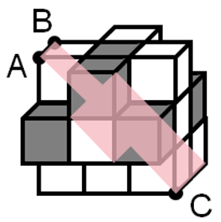

逆时针旋转即可得到如下截面图：

故正确答案为C。

### 第 66 题

下图为15个白色和5个灰色正方体组合而成的多面体，右边哪一个不可能是其某个角度的视图？

A. A

B. B

C. C

D. D

第 66 题 · 答案与解析

**参考答案（粉笔题库参考内容）**

B

**解析**

本题考查三视图，逐一分析选项。

A项：题干立体图形从仰视（即从下往上）的视角可以看到下图的图形，再将视角顺时针或逆时针旋转90°后，即为A项视图，排除；

B项：该项不是题干立体图形的视图，当选；

C项：题干立体图形从右视（即从右往左）的视角可以看到下图的图形，再将视角旋转180°后，即为C项视图，排除；

D项：题干立体图形从后视（即从后往前）的视角可以看到下图的图形，再将视角顺时针旋转90°后，即为D项视图，排除。

本题为选非题，故正确答案为B。

### 第 67 题

职场义警是指认为自己在没有正式授权的情况下，能够监控周围环境中是否存在违反公司规范的迹象，并在自认为适当或合理的时候对感知到的违规同事进行直接或间接处罚的人。

根据上述定义，下列属于职场义警的是：

A. 小张认为公司强制加班的行为违反了劳动法，于是向公司主管部门进行实名举报

B. 戴红袖标的居委会王阿姨在斑马线义务执勤时，对乱闯红灯的行人进行口头批评

C. 有同事利用上班时间闲聊，老周看不过去，瞅准机会找到这位同事进行批评教育

D. 保卫科小刘专门就公司员工安全意识弱现象向领导进行汇报，建议领导通报批评

第 67 题 · 答案与解析

**参考答案（粉笔题库参考内容）**

C

**解析**

第一步：找出定义关键词。

“在没有正式授权的情况下”、“监控到违反公司规范的迹象”、“自认为适当或合理的时候对违规同事进行处罚”。

第二步：逐一分析选项。

A项：小张认为公司行为违反劳动法，于是向公司主管部门进行实名举报，其中举报行为并非惩罚行为，不符合“自认为适当或合理的时候对违规同事进行处罚”，不符合定义，排除；

B项：居委会王阿姨对违反交通规则的行人进行批评是发生在其义务执勤期间，监督行人遵守交通规则是王阿姨的工作内容，不符合“在没有正式授权的情况下”，不符合定义，排除；

C项：老周对上班闲聊的同事进行批评教育，但并未提及老周的身份是领导，所以他并没有权力批评教育该同事，符合“在没有正式授权的情况下”，老周瞅准机会直接批评上班闲聊的同事，符合“自认为适当或合理的时候对违规同事进行处罚”，符合定义，当选；

D项：关注员工安全意识的问题在保卫科小刘的工作范围之内，不符合“在没有正式授权的情况下”，不符合定义，排除。

故正确答案为C。

### 第 68 题

领导负面反馈是指领导对员工当前行为或绩效未达到目标或标准时所给予员工的指示、否定或批评，其目的是激励员工更加努力工作或改变行为方式以减小差距。

根据上述定义，下列属于领导负面反馈的是：

A. 人力资源部王部长对总经理说，员工小李的工作能力实在太差，建议合同到期后不再续聘

B. 厨师小徐因为炒菜口味问题被顾客多次投诉，厨师长对他进行了严肃批评并帮他寻找原因

C. 在单位年终总结会上，小冯为激励自己进步，积极就自身工作不足向同事们征求批评意见

D. 办公室侯主任把年度考核不合格的员工名单递交给人事处，人事处向员工通报了处理结果

第 68 题 · 答案与解析

**参考答案（粉笔题库参考内容）**

B

**解析**

第一步：找出定义关键词。

“领导对员工当前行为或绩效未达到目标或标准时所给予员工的指示、否定或批评”、“激励员工更加努力工作或改变行为方式以减小差距”。

第二步：逐一分析选项。

A项：人力资源部长对总经理说员工小李的工作能力差，符合“领导对员工当前行为或绩效未达到目标或标准时所给予员工的指示、否定或批评”，但他建议合同到期后不续聘，不符合“激励员工更加努力工作或改变行为方式以减小差距”，不符合定义，排除；

B项：小徐因为炒菜口味问题被顾客多次投诉，厨师长对小徐进行了严肃批评，符合“领导对员工当前行为或绩效未达到目标或标准时所给予员工的指示、否定或批评”，帮助他寻找被投诉的原因，符合“激励员工更加努力工作或改变行为方式以减小差距”，符合定义，当选；

C项：小冯为激励自己进步，向同事们征求批评意见，不符合“领导对员工当前行为或绩效未达到目标或标准时所给予员工的指示、否定或批评”，不符合定义，排除；

D项：办公室侯主任把年度考核不合格的员工名单递交给人事处，由人事处向员工通报处理结果，不符合“领导对员工当前行为或绩效未达到目标或标准时所给予员工的指示、否定或批评”，不符合定义，排除。

故正确答案为B。

### 第 69 题

矛盾职业认同是指从业者对自身职业兼具认同和不认同，或认同职业某一方面而不认同其他方面，反映了个体对自身职业的复杂情感。

根据上述定义，下列属于矛盾职业认同的是：

A. 小强对未来就业感到迷茫，一方面认为本专业相对好就业，另一方面觉得工作压力会很大

B. 虽然觉得社会上有很多人对网络主播并不认同，但小飞却决定将主播当作一生的事业来做

C. 小刚的父母希望他毕业后考公务员，但小刚自己却更喜欢做一名教师

D. 老汪觉得送快递很累，但工作时间相对自由，因此他还是决定干下去

第 69 题 · 答案与解析

**参考答案（粉笔题库参考内容）**

D

**解析**

第一步：找出定义关键词。

“从业者”、“对自身职业兼具认同和不认同”、“认同职业某一方面而不认同其他方面”。

第二步：逐一分析选项。

A项：小强还未就业，不符合“从业者”，不符合定义，排除；

B项：社会上有很多人对网络主播并不认同，但小飞本人却对主播事业很坚定，仅体现出小飞对于主播事业的认同，不符合“对自身职业兼具认同和不认同”、“认同职业某一方面而不认同其他方面”，不符合定义，排除；

C项：父母希望小刚考公务员，小刚自己却更喜欢做一名教师，不明确小刚是否为从业者，并且仅体现了父母和小刚关于小刚未来职业的想法不同，不符合“对自身职业兼具认同和不认同”、“认同职业某一方面而不认同其他方面”，不符合定义，排除；

D项：老汪是快递员，符合“从业者”，他觉得送快递很累，但工作时间相对自由，符合“对自身职业兼具认同和不认同”、“认同职业某一方面而不认同其他方面”，符合定义，当选。

故正确答案为D。

### 第 70 题

逆向选择性监管是指在某些监管领域中，监管者对违规程度较低的目标群体严加监管，对违规程度更高的监管对象却相对宽松，使得监管强度与对象违规程度成反比的组织现象。

根据上述定义，下列属于逆向选择性监管的是：

A. 监管部门对证照齐全的大中型校外培训机构严加管控，却对问题突出的个体培训疏于管控

B. 候车时，守序排队的人上车没有座位，而插队的人却有座位，对此公交车司机却不加干预

C. 班主任把易犯错误且屡教不改的学生座位调整在前排，以便任课老师监督

D. 在每年的消费者权益保护日晚会上，监管部门都会重点曝光一些违规产品

第 70 题 · 答案与解析

**参考答案（粉笔题库参考内容）**

A

**解析**

第一步：找出定义关键词。

“在监管领域中”、“对违规程度较低的目标群体严加监管”、“对违规程度更高的监管对象相对宽松”。

第二步：逐一分析选项。

A项：监管部门对证照齐全的培训机构严加管控，证照齐全说明其违规程度相对较低，但却严加管控，符合“在监管领域中”、“对违规程度较低的目标群体严加监管”，对问题突出的个体培训疏于管控，问题突出说明违规程度更高，符合“对违规程度更高的监管对象相对宽松”，符合定义，当选；

B项：司机对守序排队和插队行为都不加干预，说明根本就不存在监管，不符合“对违规程度较低的目标群体严加监管”、“对违规程度更高的监管对象相对宽松”，不符合定义，排除；

C项：班主任调整易犯错误且屡教不改的学生的座位，以便任课老师监督，说明是对违规程度更高的对象严加看管，不符合“对违规程度更高的监管对象相对宽松”，不符合定义，排除；

D项：监管部门重点曝光一些违规产品，没有体现对不同群体的区别监管，不符合“对违规程度较低的目标群体严加监管”、“对违规程度更高的监管对象相对宽松”，不符合定义，排除。

故正确答案为A。

### 第 71 题

即兴能力是企业在紧急、不可预测环境下，计划与行动同时进行，通过对资源进行利用和整合呈现出创造性，从而自发地实现预期目标的能力。

根据上述定义，下列属于即兴能力的是：

A. 企业聚餐，员工老杨一杯酒下肚，情绪立即高涨起来，即兴为大家表演了诗朗诵

B. 负责公司招聘的人力资源部通过对考生即兴演讲效果的比较，确定最终录用人员

C. 某企业面对技术封锁，边调整发展规划，边创新研发技术，最终成长为行业巨头

D. 为应对未来劳动力成本大幅攀升的不利影响，企业启动了机器设备升级换代工作

第 71 题 · 答案与解析

**参考答案（粉笔题库参考内容）**

C

**解析**

第一步：找出定义关键词。

“企业在紧急、不可预测环境下”、“计划与行动同时进行”、“通过对资源进行利用和整合呈现出创造性”、“自发地实现预期目标”。

第二步：逐一分析选项。

A项：该项中员工老杨在企业聚餐时的表现属于个人行为，不符合“企业在紧急、不可预测环境下”，不符合定义，排除；

B项：该项中负责公司招聘的人力资源部对考生的考核和录用属于人力资源部的日常工作，不符合“企业在紧急、不可预测环境下”，也未表现出计划和行动情况，不符合“计划与行动同时进行”，不符合定义，排除；

C项：该项中某企业面对技术封锁，符合“企业在紧急、不可预测环境下”，调整发展规划，创新研发技术，符合“计划与行动同时进行”、“通过对资源进行利用和整合呈现出创造性”，最终成长为行业巨头，符合“自发地实现预期目标”，符合定义，当选；

D项：该项中为应对未来劳动力成本大幅攀升的不利影响，企业采取了一些措施，说明已经预知未来如何，不符合“企业在紧急、不可预测环境下”，不符合定义，排除。

故正确答案为C。

### 第 72 题

警觉性市场学习是指企业或组织为提高深度市场洞察而提前建立预警系统，并保持注意力集中以预测市场变化或感知客户需求微弱信号的学习行为。

根据上述定义，下列属于警觉性市场学习的是：

A. 公司提醒小吴要想在职场中保持优势地位，避免被淘汰，就必须利用业余时间多学习

B. 阳阳上课时注意力不集中，为帮他养成良好学习习惯，家长聘请了心理专家进行干预

C. 某知名企业组建市场调研部，定期监测市场动向，积极培训员工，努力规避潜在风险

D. 某房地产开发商通过暂缓开发或拖延施工进度等方式，试图化解可能面临的发展危机

第 72 题 · 答案与解析

**参考答案（粉笔题库参考内容）**

C

**解析**

第一步：找出定义关键词。

“企业或组织”、“为提高深度市场洞察而提前建立预警系统”、“预测市场变化或感知客户需求”。

第二步：逐一分析选项。

A项：公司提醒小吴利用业余时间多学习避免被淘汰，是公司对员工的提醒，不属于对市场变化的预测和对客户需求的感知，不符合“预测市场变化或感知客户需求”，不符合定义，排除；

B项：家长聘请心理专家帮助阳阳养成良好的学习习惯，其中阳阳的家长不属于企业或组织，不符合“企业或组织”，不符合定义，排除；

C项：某知名企业组建市场调研部，定期监测市场动向，符合“企业或组织”、“为提高深度市场洞察而提前建立预警系统”、“预测市场变化或感知客户需求”，符合定义，当选；

D项：某房地产开发商使用暂缓开发或拖延施工进度等方式，是为了化解可能面临的发展危机，而不是对市场变化的预测和对客户需求的感知，不符合“预测市场变化或感知客户需求”，不符合定义，排除。

故正确答案为C。

### 第 73 题

领导者对下属或员工的过错惩罚有两种，权变惩罚与非权变惩罚，领导权变惩罚是指领导根据下属的过失程度酌情采取惩罚；领导非权变惩罚是指因下属的过失行为，领导施加了与下属实际绩效和表现不相符的过度惩罚。

根据上述定义，下列属于领导非权变惩罚的是：

A. 小刘操作机床时，故意违反操作规程造成机床主机严重受损，公司根据相关规定对其进行加重处罚

B. 因甲方无法如期履行合同义务，乙方领导指示法务部门根据合同约定条款严肃追究甲方的违约责任

C. 刘律师因疏忽大意错过了案件上诉期，尽管其已获得委托人谅解，但律所仍对刘律师施以顶格处罚

D. 小郑不小心给客户少发了部分产品，发现后及时补发，按规定只需罚款，但是经理却坚持要将他开除

第 73 题 · 答案与解析

**参考答案（粉笔题库参考内容）**

D

**解析**

第一步：找出定义关键词。

领导权变惩罚：“领导根据下属的过失程度酌情采取惩罚”；

领导非权变惩罚：“领导根据下属的过失，施加了与下属实际绩效和表现不相符的过度惩罚”。

第二步：逐一分析选项。

A项：小刘故意违反操作造成机床主机严重受损，公司对其加重处罚是依据公司的规定，不符合“领导根据下属的过失，施加了与下属实际绩效和表现不相符的过度惩罚”，不符合“领导非权变惩罚”定义，排除；

B项：乙方领导追究甲方的违约责任，其中甲方不属于乙方的下属，且追究违约责任是依据合同约定的条款，不符合“领导根据下属的过失，施加了与下属实际绩效和表现不相符的过度惩罚”，不符合“领导非权变惩罚”定义，排除；

C项：刘律师因自身疏忽错过了案件上诉期，虽获得委托人谅解，但刘律师的行为属于失职，故律所对刘律师施以顶格处罚也是合理的，不符合“领导根据下属的过失，施加了与下属实际绩效和表现不相符的过度惩罚”，不符合“领导非权变惩罚”定义，排除；

D项：小郑在发现给客户少发了产品后及时补发，按规定只需罚款，但经理却要坚持开除小郑，这种惩罚是过度的，符合“领导根据下属的过失，施加了与下属实际绩效和表现不相符的过度惩罚”，符合“领导非权变惩罚”定义，当选。

故正确答案为D。

### 第 74 题

积极独处是个体主动选择与他人的交际分离，选择自我自由并投入到有意义的、愉快的活动中，从而产生的一种内在积极体验。

根据上述定义，下列属于积极独处的是：

A. 小孙睡眠质量不好，外出工作时一般都不和同事一起住

B. 小钱已经锁定了晚上的演唱会门票，谢绝了同事下班后聚餐的邀请

C. 为了准备研究生入学考试，小赵几乎不参加社交活动，他感到很充实

D. 小周适应不了职场人际关系，辞职后不愿出去找工作，整日在家刷视频

第 74 题 · 答案与解析

**参考答案（粉笔题库参考内容）**

C

**解析**

第一步：找出定义关键词。

“个体主动选择与他人的交际分离”、“选择自我自由并投入到有意义的、愉快的活动中”、“产生内在积极体验”。

第二步：逐一分析选项。

A项：选项指出小孙因为睡眠质量不好所以在外出工作时不和同事一起住，小孙只是晚上不和同事一起住，并不是要和同事“交际分离”，不符合“个体主动选择与他人的交际分离”，不符合定义，排除；

B项：选项指出小钱因为晚上要看演唱会所以谢绝了当晚的聚餐邀请，并不是要和同事“交际分离”，不符合“个体主动选择与他人的交际分离”，不符合定义，排除；

C项：选项指出小赵为了准备研究生入学考试几乎不参加社交活动，符合“个体主动选择与他人的交际分离”、“选择自我自由并投入到有意义的、愉快的活动中”，他感到很充实，符合“产生内在积极体验”，符合定义，当选；

D项：选项指出小周适应不了职场人际关系而不愿出去找工作，并且整日在家刷视频，“整日刷视频”不是有意义的活动，不符合“选择自我自由并投入到有意义的、愉快的活动中”，不符合定义，排除。

故正确答案为C。

### 第 75 题

飞机：机库：机场

A. 课桌：桌椅：桌面

B. 药品：药盒：药箱

C. 乘客：客车：车站

D. 汽车：车轮：车轴

第 75 题 · 答案与解析

**参考答案（粉笔题库参考内容）**

B

**解析**

第一步：判断题干词语间逻辑关系。

飞机停在机库里，二者是存放地点对应关系；飞机停在机场里，二者是存放地点对应关系。

第二步：判断选项词语间逻辑关系。

A项：桌面是课桌的一部分，二者不是存放地点对应关系，与题干逻辑关系不一致，排除；

B项：药品放在药盒里，二者是存放地点对应关系；药品放在药箱里，二者是存放地点对应关系，与题干逻辑关系一致，当选；

C项：客车运输乘客，二者不是存放地点对应关系，与题干逻辑关系不一致，排除；

D项：车轮是汽车的组成部分，二者不是存放地点对应关系，与题干逻辑关系不一致，排除。

故正确答案为B。

### 第 76 题

制造：中国制造：智能化中国制造

A. 小说：长篇小说：中长篇科幻小说

B. 批评：自我批评：剖析式自我批评

C. 学习：深度学习：机器人深度学习

D. 锻炼：体育锻炼：有意识体育锻炼

第 76 题 · 答案与解析

**参考答案（粉笔题库参考内容）**

B

**解析**

第一步：判断题干词语间逻辑关系。

中国制造是制造的一种，前两词构成种属关系；智能化中国制造是中国制造的一种，后两词构成种属关系，且“智能化”是对中国制造具体属性的描述。

第二步：判断选项词语间逻辑关系。

A项：长篇小说是小说的一种，前两词构成种属关系；中长篇科幻小说是中长篇小说的一种，不是长篇小说，后两词不构成种属关系，与题干逻辑关系不一致，排除；

B项：自我批评是批评的一种，前两词构成种属关系；剖析式自我批评是自我批评的一种，后两词构成种属关系，且“剖析式”是对自我批评具体属性的描述，与题干逻辑关系一致，保留；

C项：深度学习是学习的一种，前两词构成种属关系；机器人深度学习是指机器人利用深度学习技术进行学习，与“深度学习”不构成种属关系，与题干逻辑关系不一致，排除；

D项：体育锻炼是锻炼的一种，前两词构成种属关系；有意识体育锻炼是体育锻炼的一种，后两词构成种属关系，且“有意识”是对体育锻炼具体属性的描述，与题干逻辑关系一致，保留。

对比B、D两项，题干中“中国制造”与B项中“自我批评”都是主谓结构，D项中“体育锻炼”不是主谓结构，且题干中“智能化”与B项中“剖析式”结构一致，而D项中“有意识”与题干结构不同，故B项与题干逻辑关系更为一致。

故正确答案为B。

### 第 77 题

风吹：草低：见牛羊

A. 浪打：船摇：靠舵手

B. 光照：叶肥：促生长

C. 游人：如织：显道窄

D. 雨淋：花落：闻余香

第 77 题 · 答案与解析

**参考答案（粉笔题库参考内容）**

D

**解析**

第一步：判断题干词语间逻辑关系。

风吹导致草低，草低导致见牛羊，第一词和第二词、第二词和第三词之间分别构成因果对应关系。

第二步：判断选项词语间逻辑关系。

A项：浪打导致船摇，二者构成因果对应关系，但船摇需要靠舵手，二者不构成因果对应关系，与题干逻辑关系不一致，排除；

B项：光照导致叶肥，叶肥是促生长的结果，与题干逻辑关系不一致，排除；

C项：游人如织形容游人多得像织布的线一样，密密麻麻，如织是用来形容游人的，二者不构成因果对应关系，与题干逻辑关系不一致，排除；

D项：雨淋导致花落，花落导致闻余香，第一词和第二词、第二词和第三词之间分别构成因果对应关系，与题干逻辑关系一致，当选。

故正确答案为D。

### 第 78 题

窗户：窗帘：遮光

A. 桌子：桌布：防污

B. 电脑：鼠标：操作

C. 座椅：座垫：美观

D. 茶杯：茶叶：茶水

第 78 题 · 答案与解析

**参考答案（粉笔题库参考内容）**

A

**解析**

第一步：判断题干词语间逻辑关系。

窗帘挂在窗户上，二者为配套使用的对应关系；遮光是窗帘的功能，二者为功能对应关系。

第二步：判断选项词语间逻辑关系。

A项：桌布铺在桌子上，二者为配套使用的对应关系；防污是桌布的功能，二者为功能对应关系，与题干逻辑关系一致，当选；

B项：鼠标连接在电脑上，二者为配套使用的对应关系；操作鼠标，二者为动宾关系，与题干逻辑关系不一致，排除；

C项：座垫铺在座椅上，二者为配套使用的对应关系；美观是座垫的或然属性，二者为属性对应关系，与题干逻辑关系不一致，排除；

D项：茶叶是制作茶水的原材料，二者是原材料对应关系，与题干逻辑关系不一致，排除。

故正确答案为A。

### 第 79 题

信息科技：生物科技：科技

A. 机械工业：智能工业：工业

B. 纺织产业：物流产业：产业

C. 公共交通：城市交通：交通

D. 商品住房：保障住房：住房

第 79 题 · 答案与解析

**参考答案（粉笔题库参考内容）**

A

**解析**

第一步：判断题干词语间逻辑关系。

信息科技会利用生物科技，生物科技会利用信息科技，二者为相互利用、相互融合的关系，信息科技和生物科技都是科技的一种，前两词分别与第三词构成种属关系。

第二步：判断选项词语间逻辑关系。

A项：机械工业会利用智能工业，智能工业会利用机械工业，二者为相互利用、相互融合的关系，机械工业和智能工业都是工业的一种，前两词分别与第三词构成种属关系，与题干逻辑关系一致，当选；

B项：纺织产业会利用物流产业，但物流产业不会利用纺织产业，二者不是相互利用、相互融合的关系，与题干逻辑关系不一致，排除；

C项：有的公共交通是城市交通，有的公共交通不是城市交通，有的城市交通是公共交通，有的城市交通不是公共交通，二者为交叉关系，不是相互利用、相互融合的关系，与题干逻辑关系不一致，排除；

D项：商品住房和保障住房（保障性住房），二者不是相互利用、相互融合的关系，与题干逻辑关系不一致，排除。

故正确答案为A。

### 第 80 题

文字：汉字

A. 判断：概念

B. 宇宙：恒星

C. 中国：北京

D. 工人：矿工

第 80 题 · 答案与解析

**参考答案（粉笔题库参考内容）**

D

**解析**

第一步：判断题干词语间逻辑关系。

汉字是记录汉语的文字，二者是种属关系。

第二步：判断选项词语间逻辑关系。

A项：概念不是判断的一种，二者不是种属关系，与题干逻辑关系不一致，排除；

B项：宇宙是包括一切天体的无限空间，恒星是本身能发出光和热的天体，恒星是宇宙的组成部分，二者是组成关系，与题干逻辑关系不一致，排除；

C项：北京是中国的组成部分，二者是组成关系，与题干逻辑关系不一致，排除；

D项：矿工是开采矿物的工人，二者是种属关系，与题干逻辑关系一致，当选。

故正确答案为D。

### 第 81 题

前因后果：因果

A. 内忧外患：忧患

B. 南征北战：征战

C. 左顾右盼：顾盼

D. 有始无终：始终

第 81 题 · 答案与解析

**参考答案（粉笔题库参考内容）**

D

**解析**

第一步：判断题干词语间逻辑关系。

前因后果指的是事物的因果报应，后泛指整个事件；因果指的是原因与结果的关系，二者没有语义关系，考虑拆分。“前”和“后”是反义关系，“因”和“果”组成第二个词，分别代表原因和结果两个不同的方面，且先“因”后“果”。

第二步：判断选项词语间逻辑关系。

A项：“内”和“外”是反义关系，但是“忧”和“患”指的都是忧虑的事情，二者为近义关系，与题干逻辑关系不一致，排除；

B项：“南”和“北”是反义关系，但是“征”和“战”指的都是出发去作战，二者为近义关系，与题干逻辑关系不一致，排除；

C项：“左”和“右”是反义关系，但是“顾”和“盼”指的都是看，二者为近义关系，与题干逻辑关系不一致，排除；

D项：“有”和“无”是反义关系，“始”和“终”组成第二个词，分别代表开始和结束两个不同的方面，且先“始”后“终”，与题干逻辑关系一致，当选。

故正确答案为D。

### 第 82 题

专业课 对于 （ ） 相当于 （ ） 对于 交响曲

A. 网络课：独奏曲

B. 公共课：进行曲

C. 考试课：古筝曲

D. 选修课：前奏曲

第 82 题 · 答案与解析

**参考答案（粉笔题库参考内容）**

B

**解析**

逐一代入选项。

A项：专业课指学校根据培养目标所开设的专业知识和专门技能的课程。专业课与网络课为交叉关系。西方乐曲可分为交响曲、独奏曲、进行曲、前奏曲等不同形式，独奏曲和交响曲为并列关系，前后逻辑关系不一致，排除；

B项：公共课是指高等教育自学考试中任何专业或部分同类专业的考生都必须学习的课程，专业课与公共课为并列关系。进行曲和交响曲为并列关系，前后逻辑关系一致，当选；

C项：专业课与考试课为交叉关系。古筝曲是中国古典乐曲，和交响曲是并列关系，前后逻辑关系不一致，排除；

D项：专业课与选修课为交叉关系。前奏曲和交响曲为并列关系，前后逻辑关系不一致，排除。

故正确答案为B。

### 第 83 题

视觉（光）是哺乳动物重要的感知，其促进幼年大脑发育的功能得到了广泛关注。在发育过程中视网膜自感光神经节细胞是最早具有感光功能的视网膜感光细胞，专家认为它可能是介导光促进幼年大脑发育最关键的感光细胞。

以下哪项如果为真，最能支持专家的观点？

A. 蜻蜓拥有近乎三百六十度的视野，它们不用频繁地扭动头部，就可以发现目标猎物

B. 新生儿出生前视网膜已经发育，随着婴儿月龄增加，追物能力变强，视野扩大，多增加光环境可以促进新生儿大脑发育

C. 细胞光感受的缺失，会导致幼鼠在学习速度上的缺陷，但这种缺陷可以被幼年时人为激活该细胞或视上核的催产素神经元所弥补

D. 小蝙蝠的视杆细胞主要用于感受暗光，虽然它们具有视力，但回声定位能力却是其感知周围环境的主要手段，可以忽略视觉对它的重要性

第 83 题 · 答案与解析

**参考答案（粉笔题库参考内容）**

C

**解析**

第一步：找出论点和论据。

论点：它（视网膜自感光神经节细胞）可能是介导光促进幼年大脑发育最关键的感光细胞。

论据：在发育过程中视网膜自感光神经节细胞是最早具有感光功能的视网膜感光细胞。

本题论点和论据均在讨论视网膜自感光神经节细胞和感光的关系，论点论据话题一致，加强优先考虑补充论据，即解释原因或举例子。

第二步：逐一分析选项。

A项：选项讨论的是蜻蜓可利用近三百六十度的视野来发现目标猎物，而论点讨论的是视网膜自感光神经节细胞对幼年大脑发育的影响，话题不一致，无法加强，排除；

B项：选项讨论的是多增加光环境可以促进新生儿大脑发育，而论点讨论的是视网膜自感光神经节细胞对幼年大脑发育的影响，话题不一致，无法加强，排除；

C项：选项指出幼鼠在学习速度上的缺陷可以被幼年时人为激活视网膜自感光神经节细胞所弥补，说明该细胞确实能介导光促进幼年大脑发育，补充论据，可以加强，当选；

D项：该项指出小蝙蝠的视杆细胞主要用于感受暗光，而论点讨论的是视网膜自感光神经节细胞对幼年大脑发育的影响，话题不一致，无法加强，排除。

故正确答案为C。

### 第 84 题

某高校针对去年起图书馆的图书借阅情况做了调查，数据显示，文学类书籍的借阅量大大超过了科技类书籍。因此，文学类书籍的受欢迎程度要高于科技类书籍。

以下哪项如果为真，最能削弱上述论证？

A. 科技类书籍学习难度较大

B. 文学类书籍占该校图书馆馆藏一半以上

C. 该校就读文科专业的学生接近三分之二

D. 除了文学类书籍，法律、哲学类书籍也很受欢迎

第 84 题 · 答案与解析

**参考答案（粉笔题库参考内容）**

B

**解析**

第一步：找出论点和论据。

论点：文学类书籍的受欢迎程度要高于科技类书籍。

论据：某高校针对去年起图书馆的图书借阅情况做了调查，数据显示，文学类书籍的借阅量大大超过了科技类书籍。

本题论点探讨的是文学类书籍受欢迎程度更高，论据探讨的文学类书籍的借阅量更大，论点论据话题不一致，削弱优先考虑拆桥，即说明借阅量大不等于受欢迎程度高。

第二步：逐一分析选项。

A项：科技类书籍的学习难度较大会导致其受欢迎程度较低，解释了论点成立的原因，为加强项，无法削弱，排除；

B项：文学类书籍占该校图书馆馆藏一半以上，即图书馆中文学类书籍的总量超过了科技类书籍，两类书籍的总量不一致，在两类书籍总量不一致的情况下，借阅量无法准确反映受欢迎程度，为拆桥项，可以削弱，当选；

C项：该校有接近三分之二的学生就读“文科”专业（教学上哲学、历史、政治、法律等学科均属于“文科”专业），论点论据探讨的是“文学类”书籍，而非“文科”书籍，因此无法确定就读“文科”专业对借阅“文学类”书籍的影响，选项与题干话题不一致，无法削弱，排除；

D项：指出该校法律、哲学类书籍的情况，与论点探讨的话题无关，为无关项，无法削弱，排除。

故正确答案为B。

### 第 85 题

有研究报告指出，当前地球上有近一半的开花植物受到灭绝的威胁，数量超过10万种。而鉴于90%的药物来自植物，因此人类可能会失去大多数药物来源。

以下哪项如果为真最能质疑上述观点？

A. 动物以及真菌类也是重要的药物来源

B. 植物受威胁甚至濒临灭绝的情况明显超过动物

C. 地球上的植物大概有40万种，当前开发为药用植物的有1万多种

D. 植物的药用价值也正是其濒临灭绝的主要原因，亟需寻找可替代药物

第 85 题 · 答案与解析

**参考答案（粉笔题库参考内容）**

C

**解析**

第一步：找出论点和论据。

论点：人类可能会失去大多数药物来源。

论据：人类90%的药物来自植物，而当前地球上有近一半的开花植物受到灭绝的威胁，数量超过10万种。

本题论点讨论的是人类可能会失去大多数药物来源，论据讨论的是人类90%的药物来自植物，而近一半的开花植物受到灭绝的威胁，故论点论据话题不一致，削弱优先考虑拆桥，即在“近一半的开花植物灭绝”和“人类失去大多数药物来源”之间断开联系即可。

第二步：逐一分析选项。

A项：动物以及真菌类也是重要的药物来源，只是重要的药物来源，但不清楚动物以及真菌类在药物来源中的占比，无法削弱论点中的“大多数药物来源”，为不明确项，无法削弱，排除；

B项：植物受威胁甚至濒临灭绝的情况明显超过动物，比较植物和动物濒临灭绝的情况，与论点人类可能会失去大多数药物来源无关，为无关项，无法削弱，排除；

C项：地球上的植物大概有40万种，当前开发为药用植物的有1万多种，即地球上的植物足够多，尽管近一半的开花植物受到灭绝的威胁，人类只开发药用植物一万多种，还剩很多植物可以开发为药用植物，即在“近一半的开花植物灭绝”和“人类失去大多数药物来源”之间断开联系，为拆桥项，可以削弱，当选；

D项：植物的药用价值也正是其濒临灭绝的主要原因，是在谈论植物濒临灭绝的原因，与论点人类可能会失去大多数药物来源无关，为无关项，无法削弱，排除。

故正确答案为C。

### 第 86 题

帕金森病作为一种严重的神经变性疾病，其背后发生的潜在原因尚不清楚，尽管遗传突变已经成为诱发帕金森病的一种已知原因，但90%的病例仍然是零星发生的，且没有明确的遗传起源，最新研究发现，环境因素如肠道微生物代谢产物会破坏人类产生多巴胺的神经元，导致类似帕金森病的症状出现，这一发现表明潜在的环境因素是帕金森病的诱因之一。

以下哪项如果为真，最能支持上述观点？

A. 人类微生物组可能影响神经退行性疾病

B. 帕金森病患者的肠道微生物组环境与健康人不同

C. 帕金森病诱因的发现为开发新型疗法提供了方向

D. 杀虫剂和工业化学物质等与机体神经退化之间存在明显关联

第 86 题 · 答案与解析

**参考答案（粉笔题库参考内容）**

D

**解析**

第一步：找出论点和论据。

论点：潜在的环境因素是帕金森病的诱因之一。

论据：环境因素如肠道微生物代谢产物会破坏人类产生多巴胺的神经元，导致类似帕金森病的症状出现。

本题论据在讨论环境因素中的肠道因素会导致类似帕金森病的症状出现，论点在讨论潜在的环境因素是帕金森病的诱因之一，论点论据均在讨论环境因素导致帕金森病，二者话题一致，加强优先考虑补充论据。

第二步：逐一分析选项。

A项：该项说的人类微生物组可能影响神经退行性疾病，帕金森病是最常见的神经退行性疾病之一，说明人类微生物组可能会对帕金森病有影响，具有可能的加强作用，保留；

B项：该项说的是帕金森病患者的肠道微生物组环境与健康人不同，说明由于两类人的肠道微生物不同，所以有可能是肠道微生物引发的帕金森，有一定的加强力度，保留；

C项：该项说的是帕金森病诱因发现的现实意义，与题干讨论的潜在的环境因素是否是帕金森病诱因的话题无关，为无关项，无法加强，排除；

D项：该项说的是杀虫剂和工业化学物质等与机体神经退化之间存在明显关联，而杀虫剂和工业化学物质确实是生活环境中存在的，举例说明环境因素是帕金森病的诱因，补充论据，可以加强，保留。

对比A、B、D三项，A项和B项均为可能性的加强，而D项是明确的举例加强，D项的加强力度大于A、B两项。

故正确答案为D。

### 第 87 题

世界上一些棉花种植区域的虫害导致全球棉花价格大幅上涨，相比之下，大豆的价格长期保持稳定，由于棉花成熟快，甲国许多大豆种植者计划停止大豆种植而改种棉花。所以，至少在未来几年内，棉花价格的高涨将大幅提高棉花种植者的收入。

以下哪项如果为真，最能削弱上述论证？

A. 过去几年大豆种植成本显著增加，预计将继续攀升

B. 很少有消费者愿意为棉织品支付比现在更高的价格

C. 甲国新研发的杀虫剂价格低廉，还能有效杀死棉花害虫

D. 未来几年，甲国的棉花和棉花制品需求量不会急剧增加

第 87 题 · 答案与解析

**参考答案（粉笔题库参考内容）**

C

**解析**

第一步：找出论点和论据。

论点：至少在未来几年内，棉花价格的高涨将大幅提高棉花种植者的收入。

论据：世界上一些棉花种植区域的虫害导致全球棉花价格大幅上涨，相比之下，大豆的价格长期保持稳定，由于棉花成熟快，甲国许多大豆种植者计划停止大豆种植而改种棉花。

本题论点和论据都讨论的是“棉花价格的高涨”和“种植者收入”的关系，二者话题一致，削弱优先考虑否削弱论点。

第二步：逐一分析选项。

A项：指出大豆种植成本预计将继续攀升，论点讨论的是种棉花是否会提高种植者的收入，话题不一致，无法削弱，排除；

B项：说明消费者不愿意买单，所以棉花种植者可能无法大幅提高收入，可以削弱，保留；

C项：题干开头提及，棉花价格大涨的核心根源是棉花种植虫害问题，如果甲国的杀虫剂能低成本控制虫害，那么棉花产量就能保证，供给增加会抑制棉花价格，种植者无法大幅提高收入，削弱论点，保留；

D项：需求不增加，而许多人改种棉花后供给会上升，可能导致价格回落或滞销，不会大幅提高棉花种植者的收入，可以削弱，保留。

对比B、C、D三项，题干讨论的是“虫害”影响下的涨价问题，C项直接否定了涨价根源，说明高价状态无法维持，力度最强；B项更多是从消费端间接影响，而题干论点讨论的是棉花种植者的影响，削弱力度有限；D项甲国需求不急剧增加不等于下降或者减少，也有可能缓慢小幅度增加，且D选项只是从需求的角度来讨论，价格整体是受多方面影响的，没有C项直接、根本，所以C项更为合适。

故正确答案为C。

### 第 88 题

借助水文气象卫星20年采集的数据，科学家看到全球56%的海水变得越来越绿，这些海水都处在南纬40度和北纬40度之间的热带和亚热带水域，海水颜色由上层海水所含物质决定，深蓝色意味着海洋中没有太多生物，绿色则代表海里存在着以浮游植物为基础的生态系统，科学家据此认为，气候变暖让这片海域变得越来越绿。

以下哪项如果为真，最能支持上述结论？

A. 变绿海域都处在热带和亚热带，特别是赤道附近

B. 如果海洋持续变暖，海洋变绿现象会持续地加剧

C. 气候变暖会大大加速热带和亚热带海洋浮游植物生长

D. 模拟海洋生态系统证明气候变暖与海水变绿之间存在正相关关系

第 88 题 · 答案与解析

**参考答案（粉笔题库参考内容）**

C

**解析**

第一步：找出论点和论据。

论点：气候变暖让热带和亚热带海域变得越来越绿。

论据：全球56%的海水变得越来越绿，这些海水都处在南纬40度和北纬40度之间的热带和亚热带水域，海水颜色由上层海水所含物质决定，深蓝色意味着海洋中没有太多生物，绿色则代表海里存在着以浮游植物为基础的生态系统。

本题论点讨论的是气候变暖让热带和亚热带海域变得越来越绿，论据讨论的是绿色则代表海里存在着以浮游植物为基础的生态系统，论据和论点话题不一致，加强优先考虑搭桥，即在“浮游植物”和“气候变暖”之间建立联系。

第二步：逐一分析选项。

A项：该项说的是变绿海域处在何地，论点说的是海域变得越来越绿的原因，话题不一致，无法加强，排除；

B项：该项说的是如果海洋持续变暖，海洋变绿现象会持续地加剧，说明气候变暖会导致海洋持续变暖，进而导致海洋变绿，补充论据，可以加强，保留；

C项：该项说的是气候变暖会大大加速热带和亚热带海洋浮游植物生长，在“浮游植物”和“气候变暖”之间建立联系，为搭桥项，可以加强，保留；

D项：该项说的是模拟海洋系统证明气候变暖与海洋变绿之间存在正相关关系，补充论据，可以加强，保留。

对比B、C、D三项，C项为搭桥项，B项和D项均为补充论据，C项的加强力度大于B、D两项。

故正确答案为C。

### 第 89 题

小赵、小李、小周、小孙、小钱五人一起参与“谁是卧底”的游戏。已知五人中有两人是卧底，且存在以下情况：

①小赵、小李两人中至少有一人是卧底

②如果小李是卧底，小周一定是卧底

③只有在小孙是卧底时，小钱才是卧底

④如果小钱不是卧底，那么小赵也不是卧底

⑤小孙不是卧底

则卧底是：

A. 小赵和小钱

B. 小钱和小李

C. 小李和小周

D. 小赵和小周

第 89 题 · 答案与解析

**参考答案（粉笔题库参考内容）**

C

**解析**

第一步：分析题干条件。

①小赵 或 小李是卧底；

②小李是卧底→小周是卧底；

③小钱是卧底→小孙是卧底；

④小赵是卧底→小钱是卧底；

⑤小孙不是卧底；

⑥五人中有两人是卧底。

第二步：根据题干条件进行推理。

条件⑤为确定信息，从确定信息开始推理。结合条件③，根据“否后必否前”可以得出小钱不是卧底。结合条件④，根据“否后必否前”可知，小赵不是卧底。结合条件①，根据“或关系否一推一”可以得出小李是卧底，再结合条件②，根据“肯前必肯后”可以得出小周是卧底，对应C项。

故正确答案为C。

### 第 90 题

某单位邀请7位评标专家甲、乙、丙、丁、戊、己、庚参加评标工作，7位评标专家随机被分成两组，其中第一组3人，第二组4人，但分组须符合以下要求：

①甲和丙不能在同一个小组

②如果乙在第一组，那么丁必须在第一组

③如果戊在第一组，那么丙必须在第二组

④己必须在第二组

如果丙、戊在同一组，那么不可能在同一组的是：

A. 甲和乙

B. 甲和丁

C. 乙和庚

D. 丙和庚

第 90 题 · 答案与解析

**参考答案（粉笔题库参考内容）**

C

**解析**

第一步：分析题干条件。

（1）甲和丙不能在同一个小组；

（2）乙在第一组→丁在第一组；

（3）戊在第一组→丙在第二组；

（4）己在第二组；

（5）丙、戊在同一组；

（6）第一组3人，第二组4人。

第二步：根据题干条件进行推理。

根据条件（3），如果戊在第一组，那么丙应该在第二组，与条件（5）“丙、戊在同一组”矛盾，所以戊在第二组，则丙也在第二组。此时结合条件（1）可知，甲在第一组；结合条件（4）己在第二组和条件（6）可得表格如下。此时还余乙、丁、庚3人未分组。

结合条件（2），假设乙在第一组，则丁也在第一组，此时甲、乙、丁在第一组，丙、戊、己、庚在第二组；假设乙在第二组，此时甲、丁、庚在第一组，乙、戊、丙、己在第二组。综上，乙和庚一定不可能在同一组。

本题为选非题，故正确答案为C。

## 材料 1

截止2022年12月，我国网民规模约为10.67亿，较2021年12月新增网民约3549万，互联网普及率达75.6%，较2021年12月提升2.6个百分点。我国网民使用手机上网的比例达99.8%，较2021年12月增加0.1个百分点；使用电视上网的比例为25.9%；使用台式电脑、笔记本电脑、平板电脑上网的比例分别为34.2%、32.8%和28.5%。我国城镇网民规模约为7.59亿，占网民整体的71.1%，农村网民规模约为3.08亿，较2021年12月增长约2371万，占网民整体的28.9%。

2022年12月，20-29岁、30-39岁、40-49岁网民占比分别为14.2%、19.6%和16.7%；50岁及以上网民群体占比由2021年12月的26.8%提升至30.8%，互联网进一步向中老年群体渗透。

2022年12月，线上办公用户规模约达5.4亿，较2021年12月增加7078万户，占整体网民的50.6%。互联网医疗用户规模约达3.63亿，较2021年12月增加约6466万，占网民整体的34%。农村地区在线教育和互联网医疗用户分别占农村网民整体的31%和21.5%，较上年分别增加2.7%和4.1%。

### 第 91 题

截至2022年12月，我国20岁以上网民人数是20岁以下网民人数的：

A. 不到3倍

B. 3-4倍之间

C. 4-5倍之间

D. 5倍以上

第 91 题 · 答案与解析

**参考答案（粉笔题库参考内容）**

C

**解析**

根据题干“截至2022年12月······是······的”，结合材料时间为2022年12月，且选项为倍数，可判定本题为现期倍数问题。定位文字材料第二段可得：2022年12月，我国20-29岁、30-39岁、40-49岁网民占比分别为14.2%、19.6%和16.7%；50岁及以上网民群体占比由2021年12月的26.8%提升至30.8%。则截至2022年12月，我国20岁以上网民人数占比=14.2%+19.6%+16.7%+30.8%=81.3%，20岁以下网民人数占比=1-81.3%=18.7%，则题干所求，在C项范围内。

故正确答案为C。

### 第 92 题

截至2022年12月，我国城镇网民规模同比增速约为：

A. 1.2%

B. 1.6%

C. 2.0%

D. 2.4%

第 92 题 · 答案与解析

**参考答案（粉笔题库参考内容）**

B

**解析**

根据题干“截至2022年12月······同比增速约为”，可判定本题为一般增长率问题。定位文字材料第一段可得：截止2022年12月，我国网民规模约为10.67亿，较2021年12月新增网民约3549万。我国城镇网民规模约为7.59亿，农村网民规模约为3.08亿，较2021年12月增长约2371万。由于我国网民规模的同比增长量=城镇网民规模的同比增长量+农村网民规模的同比增长量，则2022年12月，我国城镇网民规模同比增长约3549-2371=1178万=0.1178亿。根据公式：增长率。

故正确答案为B。

### 第 93 题

2019-2022年，当年12月我国城镇与农村互联网普及率同比增量相差在1个百分点以内的年份有几个？

A. 1

B. 2

C. 3

D. 4

第 93 题 · 答案与解析

**参考答案（粉笔题库参考内容）**

A

**解析**

根据题干“2019-2022年，当年12月······同比增量······”，可判定本题为增长量计算问题。定位统计图可知2018年12月-2022年12月我国城镇与农村互联网的普及率。根据公式：增长量=现期量-基期量，则2019-2022年，当年12月我国城镇与农村互联网普及率同比增量差值分别为：

2019年：|(76.5%-74.6%)-(46.2%-38.4%)|=|1.9%-7.8%|>5%，不满足；

2020年：|(79.8%-76.5%)-(55.9%-46.2%)|=|3.3%-9.7%|>6%，不满足；

2021年：|(81.3%-79.8%)-(57.6%-55.9%)|=|1.5%-1.7%|<1%，满足；

2022年：|(83.1%-81.3%)-(61.9%-57.6%)|=|1.8%-4.3%|>2%，不满足。

综上可知，2019-2022年，当年12月我国城镇与农村互联网普及率同比增量相差在1个百分点以内的年份仅有1个（2021年）。

故正确答案为A。

### 第 94 题

以下柱状图中，最能准确反映2019年12月-2022年12月全国互联网普及率同比增量变化趋势的是（横轴位置代表增量为0）：

A. 

B. 

C. 

D. 

第 94 题 · 答案与解析

**参考答案（粉笔题库参考内容）**

C

**解析**

根据题干“······最能准确反映2019年12月-2022年12月全国互联网普及率同比增量变化趋势的是······”，可判定本题为增长量比较问题。定位统计图可知2018年12月-2022年12月全国互联网普及率。根据公式：增长量=现期量-基期量，则2019年12月-2022年12月全国互联网普及率同比增量分别为：

2019年12月：64.5%-59.6%=4.9%，即同比增长4.9个百分点；

2020年12月：70.4%-64.5%=5.9%，即同比增长5.9个百分点；

2021年12月：73.0%-70.4%=2.6%，即同比增长2.6个百分点；

2022年12月：75.6%-73.0%=2.6%，即同比增长2.6个百分点。

观察可知，同比增量呈先上升再下降最后相等的趋势，且2020年12月与2019年12月同比增量仅相差1个百分点，与C项变化趋势一致。

故正确答案为C。

### 第 95 题

以下信息中，能够从上述资料中推出的有几项？

①2022年12月我国手机网民人数同比增量

②2021年12月我国线上办公用户占网民整体的比重

③2022年12月我国城镇地区互联网医疗用户规模

A. 0

B. 1

C. 2

D. 3

第 95 题 · 答案与解析

**参考答案（粉笔题库参考内容）**

D

**解析**

①定位文字材料第一段可得：截止2022年12月，我国网民规模约为10.67亿，较2021年12月新增网民约3549万；我国网民使用手机上网的比例达99.8%，较2021年12月增加0.1个百分点。根据公式：部分量=整体量×比重，增长量=现期量-基期量，可得题干所求=\[10.67×99.8%-（10.67-0.3549）×（99.8%-0.1%）\]亿，可以推出；

②定位文字材料第一段可得：截止2022年12月，我国网民规模约为10.67亿，较2021年12月新增网民约3549万；定位文字材料第三段可得：2022年12月，线上办公用户规模约达5.4亿，较2021年12月增加7078万户。根据公式：比重，可得题干所求，可以推出；

③定位文字材料第一段可得：截止2022年12月，我国农村网民规模约为3.08亿；定位文字材料第三段可得：2022年12月，互联网医疗用户规模约达3.63亿，农村地区互联网医疗用户占农村网民整体的21.5%。根据公式：部分量=整体量×比重，可得农村地区互联网医疗用户规模=（3.08×21.5%）亿，则题干所求=（3.63-3.08×21.5%）亿，可以推出。

综上可知，能够推出的有3项。

故正确答案为D。

## 材料 2

2022年中国锂电池出货量658GWh，同比增长101.1%。2022年中国动力锂电池装车量达294.6GWh，同比增长90.7%，高于全球同比增速18.9个百分点，占全球动力锂电池装车量的56.9%。

### 第 96 题

2019-2022年，中国数码锂电池年均出货量在以下哪个范围内？

A. 不到45GWh

B. 45-47GWh之间

C. 47-49GWh之间

D. 49GWh以上

第 96 题 · 答案与解析

**参考答案（粉笔题库参考内容）**

B

**解析**

根据题干“2019-2022年······年均······在以下哪个范围内”，结合材料时间为2019-2022年，可判定本题为现期平均数问题。定位统计图可得：2019-2022年中国数码锂电池出货量分别为：36.5GWh、46.2GWh、53.5GWh、48.0GWh。则2019-2022年中国数码锂电池年均出货量为GWh，在B项范围内。

故正确答案为B。

### 第 97 题

2019-2022年，中国锂电池年出货量超过全球锂电池年出货量一半的年份有几个？

A. 1

B. 2

C. 3

D. 4

第 97 题 · 答案与解析

**参考答案（粉笔题库参考内容）**

C

**解析**

定位统计表和统计图可知：2019-2022年全球锂电池出货量和中国各类型锂电池出货量。故各年份中国锂电池出货量分别为：2019年，9.5+36.5+71.0=117.0GWh；2020年，16.2+46.2+80.0=142.4GWh；2021年47.7+53.5+226.0=327.2GWh。定位文字材料第一段可知：2022年中国锂电池出货量658GWh。若想找出中国锂电池年出货量的年份，则需找出中国锂电池年出货量×2>全球锂电池年出货量的年份。比较可知：2019年，117.0×2=234GWh>218GWh；2020年，142.4×2=284.8GWh<294.5GWh；2021年，327.2×2=654.4GWh>562.4GWh；2022年，658×2=1316GWh>957.7GWh。满足题意的有：2019年、2021年、2022年，共3个年份。

故正确答案为C。

### 第 98 题

2021年，全球动力锂电池装车量约为多少GWh？

A. 271.5

B. 295.6

C. 301.4

D. 323.6

第 98 题 · 答案与解析

**参考答案（粉笔题库参考内容）**

C

**解析**

根据题干“2021年······约为多少GWh”，结合材料时间为2022年，可判定本题为基期计算问题。定位文字材料可得：2022年中国动力锂电池装车量达294.6GWh，同比增长90.7%，高于全球同比增速18.9个百分点，占全球动力锂电池装车量的56.9%。根据公式：整体，则2022年全球动力锂电池装车量为GWh。根据公式：基期量，结合2022年全球动力锂电池装车量同比增速为90.7%-18.9%=71.8%，则题干所求为GWh，与C项最接近。

故正确答案为C。

### 第 99 题

以下饼图中，最能准确反映2022年中国锂电池出货量中，储能锂电池、数码锂电池和动力锂电池占比关系的是：

（黑色：储能锂电池 白色：数码锂电池 斜杠：动力锂电池）

A. 

B. 

C. 

D. 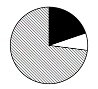

第 99 题 · 答案与解析

**参考答案（粉笔题库参考内容）**

D

**解析**

根据题干“······最能准确反映2022年······占比关系的是”，结合材料时间为2022年，可判定本题为现期比重问题。定位统计图可得：2022年中国储能锂电池出货量为130.0GWh，数码锂电池出货量为48.0GWh，动力锂电池出货量为480.0GWh；定位文字材料可得：2022年中国锂电池出货量658GWh。根据公式：比重，则在2022年中国锂电池出货量中，动力锂电池出货量占比，A项中动力锂电池出货量占比为75%，C项中超过75%，排除A、C两项；储能锂电池出货量（130.0GWh）是数码锂电池出货量（48.0GWh）的2倍多，B项两部分占比相近，排除B项，D项当选。

故正确答案为D。

### 第 100 题

在以下信息中，能够从上述资料中推出的有几项？

①2019-2022年，中国储能锂电池出货量年均增速为3类锂电池中最快

②2019-2022年，中国锂电池出货量逐年增加

③2019-2022年，中国数码锂电池年出货量同比增速逐年下降

④2022年，中国新能源汽车产量同比增速慢于2021年水平

A. 1

B. 2

C. 3

D. 4

第 100 题 · 答案与解析

**参考答案（粉笔题库参考内容）**

C

**解析**

①定位统计图可得，2019年中国储能锂电池、数码锂电池、动力锂电池出货量分别为9.5GWh、36.5GWh、71.0GWh；2022年三者出货量分别为130.0GWh、48.0GWh、480.0GWh。根据年均增长率公式：，当年份差n相同时，直接比较即可。储能锂电池：；数码锂电池：；动力锂电池：，比较可得储能锂电池出货量年均增速最快，正确；

②定位文字材料可得，2022年中国锂电池出货量658GWh；定位统计图可得2019-2021年中国锂电池出货量。2019-2022年中国锂电池出货量分别为：9.5+36.5+71.0=117GWh、16.2+46.2+80.0=142.4GWh、47.7+53.5+226.0=327.2GWh、658GWh。比较可得2019-2022年，中国锂电池出货量逐年增加，正确；

③定位统计图可得2019-2022年中国数码锂电池年出货量，但材料未给出2018年相关数据，无法计算2019年同比增速，故无法判断2020年的增速是否较2019年下降，错误；

④定位统计表可得，2020-2022年中国新能源汽车产量分别为146万辆、368万辆、722万辆。比较增速大小时，当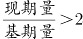，可直接比较，则2021年：368/146\>2；2022年：722/368\<2。即2022年中国新能源汽车产量同比增速慢于2021年水平，正确。

综上所述，说法正确的有3个。

故正确答案为C。

## 材料 3

2023年前5个月，天津口岸出口汽车约17.2万辆，同比增长29.5%，总价值约100.1亿元人民币，同比增长40.2%。

2023年前5个月，汽车出口带动天津口岸整体出口同比增加。汽车出口占同期天津口岸出口商品总值的2.2%，较上年同期提升0.3个百分点。1~5月民营企业出口活力明显，民营企业出口约10.6万辆，同比增长64.3%，占同期天津口岸汽车出口总量的61.6%，占比较上年同期提升13个百分点。新能源汽车出口成为新的增长点，出口约11万辆，同比增长50.2%。

### 第 101 题

2023年1~5月，天津口岸出口商品总值在以下哪个范围内？

A. 不到4000亿元

B. 4000~4400亿元之间

C. 4400~4800亿元之间

D. 4800亿元以上

第 101 题 · 答案与解析

**参考答案（粉笔题库参考内容）**

C

**解析**

根据“2023年1~5月······商品总值······”，结合资料给出了2023年1~5月天津口岸汽车出口总值及其占比，且选项带单位，可判定本题为现期比重问题。定位文字资料第一段可得：2023年前5个月，天津口岸出口汽车总价值约100.1亿元人民币；定位文字资料第二段可得：2023年前5个月，汽车出口占同期天津口岸出口商品总值的2.2%。根据公式：整体，可得所求亿元，在C项范围内。

故正确答案为C。

### 第 102 题

2023年1~5月，民营企业出口汽车同比约增加了多少万辆？

A. 3

B. 4

C. 5

D. 6

第 102 题 · 答案与解析

**参考答案（粉笔题库参考内容）**

B

**解析**

根据题干“······同比约增加了多少万辆”，可判定本题为增长量计算问题。定位文字材料第二段可得：2023年1~5月，民营企业出口汽车约10.6万辆，同比增长64.3%。根据公式：增长量，则题干所求万辆。

故正确答案为B。

### 第 103 题

2022年1~5月，天津口岸出口新能源汽车约占天津口岸出口汽车的：

A. 46%

B. 50%

C. 55%

D. 64%

第 103 题 · 答案与解析

**参考答案（粉笔题库参考内容）**

C

**解析**

根据题干“2022年1~5月······占······”，结合材料时间为2023年前5个月，可判定本题为基期比重问题。定位文字材料第一段可知：2023年前5个月，天津口岸出口汽车约17.2万辆（B），同比增长29.5%（b）。定位文字材料第二段可知：2023年前5个月，天津口岸出口新能源汽车约11万辆（A），同比增长50.2%（a）。根据公式：基期比重，则所求比重。

故正确答案为C。

### 第 104 题

2023年1~5月，天津口岸出口汽车平均单价同比增长率最大的月份是：

A. 1月

B. 2月

C. 4月

D. 5月

第 104 题 · 答案与解析

**参考答案（粉笔题库参考内容）**

B

**解析**

根据题干“······平均单价同比增长率最大······”，可以判定本题为平均数的增长率问题。定位表格可得2023年1~5月天津口岸汽车出口值的同比增速（a）和出口车辆数的同比增速（b），根据公式：平均数的增长率，则2023年1~5月天津口岸出口汽车平均单价同比增长率分别为：1月，；2月，； 4月，；5月，。比较可知，2023年1~5月天津口岸出口汽车平均单价同比增长率最大的月份是2月。

故正确答案为B。

### 第 105 题

在以下信息中，能够从上述资料中推出的有几项？

①2022年1~5月，天津口岸汽车出口量最大的是3月

②2023年1~5月，民营企业月均通过天津口岸出口汽车2万辆以上

③2023年2月，天津口岸出口汽车平均单价高于1月水平

④2022年1~5月，汽车出口总价值占天津口岸出口商品总值的2%以下

A. 1

B. 2

C. 3

D. 4

第 105 题 · 答案与解析

**参考答案（粉笔题库参考内容）**

C

**解析**

①：定位统计表可知2023年1~5月各月天津口岸出口车辆数及其同比增速。根据公式：基期量，则：

2022年1月天津口岸出口车辆数辆；

2022年2月天津口岸出口车辆数辆；

2022年3月天津口岸出口车辆数辆；

2022年4月天津口岸出口车辆数辆；

2022年5月天津口岸出口车辆数辆。

比较发现2022年1~5月，天津口岸汽车出口量最大的是5月，错误；

②：定位文字材料第二段可知，2023年前5个月······民营企业出口约10.6万辆。根据月均，则2023年1~5月，民营企业月均通过天津口岸出口汽车数量万辆，正确；

③：定位统计表可知，2023年1月天津口岸出口车辆29105辆，车辆出口值151198.7万元；2月天津口岸出口车辆22785辆，车辆出口值161250.2万元。根据公式：平均单价，则1月出口单价，2月出口单价，由于前者的分子小且分母大，因此分数较小，即2023年2月，天津口岸出口汽车平均单价高于1月水平，正确；

④：定位文字材料第二段可知，2023年前5个月······汽车出口占同期天津口岸出口商品总值的2.2%，较上年同期提升0.3个百分点。则2022年1~5月，汽车出口总价值占天津口岸出口商品总值的2.2%-0.3%=1.9%<2%，正确。

综上所述，能够从上述资料中推出的有②③④，共3项。

故正确答案为C。

## 材料 4

2023年一季度，新疆外贸进出口总值680.7亿元，同比增长80.3%。其中，出口584.7亿元，同比增长86.9%。3月当月，新疆外贸进出口总值236.9亿元，同比增长70%。其中，出口203.4亿元，同比增长78.9%；进口33.5亿元，同比增长30.8%。

2023年一季度，新疆15个地州市中，乌鲁木齐、喀什、伊犁州、博州和塔城外贸规模居前五，贸易值分别是176.0亿元、142.1亿元、121.9亿元、94.9亿元、33.5亿元，伊犁州、塔城、哈密、克拉玛依、博州增速居前五，同比增速分别为198.4%、183.6%、179.4%、163.3%、150.6%。

2023年一季度，新疆实有备案外贸企业15486家，同比增长6.5%；一季度，新疆有进出口实绩的外贸企业1535家，同比增长12%。新疆民营企业进出口650.1亿元，同比增长94.2%。一季度，新疆国有企业进出口25.7亿元；外商投资企业进出口4.9亿元。

2023年一季度，新疆金属矿及矿砂、未锻轧铜及铜材、煤炭分别进口35.5亿元、11.4亿元、3.7亿元，同比分别增长134.1%、65.3%、79.6%，进口量同比分别增长102.5%、69.4%、78.8%。同期，进口农产品15.2亿元，同比增长20.5%。

### 第 106 题

2022年3月，新疆外贸出口值约为：

A. 126亿元

B. 114亿元

C. 139亿元

D. 160亿元

第 106 题 · 答案与解析

**参考答案（粉笔题库参考内容）**

B

**解析**

根据题干“2022年3月······出口值约为”，结合材料时间为2023年3月，可判定本题为基期计算问题。定位文字材料第一段可得：2023年3月当月，新疆外贸出口203.4亿元，同比增长78.9%。根据公式：基期量，则2022年3月，新疆外贸出口值亿元，对应B项。

故正确答案为B。

### 第 107 题

2023年一季度，新疆外贸规模与增速均居前五的地州市有：

A. 喀什、博州和塔城

B. 伊犁州、博州和塔城

C. 哈密、克拉玛依和博州

D. 伊犁州、博州和乌鲁木齐

第 107 题 · 答案与解析

**参考答案（粉笔题库参考内容）**

B

**解析**

定位文字材料第二段可得：2023年一季度，新疆15个地州市中，乌鲁木齐、喀什、伊犁州、博州和塔城外贸规模居前五；伊犁州、塔城、哈密、克拉玛依、博州增速居前五。故2023年一季度，新疆外贸规模与增速均居前五的地州市有伊犁州、博州和塔城。

故正确答案为B。

### 第 108 题

2023年一季度，新疆有进出口实绩的外贸企业平均每家进出口值同比增长约：

A. 61%

B. 73%

C. 78%

D. 81%

第 108 题 · 答案与解析

**参考答案（粉笔题库参考内容）**

A

**解析**

根据题干 “2023年一季度······平均每家······同比增长约”，可判定本题为平均数的增长率问题。定位文字材料第一、三段可得：2023年一季度，新疆外贸进出口总值680.7亿元人民币，同比增长80.3%（a）；新疆有进出口实绩的外贸企业1535家，同比增长12%（b）。根据公式：平均数的增长率，则题目所求为。

故正确答案为A。

### 第 109 题

2023年一季度，新疆进口的金属矿及矿砂、未锻轧铜及铜材、煤炭合计约占新疆外贸进口值的：

A. 8.6%

B. 16%

C. 43%

D. 53%

第 109 题 · 答案与解析

**参考答案（粉笔题库参考内容）**

D

**解析**

根据题干“2023年一季度······占新疆外贸进口值的”，结合材料时间为2023年一季度，可判定本题为现期比重问题。定位文字材料第一、四段可得：2023年一季度，新疆外贸进出口总值680.7亿元人民币······其中，出口584.7亿元；新疆金属矿及矿砂、未锻轧铜及铜材、煤炭分别进口35.5亿元、11.4亿元、3.7亿元。则2023年一季度新疆外贸进口值为680.7-584.7=96亿元。根据公式：比重，则题干所求为。

故正确答案为D。

### 第 110 题

不能从上述资料中推出的是：

A. 2022年一季度，新疆进口农产品总值超过12亿元

B. 2023年一季度，新疆煤炭进口单价高于上年同期水平

C. 2023年一季度，外贸规模前五的地州市贸易值之和，占新疆外贸进出口总值的比重高于75%

D. 2023年一季度，新疆民营企业进出口总值占新疆外贸进出口总值比重低于上年同期水平

第 110 题 · 答案与解析

**参考答案（粉笔题库参考内容）**

D

**解析**

A项：定位文字材料第四段可得，2023年一季度，新疆······进口农产品15.2亿元，同比增长20.5%。根据公式：基期量，可得2022年一季度新疆进口农产品总值亿元>12亿元，正确；

B项：定位文字材料第四段可得，2023年一季度，新疆煤炭进口3.7亿元，同比增长79.6%（a），进口量同比增长78.8%（b）。根据进口单价，及两期平均数比较结论：当a>b时，平均数上升，可知新疆煤炭进口单价高于上年同期水平，正确；

C项：定位文字材料第一段可得，2023年一季度，新疆外贸进出口总值680.7亿元人民币；定位文字材料第二段可得，2023年一季度······乌鲁木齐、喀什、伊犁州、博州和塔城外贸规模居前五，贸易值分别是176.0亿元、142.1亿元、121.9亿元、94.9亿元、33.5亿元。根据公式：比重，则所求，正确；

D项：定位文字材料第一段可得，2023年一季度，新疆外贸进出口总值······同比增长80.3%（b）；定位文字材料第三段可得，2023年一季度······新疆民营企业进出口650.1亿元，同比增长94.2%（a）。根据两期比重比较结论：当部分增长率（a）>总体增长率（b）时，比重上升。则新疆民营企业进出口总值所占比重高于上年同期水平，并非低于，错误。

本题为选非题，故正确答案为D。

