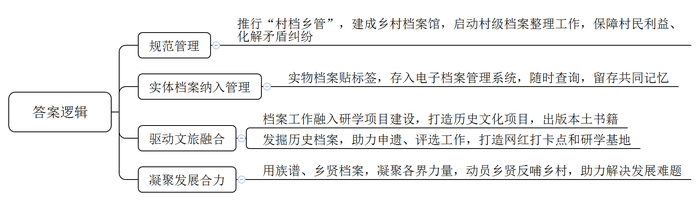
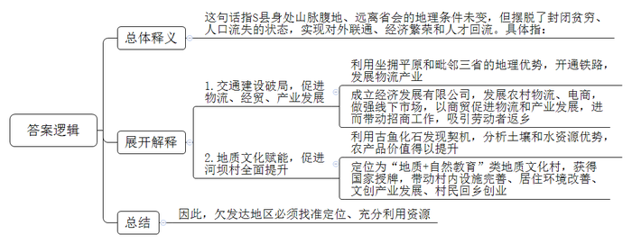
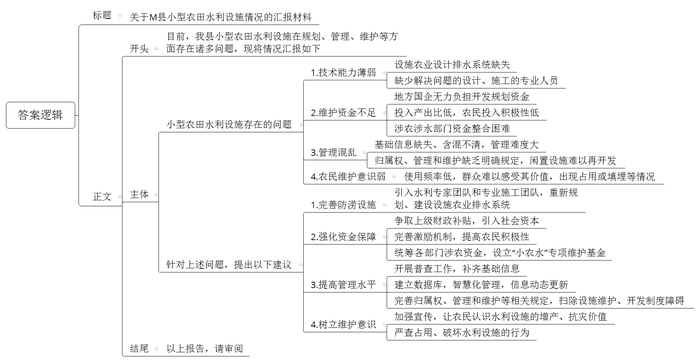
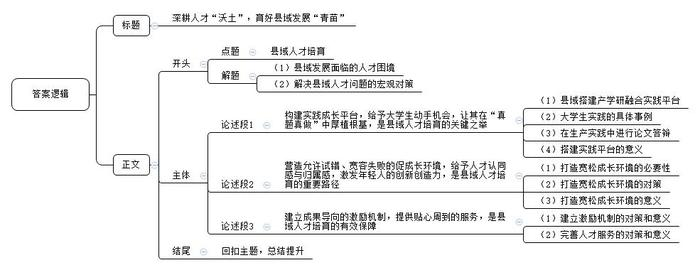

# 2025年公务员多省联考《申论》题（贵州B卷）

<!-- gwy:overview:start -->
> **贵州 · 2025 · 申论 · B类** ｜ 4 题 · 图片 4 处 · 答案随题折叠

导航：[题目](#题目) · [材料 1](#材料-1)
<!-- gwy:overview:end -->

> 候选采集稿。参考答案及解析来自粉笔页面，不代表官方答案或真实高分答卷；来源使用许可与原卷对应关系仍需人工核实。

## 给定材料

### 材料 1

如何让农民均等享受档案服务，W市走在了前面。作为全国第一批档案工作服务农村基层治理试点地区，W市在乡村档案管理工作上探索了近十年。

目前，W市共有2166个行政村实行了“村档乡管”模式，占比73.4%，在此基础上建成了7家乡村档案馆。徽章档案、矾矿档案、蛮话档案……这些藏在乡村档案馆里的特色档案，成为了当地最具辨识度的文化符号。

<u>乡村档案，不仅是岁月留痕，也蕴藏着发展动能。</u>

在C县马武镇乡镇档案馆150多平方米的空间里，竟藏有10447件档案。马武镇党政办主任兼档案馆馆长小方说：“在农村，一份小小的档案可能是保障村民利益、化解矛盾纠纷的关键证据。”2016年，村社档案收集不齐、保管不当带来的突出矛盾问题就引起了档案部门的关注。自此，一场村级档案的整理工作在W市乡镇间探索启动。

2023年，马武镇档案馆建成投用。多年查询自己宅基地档案无果的王先生抱着试试看的心态又来查询，档案馆工作人员找到了一份1982年的老档案，里面就有王先生父亲的宅基地申请表和乡镇的批复。工作人员现场将相关材料复印给王先生，他家的宅基地终于有了合法身份。

在童溪镇档案馆，还收藏有当地非遗传承人捐赠的戏曲盔头等珍贵的实物档案。“实际上，实物档案具有不可复制性，代表一个地方的独特文化，是共同记忆的最好见证。”C县委办档案科唐科长说。

档案不一定要存在档案馆里，只要纳入档案管理，同样能发挥它的功能。在马武镇向阳村文博馆，每一件展品下面都贴了一个序列号。档案管理员给每一件实物档案贴上标签，然后存入电子档案管理系统。无论实物档案保存的位置多偏远，均可一键知全貌。

矾石镇拥有600年明矾开采史。上世纪八九十年代矾矿衰微后，不少矿工带着采矿技艺走出去成长为企业家。矾石镇上有一家矾都矿石馆，里面收藏了600多件矿石样本，采集地遍布全国各地。这些矿石是由40多位矿老板从自己的矿山采集的，每一块矿石都记载了他们在外打拼的足迹，都在诉说一个创业故事。这些历史记忆连同实物档案一起，被纳入了电子档案管理系统。

纳入管理的实物档案是在外的年轻人了解家乡历史最全面、快捷的通道。“天光对应天亮，雪光对应黎明。”出自奎溪镇土话馆保存的《乡谈杂字》，这是一本翻译当地土语的方言工具书。它被录入电子档案管理系统后，人们可以随时查询，当地的方言文化得以更广泛传播。

在R县曹回镇，当地把档案工作融入到省级研学项目建设中。以档案中提取的曹回“八大文化”为内核，打造了进士文化园、花灯公园等系列历史文化项目，串起了“档案故事”，还编辑出版了《曹氏家训》等曹回本土书籍，年均接待研学人员5万多人。

无独有偶，对历史档案的持续性发掘，赋予了C县矾石镇二次生命。矾石镇因明矾而兴，也因明矾而变，一度陷入沉寂。随后，矾石镇转型工业旅游开发，开启了申遗之路。当地组建团队，参考矾矿博物馆、矾都矿石馆等收藏的各类历史档案，编制了《矾矿申遗·工业文化旅游可行性报告》等申遗材料。2017年，矾石镇获评“国家工业遗产”，2020年被评为国家地质公园。随着游客络绎而来，矾矿博物馆、矾都矿石馆也成为了网红打卡点和研学基地。

乡村档案让记忆留存，也凝聚人心。“民间最典型的档案是族谱。”唐科长认为，族谱的存在，有助于宗族团结，而用族谱档案可以凝聚各界力量。马武镇教育设施陈旧，优秀教师流失。2023年，为重振教育，镇里从档案室“乡贤档案”里找来全国各地的乡贤名单，发出求助，马武乡贤们积极响应，短短几个月捐赠了540万元。

一份份乡村档案的收集、整理、规范，也象征着基层社会的和谐稳定、有序发展。“档案，钩沉历史，也经纬当下。”唐科长表示，“我们常在思考，乡村档案管理应该发挥更多的价值。与社会发展紧密结合，为发展、民生服务。”

### 材料 2

深藏武陵山脉腹地的S县，距本省及周边省的省会城市均在500公里以上，是名副其实的“边城”——四面被崇山峻岭包围，既形成了地理上的疏离，更有地形上的隔绝。质朴、恬静的面纱覆盖的，却是贫穷与落后。逃离“边城”，成了不少S县人的人生愿景和目标。

当S县通道经济发展有限公司经理小姚还是个放牛娃时，S县还没有通铁路。那时人们要去本省省会，得先坐大巴车到邻省，再从邻省坐火车到省会，需要三天两夜。

如今的S县已经是一座通向世界的“边城”。崇山峻岭依然在，“边城”从此不再“边”。中欧班列“武陵山号”、西部陆海新通道跨境公路班车往来奔驰，集装箱货场年周转能力提升至10万标箱……这座深山小城的触角早已穿越千山伸向全国，乃至全世界。

通道带物流，物流带经贸，经贸带产业。S县坐拥武陵山区最大的平原，又毗邻三省，拥有发展物流枢纽的独特优势。2012年，铁路通到了S县。2013年，武陵现代物流园区落地S县。

2014年，大学毕业后的小姚入职S县通道经济发展有限公司，协助政府推动武陵现代物流园区发展。他成为第一批助推S县去“边”的人。小姚所在公司团队一方面发展S县农村物流、农村电商，一方面想尽办法做活线下市场，以做商贸，促进物流发展。随着物流园区中副食品、钢材、五金机电、建材等批发市场相继开发完善，S县与外界的货物往来逐渐活跃。

2018年，国内5家主要快递品牌公司先后进驻武陵现代物流园区。

2022年，武陵现代物流园区已有3000余户专业批发市场商户入驻；S县茶叶、金银花、药品加工、纺织等产业得以迅速发展，地区生产总值快速增长，连续3年入选西部百强县。

2023年，广州振华玩具公司的余总接到家乡的招商邀请，但担心S县物流成本高，有点儿犹豫。直到从小姚处得知S县已借助物流集散能力和产业支撑，与中欧物流有限公司、陆海新通道运营有限公司达成合作协议，遂决定在家乡创办分公司。次年2月，“武陵山号”中欧班列满载着余总公司制造的1.41亿个玩具，远赴东欧。此后，东欧的订单纷至沓来。“这里，将是我们扩大海外市场的新起点。”余总说。

S县河坝村是“边城”的边缘村，四面高山，遍地怪石，自然资源匮乏，“逃离”成了村民们的不二选择。

2019年，由中国科学院古脊椎动物与古人类研究所和省地质研究院组成的联合考察队，在河坝村一块石头上发现了一条状似鱼类的痕迹。经考证，这是一条4.23亿年前的全颌盾皮类古鱼，即后来被命名的袖珍边城鱼。对于古生物学界而言，这是世界级的发现。霎那间，这个穷乡僻壤的小山村吸引了全球的目光。

河坝村出了名，村民们却不以为意。他们唯一想知道的是：这个震惊世界的大发现，能给村子和自己带来什么？

考虑到村里的地质结构，省地研院专家团队感觉除了鱼化石外还应该有其他地质资源，便组织了一支专业队伍对村里的土壤和水资源进行检测，测出水资源富锶，土壤富硒，这些检测结果，可以帮助提升当地农产品的价值。

“结合村里的富锶水、富硒土、千丘梯田等资源，我们将河坝村定位为集地质科考科普、研学旅行、民俗体验于一体的‘地质+自然教育’类地质文化村。”省地研院高级工程师老杨说。

2023年11月，河坝村获得了全国地质文化村授牌。打那以后，村民们实实在在感受到了村里的变化：乡村道路拓宽了、农房里里外外焕然一新了。与此同时，村里还建起了科普长廊、科普广场、陈列室等，这些设施里面反复播放着《鱼类的黎明》科普视频、《河坝化石鱼》主题科普MV，还摆放着许多鱼文化主题文具、装饰品等文创产品。不少河坝村外出寻梦的村民陆续回乡创业。年初，有老板投入8000万元在河坝村建设矿泉水厂，还有人准备投资发展民宿产业。

<u>“边城”，还是那座城，但却已不再“边”。</u>

### 材料 3

“大棚根本进不去，里面积水太深。用水泵抽，泵一开，就听见水井口咕嘟咕嘟的上水声，泵一闭，水一下就漫上来了，越抽越进。”2024年8月，一场特大暴雨降临M县，老孙至今都清晰地记得当时自家大棚的情形。

几天过去，地表的积水慢慢退去，但只要用脚轻轻一踩，水即刻渗出地面。老孙发现，只要附近的水库一放水，棚里的水井就跟着涨水。大棚不远处还有一座废弃的方塘，如果方塘涨水，棚内积水就更加严重。邻近的几十个大棚，情况大同小异。

M县N镇的刘镇长介绍说，以前，镇里鼓励大家种果树，不少村子开始修建方塘蓄水。2005年左右，镇里牵头开始引进设施农业，建大棚。他全程参与了设计，“当时考虑的是防旱，从没想过排涝的事。田里也没做什么排水设计，在后续优化中，排水问题也几乎没有纳入考量。再说，防涝也不是随便挖条沟、挖个坑就能解决的事，具体该怎么设计、怎么施工都需要很专业的技术人员，我们没有这个水平。”他坦言，“更恼火的是资金问题，这属于公共设施，村民不可能自己出钱，镇里也没这笔钱。”

2018-2019年，县里对小型农田水利的管理进行了职能调整。“那次调整把‘小农水’的归口管理从水利部门调整到了农业部门，但事走了、人没动，各种资料、手续很多还在水利局。以前信息化、数字化不像现在这样普及，存在基础信息缺失和含混不清等问题。”县政府办王副主任表示，加之近些年的人事变动，使得全县“小农水”管理困难重重。

农业水利专家周教授指出，目前，农田水利公共设施由农业主管部门负责建设，但建成后的归属权、管理和维护问题却缺乏明确的政策规定。

刘镇长说，过去种果树、种粮食的年代，村里会对方塘进行集中管理，定期组织清淤、检查维护泵房。“现在利用率太低了，就没人管了。在别的地方，还有人把坑填了另做他用，我们不敢这么干。之前水库管理局将所辖部分闲置鱼池租赁给驾校，其中20亩左右坑塘水面改建成了硬化训练道路，结果因非法占用被通报了。”

“这些都是历史问题，想要重新管起来太难了。”县水利局陈科长说，水库建设之初，在下游预留了几个坑塘，想着可以养养鱼，职工也可以搞点副业。后来，经历机构改革，水库管理局的建制早已不复存在，水库和相关资产、人员转由地方国企统一管理，但只是清算了工资，根本没钱对坑塘水面和周边土地作进一步的开发和规划。“而且多年历史遗留的产权归属可能也有一定问题，所以就只能搁着，可惜了一块好地方。”

周教授介绍，当前，各地小型农田水利工程，如果被划入高标准农田建设范畴或是几大灌区的主要水利设施，有中央财政参与支持，管理就比较规范，但对于其他农田或者温室大棚这样的设施农业，灌排工作更多还是以农户或者生产经营者自身为主。“农业的投入产出效益比较低，农民对于‘小农水’的投入积极性不高。”他指出，虽然各涉农涉水部门均有相关建设资金，但各自对项目的要求不同，整合起来并不容易。

“要想从根本上解决问题，还必须想方设法让村集体和农户意识到其中潜在的价值。”周教授说，在乡村各类基础设施中，管理维护得最好的是道路。“老百姓几乎每天要走，能每时每刻感受到价值，所以维护意识很强。小型农田水利设施使用频率低，特别在发生涝害几率小的地区，对排水排涝不够重视，经常会看到排水沟里种植作物，还有的因为种地要用大型农机，直接把沟填平了。”

### 材料 4

2022年，N县与B大学携手向全国高校学子发出邀请——将毕业设计“写在”大地上，即以当地经济社会发展的现实需求为题，真题真做，开展全国高校联合毕业设计行动，架起县域人才“桥梁”。

2024年，第三届全国联合毕业设计行动正式启动后，N县围绕城镇更新、艺术乡建、产业升级、文旅开发等领域征集了22个需求，作为毕业设计开题方向。各行各业出题，全国大学生“接招”，实地开题、答题。

L村村口有一面宋代名士浮雕墙，大四学生小李的毕业设计作品《L村公共景观设计》就从这里开始。这个作品以宋代活字印刷为蓝本，将抽象山水和活字版融合造景。这个设计让L村党支部曾书记眼前一亮。“我们就是要将题出得好，并帮助大学生答得妙。”曾书记说。

“我们在镇里的支持下，在全镇的村庄开展了数月调研，找出迫切的、有资金支持的项目，再结合高校和专家的意见，将现实需求转化为可攻关的课题，毕业生则来实地选题、开题。”B大学的王教授介绍，“邀请项目方全程参与，将论文答辩直接搬到项目方所在的田野、村庄或车间，村民、产业工人都可以来凑热闹，现场提问。学生论文呈现方式也不拘一格，可以是设计方案，可以是进行中的工程，也可以是已完成的项目。”

“今年，我们还将毕业设计作品的落地作为考评中最大的加分项，希望以实实在在的成果，打通毕业生和县域的双向接口、满足双向需求。”N县马县长说，三年来，已有36个毕业设计作品落地，另外有28个毕业设计转化为县、镇重大项目配套设计方案。从选题到答题，N县通过一系列的场景重构、流程再造、机制创新，把毕业设计全链条搬进了县城。N县还谋划利用投资、金融等市场化手段加固毕业设计“链条”。马县长指出：“事实上，乡贤基金、教育基金会、创业联盟，都可能成为毕业设计‘造血的力量’。”

最近，某大学视觉传达专业大四学生小秦在N县喜获首批毕业设计“联络官”新身份。这是本次毕业设计行动的创新，邀请出色的毕业设计者代言，建立更加密切的联系与合作。做设计，必须与设计对象相熟相知。来到N县后，小秦每天都出去逛，县城的慢节奏让她沉下心做设计，一待就是一个多月。

“除了不会讲N县话，我已经是半个‘N县通’了，我在这里找到更多自我认同和归属感。”小秦话里话外充满了自豪。在N县的一个多月里，小秦的吃、住、行、调研都有“人才主理人”帮忙安排联络，她沉浸式感受到N县蓬勃的脉动。每年N县还拿出40多万元资金奖励优秀毕业设计作品，奖金覆盖面高达70%，以奖代补，让无数个小秦轻松敲开N县大门。

“最初，我很惊讶也很好奇，是怎样一个地方对大学生这么好！”小秦感叹的背后，是N县精心谋划的一笔人才大账。2015年，N县就提出了“未来人才储备计划”，通过“家燕归巢”“返家乡”寒暑假大学生社会实践等品牌活动，千方百计与N县籍高校毕业生建立链接，而毕业设计行动更是将眼光外拓，吸引外地青年特别是大学毕业生，集纳更广阔的人才资源。

“县域，或许没有充足富集的平台，没有一掷千金的引才实力，但可以给初出茅庐的青年人才提供成长沃土，把‘题’出好，这条路走通了，县域与人才的双向奔赴也就照进了现实。”马县长说，“我们不提要求、不讲条件、不谈结果，只做好服务，并且在毕业设计作品完成后，继续帮他们搭建平台，创造条件。未来县域的产业发展势必更加依赖年轻人，招才引智的目标也将前移。<u>我们应当把更多精力投入在‘种树’上，而非静待成熟再‘摘果’。</u>”

## 题目

### 第 1 题

**“给定资料1”中提到“乡村档案，不仅是岁月留痕，也蕴藏着发展动能”。请你谈谈W市是怎样激发乡村档案蕴藏的发展动能的。（20分）**

关联材料：材料 1

作答要求：

要求：全面、准确、有条理，不超过200字。

第 1 题 · 答案与解析

**参考答案（粉笔题库参考内容）**

1.规范管理。推行“村档乡管”，建成乡村档案馆，启动村级档案整理工作，保障村民利益、化解矛盾纠纷。

2.实体档案纳入管理。实物档案贴标签，存入电子档案管理系统，随时查询，留存共同记忆。

3.驱动文旅融合。档案工作融入研学项目建设，打造历史文化项目，出版本土书籍；发掘历史档案，助力申遗、评选工作，打造网红打卡点和研学基地。

4.凝聚发展合力。用族谱、乡贤档案，凝聚各界力量，动员乡贤反哺乡村，助力解决发展难题。

**解析**

**参考答案说明：**本参考答案从“规范管理”“实体档案纳入管理”“驱动文旅融合”“凝聚发展合力”这四个方面进行了分条撰写。各条答案要点之间在内容上相互并列，没有交叉。

**考点**：概括措施类

**来源**：2025年公务员多省联考《申论》题（贵州B卷）

### 第 2 题

**请根据“给定资料2”，谈谈对“‘边城’，还是那座城，但却已不再‘边’”这句话的理解。（30分）**

关联材料：材料 2

作答要求：

要求：全面、准确、有条理，不超过300字。

第 2 题 · 答案与解析

**参考答案（粉笔题库参考内容）**

这句话指S县身处山脉腹地、远离省会的地理条件未变，但摆脱了封闭贫穷、人口流失的状态，实现对外联通、经济繁荣和人才回流。具体指：

‌ 1.交通建设破局，促进物流、经贸、产业发展。利用坐拥平原和毗邻三省的地理优势，开通铁路，发展物流产业；成立经济发展有限公司，发展农村物流、电商，做强线下市场，以商贸促进物流和产业发展，进而带动招商工作，吸引劳动者返乡。

2.地质文化赋能，促进河坝村全面提升。利用古鱼化石发现契机，分析土壤和水资源优势，农产品价值得以提升；定位为“地质+自然教育”类地质文化村，获得国家授牌，带动村内设施完善、居住环境改善、文创产业发展、村民回乡创业。

因此，欠发达地区必须找准定位、充分利用资源。

**解析**

**参考答案说明**：思路方面，本参考答案按照词句解释题“总体释义+展开解释+总结”的一般答题思路展开。内容方面，本参考答案先对题干给定句子的含义进行了总体解释；然后从“交通建设破局，促进物流、经贸、产业发展”“地质文化赋能，促进河坝村全面提升”这两个方面展开解释；最后进行了总结。词句表达方面，本参考答案加上了“具体指”“因此”等连接词来承接上下文。

**考点**：词句解释类

**来源**：2025年公务员多省联考《申论》题（贵州B卷）

### 第 3 题

**省相关部门近期将派工作组到M县开展小型农田水利设施相关情况调研。假设你是县里的工作人员，请根据“给定资料3”，拟写一份书面汇报材料反映情况，提出建议。（40分）**

关联材料：材料 3

作答要求：

要求：

（1）情况梳理全面、准确；

（2）建议有针对性，切实可行；

（3）条理清晰，语言简洁；

（4）不超过600字。

第 3 题 · 答案与解析

**参考答案（粉笔题库参考内容）**

关于M县小型农田水利设施情况的汇报材料

目前，我县小型农田水利设施在规划、管理、维护等方面存在诸多问题，现将情况汇报如下：

小型农田水利设施存在的问题：1.技术能力薄弱。设施农业设计排水系统缺失；缺少解决问题的设计、施工的专业人员。2.维护资金不足‌。地方国企无力负担开发规划资金；投入产出比低，农民投入积极性低；涉农涉水部门资金整合困难。3.管理混乱。基础信息缺失、含混不清，管理难度大；归属权、管理和维护缺乏明确规定，闲置设施难以再开发。4.农民维护意识弱。使用频率低，群众难以感受其价值，出现占用或填埋等情况。

针对上述问题，提出以下建议：1.完善防涝设施。引入水利专家团队和专业施工团队，重新规划、建设设施农业排水系统。2.强化资金保障。争取上级财政补贴，引入社会资本；完善激励机制，提高农民积极性；统筹各部门涉农资金，设立“小农水”专项维护基金。3.提高管理水平。开展普查工作，补齐基础信息；建立数据库，智慧化管理，信息动态更新；完善归属权、管理和维护等相关规定，扫除设施维护、开发制度障碍。4.树立维护意识。加强宣传，让农民认识水利设施的增产、抗灾价值；严查占用、破坏水利设施的行为。

以上报告，请审阅。

**解析**

**参考答案说明：**（1）格式方面，本参考答案写到了“标题”“正文”两个部分。（2）正文部分，一方面从内容上来看，围绕“小型农田水利设施”这一主题，本参考答案的开头先简单叙述了整体情况；主体部分主要介绍了“问题”和“建议”，其中，“问题”从“技术能力薄弱”“维护资金不足”“管理混乱”“农民维护意识弱”四个方面展开；“建议”从“完善防涝设施”“强化资金保障”“提高管理水平”“树立维护意识”四个方面展开。结尾添加了总结语。另一方面，形式上，本参考答案做到了分段、分条撰写，整体上条理较为清晰。

**考点**：总结类

**来源**：2025年公务员多省联考《申论》题（贵州B卷）

### 第 4 题

**“给定资料4”中提到“我们应当把更多精力投入在‘种树’上，而非静待成熟再‘摘果’”，请根据你对这句话的理解，联系实际，自拟题目，写一篇文章。（60分）**

关联材料：材料 1、材料 2、材料 3、材料 4

作答要求：

要求：

（1）观点明确，见解深刻，内容充实；

（2）参考给定资料，但不拘泥于给定资料；

（3）思路清晰，语言流畅；

（4）字数800-1000字。

第 4 题 · 答案与解析

**参考答案（粉笔题库参考内容）**

**深耕人才“沃土”，育好县域发展“青苗”**

当前，县域发展普遍面临人才匮乏的困境，且与经济发达的大城市相比，也不具备高薪引进成熟人才的优势。县域人才工作需要转变思路，把更多精力投入到“种树”上，将招才引智的目标前移，为初出茅庐的青年人才提供成长的沃土，通过构建良好的人才生态系统，打通毕业生和县城的双向接口、满足双向需求。

**构建实践成长平台，给予大学生动手机会，让其在“真题真做”中厚植根基，是县域人才培育的关键之举。**县域应主动搭建产学研深度融合的实践平台，将地方发展需求转化为可供探索的实际课题，让大学生在真实场景中施展才华、积累经验。从文旅产品的设计研发，到农村公共景观设计，千余名大学生在实践中摸爬滚打，将毕业设计从图纸变为现实。同时，将论文答辩直接搬到项目现场，带领学生深入生产一线，了解流程工艺，打磨设计方案。通过搭建实践平台、构建全链条培育生态，让大学生在实践中积累经验、增长才干，成为县域发展的坚实力量。

**营造允许试错、宽容失败的促成长环境，给予人才认同感与归属感，激发年轻人的创新创造力，是县域人才培育的重要路径。**创新活动本就充满不确定性与风险，若县域一味强调成功、严厉苛责失败，人才必将因畏惧而裹足不前，创新勇气也会被极大抑制。为此，县域应着力打造包容开放的人才发展生态，鼓励人才大胆试错，在挫折中汲取经验。可设立创新风险补偿基金，对契合县域发展方向却未达预期的项目予以扶持。如此宽容的文化氛围，能让人才感受到认同与归属，激发他们持续创新的内生动力，形成“失败-学习-再创新”的良性循环。

**建立成果导向的激励机制，提供贴心周到的服务，是县域人才培育的有效保障。**在激励机制上，要充分认可人才的创新尝试与阶段性成果，给予物质奖励，这不仅能彰显县域对人才的重视，还能向外界释放强烈信号，吸引更多外部人才投身县域发展，形成人才竞相汇聚、蓬勃发展的良好态势。同时，构建精细化人才服务体系，设置人才“主理人”，在吃、住、行及调研等环节打造“一站式”服务闭环，全方位化解人才后顾之忧，营造安心、舒心、暖心的环境，真正实现“此心安处是吾乡”。

“不谋万世者，不足谋一时；不谋全局者，不足谋一域。”县域人才培育是长期系统工程，我们应摒弃急功近利的“摘果”思维，秉持“种树”般的耐心与毅力，助力人才在县域茁壮成长，共绘发展新画卷。

**解析**

**文章分析**

**深耕人才“沃土”，育好县域发展“青苗”**

【**标题的优点：**首先，标题中含有主题词，使文章主题更突出、清晰。其次，形式上采用对称式结构，使标题更加完整、饱满。】

（1）当前，县域发展普遍面临<u>人才匮乏的困境</u>，且与经济发达的大城市相比，也<u>不具备高薪引进成熟人才的优势</u>。（2）县域人才工作需要<u>转变思路</u>，把更多精力投入到“种树”上，<u>将招才引智的目标前移</u>，为初出茅庐的<u>青年人才提供成长的沃土</u>，通过<u>构建良好的人才生态系统</u>，<u>打通毕业生和县城的双向接口、满足双向需求</u>。

【**开头的优点：**★内容方面。范文的开头是紧扣“县域人才培育”这一主题展开的。首先，开头点出主题，做到了主题明确。其次，对“县域人才培育”这一主题进行了分析阐述，指出了：（1）县域发展面临的人才困境；（2）解决县域人才问题的宏观对策。★文字表达方面。长短句配合使用，使语言表达有节奏感。】

**构建实践成长平台，给予大学生动手机会，让其在“真题真做”中厚植根基，是县域人才培育的关键之举。**（1）县域应主动<u>搭建产学研深度融合的实践平台</u>，将地方发展需求转化为<u>可供探索的实际课题</u>，让大学生<u>在真实场景中施展才华、积累经验</u>。（2）从<u>文旅产品的设计研发</u>，到<u>农村公共景观设计</u>，千余名大学生在实践中摸爬滚打，将毕业设计从图纸变为现实。（3）同时，<u>将论文答辩直接搬到项目现场</u>，带领学生<u>深入生产一线</u>，<u>了解流程工艺</u>，<u>打磨设计方案</u>。（4）通过搭建实践平台、构建<u>全链条培育</u>生态，让大学生在实践中<u>积累经验、增长才干</u>，成为县域发展的坚实力量。

【**论述段1的优点：**★观点句：范文的观点句是紧扣“县域人才培育”这一文章主题提出的。形式上，它在段首处直接写出，位置突出，容易发现。内容上，关键词突出，内容要点明确，可以明显看出主要从“构建实践平台”的角度展开论述。★论述内容：（1）县域搭建产学研融合实践平台；（2）大学生实践的具体事例；（3）在生产实践中进行论文答辩；（4）搭建实践平台的意义。注意：以上几个方面的内容都是紧扣“构建实践成长平台，给予大学生动手机会，让其在‘真题真做’中厚植根基，是县域人才培育的关键之举”这个观点句进行分析论述的，论述的针对性强，内容层次丰富。在论述方法上采用了讲道理与举例子相结合的方式，论述充实清晰。】

**营造允许试错、宽容失败的促成长环境，给予人才认同感与归属感，激发年轻人的创新创造力，是县域人才培育的重要路径。**（1）<u>创新</u>活动本就充满<u>不确定性与风险</u>，若县域一味强调成功、严厉苛责失败，人才必将因畏惧而裹足不前，<u>创新勇气也会被极大抑制</u>。（2）为此，县域应着力<u>打造包容开放的人才发展生态</u>，<u>鼓励人才大胆试错</u>，<u>在挫折中汲取经验</u>。可<u>设立创新风险补偿基金</u>，对契合县域发展方向却未达预期的<u>项目予以扶持</u>。（3）如此宽容的<u>文化氛围</u>，能<u>让人才感受到认同与归属</u>，激发他们持续<u>创新的内生动力</u>，形成“失败-学习-再创新”的良性循环。

【**论述段2的优点：**★观点句：范文的观点句是紧扣“县域人才培育”这一文章主题提出的。形式上，它在段首处直接写出，位置突出，容易发现。内容上，关键词突出，内容要点明确，可以明显看出主要从“营造宽松环境”的角度展开论述。★论述内容：（1）打造宽松成长环境的必要性；（2）打造宽松成长环境的对策；（3）打造宽松成长环境的意义。注意：以上几个方面的内容都是紧扣“营造允许试错、宽容失败的促成长环境，给予人才认同感与归属感，激发年轻人的创新创造力，是县域人才培育的重要路径”这个观点句进行分析论述的，论述的针对性强，内容层次丰富。在论述方法上主要采用了讲道理的方式，论述深刻清晰。】

**建立成果导向的激励机制，提供贴心周到的服务，是县域人才培育的有效保障。**（1）在<u>激励机制</u>上，要充分<u>认可人才的创新尝试与阶段性成果</u>，给予<u>物质奖励</u>，这不仅能彰显县域<u>对人才的重视</u>，还能向外界<u>释放强烈信号</u>，吸引更多外部<u>人才投身县域发展</u>，形成人才竞相汇聚、蓬勃发展的良好态势。（2）同时，<u>构建精细化人才服务体系</u>，设置<u>人才“主理人</u>”，在吃、住、行及调研等环节打造“<u>一站式”服务</u>闭环，全方位<u>化解人才后顾之忧</u>，<u>营造安心、舒心、暖心的环境</u>，真正实现“此心安处是吾乡”。

【**论述段3的优点：**★观点句：范文的观点句是紧扣“县域人才培育”这一文章主题提出的。形式上，它在段首处直接写出，位置突出，容易发现。内容上，关键词突出，内容要点明确，可以明显看出主要从“提供激励和服务”的角度展开论述。★论述内容：（1）建立激励机制的对策和意义；（2）完善人才服务的对策和意义。注意：以上几个方面的内容都是紧扣“建立成果导向的激励机制，提供贴心周到的服务，是县域人才培育的有效保障”这个观点句进行分析论述的，论述的针对性强，内容层次丰富。在论述方法上主要采用了讲道理的方式，论述清晰透彻。】

【**论述段之间的关系：**★内容的内在逻辑：范文的论述段之间是依照“并列”的逻辑展开的。论述段1先写了“构建人才实践成长平台”，论述段2再写了“打造包容开放的成长环境”，论述段3接着写了“建立激励机制，提供服务保障”，文章整体论述逻辑清晰。】

“不谋万世者，不足谋一时；不谋全局者，不足谋一域。”县域人才培育是长期系统工程，我们应摒弃急功近利的“摘果”思维，秉持“种树”般的耐心与毅力，助力人才在县域茁壮成长，共绘发展新画卷。

【**结尾的优点：**范文的结尾回扣了“县域人才培育”这个主题，并且进行了总结提升。】

**考点**：文章写作题

**来源**：2025年公务员多省联考《申论》题（贵州B卷）

