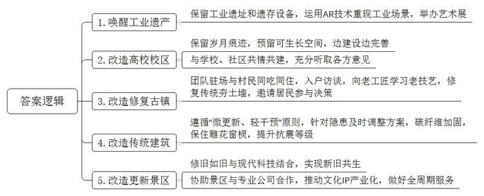
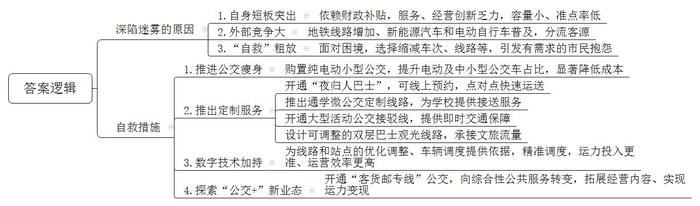
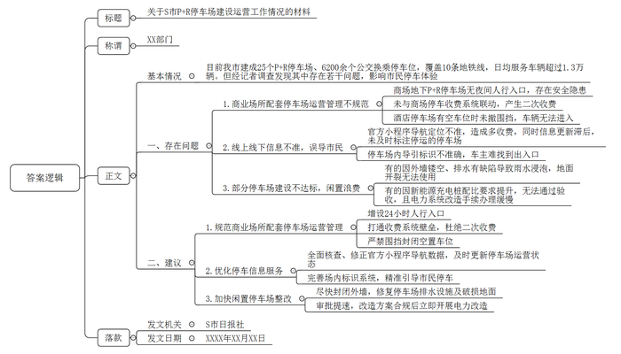
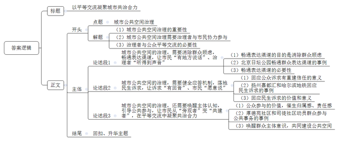

# 2026年公务员多省联考《申论》题（贵州A卷）（网友回忆版）

<!-- gwy:overview:start -->
> **贵州 · 2026 · 申论 · A类** ｜ 4 题 · 图片 4 处 · 答案随题折叠

导航：[题目](#题目) · [材料 1](#材料-1)
<!-- gwy:overview:end -->

> 候选采集稿。参考答案及解析来自粉笔页面，不代表官方答案或真实高分答卷；来源使用许可与原卷对应关系仍需人工核实。

## 给定材料

### 材料 1

城市更新既需要温度，也需要智慧。近年来，C市建筑设计院积极创新城市更新服务理念，探索出一条传承历史、立足当下、引领未来的城市更新之路。

在江南电厂遗址，锈蚀的锅炉与数字光影交织，AR技术重现了上世纪80年代初期的工业场景：运煤轨道车在虚实交织的空气中穿梭，巨型发电机组吞吐能量的轰鸣声仿佛能够穿越时空……这座停摆多年的“能源堡垒”，如今已蜕变为年均举办23场先锋艺术展的“城市能量场”。C市建筑设计院高院长轻触涡轮残骸感慨：“这项工业遗产的唤醒，从立项开始，直到运营，我们团队参与始终，陪伴至今，虽有艰辛，但更多的是欣慰。”

“城市更新是件‘绣花’的细活、慢活，既要做到项目规划时的尽善尽美，也要给建设、运营留有余地，给未来发展留足空间，让‘更好’成为可能。”高院长说。

滨江大学老校区更新后，校区的历史建筑群，灰木吊顶、黄土墙面等承载岁月痕迹的构件被精心保留。在回忆青春岁月的同时，老教授们又享受到了智能系统的便利。“以前供暖制冷能耗高，现在有了智能楼宇系统，能耗降低了30%，使用起来舒适便捷。”一位在此工作30年的老教授感慨道。“老校区的智能楼宇系统，是一边建设一边完善的结果。”高院长坦言。老校区更新规划之初，并没有智能楼宇系统的设想，是C市建筑设计院坚持“项目方案预留10%-15%的‘可生长空间’”原则，与滨江大学和施工方本着历史建筑改造“新旧共生”理念，共同创造的。

老校区改造后，“校园-社区-产业”融合模式打破了物理与心理的围墙。图书馆日均接待市民超500人次，体育馆成为周边居民的健身打卡地；与地方企业共建的产学研平台，已孵化23个科创项目，带动就业超2000人。“产城融合，高校资源反哺城市，这一创新案例，是建筑设计院、学校和所在社区共情共建，充分听取师生和市民意见的结果。”校方负责人表示。

“从江桥古镇改造开始，我们的团队就租下临街民房，和村民吃住在一起。”C市建筑设计院王总建筑师回忆道。通过每日入户访谈，年轻设计师向老工匠学习“糯米灰浆”配方修复传统夯土墙，邀请居民参与决策等，江桥古镇更新具有了坚实的群众基础，商铺出租率从45%跃升至92%，原住民回流率达68%。

“我们经常工作到深夜，有时还会通宵。”回忆起江南饭店的改造，高院长记忆犹新。2018年初，江南饭店改造面临严峻挑战：既要保留越派建筑的精髓，又需满足国际会议的功能需求。设计团队入驻工地实行“三班倒”，发现古建木梁存在虫蛀隐患后，以“微更新、轻干预”为原则，连夜调整方案，采用碳纤维加固技术，既保住雕花窗棂，又将抗震等级提升至8级。最终项目提前3天交付，成为“老建筑改造既好又快”的标杆。

“在城市更新中，我们始终秉持‘长期合伙人’理念，做好全周期服务。”高院长说。在大禹陵景区的系列更新改造中，C市建筑设计院着眼长远发展，既做到修旧如旧，又立足现代科技，实现“新旧共生”。特别是大禹纪念馆的选址与建设，设计团队以现代手法演绎历史人物和重构历史建筑意象，通过悬浮的建筑与镜面水池的映射呼应，刻画出大禹治水“疏而不堵”的伟绩。景区系列更新改造完成后，C市建筑设计院还协助大禹纪念馆与东方文化咨询公司合作，积极推动文化IP产业化。如今，大禹纪念馆年均举办30余场跨界展示，吸引大量年轻观众，历史人物与历史建筑以先锋姿态重获新生。

无论是江南电厂遗址的唤醒、滨江大学老校区的更新，还是江桥古镇的夯土墙保卫战、江南饭店的连夜调整方案与大禹陵景区的文化产业化，这些成功案例都体现了城市更新的温度与智慧。

### 材料 2

“A市快速公交B1线即将结束运营。”罗先生在手机上刷到这条信息时，心中满是不舍。10多年前，18米长的B1公交车载着他一次次往返于市区和大学校园。“车厢里挤得满满当当，那是一段抹不去的记忆。”罗先生怀念道。随着B1驶向终点，陪伴市民20多年的快速公交系统正式关闭。本世纪初，城市版图的扩大，将公共交通推向高速发展的黄金时代。2016年，全市公交客运量达到20亿人次峰值，之后逐年下滑，2024年仅有4.9亿人次。有统计显示，不仅A市，全国城市公交在城市客运体系中运量占比从2019年的54.1%下降到2024年的36.2%。

“作为一种普惠、绿色、集约的交通工具，城市公交有着重要的存在价值，‘公交优先’目前仍是国家的城市发展战略，毕竟，公众出行需求依然旺盛。但不得不承认，作为公益性行业，城市公交凭借‘主角光环’长期依赖财政补贴，在服务品质、经营策略等方面创新乏力，它的黄金时代已经一去不复返。找准自身定位，是城市公交发展迫在眉睫的问题。”A市公路运输管理中心黄主任感叹道。

早在2012年，A市地铁1号线开通首月，B1线的客流量就显著下降。如今，A市地铁运营线路已达12条，运营里程500多公里，日均客流量约400万人次。“轨道交通的容量大、准点率高，与城市公交容量小、准点率低的‘痛点’形成了鲜明对比。”黄主任说。

新年刚过，小程便购置了一辆新能源汽车。“不仅价格和购置税低，还有各种补贴，性价比很高。自己开车上下班时间比较自由，便捷舒适。”小程说。据统计，2012年以来，A市私家车保有量年均增长10%以上，2025年全市新能源汽车保有量突破145万辆，其中，新能源网约车14万辆。

2024年，A市电动自行车保有量已达700万辆，且增长势头迅猛。“这股力量可不容小觑。”黄主任表示，“大家口中的‘小电驴’价格低廉、灵活方便，在通勤距离10公里内‘点对点’的出行场景或交通常态拥堵情形下，具有很强的竞争力。”

当面对外部竞争压力加大和财政补贴收紧，A市公交集团本能地选择缩减车次、线路等，这种粗放式“自救”招致有公交需求的市民抱怨。如何处理好公益性和市场化的平衡，是城市公交平稳驶向未来的关键。

“当务之急是稳住城市公交基本盘，在保障市民出行需求的同时过‘紧日子’。”A市公交集团王总经理介绍，眼下，一项公交“瘦身”计划正在推进，集团新购了531辆纯电动小型公交车，全市车长10米以下的公交车已超过4000辆，电动公交和中小型公交车的占比越来越高，可显著降低燃油、保养等方面成本。

深夜走出地铁，在站台上扫码预约，一会儿便有“夜归人巴士”赶到出站口公交站接你回家，这是地铁1号线长河路站的新场景。长河路站方圆两公里内有10余个小区，上万居民，很多人都要面对夜间“最后一公里”通勤难题。“夜归人巴士”推出后，人们可以线上预约班车，系统会自动生成最优路线，实现“点对点”快速运送。这种响应式“云公交”突破了传统公交的固定发车、定点停靠模式，一经推出便广受好评。仅长河路站的“夜归人巴士”在运营首月就累计服务4000余人次，相比之前的固定班次，客流量上升了40%。“‘夜归人巴士’就像是地铁1号线的站外助手，手中拿着针线，在细微处密密缝合着城市的出行缝隙。”王总经理说。

与“夜归人巴士”几乎同时推出的，还有130多条“红领巾”“小黄帽”微公交定制线路，为数百所中小学、幼儿园提供接送服务，日均服务量5万余人次。在全市足球联赛、演唱会等大型活动期间，公交集团专门开通公交接驳线，提供即时交通保障。随着A市多个文旅项目火爆全国，公交集团紧盯文旅“流量”趋势，设计出多条可随时调整的双层巴士观光线路，让游客在车上观赏城市美景，感受文旅魅力。

“我们的精准‘自救’，离不开数字技术加持。”王总经理说。走进A市公交集团调度大厅，大屏幕实时显示在线营运车辆数、里程数、客流数等数据。“通过系统分析，可以为线路和站点的优化调整、车辆调度提供依据，使运力投入更准、运营效率更高。例如，精准调度后的351路公交线，在运力不变的情况下，平均每天增发50个班次，大大缩短了沿线广大乘客的候车时间。”

在351路始发站，出现一种淡蓝色公交车，车腹下竟装着送往沿线区域的快递包裹。经过有关部门批准，这种“客货邮专线”公交，成为流动在传统公交线上的特殊“快递员”。“城市公交拓展经营内容、实现运力变现，需要‘公交+物流’‘公交+医疗’等‘公交+’的新探索，实现从单纯公交运营向综合性公共服务的转变。”王总经理表示。

近日，在全市推进公交行业高质量发展论坛上，市领导在致辞中指出，A市将以公交网络覆盖全城的优势，进一步发展商超、文旅等各种衍生业务，切实解决好城市公交与城市发展同频共振问题。“只有真正放下‘主角’的架子，主动当好‘配角’，城市公交发展才能冲破‘迷雾’，平稳驶向未来。”王总经理说。

### 材料 3

车主先将车辆停在与地铁站或公交车站连通的专门停车场，再换乘公共交通继续前行，凭交通卡享受停车优惠。这是S市为鼓励市民选择公共交通出行、缓解城市交通压力而设计的一种便捷停车模式——“P+R”，即“停车换乘公共交通”。一经推出，广大市民跃跃欲试。日前，《S市日报》记者调查发现，一些市民对P+R停车的体验感并不太好。

上午10点，蒋女士根据导航和现场指引，将车停入星光商场的地下P+R停车场，然后乘商场直梯进站换乘地铁出行。当晚22点15分左右，她乘地铁返回取车时，却发现星光商场22点就打烊关门了，通往P+R停车场的直梯也随之关闭。“我在商场周边走了两圈也没找到人行入口，只能走车行通道下去，那通道又陡又长，还有多个盘旋弯道，走得我心里直发慌。”蒋女士回忆。记者实地探访发现，现场与蒋女士的描述完全一致，而且车行通道入口明确标有“禁止行人通行”的警示标志，步行入内的确存在安全隐患。

更让蒋女士不解的是：“我在P+R停车场出口闸机处刷交通卡支付了10元，但当我行驶到商场停车场地面出口时，闸机并未自动抬杆，需要再缴50元停车费。”记者后来了解到，蒋女士当时遇到的“二次收费”属于系统故障，可能是因为P+R停车场和商场停车场收费系统没有联动，如果车主遇到“二次收费”，可先拨打值守电话，再由商场工作人员协助放行。

类似的闹心事在某连锁酒店停车场的P+R区域也存在。记者发现，早高峰还没结束，P+R区域的车位就停满了，酒店工作人员此时便会用围挡拦住P+R区域入口。然而，下午2点左右，停在P+R区域的车有一部分已开走，车位是空的，但入口处的围挡并未撤走。正在停车场内徘徊、试图进入P+R区域的车主傅先生吐槽道：“明明看到有空车位，可就是被拦着，这不明摆着让我停外面多交钱吗？到底有没有统一的管理规范？”

开车前往金港路地铁站P+R停车场的车主也有一肚子“苦水”。在“S市停车”官方小程序上，可查询全市P+R停车场的具体位置和车位信息。但记者发现，该小程序会将金港路地铁站P+R停车场入口导航定位至“星港路169号”，即某商场的停车场入口，这距离真正的P+R停车场入口还有大约300米。车主按照导航提示，从非P+R入口进入停车场，虽然也能进出地铁站，但无法通过交通卡付费，只能按照普通停车收费，费用是P+R模式的2-4倍。

更令人困惑的是，金港路地铁站P+R停车场门口居然张贴着“停止运营”告示。记者在现场拨通告示上的电话，对方称“因委托经营合同到期，已不再提供P+R停车服务”。当记者追问为何“S市停车”官方小程序上仍显示该P+R停车场正常运营时，对方称：“我们只是承接了委托管理业务，下一个接手的会怎么做，我们也不清楚。‘S市停车’小程序是官方管理的，他们怎么更新信息，我们也不知道！”

即便是在一些处于正常运营状态的P+R停车场，车主们也常常摸不着头脑。车主郭先生进入人和街停车场，根据场内导引图驶向标有“P+R区域出入口”的闸机，却发现这里实际是P+R充电站区域，可以停放普通燃油车的P+R区域就在不远处，但两个区域被铁栏杆分隔开，互不相通。郭先生下车找到一名停车场管理人员询问，才弄清楚他能进的P+R区域出入口在哪儿。

记者在调查走访中还了解到，有两个P+R停车场建成3个月后，仍未投入使用。其中一个的外墙设计为半镂空，飘进来的雨水积在地面上未及时排出，因雨水浸泡，水泥地面部分已龟裂，个别区域还有刚修补过的痕迹。另一个则迟迟达不到验收标准，因为规划设计时相关规定对停车场新能源充电桩的配比要求仅为5%，建设单位也只给5%的车位预留了电缆，而现在配比要求已升至30%，改造工程不仅需要重新布设电缆，还要对供电系统进行扩容，相关手续仍在办理中。

截至目前，S市已建成25个P+R停车场、6200余个公交换乘停车位，覆盖10条地铁线，日均服务车辆超过1.3万辆。“长远来看，让P+R停车场从各种尴尬处境中走出来，回归便民本质，服务市民出行，势在必行。”S大学公共管理学院杨教授说。

### 材料 4

L市两路区图书馆每层楼走廊尽头靠近茶水间的位置，都放着一本深蓝色的纸质留言簿，几乎每隔一两周就会被写满换新。

过去并不是这样的，留言簿曾多年沉睡在有管理员值守的服务台上，意见寥寥。它更像一本指向明确的工作日志，偶尔也有读者的简短意见：“空调温度太高”“读者制造噪声”“网速太慢”……也偶有工作人员在“处理结果”栏中手写回复，内容同样简短。

直到去年8月，图书馆装修后重开，留言簿偶然间从服务台被放到无人值守的角落。没想到，就是这个不经意的举动，让读者留言井喷，悄然改变了读者与图书馆沟通的方式：有人反映椅子脚架磨损、移动有噪声，馆方立即更换所有被磨损的凳脚；有人说直饮水有异味，馆方便联系两家机构做了水质检测并公示；还有人反映馆内有噪声，工作人员随即加强轮值巡查……

一天，退休的老王发现二楼阅览室很嘈杂：一对带着孩子的夫妻不停讨论，孩子来回跑动，一些老年人在聊天……他起身，走向留言簿，带着些许愤慨，写下关于“噪声问题”的留言。几天后，他在留言簿上看到了回复。“我第一次有‘被注意到’的感觉，这几年和职场隔绝的封闭情绪，突然有了出口。”他说。这次留言后，老王观察到，孩子吵闹的情况有所减少。尽管噪声问题并未彻底解决，但图书馆给了老王作为读者的主体性感受：“原来我的诉求，真的有人在听。”或许，让公众“愿意说”本就比“说什么”更重要。

在三楼的儿童阅读室，不少孩子通过留言簿，上了公共参与的第一课。

13岁的小鸣经常和父母来图书馆看书，她常趁着去三楼茶水间接水的间隙，站在那本深蓝色册子前仔细地翻看。“我看到有人建议增加插座数量，还有人希望延长周末的开放时间。”小鸣看到，几乎每条留言下面都有图书馆工作人员的翔实回复。甚至有稚嫩的笔迹写着“卫生间老事没纸”，馆方不仅纠错回复，还安排保洁加强巡视；也有中学生在留言簿上画图吐槽“小朋友太吵”，馆方同样认真回复将加强引导。

小鸣也有留言的冲动，却不知道该写什么。这或许和她在学校长期养成的习惯有关。她观察到同学们很少主动向老师提建议，避免成为班里“刺头”。“有时觉得食堂饭菜不好吃，大家也都是回家告诉爸妈，由家长去和老师说。”小鸣知道学校有校长信箱，但她从未见身边人用过，“大家都觉得，提了也没什么用吧。”

小鸣的父亲也翻阅过留言册，他平时就关注社情民意的反映，也曾撰写文章被相关部门采纳。“图书馆留言簿成为热点是一件好事，让孩子知道他也是社会的一分子，可以主动参与社会治理，而不是被动接受。”小鸣父亲说。

随着留言量激增，馆方建立了“简单问题3天内书面答复、复杂问题集体讨论”的闭环机制。建馆以来的所有留言簿，工作人员都进行了整理归档、分类保存，放入风琴夹中，作为优化服务标准的“活档案”。更值得一提的是，留言簿逐渐演变为读者间的“公共微论坛”。

留言簿出圈，为城市公共空间治理提供了温馨路径：只有彼此尊重的平等交流，才能让每个人找到归属感，从而把“家”建设得更好。

## 题目

### 第 1 题

**请根据“给定资料1”，概括C市建筑设计院提供城市更新服务的主要做法。（20分）**

关联材料：材料 1

作答要求：

要求：全面、准确、有条理，不超过250字。

第 1 题 · 答案与解析

**参考答案（粉笔题库参考内容）**

1.唤醒工业遗产。保留工业遗址和遗存设备，运用AR技术重现工业场景，举办艺术展。

2.改造高校校区。保留岁月痕迹，预留可生长空间，边建设边完善；与学校、社区共情共建，充分听取各方意见。

3.改造修复古镇。团队驻场与村民同吃同住，入户访谈，向老工匠学习老技艺，修复传统夯土墙，邀请居民参与决策。

4.改造传统建筑。遵循“微更新、轻干预”原则，针对隐患及时调整方案，碳纤维加固，保住雕花窗棂，提升抗震等级。

5.改造更新景区。修旧如旧与现代科技结合，实现新旧共生；协助景区与专业公司合作，推动文化IP产业化，做好全周期服务。

**解析**

**参考答案说明：**本参考答案从“唤醒工业遗产”“改造高校校区”“改造修复古镇”“改造传统建筑”“改造更新景区”五个方面展开，各条答案要点之间在内容上相互并列，没有交叉。

**考点**：概括措施类

**来源**：2026年公务员多省联考《申论》题（贵州A卷）（网友回忆版）

### 第 2 题

**请根据“给定资料2”，分析A市公交集团深陷“迷雾”的原因，并谈谈它是如何“自救”的。（30分）**

关联材料：材料 2

作答要求：

要求：理解准确，分析全面，条理清晰，不超过350字。

第 2 题 · 答案与解析

**参考答案（粉笔题库参考内容）**

深陷迷雾的原因：

1.自身短板突出。依赖财政补贴，服务、经营创新乏力，容量小、准点率低。

2.外部竞争大。地铁线路增加、新能源汽车和电动自行车普及，分流客源。

3.“自救”粗放。面对困境，选择缩减车次、线路等，引发有需求的市民抱怨。

自救措施：

1.推进公交瘦身。购置纯电动小型公交，提升电动及中小型公交车占比，显著降低成本。

2.推出定制服务。开通“夜归人巴士”，可线上预约，点对点快速运送；推出通学微公交定制线路，为学校提供接送服务；开通大型活动公交接驳线，提供即时交通保障；设计可调整的双层巴士观光线路，承接文旅流量。

3.数字技术加持。为线路和站点的优化调整、车辆调度提供依据，精准调度，运力投入更准、运营效率更高。

4.探索“公交+”新业态。开通“客货邮专线”公交，向综合性公共服务转变，拓展经营内容、实现运力变现。

**解析**

**参考答案说明：**本参考答案包括“原因”“措施”两个部分，其中，原因从“自身短板突出”“外部竞争大”“‘自救’粗放”三个方面展开；措施从“推进公交瘦身”“推出定制服务”“数字技术加持”“探索‘公交+’新业态”四个方面展开。各条答案要点之间在内容上相互并列，没有交叉。

**考点**：多要素组合类

**来源**：2026年公务员多省联考《申论》题（贵州A卷）（网友回忆版）

### 第 3 题

**假如你是《S市日报》记者，请根据“给定资料3”，拟写一份反映S市P+R停车场建设运营工作情况的材料，呈送相关部门。（40分）**

关联材料：材料 3

作答要求：

要求：

（1）材料主要包括基本情况、存在问题及建议；

（2）逻辑清晰，语言精练；

（3）不超过600字。

第 3 题 · 答案与解析

**参考答案（粉笔题库参考内容）**

关于S市P+R停车场建设运营工作情况的材料

XX部门：

目前我市建成25个P+R停车场、6200余个公交换乘停车位，覆盖10条地铁线，日均服务车辆超过1.3万辆。但经记者调查发现其中存在若干问题，影响市民停车体验。

一、存在问题：1.商业场所配套停车场运营管理不规范。商场地下P+R停车场无夜间人行入口，存在安全隐患；未与商场停车收费系统联动，产生二次收费；酒店停车场有空车位时未撤围挡，车辆无法进入。2.线上线下信息不准，误导市民。官方小程序导航定位不准，造成多收费，同时信息更新滞后，未及时标注停运的停车场；停车场内导引标识不准确，车主难找到出入口。3.部分停车场建设不达标，闲置浪费。有的因外墙镂空、排水有缺陷导致雨水浸泡，地面开裂无法使用；有的因新能源充电桩配比要求提升，无法通过验收，且电力系统改造手续办理缓慢。

二、建议：1.规范商业场所配套停车场运营管理。增设24小时人行入口；打通收费系统壁垒，杜绝二次收费；严禁围挡封闭空置车位。2.优化停车信息服务。全面核查、修正官方小程序导航数据，及时更新停车场运营状态；完善场内标识系统，精准引导市民停车。3.加快闲置停车场整改。尽快封闭外墙，修复停车场排水设施及破损地面；审批提速，改造方案合规后立即开展电力改造。

S市日报社

XXXX年XX月XX日

**解析**

**参考答案说明：**（1）格式方面，本参考答案写到了“标题”“称谓”“正文”“落款”四个部分。（2）正文部分，一方面从内容上来看，围绕“S市P+R停车场建设运营工作”这一主题，本参考答案的开头先介绍了基本情况。接着主体从“存在问题”“建议”两个方面展开，其中，“存在问题”从“商业场所配套停车场运营管理不规范”“线上线下信息不准，误导市民”“部分停车场建设不达标，闲置浪费”三个层面展开；“建议”从“规范商业场所配套停车场运营管理”“优化停车信息服务”“加快闲置停车场整改”三个层面展开。另一方面，形式上，本参考答案做到了分段分条撰写，整体上条理颇为清晰。

**考点**：总结类

**来源**：2026年公务员多省联考《申论》题（贵州A卷）（网友回忆版）

### 第 4 题

**“给定资料4”中提到，“留言簿出圈，为城市公共空间治理提供了温馨路径：只有彼此尊重的平等交流，才能让每个人找到归属感，从而把‘家’建设得更好。”请深入思考这句话，参考给定资料，联系实际，自选角度，自拟题目，写一篇文章。（60分）**

关联材料：材料 1、材料 2、材料 3、材料 4

作答要求：

要求：

（1）观点明确，见解深刻；

（2）参考给定资料，但不拘泥于给定资料；

（3）思路清晰，语言流畅；

（4）字数1000-1200字。

第 4 题 · 答案与解析

**参考答案（粉笔题库参考内容）**

**以平等交流凝聚城市共治合力**

城市公共空间是市民日常生活的“第二客厅”，其治理品质关乎每个人的归属感与幸福感。一本留言簿因“挪了个位置”便激活了沉寂多年的民意表达，这背后揭示的深层逻辑是：城市公共空间治理，既需要治理者放下身段、真诚倾听，也需要市民卸下顾虑、主动参与。唯有在平等对话中实现双向奔赴，才能让每个人都找到“家”的归属感，凝聚起共建共治的强大合力。

**城市公共空间的治理，需要消除群众顾虑，畅通表达渠道，让市民“有地方说话”、治理者“听得到声音”。**真正的“畅通”，是在群众心里拆除那道看不见的墙，当表达的顾虑横亘于心，开口的勇气便会在一次次欲言又止中消磨殆尽。北京日坛公园在园内设置“园长信箱”二维码，将其张贴在卫生间、步道拐角等游客高频经过处，并公开承诺“8分钟内响应”。市民发现扫码不必面对工作人员审视的目光，留言量从“寥寥无几”变为“建议不断”。治理者唯有以行动证明每一份声音都能被善待，方可真正打消群众的思想顾虑，当“敢说”成为习惯，当“有地方说”成为常态，公共空间才有了倾听民意的基本前提。

**城市公共空间的治理，需要健全应答机制，落地民生诉求，让诉求“有回音”、市民“愿意说”。**回音，是对信任最朴素的回应。若诉求石沉大海，再畅通的渠道也不过是摆设。扬州嘉都汇商业综合体在商场内设立“民情驿站”，市民买菜或喝咖啡时随手便可写下建议，半年收集近百条诉求，全部逐一回应解决；哈尔滨地铁站内的“乘客意见簿”，乘客建议“能否提供临时休息椅”，次日两条长椅便出现在服务台旁。当每一份声音都被认真对待、每一次建议都能看到结果，“愿意说”便会取代“不敢说”，表达才能真正形成良性循环，公共空间的治理也才能在与市民的持续互动中不断趋近完善。

**城市公共空间的治理，还需要唤醒主体认知，引导公共参与，让市民从“旁观者”变“共建者”，在平等交流中凝聚共治合力。**参与本身便是一种赋能，当个体意识到自己的行动能够影响公共事务的走向，归属感与责任感便会在这一认知中悄然生长。无锡锡山区厚德苑社区发动居民参与楼道改造，大家从家中搬来闲置材料亲手设计布置，杂乱楼道变身邻里议事的共享空间；鄂州司徒社区推行“一平米计划”，居民认领闲置空地种花、改造架空层，荒芜角落逐步变身公共活动空间，实现了居民共建共享社区家园。当市民意识到“我的声音有用”，公共空间便不再是“他们”的领地，而是“我们”共同守护的家园。

以平等之声回应每一份诉求，以真诚之行落实每一个建议，让治理者与市民在对话中相互理解、在共治中彼此成就，城市公共空间才能真正成为每个人心之所安的家园。

**文章分析**

**以平等交流凝聚城市共治合力**

【**标题的优点：**首先，标题中含有主题词，使文章主题更突出、清晰。其次，形式上，文字简洁明快。】

（1）城市公共空间是<u>市民日常生活的“第二客厅”</u>，其<u>治理品质关乎每个人的归属感与幸福感</u>。（2）一本留言簿因“挪了个位置”便激活了沉寂多年的民意表达，这背后揭示的深层逻辑是：城市公共空间治理，既需要<u>治理者放下身段、真诚倾听</u>，也需要<u>市民卸下顾虑、主动参与</u>。（3）唯有在<u>平等对话</u>中实现双向奔赴，才能让<u>每个人都找到“家”的归属感</u>，<u>凝聚起共建共治的强大合力</u>。

【**开头的优点：**★内容方面。范文的开头是紧扣“城市公共空间治理”这一主题展开的。首先，开头点出主题，做到了主题明确。其次，对“城市公共空间治理”这一主题进行了分析阐述，指出了：（1）城市公共空间治理的重要性；（2）城市公共空间治理需要治理者与市民协力参与；（3）治理者与公众平等交流的必要性。★文字表达方面。使用了“既……也……”等连接词，使语言表达有逻辑性。】

**城市公共空间的治理，需要消除群众顾虑，畅通表达渠道，让市民“有地方说话”、治理者“听得到声音”。**（1）<u>真正的“畅通”</u>，<u>是在群众心里拆除那道看不见的墙</u>，<u>当表达的顾虑横亘于心</u>，<u>开口的勇气便会在一次次欲言又止中消磨殆尽</u>。（2）<u>北京日坛公园</u>在园内设置“园长信箱”二维码，将其张贴在卫生间、步道拐角等游客高频经过处，并公开承诺“8分钟内响应”。市民发现扫码不必面对工作人员审视的目光，留言量从“寥寥无几”变为“建议不断”。（3）<u>治理者唯有以行动证明每一份声音都能被善待</u>，<u>方可真正打消群众的思想顾虑</u>，<u>当“敢说”成为习惯</u>，<u>当“有地方说”成为常态</u>，<u>公共空间才有了倾听民意的基本前提</u>。

【**论述段1的优点：**★观点句：范文的观点句是紧扣“城市公共空间治理”这一文章主题提出的。形式上，它在段首处直接写出，位置突出，容易发现。内容上，关键词突出，内容要点明确，可以明显看出主要从“畅通表达渠道”的角度展开论述。★论述内容：（1）畅通表达渠道的目的是消除群众顾虑；（2）北京日坛公园畅通群众表达渠道的事例；（3）畅通表达渠道的必要性。注意：以上三个方面的内容都是紧扣“城市公共空间的治理，需要消除群众顾虑，畅通表达渠道，让市民‘有地方说话’、治理者‘听得到声音’”这个观点句进行分析论述的，论述的针对性强，内容层次丰富。在论述方法上采用了讲道理与举例子相结合的方式，论述充实清晰。】

**城市公共空间的治理，需要健全应答机制，落地民生诉求，让诉求“有回音”、市民“愿意说”。**（1）<u>回音</u>，<u>是对信任最朴素的回应</u>。<u>若诉求石沉大海</u>，<u>再畅通的渠道也不过是摆设</u>。（2）<u>扬州嘉都汇</u>商业综合体在商场内设立“民情驿站”，市民买菜或喝咖啡时随手便可写下建议，半年收集近百条诉求，全部逐一回应解决；<u>哈尔滨地铁</u>站内的“乘客意见簿”，乘客建议“能否提供临时休息椅”，次日两条长椅便出现在服务台旁。（3）<u>当每一份声音都被认真对待</u>、<u>每一次建议都能看到结果</u>，<u>“愿意说”便会取代“不敢说”</u>，<u>表达才能真正形成良性循环</u>，<u>公共空间的治理也才能在与市民的持续互动中不断趋近完善</u>。

【**论述段2的优点：**★观点句：范文的观点句是紧扣“城市公共空间治理”这一文章主题提出的。形式上，它在段首处直接写出，位置突出，容易发现。内容上，关键词突出，内容要点明确，可以明显看出主要从“落地民生诉求”的角度展开论述。★论述内容：（1）回应公众诉求有重建信任的意义；（2）扬州嘉都汇和哈尔滨地铁回应民生诉求的事例；（3）回应民生诉求的价值和意义。注意：以上三个方面的内容都是紧扣“城市公共空间的治理，需要健全应答机制，落地民生诉求，让诉求‘有回音’、市民‘愿意说’”这个观点句进行分析论述的，论述的针对性强，内容层次丰富。在论述方法上采用了讲道理与举例子相结合的方式，论述充实有力。】

**城市公共空间的治理，还需要唤醒主体认知，引导公共参与，让市民从“旁观者”变“共建者”，在平等交流中凝聚共治合力。**（1）<u>参与本身便是一种赋能</u>，<u>当个体意识到自己的行动能够影响公共事务的走向</u>，<u>归属感与责任感便会在这一认知中悄然生长</u>。（2）<u>无锡锡山区厚德苑社区</u>发动居民参与楼道改造，大家从家中搬来闲置材料亲手设计布置，杂乱楼道变身邻里议事的共享空间；<u>鄂州司徒社区</u>推行“一平米计划”，居民认领闲置空地种花、改造架空层，荒芜角落逐步变身公共活动空间，实现了居民共建共享社区家园。（3）<u>当市民意识到“我的声音有用”</u>，<u>公共空间便不再是“他们”的领地</u>，<u>而是“我们”共同守护的家园</u>。

【**论述段3的优点：**★观点句：范文的观点句是紧扣“城市公共空间治理”这一文章主题提出的。形式上，它在段首处直接写出，位置突出，容易发现。内容上，关键词突出，内容要点明确，可以明显看出主要从“引导公共参与”的角度展开论述。★论述内容：（1）公众参与能够催生归属感、责任感；（2）厚德苑社区和司徒社区动员群众参与公共事务的事例；（3）唤醒群众主体意识，共同建设公共空间。注意：以上三个方面的内容都是紧扣“城市公共空间的治理，还需要唤醒主体认知，引导公共参与，让市民从‘旁观者’变‘共建者’，在平等交流中凝聚共治合力”这个观点句进行分析论述的，论述的针对性强，内容层次丰富。在论述方法上采用了讲道理与举例子相结合的方式，论述充实深刻。】

【**论述段之间的关系：**★内容的内在逻辑：范文的论述段之间是依照“递进”的逻辑展开的。论述段1先写了“畅通表达畅渠道”，论述段2再写了“落地民生诉求”，论述段3接着写了“引导公共参与”，三个论述段层层递进，逻辑清晰。】

以平等之声回应每一份诉求，以真诚之行落实每一个建议，让治理者与市民在对话中相互理解、在共治中彼此成就，城市公共空间才能真正成为每个人心之所安的家园。

【**结尾的优点：**范文的结尾回扣了“城市公共空间治理”这个主题，并且进行了总结提升。】

**解析状态：unknown（来源未提供）**

**考点**：文章写作题

**来源**：2026年公务员多省联考《申论》题（贵州A卷）（网友回忆版）

