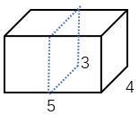
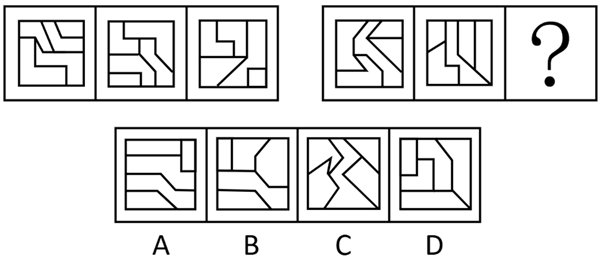
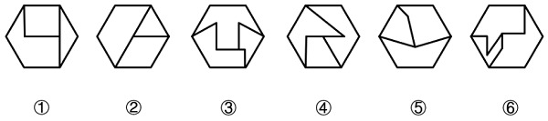
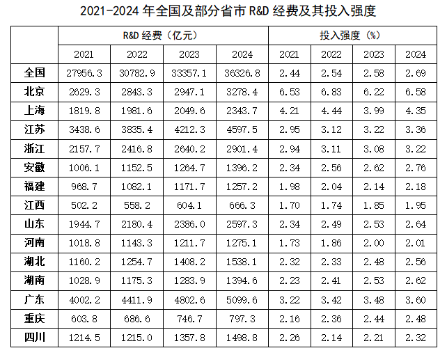
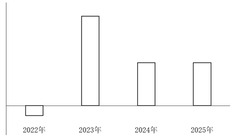

# 2026年贵州省公务员录用考试《行测》题（网友回忆版）

<!-- gwy:overview:start -->
> **贵州 · 2026 · 行测 · 统考** ｜ 110 题 · 图片 29 处 · 答案随题折叠

| 题型模块 | 题量 | 题号 |
| --- | ---: | ---: |
| 政治理论 | 10 | 1–10 |
| 常识判断 | 10 | 11–20 |
| 言语理解与表达 | 26 | 21–46 |
| 数量关系 | 14 | 47–60 |
| 判断推理 | 30 | 61–90 |
| 资料分析 | 20 | 91–110 |
| **合计** | **110** | |

导航：[题型与作答说明](#题型与作答说明) · [题目](#题目) · [材料 1](#材料-1)
<!-- gwy:overview:end -->

> 候选采集稿。参考答案及解析来自粉笔页面，不代表官方答案或真实高分答卷；来源使用许可与原卷对应关系仍需人工核实。

## 题型与作答说明

政治理论

（10题）

根据题目要求，在四个选项中选出一个最恰当的答案。

常识判断

（10题）

根据题目要求，在四个选项中选出一个最恰当的答案。

言语理解与表达

（26题）

本部分包括表达与理解两方面的内容。请根据题目要求，在四个选项中选出一个最恰当的答案。

数量关系

（14题）

在这部分试题中，每道题呈现一段表述数字关系的文字，要求你迅速、准确地计算出答案。

判断推理

（30题）

本部分包括图形推理、定义判断、类比推理与逻辑判断四种类型的试题，在四个选项中选出一个最恰当的答案。

资料分析

（20题）

所给出的图、表、文字或综合性资料均有若干个问题要你回答。你应根据资料提供的信息进行分析、比较、计算和判断处理。

## 题目

### 第 1 题

习近平总书记强调，学习好贯彻好党的二十届四中全会精神，是当前和今后一个时期全党全国的一项重大政治任务。关于党的二十届四中全会精神，下列表述正确的是（ ）。

A. 把捍卫经济安全摆在首位，加强重点领域国家安全能力建设，突出保障事关国家长治久安、经济健康稳定、人民安居乐业的重大安全

B. 坚定不移推动高质量发展，构建以新兴产业和未来产业为骨干的现代化产业体系

C. 坚定不移扩大高水平对外开放，做强国内国际大循环，加快构建新发展格局

D. 加强普惠性、基础性、兜底性民生建设，稳步推进基本公共服务均等化

第 1 题 · 答案与解析

**参考答案（粉笔题库参考内容）**

D

**解析**

本题考查新思想。

2025年10月23日，党的二十届四中全会审议通过了《中共中央关于制定国民经济和社会发展第十五个五年规划的建议》（以下简称《建议》）。

A项错误，《建议》在：“十三、推进国家安全体系和能力现代化，建设更高水平平安中国”部分指出：“（50）加强重点领域国家安全能力建设。锻造实战实用的国家安全能力，突出保障事关国家长治久安、经济健康稳定、人民安居乐业的重大安全，把捍卫政治安全摆在首位······”故“把捍卫经济安全摆在首位”表述错误，应为“把捍卫政治安全摆在首位”。

B项错误，《建议》在“三、建设现代化产业体系，巩固壮大实体经济根基”部分指出：“······坚持把发展经济的着力点放在实体经济上，坚持智能化、绿色化、融合化方向，加快建设制造强国、质量强国、航天强国、交通强国、网络强国，保持制造业合理比重，构建以先进制造业为骨干的现代化产业体系。故“以新兴产业和未来产业为骨干”表述错误，应为“以先进制造业为骨干”。

C项错误，2026年1月1日出版的第1期《求是》杂志发表了习近平总书记的重要文章《学习好贯彻好党的二十届四中全会精神》。文章指出：“第二，加快构建新发展格局。做强国内大循环、畅通国内国际双循环，是我们把握发展主动权、塑造国际合作和竞争新优势的战略举措······坚定不移扩大高水平对外开放，维护多边贸易体制······”故“做强国内国际大循环”表述错误，应为“做强国内大循环”。

D项正确，《建议》在“十一、加大保障和改善民生力度，扎实推进全体人民共同富裕”部分指出：“实现人民对美好生活的向往是中国式现代化的出发点和落脚点。坚持尽力而为、量力而行，加强普惠性、基础性、兜底性民生建设······（44）稳步推进基本公共服务均等化。建立基本公共服务均等化评价标准，完善基本公共服务范围和内容，制定实现基本公共服务均等化的目标、路径、措施······”

故正确答案为D。

**考点**：经济建设、重要文件

**来源**：2026年贵州省公务员录用考试《行测》题（网友回忆版）第1题

### 第 2 题

党的二十届四中全会提出，加快农业农村现代化，扎实推进乡村全面振兴。下列与之相关说法正确的是（ ）。

①坚持把解决好“三农”问题作为全党工作重中之重

②统筹发展科技农业、绿色农业、质量农业、品牌农业

③稳定土地承包关系，稳步推进三轮承包到期后再延长三十年试点

④因地制宜完善乡村建设实施机制，分类有序、一体化推进乡村振兴

⑤健全财政优先保障、金融重点倾斜、社会积极参与的多元投入格局，确保乡村振兴投入力度不断增强

A. ①②③

B. ①②⑤

C. ①②④⑤

D. ②③④⑤

第 2 题 · 答案与解析

**参考答案（粉笔题库参考内容）**

B

**解析**

本题考查新思想。

2025年10月23日，《中共中央关于制定国民经济和社会发展第十五个五年规划的建议》发布，以下简称《建议》。

①正确，《建议》在“八、加快农业农村现代化，扎实推进乡村全面振兴”部分指出：“坚持把解决好‘三农’问题作为全党工作重中之重，促进城乡融合发展，持续巩固拓展脱贫攻坚成果，推动农村基本具备现代生活条件，加快建设农业强国。”

②正确，③错误，《建议》在“八、加快农业农村现代化，扎实推进乡村全面振兴”部分指出：“（25）提升农业综合生产能力和质量效益。坚持产量产能、生产生态、增产增收一起抓，统筹发展科技农业、绿色农业、质量农业、品牌农业，把农业建成现代化大产业······稳定土地承包关系，稳步推进二轮承包到期后再延长三十年试点。”故③中“三轮承包”表述错误，应为“二轮承包”。

④错误，《建议》在“八、加快农业农村现代化，扎实推进乡村全面振兴”部分指出：“（26）推进宜居宜业和美乡村建设。学习运用‘千万工程’经验，因地制宜完善乡村建设实施机制，分类有序、片区化推进乡村振兴，逐步提高农村基础设施完备度、公共服务便利度、人居环境舒适度。”故“一体化”表述错误，应为“片区化”。

⑤正确，《建议》在“八、加快农业农村现代化，扎实推进乡村全面振兴”部分指出：“（27）提高强农惠农富农政策效能。健全财政优先保障、金融重点倾斜、社会积极参与的多元投入格局，确保乡村振兴投入力度不断增强。保护和调动农民务农种粮积极性，强化价格、补贴、保险等政策支持和协同。”

故①②⑤表述正确。

故正确答案为B。

**考点**：经济建设、重要文件

**来源**：2026年贵州省公务员录用考试《行测》题（网友回忆版）第2题

### 第 3 题

网络生态治理是网络强国建设的重要任务，事关国家发展和安全，事关人民群众切身利益。关于健全网络生态治理长效机制，下列说法错误的是：

A. 坚持把普惠作为第一动力、把安全作为底线要求、把创新作为价值追求，高质量推进网络生态治理

B. 完善网上思想道德教育分众化、精准化实施机制，培育自尊自信、理性平和、积极向上的网络社会心态

C. 坚持以正面声音、主流价值、时代新风塑造网络空间，使互联网成为思想引领、道德培育、文化传承的重要阵地

D. 加强国际传播网络平台和能力建设，利用互联网传播中国声音、讲好中国故事，生动展现可信、可爱、可敬的中国形象

第 3 题 · 答案与解析

**参考答案（粉笔题库参考内容）**

A

**解析**

本题考查新思想。

A项错误，2024年11月20日，习近平总书记向2024年世界互联网大会乌镇峰会开幕视频致贺时指出：“我们应当把握数字化、网络化、智能化发展大势，把创新作为第一动力、把安全作为底线要求、把普惠作为价值追求，加快推动网络空间创新发展、安全发展、普惠发展，携手迈进更加美好的‘数字未来’。”故“把普惠作为第一动力”“把创新作为价值追求”表述错误，应为“把创新作为第一动力”“把普惠作为价值追求”。

B项正确，2025年11月28日下午，中共中央政治局就加强网络生态治理进行第二十三次集体学习，习近平总书记主持学习并发表重要讲话（以下简称讲话）指出：“网络生态治理是一项系统工程，要充分调动各方力量，综合运用教育、行政、法治等多种手段。要完善网上思想道德教育分众化、精准化实施机制，培育自尊自信、理性平和、积极向上的网络社会心态。”

C项正确，讲话指出：“源清则流清，要坚持以正面声音、主流价值、时代新风塑造网络空间，使互联网成为思想引领、道德培育、文化传承的重要阵地。要深化党的创新理论网上宣传，大力弘扬社会主义核心价值观，推出更多有内涵、有温度、有影响的网络作品。”

D项正确，讲话指出：“要积极参与国际规则制定，携手各国打击网络违法犯罪，推动构建网络空间命运共同体。要加强国际传播网络平台和能力建设，利用互联网传播中国声音、讲好中国故事，生动展现可信、可爱、可敬的中国形象。”

本题为选非题，故正确答案为A。

**考点**：重要会议讲话、社会建设

**来源**：2026年贵州省公务员录用考试《行测》题（网友回忆版）第3题

### 第 4 题

习近平总书记指出，在长期实践中，中国和中亚国家探索形成了“互尊、互信、互利、互助，以高质量发展推进共同现代化”的“中国—中亚精神”。下列属于其独特精神内涵的是（ ）。

①坚持相互尊重、平等相待，国家不分大小一视同仁，有事大家商量着办，协商一致作决策

②坚持互利共赢、共同发展，互为优先伙伴，互予发展机遇，兼顾各方利益，实现多赢共生

③坚持普惠包容、和谐共生，中国将大力支持中亚国家能源绿色低碳发展，不再新建境外煤电项目

④坚持深化互信、同声相应，坚定支持彼此维护国家独立、主权、领土完整和民族尊严，不做任何损害彼此核心利益的事

⑤坚持守望相助、同舟共济，支持彼此走符合国情的发展道路，办好自己的事情，合力应对各类风险挑战，共同维护地区安全稳定

A. ①②④

B. ①②④⑤

C. ①③④⑤

D. ②③④⑤

第 4 题 · 答案与解析

**参考答案（粉笔题库参考内容）**

B

**解析**

本题考查新思想。

①②④⑤正确，③错误，当地时间2025年6月17日下午，第二届中国—中亚峰会在阿斯塔纳独立宫举行。中国国家主席习近平在发表主旨发言时表示，在长期实践中，我们探索形成了“互尊、互信、互利、互助，以高质量发展推进共同现代化”的“中国—中亚精神”：坚持相互尊重、平等相待，国家不分大小一视同仁，有事大家商量着办，协商一致作决策；坚持深化互信、同声相应，坚定支持彼此维护国家独立、主权、领土完整和民族尊严，不做任何损害彼此核心利益的事；坚持互利共赢、共同发展，互为优先伙伴，互予发展机遇，兼顾各方利益，实现多赢共生；坚持守望相助、同舟共济，支持彼此走符合国情的发展道路，办好自己的事情，合力应对各类风险挑战，共同维护地区安全稳定。

故正确答案为B。

**考点**：重要会议讲话、其他建设

**来源**：2026年贵州省公务员录用考试《行测》题（网友回忆版）第4题

### 第 5 题

习近平总书记指出，要提高政治判断力、政治领悟力、政治执行力，主动识变求变应变，强化全局视野和系统思维，加强改革政策统筹、进度统筹、效果统筹，发挥改革整体效应。这一论述最能体现马克思主义的哪些基本观点？

①实践是检验真理的唯一标准

②系统的存在依赖于要素之间的相关性中产生的有机统一体

③质变是量变的必然结果，量变达到一定程度必然引起质变

④尊重客观规律是正确发挥主观能动性的前提

A. ①②

B. ②④

C. ①③

D. ③④

第 5 题 · 答案与解析

**参考答案（粉笔题库参考内容）**

B

**解析**

本题考查马克思主义。

①错误，“实践是检验真理的唯一标准”强调的是实践作为检验真理标准的绝对性、确定性，即认识是否是真理，只有通过实践来检验，此外再无别的检验真理的办法。题干强调的是“提高政治能力”“主动识变求变应变”“强化全局视野和系统思维”以及“加强改革政策统筹”，并未直接提及实践作为检验真理的标准。

②正确，“系统的存在依赖于要素之间的相关性中产生的有机统一体”强调的是整体性和各要素之间的相互关联，即系统思维。题干中“强化全局视野和系统思维”“加强改革政策统筹、进度统筹、效果统筹”“发挥改革整体效应”体现的是系统思维，即系统是由相互关联的要素组成的有机整体，统筹协调才能发挥整体效应。

③错误，“质变是量变的必然结果，量变达到一定程度必然引起质变”讨论的是量变与质变的关系。题干强调的是“强化全局视野和系统思维”“发挥改革整体效应”等系统思维，并未涉及量变和质变相关哲学原理。

④正确，“尊重客观规律是正确发挥主观能动性的前提”是指只有从客观实际出发，尊重客观规律，按客观规律办事，才能正确地发挥人的主观能动性，最终实现人们预期的目的。题干中“主动识变求变应变”中的“识变”意味着尊重和认识客观规律和变化，“求变应变”是在尊重规律基础上发挥主观能动性。同时，“提高政治能力”都需要在尊重规律的前提下发挥主观能动性。

综上，②④正确。

故正确答案为B。

**考点**：唯物论

**来源**：2026年贵州省公务员录用考试《行测》题（网友回忆版）第5题

### 第 6 题

习近平总书记指出，全面依法治国是国家治理的一场深刻革命，关系党执政兴国，关系人民幸福安康，关系党和国家长治久安。关于全面依法治国，下列说法正确的是（ ）。

①全面依法治国是中国特色社会主义的本质要求和重要保障

②全面依法治国要坚持依法治国、依法执政、依法行政共同推进

③全面依法治国要坚持法治国家、法治政府、法治社会一体建设

④全面依法治国要坚持依法治国和依规治党有机统一

A. ①②③

B. ①②④

C. ②③④

D. ①②③④

第 6 题 · 答案与解析

**参考答案（粉笔题库参考内容）**

D

**解析**

本题考查新思想。

①②③④正确，2017年10月18日，党的十九大报告在“三、新时代中国特色社会主义思想和基本方略”部分指出：“（六）坚持全面依法治国。全面依法治国是中国特色社会主义的本质要求和重要保障······坚持依法治国、依法执政、依法行政共同推进，坚持法治国家、法治政府、法治社会一体建设，坚持依法治国和以德治国相结合，依法治国和依规治党有机统一，深化司法体制改革，提高全民族法治素养和道德素质。”

故正确答案为D。

**考点**：其他建设

**来源**：2026年贵州省公务员录用考试《行测》题（网友回忆版）第6题

### 第 7 题

习近平总书记指出，加快构建全国统一大市场，着力整治一些领域的“内卷式”竞争。关于深刻认识和综合整治“内卷式”竞争，下列说法正确的是（ ）。

A. “内卷式”竞争的根源是我国的人口基数过大

B. “内卷式”竞争是市场经济发展的必然现象

C. “内卷式”竞争会带来资源耗损、无序竞争

D. 整治“内卷式”竞争要从严从实从快

第 7 题 · 答案与解析

**参考答案（粉笔题库参考内容）**

C

**解析**

本题考查新思想。

2025年7月，《求是》杂志发表《深刻认识和综合整治“内卷式”竞争》（以下简称文章）。

A项错误，文章指出，作为当前经济发展中的突出现象，“内卷式”竞争的形成原因具有多维性和复杂性，涉及企业、行业、政府多个方面，既有经济发展和技术进步等规律性因素，也有深层次体制机制问题，还有经济主体的路径依赖等原因，是多种因素综合形成的。由此可见，“内卷式”竞争与人口基数无直接关联。

B项错误，文章指出，市场配置资源是最有效率的形式，竞争是市场经济运行的重要机制。通过竞争优化资源配置、实现优胜劣汰，倒逼企业不断创新技术、改善经营管理，进而提高经济运行效率，促进经济发展、技术进步，这是市场经济的优势所在······市场竞争有利于提高资源配置效率，可一旦竞争过了头、越了界，演变成无序“内卷”，就会扭曲市场机制、破坏市场公平，造成诸多负面影响。因此，竞争过度是市场经济演进中的阶段性问题，并非“必然现象”。

C项正确，文章指出，现实中，“内卷式”竞争表现不同、特征各异，主要涉及企业和地方政府两类行为主体······从地方政府行为看，“内卷式”竞争主要表现为：一是为招引企业、培育产业，人为制造政策洼地，违规实施税费、补贴、用地等不公平非普惠的优惠政策，导致无序竞争；二是不顾地方产业基础和资源禀赋情况，盲目上马新兴产业、重点产业，造成行业内大量重复建设和生产过剩；三是为保护本地市场、扶持本地企业，设置或明或暗的市场壁垒，区别对待各类企业，破坏公平竞争秩序。故“内卷式”竞争会带来资源耗损、无序竞争说法正确。

D项错误，文章指出，整治“内卷式”竞争是一项复杂的系统性工程，不可能一蹴而就、一招制胜，需要遵循经济规律，汇集各方力量，多管齐下，综合整治。故“从快”表述错误。

故正确答案为C。

**考点**：经济建设

**来源**：2026年贵州省公务员录用考试《行测》题（网友回忆版）第7题

### 第 8 题

2025年12月，中央经济工作会议在北京举行，部署了2026年经济工作。下列与之相关说法正确的是（ ）。

A. 增强中央转移支付力度，帮助地方政府积极有序化解债务风险

B. 加强财政科学管理，逐步降低财政赤字、债务总规模和支出总量

C. 继续实施适度宽松的货币政策，把物价合理回升作为货币政策重要考量

D. 持续深化资本市场投融资综合改革，扩大中小金融机构增量，优化存量

第 8 题 · 答案与解析

**参考答案（粉笔题库参考内容）**

C

**解析**

本题考查新思想。

2025年12月10日至11日，中央经济工作会议在北京举行。中共中央总书记、国家主席、中央军委主席习近平出席会议并发表重要讲话。

A项错误，会议指出：“坚持守牢底线，积极稳妥化解重点领域风险。着力稳定房地产市场，因城施策控增量、去库存、优供给，鼓励收购存量商品房重点用于保障性住房等。深化住房公积金制度改革，有序推动‘好房子’建设。加快构建房地产发展新模式。积极有序化解地方政府债务风险，督促各地主动化债，不得违规新增隐性债务。优化债务重组和置换办法，多措并举化解地方政府融资平台经营性债务风险。”故“增强中央转移支付力度”表述错误，化解地方债务风险的核心责任一般在地方政府。

B项错误，C项正确，会议指出：“明年经济工作在政策取向上，要坚持稳中求进、提质增效，发挥存量政策和增量政策集成效应，加大逆周期和跨周期调节力度，提升宏观经济治理效能。要继续实施更加积极的财政政策。保持必要的财政赤字、债务总规模和支出总量，加强财政科学管理，优化财政支出结构，规范税收优惠、财政补贴政策······要继续实施适度宽松的货币政策。把促进经济稳定增长、物价合理回升作为货币政策的重要考量，灵活高效运用降准降息等多种政策工具，保持流动性充裕，畅通货币政策传导机制······”故B项中“逐步降低财政赤字、债务总规模和支出总量”表述错误，应为“保持必要的财政赤字、债务总规模和支出总量”。

D项错误，会议指出：“坚持改革攻坚，增强高质量发展动力活力。制定全国统一大市场建设条例，深入整治‘内卷式’竞争。制定和实施进一步深化国资国企改革方案，完善民营经济促进法配套法规政策。加紧清理拖欠企业账款。推动平台企业和平台内经营者、劳动者共赢发展。拓展要素市场化改革试点。健全地方税体系。深入推进中小金融机构减量提质，持续深化资本市场投融资综合改革。”故“扩大中小金融机构增量，优化存量”表述错误，应为“深入推进中小金融机构减量提质”。

故正确答案为C。

**考点**：经济建设、重要会议讲话

**来源**：2026年贵州省公务员录用考试《行测》题（网友回忆版）第8题

### 第 9 题

2025年底，中共中央政治局召开民主生活会强调，锲而不舍落实中央八项规定精神，以优良作风凝心聚力真抓实干。关于作风问题，下列说法不准确的是（ ）。

A. 作风问题核心是党同人民群众的关系问题

B. 党强大的人格力量集中体现为党的优良作风

C. 透过党性看作风，在解决党性问题的基础上解决好作风问题

D. 抓作风建设，重点突出坚定理想信念、践行根本宗旨、加强道德修养

第 9 题 · 答案与解析

**参考答案（粉笔题库参考内容）**

C

**解析**

本题考查新思想。

2025年3月，中共中央党史和文献研究院编辑的《习近平关于加强党的作风建设论述摘编》出版发行，以下简称《论述摘编》。

A项正确，《论述摘编》中“三、作风问题核心是党同人民群众的关系问题”部分指出：“作风问题核心是党同人民群众的关系问题。马克思主义政党执政后特别是长期执政后的最大危险是脱离群众。”

B项正确，《论述摘编》中“一、党的作风关系人心向背，决定党和国家事业成败”部分指出：“我们党作为马克思主义执政党，不但要有强大的真理力量，而且要有强大的人格力量。真理力量集中体现为我们党的正确理论，人格力量集中体现为我们党的优良作风。”

C项错误，《论述摘编》中“二、作风问题本质上是党性问题”部分指出：“我们改进作风，不能简单就事论事，以为把眼前存在的作风问题从面上解决了就万事大吉了，而是要举一反三，透过作风看党性，在解决作风问题的基础上解决好党性问题。”故“透过党性看作风”说法错误，应为“透过作风看党性”。

D项正确，《论述摘编》中“二、作风问题本质上是党性问题”部分指出：“作风问题本质上是党性问题。抓作风建设，就要返璞归真、固本培元，重点突出坚定理想信念、践行根本宗旨、加强道德修养。”

本题为选非题，故正确答案为C。

**考点**：其他建设

**来源**：2026年贵州省公务员录用考试《行测》题（网友回忆版）第9题

### 第 10 题

《中共中央关于制定国民经济和社会发展第十五个五年规划的建议》提出，要如期实现建军一百年奋斗目标，高质量推进国防和军队现代化。下列举措不属于高质量推进国防和军队现代化的是（ ）。

A. 壮大战略威慑力量，维护全球战略平衡和稳定

B. 全面落实勤俭建军方针，走高效益、低成本、可持续发展路子

C. 建设先进国防科技工业体系，优化国防科技工业布局，推进军民标准通用化

D. 完善涉外国家安全机制，构建海外安全保障体系，加强反制裁、反干预、反“长臂管辖”斗争

第 10 题 · 答案与解析

**参考答案（粉笔题库参考内容）**

D

**解析**

本题考查新思想。

2025年10月23日，中国共产党第二十届中央委员会第四次全体会议通过《中共中央关于制定国民经济和社会发展第十五个五年规划的建议》（以下简称《建议》）。

A项正确，《建议》在“十四、如期实现建军一百年奋斗目标，高质量推进国防和军队现代化”部分指出：“（53）加快先进战斗力建设。壮大战略威慑力量，维护全球战略平衡和稳定。推进新域新质作战力量规模化、实战化、体系化发展，加快无人智能作战力量及反制能力建设，加强传统作战力量升级改造。”

B项正确，《建议》在“十四、如期实现建军一百年奋斗目标，高质量推进国防和军队现代化”部分指出：“（54）推进军事治理现代化······加强重大决策咨询评估和重大项目监管，推进军费预算管理改革，改进军事采购制度，完善军队建设统计评估体系，全面落实勤俭建军方针，走高效益、低成本、可持续发展路子。持续深化政治整训，弘扬优良传统，加强重点行业和领域整肃治理。”

C项正确，《建议》在“十四、如期实现建军一百年奋斗目标，高质量推进国防和军队现代化”部分指出：“（55）巩固提高一体化国家战略体系和能力。深化跨军地改革，构建各司其职、紧密协作、规范有序的跨军地工作格局。加快新兴领域战略能力建设，推动新质生产力同新质战斗力高效融合、双向拉动。建设先进国防科技工业体系，优化国防科技工业布局，推进军民标准通用化。”

D项错误，《建议》在“十三、推进国家安全体系和能力现代化，建设更高水平平安中国”部分指出：“（49）健全国家安全体系······落实国家安全责任制，促进全链条全要素协同联动，形成体系合力。完善涉外国家安全机制，构建海外安全保障体系，加强反制裁、反干预、反‘长臂管辖’斗争，深化国际执法安全合作，推动完善全球安全治理。强化国家安全教育，筑牢人民防线。”故该项不属于“高质量推进国防和军队现代化”举措。

本题为选非题，故正确答案为D。

**考点**：其他建设

**来源**：2026年贵州省公务员录用考试《行测》题（网友回忆版）第10题

### 第 11 题

下列诗句描述的现象与气象变化对应错误的是：

A. 雨中百草秋烂死，阶下决明颜色鲜——软雹

B. 白雪却嫌春色晚，故穿庭树作飞花——倒春寒

C. 风驱急雨洒高城，云压轻雷殷地声——雷阵雨

D. 北风卷地白草折，胡天八月即飞雪——冷锋过境

第 11 题 · 答案与解析

**参考答案（粉笔题库参考内容）**

A

**解析**

本题考查地理国情。

A项错误，“雨中百草秋烂死，阶下决明颜色鲜”出自唐代杜甫的《秋雨叹三首·其一》，意思是秋雨连绵百草烂死，台阶下的决明却颜色正鲜。诗句中秋雨现象主要由冷锋活动引起。当北方冷空气南下时，与较暖湿的空气相遇，冷空气迫使暖湿空气抬升，形成云系和降水。故诗句描写的气象变化是连绵秋雨，不是软雹。

B项正确，“白雪却嫌春色晚，故穿庭树作飞花”出自唐代韩愈的《春雪》，意思是白雪也嫌春色来得太晚了，所以有意化作花儿在庭院树间穿飞。诗句中描写的这种春季气温偏低、出现降雪或霜冻的天气，是典型的倒春寒。

C项正确，“风驱急雨洒高城，云压轻雷殷地声”出自明代刘基的《五月十九日大雨》，意思是疾风驱使着骤雨瞬间洒落高城，乌云密布，雷声滚滚，大地仿佛都在震动。故诗句描写的是夏季典型的雷阵雨天气。

D项正确，“北风卷地白草折，胡天八月即飞雪”出自唐代岑参的《白雪歌送武判官归京》，意思是北风席卷大地把白草吹折，胡地天气八月就纷扬落雪。北风带来寒冷空气，使气温骤降并出现降雪，这是冷锋过境的典型表现。

本题为选非题，故正确答案为A。

**考点**：自然地理

**来源**：2026年贵州省公务员录用考试《行测》题（网友回忆版）第11题

### 第 12 题

下列与电有关说法正确的是（ ）。

A. 风力发电利用了电磁感应原理，水力发电没有

B. 电动机是能够把电能转换成机械能的一种装置

C. 微波炉加热食品是电流的热效应在生活中的应用

D. “摩擦生电”是因为在两个物体间产生了新的电荷

第 12 题 · 答案与解析

**参考答案（粉笔题库参考内容）**

B

**解析**

本题考查科技常识。

A项错误，风力发电是利用风机叶片转动带动发电机转子切割磁力线，从而产生感应电流，其基本原理是电磁感应；水力发电同样是利用水流推动水轮机转动，带动发电机转子切割磁力线产生感应电流，同样基于电磁感应原理。因此，风力发电和水力发电都利用了电磁感应原理。

B项正确，电动机是一种能够将电能转化为机械能的装置，其工作原理是通电导体在磁场中受到力的作用而运动，从而输出机械能。

C项错误，微波炉加热食品是利用微波（一种电磁波）使食物中的水分子和脂肪分子高速振动、相互摩擦而产生热量，这属于电磁能向热能的转化；电流的热效应是指电流通过导体时使导体发热的现象（如电炉、电热毯），微波炉不属于电流的热效应在生活中的应用。

D项错误，“摩擦生电”的本质是两种不同材料相互摩擦时，电子从一个物体转移到另一个物体，使一个物体带正电、另一个物体带负电，这是电荷的转移过程，而非“产生了新的电荷”。电荷既不能创造也不能消灭，只能从一个物体转移到另一个物体。

故正确答案为B。

**考点**：物理常识

**来源**：2026年贵州省公务员录用考试《行测》题（网友回忆版）第12题

### 第 13 题

下列李白所作诗句描述的名山与现在我国的地理分区对应错误的是（ ）。

A. 西上太白峰，夕阳穷登攀——西北地区

B. 我有万古宅，嵩阳玉女峰——华中地区

C. 日照香炉生紫烟，遥看瀑布挂前川——华东地区

D. 衡山苍苍入紫冥，下看南极老人星——华南地区

第 13 题 · 答案与解析

**参考答案（粉笔题库参考内容）**

D

**解析**

本题考查地理国情。

A项正确，“西上太白峰，夕阳穷登攀”出自唐代李白的《登太白峰》，意思是向西攀登太白峰，在日落时分才登上峰巅。诗句中的“太白峰”即太白山，又称太乙山、太一山，是秦岭山脉的主峰，位于陕西省宝鸡市眉县、太白县、周至县交界处，按照通用行政地理分区标准，陕西省属于西北五省之一（陕、甘、宁、青、新）。

B项正确，“我有万古宅，嵩阳玉女峰”出自唐代李白的《送杨山人归嵩山》，意思是我有万古不坏的仙宅，那就是嵩山之阳的玉女峰。诗句中“嵩阳”指嵩山之南；“玉女峰”为嵩山支脉太皇山二十四峰之一，因峰北有石如女而得此名。嵩山主体位于河南省登封市境内，按照通用分区标准，河南省属于华中三省之一（豫、鄂、湘）。

C项正确，“日照香炉生紫烟，遥看瀑布挂前川”出自唐代李白的《望庐山瀑布》，意思是太阳照耀香炉峰生出袅袅紫烟，远远望去瀑布像长河悬挂山前。诗句描述的主体是庐山，位于江西省九江市庐山市境内，按照通用分区标准，江西省属于华东七省一市之一（上海、江苏、浙江、安徽、福建、江西、山东与台湾）。

D项错误，“衡山苍苍入紫冥，下看南极老人星”出自唐代李白的《与诸公送陈郎将归衡阳》，意思是衡山在夜色的天空下愈发苍翠，从山上俯视着南方升起的老人星。诗句描述的主体是衡山，位于湖南省衡阳市南岳区境内，按照通用分区标准，湖南省属于华中三省之一（豫、鄂、湘）。

本题为选非题，故正确答案为D。

**考点**：中国地理

**来源**：2026年贵州省公务员录用考试《行测》题（网友回忆版）第13题

### 第 14 题

水是生命之源、生态之基、生产之要，更是文明之本，在中华民族的文明发展史上，水始终占据着特殊的地位。下列与水有关的说法错误的是：

A. 《尚书·禹贡》是与河流密切相关的著作

B. “兵无常势，水无常形”是孙武论兵的名言

C. “坎坎伐檀兮，置之河之干兮”出自《诗经》

D. 最早提出“水能载舟、亦能覆舟”的是唐太宗

第 14 题 · 答案与解析

**参考答案（粉笔题库参考内容）**

D

**解析**

本题考查人文常识。

A项正确，《尚书·禹贡》是中国古代地理学的重要文献，被认为是第一篇具有系统性地理观念的著作，《禹贡》以自然地理实体（山脉、河流等）为标志，将全国划分为9个区（即九州），并对每区（州）的疆域、山脉、河流、植被、土壤、物产、贡赋、少数民族、交通等自然和人文地理现象作了简要描述。此外，《禹贡》还分述了导山、导水、水功和以京都为中心的五服制度，其内容与河流密切相关。

B项正确，“兵无常势，水无常形”出自《孙子·虚实篇》，意思是用兵作战要根据敌情的变化来采取灵活机动的战略战术，不能墨守某种作战方法。

C项正确，“坎坎伐檀兮，置之河之干兮”出自《诗经·伐檀》，意思是砍伐檀树声坎坎啊，把砍到的檀树一棵棵堆放在河边。

D项错误，“水能载舟、亦能覆舟”最早出自于战国时期荀子及其弟子所著的《荀子·王制》，内容是：“《传》曰：‘君者，舟也；庶人者，水也。水则载舟，水则覆舟’。”后世据此典故引申出成语“水能载舟，亦能覆舟”。贞观六年，唐太宗与群臣论治国之道，提出：“天子者，有道则人推而为主，无道则人弃而不用，诚可畏也。”魏征接着说道：“臣又闻古语云：君，舟也；人，水也。水能载舟，亦能覆舟。陛下以为可畏，诚如圣旨。”

本题为选非题，故正确答案为D。

**考点**：文学常识

**来源**：2026年贵州省公务员录用考试《行测》题（网友回忆版）第14题

### 第 15 题

关于我国航空探月技术，下列说法错误的是（ ）。

A. 空间站的温控系统采用流体回路以使温度保持适宜

B. 嫦娥五号在月表展示的国旗采用有机刚性纤维制成

C. 嫦娥四号的“腿”所用“嫦娥钢”兼具至刚至柔特性

D. 鹊桥二号中继星采用前所未有的环月大椭圆冻结轨道

第 15 题 · 答案与解析

**参考答案（粉笔题库参考内容）**

B

**解析**

本题考查科技常识。

A项正确，中国空间站在太空运行时，会面临极端温差环境，向阳面温度极高、背阳面温度极低，为保证舱内设备与航天员适宜的工作生活温度，空间站采用了流体回路温控系统。该系统通过特殊导热流体在管路内循环流动，均匀收集、传递和散发热量，配合辐射散热、主动控温等技术，实现全舱段温度精准稳定调控，确保各类科学实验设备正常运转、航天员生命安全得到可靠保障，是空间站长期在轨运行的关键温控技术之一。

B项错误，2020年11月24日，长征五号遥五运载火箭搭载嫦娥五号探测器成功发射升空并将其送入预定轨道。嫦娥五号搭载并在月球表面成功展示的国旗，是我国首次在月表实现独立展示的国旗。这面国旗主要采用国产高性能芳纶纤维材料，该面料在极端紫外条件下展现出优良的耐日晒牢度，同时从根本上解决了极端条件下颜料热升华及热迁移牢度的问题。故“有机刚性纤维”表述错误，应为“高性能芳纶纤维”。

C项正确，嫦娥四号是中国探月工程二期发射的月球探测器，也是人类第一个着陆月球背面的探测器。嫦娥四号着陆器于2019年1月3日在月球背面预选区着陆，其着陆缓冲机构，也就是俗称的“腿”，采用了特制的“嫦娥钢”合金材料。这种特种钢材同时具备极高的结构强度与优异的韧性，即“至刚至柔”特性，“刚”可保证着陆支撑结构稳定可靠，“柔”能在着陆瞬间有效吸收巨大冲击能量，大幅降低着陆器与月面接触时的震动与损伤，为软着陆全过程提供关键安全保障。

D项正确，2024年3月20日8时31分，鹊桥二号中继卫星由长征八号遥三运载火箭在中国文昌航天发射场成功发射升空。鹊桥二号中继星采用环月大椭圆冻结轨道作为使命轨道，这是中国探月工程中首次使用该类型轨道。由于月球外形结构不规则，靠近月球飞行的航天器受到月球引力等因素作用，飞行轨道易产生偏差。环月大椭圆冻结轨道是处于稳定状态的环月轨道，航天器在该轨道飞行，能够使飞行轨道的偏差最小化。选择环月大椭圆冻结轨道作为使命轨道，不仅能提高鹊桥二号的通信速率，大幅提高对月球南极区域的通信覆盖能力，还可以节省卫星燃料，让鹊桥二号可以在该轨道上长期驻留。

本题为选非题，故正确答案为B。

**考点**：科技理论与成就

**来源**：2026年贵州省公务员录用考试《行测》题（网友回忆版）第15题

### 第 16 题

下列关于鸦片战争和第二次鸦片战争说法错误的是：

A. 鸦片战争是英、法两国联合发动的侵略战争

B. 电影《火烧圆明园》以第二次鸦片战争为背景

C. 第二次鸦片战争迫使清政府签订了《天津条约》

D. “三元里前声若雷，千众万众同时来”与鸦片战争有关

第 16 题 · 答案与解析

**参考答案（粉笔题库参考内容）**

A

**解析**

本题考查人文常识。

A项错误，1840年，英国为扭转对华贸易逆差，向中国走私鸦片，林则徐虎门销烟成为战争借口，英国发动鸦片战争；1856-1860年，英法等国为进一步打开中国市场、扩大侵略权益，以“修约”被拒为借口，发动第二次鸦片战争。故英、法两国联合发动鸦片战争表述错误，鸦片战争（第一次鸦片战争）是英国单独发动的。

B项正确，火烧圆明园发生在第二次鸦片战争期间，1860年，英法联军攻占北京，抢劫并焚毁圆明园。电影《火烧圆明园》正是以第二次鸦片战争为背景。

C项正确，第二次鸦片战争中，清政府被迫与英、法、俄、美四国签订《天津条约》；与英国、法国、俄国签订《北京条约》等。

D项正确，选项诗句出自清代爱国诗人张维屏的七言古诗《三元里》，写于1841年，歌颂三元里抗英斗争。诗句意思为：“三元里村前，民众呐喊声如雷鸣，成千上万的人从各处一同赶来，奋起反抗英国侵略者。”第一次鸦片战争期间，英军在广州三元里一带骚扰作恶，激起民众反抗，三元里人民自发组织起来围歼英军，是近代中国第一次大规模民间反侵略斗争。

本题为选非题，故正确答案为A。

**考点**：中国历史

**来源**：2026年贵州省公务员录用考试《行测》题（网友回忆版）第16题

### 第 17 题

在我国，驾驶证、社会保障卡、居民身份证和护照等属于依法可以证明身份的证件。下列与之相关说法正确的是（ ）。

A. B1驾驶证的准驾车型不包括家用小型汽车

B. 社会保障卡具备办理工伤和失业事务的功能

C. 居民身份证号码的最后一位数字用来表示性别

D. 中华人民共和国普通护照的签发机关为外交部

第 17 题 · 答案与解析

**参考答案（粉笔题库参考内容）**

B

**解析**

本题考查科技常识。

A项错误，B1驾驶证，是《机动车驾驶证申领和使用规定》中规定的一种驾驶证类别，它是准驾中型载客汽车（核载10-19人）的法定证照，并可驾驶C1、C2、C3、C4及M类车型。家用小型汽车属于C1准驾范围，故B1驾驶证的准驾车型包括家用小型汽车。

B项正确，社会保障卡是劳动者在劳动保障领域办事的电子凭证。持卡人可以凭卡就医，进行医疗保险个人账户结算；可以凭卡办理养老保险事务；可以凭卡到相关部门办理求职登记和失业登记手续，申领失业保险金，申请参加就业培训；可以凭卡申请劳动能力鉴定和申领享受工伤保险待遇等。

C项错误，公民身份号码由18位数字构成，前6位为根据《行政区划代码管理办法》确定的行政区划代码，第7至14位为出生日期码，第15至17位为顺序码（第17位兼具性别标识功能，奇数代表男性，偶数代表女性），第18位（最后一位）为校验码（按ISO 7064：1983标准生成，数值10用罗马数字X表示）。

D项错误，因私普通护照是中华人民共和国国家移民管理局签发给因定居、探亲、学习、就业、旅行、商务活动等非公务原因出国的中国公民的旅行证件，持照人可凭该护照证明国籍和身份。中华人民共和国国家移民管理局受中华人民共和国公安部管理，而非受外交部管理。

故正确答案为B。

**考点**：生活常识

**来源**：2026年贵州省公务员录用考试《行测》题（网友回忆版）第17题

### 第 18 题

下列关于我国古代绘画说法错误的是：

A. “妙手丹青”中包含两种矿物染料

B. 《清明上河图》是纸本水墨画

C. “胸有成竹”是苏轼对文同的评价

D. “点染”是一种古代绘画技法

第 18 题 · 答案与解析

**参考答案（粉笔题库参考内容）**

B

**解析**

本题考查人文常识。

A项正确，“妙手丹青”中的“丹青”确实指代两种矿物染料。“丹”指朱砂，是一种红色的矿物颜料；“青”指石青（如蓝铜矿）或曾青，是一种蓝色的矿物颜料。因此，该成语字面上包含了两种矿物染料，用来借代绘画艺术。

B项错误，《清明上河图》是由北宋画家张择端绘制的长卷，其绘制材质是“绢”（一种丝织品），而非纸张。同时，画作中运用了色彩渲染，属于“设色”作品，而非单纯的水墨画。因此《清明上河图》并非纸本水墨画，而是绢本设色风俗画。

C项正确，“胸有成竹”出自苏轼的《文与可画筼筜谷偃竹记》，是苏轼评价表兄文同（文与可）画竹时，心中先有完整意象，再下笔作画，因此是苏轼对文同的评价。

D项正确，“点染”是中国古代的一种绘画技法。根据记载，北齐颜之推在《颜氏家训·杂艺》中提到“武烈太子偏能写真，坐上宾客，随宜点染，即成数人”。在古代画论中，“点染无法”也被列为绘画十二忌之一，指设色时点染不得法，可见其作为一种技法的客观存在。

本题为选非题，故正确答案为B。

**考点**：文化常识

**来源**：2026年贵州省公务员录用考试《行测》题（网友回忆版）第18题

### 第 19 题

根据《中华人民共和国村民委员会组织法》，下列说法错误的是（ ）。

A. 需由村民会议或者村民代表会议决定的重要事项，应当先经村党组织研究讨论

B. 村民委员会具有基层群众性自治组织法人资格，村民委员会主任为法定代表人

C. 村民委员会成员实行近亲属回避，根据具体情况吸纳妇女成员

D. 村民委员会应当设立村务公开栏，公布的期限不得少于十五日

第 19 题 · 答案与解析

**参考答案（粉笔题库参考内容）**

C

**解析**

本题考查法律常识。

A项正确，根据《中华人民共和国村民委员会组织法》第二十八第三款规定：“需由村民会议或者村民代表会议决定的重要事项，应当先经村党组织研究讨论。”

B项正确，根据《中华人民共和国村民委员会组织法》第十三条规定：“村民委员会具有基层群众性自治组织法人资格，村民委员会主任为法定代表人。村民委员会可以从事为履行职能所需要的民事活动，但是不得提供担保。”

C项错误，根据《中华人民共和国村民委员会组织法》第八条第二款规定：“村民委员会成员中，应当有妇女成员。村民委员会成员实行近亲属回避。”因此，村民委员会成员中应当有妇女成员，并非根据具体情况吸纳妇女成员。

D项正确，根据《中华人民共和国村民委员会组织法》第三十五条第四款规定：“村民委员会应当设立村务公开栏，可以采用现代信息技术进行村务公开。公布的期限不得少于十五日。村民委员会应当保证公布事项的真实性，并接受村民的查询。”

本题为选非题，故正确答案为C。

**考点**：其他法律法规

**来源**：2026年贵州省公务员录用考试《行测》题（网友回忆版）第19题

### 第 20 题

甲因琐事纠纷将乙打伤，经当地人民调解委员会调解，双方达成调解协议，约定甲向乙支付医疗费等共计5000元。事后甲拒绝履行该协议。对此，下列相关说法正确的是（ ）。

A. 乙可依据该调解协议直接向人民法院申请强制执行

B. 乙只能就原人身损害事实另行提起侵权损害赔偿诉讼

C. 乙有权依据该调解协议向人民法院提起诉讼，请求判令甲履行协议

D. 甲有权主张该调解协议内容显失公平，向人民法院申请撤销该协议

第 20 题 · 答案与解析

**参考答案（粉笔题库参考内容）**

C

**解析**

本题考查法律常识。

A项错误，根据《中华人民共和国人民调解法》第三十三条第一、二款规定：“经人民调解委员会调解达成调解协议后，双方当事人认为有必要的，可以自调解协议生效之日起三十日内共同向人民法院申请司法确认，人民法院应当及时对调解协议进行审查，依法确认调解协议的效力。人民法院依法确认调解协议有效，一方当事人拒绝履行或者未全部履行的，对方当事人可以向人民法院申请强制执行。”题中，该调解协议未经过司法确认，不具有强制执行力，乙不能直接申请强制执行。

B项错误，C项正确，根据《中华人民共和国人民调解法》第三十二条规定：“经人民调解委员会调解达成调解协议后，当事人之间就调解协议的履行或者调解协议的内容发生争议的，一方当事人可以向人民法院提起诉讼。”题中，乙既可以就原人身损害提起侵权损害赔偿诉讼，也可针对调解协议提起诉讼，请求判令甲履行协议。

D项错误，根据《中华人民共和国民法典》第一百五十一条规定：“一方利用对方处于危困状态、缺乏判断能力等情形，致使民事法律行为成立时显失公平的，受损害方有权请求人民法院或者仲裁机构予以撤销。”题中，案件涉及甲事后拒绝履行调解协议，未表明存在显失公平的情形，因此，甲无权主张撤销该协议。

故正确答案为C。

**考点**：其他法律法规

**来源**：2026年贵州省公务员录用考试《行测》题（网友回忆版）第20题

### 第 21 题

“比上有余，比下不足”这八个字大致概括了宋史史料的数量特征。由于“比上有余”，治宋史者无“巧妇无米”、“            ”之感；因为“比下不足”，治宋史者无“老虎吃天，无处下手”之叹。

填入画横线部分最恰当的一项是：

A. 黔驴技穷

B. 山穷水尽

C. 顾此失彼

D. 青黄不接

第 21 题 · 答案与解析

**参考答案（粉笔题库参考内容）**

B

**解析**

分析文意可知，文段以“比上有余，比下不足”形容宋史史料的数量特征，这意味着与比它更好、更多的朝代比，宋史史料是够多、够用的；而与比它更差、更少的朝代比，宋史史料又没多到泛滥，也就是说既不会太少，没材料可用，也不会太多，多到看不完、无从下手。横线处位于“由于‘比上有余’”引导的分句中且通过顿号与“巧妇无米”构成近义并列，用以描述因史料严重缺乏而导致的困境。B项“山穷水尽”指山和水都到了尽头，前面再没有路可走了，比喻陷入绝境，置于此处可形容因史料不足而产生的极端困窘感，符合文意，当选。

A项“黔驴技穷”比喻有限的一点本领已经用完，再没有别的办法了，侧重于“本领、技能用尽”，而非“材料、条件缺乏”，与文意不符，排除；

C项“顾此失彼”指顾了这个，丢了那个，形容忙乱或慌张的情景，无法全面照顾，侧重于处理多项事务时的忙乱和失衡，与“史料匮乏的困境”的语义无关，排除；

D项“青黄不接”指庄稼还没有成熟，陈粮已经吃完，比喻人力或物力等暂时缺乏，接续不上，侧重新旧资源衔接不上的暂时困境，而非文段“巧妇无米”所强调的史料根本性的缺乏，不合文意，排除。

故正确答案为B。

【文段出处】史学月刊《书中自有问题在》

**考点**：成语填空、关联关系-并列关系

**来源**：2026年贵州省公务员录用考试《行测》题（网友回忆版）第21题

### 第 22 题

中国传统山水画通过            的手法营造出万千意境。苏绣艺术家深谙这一理念，在山水题材创作中巧妙利用绣地绢帛本色的“空白”与丝线绣制的“形象”，营造出“超以象外”的空间意境，打破了传统刺绣的密集形态，提升了画面的艺术表现力。

填入画横线部分最恰当的一项是：

A. 虚实相生

B. 天人合一

C. 刚柔兼济

D. 举重若轻

第 22 题 · 答案与解析

**参考答案（粉笔题库参考内容）**

A

**解析**

根据“在山水题材创作中巧妙利用绣地绢帛本色的‘空白’与丝线绣制的‘形象’”可知，横线处需体现将绣地绢帛本色的“空白”，即“无”或“虚”，与丝线绣制的“形象”，即“有”或“实”结合在一起的意思。A项“虚实相生”指通过虚与实的结合来表达意境，与文意相符，当选。

B项“天人合一”指天与人的关系紧密相连，不可分割，强调自然和人的结合，文段并非强调人与自然的结合，与文意无关，排除；

C项“刚柔兼济”指刚强的和柔和的互相配合，使恰到好处，文段并没有“刚”和“柔”的对应，与文意不符，排除；

D项“举重若轻”形容处理艰难问题或进行繁重的工作时都显得很轻松，文段并未指出处理难题或进行繁重工作很轻松，与文意无关，排除。

故正确答案为A。

【文段出处】人民日报《苏绣山水的诗性美学》

**考点**：对应关系-前后呼应、成语填空

**来源**：2026年贵州省公务员录用考试《行测》题（网友回忆版）第22题

### 第 23 题

为适应不同地域和气候条件，昆虫需要        的季节性适应策略以及合理的年度生活史，以应对低温、短光照、食物匮乏等不利环境。滞育是昆虫在特定时期或特定季节性信号（如光变化、温度等）的        下发生的发育停滞行为，可以帮助昆虫应对不利环境并显著延长昆虫的世代周期，因此也是造成昆虫不同年度生活史的生理基础。

依次填入画横线部分最恰当的一项是：

A. 有效 诱导

B. 灵活 推动

C. 复杂 调控

D. 适宜 影响

第 23 题 · 答案与解析

**参考答案（粉笔题库参考内容）**

A

**解析**

第一空，根据前文“为适应不同地域和气候条件”可知，横线处应体现昆虫的策略能适配多样的环境。A项“有效”指有成效，有效果，符合文意，保留。B项“灵活”指不拘泥于固有模式，善于变通，呼应前文“适应不同地域和气候条件”，符合文意，保留。C项“复杂”指事物的种类、头绪等多而杂，感情色彩偏消极，排除；D项“适宜”指合适、相宜，与“适应”表意重复，排除。

第二空，根据“滞育是昆虫在特定时期······发生的发育停滞行为”可知，横线处应体现“特定时期或特定季节性信号”引发滞育行为之意。A项“诱导”指劝诱，引导，常用于生物行为由外部信号引发的语境，符合文意，当选。B项“推动”指使事物前进，适用于积极主动的语境，而文段昆虫滞育是一种由外部信号触发内部生理程序的被动适应策略，语意不符，排除。

故正确答案为A。

【文段出处】中国科学院《昆虫滞育研究取得重要进展》

**考点**：词的辨析-感情色彩、实词填空、对应关系-前后呼应

**来源**：2026年贵州省公务员录用考试《行测》题（网友回忆版）第23题

### 第 24 题

大杜鹃（俗称布谷鸟）不筑巢，而是将卵产在其他鸟类的巢中，幼鸟出生后会将宿主的蛋或幼鸟挤出巢外，        宿主的喂养，其繁殖方式十分独特。2024年，有两只大杜鹃在云南新平县金山丫口鸟类监测环志站被标上环志，先是飞往非洲过冬，后又在俄罗斯的堪察加半岛度夏，        展现出跨越洲际的强大迁徙能力。

依次填入画横线部分最恰当的一项是：

A. 攫取 客观

B. 独占 清晰

C. 骗取 直观

D. 独享 完整

第 24 题 · 答案与解析

**参考答案（粉笔题库参考内容）**

B

**解析**

第一空，搭配“宿主的喂养”，结合前文“幼鸟出生后会将宿主的蛋或幼鸟挤出巢外”可知，大杜鹃幼鸟将宿主的后代清除后，会独自获得宿主的喂养。B项“独占”指独自占有，D项“独享”指独自享受，均符合文意，保留。A项“攫取”指强行夺取，文段中宿主为主动喂养，并非喂养资源被强行夺取，不符合文意，排除；C项“骗取”指用欺骗的手段取得，文段侧重幼鸟排挤宿主后代后独自占有喂养资源，而非强调“欺骗”，不符合文意，排除。

第二空，搭配“迁徙能力”，横线处需体现通过环志监测信息，明确大杜鹃迁徙轨迹，让这种能力得到充分印证。B项“清晰”指清楚、明确，借助具体轨迹让抽象的能力一目了然，符合文意，当选。D项“完整”侧重没有残缺、全面齐全，文段仅提及非洲和堪察加半岛两个迁徙节点，并未呈现迁徙路线的全貌，排除。

故正确答案为B。

【文段出处】央视网《候鸟“打卡”哀牢山迁徙通道 鸟类环志工作启动》

**考点**：词的辨析-搭配对象、实词填空、对应关系-前后呼应

**来源**：2026年贵州省公务员录用考试《行测》题（网友回忆版）第24题

### 第 25 题

以往在医疗机构中出现过“我院节后手术量创新高”“开门大吉”等宣传标语，甚至有民营医院打出“手术室里全是钱”的横幅，都曾引发舆论关注和质疑。这并非公众敏感或者            ，公共服务机构的宣传表达，本质是与公众的沟通对话，必须坚守“同理心”原则，每一句标语都应体现对患者的        与关怀。

依次填入画横线部分最恰当的一项是：

A. 小题大做 尊重

B. 吹毛求疵 体谅

C. 捕风捉影 理解

D. 不依不饶 体恤

第 25 题 · 答案与解析

**参考答案（粉笔题库参考内容）**

A

**解析**

第一空，根据“······都曾引发舆论关注和质疑。这并非公众敏感或者······”可知，横线处成语应与“敏感”构成并列，体现过度较真、无端挑剔之意。A项“小题大做”指把小事当作大事来办，B项“吹毛求疵”指故意挑剔毛病，寻找差错，均符合文意，保留。C项“捕风捉影”指说话做事没有确切的事实根据，无事生非，文段中宣传标语及横幅是切实存在的，而非“没有确切的事实根据”，与文意不符，排除；D项“不依不饶”指要求不得到满足就不肯罢休，无法与“敏感”构成并列，且与文意不符，排除。

第二空，根据“必须坚守‘同理心’原则”可知，横线处词语应体现医疗机构站在患者角度、顾及患者感受的基本态度，A项“尊重”指尊敬、重视，符合公共服务机构面对服务对象最核心、最基础的价值理念，当选。B项“体谅”侧重设身处地谅解、包容他人的难处与过失，侧重人与人之间的情感体谅，文段并非强调个人间的情感体谅，而是公共服务机构官方标语对服务对象应具备的态度，排除。

故正确答案为A。

【文段出处】新京报《“把病人留住是艺术”，卫生院不需要这般话术》

**考点**：对应关系-前后呼应、混搭填空、关联关系-并列关系

**来源**：2026年贵州省公务员录用考试《行测》题（网友回忆版）第25题

### 第 26 题

今天，人工智能技术已经深刻改变了人类与环境互动的能力和        ，正在推动人类社会新的范式变革。人类个体最理想的发展路径或许是让人工智能继续发挥其强大的工具性能，更好地使用人工智能以进一步提升人类主体性和          ，通过人机协同突破人类认知边界，让人工智能高效参与到人类“源于无”的创新中。

依次填入画横线部分最恰当的一项是：

A. 角色 创造力

B. 模式 价值观

C. 逻辑 参与度

D. 维度 能动性

第 26 题 · 答案与解析

**参考答案（粉笔题库参考内容）**

A

**解析**

本题可从第二空入手，根据“通过人机协同突破人类认知边界，让人工智能高效参与到人类‘源于无’的创新中”可知，横线处所填词语需体现人类在人工智能的辅助下实现更高层次的发展与创新。A项“创造力”指产生新思想、创造新事物的能力，符合文意，保留。B项“价值观”指是非、重要性的判断标准，与“提升”搭配不当，且与文意不符，排除；C项“参与度”侧重介入某件事的程度，文段并非强调“参与程度”，与文意无关，排除；D项“能动性”侧重主动行动的能力，文段重点强调高层次的发展与创新，而非单纯强调主动作为，与文意不符，排除。

第一空，代入验证，横线处需体现人工智能对人类与环境互动的改变，A项“角色”比喻生活中某种类型的人物，在此体现人类与环境互动中的定位、作用，符合文意，当选。

故正确答案为A。

【文段出处】期刊《作始也简，将毕必巨：从工具革命到革命工具》

**考点**：词的辨析-搭配对象、实词填空、对应关系-前后呼应

**来源**：2026年贵州省公务员录用考试《行测》题（网友回忆版）第26题

### 第 27 题

说起某地的地理情况，它既可以指这一地区的山川水文、地形走势、气候等自然要素，也可能涉及行政区划、人口分布、风俗习惯等看似和地理关系不大，却又            地决定了一个地方发展模式的人文要素。正是因为这门学科的外延如此        ，地理的学习才成了一项复杂的系统性工作。

依次填入画横线部分最恰当的一项是：

A. 不言而喻 宽广

B. 不容置疑 抽象

C. 潜移默化 模糊

D. 实实在在 丰富

第 27 题 · 答案与解析

**参考答案（粉笔题库参考内容）**

D

**解析**

第一空，根据“却”可知，横线处与前文构成转折关系，转折前指出诸多要素“看似和地理关系不大”，横线处则应体现这些要素对地方发展模式的决定作用是明确的，这些要素和地方发展模式是有较大关联的。D项“实实在在”形容真实存在、不夸张的事物，能体现人文要素对发展模式的决定作用是真切存在的，符合文意，保留。A项“不言而喻”指不用说就可以明白，也形容道理很浅显，通常放在句子最后使用，如“······的重要性不言而喻”“······的分量不言而喻”，置于此处用法不当，排除；B项“不容置疑”指不允许有什么怀疑，侧重于权威性、不可质疑，文段未体现对人文要素作用的质疑，而是强调其“切实影响”，排除；C项“潜移默化”指人的思想或性格不知不觉受到感染、影响而发生了变化，文段并无不知不觉受到影响之意，与文意不符，排除。

第二空，代入验证。根据前文“既可以指这一地区的山川水文、地形走势、气候等自然要素，也可能涉及行政区划、人口分布、风俗习惯等·····人文要素”可知，横线处表达地理这门学科的外延包含内容很多。D项“丰富”指种类多或数量大，符合文意，当选。

故正确答案为D。

【文段出处】公众号地球知识局《地图上的全景中国地理，性价比很高，仅3.1折！》

**考点**：对应关系-前后呼应、混搭填空、关联关系-转折关系

**来源**：2026年贵州省公务员录用考试《行测》题（网友回忆版）第27题

### 第 28 题

鲁迅十八岁考入矿务铁路学堂，到日本留学后，依然对矿物            ，记录了大量笔记，手抄、临摹过许多海外矿业的专著。鲁迅读书的时代，地质学仍被称为“地学”，矿物学则被称为“金石学”。            的人或许会以为，这两门功课探讨的仍是舆地和钟鼎碑版这些古老的学问。

依次填入画横线部分最恰当的一项是：

A. 情有独钟 不明就里

B. 爱不释手 张冠李戴

C. 乐此不疲 抱残守缺

D. 念念不忘 浅尝辄止

第 28 题 · 答案与解析

**参考答案（粉笔题库参考内容）**

A

**解析**

第一空，搭配“矿物”，且根据“记录了大量笔记，手抄、临摹过许多海外矿业的专著”可知，横线处应体现出鲁迅对矿物的喜爱。A项“情有独钟”指对某一事物特别喜爱、专注，符合文意，保留。B项“爱不释手”指喜爱，舍不得放下，侧重“拿在手里舍不得放”的动作和状态，而此处“矿物”指的是与矿物相关的学科领域，并非矿物实物，与“矿物”搭配不当，排除；C项“乐此不疲”形容对某事特别爱好，沉浸其中，强调做事的状态，与“矿物”搭配不当，排除；D项“念念不忘”侧重思念、记挂在心里不忘记，与文段想要表达的喜爱之情不符，排除。

第二空，代入验证。根据“或许会以为，这两门功课探讨的仍是舆地和钟鼎碑版这些古老的学问”可知，横线处应表达一些人对“地学”“金石学”的研究内容不清楚、不明确之意。A项“不明就里”指不明白内情、不了解真实情况，符合文意，当选。

故正确答案为A。

【文段出处】《荒野上的大师：中国考古百年纪》

**考点**：词的辨析-词义侧重、词的辨析-搭配对象、对应关系-前后呼应、成语填空

**来源**：2026年贵州省公务员录用考试《行测》题（网友回忆版）第28题

### 第 29 题

在文旅热的当下，依托名人资源、打造驰名IP、凸显地方特色，是在日益激烈的竞争中            的捷径。但同样不可否认的是，争夺名人故里是企图以“四两拨千斤”的“巧劲”回避文化建设的漫长与艰苦。我们必须警惕争夺名人故里背后所体现出的急功近利的浮躁心态。这种浮躁心态与文化建设规律            ，不利于文旅事业高质量发展。

依次填入画横线部分最恰当的一项是：

A. 出类拔萃 南辕北辙

B. 一鸣惊人 适得其所

C. 脱颖而出 背道而驰

D. 崭露头角 分道扬镳

第 29 题 · 答案与解析

**参考答案（粉笔题库参考内容）**

C

**解析**

第一空，搭配“捷径”，且根据“依托名人资源、打造驰名IP、凸显地方特色”可知，所填成语应体现在文旅行业竞争中成功胜出、显现出来之意。A项“出类拔萃”形容超出同类，C项“脱颖而出”比喻有才能者的才能终能显露出来，D项“崭露头角”比喻突出地显露出才能和本领，均符合文意，保留。B项“一鸣惊人”比喻平时没有什么特殊的表现而突然做出惊人的举动或成就，文段并未体现“突然”之意，排除。

第二空，根据“必须警惕争夺名人故里背后所体现出的急功近利的浮躁心态”以及“不利于文旅事业高质量发展”可知，所填成语应体现这种浮躁心态与文化建设规律是相背离的，C项“背道而驰”比喻背离正确的目标，方向与目标完全相反，符合文意，当选。A项“南辕北辙”比喻行动跟目的相反，通常形容同一主体，不用于形容两个事物的对比，且“浮躁心态”并非“行动”，排除；D项“分道扬镳”比喻目标不同，各走各的路或各干各的事，多用于形容人与人的志向不同，不用于形容“心态与规律”的关系，不如“背道而驰”恰当，排除。

故正确答案为C。

【文段出处】人民日报《争夺名人故里为哪般？（人文茶座）》

**考点**：词的辨析-搭配对象、对应关系-前后呼应、成语填空

**来源**：2026年贵州省公务员录用考试《行测》题（网友回忆版）第29题

### 第 30 题

我们一方面渴望独立自主，另一方面也需要有所倚靠，但在人际关系中，我们偏只愿意强调其中一方。更为        的是，我们有可能是为了依赖而独立，也有可能是为了独立而依赖。关于两种观念体系孰是孰非的讨论            ，但是每一个做父母的人至少应该知道有这两种相互        的观念存在。

依次填入画横线部分最恰当的一项是：

A. 可惜 见仁见智 冲突

B. 复杂 莫衷一是 龃龉

C. 重要 悬而未决 纠缠

D. 麻烦 由来已久 抵触

第 30 题 · 答案与解析

**参考答案（粉笔题库参考内容）**

B

**解析**

第一空，结合前文“偏只愿意强调其中一方”及后文“为了依赖而独立，也有可能是为了独立而依赖”可知，横线处应体现此种人际关系状态的非单一性与交织性。B项“复杂”指事物的种类、头绪等既多且杂，D项“麻烦”指烦琐难办，均契合状态的交织性，保留。A项“可惜”侧重惋惜，文段仅为客观描述状态，无主观惋惜之意，排除；C项“重要”侧重具有重大意义，与文意无关，排除。

第二空，根据转折词“但是”可知，横线前后语义相反，结合“每一个做父母的人至少应该知道”，横线处应体现两种观念体系孰是孰非的讨论无统一结论。B项“莫衷一是”指不能决定哪个是对的，形容意见分歧，没有一致的看法，保留。D项“由来已久”侧重存在时间久远，与“讨论是否有统一结论”无关，排除。

第三空，代入验证。横线处应体现两种观念的分歧，B项“龃龉”指意见不合，契合语境且与第一空“复杂”的状态相呼应，当选。

故正确答案为B。

**考点**：对应关系-前后呼应、混搭填空、关联关系-转折关系

**来源**：2026年贵州省公务员录用考试《行测》题（网友回忆版）第30题

### 第 31 题

奶皮子与糖葫芦的组合，精准        了年轻人“怀旧+猎奇”的双重心理，因此迅速风靡各地。对这些消费者而言，在快节奏的现代生活中，排队3小时的等待不再是        ，而是为热爱付出的仪式感；为此花费数十元也不再是        的消费支出，而是犒劳自己的“小确幸”。

依次填入画横线部分最恰当的一项是：

A. 契合 负累 轻率

B. 击中 煎熬 单纯

C. 捕捉 浪费 纯粹

D. 匹配 虚耗 奢侈

第 31 题 · 答案与解析

**参考答案（粉笔题库参考内容）**

B

**解析**

本题从第二空入手，根据“不再是······而是······”可知，横线处与“为热爱付出的仪式感”语义相反，应体现等待是消极的、令人不快的体验。A项“负累”指负担，B项“煎熬”比喻折磨，D项“虚耗”指白白地消耗，均符合文意，保留。C项“浪费”指不充分利用，不合理，不珍惜，不必要地废弃，与文意无关，排除。

第三空，搭配“消费支出”，且根据“不再是······而是······”可知，横线处与“犒劳自己的‘小确幸’”语义相反，“小确幸”指日常生活中微小而确实的幸福与满足，故横线处应体现消费支出仅仅是花钱，无法带来其他的附属价值。B项“单纯”指单一，符合文意，保留。A项“轻率”指随随便便，不慎重，与“消费支出”搭配不当，排除；D项“奢侈”指挥霍浪费钱财，过分追求享受，与文段“花费数十元”的语境不符，排除。

第一空，代入验证，搭配“双重心理”，且根据后文“迅速风靡各地”可知，奶皮子与糖葫芦的组合与年轻人的心理相符合，B项“击中”比喻触及，切中，符合文意，当选。

故正确答案为B。

【文段出处】新京报快评《98元一串糖葫芦，何以被年轻人捧成“顶流”》

**考点**：词的辨析-搭配对象、实词填空、关联关系-并列关系

**来源**：2026年贵州省公务员录用考试《行测》题（网友回忆版）第31题

### 第 32 题

中国人对地域文化的执着，或许从对“籍贯”的强调中            。每个人一出生，就要标记出“籍贯”，从此它成为伴随人一生的身份信息。籍贯，不仅是简单的地理坐标，更是家族历史、文化基因的        。陌生人初次见面，“你是哪里人”的询问，本质上是对地域文化背后情感联结与身份认同的        。

依次填入画横线部分最恰当的一项是：

A. 见微知著 传承 探讨

B. 可见一斑 承载 探寻

C. 略知一二 延续 追究

D. 以偏概全 印记 追寻

第 32 题 · 答案与解析

**参考答案（粉笔题库参考内容）**

B

**解析**

第一空，根据“中国人对地域文化的执着，或许从对‘籍贯’的强调中······”可知，横线处应表达通过“籍贯”这一具体表现，能了解到中国人对地域文化的执着之意。B项“可见一斑”比喻见到事物的一小部分就能推知整体，C项“略知一二”指稍微知道一些，均符合文意，保留。A项“见微知著”指见到事物的一点苗头就能知晓其发展趋势或问题的实质，文段并非强调知晓发展趋势或问题的实质，与文意不符，排除；D项“以偏概全”指用片面的观点看待整体问题，感情色彩偏消极，与文段感情色彩不符，排除。

第二空，形容籍贯对家族历史、文化基因的作用。B项“承载”指托着物体，承受它的重量，C项“延续”指照原来的样子持续下去，均可形容籍贯对家族历史、文化基因的作用，保留。

第三空，搭配“情感联结与身份认同”，且根据“陌生人初次见面，‘你是哪里人’的询问”可知，横线处应表达对情感联结与身份认同的探求之意。B项“探寻”指探求、寻找，与“情感联结与身份认同”搭配恰当，且符合文意，当选。C项“追究”指追问根由，追查原因、责任等，与“情感联结与身份认同”搭配不当，排除。

故正确答案为B。

【文段出处】光明网《“苏超”文化梗：超越胜负的地域文化叙事》

**考点**：词的辨析-搭配对象、词的辨析-感情色彩、对应关系-前后呼应、混搭填空

**来源**：2026年贵州省公务员录用考试《行测》题（网友回忆版）第32题

### 第 33 题

眼睛是十分        的人体器官，对它“动刀”需要万分谨慎，因为任何一个环节的        都可能造成严重后果。互联网时代，千万不能通过网上的            ，就选择一家医院去做近视手术。

依次填入画横线部分最恰当的一项是:

A. 复杂 松懈 流言蜚语

B. 关键 差池 一面之词

C. 精密 疏漏 只言片语

D. 独特 失误 不经之谈

第 33 题 · 答案与解析

**参考答案（粉笔题库参考内容）**

C

**解析**

第一空，描述眼睛作为人体器官的特点，根据后文“对它‘动刀’需要万分谨慎” “任何一个环节······都可能造成严重后果”可知，横线处所填词语应突出眼睛结构精细、重要的特性， A项“复杂”指事物的种类、头绪等多而杂，B项“关键”指事物最紧要的部分，C项“精密”指精确细密，均符合文意，保留。D项“独特”指特有的，特别的，独一无二、与众不同的，文段并未将眼睛与其他器官对比，且与后文无法对应，排除。

第二空，与“环节”搭配，且根据“造成严重后果”可知，横线处应体现手术过程中任何一个环节出现的小问题都可能造成严重后果。B项“差池”指差错、意外的事，C项“疏漏”指疏忽遗漏，强调因疏忽而造成的错漏缺失，均符合文意，且与“环节”搭配恰当，保留。A项“松懈”指放松懈怠，多指态度、纪律松散，与“环节”搭配不当，排除。

第三空，形容“网上的”信息，根据“千万不能通过网上的······，就选择一家医院去做近视手术”可知，横线处应体现网络信息的特性。C项“只言片语”指个别的词句或片段的话，契合互联网时代信息碎片化的特征，符合语境，当选。B项“一面之词”指争执中一方的话，通常用于纠纷场景，与语境不符，排除。

故正确答案为C。

【文段出处】读者——《第一批做近视手术的人，现在后悔了吗？》

**考点**：词的辨析-搭配对象、对应关系-前后呼应、混搭填空、对应关系-解释说明

**来源**：2026年贵州省公务员录用考试《行测》题（网友回忆版）第33题

### 第 34 题

人工智能的算法主要关注在训练数据中频繁出现的信息，而不够普遍或统计上不够强大的数据往往会被忽视和排除，从而无法得到算法的充分理解和适当响应。依赖于统计频率的算法设计构成了一种特定的“认知盲从”，进而导致部分群体的声音被系统性边缘化。这种设计上的缺陷不仅限制了算法的认知能力，也加剧了社会中的不平等和认知压迫，破坏了认知正义。

根据这段文字，“认知盲从”会导致认知正义被破坏的原因不包括（ ）。

A. 算法的设计加剧了社会中的不平等现象

B. 算法过于关注训练数据中频繁出现的信息

C. 算法依赖统计频率而忽视了部分群体的声音

D. 算法不能充分理解和适当响应非频繁信息数据

第 34 题 · 答案与解析

**参考答案（粉笔题库参考内容）**

A

**解析**

根据“人工智能的算法主要关注在训练数据中频繁出现的信息，而不够普遍或统计上不够强大的数据往往会被忽视和排除，从而无法得到算法的充分理解和适当响应。依赖于统计频率的算法设计构成了一种特定的‘认知盲从’，进而导致······破坏了认知正义”可知，文段前三个分句即为“‘认知盲从’会导致认知正义被破坏”的原因，故B、C、D三项均属于原因，排除；

A项，根据“依赖于统计频率的算法设计构成了一种特定的‘认知盲从’，进而导致······也加剧了社会中的不平等和认知压迫，破坏了认知正义”可知，“加剧了社会中的不平等现象”是结果，而非原因，当选。

本题为选非题，故正确答案为A。

【文段出处】光明日报《如何让人工智能实现认知正义》

**考点**：细节判断题

**来源**：2026年贵州省公务员录用考试《行测》题（网友回忆版）第34题

### 第 35 题

当前，世界各国普遍存在高压竞争、情感压抑、社群疏离、环境恶化、数字过载等损害身心健康的社会状况，却被普遍认可为“正常”的生活方式。这种“正常”背后是一种隐蔽而有害的“有毒文化”，即由社会结构、信念体系、假设和价值观构成的整体环境。它像空气一样无处不在，甚至全球化本身也构成了一种渗透性的生理环境，让我们不知不觉地被侵蚀。许多慢性疾病并非来自神秘莫测的个体厄运或单纯的基因缺陷，而是来自特定社会文化及其制造的巨大压力，通过心理创伤这一中介，在个体身心上产生的“功能性”结果。

这段文字意在：

A. 证明心理创伤是身心疾病的主要根源

B. 强调全球化对环境健康造成直接冲击

C. 揭示有害的社会文化是慢性疾病的潜在诱因

D. 呼吁个体积极改变生活方式以应对健康威胁

第 35 题 · 答案与解析

**参考答案（粉笔题库参考内容）**

C

**解析**

文段开篇介绍世界各国普遍存在的一系列负面的社会状况会损害身心健康，而这些社会状况却被认为是“正常”的生活方式，随后指出该“正常”认知背后是一种有毒的社会文化，并介绍其让人不知不觉地受到侵蚀。据此，尾句得出结论，许多慢性疾病来自特定社会文化及其制造的压力。文段重在强调有毒的社会文化对慢性疾病的影响，对应C项。

A项，缺少核心话题“有毒的社会文化”，且“主要根源”无中生有，排除；

B项，对应文段引入铺垫部分，非重点，排除；

D项，“改变生活方式以应对健康威胁”无中生有，排除。

故正确答案为C。

【文段出处】中国科学报《我们为何会走向健康的反面？》

**考点**：主题词、分述句特征-引入铺垫

**来源**：2026年贵州省公务员录用考试《行测》题（网友回忆版）第35题

### 第 36 题

电池充放电全靠锂离子在正负极间“往返跑”，锂离子就像电池中的“快递员”，负责把电子从电池正极送到负极，固态电解质就是它们“送快递”的“高速公路”。常用的硫化物固体电解质硬度高、脆如陶瓷，而金属锂电极却软得像橡皮泥。这两种材料贴合时，就像把橡皮泥粘在陶瓷板上，界面处坑坑洼洼，这样难走的路会影响电池充放电效率。近来，我国多个科研团队纷纷出手，三大关键技术的突破让“陶瓷板”和“橡皮泥”实现严丝合缝，有望打通固态电池的续航瓶颈，实现固态电池性能的跨越式升级。

关于固态电池，这段文字未提及（ ）。

A. 技术突破将带来性能提升

B. 电极新材料的创新之处

C. 界面接触问题的形成原因

D. 电解质材料的物理特性

第 36 题 · 答案与解析

**参考答案（粉笔题库参考内容）**

B

**解析**

A项，根据“三大关键技术的突破让‘陶瓷板’和‘橡皮泥’实现严丝合缝，有望打通固态电池的续航瓶颈，实现固态电池性能的跨越式升级”可知，“技术突破将带来性能提升”文段已提及，排除；

B项，文段并未提及“电极新材料的创新之处”，无中生有，当选；

C项，根据“常用的硫化物固体电解质硬度高、脆如陶瓷，金属锂电极却软得像橡皮泥。这两种材料贴合时，就像把橡皮泥粘在陶瓷板上，界面处坑坑洼洼，这样难走的路，会影响电池充放电效率”可知，“界面接触问题的形成原因”文段已提及，排除；

D项，根据“常用的硫化物固体电解质硬度高、脆如陶瓷”可知，“电解质材料的物理特性”文段已提及，排除。

本题为选非题，故正确答案为B。

【文段出处】央视网《新进展、新突破、新标准 这些科技“硬核”技术彰显中国力量》

**考点**：细节判断题

**来源**：2026年贵州省公务员录用考试《行测》题（网友回忆版）第36题

### 第 37 题

唐代名医孙思邈认为：“天下物类皆是灵药，万物之中，无一物而非药者。”换言之，只要运用得当，任何东西都有可能是药物。事实上，传统中药种类繁多，包括草木类、矿物类、动物类和食物类药物。例如，药物学专著《本草纲目》收载药物近1900种，其中包含水、尘土、纺织品等千奇百怪的物质。因此，传统中药学的核心是透过治疗的镜头探察整个物质世界。

下列说法中不符合作者观点的是：

A. 整个世界本就是一个巨大的药材库

B. 传统中药学通过观察世界进行治疗

C. 药物的种类超出了人们的一般认知

D. 药物与非药物之间并没有本质区别

第 37 题 · 答案与解析

**参考答案（粉笔题库参考内容）**

B

**解析**

A项，根据“天下物类皆是灵药，万物之中，无一物而非药者”以及“只要运用得当，任何东西都有可能是药物”可知，整个世界都可视为药材库，与文意相符，排除；

B项，根据“传统中药学的核心是透过治疗的镜头探察整个物质世界”可知，文段指出以治疗为视角去探察万物，而非“通过观察世界进行治疗”，逻辑颠倒，与原文不符，当选；

C项，根据“药物学专著《本草纲目》收载药物近1900种，其中包含水、尘土、纺织品等千奇百怪的物质”可知，药物种类繁多且千奇百怪，超出了人们的一般认知，与文意相符，排除；

D项，根据“天下物类皆是灵药，万物之中，无一物而非药者”“换言之，只要运用得当，任何东西都有可能是药物”可知，药物与非药物之间并没有本质区别，与文意相符，排除。

本题为选非题，故正确答案为B。

【文段出处】北京日报客户端《毒药能治病？这本书揭秘中古时期丰富的中药文化》

**考点**：细节判断题

**来源**：2026年贵州省公务员录用考试《行测》题（网友回忆版）第37题

### 第 38 题

人类已探测到的100多次引力波事件中，绝大多数来自双黑洞并合，双黑洞是如何形成和演化的？目前学术界尚无定论。中国科学家首次提出新颖的三体系统“极端质量比旋近双星”理论设想，即双黑洞是被一个超大质量致密天体抓住，形成“三人组”。双黑洞在这个致密天体附近“跳舞”，进而辐射多频段的引力波。为证实该设想，他们深入研究已探测到的引力波事件，最终将目标锁定在GW190814。该事件中的两个黑洞质量相差近10倍，如此悬殊的组合，很可能就是因为它们背后存在一个致密天体，让它们在彼此引力拉扯下越靠越近。

最适合做这段文字标题的是（ ）。

A. 双黑洞并合之谜已被破解

B. 引力波的探测历程与突破

C. 双黑洞“三人组”理论亮相

D. GW190814事件独特性解析

第 38 题 · 答案与解析

**参考答案（粉笔题库参考内容）**

C

**解析**

文段开篇介绍引力波绝大多数来自双黑洞并合，而双黑洞如何形成和演化尚无定论，接着指出中国科学家首次提出三体系统“极端质量比旋近双星”理论设想，即双黑洞与超大质量致密天体形成“三人组”，进而辐射多频段的引力波。后文详细介绍了科学家为证实该设想的具体研究过程。故文段重点介绍的是中国科学家提出的双黑洞“三人组”理论设想，对应C项。

A项，“双黑洞并合之谜已被破解”无中生有，科学家只是提出理论设想，并非已经破解谜团，排除；

B项，“引力波”偏离文段重点，且“探测历程”无中生有，排除；

D项，“GW190814事件”为解释说明部分，非文段重点，排除。

故正确答案为C。

【文段出处】新华网《星空有约丨我国科研人员首次发现：双黑洞背后可能隐藏第三个致密天体》

**考点**：标题填入题

**来源**：2026年贵州省公务员录用考试《行测》题（网友回忆版）第38题

### 第 39 题

微波辅助催化技术是一项实现填埋场混杂废塑料高值利用的新技术，特制的Zn/b-ZnO催化剂和微波的独特作用，是该技术为塑料垃圾带来“重生”的关键。Zn/b-ZnO催化剂由两个功能单元组成：b-ZnO能吸收微波能量并转化为局部热量，就像给塑料垃圾搭建了一个烹饪炉，使其更易发生反应；原位生成的Zn团簇则像菜刀，专门负责切断塑料分子中顽固的C-C键。微波则像厨师，通过选择性加热对塑料垃圾进行处理。相比于传统加热方式，微波能精准找到催化剂，只对其加热，反应速度更快，还能大大减少能量浪费。

最适合做这段文字标题的是：

A. 从塑料到资源：原子簇-氧化物的协同效应

B. 告别能量浪费：神奇的微波选择性加热技术

C. 塑料垃圾处理新技术：微波与催化剂的烹饪二重奏

D. 塑料垃圾的蜕变：微波助力塑料垃圾实现高值利用

第 39 题 · 答案与解析

**参考答案（粉笔题库参考内容）**

C

**解析**

文段开篇指出微波辅助催化技术是实现废塑料资源化利用的新技术，接着强调特制Zn/b-ZnO催化剂与微波两者在其中发挥关键作用，随后分别围绕Zn/b-ZnO催化剂和微波两方面展开论述，介绍两者在其中发挥的具体作用。故文段围绕微波辅助催化技术处理塑料垃圾展开，介绍了微波与催化剂两者的协同作用，对应C项。

A项，缺少文段主题词“微波”和“塑料垃圾处理”，且“原子簇-氧化物的协同效应”表述不准确，文段强调的是Zn/b-ZnO催化剂和微波共同作用处理塑料垃圾，排除；

B项，缺少文段主题词“塑料垃圾处理”，且“神奇的微波选择性加热技术”仅强调微波作用，未体现催化剂的关键作用，表述片面，排除；

D项，仅强调微波助力塑料垃圾实现高值利用，未突出特制Zn/b-ZnO催化剂的重要作用，表述片面，排除。

故正确答案为C。

【文段出处】中国科学院《微波催化有望让塑料垃圾变废为宝》

**考点**：标题填入题

**来源**：2026年贵州省公务员录用考试《行测》题（网友回忆版）第39题

### 第 40 题

棉花花朵的子房包含着未来会发育成棉籽的胚珠。棉花开花授粉后，胚珠的表皮细胞开始分化，一部分向外突起、伸长，发育成棉纤维，胚珠本身受精后发育成种子（棉籽）。棉纤维是主产品，广泛应用于纺织工业；棉籽传统上被视为副产品，实则浑身是宝——棉籽仁可以榨油，残渣（棉籽粕）是优质的蛋白质饲料原料。棉纤维和种子的发育同时进行，共享母体植株供给的营养与能量。前期大量研究表明，许多影响纤维和种子最终表型的基因均在胚珠发育早期集中表达，此时代谢活动也极为旺盛，决定了后续纤维的产量、品质和种子的营养价值。

这段文字接下来最可能讲的是（ ）。

A. 棉籽仁及棉籽粕的加工技术

B. 棉纤维以及棉籽的经济价值

C. 棉花种子的品质以及营养价值判断

D. 胚珠发育早期的基因表达与代谢调控机制

第 40 题 · 答案与解析

**参考答案（粉笔题库参考内容）**

D

**解析**

本题为接语选择题，通读全文，重点关注文段最后论述的核心话题。文段开篇引出棉花胚珠，然后介绍胚珠发育成棉纤维和棉籽，并论述了棉纤维和棉籽的用途。接着指出棉纤维和种子发育同时进行且共享营养与能量，尾句指出影响纤维和种子最终表型的基因在胚珠发育早期集中表达，此时代谢活动极为旺盛，决定了后续纤维和种子的相关情况。所以文段最后论述的核心话题为“胚珠发育早期的基因表达和代谢活动”，根据话题一致原则，文段接下来应继续围绕“胚珠发育早期的基因表达和代谢活动”展开论述，对应D项。

A项“棉籽仁及棉籽粕的加工技术”、C项“品质以及营养价值判断”均与文段最后论述的核心话题不一致，衔接不当，排除；

B项，“经济价值”前文已有详细论述，后文不会再阐述，排除。

故正确答案为D。

【文段出处】中国科学报《打开棉花“总开关”：从经验育种到多元化品种设计》

**考点**：接语选择题

**来源**：2026年贵州省公务员录用考试《行测》题（网友回忆版）第40题

### 第 41 题

人脑中的IPN神经元接受来自MHb和前脑、中脑各区的信息，再通过内部微环路将信息进一步整合，最终传递给其下游NI。IPN-NI环路不仅可以放大恐惧反应，增强回避行为，还参与药物戒断相关的厌恶反应。与杏仁核这个情绪生产者不同，IPN-NI环路并不直接产生厌恶情绪，而是作为厌恶反应的放大器，能够灵活而精确地对外部刺激做出适应性调节，为治疗精神疾病以及药物戒断提供了新的潜在治疗靶点。

根据这段文字，下列说法错误的是：

A. 杏仁核与人的情感情绪反应相关

B. 恐惧情绪会让人类对某些事物产生回避

C. IPN-NI环路能参与药物戒断相关的厌恶反应

D. 可利用IPN-NI环路研制缓解恐惧情绪的药物

第 41 题 · 答案与解析

**参考答案（粉笔题库参考内容）**

D

**解析**

A项，根据“与杏仁核这个情绪生产者不同······”可知，表述正确，排除；

B项，根据“IPN-NI环路不仅可以放大恐惧反应，增强回避行为······”可知，表述正确，排除；

C项，根据“IPN-NI环路不仅可以······还参与药物戒断相关的厌恶反应”可知，表述正确，排除；

D项，根据“IPN-NI环路并不直接产生厌恶情绪，而是作为厌恶反应的放大器······为治疗精神疾病以及药物戒断提供了新的潜在治疗靶点”可知，IPN-NI环路是厌恶反应的放大器，而非缓解恐惧情绪，且文段只说它是潜在治疗靶点，不等于能直接用来研制缓解恐惧的药物，表述与文段不符，当选。

本题为选非题，故正确答案为D。

【文段出处】生命科学联合中心《生命中心罗敏敏团队首次发现大脑中放大厌恶反应的神经环路和调控机制》

**考点**：细节判断题

**来源**：2026年贵州省公务员录用考试《行测》题（网友回忆版）第41题

### 第 42 题

世界是真与假、善与恶、美与丑的混合体，因而不存在黑白分明的“时代精神”，更不存在单一维度的“时代精神”。社会生活中的事件并不都是正剧或喜剧，有时是悲剧，有时是丑剧，有时是闹剧。所以，文学创作不能也不应回避假、恶、丑的对象，因为掩盖矛盾和问题不等于矛盾和问题不存在；把矛盾和问题的盖子掀起来，有利于问题的解决和社会的进步。就此而言，作家在描述这种现象时，必须对不同立场持多元观念和包容态度——深刻的思想和认识往往来自生活本身所具有的激烈矛盾和冲突，平静如水的生活不可能产生深刻的思想。

这段文字意在强调（ ）。

A. 社会生活是文学艺术创作的唯一源泉

B. 新时代文学当具中国气质与时代精神

C. 优秀的文学作品应反映社会多元文化

D. 作家应具有包容意识和多元开放心态

第 42 题 · 答案与解析

**参考答案（粉笔题库参考内容）**

D

**解析**

文段首先指出世界是复杂的，不存在单一维度的“时代精神”，社会生活事件有多种形态，文学创作不应回避假、恶、丑，揭露问题有利于社会进步。随后通过“就此而言”引出结论，强调作家在描述现象时必须对不同立场持多元观念和包容态度，最后进行原因解释，对应D项。

A项，“唯一源泉”表述过于绝对，文段仅强调生活对文学创作和深刻思想的重要性，并未提及“唯一”，排除；

B项，文段未提及“中国气质”，无中生有，排除；

C项，“优秀文学作品”非重点，文段重点强调的是作家对待社会多元现象的态度，排除。

故正确答案为D。

【文段出处】人民论坛网《弘扬时代精神，创造高峰文学作品》

**考点**：关联词-因果、关联词-对策

**来源**：2026年贵州省公务员录用考试《行测》题（网友回忆版）第42题

### 第 43 题

价格、品质和服务决定了一款产品是否具备竞争力。无论是保证品质还是提供服务，这些动作都是有成本的。若一味追求低价，不断压榨商家的利润空间，很可能导致用心经营的商家或被迫以次充好，或因资金链断裂而被劣币驱逐。特别是在当前经济环境承压、消费有效需求不足的背景下，平台打价格战，为此兜底的商家遭受的打击无疑是毁灭性的。长此以往，行业生态必将被破坏殆尽，微观企业生存都成问题，遑论各个产业的高质量发展。为低价又劣质的产品买单的消费者，还是最大的受害者。

这段文字意在说明（ ）。

A. 平台打价格战可能会造成严重恶果

B. 企业在经营上面临前所未有的挑战

C. 品质与服务才是产品的核心竞争力

D. 良好的市场生态能使各方从中受益

第 43 题 · 答案与解析

**参考答案（粉笔题库参考内容）**

A

**解析**

文段开篇指出价格、品质和服务共同决定产品竞争力，且品质和服务均有成本。接着表明若一味追求低价、打价格战可能导致用心经营的商家被驱逐、行业生态被破坏、企业生存艰难，消费者最终也受害。故文段围绕“价格”展开，强调一味追求低价、打价格战的危害极大，对应A项。

B项，“前所未有的挑战”表述不明确，排除；

C项，“品质与服务是核心竞争力”为文段开头引出话题部分，非重点，排除；

D项，文段强调价格战的危害，未提及“良好市场生态使各方受益”，无中生有，排除。

故正确答案为A。

【文段出处】《为低价狂欢的时代过去了》

**考点**：主题词

**来源**：2026年贵州省公务员录用考试《行测》题（网友回忆版）第43题

### 第 44 题

中国整体位于中纬度，大部分地区四季分明，由夏季到冬季的冷热转换是由于太阳直射点移动造成的风带和气压带的季节移动。①在冬季，西北风将西伯利亚的强冷空气带进并横扫中国，造成大幅度降温和大风天气。②在北半球冬季，由于接收到的太阳辐射较少，北极近地面形成冷性高压，高空则对应低压，在地转偏向力和山地地形的作用下形成极地涡旋，这就是冷空气的“仓库”。③在涡旋变弱时，来自低纬度的气团就会挤压北部冷空气使其向南移动。④据统计，欧亚大陆95%的冷空气都要经过西伯利亚中部地区，并在那里积累加强，我们称其为“寒潮关键区”。

下面这段文字应该放在文中哪个位置？（ ）

与大多数人所想的不同，冷空气真正的“老窝”并非西伯利亚，而是在北极。

A. ①处

B. ②处

C. ③处

D. ④处

第 44 题 · 答案与解析

**参考答案（粉笔题库参考内容）**

B

**解析**

所填句子应与前后文话题衔接得当，所给句子指出冷空气的来源并非西伯利亚，而是北极，故所填位置的前后文话题应与之保持一致。B项，②处前文介绍西北风将西伯利亚的强冷空气带进中国，造成降温和大风天气，后文介绍因太阳辐射较少，北极形成极地涡旋，即冷空气的“仓库”，填入此处前后文衔接恰当，当选。

A项，①处前文介绍中国大部分地区四季分明的原因，后文介绍冷空气的来源是西伯利亚，放入此处衔接不当，排除；

C项，③处前文介绍北极形成极地涡旋，是冷空气的“仓库”，后文介绍极地涡旋变弱的情况，内容衔接紧密，无法插入所给句子，排除；

D项，④处前文介绍极地涡旋变弱的情况，后文介绍“寒潮关键区”，放入此处衔接不当，排除。

故正确答案为B。

【文段出处】科学与中国《我们会迎来一个最冷的冬天吗？》

**考点**：特殊题型-问语句在文中的位置

**来源**：2026年贵州省公务员录用考试《行测》题（网友回忆版）第44题

### 第 45 题

我国《宪法》明确了劳动权是公民的基本权利之一，                    。按照《就业促进法》的规定，用人单位、人力资源服务机构不得基于法律禁止的归类因素对劳动者实施差别对待，这些法律禁止的归类因素通常都是个人通过主观努力而无法改变的因素，包括民族、种族、性别等。如果在招录时无正当理由对劳动者差别对待，就构成违法的就业歧视行为。

填入画横线部分最恰当的一项是（ ）。

A. 这就要求用人单位秉持公平原则

B. 而平等就业是劳动权的重要内容

C. 但在现实中，就业歧视普遍存在

D. 任何单位均需在用工环节遵守《宪法》

第 45 题 · 答案与解析

**参考答案（粉笔题库参考内容）**

B

**解析**

横线出现在文段首句，且为首句中的分句，需结合前后文内容进行分析。横线前提出“劳动权”的话题，指出劳动权是公民的基本权利之一，横线后指出用人单位、人力资源服务机构不得基于法律禁止的归类因素对劳动者实施差别对待，否则就构成就业歧视，强调应注重平等就业，故横线处既要承接前文“劳动权”的话题，又要引出后文“平等就业”的话题，对应B项。

A项，“秉持公平原则”表述较为笼统，后文重点强调“平等就业”，且“用人单位”表述片面，后文还提及了“人力资源服务机构”，与后文衔接不当，排除；

C项，“就业歧视普遍存在”文段并未提及，无中生有，排除；

D项，未提及“劳动权”“平等就业”，与前后文衔接不当，排除。

故正确答案为B。

【文段出处】经济观察网《携带地贫基因被解聘，体检“国标”该修了》

**考点**：横线在开头

**来源**：2026年贵州省公务员录用考试《行测》题（网友回忆版）第45题

### 第 46 题

①所以，经典的意义不仅仅在于为我们提供某种现实的启示

②不仅仅是对文章的解读，更有观念上的激荡

③我们对于经典的关注，并不是为了获取某种特定的知识

④在阅读经典的过程中，我们一方面领略了以往思想家的心路历程，另一方面又可以和历史上的思想家展开某种独特的对话，形成一种思想上的互动

⑤在与以往思想家的沟通、互动中，我们可以不断深入社会，并由此推动对世界和人本身的理解

⑥更多的是要回溯前人所经历的思想智慧的历程

将以上6个句子重新排列，语序正确的一项是：

A. ③②①④⑥⑤

B. ⑤④②③⑥①

C. ③⑥①④②⑤

D. ⑤④③⑥②①

第 46 题 · 答案与解析

**参考答案（粉笔题库参考内容）**

C

**解析**

本题可从尾句入手。⑤句“我们可以······，并由此推动对世界和人本身的理解”是对前文经典意义的总结，属于结论性尾句；①句指出“所以，经典的意义不仅仅在于······”未完整点明经典的意义何在，不适合做尾句，因此排除B、D两项，保留A、C两项。

对比A、C两项，③句后所接句子分别为②句和⑥句。⑥句“更多的是”作为肯定表述，可与③句的“并不是······”构成反义并列，两句衔接恰当，C项当选。②句“不仅仅······”无法与③句的“并不是······”对应，两句逻辑上无法衔接，排除A项。

故正确答案为C。

【文段出处】搜狐《宣讲家文稿：历史中的经典及其意义》

**考点**：确定尾句、确定捆绑

**来源**：2026年贵州省公务员录用考试《行测》题（网友回忆版）第46题

### 第 47 题

某企业去年获得碳配额100万吨，实际排放115万吨，实际排放量和获得配额之间的缺口需购买配额弥补。已知缺口的10%以内可以用30元/吨的价格购买，其余部分需以50元/吨的市价购买。问共需要多少万元？

A. 450

B. 620

C. 720

D. 750

第 47 题 · 答案与解析

**参考答案（粉笔题库参考内容）**

C

**解析**

根据题意，该企业实际排放量和获得配额之间的缺口为115-100=15万吨，其中15×10%=1.5万吨可以用30元/吨的价格购买，需要1.5×30=45万元，其余15-1.5=13.5万吨需以50元/吨的市价购买，需要13.5×50=675万元，则共需要45+675=720万元。

故正确答案为C。

**考点**：和差倍比问题

**来源**：2026年贵州省公务员录用考试《行测》题（网友回忆版）第47题

### 第 48 题

某市低空经济示范区要为8个无人机起降点设计航线网络。若任意两个起降点之间最多1条航线，且每个起降点至少连接3条航线，问最少需要设计多少条航线？

A. 12

B. 22

C. 28

D. 56

第 48 题 · 答案与解析

**参考答案（粉笔题库参考内容）**

A

**解析**

把题干中提到的8个无人机起降点理解为平面几何图形的8个顶点，航线为点与点之间的连线，即为该几何图形的边。题目要求“每个起降点至少连接3条航线，且要使航线数最少”，可以判断出每个起降点只需连接三条航线可使总航线数最少，即构成的图形中每个顶点的度数为3（一个顶点的度数指的是与该顶点相连的边的数量）。由此这个题目可以理解为：有8个顶点的平面几何图形（无重复边），每个顶点的度数为3，求图形的边数。这类题型可以根据“握手定理”解决：所有顶点度数之和=边数×2。该题目共8个顶点，每个顶点的度数为3，8个顶点度数之和=8×3=24，根据“握手定理”的公式可以求得：边数= 24/2 = 12，因此该图形最少的边数为12条，即最少需要设计12条航线。

故正确答案为A。

备注：关于“握手定理”的理解，可以把每个顶点都想象成一个参加会议的人，他们之间相互握手，每一次握手构成一条“边”，每个人握手的次数就是顶点的度数。每一次握手都会涉及两个人，所以一次握手事件会分别被双方记录一次，次数计入到自己的握手次数中，算成自己的度数。所以可得：总握手次数（总度数）=2×握手事件发生的次数（边的数量）。

**考点**：几何公式类-平面图形

**来源**：2026年贵州省公务员录用考试《行测》题（网友回忆版）第48题

### 第 49 题

某AI训练任务需完成X亿次浮点运算。若使用云服务器单独计算，A型需12小时，B型需15小时。实际先由A型工作3小时后，加入B型共同工作。但因任务负载变化，共同工作时效率均下降20%。问完成全部任务需多少小时？

A. 6.25

B. 7.5

C. 9.25

D. 10.5

第 49 题 · 答案与解析

**参考答案（粉笔题库参考内容）**

C

**解析**

赋值工作总量为60，则A型云服务器的效率为60/12 = 5，B型云服务器的效率为60/15=4。根据“共同工作时效率均下降20%”，可知效率下降后A型的效率变为5×（1-20%）=4，B型的效率变为4×（1-20%）=3.2。设B型云服务器加入后又工作了x小时，根据题意可列式：3×5+(4+3.2)×x=60，解得x=6.25。故完成全部任务需6.25+3=9.25小时。

故正确答案为C。

**考点**：给完工时间型

**来源**：2026年贵州省公务员录用考试《行测》题（网友回忆版）第49题

### 第 50 题

某光伏电站使用正方形太阳能板构成一正方形阵列，总面积为576平方米。若将板间距再扩大1米，总阵列面积变为784平方米。则正方形太阳能板的边长可能是：

A. 4.6米

B. 5.1米

C. 5.6米

D. 6.1米

第 50 题 · 答案与解析

**参考答案（粉笔题库参考内容）**

A

**解析**

设正方形阵列每边有N块太阳能板，则每边中间有（N-1）个间隔，设每段间隔长y米，每块太阳能板边长为x米。根据正方形面积等于边长的平方，576 = 24²，784 = 28^2，可知正方形阵列的边长增加了28-24=4米。正方形阵列的边长扩大是由于板间距扩大，可得：1×(N−1)=4，解得N=5。根据题意，原正方形阵列边长=太阳能板总长+间隔总长，即24=5x+4y，由于间隔长y≥0，则5x ≤ 24，即x≤4.8米，只有A项满足。

故正确答案为A。

**考点**：植树问题、几何公式类-平面图形

**来源**：2026年贵州省公务员录用考试《行测》题（网友回忆版）第50题

### 第 51 题

某科技企业用a台智能机器人组装产品，原定20天完成。工作5天后，企业又增加了效率翻倍的b台新型机器人，最终提前4天完成。则a：b的范围是：

A. 不足3

B. 3~5

C. 5~7

D. 超过7

第 51 题 · 答案与解析

**参考答案（粉笔题库参考内容）**

C

**解析**

赋值每台智能机器人工作效率为1，则每台新型机器人工作效率为1×2=2。根据题意可列式：1×a×20=1×a×5+（1×a+2×b）×（20-5-4），整理得4a=22b，则a/b = 22/4 = 5.5，在C项范围内。

故正确答案为C。

**考点**：给效率比例型

**来源**：2026年贵州省公务员录用考试《行测》题（网友回忆版）第51题

### 第 52 题

一架无人机配送货物到5千米外的站点，无人机载重时速30千米/小时、空载时速45千米/小时。每次装卸时间合计5分钟，且最多载货3件。则连续配送60件货物到站点的最短时间在以下哪个范围？（单位：分钟）

A. 不到420

B. 420~430

C. 430~440

D. 超过440

第 52 题 · 答案与解析

**参考答案（粉笔题库参考内容）**

B

**解析**

每次最多载货3件，配送60件货物，至少需60/3=20次。载货运送单程需要5/30 = 1/6小时=1/6×60分钟=10分钟，空载返回单程需要5/45 = 1/9小时= 1/9 × 60分钟=20/3分钟，每次装卸时间合计5分钟。题干所求为配送货物到站点的最短时间，则最后一次配送后不需要返回，用时总计为10 × 20 + 5 × 20 + 19 × 20/3 ≈ 426.67分钟，在B项范围内。

故正确答案为B。

**考点**：行程问题-其他

**来源**：2026年贵州省公务员录用考试《行测》题（网友回忆版）第52题

### 第 53 题

一架飞机有如下图所示的8个公务舱座位，本次航程共售出5张公务舱机票（包括一对夫妻）。如每名公务舱旅客都随机选座，且夫妻选择坐在相邻的2个座位上（夫妻先选座且隔过道不算相邻），则只有1人坐在第2排的概率为：

A. 1/10

B. 1/20

C. 1/30

D. 1/40

第 53 题 · 答案与解析

**参考答案（粉笔题库参考内容）**

A

**解析**

根据题意，共售出5张公务舱机票，且夫妻选择坐在相邻的2个座位，则可从两排座位中选取最左边或最右边的两个座位给这对夫妻，有C_4^1种情况，夫妻两人入座时有A_2^2种情况，剩余3人安排在其余座位，有A_6^3种情况。分步用乘法，则总情况数有C_4^1×A_2^2×A_6^3种。

根据题意，若只有1人坐在第2排，则有4人坐在第1排。夫妻只能坐在第1排，从第1排选取最左边或最右边的两个座位给这对夫妻，有C_2^1种情况，夫妻两人入座时有A_2^2种情况，从第2排选一个座位，有C_4^1=4种情况，剩余3人安排在第1排剩余2个座位与第2排选出的座位上，有A_3^3种情况。分步用乘法，则满足条件的情况数有C_2^1 × A_2^2 × C_4^1 × A_3^3种。

根据公式：概率= 满足条件的情况数/总情况数，则题干所求为(C_2^1 × A_2^2 × C_4^1 × A_3^3)/(C_4^1 × A_2^2 × A_6^3)=C_2^1×A_3^3/A_6^3=(2×3×2×1)/(6×5×4)=1/10。

故正确答案为A。

**考点**：相邻问题、给情况求概率

**来源**：2026年贵州省公务员录用考试《行测》题（网友回忆版）第53题

### 第 54 题

一个长方体金属块的长、宽、高之比为5：4：3，现要用一个平面将这个金属块切为2个完全相同的部分，截面可能的最大面积是最小面积的：

A. 不到1.6倍

B. 1.6～1.8倍

C. 1.8～2倍

D. 2倍以上

第 54 题 · 答案与解析

**参考答案（粉笔题库参考内容）**

D

**解析**

赋值长方体金属块的长、宽、高分别为5、4、3。要把长方体切为两个完全相同的部分，切面必经过长方体中心。切面尽量大时，应该为沿长方体的长边切割的斜面，如下图所示，切面面积为5 × √(3^2 + 4^2) = 5 × 5 = 25；

切面尽量小时，应该为垂直于长方体最小面进行切割，如下图所示，切面面积为3×4=12。

综上，截面最大面积是最小面积的25/12 = 2^+倍。

故正确答案为D。

**考点**：几何公式类-立体图形

**来源**：2026年贵州省公务员录用考试《行测》题（网友回忆版）第54题

### 第 55 题

甲和乙从全长n米的环形跑道上某一点同时匀速出发，如两人同向跑步，则甲第一次追上乙的用时是两人反向跑步第一次相遇用时的8倍。如两人反向跑步，那么第一次相遇时乙跑了多少米？

A. n/8

B. n/16

C. 3n/8

D. 7n/16

第 55 题 · 答案与解析

**参考答案（粉笔题库参考内容）**

D

**解析**

根据题意，设两人反向跑步第一次相遇时所用时间为t，甲的速度为V_1，乙的速度为V_2，根据环形相遇公式n = (V_1+V_2)×t，可得V_1 + V_2 = n/t······①；则两人同向追及时间为8t，根据环形追及公式n=(V1−V2)×8t，V_1 - V_2 = n/(8t)······②；将①-②可得V_2=(n/t-n/(8t))×1/2=7n/(16t)，故两人反向跑步，第一次相遇时乙跑了S乙 = V2 × t = 7n/(16t) × t = 7n/16米。

故正确答案为D。

**考点**：相遇追及

**来源**：2026年贵州省公务员录用考试《行测》题（网友回忆版）第55题

### 第 56 题

某企业每周从下属8个门店中随机选择6个进行巡查。问下周巡查的门店正好有5个与本周相同的概率为：

A. 1/4

B. 2/5

C. 3/7

D. 3/8

第 56 题 · 答案与解析

**参考答案（粉笔题库参考内容）**

C

**解析**

根据题意，下周巡查门店的情况为从8个门店中随机选择6个进行巡查，总情况数=C8^6=C8^2= (8×7)/(2×1) = 28种；满足条件的情况为“下周巡查的门店正好有5个与本周相同”，先从本周巡查的6个门店中选择5个与下周相同，情况数为C_6^5 = C_6^1 = 6种；再从本周没选的2个门店里选1个，情况数为C_2^1=2种，则满足条件的情况数=6×2=12种。根据公式：概率= 满足条件的情况数/总情况数，则题干所求概率= 12/28 = 3/7。

故正确答案为C。

**考点**：给情况求概率

**来源**：2026年贵州省公务员录用考试《行测》题（网友回忆版）第56题

### 第 57 题

某容器下部分是一个圆柱，上部分是一个圆台，圆台底面刚好与圆柱重合。已知圆台上面半径的2倍等于圆台底面半径，圆台的高和圆柱相等。现匀速向容器内注水，3秒装满了圆柱部分的一半，那么还需要多长时间才能装满整个容器（容器壁厚忽略不计）？

A. 6秒

B. 6.5秒

C. 7秒

D. 7.5秒

第 57 题 · 答案与解析

**参考答案（粉笔题库参考内容）**

B

**解析**

设圆台上面半径为r，高为h，则圆台下面半径与圆柱半径均为2r，圆柱的高度为h。

方法一：下方圆柱体积为π×(2r)^2×h=4πr^2h，将上方圆台母线延长相交于一点（如图所示），所求圆台体积可看做一个大圆锥体积与上方小圆锥体积之差。大圆锥底面为圆台下底面，半径为2r；小圆锥底面为圆台上底面，半径为r，大圆锥与小圆锥相似，底面半径之比为2r：r=2：1，即相似比为2：1，大圆锥与小圆锥高度之比也为2：1，圆台高为h，则大圆锥高为2h，小圆锥高为h。故小圆锥体积=1/3πr^2h，大圆锥体积= (8/3)πr^2h，圆台体积=大圆锥体积-小圆锥体积= 8/3 πr^2h − 1/3 πr^2h = 7/3 πr^2h。该容器总体积= 4πr^2h + 7/3 πr^2h = 19/3 πr^2h。目前容器内注水体积为下方圆柱部分的一半，即注水体积= 1/2 × 4πr^2 h = 2πr^2 h，注水时间为3秒，注水速度不变，则注水体积与注水时间成正比，设还需注水时间为t秒，则((19/3)πr^2h)/(2πr^2h) = (t + 3)/3，解得t=6.5秒。

方法二：下方圆柱体积为π×(2r)^2×h=4πr^2h，上方圆台体积= 1/3 πh[r^2 + (2r)^2 + r·2r] = 7/3 πr^2h，该容器总体积= 4πr^2h + 7/3 πr^2h = 19/3 πr^2h。目前容器内注水体积为下方圆柱部分的一半，即注水体积= 1/2 × 4πr^2 h = 2πr^2 h，注水时间为3秒，注水速度不变，则注水体积与注水时间成正比，设还需注水时间为t秒，则((19/3)πr^2h)/(2πr^2h) = (t + 3)/3，解得t=6.5秒。

故正确答案为B。

粉笔备注：圆台体积公式V圆台=1/3πh(R^2+Rr+r^2)

R—圆台底面半径

r—圆台顶面半径

h—圆台高度

**考点**：几何公式类-立体图形

**来源**：2026年贵州省公务员录用考试《行测》题（网友回忆版）第57题

### 第 58 题

某农学院在一块正方形试验田中划出4块尽可能大、且彼此相切的等大圆形土地，并计划在灰色、黑色区域分别种植小麦和玉米（如下图所示）。问小麦和玉米的种植面积之比为：

A. 4:π

B. 2：1

C. (π+2):π

D. π:√2

第 58 题 · 答案与解析

**参考答案（粉笔题库参考内容）**

A

**解析**

赋值每个圆的半径为1，则正方形边长为4。过AB、AD中点分别作平行于边长的直线EF、GH，相交于O点。因为4个圆大小相等，则把中间灰色区域分成4个面积大小相等的部分MON，那么小麦的种植面积=一个圆的面积+4个MON的面积=正方形AEOG的面积=2^2=4。根据圆的面积公式：S=πr^2，可得玉米的种植面积为π×1^2=π。则小麦和玉米的种植面积之比为4:π。

故正确答案为A。

**考点**：几何公式类-平面图形

**来源**：2026年贵州省公务员录用考试《行测》题（网友回忆版）第58题

### 第 59 题

一条输电线沿着A地的东北方向（45°）布设，B地、C地均在A地正东方向，距离A地分别为4公里、6公里，D地在C地正北方向2公里处。现从输电线的某处P点分别搭建两条电缆至B、D两地，则这两条电缆长度之和最小为多少公里？

A. 4√2

B. 4√3

C. 3√6

D. 2√10

第 59 题 · 答案与解析

**参考答案（粉笔题库参考内容）**

D

**解析**

根据几何最短路径问题的结论，选择点B作输电线的镜像对称点B_1，连接点B_1和点D，并与输电线交于点P。则点P为搭建两条电缆长度之和最小的位置。

根据题意可得：∠CAP = 45°，且∠BEA = 90°，则△ABE为等腰直角三角形。因为AB=4公里，故BE=AB÷√2=2√2公里 = B1E。因此BB1 = 2 × 2√2 = 4√2。又因为BC=CD=2公里，且∠BCD = 90°，则△BCD为等腰直角三角形。故BD = BC × √2 = 2√2公里。且∠ABE = ∠CBD = 45°，则∠DBB_1=90°，根据勾股定理B1D = √(BB1^2 + BD^2) = 2√10公里。

故正确答案为D。

**考点**：几何结论类-几何小题型

**来源**：2026年贵州省公务员录用考试《行测》题（网友回忆版）第59题

### 第 60 题

某电脑设有6位开机密码，且每一位密码都是字母a、b、c、d中的一个。若密码必须包含a、b字母至少各1个，且首尾字母相同，问符合要求的密码有多少种？

A. 320

B. 450

C. 570

D. 960

第 60 题 · 答案与解析

**参考答案（粉笔题库参考内容）**

C

**解析**

根据题意，出现至少······，正面考虑较为复杂，可以从反面考虑。

即：正面情况数=总情况数-反面情况数。

总情况数即首尾字母相同，中间位置字母任选：

第一步：确定首尾字母，有a、b、c、d共C_4^1=4种选择；

第二步：确定中间4个位置，每个位置都可从4个字母中任选，共C_4^1 × C_4^1 × C_4^1 × C_4^1 = 256种选择；

总情况数=4×256=1024种情况。

反面情况数可分类讨论：

根据两集合容斥原理，反面情况数=不含a的情况数+不含b的情况数-既不含a也不含b的情况数（重复计算部分）

①不含a的情况：即所有位置只有b、c、d共3个字母可供选择。

第一步：确定首尾字母，有b、c、d共C_3^1=3种选择；

第二步：确定中间4个位置，每个位置都可从3个字母中任选，共C3^1 × C3^1 × C3^1 × C3^1 = 81种选择；

不含a的情况数=3×81=243种情况；

②不含b的情况：即所有位置只有a、c、d共3个字母可供选择。

第一步：确定首尾字母，有a、c、d共C_3^1=3种选择；

第二步：确定中间4个位置，每个位置都可从3个字母中任选，共C3^1 × C3^1 × C3^1 × C3^1 = 81种选择；

不含b的情况数=3×81=243种情况；

③既不含a也不含b的情况：即所有位置只有c、d共2个字母可供选择。

第一步：确定首尾字母，有c、d共C_2^1=2种选择；

第二步：确定中间4个位置，每个位置都可从2个字母中任选，共C_2^1 × C_2^1 × C_2^1 × C_2^1 = 16种选择；

既不含a也不含b的情况数=2×16=32种情况；

所以，反面情况数=243+243−32=454种。

因此，正面情况数=总情况数-反面情况数=1024−454=570种。

故正确答案为C。

**考点**：基础排列组合、两集合

**来源**：2026年贵州省公务员录用考试《行测》题（网友回忆版）第60题

### 第 61 题

从所给的四个选项中，选择最合适的一个填入问号处，使之呈现一定规律性：

A. A

B. B

C. C

D. D

第 61 题 · 答案与解析

**参考答案（粉笔题库参考内容）**

B

**解析**

元素组成相同，但无明显位置规律，也无明显属性规律，考虑数量规律。观察发现，题干图形均存在大面积黑块，且黑块有明显分堆，优先考虑黑白块的部分数。第一组图形中，黑块部分数依次为1、2、3，第二组前两幅图形的黑块部分数依次为1、2，故“？”处图形的黑块部分数应为3，只有B项符合。

故正确答案为B。

**考点**：黑白块类、数量规律-素

**来源**：2026年贵州省公务员录用考试《行测》题（网友回忆版）第61题

### 第 62 题

从所给的四个选项中，选择最合适的一个填入问号处，使之呈现一定的规律性：

A. A

B. B

C. C

D. D

第 62 题 · 答案与解析

**参考答案（粉笔题库参考内容）**

C

**解析**

解析一：元素组成不同，且无明显属性规律，考虑数量规律。观察发现，题干图形分割明显，考虑面数量，但没规律；继续观察发现，题干图形均由多个面拼接而成，考虑图形间关系。第一组图中，面①将其中1个面与另外3个面完全分隔开，且同侧的3个面相交；第二组图形中，面②将与之相交的4个面两两分隔开，且同侧的2个面相交，只有C项符合。

解析二：元素组成不同，且无明显属性规律，考虑数量规律。观察发现，题干图形分割明显，考虑面数量，但没规律；继续观察发现，只考虑内部线条的情况下，第一组图内部的线条为两部分，且两部分的笔画数分别为1和3；第二组图内部的线条为两部分，且两部分的笔画数分别为2和2，只有C项符合。

故正确答案为C。

**考点**：特殊规律-图形间关系

**来源**：2026年贵州省公务员录用考试《行测》题（网友回忆版）第62题

### 第 63 题

左图为两个正方体组合而成的长方体，则这两个正方体的外表面展开图分别是：

A. ①和②

B. ③和④

C. ①和④

D. ②和③

第 63 题 · 答案与解析

**参考答案（粉笔题库参考内容）**

A

**解析**

将题干两个正方体的面标上字母序号，并在立体图形和外表面展开图的“小正方形”面（面e和面g）中以“小正方形”与外框的公共顶点为起始点，顺时针画边标号，如下图所示：

图①中，标出“小正方形”面中对应的边1和边2后发现，二者与题干右侧正方体中面g的边1和边2对应一致，故图①可能是题干右侧正方体的外表面展开图；

图②中，标出“小正方形”面中对应的边2后发现，该公共边与题干左侧正方体中面e的边2对应一致，故图②可能是题干左侧正方体的外表面展开图；

图③中，标出“小正方形”面中对应的边1和边2后发现，二者与题干右侧正方体中面g的边1和边2对应不一致，故图③不可能是题干右侧正方体的外表面展开图，且与题干左侧正方体中面e的边2也对应不一致，故图③不可能是题干左侧正方体的外表面展开图；

图④中，标出“小正方形”面中对应的边1和边2后发现，二者与题干右侧正方体中面g的边1和边2对应不一致，故图④不可能是题干右侧正方体的外表面展开图，且与题干左侧正方体中面e的边2也对应不一致，故图④不可能是题干左侧正方体的外表面展开图。

综上，两个正方体的外表面展开图可能是①和②，对应A项。

故正确答案为A。

**考点**：空间类-空间重构-六面体

**来源**：2026年贵州省公务员录用考试《行测》题（网友回忆版）第63题

### 第 64 题

把下面的六个图形分为两类，使每一类图形都有各自的共同特征或规律，分类正确的一项是：

A. ①②③，④⑤⑥

B. ①③④，②⑤⑥

C. ①②⑥，③④⑤

D. ①④⑤，②③⑥

第 64 题 · 答案与解析

**参考答案（粉笔题库参考内容）**

B

**解析**

本题为分组分类题目。元素组成不同，且无明显属性规律，考虑数量规律。观察发现，题干每幅图形均出现灰色多边形，考虑数灰色多边形的边数量。题干图形的灰色多边形的边数量依次为3、4、3、4、5、5，单独数边数无法分为两组。继续观察发现，题干每幅图形中白色面较多，考虑白色面的数量。题干图形中白色面的数量依次为4、3、4、5、4、4，单独看白色面的数量无规律，考虑灰色图形的边数与白色面的数量之间做运算。图①③④的白色面的数量比灰色多边形的边数多1，图②⑤⑥的白色面的数量比灰色多边形的边数少1，即图①③④为一组，图②⑤⑥为一组。

故正确答案为B。

**考点**：数量规律-复合

**来源**：2026年贵州省公务员录用考试《行测》题（网友回忆版）第64题

### 第 65 题

以下哪两个图形交换位置之后，整个图形序列将呈现一定的规律性？

A. ②和③

B. ③和④

C. ④和⑤

D. ⑤和⑥

第 65 题 · 答案与解析

**参考答案（粉笔题库参考内容）**

D

**解析**

解析一：元素组成不同，且无明显属性规律，考虑数量规律。观察发现，题干每幅图形的内部线条均与外框相交，且内部线条与外框的交点数均为3。继续观察发现，图①到图④的3个框上交点每次沿顺时针方向移动一个边，交换图⑤和图⑥后，六个图形交点移动规律连贯，对应D项。

解析二：元素组成不同，且无明显属性规律，考虑数量规律。观察发现，题干每幅图都是一个六边形被内部线条分割成3个面，其中有且只有一个面与外边框有3条边重合，观察这3条重合边，图①到图④的3条重合边每次沿顺时针方向移动一个边，交换图⑤和图⑥后，六个图形的3条重合边移动规律连贯，对应D项。

故正确答案为D。

**考点**：位置规律-平移、数量规律-面、数量规律-点

**来源**：2026年贵州省公务员录用考试《行测》题（网友回忆版）第65题

### 第 66 题

左下图为14个白色、2个灰色和2个黑色正方体组成的多面体的左视图和主视图，问哪一项可能是其正确的俯视图？（ ）

A. A

B. B

C. C

D. D

第 66 题 · 答案与解析

**参考答案（粉笔题库参考内容）**

A

**解析**

本题考查三视图。根据主视图可知，该多面体的右上方没有正方体；根据左视图可知，该多面体的中后方没有正方体；根据所有选项俯视图可知，该多面体的左前方没有正方体，此时对于3×3×3形式的大立方体来说，该多面体应缺失9个小正方体。又已知该多面体有14个白色、2个灰色和2个黑色共计18个小正方体，故该多面体的其他位置均应存在小正方体。

结合左视图、主视图，可以确定符合要求的立体图形如下图所示。

立体图形对应的俯视图如下图所示，对应A项。

故正确答案为A。

**考点**：空间类-三视图

**来源**：2026年贵州省公务员录用考试《行测》题（网友回忆版）第66题

### 第 67 题

情绪方言是特定文化或亚文化群体中形成的社会性情绪表达系统，其通过共享的符号规则、行为模式及认知框架，在群体内部传递、识别并规范情绪体验，具有地域性、传承性，且能与其他文化群体的情绪表达模式形成显著区分。

根据上述定义，下列不属于情绪方言的是（ ）。

A. 北极圈某游牧部落的成员通过凝视积雪反光角度的细微变化，传递对猎物的敬畏等复杂情绪

B. 某沙漠贸易群体在扎营时，用靴尖绘制族群特定沙纹图案表达情绪，如螺旋表交易诚意，折线表怀疑等

C. 某海岛社群在集体捕鱼前吟唱特定旋律，代表对海洋风险的集体忧虑，而外来者常误以为是普通劳作号子

D. 某公司业务分淡季、旺季，公司员工也逐渐形成了喝浓缩咖啡代表旺季工作压力大，喝奶茶代表淡季工作舒心的职场亚文化默契

第 67 题 · 答案与解析

**参考答案（粉笔题库参考内容）**

D

**解析**

第一步：找出定义关键词。

“特定文化或亚文化群体中形成的社会性情绪表达系统”、“通过共享的符号规则、行为模式及认知框架，在群体内部传递、识别并规范情绪体验”、“具有地域性、传承性，且能与其他文化群体的情绪表达模式形成显著区分”。

第二步：逐一分析选项。

A项：北极圈某游牧部落的成员通过凝视积雪反光角度的细微变化传递复杂情绪，属于特定地域文化群体的符号化情绪表达，具有鲜明传承性和文化区分性，符合“特定文化或亚文化群体中形成的社会性情绪表达系统”、“通过共享的符号规则、行为模式及认知框架，在群体内部传递、识别并规范情绪体验”、“具有地域性、传承性，且能与其他文化群体的情绪表达模式形成显著区分”，符合定义，排除；

B项：某沙漠贸易群体用特定沙纹图案表达情绪，是群体内部共享的符号系统，具有地域性、传承性和文化特异性，符合“特定文化或亚文化群体中形成的社会性情绪表达系统”、“通过共享的符号规则、行为模式及认知框架，在群体内部传递、识别并规范情绪体验”、“具有地域性、传承性，且能与其他文化群体的情绪表达模式形成显著区分”，符合定义，排除；

C项：某海岛社群以吟唱特定旋律传递集体忧虑，是群体内部传承的情绪表达模式，外来者难以理解，体现文化区分性，符合“特定文化或亚文化群体中形成的社会性情绪表达系统”、“通过共享的符号规则、行为模式及认知框架，在群体内部传递、识别并规范情绪体验”、“具有地域性、传承性，且能与其他文化群体的情绪表达模式形成显著区分”，符合定义，排除；

D项：某公司员工以饮品习惯隐喻工作压力，虽是职场亚文化中的情绪默契，但缺乏地域性、传承性及显著的文化区分特征，更接近临时性、情境化的职场习惯，不符合“具有地域性、传承性，且能与其他文化群体的情绪表达模式形成显著区分”，不符合定义，当选。

本题为选非题，故正确答案为D。

**考点**：方式目的

**来源**：2026年贵州省公务员录用考试《行测》题（网友回忆版）第67题

### 第 68 题

环境福利绩效是衡量经济活动主体在实现经济目标过程中，对生态环境带来积极影响程度的综合指标。它涵盖资源利用效率、污染减排成效、生态系统保护成果等多个维度，评估在获取经济收益的同时，为生态环境创造的福利增值，旨在全面反映经济活动对环境改善的贡献，以推动可持续发展模式的构建。

根据上述定义，下列不属于环境福利绩效的是（ ）。

A. 某大型企业在塌陷区铺设光伏板，年发电4.8亿度，与此同时还雇佣了300名失业矿工担任运维人员

B. 某企业车队将车辆全部更换为纯电动车，虽然因购车支出挤占培训经费3亿元，但同时可降低碳排放15%

C. 某市划拨经费改造透水路面等生态设施，大大降低了内涝发生率，同时减少排水管网维修支出1.2亿元/年

D. 某钢铁厂将余热接入市政供暖，替代燃煤锅炉，减少PM2.5排放41%，覆盖区域冬季呼吸道疾病就诊量下降29%

第 68 题 · 答案与解析

**参考答案（粉笔题库参考内容）**

C

**解析**

第一步：找出定义关键词。

“在实现经济目标过程中”、“对生态环境带来积极影响”。

第二步：逐一分析选项。

A项：某大型企业在塌陷区铺设光伏板以此发电，符合“在实现经济目标过程中”，光伏是清洁能源，减少了化石能源的使用，同时塌陷区得到开发利用，符合“对生态环境带来积极影响”，符合定义，排除；

B项：某企业车队将车辆全部更换为纯电动车，符合“在实现经济目标过程中”，降低碳排放15%，符合“对生态环境带来积极影响”，符合定义，排除；

C项：某市划拨经费改造透水路面等生态设施，属于城市公共基础设施与生态治理工程，并非经济活动主体追求经济目标的行为，不符合“在实现经济目标过程中”，不符合定义，当选；

D项：某钢铁厂将余热接入市政供暖，符合“在实现经济目标过程中”，减少PM2.5排放41%，符合“对生态环境带来积极影响”，符合定义，排除。

本题为选非题，故正确答案为C。

**考点**：大前提

**来源**：2026年贵州省公务员录用考试《行测》题（网友回忆版）第68题

### 第 69 题

差错导向是指个体对错误本身以及应对错误方式的主观看法，差错掩盖导向指个体出于自我形象或短期利益的维护而产生对负面评价或惩罚的恐惧，倾向于通过否认、隐藏或推卸责任等方式掩盖错误，避免他人察觉。差错学习导向指个体以开放的心态将错误视为改进机会，主动反思错误原因、总结经验并积极调整行为以实现自我提升。

根据上述定义，下列属于差错学习导向的是（ ）。

A. 某餐厅食材变质导致多名顾客食物中毒，餐厅经理把原因归结为“厨师与采购沟通不足，导致食材新鲜度不达标”

B. 某三甲医院建立“无惩罚差错上报系统”，医护人员可匿名分享失误案例以供全院学习

C. 小赵在考试失利后大量刷题，但拒绝分析错题原因导致相同知识点反复出错

D. 某企业宣称“已从用户数据泄露事件中汲取教训”，但并未升级安全系统

第 69 题 · 答案与解析

**参考答案（粉笔题库参考内容）**

B

**解析**

第一步：找出定义关键词。

差错导向：“个体对错误本身以及应对错误方式”、“主观看法”；

差错掩盖导向：“个体出于自我形象或短期利益的维护”、“对负面评价或惩罚的恐惧”、“通过否认、隐藏或推卸责任等方式掩盖错误”、“避免他人察觉”；

差错学习导向：“个体以开放的心态将错误视为改进机会”、“主动反思并积极调整行为”、“以实现自我提升”。

第二步：逐一分析选项。

A项：餐厅经理将中毒事件简单归咎于沟通不足，未主动反思问题根源、未总结经验、未采取改进措施，不符合“主动反思并积极调整行为”、“以实现自我提升”，不符合“差错学习导向”定义，排除；

B项：医院建立无惩罚差错上报系统，医护人员可匿名分享失误案例以供学习，符合“个体以开放的心态将错误视为改进机会”、“主动反思并积极调整行为”、“以实现自我提升”，符合“差错学习导向”定义，当选；

C项：小赵拒绝分析错题原因，不符合“主动反思并积极调整行为”，不符合“差错学习导向”定义，排除；

D项：企业未升级安全系统，不符合“主动反思并积极调整行为”，不符合“差错学习导向”定义，排除。

故正确答案为B。

**考点**：常规问法

**来源**：2026年贵州省公务员录用考试《行测》题（网友回忆版）第69题

### 第 70 题

敌对型自恋是以持久敌意和系统性贬低他人为核心特征的人格特质，个体在防御性动机和工具性动机的双重驱动下通过主动否定或压制他人来维护自我优越感。

根据上述定义，下列不属于敌对型自恋的是：

A. 小周因为同事指出其科研成果存在重大缺陷，情绪一时崩溃，对同事大发脾气

B. 部门主管老周因对下属提案所涉领域不熟悉，在会议上频繁打断下属发言，并公开嘲讽其“缺乏专业素养”

C. 小赵在小组讨论中，只要有人提出不同意见，他就立刻反驳，认为别人的想法都很愚蠢，只有自己的才是正确的

D. 小刘本以为自己是当之无愧的项目负责人，但领导却让小王负责该项目，小刘为此多次在关键环节设置障碍，导致小王无法按时完成项目

第 70 题 · 答案与解析

**参考答案（粉笔题库参考内容）**

A

**解析**

第一步：找出定义关键词。

“通过主动否定或压制他人来维护自我优越感”。

第二步：逐一分析选项。

A项：该项中小周因为同事指出其研究的问题而对同事大发脾气，是被他人否定后的情绪反应，不符合“通过主动否定或压制他人来维护自我优越感”，不符合定义，当选；

B项：该项中老周因对下属提案所涉领域不熟悉，在会议上频繁打断下属发言，并公开嘲讽，说明老周主动否定下属来维护其作为主管的优越感，符合“通过主动否定或压制他人来维护自我优越感”，符合定义，排除；

C项：该项中小赵对他人提出的问题均进行反驳，认为只有自己是正确的，说明小赵主动压制他人来维护自身优越感，符合“通过主动否定或压制他人来维护自我优越感”，符合定义，排除；

D项：该项中小刘因领导让小王负责项目，便多次设置障碍，导致小王无法按时完成项目，说明小刘通过压制小王来维护自己本该是负责人的优越感，符合“通过主动否定或压制他人来维护自我优越感”，符合定义，排除。

本题为选非题，故正确答案为A。

**考点**：方式目的

**来源**：2026年贵州省公务员录用考试《行测》题（网友回忆版）第70题

### 第 71 题

人口粘性是以人口迁移惰性与地理空间稳定性为核心特征的社会地理现象，指特定区域内居民因资源依赖、社会交往、文化认同或制度约束等因素，形成对原居地的长期驻留倾向，抑制人口外迁动力，从而维持或强化区域人口规模与结构稳定性。

根据上述定义，下列属于人口粘性的是（ ）。

A. 老刘退休后搬迁至深圳和子女一起生活，但每年清明节都会返乡扫墓

B. 在上海打工的赵某十年来一直租住在房租低廉的城中村，虽然日均通勤3小时，但仍不打算迁离

C. 山东农户李某每年冬季赴海南种植反季瓜菜，春季返乡务农，虽然每年往返，但多了一份额外收入

D. 煤矿工人孙某因国企改制获得矿区住房产权，子女教育依托企业附属学校，尽管薪资偏低仍拒绝南下务工

第 71 题 · 答案与解析

**参考答案（粉笔题库参考内容）**

D

**解析**

第一步：找出定义关键词。

“资源依赖、社会交往、文化认同或制度约束”、“对原居地的长期驻留倾向”。

第二步：逐一分析选项。

A项：老刘退休后搬去深圳，每年清明节返乡扫墓，说明老刘已经搬走、定居外地，只是偶尔回去，不符合“对原居地的长期驻留倾向”，不符合定义，排除；

B项：赵某在上海城中村租房，说明赵某并非长期驻留原居地，不符合“对原居地的长期驻留倾向”，不符合定义，排除；

C项：李某冬季去海南，春季回山东务农，说明李某并非长期驻留原居地，不符合“对原居地的长期驻留倾向”，不符合定义，排除；

D项：孙某有矿区住房产权、子女在企业附属学校上学，薪资低也不南下，说明是对矿区住房产权及子女企业附属学校有资源依赖，符合“资源依赖、社会交往、文化认同或制度约束”，且薪资偏低也拒绝南下，说明确实存在长期驻留倾向，符合“对原居地的长期驻留倾向”，符合定义，当选。

故正确答案为D。

**考点**：原因结果

**来源**：2026年贵州省公务员录用考试《行测》题（网友回忆版）第71题

### 第 72 题

语法惊异是指刻意违反语法规则以触发认知冲突与情感共鸣，在特定语境中制造“预期与现实”的认知落差，从而引发短暂而强烈的惊异体验的语言创新机制。这种体验不但能清除既有认知干扰，又能通过唤起兴趣促进认知重构，最终实现语言表达的戏剧化效果或语义增殖。

根据上述定义，下列不属于语法惊异的是（ ）。

A. “梦，涂鸦了现实的画布”将“梦”比作人进行涂鸦，带来新奇感受

B. 广告文案“好喝到哭，这奶茶！”打破常规语序，强化情感强度，制造消费冲动

C. 社交媒体中流行“被幸福”等表达，将“被”强行与抽象名词组合，制造反讽效果

D. “风，温柔了田野”赋予“温柔”动作意味，使风的形象更加生动鲜活，不再是抽象的自然现象

第 72 题 · 答案与解析

**参考答案（粉笔题库参考内容）**

A

**解析**

第一步：找出定义关键词。

“刻意违反语法规则”、“以触发认知冲突与情感共鸣”。

第二步：逐一分析选项。

A项：“梦，涂鸦了现实的画布”将“梦”比作人，使用了拟人的修辞手法，但并未违反语法规则，“梦”是主语，“涂鸦”是谓语，“画布”是宾语，句子整体遵循“主谓宾”的常规语法规则，不符合“刻意违反语法规则”，不符合定义，当选；

B项：“好喝到哭，这奶茶！”将主语“这奶茶”后置，违反“主谓宾”的常规语序（常规语序应为“这奶茶好喝到哭！”），强化情感强度，制造消费冲动，符合“刻意违反语法规则”、“以触发认知冲突与情感共鸣”，符合定义，排除；

C项：“被幸福”将“被”强行与抽象名词“幸福”组合（“被”通常用于被动句，后接及物动词，如“被爱”，“幸福”是抽象名词，不能作“被”的宾语），制造反讽效果，符合“刻意违反语法规则”、“以触发认知冲突与情感共鸣”，符合定义，排除；

D项：“风，温柔了田野”将形容词“温柔”用作动词，带宾语“田野”（违反“形容词不能带宾语”的语法规则），使风的形象更加生动鲜活，符合“刻意违反语法规则”、“以触发认知冲突与情感共鸣”，符合定义，排除。

本题为选非题，故正确答案为A。

**考点**：方式目的

**来源**：2026年贵州省公务员录用考试《行测》题（网友回忆版）第72题

### 第 73 题

推理句是基于已知信息、知识或前提，通过逻辑推导得出结论的语句，属于逻辑思维在语言中的体现，它凭借合理的推理规则，从给定条件推导出可能性或必然性的结果，其结论的成立依赖于前提的真实性及逻辑有效性，核心功能在于论证观点或预测可能性，因果句是指通过显性逻辑连接词或隐性语义关联，明确表达一个事件导致另一个事件的发生，前后分句间存在客观的事理关联，其核心功能在于解释现象成因或行为动机。

根据上述定义，下列属于因果句的有几项？

①因为合同明确约定违约条款，所以甲方就应承担赔偿责任

②因为玉米价格持续下跌，所以农民明年可能改种大豆

③因为服务器散热系统故障，所以网站瘫痪3小时

④因为听到外面雨声很大，所以地面肯定湿了

A. 1

B. 2

C. 3

D. 4

第 73 题 · 答案与解析

**参考答案（粉笔题库参考内容）**

A

**解析**

第一步：找出定义关键词。

推理句：“基于已知信息、知识或前提”、“通过逻辑推导得出结论的语句”、“它凭借合理的推理规则，从给定条件推导出可能性或必然性的结果”、“其结论的成立依赖于前提的真实性及逻辑有效性，核心功能在于论证观点或预测可能性”；

因果句：“通过显性逻辑连接词或隐性语义关联，明确表达一个事件导致另一个事件的发生”、“前后分句间存在客观的事理关联”、“其核心功能在于解释现象成因或行为动机”。

第二步：逐一进行分析。

①因为合同明确约定违约条款，所以甲方就应承担赔偿责任，“就应”表示“应该”出现某个结果，符合“它凭借合理的推理规则，从给定条件推导出可能性或必然性的结果”，属于推理句，不符合“明确表达一个事件导致另一个事件的发生”，也不符合“前后分句间存在客观的事理关联”，符合推理句定义，不符合因果句定义；

②因为玉米价格持续下跌，所以农民明年可能改种大豆，是基于经验的预测，符合“它凭借合理的推理规则，从给定条件推导出可能性或必然性的结果”、“其结论的成立依赖于前提的真实性及逻辑有效性，核心功能在于论证观点或预测可能性”，符合推理句定义，不符合因果句定义；

③因为服务器散热系统故障，所以网站瘫痪3小时，“服务器散热系统故障”直接导致“网站瘫痪3小时”的发生，符合“通过显性逻辑连接词或隐性语义关联，明确表达一个事件导致另一个事件的发生”、“前后分句间存在客观的事理关联”、“其核心功能在于解释现象成因或行为动机”，符合因果句定义；

④因为听到外面雨声很大，所以地面肯定湿了，是基于经验的预测，符合“它凭借合理的推理规则，从给定条件推导出可能性或必然性的结果”、“其结论的成立依赖于前提的真实性及逻辑有效性，核心功能在于论证观点或预测可能性”，符合推理句定义，不符合因果句定义。

综上，属于因果句的只有③，共1项。

故正确答案为A。

**考点**：常规问法

**来源**：2026年贵州省公务员录用考试《行测》题（网友回忆版）第73题

### 第 74 题

分权时序是指政府或组织在权力分配过程中，依据特定逻辑，分阶段、按顺序逐步下放权力的策略，其核心逻辑是通过“时序规划”降低分权风险，确保权力下放与承接能力、管理成熟度相匹配。

根据上述定义，下列属于分权时序的是：

A. 某企业市场部根据产品推广计划安排不同地区的促销活动时间

B. 某政府部门在公共设施建设中，根据项目进度和资金安排分阶段推进不同区域的设施建设

C. 某公司研发团队在产品研发过程中，根据项目进度安排团队不同成员的工作任务和时间顺序

D. 某矿区开展生态修复项目时，地方政府优先赋予矿区环境监管权，但未同步下放排污费征收权

第 74 题 · 答案与解析

**参考答案（粉笔题库参考内容）**

D

**解析**

第一步：找出定义关键词。

“政府或组织在权力分配过程中”、“分阶段、按顺序逐步下放权力”。

第二步：逐一分析选项。

A项：某企业市场部根据产品推广计划安排不同地区的促销活动时间，属于工作时间安排，没有体现权力分配与下放权力，不符合“政府或组织在权力分配过程中”、“分阶段、按顺序逐步下放权力”，不符合定义，排除；

B项：某政府部门根据项目进度和资金安排分阶段推进公共设施建设，属于项目建设推进，没有体现权力分配与下放权力，不符合“政府或组织在权力分配过程中”、“分阶段、按顺序逐步下放权力”，不符合定义，排除；

C项：某公司研发团队根据项目进度安排成员工作任务和时间顺序，属于工作分工与进度安排，没有体现权力分配与下放权力，不符合“政府或组织在权力分配过程中”、“分阶段、按顺序逐步下放权力”，不符合定义，排除；

D项：地方政府优先赋予矿区环境监管权，未同步下放排污费征收权，体现权力分配与下放权力，符合“政府或组织在权力分配过程中”、“分阶段、按顺序逐步下放权力”，符合定义，当选。

故正确答案为D。

**考点**：主客体、大前提

**来源**：2026年贵州省公务员录用考试《行测》题（网友回忆版）第74题

### 第 75 题

江山：画卷

A. 琴弦：心声

B. 节气：农事

C. 火药：军事

D. 春雨：甘露

第 75 题 · 答案与解析

**参考答案（粉笔题库参考内容）**

D

**解析**

第一步：判断题干词语间逻辑关系。

江山可以被比喻为画卷，二者为比喻象征义。

第二步：判断选项词语间逻辑关系。

A项：琴弦是传递心声的工具，二者不是比喻象征义，与题干逻辑关系不一致，排除；

B项：农事活动依据节气，二者为依据对应关系，与题干逻辑关系不一致，排除；

C项：火药可用于军事领域，二者为应用领域对应关系，与题干逻辑关系不一致，排除；

D项：春雨可以被比喻为甘露，二者为比喻象征义，与题干逻辑关系一致，当选。

故正确答案为D。

**考点**：语义关系-比喻象征义

**来源**：2026年贵州省公务员录用考试《行测》题（网友回忆版）第75题

### 第 76 题

探空火箭：探索太空

A. 基因编辑：筛选胚胎

B. 人工智能：提升效率

C. 法律规范：经济调控

D. 疫苗接种：公共卫生

第 76 题 · 答案与解析

**参考答案（粉笔题库参考内容）**

B

**解析**

第一步：判断题干词语间逻辑关系。

探空火箭可以用来探索太空，二者是功能对应关系。

第二步：判断选项词语间逻辑关系。

A项：基因编辑是指通过基因编辑技术对生物体基因组特定目标进行修饰的过程，其主要功能是修复或纠正基因，筛选胚胎是指通过对体外培养的胚胎进行基因检测，筛选出正常胚胎以降低遗传病风险，二者不是功能对应关系，与题干逻辑关系不一致，排除；

B项：人工智能可以用来提升效率，二者是功能对应关系，与题干逻辑关系一致，当选；

C项：法律规范不是用来经济调控的，二者不是功能对应关系，与题干逻辑关系不一致，排除；

D项：疫苗接种是公共卫生领域的一方面，二者不是功能对应关系，与题干逻辑关系不一致，排除。

故正确答案为B。

**考点**：逻辑关系-对应关系

**来源**：2026年贵州省公务员录用考试《行测》题（网友回忆版）第76题

### 第 77 题

暴雨：洪水预警：加高堤坝

A. 地震：余震监测：稳固房屋

B. 旱灾：人工降雨：水库蓄水

C. 台风：航线取消：航班延误

D. 寒潮：供暖启动：道路结冰

第 77 题 · 答案与解析

**参考答案（粉笔题库参考内容）**

A

**解析**

第一步：判断题干词语间逻辑关系。

洪水预警是暴雨发生以后的监控手段，加高堤坝是防灾措施。

第二步：判断选项词语间逻辑关系。

A项：余震监测是地震发生以后的监控手段，稳固房屋是防灾措施，与题干逻辑关系一致，当选；

B项：人工降雨不是旱灾发生以后的监控手段，与题干逻辑关系不一致，排除；

C项：航线取消不是台风发生以后的监控手段，与题干逻辑关系不一致，排除；

D项：供暖启动不是寒潮发生以后的监控手段，与题干逻辑关系不一致，排除。

故正确答案为A。

**考点**：逻辑关系-对应关系

**来源**：2026年贵州省公务员录用考试《行测》题（网友回忆版）第77题

### 第 78 题

输液泵：病房：精准给药

A. 雷达站：机场：情报传输

B. 变压器：电网：电压调节

C. 消防栓：街道：应急供水

D. 服务器：硬盘：数据存储

第 78 题 · 答案与解析

**参考答案（粉笔题库参考内容）**

C

**解析**

第一步：判断题干词语间逻辑关系。

输液泵是作用于输液导管以控制输液速度、严格控制输液量和药量的机械或电子装置，输液泵可在病房内使用，具有精准给药的功能，前两词是事物与地点的对应关系，第一词与第三词是功能的对应关系。

第二步：判断选项词语间逻辑关系。

A项：雷达站可放置在机场内，但其作用是通过探测来保障飞行安全和进行空中交通管制，并非传输情报，第一词与第三词并非功能的对应关系，与题干逻辑关系不一致，排除；

B项：变压器是电网中不可或缺的核心设备，前两词是组成关系，与题干逻辑关系不一致，排除；

C项：消防栓可放在街道中，且消防栓在特定条件下，具有应急供水的功能，前两词是事物与地点的对应关系，第一词与第三词是功能的对应关系，与题干逻辑关系一致，当选；

D项：服务器是在网络环境中提供计算能力并运行软件应用程序的特定IT设备，硬盘是服务器的重要组成部分，前两词是组成关系，与题干逻辑关系不一致，排除。

故正确答案为C。

**考点**：逻辑关系-对应关系

**来源**：2026年贵州省公务员录用考试《行测》题（网友回忆版）第78题

### 第 79 题

鸟蛋：鸟巢：树木

A. 书签：书本：书架

B. 月亮：地球：太阳

C. 信件：信封：邮寄

D. 细胞：器官：动物

第 79 题 · 答案与解析

**参考答案（粉笔题库参考内容）**

A

**解析**

第一步：判断题干词语间逻辑关系。

鸟巢是鸟用来孵化鸟蛋的地方，树木则是搭建鸟巢的地方，第一词和第二词、第二词和第三词均是地点对应。

第二步：判断选项词语间逻辑关系。

A项：书签放置在书本中，书本放置在书架上，第一词和第二词、第二词和第三词均是地点对应，与题干逻辑关系一致，当选；

B项：月亮、地球、太阳是三个不同的星体，三者是并列关系，与题干逻辑关系不一致，排除；

C项：信件放置在信封中，但邮寄信封是动宾短语，与题干逻辑关系不一致，排除；

D项：细胞是器官的组成部分，器官是动物的组成部分，第一词和第二词、第二词和第三词均是组成关系，与题干逻辑关系不一致，排除。

故正确答案为A。

**考点**：逻辑关系-对应关系

**来源**：2026年贵州省公务员录用考试《行测》题（网友回忆版）第79题

### 第 80 题

（ ） 对于 翰墨丹青 相当于 （ ） 对于 霓裳羽衣

A. 画家；绣娘

B. 画室；舞台

C. 绘画；服饰

D. 笔墨；布料

第 80 题 · 答案与解析

**参考答案（粉笔题库参考内容）**

A

**解析**

逐一代入选项。

A项：画家可以画出翰墨丹青，二者为职业与创作内容的对应关系；绣娘可以做出霓裳羽衣，二者为职业与创作内容的对应关系，前后逻辑关系一致，当选；

B项：画室是创作翰墨丹青的场所，二者为创作场所与创作内容的对应关系；舞台是展示霓裳羽衣的场所，二者为展示场所与展示内容的对应关系，前后逻辑关系不一致，排除；

C项：翰墨丹青是绘画的雅称；霓裳羽衣是服饰的一种，二者为种属关系，前后逻辑关系不一致，排除；

D项：笔墨是创作翰墨丹青的工具，二者为工具对应关系；布料是制作霓裳羽衣的原料，二者为原材料与成品的对应关系，前后逻辑关系不一致，排除。

故正确答案为A。

**考点**：逻辑关系-对应关系

**来源**：2026年贵州省公务员录用考试《行测》题（网友回忆版）第80题

### 第 81 题

移动支付 对于 （ ） 相当于 （ ） 对于 资源优化

A. 手机操作；平台运营

B. 远程购物；通讯网络

C. 便捷交易；共享单车

D. 电子支付；汽车租赁

第 81 题 · 答案与解析

**参考答案（粉笔题库参考内容）**

C

**解析**

逐一代入选项。

A项：移动支付需要通过手机操作实现，二者为条件对应关系；平台运营实现了资源优化，二者为方式与结果对应关系，前后逻辑关系不一致，排除；

B项：远程购物需要通过移动支付实现，二者为条件对应关系；通讯网络与资源优化没有必然关联，前后逻辑关系不一致，排除；

C项：移动支付实现了便捷交易，共享单车实现了资源优化，二者均为方式与结果对应关系，前后逻辑关系一致，当选；

D项：移动支付是电子支付的一种，二者为种属关系；汽车租赁实现了资源优化，二者为方式与结果对应关系，前后逻辑关系不一致，排除。

故正确答案为C。

**考点**：逻辑关系-对应关系

**来源**：2026年贵州省公务员录用考试《行测》题（网友回忆版）第81题

### 第 82 题

（ ） 对于 轨道 相当于 候鸟 对于 （ ）

A. 卫星；迁徙路线

B. 车道；大雁

C. 汽车；湿地公园

D. 马路；丹顶鹤

第 82 题 · 答案与解析

**参考答案（粉笔题库参考内容）**

A

**解析**

逐一代入选项。

A项：卫星沿着轨道运行，二者是主体与运动轨迹的对应关系；候鸟沿着迁徙路线飞行，二者是主体与运动轨迹的对应关系，前后逻辑关系一致，当选；

B项：车道和轨道是两种不同的道路设施，二者是并列关系；大雁是一种候鸟，二者是种属关系，前后逻辑关系不一致，排除；

C项：某些特殊的轨道汽车可以在轨道上行驶，二者是主体与运动轨迹的对应关系；湿地公园是候鸟的栖息地，二者是地点的对应关系，前后逻辑关系不一致，排除；

D项：马路和轨道是两种不同的道路设施，二者是并列关系；丹顶鹤是一种候鸟，二者是种属关系，前后逻辑关系不一致，排除。

故正确答案为A。

**考点**：逻辑关系-对应关系

**来源**：2026年贵州省公务员录用考试《行测》题（网友回忆版）第82题

### 第 83 题

最新研究发现，M国人口超过60万的28个主要城市都在下沉，下沉速度最快的N市近40%的区域每年下沉超过5毫米，还有些区域每年下沉幅度甚至高达5厘米。研究人员将地下水抽取数据与地面沉降数据比较分析后确认，为满足不断增长的人口用水和工商业用水需要大量开采地下水，是造成城市下沉的原因。

以下哪项如果为真，最能支持上述研究人员观点？

A. 大量开采地下水会导致土壤结构变化并影响上层土体稳定性

B. 地下水水位下降使土体失去足够支撑力，进而引起地面沉降

C. 大量抽取地下水会造成地下水水位下降，进而引发地面沉降

D. 在一定范围内，地下水开采量与地面沉降速率呈正相关关系

第 83 题 · 答案与解析

**参考答案（粉笔题库参考内容）**

C

**解析**

第一步：找出论点和论据。

论点：为满足不断增长的人口用水和工商业用水需要大量开采地下水，是造成城市下沉的原因。

论据：最新研究发现，M国人口超过60万的28个主要城市都在下沉，下沉速度最快的N市近40%的区域每年下沉超过5毫米，还有些区域每年下沉幅度甚至高达5厘米。研究人员将地下水抽取数据与地面沉降数据比较分析后确认，大量开采地下水会造成城市下沉。

本题论点和论据均在讨论地下水抽取和城市下沉的关系，二者话题一致，加强优先考虑补充论据。

第二步：逐一分析选项。

A项：指出大量开采地下水会导致土壤结构变化并影响上层土体稳定性，论点讨论的是大量开采地下水会造成城市下沉，不明确土壤结构变化和上层土体稳定性与城市下沉的关系，不明确选项，无法加强，排除；

B项：指出地下水水位下降引起地面沉降，论点讨论的是大量开采地下水会造成城市下沉，不明确地下水水位下降是否是因为大量开采地下水，不明确选项，无法加强，排除；

C项：指出大量抽取地下水会造成地下水水位下降，进而引发地面沉降，解释了为什么大量开采地下水会造成城市下沉，补充论据，可以加强，当选；

D项：指出在一定范围内，地下水开采量与地面沉降速率呈正相关关系，论点讨论的是大量开采地下水会造成城市下沉，呈正相关关系不代表有因果关系，不明确选项，排除。

故正确答案为C。

**考点**：补充论据

**来源**：2026年贵州省公务员录用考试《行测》题（网友回忆版）第83题

### 第 84 题

一项随机对照研究以某地区90余名36~66岁的肥胖人群作为研究对象，实验组每天早餐前喝220克酸奶，对照组喝相同量的牛奶。该实验持续24周，结果发现，与对照组相比，实验组受试者的身体脂肪平均减少了2.26公斤。研究者认为，喝酸奶可以降低体脂率。

以下哪项如果为真，最能削弱题干中研究者的结论？

A. 市场上的许多酸奶产品添加了糖分以提升口感，但也增加了热量摄入

B. 实验期间除规律饮食外，实验组有人每天保持了一定强度的有氧锻炼

C. 酸奶富含钙质及蛋白质等营养成分，餐前半小时喝酸奶可减轻饥饿感

D. 酸奶中的益生菌对于改善消化功能有显著效果，有助于身体新陈代谢

第 84 题 · 答案与解析

**参考答案（粉笔题库参考内容）**

B

**解析**

第一步：找出论点和论据。

论点：喝酸奶可以降低体脂率。

论据：一项随机对照研究以某地区90余名36~66岁的肥胖人群作为研究对象，实验组每天早餐前喝220克酸奶，对照组喝相同量的牛奶。该实验持续24周，结果发现，与对照组相比，实验组受试者的身体脂肪平均减少了2.26公斤。

本题论点说的是“喝酸奶”可以“降低体脂率”，论据通过实验证明“喝酸奶”可以“减少身体脂肪”，二者话题一致，削弱可以考虑削弱论点，且论点中存在因果关系，削弱还可以考虑他因削弱和因果倒置。

第二步：逐一分析选项。

A项：选项指出市场上的许多酸奶因添加糖分会增加热量摄入，但不清楚实验中所选酸奶的糖分情况，且并未直接削弱实验组喝酸奶可以降低体脂率的结论，无法削弱，排除；

B项：选项指出实验组除规律饮食外，部分人每天还保持了一定强度的有氧锻炼，说明实验组的这部分人也可能是通过有氧锻炼而降低了体脂率，他因削弱，可以削弱，当选；

C项：选项指出在餐前喝酸奶可以减轻饥饿感，解释了为什么喝酸奶可以降低体脂率，为加强项，无法削弱，排除；

D项：选项指出酸奶有助于改善消化功能和身体的新陈代谢，解释了为什么喝酸奶可以降低体脂率，为加强项，无法削弱，排除。

故正确答案为B。

**考点**：他因削弱

**来源**：2026年贵州省公务员录用考试《行测》题（网友回忆版）第84题

### 第 85 题

继黄金、白银价格大幅拉涨后，近日期货市场上铂金价格也出现了上涨。作为有色金属，铂、钯等铂族金属可吸收氢气，是汽车尾气催化剂以及氢能等新兴应用场景的关键原材料。有专家认为，此轮铂金行情看涨并非短期情绪驱动，铂金价格将持续走高。

以下除哪一项外，均能支持上述专家的观点？

A. 由于国际市场的需要，未来燃油汽车产业和清洁能源行业对铂金的需求会持续扩大

B. 在美元信用走弱的趋势下，交易市场基于稳定预期，会将投资目光转向黄金、白银、铂金等贵金属

C. 铂金具有化学稳定性、催化活性和生物相容性，一直以来被广泛应用于航空航天、生物医药等现代高科技产业

D. N国拥有全球70%以上铂金产量，但该国近期面临电力短缺、矿体老化和运营成本上升等情况，导致全球铂金供应不足进一步加剧

第 85 题 · 答案与解析

**参考答案（粉笔题库参考内容）**

C

**解析**

第一步：找出论点和论据。

论点：此轮铂金行情看涨并非短期情绪驱动，铂金价格将持续走高。

论据：近日期货市场上铂金价格也出现了上涨。作为有色金属，铂、钯等铂族金属可吸收氢气，是汽车尾气催化剂以及氢能等新兴应用场景的关键原材料。

本题论点与论据都在说铂族金属是新兴应用场景的关键原材料，所以后续价格会持续走高，论点和论据话题一致，加强优先考虑补充论据，即解释原因或举例子，且本题为选非题，将可以加强的选项排除即可。

第二步：逐一分析选项。

A项：该项讨论的是燃油汽车产业和清洁能源行业对铂金的需求会持续扩大，而需求扩大会带来铂金价格的持续走高，补充论据，可以加强，排除；

B项：该项讨论的是美元信用走弱，使得资金流向黄金、白银、铂金等贵金属，资金流入铂族金属时会增加铂族金属的需求，而需求增加会带来铂金价格的持续走高，补充论据，可以加强，排除；

C项：该项讨论的是铂金因化学稳定性、催化活性等，一直被广泛应用于航空航天、生物医药等高科技产业，只能表明其用途广泛，并未提到其未来需求增加或供给减少，不能证明其价格是否会持续走高，为不明确项，无法加强，当选；

D项：该项讨论的是N国铂金产量占全球70%以上，但其面临电力短缺、矿体老化、运营成本上升等情况导致全球铂金供应不足加剧，说明铂金供给减少，而供给减少会带来铂金价格的持续走高，补充论据，可以加强，排除。

本题为选非题，故正确答案为C。

**考点**：加强选非题

**来源**：2026年贵州省公务员录用考试《行测》题（网友回忆版）第85题

### 第 86 题

冻雨是冬季常见的灾害性天气之一，它落地凝结成冰，给生产生活带来不小威胁。Z地区冻雨分布呈现“西部多、东部少，中部多、南北少”的鲜明特点。对于该地区冻雨分布的特点，有气象学家认为，这与当地地形有关。Z地区的西部、中部分布着大片高海拔的山区，而东部、南北部则分布着低海拔的河谷和平缓地带。高海拔的山区气温更低，为冻雨形成提供了充分的温度条件；而在低海拔的河谷和平缓地带冻雨出现概率低、范围小。因此有气象学家认为，Z地区冻雨分布特点是由当地的地形决定的。

以下哪项如果为真，最能削弱上述论证？

A. 受大气环流及地形等影响，Z地区气候多样且不稳定，灾害性天气种类较多，干旱、凌冻、冰雹等频度大

B. 除了地势西高东低外，Z地区还有大面积的丘陵地带，通过地形抬升作用促进了水汽的积聚和冷却，从而增加了冻雨发生的可能性

C. 气温低和降水是形成冻雨的条件，雨滴在下降过程中以过冷水滴的形式存在，这样当它们到达地面时，就出现了冻结的情况，即冻雨

D. 冬季，来自北方的冷气团与来自东南的暖湿气流在Z地区交汇，形成难以消散的准静止锋，它与地形共同作用形成了当地冻雨分布的特点

第 86 题 · 答案与解析

**参考答案（粉笔题库参考内容）**

D

**解析**

第一步：找出论点和论据。

论点：Z地区冻雨分布特点是由当地的地形决定的。

论据：Z地区冻雨分布呈现“西部多、东部少，中部多、南北少”的鲜明特点。Z地区的西部、中部分布着大片高海拔的山区，而东部、南北部则分布着低海拔的河谷和平缓地带。高海拔的山区气温更低，为冻雨形成提供了充分的温度条件；而在低海拔的河谷和平缓地带冻雨出现概率低、范围小。

本题论点和论据均围绕Z地区冻雨分布特点与地形的关系展开，话题一致，削弱优先考虑削弱论点。

第二步：逐一分析选项。

A项：该项指出Z地区受大气环流及地形等影响，气候多样且不稳定，灾害性天气种类较多，但没有涉及这些因素对冻雨分布特点的具体影响，与论点讨论的冻雨分布特点是否由地形决定无关，为无关项，无法削弱，排除；

B项：该项指出Z地区的丘陵地带通过地形抬升作用增加了冻雨发生的可能性，强调了地形对冻雨分布的促进作用，可以加强，无法削弱，排除；

C项：该项指出气温低与冻雨的形成有关，肯定了论据“高海拔的山区气温更低，为冻雨形成提供了充分的温度条件”，可以加强，无法削弱，排除；

D项：该项指出冬季来自北方的冷气团与来自东南的暖湿气流在Z地区交汇形成难以消散的准静止锋，是准静止锋与地形共同作用形成了当地冻雨分布的特点，说明Z地区冻雨分布特点并非仅由地形决定，直接削弱了论点，可以削弱，当选。

故正确答案为D。

**考点**：削弱论点

**来源**：2026年贵州省公务员录用考试《行测》题（网友回忆版）第86题

### 第 87 题

当下许多人工智能大模型产品如雨后春笋般涌现，人们的阅读场景正经历着颠覆性变革。现在只需将要阅读的作品上传至人工智能大模型产品，就能快速得到大纲目录、核心摘要等内容，还可以根据读者不同的指令对作品进行各种视角的“解读式阅读”。因此，对于平时没时间做深度阅读的人而言，借助人工智能工具能替代“阅读”。

以下哪项如果为真，最能质疑上述观点？

A. 阅读是人类文化传承和发展最重要的方式，其文化力量更是无可替代的

B. 用人工智能技术辅助阅读时可以高效整合大量相关内容，既省时又全面

C. 单纯依赖人工智能快速提供答案，很容易让人忽略系统性学习的重要性

D. 当下人工智能产品所生成的内容中有些概念、知识其实是拼凑、虚构的

第 87 题 · 答案与解析

**参考答案（粉笔题库参考内容）**

A

**解析**

第一步：找出论点和论据。

论点：对于平时没时间做深度阅读的人而言，借助人工智能工具能替代“阅读”。

论据：现在只需将要阅读的作品上传至人工智能大模型产品，就能快速得到大纲目录、核心摘要等内容，还可以根据读者不同的指令对作品进行各种视角的“解读式阅读”。

本题论点和论据都在讨论人工智能工具能否替代“阅读”，二者话题一致，削弱优先考虑否定论点。

第二步：逐一分析选项。

A项：指出阅读是人类文化传承和发展最重要的方式，其文化力量更是无可替代的，说明无法借助人工智能工具替代“阅读”，削弱论点，可以削弱，保留；

B项：指出人工智能技术辅助阅读的好处，解释了借助人工智能工具能替代“阅读”的原因，为加强项，无法削弱，排除；

C项：指出单纯依赖人工智能快速提供答案的坏处，但论点讨论的是借助人工智能工具能替代“阅读”，话题不一致，无法削弱，排除；

D项：指出当下人工智能产品所生成的内容中有些概念、知识其实是拼凑、虚构的，说明人工智能生成的有些内容可能不可靠，无法借助人工智能工具替代“阅读”，削弱论点，可以削弱，保留。
对比A、D两项，题干论点强调的是“替代”，A项指出了阅读的无可替代性，即使人工智能工具总结的都是正确的，也替代不了“阅读”，因为“阅读”是一个重要的思维发展的过程和方式，所以A项的削弱力度更强。

故正确答案为A。

**考点**：削弱论点

**来源**：2026年贵州省公务员录用考试《行测》题（网友回忆版）第87题

### 第 88 题

近期的一项研究发现，氢排放会间接加剧全球变暖，1990年至2020年累积的氢排放为工业化后的全球平均气温上升“贡献”了0.02摄氏度。氢气间接加剧全球变暖的主要原因是它会消耗大气中能够分解温室气体甲烷的天然净化物质，大气中的氢气越多，这类天然净化物质就越少，从而延长甲烷在大气中的留存时间，加剧升温。此外，另有研究发现，近三十年人类活动在整体规模、强度与对全球影响范围上显著增强。由此可见，人类活动加剧了全球变暖。

上述论证的成立，必须基于以下哪一前提？

A. 人类活动排放的大量二氧化碳是推动全球变暖的元凶

B. 1990年至2020年间，全球氢气排放量的增加主要由于人类活动

C. 氢气与这类天然净化物质的反应会生成臭氧、水蒸气等温室气体

D. 氢气排放会对人类的工业、农业等活动产生直接或间接不利影响

第 88 题 · 答案与解析

**参考答案（粉笔题库参考内容）**

B

**解析**

第一步：找出论点和论据。

论点：人类活动加剧了全球变暖。

论据：氢排放会间接加剧全球变暖，1990年至2020年累积的氢排放为工业化后的全球平均气温上升“贡献”了0.02摄氏度。氢气间接加剧全球变暖的主要原因是它会消耗大气中能够分解温室气体甲烷的天然净化物质，大气中的氢气越多，这类天然净化物质就越少，从而延长甲烷在大气中的留存时间，加剧升温。此外，另有研究发现，近三十年人类活动在整体规模、强度与对全球影响范围上显著增强。

本题论点讨论的是人类活动加剧了全球变暖，论据讨论的是氢排放加剧全球变暖，且近三十年人类活动增强。论点和论据有话题不一致的地方，加强可考虑搭桥，即建立“人类活动”与“氢排放”之间的联系。

第二步：逐一分析选项。

A项：该项说人类活动排放的大量二氧化碳是推动全球变暖的元凶，补充论据说明人类活动加剧了全球变暖，可以加强，保留；

B项：该项说1990年至2020年间（即近三十年），全球氢气排放量的增加主要由于人类活动，建立了“人类活动”与“氢排放”之间的联系，搭桥项，可以加强，保留；

C项：该项说氢气会通过反应生成温室气体，但没有提及人类活动，无法说明是否是人类活动加剧了全球变暖，话题不一致，无法加强，排除；

D项：该项说氢气排放会对人类活动产生影响，没有提及全球变暖，与论点讨论的人类活动加剧全球变暖话题不一致，无法加强，排除。

对比A、B两项，B项搭桥的加强力度大于A项补充论据，当选。

故正确答案为B。

**考点**：搭桥

**来源**：2026年贵州省公务员录用考试《行测》题（网友回忆版）第88题

### 第 89 题

近年来，不少高校在课程论文、毕业论文中明确列出AI工具的“可用清单”与“禁用边界”，要求学生声明是否使用AI。国际主流学术期刊与出版机构也相继更新投稿须知，强调AI不得署名为作者，要求披露AI使用情况，并重申作者对论文内容的最终责任。面对AI的迅猛发展，这些规范回应迅速，态度审慎，体现了学术共同体对伦理风险的高度重视。因此，这些AI使用规范的出台，有利于防止学术不端的出现。

以下哪项如果为真，最能削弱上述论证？

A. 无论是教学科研，还是论文写作与数据处理，在当前的学术界，AI的使用已经成为常态

B. 除了作者自我披露，目前不存在可靠的AI检测工具来检测是否使用以及在多大程度上使用了AI

C. 在学术实践中，AI不只被用于代写等极端场景，还参与到梳理论证结构、优化逻辑衔接、润色语言表达等各个环节

D. 上述规则只是在形式上作了更新，但其核心依然延续了传统学术不端治理的路径，即划定允许与禁止的边界并加以惩戒

第 89 题 · 答案与解析

**参考答案（粉笔题库参考内容）**

B

**解析**

第一步：找出论点和论据。

论点：这些AI使用规范的出台，有利于防止学术不端的出现。

论据：不少高校在课程论文、毕业论文中明确列出AI工具的“可用清单”与“禁用边界”，要求学生声明是否使用AI。国际主流学术期刊与出版机构也相继更新投稿须知，强调AI不得署名为作者，要求披露AI使用情况，并重申作者对论文内容的最终责任。面对AI的迅猛发展，这些规范回应迅速，态度审慎，体现了学术共同体对伦理风险的高度重视。

本题论点与论据均在讨论AI使用规范与防止学术不端的关系，二者话题一致，削弱可以优先考虑削弱论点。

第二步：逐一分析选项。

A项：指出学术界AI使用已成为常态，只能说明用的多，无法说明AI使用规范能否防止学术不端，无关选项，无法削弱，排除；

B项：指出除了作者自我披露，目前不存在可靠的AI检测工具来检测是否使用以及在多大程度上使用了AI，说明是否使用AI只能靠作者的自我披露，并没有有效的监测方式，那么想学术不端的人可以用了AI却不声明，AI使用规范就失去了作用，进而无法防止学术不端行为，削弱论点，可以削弱，当选；

C项：指出AI用途广泛，无法说明AI使用规范能否防止学术不端，无关选项，无法削弱，排除；

D项：指出AI使用规范只在形式上作了更新，其核心依然延续了传统学术不端治理的路径，只能说明AI使用规范与传统方式一致，但这无法说明AI使用规范能否防止学术不端，无法削弱，排除。

故正确答案为B。

**考点**：削弱论点

**来源**：2026年贵州省公务员录用考试《行测》题（网友回忆版）第89题

### 第 90 题

S岛位于太平洋，考古证据表明，S岛上的P族人在政治上并没有统一，因此学界对于岛上数百座石像是否由一个首领协调建造观点不一。岛上只有一个提供石像所用火山岩的采石场，近期研究人员使用无人机和高科技测绘设备，创建了采石场的首张三维地图，其中包含大量未完成的石像。研究人员发现，采石场被划分为30个工作区，每个区域似乎都是独立的。研究人员据此认为，S岛上的石像是由许多不同的部落制作的。

以下哪项如果为真，最能支持上述结论?

A. 研究中发现，未完成的石像在采石场的各个工作区中均有分布，且石像的完成进度不同

B. 在与P族人同时代其他地区的部落中，也有很多部落没有统一的首领，处在去中心化的阶段

C. 据史料记载，S岛上曾经出现过多个部落共存的局面，各部落之间还会爆发不同规模的领地冲突

D. 研究人员在S岛上找到了426个代表不同完成阶段的石像，发现它们采用了不同的雕刻技术，特征也不一样

第 90 题 · 答案与解析

**参考答案（粉笔题库参考内容）**

D

**解析**

第一步：找出论点和论据。

论点：S岛上的石像是由许多不同的部落制作的。

论据：岛上只有一个提供石像所用火山岩的采石场，近期研究人员使用无人机和高科技测绘设备，创建了采石场的首张三维地图，其中包含大量未完成的石像。研究人员发现，采石场被划分为30个工作区，每个区域似乎都是独立的。

本题论点在讨论“石像”和“不同部落”，论据在讨论“石像”和“独立区域”，其中“不同部落”和“独立区域”关系密切，所以论点和论据二者话题一致，加强考虑补充论据。

第二步：逐一分析选项。

A项：选项说的是未完成的石像在采石场的各个工作区中均有分布，论点讨论的是S岛上的石像是由谁制作的，二者话题不一致，不能加强，排除；

B项：选项说的是与P族人同时代其他地区的部落首领的情况，论点讨论的是S岛上的石像是由谁制作的，二者话题不一致，不能加强，排除；

C项：选项说的是S岛多个部落共存的情况，论点讨论的是S岛上的石像是由谁制作的，二者话题不一致，不能加强，排除；

D项：选项说的是426个石像采用了不同的雕刻技术，特征也不一样，补充论据，说明S岛上的石像的确是由许多不同的部落制作的，可以加强，当选。

故正确答案为D。

**考点**：补充论据

**来源**：2026年贵州省公务员录用考试《行测》题（网友回忆版）第90题

## 材料 1

### 第 91 题

2024年，全国R&D经费同比增量比上年：

A. 低不到200亿元

B. 低200亿元以上

C. 高不到200亿元

D. 高200亿元以上

第 91 题 · 答案与解析

**参考答案（粉笔题库参考内容）**

D

**解析**

根据题干“2024年······同比增量比上年”，可判定本题为增长量计算问题。定位统计表可得，2022-2024年全国R&D经费分别为30782.9亿元、33357.1亿元、36326.8亿元。根据公式：增长量=现期量-基期量，则2024年全国R&D经费同比增量比上年相差：（36326.8-33357.1）-（33357.1-30782.9）=2969.7-2574.2=395.5亿元，即高395.5亿元，对应D项。

故正确答案为D。

**考点**：增长量计算、统计表

**来源**：2026年贵州省公务员录用考试《行测》题（网友回忆版）第91题

### 第 92 题

表中2024年R&D经费投入金额最高的4个省市，当年R&D经费约占全国的：

A. 40%

B. 44%

C. 48%

D. 52%

第 92 题 · 答案与解析

**参考答案（粉笔题库参考内容）**

B

**解析**

根据题干“······2024年······占······”，结合材料时间为2024年，可判定本题为现期比重问题。定位统计表可得：2024年全国及部分省市R&D经费投入金额。比较可知，2024年R&D经费投入金额最高的4个省市分别为广东（5099.6亿元）、江苏（4597.5亿元）、北京（3278.4亿元）、浙江（2901.4亿元）。2024年全国R&D经费投入金额为36326.8亿元。根据公式：比重 = 部分/整体，则所求=(5099.6+4597.5+3278.4+2901.4)/36326.8≈(5100+4600+3300+2900)/36300 = 15900/36300 ≈ 44%。

故正确答案为B。

**考点**：现期比重、统计表

**来源**：2026年贵州省公务员录用考试《行测》题（网友回忆版）第92题

### 第 93 题

2024年，川渝地区（四川和重庆）整体R&D经费投入强度比2021年上升了：

A. 不到0.1个百分点

B. 0.1～0.2个百分点

C. 0.2～0.3个百分点

D. 0.3个百分点以上

第 93 题 · 答案与解析

**参考答案（粉笔题库参考内容）**

B

**解析**

根据题干“2024年，川渝地区（四川和重庆）整体R&D经费投入强度比2021年上升了”，结合材料给出了2021年、2024年四川、重庆的R&D经费投入强度，且R&D经费投入强度= R&D经费/全省（市）生产总值，可判定本题为混合比重问题。定位统计表可得：2021年四川和重庆的R&D经费分别为1214.5亿元、603.8亿元，投入强度分别为2.26%、2.16%；2024年四川和重庆的R&D经费分别为1498.8亿元、797.3亿元，投入强度分别为2.32%、2.48%。根据线段法“距离（投入强度差）与量（全省（市）生产总值）成反比”，设2021年川渝地区（四川和重庆）整体R&D经费投入强度为x，2024年为y，可列式：(x-2.16%)/(2.26%-x)=(1214.5/2.26%)/(603.8/2.16%)≈ (1200 × 2.2)/(600 × 2.3) ≈ 1.9，(2.48%-y)/(y-2.32%) = (1498.8/2.32%)/(797.3/2.48%)≈(1500×2.5)/(800×2.3)≈2，解得x≈2.23%，y≈2.37%。则题干所求为2.37%-2.23%=0.14%，即上升了0.14个百分点，在B项范围内。

故正确答案为B。

**考点**：混合比重、统计表

**来源**：2026年贵州省公务员录用考试《行测》题（网友回忆版）第93题

### 第 94 题

以下柱状图反映了哪个省市2022～2024年R&D经费同比增量的变化趋势（横轴位置代表增量为0）？

A. 安徽

B. 江西

C. 湖北

D. 湖南

第 94 题 · 答案与解析

**参考答案（粉笔题库参考内容）**

C

**解析**

根据题干“······反映了哪个省市2022-2024年······同比增量的变化趋势”，可判定本题为增长量比较问题。定位统计表可知2021-2024年安徽、江西、湖北、湖南四个省份各年的R&D经费。根据公式：增长量=现期量-基期量，可得选项中各指标同比增量如下：

A项，安徽：2022年，1152.5-1006.1=146.4亿元；2023年，1264.7-1152.5=112.2亿元。2022年同比增量＞2023年同比增量，不符合柱状图变化趋势，排除；

B项，江西：2022年，558.2-502.2=56亿元；2023年，604.1-558.2=45.9亿元。2022年同比增量＞2023年同比增量，不符合柱状图变化趋势，排除；

C项，湖北：2022年，1254.7-1160.2=94.5亿元；2023年，1408.2-1254.7=153.5亿元；2024年，1538.1-1408.2=129.9亿元。2023年同比增量＞2024年同比增量＞2022年同比增量，符合柱状图变化趋势，当选；

D项，湖南：2022年，1175.3-1028.9=146.4亿元；2023年，1283.9-1175.3=108.6亿元。2022年同比增量＞2023年同比增量，不符合柱状图变化趋势，排除。

故正确答案为C。

**考点**：增长量比较、统计表

**来源**：2026年贵州省公务员录用考试《行测》题（网友回忆版）第94题

### 第 95 题

能够从上述资料中推出的是：

A. 2021～2024年，北京年均R&D经费超过3000亿元

B. 2022～2024年，河南R&D经费投入强度的3年同比增量持续递增

C. 2021～2024年，上海、重庆R&D经费投入强度最高的年份是同一个

D. 2024年，江苏、浙江和安徽R&D经费都比2021年增长了30%以上

第 95 题 · 答案与解析

**参考答案（粉笔题库参考内容）**

D

**解析**

A项：定位统计表，2021~2024年各年份北京R&D经费分别为2629.3亿元、2843.3亿元、2947.1亿元、3278.4亿元。根据公式：平均数= 总量/份数，则2021~2024年，北京年均R&D经费为(2629.3 + 2843.3 + 2947.1 + 3278.4)/4 ≈(2600 + 2800 + 2900 + 3300)/4 = 11600/4 = 2900亿元＜3000亿元，错误；

B项：定位统计表，2021~2024年各年份河南R&D经费投入强度分别为1.73%、1.86%、2.00%、2.01%。根据公式：增长量=现期量-基期量，可得2022～2024年各年份河南R&D经费投入强度同比增量分别为：2022年，1.86%-1.73%=0.13%；2023年，2.00%-1.86%=0.14%；2024年，2.01%-2.00%=0.01%。2024年同比增量＜2023年同比增量，非持续递增，错误；

C项：定位统计表，2021~2024年各年份上海R&D经费投入强度分别为4.21%、4.44%、3.99%、4.35%；重庆R&D经费投入强度分别为2.16%、2.36%、2.44%、2.48%。则2021～2024年，上海R&D经费投入强度最高的年份是2022年（4.44%），重庆R&D经费投入强度最高的年份是2024年（2.48%），非同一个年份，错误；

D项：定位统计表，2024年江苏、浙江和安徽R&D经费分别为4597.5亿元、2901.4亿元、1396.2亿元；2021年江苏、浙江和安徽R&D经费分别为3438.6亿元、2157.7亿元、1006.1亿元。根据公式：增长率 = (现期量 - 基期量)/基期量，可得2024年，江苏、浙江和安徽R&D经费比2021年的增长率分别为：江苏，(4597.5−3438.6)/3438.6 ≈ 1158.9/3400 ＞ 30%；浙江，(2901.4 - 2157.7)/2157.7 ≈ 743.7/2200 ＞ 30%；安徽，(1396.2 − 1006.1)/1006.1 ≈ 390.1/1000 ＞ 30%。都增长了30%以上，正确。
故正确答案为D。

**考点**：综合分析、统计表

**来源**：2026年贵州省公务员录用考试《行测》题（网友回忆版）第95题

## 材料 2

### 第 96 题

2025年，我国服装整体市场规模比2020~2024年间的平均值高：

A. 不到1000亿元

B. 1000~1300亿元

C. 1300~1600亿元

D. 1600亿元以上

第 96 题 · 答案与解析

**参考答案（粉笔题库参考内容）**

B

**解析**

根据题干“2025年······比2020~2024年间的平均值高”，可判定本题为现期平均数问题。定位统计表可得：2020~2025年我国服装整体市场规模分别为19600.7亿元、21938.2亿元、19950.5亿元、21619.5亿元、21698.2亿元、22049.5亿元。则所求= 22049.5 − (19600.7+21938.2+19950.5+21619.5+21698.2)/5≈ 22050 − (19600+21940+19950+21620+21700)/5= 22050 − 104810/5 = 22050 − 20962 = 1088亿元，在B项范围内。

故正确答案为B。

**考点**：现期平均数、统计表

**来源**：2026年贵州省公务员录用考试《行测》题（网友回忆版）第96题

### 第 97 题

2025年，我国运动鞋类市场规模占鞋类市场规模的比重比运动服装占服装市场规模的比重高约多少个百分点？

A. 37

B. 41

C. 45

D. 49

第 97 题 · 答案与解析

**参考答案（粉笔题库参考内容）**

B

**解析**

根据题干“2025年······比重高约多少个百分点”，可判定本题为现期比重问题。定位表格材料可得：2025年我国鞋类市场规模4787.7亿元，其中运动鞋类市场规模2393.7亿元；我国服装市场规模22049.5亿元，其中运动服装市场规模1982.8亿元。根据公式：比重=部分/整体，则题干所求= 2393.7/4787.7 − 1982.8/22049.5 ≈ 2393.7/4790 − 1982.8/22000 ≈ 50% − 9% = 41%，即高约41个百分点。

故正确答案为B。

**考点**：现期比重、统计表

**来源**：2026年贵州省公务员录用考试《行测》题（网友回忆版）第97题

### 第 98 题

如保持2025年同比增量不变，我国运动服装市场规模将在哪一年首次超过运动鞋类市场规模？

A. 2034年

B. 2035年

C. 2036年

D. 2037年

第 98 题 · 答案与解析

**参考答案（粉笔题库参考内容）**

A

**解析**

根据题干“如保持2025年同比增量不变······将在哪一年首次超过······”，可判定本题为现期计算问题。定位统计表可得：2024年我国运动服装市场规模为1831.1亿元，运动鞋类市场规模为2292.6亿元；2025年我国运动服装市场规模为1982.8亿元，运动鞋类市场规模为2393.7亿元。根据公式：增长量=现期量-基期量，可得2025年我国运动服装市场规模同比增量=1982.8-1831.1=151.7亿元，我国运动鞋类市场规模同比增量=2393.7-2292.6=101.1亿元。根据公式：现期量=基期量+增长量×n，可列式：1982.8+151.7×n>2393.7+101.1×n，解得n>8.1，则n取整最小为9，即如保持2025年同比增量不变，我国运动服装市场规模将在2025+9=2034年首次超过运动鞋类市场规模。

故正确答案为A。

**考点**：现期计算、统计表

**来源**：2026年贵州省公务员录用考试《行测》题（网友回忆版）第98题

### 第 99 题

以下柱状图反映了2022~2025年间，哪一类商品市场规模同比增量的变化趋势（横轴位置代表增量为0）？

A. 户外服装

B. 时尚服装

C. 功能鞋类

D. 时尚鞋类

第 99 题 · 答案与解析

**参考答案（粉笔题库参考内容）**

C

**解析**

根据题干“以下柱状图反映了2022~2025年间······同比增量的变化趋势（横轴位置代表增量为0）”，可判定本题为增长量比较问题。定位统计表可得2021~2025年我国户外服装、时尚服装、功能鞋类、时尚鞋类各年份市场规模。根据公式：增长量=现期量-基期量，结合柱形图变化趋势分析如下：

A项，户外服装，2022年同比增长量=260.7-221.9>0，而柱状图中2022年同比增长量为负，不符合柱状图变化趋势，排除；

B项，时尚服装，2022年同比增长量=673.1−771.9=−98.8亿元，2023年同比增长量=753.4−673.1=80.3亿元，2022年同比增长量的绝对值（98.8亿元）>2023年同比增长量的绝对值（80.3亿元），不符合柱状图变化趋势，排除；

C项，功能鞋类，2022年同比增长量=735.6−749.1=-13.5亿元，2023年同比增长量=857.0−735.6=121.4亿元，2024年同比增长量=915.2−857.0=58.2亿元，2025年同比增长量=973.6−915.2=58.4亿元，符合柱状图变化趋势，当选；

D项，时尚鞋类，2022年同比增长量=1094.3−1176.7=−82.4亿元，2023年同比增长量=1185.7−1094.3=91.4亿元，2023年同比增长量的绝对值（91.4亿元）是2022年同比增长量绝对值（82.4亿元）的1倍多，而柱状图中前者是后者的好几倍，不符合柱状图变化趋势，排除。

故正确答案为C。

**考点**：增长量比较、统计表

**来源**：2026年贵州省公务员录用考试《行测》题（网友回忆版）第99题

### 第 100 题

不能从上述资料中推出的是：

A. 2023~2025年，我国非运动服装市场规模不到6万亿元

B. 2023~2025年，我国功能服装市场规模同比增速逐年加快

C. 2021~2025年，我国非运动鞋类市场规模比运动鞋类高不到1万亿元

D. 2025年，我国功能鞋类市场规模同比增量占运动鞋类市场规模同比增量的一半以上

第 100 题 · 答案与解析

**参考答案（粉笔题库参考内容）**

B

**解析**

A项：定位统计表可得，2023~2025年各年份我国非运动服装市场规模分别为19946.3亿元、19867.1亿元、20066.7亿元。则2023~2025年，我国非运动服装市场规模为19946.3+19867.1+20066.7=59880.1亿元<6万亿元，正确；

B项：定位统计表可得，2022~2025年各年份我国功能服装市场规模分别为495.9亿元、580.6亿元、612.5亿元、643.1亿元。根据公式：增长率= (现期量 − 基期量)/基期量，则2023年我国功能服装市场规模同比增速= (580.6-495.9)/495.9 ≈ 84.7/500 ＞ 10%，2024年我国功能服装市场规模同比增速=(612.5−580.6)/580.6≈31.9/580＜10%，2023年同比增速>2024年同比增速，同比增速并非逐年加快，错误；

C项：定位统计表可得，2021~2025年各年份我国非运动鞋类和运动鞋类市场规模。则所求=2641.2+2286.9+2455.9+2414.3+2394.0-（2029.3+1947.5+2186.3+2292.6+2393.7）≈2600＋2300+2500+2400+2400-（2000+1900+2200+2300+2400）=12200-10800=1400亿元<1万亿元，正确；

D项：定位统计表可得，2024年、2025年我国功能鞋类市场规模分别为915.2亿元、973.6亿元，运动鞋类市场规模分别为2292.6亿元、2393.7亿元。根据公式：增长量=现期量-基期量、比重=部分/整体，则所求= (973.6−915.2)/(2393.7−2292.6) = 58.4/101.1 ＞ 1/2，正确。

本题为选非题，故正确答案为B。

**考点**：综合分析、统计表

**来源**：2026年贵州省公务员录用考试《行测》题（网友回忆版）第100题

## 材料 3

2025年1-9月，甲、乙平台唇部彩妆销售额分别为63.1亿元和75.3亿元。

### 第 101 题

如2025年和2026年中国唇部彩妆行业市场规模同比增量与2024年相同，则2022-2026年中国唇部彩妆行业市场总规模将在以下哪个范围？

A. 不到1460亿元

B. 1460亿~1480亿元

C. 1480亿~1500亿元

D. 超过1500亿元

第 101 题 · 答案与解析

**参考答案（粉笔题库参考内容）**

A

**解析**

根据题干“如2025年和2026年······同比增量与2024年相同，则2022-2026年······总规模将在以下哪个范围”，可判定本题为现期计算问题。定位统计图可得：2022-2024年中国唇部彩妆行业市场规模分别为232.6亿元、262.8亿元、291.2亿元。根据公式：增长量=现期量-基期量，则2024年中国唇部彩妆行业市场规模同比增量=291.2-262.8=28.4亿元；根据公式：现期量=基期量+增长量，则2025年中国唇部彩妆行业市场规模=291.2+28.4=319.6亿元，2026年市场规模=319.6+28.4=348亿元。故2022-2026年中国唇部彩妆行业市场总规模=232.6+262.8+291.2+319.6+348≈233+263+291+320+348=1455亿元，在A项范围内。

故正确答案为A。

计算提示：2025年市场规模=2024年市场规模+2024年同比增量；2026年市场规模=2024年市场规模+2024年同比增量×2，则本题可列式为232.6+262.8+291.2×3+28.4×3≈233+263+（291.2+28.4）×3≈496+960=1456亿元，在A项范围内。

**考点**：现期计算、综合资料

**来源**：2026年贵州省公务员录用考试《行测》题（网友回忆版）第101题

### 第 102 题

2016-2024年间，中国唇部彩妆行业市场规模同比增速超过20%的年份有几个？

A. 1

B. 2

C. 3

D. 4

第 102 题 · 答案与解析

**参考答案（粉笔题库参考内容）**

C

**解析**

根据题干“2016-2024年间······同比增速超过20%的年份有几个”，可判定本题为一般增长率问题。定位统计图可得2015-2024年中国唇部彩妆行业市场规模。根据公式：增长率= (现期量 − 基期量)/基期量，可得2016-2024年中国唇部彩妆行业市场规模同比增速分别为：

2016年=(71.0−61.8)/61.8=9.2/61.8＜20%；

2017年=(94.2-71.0)/71.0=23.2/71大于20%；

2018年= (128.2-94.2)/94.2 = 34/94.2 ＞ 20%；

2019年=(167.3-128.2)/128.2=39.1/128.2＞20%；

2020年= (183.5 − 167.3)/167.3 = 16.2/167.3 ＜ 20%；

2021年= (201.9−183.5)/183.5 = 18.4/183.5 ＜ 20%；

2022年= (232.6 − 201.9)/201.9 = 30.7/201.9 ＜ 20%；

2023年= (262.8 − 232.6)/232.6 = 30.2/232.6 ＜ 20%；

2024年= (291.2 − 262.8)/262.8 = 28.4/262.8 ＜ 20%。

综上，同比增速超过20%的年份有2017年、2018年、2019年，共3个。

故正确答案为C。

计算提示：同比增速超过20%，即基期量+20%×基期量<现期量。分析可知，2017年：71.0+71.0×20%<94.2，满足；2018年：94.2+94.2×20%<128.2，满足；2019年：128.2+128.2×20%<167.3，满足。其余年份均不满足，故同比增速超过20%的年份有2017年、2018年、2019年，共3个。

**考点**：一般增长率、综合资料

**来源**：2026年贵州省公务员录用考试《行测》题（网友回忆版）第102题

### 第 103 题

2025年1-9月，K、L两个品牌在乙平台的总体销售额同比增长了约（ ）。

A. 19%

B. 25%

C. 31%

D. 37%

第 103 题 · 答案与解析

**参考答案（粉笔题库参考内容）**

A

**解析**

根据题干“2025年1-9月······同比增长了约”，结合选项为百分数，且材料给出2025年1-9月K、L两个品牌在乙平台的销售额及其同比增速，可判定本题为混合增长率问题。定位统计表可得：2025年1-9月K、L两个品牌在乙平台的销售额分别为3.85亿元、3.70亿元，同比增速分别为-0.7%、49.0%。根据公式：基期量=现期量/(1+增长率)，可得2024年1-9月K、L两个品牌在乙平台的销售额分别为3.85/(1+(-0.7%))亿元、3.70/(1 + 49.0%)亿元。根据混合增长率口诀：“混合居中不正中，偏向基期量大的”可知，2025年1-9月K、L两个品牌在乙平台的总体销售额同比增速在-0.7%~49.0%之间；因3.85/(1+(-0.7%)) ＞ 3.70/(1+49.0%)，则混合后的同比增速更接近K品牌在乙平台销售额的同比增速，(49.0% + (-0.7%))/2 = 24.15%，则K、L两个品牌在乙平台的总体销售额同比增速在-0.7%~24.15%之间，对应A项。

故正确答案为A。

**考点**：混合增长率、综合资料

**来源**：2026年贵州省公务员录用考试《行测》题（网友回忆版）第103题

### 第 104 题

品牌集中度指标CR5代表销售额前5位品牌的销售额占总销售额的比重。2025年1-9月，甲平台唇部彩妆的CR5指标比乙平台（ ）。

A. 低不到5个百分点

B. 低5个百分点以上

C. 高不到5个百分点

D. 高5个百分点以上

第 104 题 · 答案与解析

**参考答案（粉笔题库参考内容）**

D

**解析**

根据题干“品牌集中度指标CR5代表······占······的比重。2025年1-9月······”，CR5 = 前5位品牌的销售额/总销售额，结合材料时间为2025年1-9月，可判定本题为现期比重问题。定位文字材料可得：2025年1-9月，甲、乙两大电商平台唇部彩妆销售额分别为63.1亿元和75.3亿元；定位统计表可知2025年1-9月甲、乙两大电商平台唇部彩妆销售额前5位品牌的销售额。则甲平台唇部彩妆销售额前5位品牌的销售额之和=6.52+4.70+4.57+2.33+2.17=20.29亿元，乙平台唇部彩妆销售额前5位品牌的销售额之和=3.85+3.70+3.13+3.09+2.97=16.74亿元。根据公式：比重=部分/整体，则甲平台唇部彩妆的CR5指标-乙平台唇部彩妆的CR5指标= 20.29/63.1 - 16.74/75.3 ≈ 20.29/63 - 16.74/75≈ 32.2% − 22.3% = 9.9%，即高5个百分点以上。

故正确答案为D。

**考点**：现期比重、综合资料

**来源**：2026年贵州省公务员录用考试《行测》题（网友回忆版）第104题

### 第 105 题

能够从上述资料中推出的是（ ）。

A. 2015-2019年，中国唇部彩妆行业市场规模超过550亿元

B. 2024年1-9月，F品牌在甲平台的销售额高于在乙平台的销售额

C. 2025年1-9月，B、C、D三个品牌在甲、乙平台的总销售额均同比正增长

D. 2025年1-9月，乙平台销售额同比增长的唇部彩妆前10位品牌中，过半是外国品牌

第 105 题 · 答案与解析

**参考答案（粉笔题库参考内容）**

B

**解析**

A项：定位统计图可知2015-2019年各年份中国唇部彩妆行业市场规模。则2015-2019年，中国唇部彩妆行业市场规模=61.8+71+94.2+128.2+167.3≈62+71+94+128+167=522亿元，未超过550亿元，错误；

B项：定位统计表可得，2025年1-9月F品牌在甲平台的销售额为2.08亿元，同比增长-35.8%；2025年1-9月F品牌在乙平台的销售额为3.09亿元，同比增长46.2%。根据公式：基期量= 现期量/(1 + r)，则2024年1-9月F品牌在甲平台的销售额=2.08/(1−35.8%)≈2.08/0.64=3.25亿元；F品牌在乙平台的销售额= 3.09/(1+46.2%) ＜ 3.09亿元，即2024年1-9月，F品牌在甲平台的销售额高于在乙平台的销售额，正确；

C项：定位统计表可知2025年1-9月B、C、D三个品牌在甲平台的销售额以及同比增速，D品牌在乙平台的销售额及同比增速。材料未给出B、C品牌在乙平台的销售额数据，故无法推出B、C、D三个品牌在甲、乙平台的总销售额均同比正增长，错误；

D项：定位统计表可知2025年1-9月，乙平台唇部彩妆前10位品牌的销售额同比增速。同比增长（r>0）的品牌有L、M、F、D、N、G、H共7个，其中外国品牌有D、G、H共3个，根据公式：比重=部分/整体，则外国品牌的占比=3/7<50%，即未过半，错误。

故正确答案为B。

**考点**：综合分析、综合资料

**来源**：2026年贵州省公务员录用考试《行测》题（网友回忆版）第105题

## 材料 4

2009年，民营企业进出口3.45万亿元，占同期我国进出口总额的22.9%，比重首次超过国有企业。2019年，民营企业进出口13.49万亿元，占同期我国进出口总额的42.7%，首次成为第一大外贸经营主体并保持至今。2024年，民营企业进出口占同期我国进出口总额的55.5%。2025年前两个月，民营企业进出口3.69万亿元。

2022年，我国有进出口实绩的民营企业数量迈上50万家台阶。2024年，我国有进出口实绩的民营企业数量达60.9万家，占我国有进出口实绩企业的87.1%。

2024年，民营企业出口高新技术产品3.05万亿元，较2019年增长94.5%，占我国同类商品出口比重较2019年（下同）提升17.5个百分点至48.6%。手机、汽车（包括底盘）、蓄电池、电脑、船舶出口额较2019年分别增长123.8%、10.5倍、461.6%、83.9%、375%，占比分别提升30.1个、18.3个、19.4个、11.2个、20.3个百分点至59.7%、51.5%、69.4%、27.2%、38.6%。2025年前两个月，民营企业上述商品出口额同比分别增长11.8%、11%、20.3%、1.7%、25.2%。

2024年，民营企业进口大宗商品1.91万亿元，较2019年增长107.8%。同期，国有企业、外商投资企业大宗商品进口额占我国大宗商品进口额比重分别较2019年下降8.6个、0.7个百分点至55.4%、9.3%。

2025年前两个月，民营企业对传统市场（美国、欧盟、日本、我国香港地区、英国等）、东盟、拉美分别进出口1.26万亿元、6310.2亿元、3247.9亿元，同比分别增长4%、增长4.8%、下降1.3%。

### 第 106 题

2019年我国进出口总额比2009年约增加多少万亿元？

A. 10

B. 13

C. 17

D. 20

第 106 题 · 答案与解析

**参考答案（粉笔题库参考内容）**

C

**解析**

根据题干“2019年······比2009年······约增加多少万亿元”，可判定本题为增长量计算问题。定位文字材料第一段可得：2009年，民营企业进出口3.45万亿元，占同期我国进出口总额的22.9%；2019年，民营企业进出口13.49万亿元，占同期我国进出口总额的42.7%。根据公式：整体=部分/比重、增长量=现期量-基期量，则题干所求= 13.49/42.7%-3.45/22.9% ≈ 13.49/0.43-3.45/0.23 ≈ 31.4-15=16.4万亿元，与C项最接近。

故正确答案为C。

**考点**：增长量计算、文字资料

**来源**：2026年贵州省公务员录用考试《行测》题（网友回忆版）第106题

### 第 107 题

将手机、蓄电池、船舶三类商品按2019年民营企业出口额占我国同类产品出口额比重从高到低排列，正确的是：

A. 手机、船舶、蓄电池

B. 蓄电池、船舶、手机

C. 蓄电池、手机、船舶

D. 船舶、手机、蓄电池

第 107 题 · 答案与解析

**参考答案（粉笔题库参考内容）**

C

**解析**

根据题干“······按2019年······比重从高到低排列······”，结合材料时间为2024年，可判定本题为基期比重问题。定位文字材料第三段可得：2024年，手机、蓄电池、船舶出口额占比较2019年分别提升30.1个、19.4个、20.3个百分点至59.7%、69.4%、38.6%。则2019年这三类商品占比分别为：手机=59.7%-30.1%=29.6%、蓄电池=69.4%-19.4%=50%、船舶=38.6%-20.3%=18.3%。综上，2019年所占比重从高到低排列为蓄电池、手机、船舶。

故正确答案为C。

**考点**：文字资料、基期比重

**来源**：2026年贵州省公务员录用考试《行测》题（网友回忆版）第107题

### 第 108 题

2019年，国有企业大宗商品进口额约是外商投资企业大宗商品进口额的多少倍？

A. 5.2

B. 5.8

C. 6.4

D. 7.0

第 108 题 · 答案与解析

**参考答案（粉笔题库参考内容）**

C

**解析**

根据题干“2019年······是······的多少倍”，结合材料时间为2024年，可判定本题为基期倍数问题。定位文字材料第四段可得：2024年，国有企业、外商投资企业大宗商品进口额占我国大宗商品进口额比重分别较2019年下降8.6个、0.7个百分点至55.4%、9.3%。则2019年国有企业、外商投资企业大宗商品进口额占我国大宗商品进口额比重分别为55.4%+8.6%=64%、9.3%+0.7%=10%。则题干所求倍数=(大宗商品进口额×64%)/(大宗商品进口额×10%)=6.4。

故正确答案为C。

**考点**：基期倍数、文字资料

**来源**：2026年贵州省公务员录用考试《行测》题（网友回忆版）第108题

### 第 109 题

关于2025年前两个月民营企业进出口总额，以下饼图能准确反映传统市场（白色）、东盟（灰色）和其他地区（黑色）占比关系的是：

A. 

B. 

C. 

D. 

第 109 题 · 答案与解析

**参考答案（粉笔题库参考内容）**

A

**解析**

根据题干“······2025年前两个月······占比关系的是”，结合材料时间涉及2025年前两个月，可判定本题为现期比重问题。定位文字材料第一段可得：2025年前两个月，民营企业进出口3.69万亿元；定位文字材料第五段可得：2025年前两个月，民营企业对传统市场、东盟分别进出口1.26万亿元、6310.2亿元。根据公式：比重=部分/整体，

则民营企业进出口总额中，对传统市场和东盟所占比重之和为(12600 + 6310.2)/36900 ≈ 18900/36900稍大于50%，排除C、D两项；民营企业对传统市场进出口额是对东盟进出口额的(1.26 × 10^4)/6310.2 ≈ 2倍，排除B项。

故正确答案为A。

**考点**：文字资料、现期比重

**来源**：2026年贵州省公务员录用考试《行测》题（网友回忆版）第109题

### 第 110 题

能够从上述资料中推出的是：

A. 2024年3-12月民营企业进出口总额

B. 2024年前两个月民营企业高新技术产品出口额

C. 2024年前两个月民营企业手机、电脑进出口总额

D. 2024年非民营企业高新技术产品出口额相较2019年增速

第 110 题 · 答案与解析

**参考答案（粉笔题库参考内容）**

D

**解析**

A项：定位文字材料第一段可得：2024年民营企业进出口占同期我国进出口总额的55.5%，2025年前两个月民营企业进出口3.69万亿元。没有给出2024年3-12月民营企业进出口总额相关数据，无法推出，错误；

B项：定位文字材料第三段可得：2024年民营企业出口高新技术产品3.05万亿元。没有给出2024年前两个月民营企业高新技术产品出口额相关数据，无法推出，错误；

C项：定位文字材料第三段可得：2024年民营企业手机、电脑出口额较2019年的增速及比重变化，2025年前两个月民营企业手机、电脑出口额的同比增速。没有给出2024年前两个月民营企业手机、电脑进出口总额相关数据，无法推出，错误；

D项：定位文字材料第三段可得：2024年民营企业出口高新技术产品3.05万亿元，较2019年增长94.5%，占我国同类商品出口比重较2019年（下同）提升17.5个百分点至48.6%。则2024年非民营企业高新技术产品出口额=高新技术产品出口额-民营企业高新技术产品出口额=3.05/48.6%-3.05≈3.23万亿元，2019年非民营企业高新技术产品出口额= (3.05 ÷ (1 + 94.5%))/(48.6% − 17.5%) − 3.05 ÷ (1 + 94.5%) ≈ 3.47万亿元。根据公式：增长率= (现期量 − 基期量)/基期量，2024年非民营企业高新技术产品出口额相较2019年的增速= (3.23-3.47)/3.47 ≈ -6.92%，可以推出，正确。

故正确答案为D。

**考点**：文字资料、综合分析

**来源**：2026年贵州省公务员录用考试《行测》题（网友回忆版）第110题

