# 2008年辽宁省公务员录用考试《行测》题

<!-- gwy:overview:start -->
> **辽宁 · 2008 · 行测 · 统考** ｜ 130 题 · 图片 17 处 · 答案随题折叠

| 题型模块 | 题量 | 题号 |
| --- | ---: | ---: |
| 言语理解与表达 | 25 | 1–25 |
| 数量关系 | 20 | 26–45 |
| 判断推理 | 35 | 46–80 |
| 常识判断 | 20 | 81–100 |
| 资料分析 | 30 | 101–130 |
| **合计** | **130** | |

导航：[题型与作答说明](#题型与作答说明) · [题目](#题目) · [材料 1](#材料-1)
<!-- gwy:overview:end -->

> 候选采集稿。参考答案及解析来自粉笔页面，不代表官方答案或真实高分答卷；来源使用许可与原卷对应关系仍需人工核实。

## 题型与作答说明

言语理解与表达

（25题）

本部分中每道题包含一段话或一个句子，后面是一个不完整的的陈述，要求你从四个选项中选出一个来完成陈述。注意，答案可能是完成对所给文字主要意思的陈述，也可能是满足陈述中其他方面的要求，你的选择应与所提要求最相符合。

数量关系

（20题）

本部分包括数字推理与数学运算两种类型的试题。

判断推理

（35题）

本部分包括图形推理、定义判断、类比推理与逻辑判断四种类型的试题。注意，正确答案应与所给的陈述相符合，应不需要任何附加说明即可以从陈述中直接推出。

常识判断

（20题）

根据题目要求，在四个选项中选出一个正确答案。

资料分析

（30题）

所给出的图、表或一段文字均有5个问题要你回答。你应根据资料提供的信息进行分析、比较、计算和判断处理，从四个备选答案中选出符合题意的答案。

## 题目

### 第 1 题

乡村规划和建设，要突出乡村特色、地域特色和民族特色，尊重各地的传统习俗和风土人情，不能把典型的地域特征搞没了，把鲜明的民族特色改掉了，把优秀的文化传统弄丢了。

对本句话最恰当的概括是：

A. 乡村规划和建设要突出特色

B. 乡村规划和建设要保留优秀传统

C. 乡村规划和建设要典型

D. 乡村规划和建设要符合国情

第 1 题 · 答案与解析

**参考答案（粉笔题库参考内容）**

A

**解析**

据提问“概括”一词可知此题是中心理解题。

材料前半部分谈突出特色的正确做法，后半部分谈不正确的做法。这属于典型的分—分结构层次，表明主旨需要两者兼顾不可偏废，故A项正确；

B项错在未把握重点，“优秀的文化传统”只是“特色”的组成之一，不是材料针对的问题；

C项“典型”在材料中形容的是“地域特征”而不是“特色”，且“典型”是指事物具有代表性，而“特色”是指事物所表现的独特的色彩、风格等，两者看似意思相近，但实不相同；

D项在材料中没有提及，故也不选。

故正确答案为A。

**考点**：关联词-并列

**来源**：2008年辽宁省公务员录用考试《行测》题第1题

### 第 2 题

在目前义务教育投入体制下，县级财政勉强能负担起教师工资，中央和省财政能补贴部分教师工资和学校建设资金，但留下的缺口全部都交给学校自己解决。一些农村中小学校长反映：义务教育现在已经成了“学校的义务”。

义务教育现在已经成了“学校的义务”的含义是：

A. 学校承担义务教育

B. 义务教育是学校的责任

C. 学校的义务是负责义务教育

D. 学校只尽义务而缺少外部投资

第 2 题 · 答案与解析

**参考答案（粉笔题库参考内容）**

D

**解析**

据提问知是句子理解题。所问的句子是农村中小学校长因学校要自己解决义务教育的部分资金缺口而提出的，据此可知，校长认为学校有义务教育的责任，但不应承担资金缺口，该反映重点在“义务教育”和“资金缺口”的关系。

因此，结合选项应该选择D。

A、B、C项没有谈及“义务教育”和“资金”的关系，未抓住重点，均不选。

故正确答案为D。

**考点**：句子

**来源**：2008年辽宁省公务员录用考试《行测》题第2题

### 第 3 题

他们认为不应该纠缠于中日间的陈年旧账，要眼望中日友好的巨大利益，他们中一些“杰出的”代表还根据欧洲经济共同体的模式提出了一个中日关系新思维理论，认为如果早在20世纪就建立日本人设计的“大东亚共荣圈”将会给亚洲人民带来巨大福祉。

作者对“他们”的态度是：

A. 否定

B. 肯定

C. 未置可否

D. 有肯定有否定

第 3 题 · 答案与解析

**参考答案（粉笔题库参考内容）**

A

**解析**

材料中，“杰出的”这个形容词加上了双引号，原本的褒义词就带上了贬义色彩，具有反讽的作用，而且是“他们中一些······还······”，用的关联词“还”，贬义色彩升级，所以通篇材料都表明作者对“他们”持否定的态度。

因此，结合选项应该选择A。

B项理解相反；C项没有抓住作者真正的看法，而作者有明确的态度；D项没有正面针对性地理解作者的立场，故都不选。

故正确答案为A。

**考点**：关联词-并列

**来源**：2008年辽宁省公务员录用考试《行测》题第3题

### 第 4 题

在他们过度理性的影响下，一些被他们的过度理性蒙蔽的中国人开始无视中国的抗日战争史而向“中国愤青派”爱国青年质问诸如，“你们为什么要反日？”这样完全丧失民族情感的弱智问题。

“中国愤青派”的爱国青年在作者心目中是：

A. 愤青中的爱国青年

B. 藐视愤青的爱国青年

C. 普通的爱国青年

D. 情绪激动的爱国青年

第 4 题 · 答案与解析

**参考答案（粉笔题库参考内容）**

C

**解析**

从材料中的“无视”“完全丧失民族情感”“弱智”等词语可以看出作者对这些“被他们过度理性蒙蔽的中国人”持否定的态度。而“中国愤青派”是相对于“被过度理性蒙蔽的中国人”而言的，所以在作者笔下“中国愤青派”爱国青年其实就是普通的爱国青年而已。

因此，结合选项应该选择C。

从“向‘中国愤青派’爱国青年质问”可知“愤青”就是爱国青年，故A项错误；B项完全不合题意，故也不选；D项脱离语境，只理解了字面义。

故正确答案为C。

**考点**：实词

**来源**：2008年辽宁省公务员录用考试《行测》题第4题

### 第 5 题

1972年《中美上海公报》有关台湾的内容初稿中，美国方面表明：“认识到中华人民共和国和台湾政府都认为只有一个中国，台湾是中国的一部分，美国政府对这一立场不提出异议。”我方对此提出了异议。我方为什么对初稿中美声明提出异议？

正确的一项是：

A. “中华人民共和国和台湾政府都认为”一语中两者并列，实际上是“一中一台”的意思

B. “台湾是中国的一部分”与“只有一个中国”矛盾

C. “这一立场”指代“台湾是中国的一部分”，不正确

D. 应该把“台湾政府”四个字删去

第 5 题 · 答案与解析

**参考答案（粉笔题库参考内容）**

A

**解析**

阅读材料，美国方面的声明中“中华人民共和国和台湾政府都认为”一语，把中华人民共和国和台湾政府并列，表面承认台湾是中国的一部分，实则坚持“一中一台”的立场，所以我方对此提出异议。

因此，结合选项应该选择A。

B项“台湾是中国的一部分”和“只有一个中国”是没有矛盾的；C项理解不正确，“这一立场”看似指代“台湾是中国的一部分”，实则指代“一中一台，台湾是中国的一部分”；题目问的是提出异议的原因，而非解决异议的方式，故D项错误。

故正确答案为A。

**考点**：细节判断题

**来源**：2008年辽宁省公务员录用考试《行测》题第5题

### 第 6 题

在择偶的基础上，阶级的含义凸显出来，“劳动人民”和不劳而获的“地主”形成对立，“自主”在某种程度上就意味着在这二者之间进行选择，而最终答案已经设定。

“最终答案已经设定”的含义是：

A. 选择所爱的人

B. 在阶级内选择

C. 选择劳动人民

D. 选择地主

第 6 题 · 答案与解析

**参考答案（粉笔题库参考内容）**

B

**解析**

根据材料，在择偶的基础上，阶级的含义凸显，劳动人民和地主形成对立，可知择偶透露出来的选项设定是：劳动人民阶级选择劳动人民，地主阶级选择地主。后半句的“而最终答案已经设定”，是一种转折，是对“自主”的否定，说明尽管在某种程度上可以在这二者之间自主选择，但最终还是要按照阶级层级来做出择偶选择，即在阶级内选择。

因此，结合选项应该选择B。

材料重点在阶级，A项没有凸显出阶级对择偶的作用；C、D项没有根据，无法从材料中推断出“最终答案”是要选择哪个阶级。

故正确答案为B。

**考点**：实词

**来源**：2008年辽宁省公务员录用考试《行测》题第6题

### 第 7 题

将公民满意不满意、幸福不幸福作为检验政府工作的终极标准，意味着“以人为本”正在真正成为政府的核心执政理念。

符合句义的是：

A. 公民的满意度和幸福感程度促成了政府核心执政理念的形成

B. 公民的满意度和幸福感程度是检验政府核心执政理念的试金石

C. “以人为本”应该是政府执政的核心理念

D. “以人为本”已经是政府执政的核心理念

第 7 题 · 答案与解析

**参考答案（粉笔题库参考内容）**

C

**解析**

由材料可知，“将公民满意不满意、幸福不幸福作为检验政府工作的终极标准”是“以人为本”的一种体现，“意味着······正在真正成为······”说明“以人为本”是政府努力的方向。

因此，结合选项应该选择C。

注重“公民的满意度和幸福感程度”是“以人为本”的体现，而非其促成原因，A项逻辑关系错误；B项偷换了概念，公民的满意度和幸福感程度是检验政府工作的终极标准，而不是检验理念的标准；“以人为本”还没有实现，因此排除D项。

故正确答案为C。

**考点**：细节判断题

**来源**：2008年辽宁省公务员录用考试《行测》题第7题

### 第 8 题

虚拟经济是人类参与投机买卖，单纯期望商品（物质或物品）价格上涨而获利、不涉及任何物质转化的经济活动，严格地说，一切虚拟经济活动乃是因为交易费用或信息费用或信息不对称而起。从降低交易费用、或信息费用、或减少不对称信息角度看，虚拟经济活动极大促进其真实活动，参与价值制造。

本段文字描述的“虚拟经济”与“真实经济”的根本差异是：

A. 虚拟的

B. 不涉及物质转化

C. 单纯期望商品价格上涨而获利

D. 不参与价值制造

第 8 题 · 答案与解析

**参考答案（粉笔题库参考内容）**

B

**解析**

从材料可知虚拟经济的特点：“单纯期望商品价格上涨而获利、不涉及任何物质转化”，所以“虚拟经济”与“真实经济”的根本差异就是不涉及物质转化，对应B项，当选。

A项，表述错误，“虚拟的”是对概念的字面解读，未触及两种经济形态的本质差异，排除；

C项，表述错误，“单纯期望商品价格上涨而获利”是虚拟经济的表现形式之一，但“真实经济”也会存在此种表现形式，并非与真实经济的根本差异，排除；

D项，表述错误，文段尾句指出虚拟经济“极大地促进真实经济活动，参与价值创造”，该项与原文相悖，排除。

故正确答案为B。

**考点**：细节判断题

**来源**：2008年辽宁省公务员录用考试《行测》题第8题

### 第 9 题

只有淡化经济增长指标，同时强化公共服务，突出政府责任指标，才可能真正实现政府职能的转变。

不符合句义的是：

A. 要真正实现政府职能的转变就不能强调经济增长指标

B. 要真正实现政府职能的转变就必须强化公共服务

C. 要真正实现政府职能的转变就必须突出政府责任指标

D. 突出政府责任指标是实现政府职能转变的途径之一

第 9 题 · 答案与解析

**参考答案（粉笔题库参考内容）**

D

**解析**

语句采用关联词“只有······才······”，因此“淡化经济增长指标”“强化公共服务”和“突出政府责任指标”是“实现政府职能转变”的三个必要条件，都要实现，缺一不可，所以A、B、C均符合句义。

D项“······是实现······途径之一”意即突出政府责任指标就可以实现政府职能转变，显然不符合句义。

本题为选非题，故正确答案为D。

**考点**：细节判断题

**来源**：2008年辽宁省公务员录用考试《行测》题第9题

### 第 10 题

在许多行业，商业贿赂已成“行规”和企业运行的潜规则，从业者已陷入“非道德”恶性竞争的环境。不完善的市场经济体制和缺乏严密的刑事法网，使海外投资的外国企业进入我国经济活动中也难以独善其身。

“独善其身”指：

A. 不参加恶性商业竞争

B. 不犯法

C. 不进行商业贿赂

D. 不参与有潜规则的企业运行

第 10 题 · 答案与解析

**参考答案（粉笔题库参考内容）**

C

**解析**

由材料可知，许多行业的“行规”和企业运行的潜规则是指商业贿赂，故此处的“独善其身”便是指不进行商业贿赂。

因此，结合选项应该选择C。

A、B、D项错在太空泛，未把握重点，商业贿赂只是恶性商业竞争、犯法和潜规则的其中一种形式，都不正确。

故正确答案为C。

**考点**：实词

**来源**：2008年辽宁省公务员录用考试《行测》题第10题

### 第 11 题

自从香港苏富比拍卖行和佳士得拍卖行要拍卖1860年被英法联军掠夺的圆明园珍贵文物的消息传出后，立即引起国人关注，香港民众也对拍卖国宝表示抗议，但是这两家拍卖行却对此置若罔闻，如期举行拍卖。眼看国宝将遭噩运，保利集团毅然赴港出击，分别以818.5万港元和774.5万港元的天价将当天拍卖的圆明园文物青铜猴头和青铜牛头两件国宝买下。与保利集团竞投的神秘人物一直用电话报投，自始至终没敢露面。据悉，此次从香港购回的这两件国宝不久将在保利博物馆内展出。

根据以上消息所拟的一句话新闻，恰当的一句是（    ）。

A. 保利集团赴港出击，以1593万港元夺回圆明园文物青铜猴头和青铜牛头

B. 香港两拍卖行拍卖圆明园珍贵文物，引起国人关注

C. 保利集团和神秘人物竞投，夺回国宝

D. 保利集团夺回国宝，青铜猴头和青铜牛头不久将在馆内展出

第 11 题 · 答案与解析

**参考答案（粉笔题库参考内容）**

A

**解析**

本题属于中心理解题。文段介绍了香港两家拍卖行对国人的抗议置若罔闻，坚持拍卖青铜猴头和青铜牛头这两样国宝文物，为了防止文物外流，保利集团毅然出巨资参与竞拍，最终购回了国宝并将在保利博物馆展出。可知文段强调的重点是保利集团出资购回青铜猴头和青铜牛头这两样国宝一事。结合选项，A项全面地概括了文段的中心意思。

B项，未体现保利集团，不符合文意，故排除。

C项，“国宝”指代不明确，故排除。

D项，文段重点强调的是保利集团购回国宝，而不是强调展出，未把握文段重点，故排除。

故正确答案为A。

【文段出处】《圆明园兽首：一场事先张扬的“拍卖秀”》

**考点**：分述句特征-引入铺垫

**来源**：2008年辽宁省公务员录用考试《行测》题第11题

### 第 12 题

如果本合同或涉及本合同而签署的任何文件中的任何条款，日后根据任何适用法律被认定在某方面是无效的、不合法的或不能强制执行的，本合同或涉及本合同而签署的文件的其他条款的效力、合法性和可强制执行性则不受任何影响或损害，并仍然具有完全的效力。

本合同是否受相关法律制约：

A. 是

B. 否

C. 根据具体情况判断

D. 有些条款受制约

第 12 题 · 答案与解析

**参考答案（粉笔题库参考内容）**

A

**解析**

将原句简化可得：如果本合同或与之相关的文件中的某些条款根据法律被认定不合法、无效，则其他条款仍具有完全的效力。由此可知，本合同和相关文件都是受法律制约的，有效性由法律认定。

故正确答案为A。

**考点**：细节判断题

**来源**：2008年辽宁省公务员录用考试《行测》题第12题

### 第 13 题

百姓的好恶要考虑，但他们的法制观念同样需要通过严格的执法引导。在这种引导中，执法机关的作用和责任毋庸置疑。不甄别百姓的诉求是否合法、理性而一味迎合，结果只能让法盲狂欢。

符合本句文义的是：

A. 老百姓的好恶往往合理不合法

B. 老百姓的法制观念很淡薄

C. 老百姓希望执法机关迎合当事人

D. 老百姓的法制观念需要引导

第 13 题 · 答案与解析

**参考答案（粉笔题库参考内容）**

D

**解析**

此题为细节判断题。

从文段第一句可知“老百姓的法制观念需要引导”，因此D项正确。

A项理解错误，“老百姓的好恶”是老百姓主观的想法，没有什么合理、合法之说；B、C项过度理解，材料中只提到老百姓的法制观念需要引导，但是这并不是说老百姓的法制观念很淡薄，文中亦没有提及老百姓之于“执法机关迎合当事人”的态度。

故正确答案为D。

**考点**：细节判断题

**来源**：2008年辽宁省公务员录用考试《行测》题第13题

### 第 14 题

真诚永远都像镜子一样，当你真诚面对公众时，公众肯定会读到你的真诚，即便你存在错误和自己没有发现的过失，那可能是智力问题，或者是现有的行为模式和智力结构所无法避免的，公众会原谅。

本句的主旨是：

A. 无论正确错误都应该真诚地面对公众

B. 公众能读懂你的真诚

C. 真诚面对公众，公众会原谅你的错误

D. 真诚是镜子

第 14 题 · 答案与解析

**参考答案（粉笔题库参考内容）**

A

**解析**

据提问知此题是中心理解题。

从关联词“即便”可知材料的主题——作者对于真诚的支持立场：我们应该真诚地面对公众，不论正确与错误。后面从反面来论证“真诚面对公众”的重要性。

因此，结合选项应该选择A。

B项未把握重点；C项后半句改变了句子的重点，没有反映材料主题；D项只是材料为了更好地论证作的一个比喻，没有反映本质问题。

故正确答案为A。

**考点**：关联词-对策

**来源**：2008年辽宁省公务员录用考试《行测》题第14题

### 第 15 题

智者乐水的境界、鱼与小鸟的歌唱、蝌蚪与青蛙的故事、水中的月亮与建筑倒影，这些河流的自然与文化多重衍生物，是水泥森林与车流喧闹的城市生活中宝贵的诗意安慰。

“诗意安慰”都与自然界何物相关：

A. 动物

B. 水

C. 月亮

D. 森林

第 15 题 · 答案与解析

**参考答案（粉笔题库参考内容）**

B

**解析**

由“这些河流的自然与文化多重衍生物，是······宝贵的诗意安慰”简化可知“衍生物是诗意安慰”，而衍生物与河流有关，所以诗意安慰都与自然界的水有关。而且不难看出材料中“智者乐水的境界”“鱼与小鸟的歌唱”“蝌蚪与青蛙的故事”“水中的月亮与建筑倒影”这些衍生物都与水有关。

故正确答案为B。

**考点**：实词

**来源**：2008年辽宁省公务员录用考试《行测》题第15题

### 第 16 题

正是因为我们的自由本质给了我们那模铸我们的力量，我们藉着它，才有了抵抗由于自私、由于受表面现象的奴役、由于放任我们体内的物性而表现出来的道德低下和绝望的可能性。

抵抗道德低下和绝望的凭借是：

A. 模铸

B. 体内的物性

C. 自由本质

D. 我们

第 16 题 · 答案与解析

**参考答案（粉笔题库参考内容）**

C

**解析**

材料可以简化为“自由本质给了我们抵抗道德低下和绝望的可能性”，由此可知抵抗道德低下和绝望的凭借是自由本质。

因此，结合选项应该选择C。

A项未把握重点，抵抗道德低下和绝望是要靠自我模铸，但是自我模铸的力量是自由本质给的，故归根结底抵抗道德低下和绝望的凭借还是自由本质；B项没有根据；D项错在脱离语境，太空泛。

故正确答案为C。

**考点**：细节判断题

**来源**：2008年辽宁省公务员录用考试《行测》题第16题

### 第 17 题

如果我们由一连串的意念下手时，许多乍看之下对梦的形成并无关联的意念，却会突然发觉它带给我们一个确实与梦的内容有关联的结果，而这正是梦的解析所不可或缺的关键，但它却只有由那一连串的意念追寻下来才能达到。

解析梦的关键是：

A. 寻求一连串的意念

B. 与梦的内容有关联的意念

C. 一连串的意念

D. 解析梦的内容

第 17 题 · 答案与解析

**参考答案（粉笔题库参考内容）**

B

**解析**

由文段“这正是梦的解析所不可或缺的关键”可知，解析梦的关键是“这”所代表的内容。将语句简化整理可得“许多······的意念是梦的解析所不可或缺的关键”，因此“关键”就是这些“意念”，而且是“乍看之下对梦的形成并无关联，却会带给我们一个确实与梦的内容有关联的结果”的意念，简言之其实就是“与梦的内容有关联的意念”。

因此，结合选项应该选择B。

A、C项是达到“带给······结果”的方式，不是关键；D项只是字面解释了什么是“解析梦”，并不是解析梦的关键。

故正确答案为B。

**考点**：细节判断题

**来源**：2008年辽宁省公务员录用考试《行测》题第17题

### 第 18 题

绝不要假意装着孩子可以由其他东西替代，就如同绝不要假意装着你没有得到的东西是不值得获取的一样。

你没有得到的东西值不值得获取？

A. 不知道

B. 值得

C. 假装不值得

D. 假装值得

第 18 题 · 答案与解析

**参考答案（粉笔题库参考内容）**

B

**解析**

“绝不要假意装着孩子可以由其他东西替代”即“孩子不可以由其他东西替代”，所以“绝不要假意装着你没有得到的东西是不值得获取的”的意思就是“没有得到的东西不是不值得获取的”，双重否定表肯定，即“没有得到的东西是值得获取的”。

故正确答案为B。

**考点**：细节判断题

**来源**：2008年辽宁省公务员录用考试《行测》题第18题

### 第 19 题

今天在座的每一位都是在为中华民族写历史，让我们一起站在历史的制高点宏观地看我们两岸合作的愿景。

句中的“愿景”指：

A. 愿望和前景

B. 心愿和远景

C. 心愿和心景

D. 愿望和景致

第 19 题 · 答案与解析

**参考答案（粉笔题库参考内容）**

A

**解析**

愿景，意思是：所向往的前景，有展望之意。材料中“愿景”二字应该结合语境理解。抓住关键词“历史的制高点”，所以“愿”理解为“愿望”比较贴切，与“制高点”相呼应；“景”就是“前景”，与“历史”相对应。

因此，结合选项应该选择A。

“心愿”没有和“制高点”呼应，没有“愿望”贴切；“心景”，是心情、心境的意思，不合语境；“远景”和“景致”没有和“历史”相呼应。所以B、C、D都不正确。

故正确答案为A。

**考点**：实词

**来源**：2008年辽宁省公务员录用考试《行测》题第19题

### 第 20 题

所谓的“人造太阳”的原理，就是在这台装置的真空室内加入少量氢的同位素氘或氚，通过类似变压器的原理使其产生等离子体，然后提高其密度、温度使其发生聚变反应，反应过程中会产生巨大的能量。

“人造太阳”是：

A. 由氢的同位素氘或氚组成的物质

B. 一间真空室

C. 一台装置

D. 在反应过程中会产生巨大能量的物质

第 20 题 · 答案与解析

**参考答案（粉笔题库参考内容）**

C

**解析**

提取句子主干，“人造太阳”原理就是发生聚变反应，而“人造太阳”就是指发生聚变反应的这台装置。

因此，结合选项应该选择C。

A、B、D项均是“人造太阳”的组成部分，理解错误。

故正确答案为C。

**考点**：实词

**来源**：2008年辽宁省公务员录用考试《行测》题第20题

### 第 21 题

霍尔的景观都有路可达，但大多由“搓衣板路”连接。“搓衣板路”是高原高反差气温决定的，昼间烈日高照地表受巨热膨胀，夜间雪山影响地表又剧烈收缩，反复扩张收缩之下使公路受力面不均，车轮碾过之后形成规则的横槽，因其形状像过去搓洗衣服的搓衣板，故被筑路人称为“搓衣板路”。朝阳夕至时似乎景色美好，可行驶于上则有那种把你当成衣服在搓衣板上使劲搓动拍打的感觉。

不合文义的是：

A. “搓衣板路”因气温高反差所形成

B. 霍尔景观区的“搓衣板路”让人受不了

C. 霍尔有雪山

D. 霍尔日照强

第 21 题 · 答案与解析

**参考答案（粉笔题库参考内容）**

A

**解析**

由材料中“‘搓衣板路’是高原高反差气温决定的”、“车轮碾过之后形成规则的横槽”可知“搓衣板路”是由高原高反差气温和车轮碾过共同作用形成的，A不符合文义；

由“昼间烈日高照地表受巨热膨胀，夜间雪山影响地表又剧烈收缩”可知，霍尔白天日照很强，而且有雪山，所以C、D符合文义；

B项是强干扰项，“可行驶于上则有那种把你当成衣服在搓衣板上使劲搓动拍打的感觉”用关联词“可”表转折，而且从“使劲搓动拍打”可以看出“搓衣板路”让人受不了，故B符合文义。

本题为选非题，故正确答案为A。

**考点**：细节判断题

**来源**：2008年辽宁省公务员录用考试《行测》题第21题

### 第 22 题

黄河自1972年首次在山东省利津县断流，到1996年累计断流已达57次共682天。今年以来已经断流10次之多！往常断流多在5、6月份，而今年则于2月7日开始，首次断流为15天；1995年全年为122天，1996年全年为136天。1994年断流河段到达河南开封附近的陈桥，长达683公里，占下游河段总长的87％，断流使下游泥沙淤积日趋严重，郑州市以下780公里河床，每年增高近10厘米。入海口鱼类减少，沙化、盐碱化日益严重，生态环境遭破坏，造成工农业损失约268亿元。

这段话最主要的意思是说：

A. 自1972年以来，黄河山东段开始断流，以后日趋严重，经济损失大

B. 自1994年以来，黄河断流河段占下游河段总长的87%，经济损失严重

C. 自1972年以来，黄河断流现象日趋严重，已造成数百亿元的损失

D. 自1972年以来，黄河断流严重，已严重影响工农业的发展

第 22 题 · 答案与解析

**参考答案（粉笔题库参考内容）**

C

**解析**

文段开篇说明黄河自1972年首次断流后，断流的次数、时长不断增多，断流时间提前、河段范围也持续扩大，随后通过列举不同年份断流的具体数据（1995年、1996年断流天数，1994年断流河段长度及占比），具体印证断流现象日趋严重，最后阐述断流带来泥沙淤积、生态破坏、工农业经济损失等一系列严重后果。故文段核心是围绕黄河断流现象日渐严重及造成的巨大损失展开，对应C项，当选。

A项，“黄河山东段开始断流”表述不准确，文段仅提及1972年首次在山东利津县断流，并非仅山东段断流，且选项未完整概括断流日趋严重的趋势和多重损失，排除；

B项，“1994年以来”表述片面，无法涵盖1972年起黄河断流的整体发展情况，且仅聚焦单一断流数据，未体现断流的整体恶化态势和全部后果，排除；

D项，“严重影响工农业生产发展”只是断流诸多危害中的一项，未提及泥沙淤积、生态沙化盐碱化等其他后果，表述不全面，排除。

故正确答案为C。

**考点**：分述句特征-引入铺垫

**来源**：2008年辽宁省公务员录用考试《行测》题第22题

### 第 23 题

中国网民爆发性增长，流量计费可以立竿见影地解决网络宽带严重不足这一问题，然而长远来看，中国电信运营商建立在网络平台上的免费或低价的互联网运营业务模式，亟待突破。

对用收费解决网络宽带不足的问题，作者的观点是：

A. 立竿见影，一劳永逸

B. 认同，但收费模式要逐步完善

C. 短期有效，但不解决长远问题

D. 赞同，但要加快收费模式的革新

第 23 题 · 答案与解析

**参考答案（粉笔题库参考内容）**

C

**解析**

文段前面提到“流量计费可以立竿见影地解决网络宽带严重不足这一问题”，但随后用关联词“然而”，语锋一转，提出论点：流量计费虽然立竿见影，但只能在短时期内解决网络带宽不足的问题，长远来看，应该在互联网运营业务模式上突破。

因此，结合选项应该选择C。

A项后半句错误，收费的办法不是长久之计，所以不是“一劳永逸”；B、D项理解错误，首先是对作者的态度理解不正确，而且最终的解决办法不是完善和革新收费模式，而是突破互联网运营业务模式。

故正确答案为C。

**考点**：关联词-转折

**来源**：2008年辽宁省公务员录用考试《行测》题第23题

### 第 24 题

把个人婚姻从宗法制家庭中剥离出来，纳入现代民族国家的建构进程，一直是现代婚姻变革的重要目标，而爱情作为现代婚姻的基石，也介入到各种权利和不同传统对婚姻的争夺中来。

本句中介入现代婚姻争夺的因素不包括：

A. 爱情

B. 权利

C. 传统

D. 法律

第 24 题 · 答案与解析

**参考答案（粉笔题库参考内容）**

D

**解析**

由文段中“而爱情作为现代婚姻的基石，也介入到各种权利和不同传统对婚姻的争夺中来”可知，介入现代婚姻争夺的因素包括爱情、权利和传统。

本题为选非题，故正确答案为D。

**考点**：细节判断题

**来源**：2008年辽宁省公务员录用考试《行测》题第24题

### 第 25 题

中国的传统教育是允许体罚的，或者说中国有着体罚的“传统”，民间就流传着“鞭子底下出好人”的俗话。这是专制社会教育现象，至今仍然贻害无穷。这也是在当今尊重人权的民主社会里，体罚现象屡屡发生的原因。教师允不允许体罚学生？这不是一个到现在还需争议的话题。

符合文义的观点是：

A. 我国有体罚的“传统”

B. 鞭子底下出优秀学生

C. 是否允许教师体罚学生是个有争议的话题

D. 中国的教育允许体罚

第 25 题 · 答案与解析

**参考答案（粉笔题库参考内容）**

A

**解析**

由文段第一句话可知我国有体罚的“传统”，故A项正确，这是当今社会“体罚现象屡屡发生的原因”。这个所谓的“传统”是“不尊重人权”的“专制社会”教育现象，虽然中国传统教育允许，但是在当今“尊重人权”的“民主社会”里，体罚是不被允许的，A项表述符合题意。

B项错误，根据“这是专制社会教育现象，至今仍然贻害无穷”可知，作者对该观点持否定态度；

C项错误，从最后一句可知教师允不允许体罚学生到现在已经不是个有争议的话题；

D项错误，“中国的教育”和文中“中国的传统教育”不是同一个概念。

故正确答案为A。

**考点**：细节判断题

**来源**：2008年辽宁省公务员录用考试《行测》题第25题

### 第 26 题

（    ），1，√2，√3，2

A. \-2

B. 0

C. 2/3

D. 3/2

第 26 题 · 答案与解析

**参考答案（粉笔题库参考内容）**

B

**解析**

原数列可变形为（    ）、√1、√2、√3、√4，底数成等差数列，所以未知项为0。

故正确答案为B。

**来源**：2008年辽宁省公务员录用考试《行测》题第26题

### 第 27 题

2，9/8，28/27，65/64，（    ）

A. 126/125

B. 82/81

C. 66/65

D. 112/111

第 27 题 · 答案与解析

**参考答案（粉笔题库参考内容）**

A

**解析**

原数列可化为2/1、9/8、28/27、65/64、( )，分母为立方数列：1^3、2^3、3^3、4^3，分子为立方数列的变式1^3+1、2^3+1、3^3+1、4^3+1，下一项分母为5^3=125，分子为5^3 + 1 = 126。

故正确答案为A。

**来源**：2008年辽宁省公务员录用考试《行测》题第27题

### 第 28 题

123，132，213，231，312，（    ）

A. 213

B. 321

C. 123

D. 231

第 28 题 · 答案与解析

**参考答案（粉笔题库参考内容）**

B

**解析**

每个项都是由数字1、2、3构成的三位数且数字不重复使用，而原数列为这些项按照递增关系排列，只有选项B符合。

故正确答案为B。

**来源**：2008年辽宁省公务员录用考试《行测》题第28题

### 第 29 题

1，2，5，12，27，（    ）

A. 58

B. 64

C. 81

D. 75

第 29 题 · 答案与解析

**参考答案（粉笔题库参考内容）**

A

**解析**

后项等于前项的2倍加上一个首项为0，公差为+1的等差数列。具体规律为：1 × 2 + 0 = 2，2×2+1=5，5×2+2=12，12 × 2 + 3 = 27，27 × 2 + 4 = 58，因此未知项为58。

故正确答案为A。

**来源**：2008年辽宁省公务员录用考试《行测》题第29题

### 第 30 题

84，12，48，30，39，（    ）

A. 23

B. 36.5

C. 34.5

D. 43

第 30 题 · 答案与解析

**参考答案（粉笔题库参考内容）**

C

**解析**

故正确答案为C。

**来源**：2008年辽宁省公务员录用考试《行测》题第30题

### 第 31 题

15，5，3，5/3，（  ）

A. 9/5

B. 27/5

C. 15/9

D. 91/5

第 31 题 · 答案与解析

**参考答案（粉笔题库参考内容）**

A

**解析**

递推商数列，前项除以后项等于下一项。15 ÷ 5 = 3，5÷3=5/3，3 ÷ 5/3 = 9/5。

故正确答案为A。

**来源**：2008年辽宁省公务员录用考试《行测》题第31题

### 第 32 题

3.1，5.01，7.001，（    ）

A. 8.001

B. 9.0001

C. 10.0001

D. 8.0001

第 32 题 · 答案与解析

**参考答案（粉笔题库参考内容）**

B

**解析**

整数部分构成等差数列3、5、7、(9)，小数部分构成等比数列0.1、0.01、0.001、(0.0001)。

故正确答案为B。

**来源**：2008年辽宁省公务员录用考试《行测》题第32题

### 第 33 题

100 3/4，（    ），64 16/12，49 64/36，36 256/108

A. 81 4/5

B. 81 9/5

C. 82

D. 81

第 33 题 · 答案与解析

**参考答案（粉笔题库参考内容）**

C

**解析**

整数部分可变形为10^2、（9^2）、8^2、7^2、6^2，底数成等差数列；分数部分可变形为(4/3)^-1、(4/3)^0、(4/3)^1、(4/3)^2、(4/3)^3，指数成等差数列。则未知项为9^2 + (4/3)^0 = 81 + 1 = 82。

故正确答案为C。

**来源**：2008年辽宁省公务员录用考试《行测》题第33题

### 第 34 题

4，10，34，130，（    ）

A. 184

B. 258

C. 514

D. 1026

第 34 题 · 答案与解析

**参考答案（粉笔题库参考内容）**

C

**解析**

原数列为四倍递推数列，修正项为-6，具体规律为4 × 4 − 6 = 10，10 × 4 − 6 = 34，34 × 4 − 6 = 130，则未知项为130 × 4 − 6 = 514。

故正确答案为C。

**来源**：2008年辽宁省公务员录用考试《行测》题第34题

### 第 35 题

2，9，28，65，（    ），217

A. 124

B. 125

C. 126

D. 127

第 35 题 · 答案与解析

**参考答案（粉笔题库参考内容）**

C

**解析**

原数列为立方修正数列。

原数列2 9 28 65 ( ) 217

立方项1^3  2^3  3^3  4^3  5^3  6^3底数成等差数列

修正项+1 +1 +1 +1 +1 +1

则未知项为5^3 + 1 = 126。

故正确答案为C。

**来源**：2008年辽宁省公务员录用考试《行测》题第35题

### 第 36 题

买5件甲商品和3件乙商品，需要348元，如果买3件甲商品和2件乙商品，需要216元，买一件甲商品需要多少元？

A. 48

B. 46

C. 34

D. 32

第 36 题 · 答案与解析

**参考答案（粉笔题库参考内容）**

A

**解析**

设甲商品的价格为x，乙商品的价格为y，根据题意，可列方程：5x+3y=348，3x+2y=216，解得x=48元。

故正确答案为A。

**考点**：经济利润问题

**来源**：2008年辽宁省公务员录用考试《行测》题第36题

### 第 37 题

现有26株树苗，要分植于5片绿地上，若使每片绿地上分得的树苗数各不同，则分得树苗最多的绿地至少可以分得几株树苗？

A. 8

B. 7

C. 6

D. 5

第 37 题 · 答案与解析

**参考答案（粉笔题库参考内容）**

A

**解析**

设分得树苗最多的绿地至少可分得x株树苗。根据题意，总量一定，若要求x最少，则其余的绿地树苗数应尽量多，构造可得：

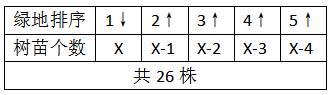

加和求解可得：5x-10=26，解得x=7.2，则最少分得8株。

故正确答案为A。

**考点**：构造数列

**来源**：2008年辽宁省公务员录用考试《行测》题第37题

### 第 38 题

一个人上楼，边走边数台阶，从一楼走到四楼共走了54级台阶。如果每层楼之间的台阶数相同，他一直要走到八楼，问他从一楼到八楼一共要走多少级台阶？

A. 126

B. 120

C. 114

D. 108

第 38 题 · 答案与解析

**参考答案（粉笔题库参考内容）**

A

**解析**

从一楼走到四楼其实只上了三层楼，每层台阶为54 ÷ 3 = 18级，从一楼到八楼一共要走18×7=126级台阶。

故正确答案为A。

**来源**：2008年辽宁省公务员录用考试《行测》题第38题

### 第 39 题

某总公司由A、B、C三个分公司构成，若A公司的产出增加10%可使总公司的产出增加2%，若B公司的产出增加10%可使总公司的产出增加5%，问若C公司的产出减少10%可使总公司的产出减少百分之几？

A. 2

B. 3

C. 4

D. 5

第 39 题 · 答案与解析

**参考答案（粉笔题库参考内容）**

B

**解析**

设总公司产出为100，则根据条件“若A公司的产出增加10%可使总公司的产出增加2%”，可列式为：A × 10% = 100 × 2%，则A=20；根据条件“若B公司的产出增加10%可使总公司的产出增加5%”，则B=50，那么C=100-20-50=30。当C公司的产出减少10%时，30×10%=100×3%，总公司的产出减少3%。

故正确答案为B。

**考点**：和差倍比问题

**来源**：2008年辽宁省公务员录用考试《行测》题第39题

### 第 40 题

老师出了若干份试卷，以各份试卷的平均分计算考生的成绩，某考生最后一份试卷得97分，则平均分为90分，若该考生最后一份试卷得73分，则平均分为87分，那么这组试卷的份数是：

A. 8

B. 9

C. 10

D. 11

第 40 题 · 答案与解析

**参考答案（粉笔题库参考内容）**

A

**解析**

总分少97-73=24分，平均分少90-87=3分，则试卷份数为24÷3=8份。

故正确答案为A。

**来源**：2008年辽宁省公务员录用考试《行测》题第40题

### 第 41 题

某农场饲养的A、B两个品种的羊数量比是3：1，饲养员每天给200个A种羊和120个B种羊作记号，几天后下班时发现，B种羊只剩60个没作记号，A种羊还剩660个没作记号，问农场饲养的A、B两个品种的羊的数量分别为多少？

A. 1260 420

B. 1860 620

C. 3060 1020

D. 1125 375

第 41 题 · 答案与解析

**参考答案（粉笔题库参考内容）**

A

**解析**

设作记号的天数为x，由题可得：200x+660=3(120x+60)，解得x =3，因此A品种羊数量=200x+660=1260；B品种的数量=120x+60=420。

故正确答案为A。

**考点**：和差倍比问题

**来源**：2008年辽宁省公务员录用考试《行测》题第41题

### 第 42 题

张警官一年内参与破获的各类案件有100多件，是王警官的5倍，李警官的五分之三，越警官的八分之七，问李警官一年内参与破获了多少案件：

A. 175

B. 125

C. 120

D. 不好估算

第 42 题 · 答案与解析

**参考答案（粉笔题库参考内容）**

A

**解析**

设张警官一年破获x件，则100&lt;x&lt;200，李警官破获的各类案件有166＜5/3x＜333。只有A项符合。

故正确答案为A。

**考点**：和差倍比问题

**来源**：2008年辽宁省公务员录用考试《行测》题第42题

### 第 43 题

甲、乙、丙共同编制一标书，前三天3人一起完成了全部工作量的1/5，第四天丙没参加，甲、乙完成了全部工作量的1/18，第五天甲、丙没参加，乙完成了全部工作量的1/90，从第六天起三人一起工作直到结束。

问：这份标书的编制一共用了多少天？

A. 13

B. 14

C. 15

D. 16

第 43 题 · 答案与解析

**参考答案（粉笔题库参考内容）**

D

**解析**

方法一：赋值工作总量为5、18、90的最小公倍数90，由三人合作3天完成总量的1/5可得，甲、乙、丙三人效率之和为90/5 ÷ 3 = 6；第四天甲、乙完成总量的1/18为90/18=5；第五天乙完成总量的1/90为90/90=1。此时剩余总量为90-18-5-1=66，三人还需66/6=11天，总工期为5+11=16天。

方法二：由三人合作3天完成总量的1/5可知，若三人合作15天可完成总量，现第四、五天均有人未参与工作，则实际完工时间应长于15天，只有D项符合，当选。

故正确答案为D。

**考点**：给完工时间型

**来源**：2008年辽宁省公务员录用考试《行测》题第43题

### 第 44 题

某汽车商销售A、B两种汽车，A种汽车的销售价是每辆20万，B种汽车的销售价是每辆5万，A种汽车销售金额的一半和B种汽车销售金额的三分之一合计5000万元，B种汽车销售金额的一半和A种汽车销售金额的三分之一合计3500万元。

问A、B两种汽车各销售多少辆？

A. 500 100

B. 400 200

C. 300 360

D. 480 120

第 44 题 · 答案与解析

**参考答案（粉笔题库参考内容）**

D

**解析**

设汽车销售商销售A种汽车z辆，B种汽车y辆，则有

20z×1/2 + 5y×1/3 = 5000，20z×1/3 + 5y×1/2 = 3500

解得z=480，y=120。

故正确答案为D。

**考点**：和差倍比问题

**来源**：2008年辽宁省公务员录用考试《行测》题第44题

### 第 45 题

某单位现有职工120人，其中8人具有正高职称，20人具有副高职称，想通过引进副高以上职称人员的办法在短期内把正高职称的人员比例上升到30％，副高职称人员比例上升到30％，问需引进正高、副高职称人员各多少人：

A. 61 49

B. 268 542

C. 258 532

D. 71 59

第 45 题 · 答案与解析

**参考答案（粉笔题库参考内容）**

A

**解析**

设引进正高级x人，副高级y人。(x+8)/(120+x+y) = 30%①，(y+20)/(120+x+y)=30%②。

联立①②计算得出x=61，y=49。

故正确答案为A。

**考点**：和差倍比问题

**来源**：2008年辽宁省公务员录用考试《行测》题第45题

### 第 46 题

从所给四个选项中，选择最合适的一个填入问号处，使之呈现一定的规律性：

A. A

B. B

C. C

D. D

第 46 题 · 答案与解析

**参考答案（粉笔题库参考内容）**

C

**解析**

元素组成凌乱，考数数。

本题为数部分（连在一起的黑色线条为1部分），第一行的三个图形分别有1、2、3个部分，第二行的三个图形也满足此规律，因此第三行的第三个图形也应该有3个部分，通过分析选项，其组成部分为2、2、3、1。只有C选项的图形有3个部分。

故正确答案为C。

**考点**：数量规律-素

**来源**：2008年辽宁省公务员录用考试《行测》题第46题

### 第 47 题

从所给四个选项中，选择最合适的一个填入问号处，使之呈现一定的规律性：

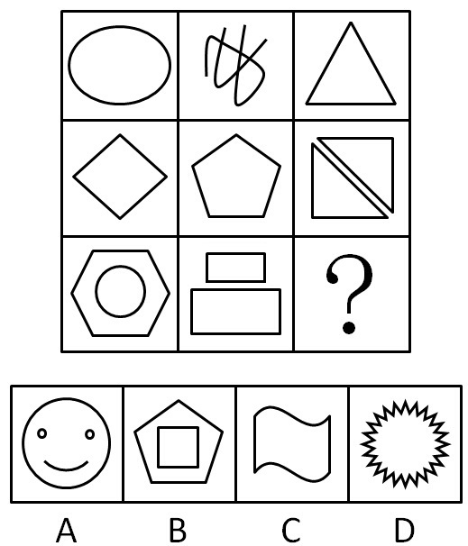

A. A

B. B

C. C

D. D

第 47 题 · 答案与解析

**参考答案（粉笔题库参考内容）**

B

**解析**

元素组成凌乱，考数数。

本题为数线条数量，第一行三个图形的线条数量分别为1、2、3，第二行三个图形的线条数量分别为4、5、6，因此第三行三个图形的线条数量应分别为7、8、9，即第三行的第三个图形的线条数量为9，通过分析只有B选项图形的线条数量为9。

故正确答案为B。

**考点**：数量规律-线

**来源**：2008年辽宁省公务员录用考试《行测》题第47题

### 第 48 题

从所给四个选项中，选择最合适的一个填入问号处，使之呈现一定的规律性：

A. A

B. B

C. C

D. D

第 48 题 · 答案与解析

**参考答案（粉笔题库参考内容）**

C

**解析**

已知图形均为封闭图形，通过分析只有C选项的图形是封闭的。

故正确答案为C。

**考点**：属性规律-开闭性

**来源**：2008年辽宁省公务员录用考试《行测》题第48题

### 第 49 题

从所给四个选项中，选择最合适的一个填入问号处，使之呈现一定的规律性：

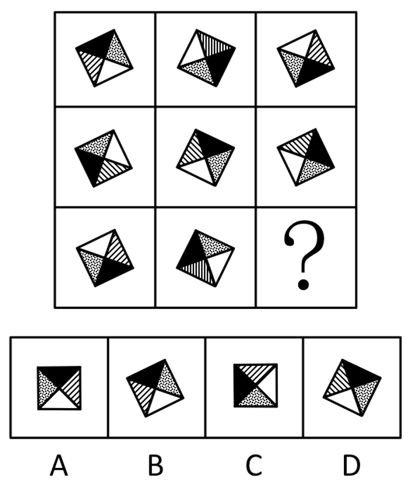

A. A

B. B

C. C

D. D

第 49 题 · 答案与解析

**参考答案（粉笔题库参考内容）**

B

**解析**

元素组成相同，考查位置规律。

第一列第一个图形逆时针旋转90度得到第二个图形，第二个图形逆时针旋转90度得到第三个图形，第二列的图形也满足此规律，因此第三列第三个图形应该是由第二个图形逆时针旋转90度得到，通过分析只有B选项的图形符合。

故正确答案为B。

**考点**：位置规律-旋转

**来源**：2008年辽宁省公务员录用考试《行测》题第49题

### 第 50 题

从所给四个选项中，选择最合适的一个填入问号处，使之呈现一定的规律性：

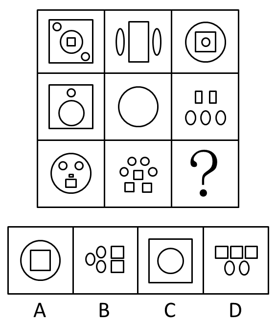

A. A

B. B

C. C

D. D

第 50 题 · 答案与解析

**参考答案（粉笔题库参考内容）**

B

**解析**

题干明显存在2种元素，分别数数量，确定二者的关系，仔细分析前两行图形，可以发现这样的规律：已知图形中椭圆的数量都比矩形多一个。通过分析只有B选项的图形符合该规律。

故正确答案为B。

备注：圆是特殊的椭圆，正方形是特殊的矩形，望考生注意。

**考点**：数量规律-素

**来源**：2008年辽宁省公务员录用考试《行测》题第50题

### 第 51 题

从所给四个选项中，选择最合适的一个，使之呈现一定的规律性：

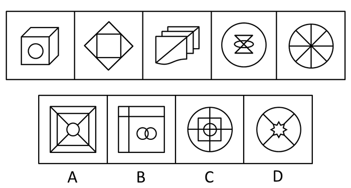

A. A

B. B

C. C

D. D

第 51 题 · 答案与解析

**参考答案（粉笔题库参考内容）**

A

**解析**

元素组成凌乱，考数数。

本题为数面（封闭空间），已知图形的面数分别为4、5、6、7、8，因此下一个图形的面数应为9，通过分析，选项面的数量分别是9、7、12、5。只有A选项的面数为9。

故正确答案为A。

**考点**：数量规律-面

**来源**：2008年辽宁省公务员录用考试《行测》题第51题

### 第 52 题

从所给四个选项中，选择最合适的一个，使之呈现一定的规律性：

A. A

B. B

C. C

D. D

第 52 题 · 答案与解析

**参考答案（粉笔题库参考内容）**

C

**解析**

元素组成凌乱，考数数。

本题为数部分（连在一起的黑色线条为1部分），已知图形分别有1、2、3、4、5个部分，因此下一个图形应该有6个部分，通过分析只有C选项的图形有6个部分。

故正确答案为C。

**考点**：数量规律-素

**来源**：2008年辽宁省公务员录用考试《行测》题第52题

### 第 53 题

从所给四个选项中，选择最合适的一个，使之呈现一定的规律性：

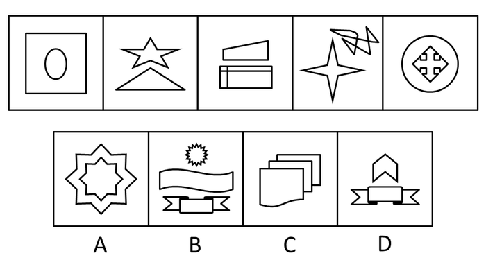

A. A

B. B

C. C

D. D

第 53 题 · 答案与解析

**参考答案（粉笔题库参考内容）**

D

**解析**

本题为数元素种类。

已知图形均是由2个不同的图形组成的，可知下一个图形也应符合该规律，通过观察只有D选项的图形是由2个不同的图形组成的，A项虽然也是两个图形，但为一个元素种类，所以只有D选项符合。

故正确答案为D。

**考点**：数量规律-素

**来源**：2008年辽宁省公务员录用考试《行测》题第53题

### 第 54 题

从所给四个选项中，选择最合适的一个，使之呈现一定的规律性：

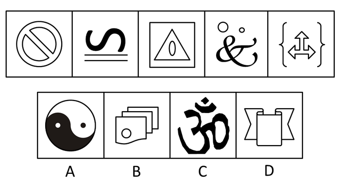

A. A

B. B

C. C

D. D

第 54 题 · 答案与解析

**参考答案（粉笔题库参考内容）**

C

**解析**

元素组成凌乱，考数数。

本题为数部分（连在一起的黑色线条为1部分），已知图形均有3部分，通过分析，选项的部分数分别是2、2、3、1。只有C选项的图形有3部分。

故正确答案为C。

**考点**：数量规律-素

**来源**：2008年辽宁省公务员录用考试《行测》题第54题

### 第 55 题

请从所给的四个选项中，选择最合适的一项，使之和上面图形一起呈现一定的规律性：

A. A

B. B

C. C

D. D

第 55 题 · 答案与解析

**参考答案（粉笔题库参考内容）**

B

**解析**

本题属于争议题。

方法一：元素组成凌乱，考虑属性变化。已知图形中奇数项图形是开放的，偶数项图形是全封闭的，未知的下一项图形是偶数项，所以应该是封闭的。通过分析只有B选项的图形是封闭的。故正确答案为B。

方法二：元素组成凌乱，考虑数数。已知图形奇数项图形是0个面，偶数项图形是1个面，图形面数呈0、1、0、1、0、？的规律。未知的下一项也应该是有1个面的图形，通过分析A项为0个面，B项为4个面，D项为9个面，只有C选项为1个面。故正确答案为C。

**考点**：属性规律-开闭性、数量规律-面

**来源**：2008年辽宁省公务员录用考试《行测》题第55题

### 第 56 题

黏合策略：把不同对象或不同对象中的构件黏合成新形象的策略。下列不属于黏合策略的是（    ）。

A. 丰源、鸿远、新星原是三家个体小企业，处境十分艰难，市政府采取措施让他们联合成“新鸿源”有限公司，现在成了省明星企业

B. 江苏省委省政府根据苏锡常地缘相近，在人口、文化、消费等诸方面又有些相似，市场发展不平衡的特点，超前决策，要求三地优势互补，终于成功打造了全国闻名的经济链

C. 为了解决企业的资金困难问题，领导层决定向每个雇员借资2000元，按银行同期利息计算

D. 小杜歌唱得很棒，他想成立一个乐队，于是联系了会弹吉他的小宋、会拉小提琴的小华、会弹电子琴的小李等五人，组建了“天籁”组合，一年后就走红了

第 56 题 · 答案与解析

**参考答案（粉笔题库参考内容）**

C

**解析**

第一步：判断题干中的关键词。

客体：不同对象或不同对象中的构件。结果：黏合成新形象。

第二步：逐一分析选项。

A项，三家不同的个体小企业联合成了一家新公司，并成为了省明星企业，符合定义。

B项，江苏省委省政府将苏锡常三地联合起来，打造出全国闻名的经济链，符合定义。

C项，领导层向雇员借资后，解决了企业的资金困难问题，但没有打造出企业的新形象，不符合定义。

D项，小杜联系小宋、小华等有不同本领的五人组成了一个新乐队，并在一年后走红，符合定义。

第三步：再次标注答案。

本题为选非题，故正确答案为C。

**考点**：单定义-其他句式

**来源**：2008年辽宁省公务员录用考试《行测》题第56题

### 第 57 题

软科学：是综合运用自然科学、社会科学和哲学的理论和方法，对复杂的社会课题（人、自然、社会经济、科学技术之间相互作用的政策课题和社会问题）进行预测、规划、管理和评价，从整体上探求最优化的解决方案和决策。以下属于软科学的是（    ）。

A. 心理学

B. 逻辑学

C. 语言学

D. 管理学

第 57 题 · 答案与解析

**参考答案（粉笔题库参考内容）**

D

**解析**

第一步：找出定义关键词。

“综合运用自然科学、社会科学和哲学的理论和方法”、“对复杂的社会课题进行预测、规划、管理和评价”、“从整体上探求最优化的解决方案和决策”。

第二步：逐一分析选项。

A项：“心理学”主要是心理现象的发生、发展和活动规律，一般不涉及对复杂社会课题的预测、规划、管理和评价，不符合定义，排除；

B项：“逻辑学”主要是思维规律的学说，它一般研究的是纯粹的思维规律，不涉及对社会课题的管理，不符合定义，排除；

C项：“语言学”主要是以人类语言为研究对象的学科，不涉及对社会课题的预测、规划、管理和评价，不符合定义，排除；

D项：“管理学”是一门综合性的交叉学科，是系统研究管理活动的基本规律和一般方法的科学，说明管理学可以对复杂社会问题进行预测、规划、管理和评价，并且致力于给出最优化的解决方案和决策，符合定义，当选。

故正确答案为D。

**考点**：方式目的

**来源**：2008年辽宁省公务员录用考试《行测》题第57题

### 第 58 题

环境权：公民享有的在不被污染和破坏的环境中生存及利用环境资源的权利。

下列不属于环境权的是：

A. 某公司将在一住宅区附近建一幢35层高楼大厦，一些居民家可能会因此终年不见阳光，有几户居民把该公司告到人民法院，要求该公司归还他们的阳光照射权

B. 有一户居民在公用楼道口搭建了一个小棚，使整个楼道的通风受到了严重影响，于是同楼道多户居民一起把该户告到人民法院，要求该户拆除小棚，恢复良好的通风条件

C. 老申新建了一个服饰广告牌，刚安装了不久，就被邻居告到法院，说老申的广告牌越过了阳台，遮挡了他家的视线，要求申家移一移广告牌，恢复其视线权

D. 小徐在某超市买了一盒饼干，回家后发现饼干里有一只苍蝇，小徐将该超市告上法院，要求该超市恢复其卫生权

第 58 题 · 答案与解析

**参考答案（粉笔题库参考内容）**

D

**解析**

第一步：抓住定义中的关键词。

关键词包括“不被污染和破坏的环境”、“生存及利用环境资源”。

第二步：逐一判断选项。

A中的“阳光照射权”，B中的“通风受堵”，C中的“视线权”都属于环境权范畴内；

D中“卫生权”没有涉及到环境和环境资源，不属于环境权利的范畴。

故正确答案为D。

**考点**：拆词

**来源**：2008年辽宁省公务员录用考试《行测》题第58题

### 第 59 题

信用质量“黑名单”指通过一定的信息系统对某些个人或单位在经济活动中违约违法行为在一定范围内予以披露，从而对这种行为起到记录污点、批语监督、处罚抑制作用的管理手段。

下列不符合上述定义的一项是：

A. 中国银监会不久前向各金融机构发了一份通报“名单”，要求高度警惕对名单中企业的贷款

B. 某杂志披露了某旅客在向餐车索要发票时，竟然得到一张写有“餐费”字样的收据

C. 中国人民银行自10月1日起，将信用不良者收录进“个人信用信息数据库”

D. 某省文化行政部门日前决定，对各类文化经营单位建立信用档案，信用差者将受到一定的处罚

第 59 题 · 答案与解析

**参考答案（粉笔题库参考内容）**

B

**解析**

第一步：抓住定义中的关键词。

关键词包括“一定的信息系统”、“经济活动中违约违法行为”。

第二步：逐一判断选项。

A中的“通报‘名单’”，C中的“个人信用信息数据库”，D中的“信用档案”均是信用质量“黑名单”；

B中“某杂志”不符合关键词“一定的信息系统”，因此不属于信用质量“黑名单”。

故正确答案为B。

**考点**：方式目的

**来源**：2008年辽宁省公务员录用考试《行测》题第59题

### 第 60 题

非理性：指在人的认识过程中，不以理性思维为基础的精神要素以及不能被逻辑思维的概念所包含的主体心理形式。以下认识过程属于非理性因素的是（    ）。

A. 学习英语单词时，通过结合字形来掌握记忆字义的星火记忆法

B. 历史主义坚持以科学史为基础来考查哲学问题

C. 阿基米德在浴缸洗澡，因水溢出获得了鉴定王冠的灵感

D. 实证主义认为只有通过实证才是唯一可靠的

第 60 题 · 答案与解析

**参考答案（粉笔题库参考内容）**

C

**解析**

第一步：判断题干中的关键词。

形式：不以理性思维为基础、不能被逻辑思维的概念所包含。

第二步：逐一分析选项。

A项，结合字形来掌握记忆字义，属于在认识过程中运用理性和逻辑思维。

B项，历史主义坚持以科学史为基础来考查哲学问题，属于在认识过程中运用理性和逻辑思维。

C项，阿基米德得出浮力原理的过程，属于非理性中的灵感。

D项，通过实证方式检验认识是否正确，属于在认识过程中运用理性思维和逻辑思维。

第三步：再次标注答案。

故正确答案为C。

**考点**：方式目的

**来源**：2008年辽宁省公务员录用考试《行测》题第60题

### 第 61 题

环境噪声指在工业生产、建筑施工、交通运输和社会生活中所产生的干扰周围生活环境的声音。

下列属于环境噪声的是：

A. 宁静公园中琅琅的读书声

B. 汽车城里试车时的鸣笛声

C. 疗养院里轰鸣的机械声

D. 宴饮时的猜拳声

第 61 题 · 答案与解析

**参考答案（粉笔题库参考内容）**

C

**解析**

第一步：抓住定义中的关键词。

关键词强调“干扰周围生活环境的声音”。

第二步：逐一判断选项。

A、B和D三项中的声音都属于合适其场所的合理声音；

C项中疗养院里轰鸣的机械声是干扰周围生活环境的不和谐声音，因此属于环境噪声。

故正确答案为C。

**考点**：拆词

**来源**：2008年辽宁省公务员录用考试《行测》题第61题

### 第 62 题

经验决策：依靠个别高明的谋臣术士，或凭借决策者个人的阅历、知识和智慧进行的决策。

下列属于经验决策的是：

A. 某企业的决策中主要把握三条原则：一是抓大放小；二是分工多元，对决策内容实行“分类管理”和“分层管理”；三是抓主要矛盾

B. 某民营企业的投资者和创办者常亲临第一线，直接掌握第一手材料，把握全局，以“过去出现的事将会重复出现”为决策前提，大大减少了经营风险

C. 某老总总是通过与专业的市场研究公司合作，通过它们收集信息，然后结合企业的情况再做决策

D. 某企业一条生产流水线坏了，技术人员认为要立即停产整修，老总担心完不成生产任务负违约责任，不同意停产，于是一拍胸脯：“有责任我承担。”技术员只好服从

第 62 题 · 答案与解析

**参考答案（粉笔题库参考内容）**

B

**解析**

第一步：抓住定义中的关键词。

关键词包括“依靠个别高明的谋臣术士”、“凭借决策者个人的阅历、知识和智慧”。

第二步：逐一判断选项。

A项中所说的决策原则跟个人的才能阅历无关；

B项中以“过去出现的事将会重复出现”为决策前提，减少企业经营风险，体现决策是根据以往的经验，符合定义的构成要件；

C项中的收集信息后决策也没有个人的影响，是结合实际情况做的决策；

D项中的临时决定不属于决策，也没依靠个人才能和经验。

故正确答案为B。

**考点**：单定义-其他句式

**来源**：2008年辽宁省公务员录用考试《行测》题第62题

### 第 63 题

自信：坚信自己能力和行为力量的积极健康的个性品质和心理特征，建立在对社会生活的充分理解和对自己充分了解的基础上，以实事求是、坚持真理的科学态度为前提。

下列哪一种情况属于自信：

A. 小明的期末考试成绩还不错，但他自己不满意，他发现很多题都因为粗心大意被扣分，所以他认为如果能细心一点，下次遇到同等难度的试卷会考得更好

B. 小强的考试成绩一般都比同桌的小军高，因此小强认为自己在各方面都胜小军一筹

C. 小磊发现同班同学小伟的胳膊比自己粗，所以他坚信自己的力气肯定没有小伟大

D. 小涛家境贫寒，父母常年在外打工，爷爷奶奶对小涛管教不严，所以小涛在学校顽皮乖戾，学习不努力，但小涛坚信“自古寒门出英才”，相信自己将来一定出人头地

第 63 题 · 答案与解析

**参考答案（粉笔题库参考内容）**

A

**解析**

第一步：抓住定义中的关键词。

关键词包括“积极健康的个性品质和心理特征”、“对自己充分了解”、“实事求是、坚持真理的科学态度”。

第二步：逐一判断选项。

B项中的小强对自己不够了解，C项中小磊对自己不够自信，属于不自信，D项中小涛的自信不是来自于实事求是，因此B、C、D三项都不符合自信的关键词。

只有A项符合定义要求。

故正确答案为A。

**考点**：大前提

**来源**：2008年辽宁省公务员录用考试《行测》题第63题

### 第 64 题

社会商品购买力指一定时期内社会各方面用于购买商品的货币支付能力，反映该时期社会有支付能力的商品需求和市场容量的大小。由于购买力是指对商品的购买能力，因此一切不通过货币结算的实物收支和不是用来购买商品和劳务的货币支出，均不属于社会商品购买力范围。

下列属于社会商品购买力范围的一项是：

A. 小李每月按时交纳78元党费

B. 小孙每个月从公司领取3000元工资

C. 小王每月从所得薪酬中扣除一部分用于交纳个人所得税

D. 小张上半年借了小刘4000元买电脑，他这个月将所借款还给了小刘

第 64 题 · 答案与解析

**参考答案（粉笔题库参考内容）**

B

**解析**

第一步：抓住定义中的关键词。

关键词强调“购买商品的货币支付能力”，“货币结算的实物收支”，“购买商品和劳务的货币支出”。

第二步：逐一判断选项。

A项中小李所交的党费不是用来购买商品，不符合“购买商品的货币支付能力”这一关键词，因此不属于社会商品购买力范围；

B项中小孙领取工资完全符合关键词，因此属于社会商品购买力范围；

C项中小王交纳个人所得税是从薪酬中扣除的，并非通过货币结算的实物收支，不符合关键词，因此不属于社会商品购买力范围；

D项中小张借钱买电脑不是自己当时的货币支付能力，不符合关键词“购买商品的货币支付能力”，因此不属于社会商品购买力范围。

故正确答案为B。

**考点**：单定义-其他句式

**来源**：2008年辽宁省公务员录用考试《行测》题第64题

### 第 65 题

灰色营销：有两种不同的含义，第一是指针对老年人的营销活动，也称为银色营销；第二是指在道德或法律上有问题的营销活动。

下列不属于灰色营销的是：

A. 某企业刻意模仿另一家企业的包装装潢，不过它做得很巧妙，以致于被模仿的企业很难起诉它

B. 某企业在广告中加入隐含的暴力和色情类的内容，法律机构很难对该企业进行制裁

C. 卖方通过向买方代理方让利方式来销售商品，使买方的利益部分地被其采购代理人侵占

D. 生产企业严格遵守与代理商签订的协议，确保代理商的专营权不受侵害，保护了各自的利益

第 65 题 · 答案与解析

**参考答案（粉笔题库参考内容）**

D

**解析**

第一步：抓住定义中的关键词。

关键词包括“针对老年人”，“在道德或法律上有问题”。

第二步：逐一判断选项。

A项中某企业刻意模仿另一家企业的包装装潢；

B项中广告商在广告中加入隐含暴力和色情的内容；

C项中卖方通过向买方代理方让利销售商品都属于在道德和法律上有问题的经营活动；

D项中是正当的营销，不存在道德或法律上有问题的营销活动。

故正确答案为D。

**考点**：单定义-其他句式

**来源**：2008年辽宁省公务员录用考试《行测》题第65题

### 第 66 题

地衣：苔藓

A. 腊月：十二月

B. 小姨子：妻弟

C. 竖子：叛徒

D. 蝉联：阔别

第 66 题 · 答案与解析

**参考答案（粉笔题库参考内容）**

B

**解析**

第一步：判断题干词语间逻辑关系。

题干两词是并列关系，且是并列中的反对关系（地衣与苔藓生长环境相同，但是种类不同）。

第二步：判断选项词语间逻辑关系。

与题干相同逻辑关系的即为B项。

A项是同一事物的不同称谓，农历十二月叫腊月；

C项中“竖子”指童仆、小子，C项和D项无明显逻辑关系。

故正确答案为B。

**考点**：逻辑关系-并列关系

**来源**：2008年辽宁省公务员录用考试《行测》题第66题

### 第 67 题

燕子：春天

A. 知了：夏天

B. 山鸡：高原

C. 蟋蟀：冬天

D. 白药：云南

第 67 题 · 答案与解析

**参考答案（粉笔题库参考内容）**

A

**解析**

第一步：判断题干词语间逻辑关系。

题干两词是对应关系，且是动物是季节里的代表动物之一的对应。

第二步：判断选项词语间逻辑关系。

与题干逻辑关系相同的为A项。

B项和D项没有季节；

C项中蟋蟀不是冬天的代表动物。

故正确答案为A。

**考点**：逻辑关系-对应关系

**来源**：2008年辽宁省公务员录用考试《行测》题第67题

### 第 68 题

柳絮：杨花

A. 松子：榆钱

B. 月华：幽兰

C. 芙蓉：荷花

D. 菊花：银甲

第 68 题 · 答案与解析

**参考答案（粉笔题库参考内容）**

C

**解析**

第一步：判断题干词语间逻辑关系。

题干两词是同一事物的不同称谓，古代“杨”与“柳”可以统称，“杨柳”单指柳树，并不是杨树和柳树，故杨花是专指柳絮。

第二步：判断选项词语间逻辑关系。

与题干逻辑关系相同的为C项，“芙蓉”即“荷花”；

A项是并列关系；

B项中月华指的是月光、月色，幽兰是一种花，二者无明显逻辑关系；

D项无明显逻辑关系。

故正确答案为C。

**考点**：逻辑关系-全同关系

**来源**：2008年辽宁省公务员录用考试《行测》题第68题

### 第 69 题

灭火器：干粉

A. 课桌：书本

B. 印纸学习：经费

C. 打印机：打印纸

D. 电灯：电线

第 69 题 · 答案与解析

**参考答案（粉笔题库参考内容）**

C

**解析**

第一步：判断题干词语间逻辑关系。

题干两词是对应关系，且是前者需要后者才能发挥其作用的对应。

第二步：判断选项词语间逻辑关系。

与题干逻辑关系相同的为C项，打印机需要打印纸打印；

A项中课桌与书本两者没有前者需要后者才能发挥其作用的对应；

B项无明显逻辑关系；

D项如果为电灯：电能就是正确的了。

故正确答案为C。

**考点**：逻辑关系-对应关系

**来源**：2008年辽宁省公务员录用考试《行测》题第69题

### 第 70 题

中国：台湾

A. 北京：城市

B. 马：千里马

C. 中国：香港

D. 知识分子：学者

第 70 题 · 答案与解析

**参考答案（粉笔题库参考内容）**

C

**解析**

第一步：判断题干词语间逻辑关系。

题干两词是包容关系，前者包含后者，且是包容中的组成关系。

第二步：判断选项词语间逻辑关系。

与题干逻辑关系相同的为C项；

A项是包容关系，后者包含前者，且是包容中的种属关系；

B项是包容关系，前者包含后者，且是包容中的种属关系；

D项是包容关系，前者包含后者，且是包容中的种属关系。

故正确答案为C。

**考点**：逻辑关系-包容关系

**来源**：2008年辽宁省公务员录用考试《行测》题第70题

### 第 71 题

“高山流水”是任何人都极为欣赏的古典音乐，而每个人对任何一种古典音乐的态度是要么着迷，要么不欣赏。

由此可见：

A. 任何人都欣赏古典音乐

B. 任何人都不欣赏古典音乐

C. 任何人都对“高山流水”着迷

D. 有些人对“高山流水”不着迷

第 71 题 · 答案与解析

**参考答案（粉笔题库参考内容）**

C

**解析**

第一步：翻译题干。

（1）高山流水是任何人都欣赏的古典音乐；

（2）古典音乐→要么着迷，要么不欣赏。

第二步：逐一分析选项。

A项：题干中只提到了任何人都欣赏高山流水，无法推出任何人欣赏所有古典音乐，排除；

B项：该项与条件（1）高山流水是任何人都欣赏的古典音乐矛盾，无法推出，排除；

C项：根据条件（1）可知高山流水是古典音乐，是对条件（2）的肯前，肯前必肯后，可得到对高山流水的态度是要么着迷，要么不欣赏，结合条件（1）任何人都欣赏高山流水，是对“不欣赏”这一项的否定，则可得到任何人都对高山流水着迷，可以推出，当选；

D项：根据上述推理可知任何人都对高山流水着迷，所有是不能推出有的不是，因此无法推出有些人对高山流水不着迷，排除。

故正确答案为C。

**考点**：集合推理

**来源**：2008年辽宁省公务员录用考试《行测》题第71题

### 第 72 题

在一次机关作风检查中，当场发现有四人上班期间在办公室打牌。单独进行身份询问时，戴眼镜的说：“我们都不是该单位的。”年轻的说：“至少有一人是该单位的。”黑脸的说：“我什么都不知道。”穿皮夹克的说：“至少有一人不是该单位的。”经核实，四人中只有一人讲了真话。

由此可见：

A. 戴眼镜和穿皮夹克的不是该单位的

B. 黑脸的是该单位的，但年轻的不是该单位的

C. 年轻的不是该单位的，而戴眼镜的是该单位的

D. 年轻的和穿皮夹克的都是该单位的

第 72 题 · 答案与解析

**参考答案（粉笔题库参考内容）**

D

**解析**

第一步：找突破口。

本题突破口为戴眼镜的说：四人都不是该单位的；年轻的说：至少有一个是该单位的，两人所说相互矛盾，其中必有一真一假。

第二步：看其他的话。

本题只有一句为真，故黑脸的和穿皮夹克所说的话都是假的。由穿皮夹克所说的话为假的可知，四个人都是该单位的。

第三步：判断突破口中两句话的真假。

由四个人都是该单位的可知，年轻的所说的话为真。

故正确答案为D。

**考点**：只有一真/一假

**来源**：2008年辽宁省公务员录用考试《行测》题第72题

### 第 73 题

一则公益广告劝告人们，酒后不要开车，直到你感到能安全驾驶的时候才开。然而，在医院进行的一项研究中，酒后立即被询问的对象往往低估他们恢复驾驶能力所需要的时间。这个结果表明，在驾驶前饮酒的人很难遵循这个广告的劝告。

下面哪项如果为真，能最有力地支持以上结论：

A. 医院中被研究的对象估计他们恢复驾驶的能力通常比其他人更保守

B. 医院中被研究的对象也被询问恢复对安全驾驶不起重要作用的能力所需要的时间

C. 一些不得不开车回家的人就不饮酒

D. 一般的人，对公益广告的警觉比医院研究对象的警觉高

第 73 题 · 答案与解析

**参考答案（粉笔题库参考内容）**

A

**解析**

第一步：找到论点和论据。

本题论点是在驾驶前饮酒的人很难遵循这个广告的劝告，论据是酒后立即被询问的对象往往低估他们恢复驾驶能力所需要的时间。

第二步：判断加强方式。

论点强调驾驶前饮酒的人，论据强调酒后立即被询问的对象，仅是部分，所以论点与论据间不存在明显因果关系，需加强论证，在论点和论据间搭桥。

第三步：逐一判断选项的作用。

A项中被研究对象的恢复驾驶的能力即在驾驶前饮酒的人和酒后立即被询问的对象间搭桥，即没有被询问的人会比被询问的人更大胆，认为自己可以很快上路，从而加强了论证；

B项中对安全驾驶不起重要作用的能力与驾驶前饮酒无直接关系，属无关选项；

C项中不得不开车回家的人不饮酒与驾驶前饮酒的人无直接关系，属无关选项；

D项中对公益广告的警觉与驾驶前饮酒的人无直接关系，属无关选项。

故正确答案为A。

**考点**：搭桥

**来源**：2008年辽宁省公务员录用考试《行测》题第73题

### 第 74 题

某领导在一次工作会议上说：“我们首先要有‘亲民’意识。有了‘亲民’意识，我们就能站在老百姓的角度来考虑问题，就能负责地为老百姓解决实际问题。如果我们及时帮助群众解决困难，那么干群关系就拉近了。”

从领导的这句话，我们可以推出：

A. 如果有“亲民”意识，那么干群关系就拉近了。其结果必然是，我们能及时帮助群众解决困难

B. 如果有“亲民”意识，那么干群关系就拉近了。但是，其前提是，我们能及时帮助群众解决困难

C. 只有具备“亲民”意识，我们才能站在老百姓的角度来考虑问题，才能负责地为百姓解决实际问题。其结果必然是，我们密切了干群关系

D. 如果我们能负责地为老百姓解决实际问题，我们就具备“亲民”意识。但是，其前提是，我们必须重视干群关系

第 74 题 · 答案与解析

**参考答案（粉笔题库参考内容）**

B

**解析**

第一步：翻译题干。利用充分必要条件。

根据“有了‘亲民’意识，我们就能站在老百姓的角度来考虑问题，就能负责地为老百姓解决实际问题”得到关系：有亲民意识⇒站在老百姓的角度考虑问题∧负责地为老百姓解决问题。

根据“如果我们及时帮助群众解决困难，那么干群关系就拉近了”得到关系：负责地为老百姓解决问题⇒干群关系拉近。

利用联言命题规则得到站在老百姓的角度考虑问题∧负责地为老百姓解决问题⇒负责地为老百姓解决问题。

将以上三个推导关系连起来即为：有亲民意识⇒站在老百姓的角度考虑问题∧负责地为老百姓解决问题⇒负责地为老百姓解决问题⇒干群关系拉近。

第二步：逐一翻译选项并判断选项是否正确。利用逆否规则。

A项：有亲民意识⇒干群关系拉近⇒负责地为老百姓解决问题，“干群关系拉近”属肯后件，无法推出绝对表达的结论，错误；

B项：有亲民意识⇒负责地为老百姓解决问题⇒干群关系拉近，是题干推导关系，正确；

C项：站在老百姓的角度考虑问题∧负责地为老百姓解决问题⇒有亲民意识⇒干群关系拉近，“站在老百姓的角度考虑问题∧负责地为老百姓解决问题”属肯后件，无法推出绝对表达的结论，错误；

D项：负责地为老百姓解决问题⇒干群关系拉近⇒有亲民意识，“干群关系拉近”属肯后件，无法推出绝对表达的结论，错误。

故正确答案为B。

**考点**：常规翻译

**来源**：2008年辽宁省公务员录用考试《行测》题第74题

### 第 75 题

如果阿根廷参加联盟，则巴西和智利将抵制联盟。如果巴西和智利有一国抵制联盟，那么联盟就会名存实亡。而联盟没有名存实亡。

由此可见：

A. 巴西没有参加联盟

B. 巴西参加联盟

C. 智利或巴西至少有一国没有参加联盟

D. 阿根廷没有参加联盟

第 75 题 · 答案与解析

**参考答案（粉笔题库参考内容）**

D

**解析**

第一步：翻译题干。利用充分必要条件。

第一句：阿根廷参加联盟⇒巴西抵制联盟∧智利抵制联盟，第二句：巴西抵制联盟∨智利抵制联盟⇒联盟名存实亡，第三句：－联盟名存实亡，该句为事实信息，即已经成立的事实。

第二步：从事实信息开始推导，得到结论。

由－联盟名存实亡，对第二句利用逆否规则得到－（巴西抵制联盟∨智利抵制联盟），利用摩根规则再得到（－巴西抵制联盟）∧（－智利抵制联盟），利用联言命题的规则再得到（－巴西抵制联盟）∨（－智利抵制联盟），利用摩根规则再得到－（巴西抵制联盟∧智利抵制联盟），利用逆否规则再得到－阿根廷参加联盟，因此可知阿根廷没有参加联盟。

故正确答案为D。

注：1巴西有没有参加联盟跟巴西抵制不抵制联盟是两个方面，没有关系，望考生注意区分。2（－巴西抵制联盟）∧（－智利抵制联盟）是（－巴西抵制联盟）∨（－智利抵制联盟）的一种情况。

**考点**：常规翻译

**来源**：2008年辽宁省公务员录用考试《行测》题第75题

### 第 76 题

或者所有客人尽情玩乐，或者有些客人隐藏他们的真实感受，没有坦率的人会隐藏他们的真实感受，所有客人都是坦率的人。

可见：

A. 只有表达自己真实情感的人才能尽情地玩乐

B. 有些客人隐藏了他们的真实感受

C. 所有客人都尽情玩乐

D. 尽情玩乐才能表达自己的真实感受

第 76 题 · 答案与解析

**参考答案（粉笔题库参考内容）**

C

**解析**

第一步：翻译题干。利用充分必要条件。

“没有坦率的人会隐藏他们真实感受”换言之“所有坦率的人都不会隐藏他们的真实感受”，即为：坦率的人⇒－隐藏真实感受。

“所有客人都是坦率的”，即为：客人⇒坦率的人。

又知“或者所有客人尽情玩乐，或者有些客人隐藏他们的真实感受”为相容选言，即尽情玩乐∨隐藏真实感受。

将以上两个推导关系连起来并利用选言规则可得：客人⇒坦率的人⇒－隐藏真实感受⇒尽情玩乐，即所有客人都尽情玩乐。

第二步：逐一翻译选项并判断选项是否正确。

A项：尽情玩乐⇒－隐藏真实感受，“尽情玩乐”属肯后件，无法推出绝对表达的结论，因此A项错误；

B项：由第一步中关系“客人⇒－隐藏真实感受”可知，所有客人都不隐藏真实感受，因此B项错误；

C项：客人⇒尽情玩乐，正是第一步中得到的结论，因此C项正确；

D项：表达自己的真实感受⇒尽情玩乐，题干中没有“表达自己真实感受”这个条件，无中生有，因此D项错误。

故正确答案为C。

**考点**：常规翻译

**来源**：2008年辽宁省公务员录用考试《行测》题第76题

### 第 77 题

通过调查发现，如果辽宁队获得出线权，那么江苏队或者安徽队也将获得出线权。江西队不可能获得出线权。如果江苏队和山东队获得出线权，那么江西队将获得出线权。只有江西队和山西队都获得出线权，陕西队才能获得出线权。

由此可见：

A. 安徽队不能获得出线权

B. 辽宁队不能获得出线权

C. 江苏队不能获得出线权

D. 陕西队不能获得出线权

第 77 题 · 答案与解析

**参考答案（粉笔题库参考内容）**

D

**解析**

第一步：翻译题干。利用充分必要条件。

第一句：辽宁队⇒江苏队∨安徽队，第二句：－江西队，该句为事实信息，即已经成立的事实，第三句：江苏队∧山东队⇒江西队，第四句：陕西队⇒江西队∧山西队。

第二步：从事实信息开始推导，得到结论。

由第一步中第二句的事实信息“－江西队”利用选言命题规则得到（－江西队）∨（－山西队），利用摩根规则再得到－（江西队∧山西队），又知第四句的“陕西队⇒江西队∧山西队”，利用逆否规则再得到－陕西队，即陕西队不能获得出线权；

由第一步中第二句的事实信息“－江西队”和第三句的“江苏队∧山东队⇒江西队”利用逆否规则得到－（江苏队∧山东队），利用摩根规则再得到（－江苏队）∨（－山东队），条件不足，无法继续推导。

综上，根据题干条件，只能得到陕西队不能获得出线权。

故正确答案为D。

**考点**：常规翻译

**来源**：2008年辽宁省公务员录用考试《行测》题第77题

### 第 78 题

据有关科学人士认为亚洲人特别是华裔子弟的智商较高，日本人是103，美国人是101~103，中国人是110，前国务委员宋健认为，智商还不是智慧，真正智慧的人识大局，知环境，认航向，尊重别人，善于共事。

据此，我们可以认为：

A. 中国人虽然智商较高但没智慧

B. 美国人虽然智商较低但有智慧

C. 智商高低不决定智慧大小

D. 大智若愚

第 78 题 · 答案与解析

**参考答案（粉笔题库参考内容）**

C

**解析**

第一步：抓住题目关键点。

本题关键点：智商还不是智慧，真正智慧的人识大局，知环境，认航向，尊重别人，善于共事。

第二步：逐一判断选项是否正确。

智商不等于智慧，所以智商高的人不一定智慧多，可以说不能从智商高低来判断智慧与否。因此A、B两项都是错误的，C项正是说明了这一点，因此C项正确，D项明显无关。

故正确答案为C。

**考点**：日常结论

**来源**：2008年辽宁省公务员录用考试《行测》题第78题

### 第 79 题

某体育代表团共同参加比赛，按照以往经验，该代表团成员代号分别为（01、02、03、04、05、06）的最佳分配有这样几条规矩：

（1）02和04最好同时出场。

（2）如果03出场，那么最好04不出场。

（3）如果01出场，那么最好02也出场。

（4）如果05、06同时出场，那么最好03不出场。

为保证最佳比赛效果，教练哪个判断是正确的？

A. 如果02、04同时出场，那么03不出场

B. 如果01、03同时出场，那么02出场，04不出场

C. 如果04出场，那么01、02出场，03不出场

D. 如果03出场，04、05、06都不应出场

第 79 题 · 答案与解析

**参考答案（粉笔题库参考内容）**

A

**解析**

第一步：翻译题干。利用充分必要条件。

规矩（1）：02∧04，规矩（2）：03⇒－04，规矩（3）：01⇒02，规矩（4）：05∧06⇒－03。

第二步：逐一翻译选项并判断选项的正确。利用逆否规则。

A项：02∧04⇒－03，由第一步中规矩（1）的“02∧04”利用联言命题规则得到02∧04⇒04，又知规矩（2）的“03⇒－04”，利用逆否规则得到04⇒－03，将以上两个推导关系连起来即为：02∧04⇒04⇒－03，因此可以推出；

B项：01∧03⇒02∧（－04），此时与规矩（1）“02∧04”不相符，因此无法推出；

C项：04⇒01∧02∧（－03），利用联言命题规则得到04⇒02∧04，由第一步中规矩（2）的“03⇒－04”，利用逆否规则得到04⇒－03，条件不足，无法推出01是否出场，因此无法推出；

D项：03⇒（－04）∧（－05）∧（－06），由第一步中规矩（4）的“05∧06⇒－03”利用逆否规则得到03⇒－（05∧06），利用摩根规则得到03⇒（－05）∨（－06），虽又知规矩（2）中“03⇒－04”，但条件还是不足，无法推出05、06同时不出场，因此无法推出。

故正确答案为A。

**考点**：常规翻译

**来源**：2008年辽宁省公务员录用考试《行测》题第79题

### 第 80 题

某旅游团去木兰围场旅游，团员们骑马、射箭、吃烤肉，最后去商店购买纪念品。已知：

（1）有人买了蒙古刀。

（2）有人没有买蒙古刀。

（3）该团的张先生和王女士都买了蒙古刀。

如果以上三句话中只有一句为真，则以下哪项肯定为真？

A. 张先生和王女士都没有买蒙古刀

B. 张先生买了蒙古刀，但王女士没有买蒙古刀

C. 该旅游团的李先生买了蒙古刀

D. 张先生和王女士都买了蒙古刀

第 80 题 · 答案与解析

**参考答案（粉笔题库参考内容）**

A

**解析**

解析1：

第一步：找突破口。

本题突破口为（1）和（2）之间的反对关系，两句话不可同假，但可同真，因此必有一真。

第二步：看其他的话。

本题只有一句为真，故（3）的话为假话。由（3）的话为假话可知，张先生和王女士至少有一人没买蒙古刀。

第三步：判断突破口中两句话的真假。

由张先生和王女士至少有一人没买蒙古刀可知，（2）“有人没有买蒙古刀”为真，又知本题只有一句为真，从而可知（1）“有人买了蒙古刀”为假，因此可以得到所有人都没买蒙古刀。

通过分析，只有A项说法符合。

故正确答案为A。

解析2：

第一步：找突破口。

本题突破口为如果（3）“该团的张先生和王女士都买了蒙古刀”为真，则（1）“有人买了蒙古刀”必为真，这与题干“以上三句话中只有一句为真”矛盾，故（3）为假。

第二步：看其他的话。

（3）为假，即：张先生和王女士至少有一人没买蒙古刀，从而推出（2）“有人没有买蒙古刀”为真，又知本题只有一句为真，从而可知（1）“有人买了蒙古刀”为假，因此可以得到所有人都没买蒙古刀。通过分析，只有A项说法符合。

故正确答案为A。

**考点**：只有一真/一假

**来源**：2008年辽宁省公务员录用考试《行测》题第80题

### 第 81 题

负责主持辽宁省沈阳市人大代表选举的组织是：

A. 辽宁省人民代表大会

B. 辽宁省人大常委会

C. 沈阳市人大常委会

D. 沈阳市人民代表大会

第 81 题 · 答案与解析

**参考答案（粉笔题库参考内容）**

C

**解析**

地方各级人大常委会的职权有：（1）在本行政区域内，保证宪法、法律、行政法规和上级人大及其常委会决议的遵守和执行。（2）领导或主持本级人民代表大会代表的选举；召集本级人民代表大会会议。（3）决定本行政区域内政治、经济、科学、文化、卫生、民政、民族、计划生育工作等重大事项；根据本级人民政府的建议，对本行政区域内的国民经济和社会发展计划、预算作部分变更；决定授予地方荣誉称号。（4）对本级人民政府、人民法院、人民检察院和下级人大及其常委会的工作进行监督，撤销其不适当的决议、决定、命令等，受理人民群众对国家机关及其工作人员的申诉意见。（5）依法任免行政机关、人民法院和人民检察院的有关工作人员；在本级人大闭会期间，补选上一级人大出缺的代表和撤换个别代表。（6）省自治区、直辖市的人大常委会，在不违背宪法、法律和行政法规的前提下，可以依法制定和颁布地方性法规；省自治区人民政府所在地的市和经国务院批准的较大的市的人大常委会可以依法制定地方性法律。

题干中组织市级人大代表选举是同级人大常委会在本级人大闭会期间可以履行的职能。

故正确答案为C。

**考点**：其他法律法规

**来源**：2008年辽宁省公务员录用考试《行测》题第81题

### 第 82 题

一般情况下，民族自治地方名称的排序依次是：

A. 地方名称、民族名称、行政地位

B. 行政地位、地方名称、民族名称

C. 地方名称、行政地位、民族名称

D. 民族名称、地方名称、行政地位

第 82 题 · 答案与解析

**参考答案（粉笔题库参考内容）**

A

**解析**

民族自治地方的名称一般按照地方名称、民族名称、行政地位的顺序组成，如广西壮族自治区。

故正确答案为A。

**考点**：中国地理

**来源**：2008年辽宁省公务员录用考试《行测》题第82题

### 第 83 题

在我国，公务员职务分为领导职务和非领导职务。领导职务层次的分类中不包括：

A. 国家级正职

B. 巡视员

C. 厅局级副职

D. 乡科级副职

第 83 题 · 答案与解析

**参考答案（粉笔题库参考内容）**

B

**解析**

本题考查法律常识。

《公务员法》第十八条规定：“公务员领导职务根据宪法、有关法律和机构规格设置。领导职务层次分为：国家级正职、国家级副职、省部级正职、省部级副职、厅局级正职、厅局级副职、县处级正职、县处级副职、乡科级正职、乡科级副职。”

第十九条规定：“公务员职级在厅局级以下设置。综合管理类公务员职级序列分为：一级巡视员、二级巡视员、一级调研员、二级调研员、三级调研员、四级调研员、一级主任科员、二级主任科员、三级主任科员、四级主任科员、一级科员、二级科员。”

由上可知，A、C、D三项都属于领导职务层次，B项不属于。

本题为选非题，故正确答案为B。

**考点**：行政法

**来源**：2008年辽宁省公务员录用考试《行测》题第83题

### 第 84 题

定期考核的结果影响着公务员的任职。导致按照规定程序降低公务员一个职务层次任职的定期考核结果是：

A. 合格

B. 称职

C. 不合格

D. 不称职

第 84 题 · 答案与解析

**参考答案（粉笔题库参考内容）**

D

**解析**

本题考查法律常识。

根据《公务员法》第五十条的规定：“公务员在年度考核中被确定为不称职的，按照规定程序降低一个职务或者职级层次任职。”

故正确答案为D。

本题相关知识点：定期考核按一定的周期和固定的程序、方法进行。定期考核是考核制度的主要形式，如果没有定期考核办法，就不能说已经建立了考核制度。目前世界上除了个别国家外，大多数把公务员考核的周期定为一年。从我国的实践情况看，对非领导成员公务员一般采取年度考核的方式，对领导成员则普遍采取了届中、届末考核的方式。

**考点**：行政法

**来源**：2008年辽宁省公务员录用考试《行测》题第84题

### 第 85 题

李某向张某借款5万元用于开旅行社，答应旅行社开业后3个月还款，张某同意，李某拿到5万元后并没有去开旅行社而是用于购买家用电器，张某知道后要求李某立即还款，李某声称还款的期限是旅行社开业后3个月，现在旅行社还没有开业自己没有还钱义务。

下列表述正确的是：

A. 李某还钱的期限未到，李某可以不还钱

B. 李某还钱的期限视为已到，李某应当还钱

C. 李某还钱的条件未成就，李某可以不还钱

D. 李某还钱的条件视为已成就，李某应当还钱

第 85 题 · 答案与解析

**参考答案（粉笔题库参考内容）**

D

**解析**

《中华人民共和国合同法》第四十五条规定：“当事人对合同的效力可以约定附条件。附生效条件的合同，自条件成就时生效。附解除条件的合同，自条件成就时失效。当事人为自己的利益不正当地阻止条件成就的，视为条件已成就；不正当地促成条件成就的，视为条件不成就。”第四十六条规定：“当事人对合同的效力可以约定附期限。附生效期限的合同，自期限届至时生效。附终止期限的合同，自期限届满时失效。”

附条件合同中的“条件”必须是将来客观上不确定的事实，如果不属于将来或该事实是确定要发生的，则不能成为条件；而附期限合同中的“期限”是以将来确定的事实的到来为客观的，如果不属于将来或不是确实的事实，则不能成为期限附款。本案中，李某向张某借款时约定的“旅行社开业后3个月还款”，是将来不确定发生的事实，因此属于附条件的合同，而不是附期限的合同。而后来李某将借到的5万元用于购买家电，致使“旅行社开业”这一条件不能成就（不正当地阻止条件成就），根据《合同法》第45条规定，李某的行为视为条件已成就，应当还钱。

故正确答案为D。

**考点**：民法典

**来源**：2008年福建省公务员录用考试《行测》题第19题

### 第 86 题

物权法的立法是涉及每一个人生活的大事。按照物权法一般理论，下列选项中属于用益物权的是：

A. 土地使用权

B. 抵押权

C. 留置权

D. 质押权

第 86 题 · 答案与解析

**参考答案（粉笔题库参考内容）**

A

**解析**

用益物权是指对他人所有物在一定范围内进行占有、使用、收益、处分的他物权。其特征为：标的物主要是不动产；以占有为前提；是他物权、期限物权、限制物权；是以使用、收益为目的的独立物权。

我国的用益物权主要包括国有土地使用权、土地承包经营权、宅基地使用权、典权。担保物权，是指为确保债权的实现而设定的，以直接取得或者支配特定财产的交换价值为内容的权利。我国担保物权包括抵押权、质押权、留置权。

由上可知，B、C、D项都属于担保物权。

故正确答案为A。

**考点**：其他法律法规

**来源**：2008年辽宁省公务员录用考试《行测》题第86题

### 第 87 题

公司提取的法定公积金不可以用于：

A. 扩大公司生产经营

B. 改善职工福利

C. 转增公司资本

D. 弥补公司亏损

第 87 题 · 答案与解析

**参考答案（粉笔题库参考内容）**

B

**解析**

《公司法》第一百六十六条规定，公司分配当年税后利润时，应当提取利润的百分之十列入公司法定公积金。公司法定公积金累计额为公司注册资本的百分之五十以上的，可不再提取。

公司的法定公积金不足以弥补上一年度公司亏损的，在依照前款规定提取法定公积金之前，应当先用当年利润弥补亏损。《公司法》第一百六十八条规定：公司的公积金用于弥补公司的亏损，扩大公司生产经营或者转为增加公司资本。

由上可知，A、C、D三项都可作为公司法定公积金的用途，只有B项不可以。

本题为选非题，故正确答案为B。

**考点**：其他法律法规

**来源**：2008年辽宁省公务员录用考试《行测》题第87题

### 第 88 题

根据我国《票据法》的规定，对汇票的持票人承担连带责任的主体不包括：

A. 出票人

B. 见证人

C. 背书人

D. 承兑人

第 88 题 · 答案与解析

**参考答案（粉笔题库参考内容）**

B

**解析**

《票据法》第44条规定：付款人承兑汇票后，应当承担到期付款的责任。

《票据法》第68条规定：汇票的出票人、背书人、承兑人和保证人对持票人承担连带责任。持票人可以不按照汇票债务人的先后顺序，对其中任何一人、数人或者全体行使追索权。持票人对汇票债务人中的一人或者数人已经进行追索的，对其他汇票债务人仍可以行使追索权。被追索人清偿债务后，与持票人享有同一权利。

本题为选非题，故正确答案为B。

**考点**：其他法律法规

**来源**：2008年辽宁省公务员录用考试《行测》题第88题

### 第 89 题

个体户崔某为使自己的劣质酱油能在某超市上柜，为超市部门主管汤某安排了一次全家境外游，并为汤某的儿子入学缴纳了3万元的赞助费。在反不正当竞争法中，这一行为属于：

A. 混淆行为

B. 虚假宣传行为

C. 独占排挤行为

D. 商业贿赂行为

第 89 题 · 答案与解析

**参考答案（粉笔题库参考内容）**

D

**解析**

《反不正当竞争行为》第8条规定：经营者不得采用财物或者其他手段进行贿赂以销售或者购买商品。在账外暗中给予对方单位或者个人回扣的，以行贿论处；对方单位或者个人在账外暗中收受回扣的，以受贿论处。

经营者销售或者购买商品，可以以明示方式给对方折扣，可以给中间人佣金。经营者给对方折扣、给中间人佣金的，必须如实入账。接受折扣、佣金的经营者必须如实入账。

故正确答案为D。

**考点**：其他法律法规

**来源**：2008年辽宁省公务员录用考试《行测》题第89题

### 第 90 题

小宋受朋友之请去某饭店吃饭，中途去洗手间时，因地面油滑不慎摔倒，致使腿骨骨折。对小宋受到的损害，以下说法正确的是：

A. 小宋与饭店没有形成合同关系，所以饭店不承担责任

B. 小宋不是消费者，所以饭店不承担责任

C. 小宋是消费者，所以饭店应当承担责任

D. 小宋是自己不注意摔倒的，饭店并无加害行为，所以饭店不承担责任

第 90 题 · 答案与解析

**参考答案（粉笔题库参考内容）**

C

**解析**

《中华人民共和国消费者权益保护法》第八十条第二款规定：“宾馆、商场、餐馆、银行、机场、车站、港口、影剧院等经营场所的经营者，应当对消费者尽到安全保障义务。”第四十八条第二款规定：“经营者对消费者未尽到安全保障义务，造成消费者损害的，应当承担侵权责任。”因此，小宋属于消费者，作为经营者的饭店，应当保障小宋的安全，由于地面油滑而导致小宋摔倒骨折，该饭店应当承担赔偿责任。因此，A、B、D三项表述错误。

故正确答案为C。

**考点**：民法典

**来源**：2008年辽宁省公务员录用考试《行测》题第90题

### 第 91 题

江某在某超市购买了一台电动榨汁机，1个月后出现故障，要求超市处理。但超市“购物须知”规定：“在本超市购物有质量问题请及时解决，自购物之日起超过15日的概不退换。”超市以此为由，拒绝受理，要求江某与生产厂家联系处理。

对本纠纷的处理，下列观点错误的是：

A. 超市的规定是“霸王条款”，损害消费者权益，应当无效

B. 超市的规定是要约，消费者的购买是承诺，双方形成合同关系，所以规定有效

C. 超市的规定是格式条款，但免除了自己的责任，所以无效

D. 超市的规定与产品质量法的规定相抵触，所以无效

第 91 题 · 答案与解析

**参考答案（粉笔题库参考内容）**

B

**解析**

A项正确，霸王条款主要是指一些经营者单方面制定的逃避法定义务、减免自身责任的不平等的格式合同、通知、声明和店堂公告等。《中华人民共和国消费者权益保护法》第二十六条第二、三款规定：“经营者不得以格式条款、通知、声明、店堂告示等方式，作出排除或者限制消费者权利、减轻或者免除经营者责任、加重消费者责任等对消费者不公平、不合理的规定，不得利用格式条款并借助技术手段强制交易。格式条款、通知、声明、店堂告示等含有前款所列内容的，其内容无效。”因此，超市的规定是霸王条款，该条款无效。

B项错误，《中华人民共和国民法典》第四百七十二条规定：“要约是希望与他人订立合同的意思表示，该意思表示应当符合下列条件：（一）内容具体确定；（二）表明经受要约人承诺，要约人即受该意思表示约束。”本案中，该超市的规定是为了免除自己的法定责任而单独规定的，其本身就是违法的，无效的。

C项正确，《中华人民共和国民法典》第四百九十六条第一款规定：“格式条款是当事人为了重复使用而预先拟定，并在订立合同时未与对方协商的条款。”《合同法》第四十条规定：“格式条款具有本法第五十二条和第五十三条规定情形的，或者提供格式条款一方免除其责任、加重对方责任、排除对方主要权利的，该条款无效。”因此，超市的规定是格式条款，因免除超市责任，该条款无效。

D项正确，超市的规定与产品质量法的规定相抵触，违反法律规定，该行为无效。

本题为选非题，故正确答案为B。

**考点**：民法典

**来源**：2008年辽宁省公务员录用考试《行测》题第91题

### 第 92 题

下列各产品中能够适用我国《产品质量法》的是：

A. 甲自产自用的木椅

B. 乙销售的木椅

C. 丙自建自用的木屋

D. 丁销售的木屋

第 92 题 · 答案与解析

**参考答案（粉笔题库参考内容）**

B

**解析**

B项正确，《产品质量法》第2条规定：在中华人民共和国境内从事产品生产、销售活动，必须遵守本法。本法所称产品是指经过加工、制作，用于销售的产品。建设工程不适用本法规定；但是，建设工程使用的建筑材料、建筑构配件和设备，属于前款规定的产品范围的，适用本法规定。

D项错误，木屋属于建筑工程，不适用本法的规定。

故正确答案为B。

**考点**：其他法律法规

**来源**：2008年辽宁省公务员录用考试《行测》题第92题

### 第 93 题

下列不属于累犯的法律后果的是：

A. 应当从重处罚

B. 不得适用缓刑

C. 不得适用假释

D. 不得减刑

第 93 题 · 答案与解析

**参考答案（粉笔题库参考内容）**

D

**解析**

累犯是指受过一定的刑罚处罚，刑罚执行完毕或者赦免以后，在一定的时间内又犯被判处一定刑罚之罪的犯罪分子。累犯分为一般累犯和特殊累犯两种。

对累犯的处罚，我国法律规定，累犯应当在法定刑的幅度内从重处罚。我国刑法明确规定，对累犯以及因杀人、爆炸、抢劫、强奸、绑架等暴力性犯罪被判处10年以上有期徒刑、无期徒刑的犯罪分子，不得假释。

我国《刑法》第74条明确规定：“对于累犯和犯罪集团的首要分子，不适用缓刑。”《刑法》规定，减刑的对象包括被判处管制、拘役、有期徒刑或者无期徒刑和死刑缓期二年执行的犯罪分子。也就是说，减刑的对象只有被判处刑种的限制，而没有犯罪性质和被判刑期的长短的限制。故累犯的法律后果不包括不得减刑。

本题为选非题，故正确答案为D。

**考点**：刑法

**来源**：2008年辽宁省公务员录用考试《行测》题第93题

### 第 94 题

小张犯盗窃罪被一审法院判决并处罚金5000元，小张提起上诉，二审法院维持了一审法院的判决。对小张并处罚金的执行机关是：

A. 一审法院

B. 二审法院

C. 监狱

D. 公安机关

第 94 题 · 答案与解析

**参考答案（粉笔题库参考内容）**

A

**解析**

对于刑罚的执行机关可作以下记忆：死缓、无期、有期徒刑由监狱执行(有期徒刑剩余刑期在1年内的，看守所代为执行)；拘役由公安机关执行；管制、剥夺政治权利由公安机关执行；未成年犯由未成年管教所执行；罚金由原审法院执行(可与行政处罚的罚款折抵)；没收财产由原审法院执行(必要时可会同公安机关执行)；监外执行由居住地公安机关执行；缓刑考验期由所在单位或基层组织考察；假释考验期由公安机关监督。

据此，罚金由原审法院执行。

故正确答案为A。

**考点**：刑法

**来源**：2008年辽宁省公务员录用考试《行测》题第94题

### 第 95 题

天龙公司与张某因装修合同发生纠纷，在诉讼过程中，双方协商同意调解。法院依法主持双方调解后达成调解协议，以下说法正确的是：

A. 法院根据调解协议制作调解书后，经双方当事人签收后，具有法律效力

B. 当事人收到调解书后可以在15日内上诉

C. 该案调解书一旦发生法律效力就不得申请再审

D. 法院制作调解书后，送达时，法院可以采用留置送达

第 95 题 · 答案与解析

**参考答案（粉笔题库参考内容）**

A

**解析**

A项正确、B项错误，《中华人民共和国民事诉讼法》第97条第3款规定：“调解书经双方当事人签收后，即具有法律效力。”因此，民事调解书在送达双方当事人后即发生法律效力，而上诉的前提是判决或者裁定未生效，故调解书不能上诉。

C项错误，《中华人民共和国民事诉讼法》第二百零一条规定：“当事人对已经发生法律效力的调解书，提出证据证明调解违反自愿原则或者调解协议的内容违反法律的，可以申请再审。经人民法院审查属实的，应当再审。”

D项错误，《最高人民法院关于适用&lt;中华人民共和国民事诉讼法>》第一百三十三条规定：“调解书应当直接送达当事人本人，不适用留置送达。当事人本人因故不能签收的，可由其指定的代收人签收。”

故正确答案为A。

**考点**：民法典

**来源**：2008年辽宁省公务员录用考试《行测》题第95题

### 第 96 题

A县环保局在环境执法中，发现B企业存在私自排放污染物的行为，经过其上级环保行政主管部门C市环保局的批准，决定对B企业罚款10万元，罚款单盖上A县环保局的公章。B企业对此行政处罚不服，为此，B企业提起行政诉讼。

被告是：

A. Ａ县环保局

B. Ｃ市环保局

C. Ａ县环保局或者Ｃ市环保局

D. Ａ县环保局和Ｃ市环保局

第 96 题 · 答案与解析

**参考答案（粉笔题库参考内容）**

A

**解析**

根据《行政诉讼法》的规定，公民、法人或者其他组织直接向人民法院提起诉讼的，作出具体行政行为的行政机关是被告。经复议的案件，复议机关决定维持原具体行政行为的，作出原具体行政行为的行政机关是被告；复议机关改变原具体行政行为的，复议机关是被告。两个以上行政机关作出同一具体行政行为的，共同作出具体行政行为的行政机关是共同被告。具体说来：当事人不服经上级行政机关批准的具体行政行为，向人民法院提起诉讼的，应当以在对外发生法律效力的文书上署名的机关为被告。

本题中对外发生法律效力的文书上署名的机关为A县环保局，故其为被告。

故正确答案为A。

**考点**：行政法

**来源**：2008年辽宁省公务员录用考试《行测》题第96题

### 第 97 题

行政机关在其法定职权范围内，依法可以委托下列哪种组织实施行政许可：

A. 其他国家机关

B. 其他行政机关

C. 具有管理公共事务职能的事业组织

D. 具有管理公共事务职能的社会团体

第 97 题 · 答案与解析

**参考答案（粉笔题库参考内容）**

B

**解析**

《行政许可法》第23条规定：法律、法规授权的具有管理公共事务职能的组织，在法定授权范围内，以自己的名义实施行政许可。被授权的组织适用本法有关行政机关的规定。第24条规定：行政机关在其法定职权范围内，依照法律、法规、规章的规定，可以委托其他行政机关实施行政许可。委托机关应当将受委托行政机关和受委托实施行政许可的内容予以公告。委托行政机关对受委托行政机关实施行政许可的行为应当负责监督，并对该行为的后果承担法律责任。受委托行政机关在委托范围内，以委托行政机关名义实施行政许可；不得再委托其他组织或者个人实施行政许可。

故正确答案为B。

**考点**：行政法

**来源**：2008年辽宁省公务员录用考试《行测》题第97题

### 第 98 题

关于行政处罚，下列表述正确的是：

A. 法律、法规、规章授权的具有管理公共事务职能的组织可以在法定授权范围内实施行政处罚

B. 受他人胁迫有行政违法行为的，可以依法从轻或者减轻行政处罚

C. 行政处罚的当事人到期不缴纳罚款，每日按罚款数额的百分之三加处罚款

D. 行政机关在收集证据时，必须采取抽样取证的方法

第 98 题 · 答案与解析

**参考答案（粉笔题库参考内容）**

C

**解析**

A项错误，《行政处罚法》第19条规定，法律、法规授权的具有管理公共事务职能的组织可以在法定授权范围内实施行政处罚。

B项错误，《行政处罚法》第32条第二项规定，当事人有下列情形之一，应当从轻或者减轻行政处罚：（二）受他人胁迫或者诱骗实施违法行为的。

C项正确，《行政处罚法》第72条第一款规定，当事人逾期不履行行政处罚决定的，作出行政处罚决定的行政机关可以采取下列措施：（一）到期不缴纳罚款的，每日按罚款数额的百分之三加处罚款，加处罚款的数额不得超出罚款的数额；（二）根据法律规定，将查封、扣押的财物拍卖、依法处理或者将冻结的存款、汇款划拨抵缴罚款；（三）根据法律规定，采取其他行政强制执行方式；（四）依照《中华人民共和国行政强制法》的规定申请人民法院强制执行。

D项错误，行政机关在收集证据时，可以采取抽样取证的方法；在证据可能灭失或者以后难以取得的情况下，经行政机关负责人批准，可以先行登记保存，并应当在7日内及时作出处理决定，在此期间，当事人或者有关人员不得销毁或者转移证据。由此可知，行政机关在收集证据时，并不是必须采取抽样取证的方法。

故正确答案为C。

**考点**：行政法

**来源**：2008年辽宁省公务员录用考试《行测》题第98题

### 第 99 题

蓝天市文化局和公安局在2006年一次联合执法中发现本市B区的楚天歌舞厅存在安全隐患，以共同名义对其给予2000元罚款，楚天歌舞厅不服，向B区人民政府提交复议申请。关于此案，下列说法正确的是：

A. B区人民政府应该受理

B. B区人民政府告之楚天歌舞厅向市人民政府申请复议

C. B区人民政府自接到复议申请之日起10日内转送市人民政府，并告之楚天歌舞厅

D. B区人民政府自接到复议申请之日起７日内转送市人民政府，并告之楚天歌舞厅

第 99 题 · 答案与解析

**参考答案（粉笔题库参考内容）**

D

**解析**

本题考查法律常识。

《行政复议法》第三十条第二款规定：对不符合前款规定的行政复议申请，行政复议机关应当在审查期限内决定不予受理并说明理由；不属于本机关管辖的，还应当在不予受理决定中告知申请人有管辖权的行政复议机关。

2024年1月1日新法生效以后，本题无正确答案。

**考点**：行政法

**来源**：2008年辽宁省公务员录用考试《行测》题第99题

### 第 100 题

中国公民王某在出入国境时违反了《中国公民出境入境管理法》，被公安机关罚款2000元。王某可以寻求救济的途径是：

A. 王某应该先进行行政复议，然后才能提起行政诉讼

B. 王某只能选择行政复议，不可以提起行政诉讼

C. 王某只能提起行政诉讼，不可以选择行政复议

D. 王某选择行政复议后不可以再提起行政诉讼

第 100 题 · 答案与解析

**参考答案（粉笔题库参考内容）**

D

**解析**

《中华人民共和国出入境管理法》第十五条规定，受公安机关拘留处罚的公民对处罚不服的，在接到通知之日起十五日内，可以向上一级公安机关提出申诉，由上一级公安机关作出最后的裁决，也可以直接向当地人民法院提起诉讼。

这表明对处罚不服有两种选择（复议终局或者上诉）。即可选择行政复议，也可选择行政诉讼，若选择行政复议，复议裁决则为终局裁决，不能再提起行政诉讼。

故正确答案为D。

**考点**：行政法

**来源**：2008年辽宁省公务员录用考试《行测》题第100题

## 材料 1

根据我国农村和城市郊区农业生产结构特征，南方农作物主要为早稻和晚稻，北方主要为小麦和玉米，大中城市郊区主要以蔬菜为主。2005年，南方早、晚稻每公顷平均年产值为1.23万元，北方小麦和玉米每公顷平均年产值为1.04万元，大中城市郊区蔬菜每公顷平均年产值为3.89万元。按照现行征地补偿最高标准30倍，南方每公顷耕地的最高征地补偿为36.9万元，北方每公顷耕地的最高征地补偿为31.2万元，大中城市郊区每公顷耕地的最高征地补偿为116.7万元。根据国家农调队统计数据，2005年农户人均从耕地（即种植业）中获得的纯收入为1098元，农户人均耕地面积为0.14公顷，即每公顷耕地的纯收入为7842元。以预期寿命70岁计算，农民一生从1公顷耕地中获得的纯收入为54.89万元，这还没有考虑农产品价格上涨因素和土地增值、保值因素（即70年后土地还可用于农业生产）。在实际征地时，通常不按最高标准进行补偿，大中城市郊区也仍然以价值较低的粮食作物产值作为补偿依据。因此，我国目前的征地补偿严重偏低。

### 第 101 题

以2005年的种植业产值估算北方农村每公顷耕地的实际征地补偿，结果如何：

A. 等于116.7万元

B. 等于36.9万元

C. 等于31.2万元

D. 低于31.2万元

第 101 题 · 答案与解析

**参考答案（粉笔题库参考内容）**

D

**解析**

由“北方每公顷耕地的最高征地补偿为31.2万元”和“我国目前的征地补偿严重偏低”可知，D项正确。

故正确答案为D。

**考点**：文字资料、直接找数

**来源**：2008年辽宁省公务员录用考试《行测》题第101题

### 第 102 题

2005年，农民户均（假设为三口之家）从耕地中获得的纯收入为多少元：

A. 7842

B. 5663

C. 3294

D. 1098

第 102 题 · 答案与解析

**参考答案（粉笔题库参考内容）**

C

**解析**

2005年农户人均从种植业中获得的纯收入为1098元，故三口之家从耕地中获得的纯收入大约为三千元，选项中只有C最接近。

故正确答案为C。

**考点**：文字资料、现期平均数

**来源**：2008年辽宁省公务员录用考试《行测》题第102题

### 第 103 题

下列说法错误的是：

A. 与农民从耕地上取得的收入相比，集体和农民所得的征地补偿偏低

B. 2005年，大中城市郊区农户人均从耕地中获得的纯收入为1098元

C. 按照现行征地补偿标准，南方地区农村的征地补偿高于北方

D. 大中城市郊区农民从耕地上取得的产值高于南方及北方农村

第 103 题 · 答案与解析

**参考答案（粉笔题库参考内容）**

B

**解析**

根据文中提供的信息，我国的征地补偿偏低，可直接得出A项正确；

B项的错误在于不是大中城市郊区农户，而是全国农户；

“南方每公顷耕地的最高征地补偿为36.9万元，北方每公顷耕地的最高征地补偿为31.2万元”，C项正确；

“南方早、晚稻每公顷平均年产值为1.23万元，北方小麦和玉米每公顷平均年产值为1.04万元，大中城市郊区蔬菜每公顷平均年产值为3.89万元”，D项正确。

本题为选非题，故正确答案为B。

**考点**：文字资料、综合分析

**来源**：2008年辽宁省公务员录用考试《行测》题第103题

### 第 104 题

与农民从耕地上取得的收入相比，实际得到的征地补偿偏低最严重的地方是：

A. 北方农村

B. 南方农村

C. 大中城市郊区

D. 小城市郊区

第 104 题 · 答案与解析

**参考答案（粉笔题库参考内容）**

C

**解析**

南方每公顷耕地的最高征地补偿为36.9万元，北方每公顷耕地的最高征地补偿为31.2万元，大中城市郊区每公顷耕地的最高征地补偿为116.7万元，而实际征地时，大中城市郊区以价值较低的粮食作物产值作为补偿依据。所以实际得到的征地补偿偏低最严重的地方是大中城市郊区。

故正确答案为C。

**考点**：文字资料、直接找数

**来源**：2008年辽宁省公务员录用考试《行测》题第104题

### 第 105 题

2005年，大中城市郊区蔬菜每亩年平均产值是南方早、晚稻每亩年均产值的约多少倍：

A. 3.16

B. 4.23

C. 4.52

D. 5.08

第 105 题 · 答案与解析

**参考答案（粉笔题库参考内容）**

A

**解析**

大中城市郊区蔬菜每亩年平均产值是3.89万，南方早、晚稻每亩年均产值是1.23万，则3.89 ÷ 1.23 ≈ 3.8 ÷ 1.2 ≈ 3倍，A项最接近。

故正确答案为A。

**考点**：文字资料、现期倍数

**来源**：2008年辽宁省公务员录用考试《行测》题第105题

## 材料 2

我国奶业发展已经得到政府的高度重视，国务院办公厅《“十五”营养发展纲要》提出了中国奶品消费的目标：到2005年，人均年消费量达到10公斤；到2010年，人均年消费量达到16公斤；到2015年，人均年消费量达到23公斤。

        资料显示，1975年到1990年，是日本乳品消费高速增长的15年，人均消费量从9公斤增长到54公斤，年增长率近13%。在韩国，乳品消费从1975年至1990年也高速增长了15年，人均年消费量从4.6公斤增长到43.8公斤，年均增幅达16%。由此推断，未来10年，我国乳品行业将保持每年12%－14%的稳定增长。

        巨大的潜在市场吸引着国内外的资本纷纷进入。巨大的资本介入在加速国内乳业发展的同时，也将促进国内乳业市场的全面洗牌。

        按照中国奶业协会的估计，我国现有乳品企业1500家，但日加工能力超过百吨的企业只占5％，50吨－100吨的占40%，其余绝大部分日加工能力在20吨以下。大部分企业处于低产量、低质量、低效益的“三低”状态。根据中国加入WTO的有关协议，乳制品的进口关税减让幅度从目前的平均50%左右下降到12%，将对我国乳品行业造成一定的冲击。

### 第 106 题

按照《“十五”营养发展纲要》提出的中国奶品消费的目标，2005－2010年我国奶品人均消费量的年增长速度将为（假设每年以相同速度增长）：

A. ⁵√1.6

B. ⁵√1.6-1

C. ⁵√1.6

D. ⁴√1.6-1

第 106 题 · 答案与解析

**参考答案（粉笔题库参考内容）**

B

**解析**

由年均增长率的公式为A × (1 + r)^n = B，代入数据可得

(1+r)^5 × 10 = 16，解得r=(1.6)^(1/5)−1。

故正确答案为B。

**考点**：年均增长率、文字资料

**来源**：2008年辽宁省公务员录用考试《行测》题第106题

### 第 107 题

我国现有乳品企业日加工能力在100吨以上的约有多少家：

A. 25

B. 85

C. 75

D. 根据以上文字不好估算

第 107 题 · 答案与解析

**参考答案（粉笔题库参考内容）**

C

**解析**

我国现有乳品企业1500家，加工能力超过百吨的企业只占5%，1500×5%=75家。

故正确答案为C。

**考点**：文字资料、现期比重

**来源**：2008年辽宁省公务员录用考试《行测》题第107题

### 第 108 题

我国现有大部分乳品企业的生产质量：

A. 较低

B. 较高

C. 不稳定

D. 与国际企业相当

第 108 题 · 答案与解析

**参考答案（粉笔题库参考内容）**

A

**解析**

从材料可知，大部分企业处于“三低”状态，所以我国现有大部分乳品企业的生产质量较低。

故正确答案为A。

**考点**：文字资料、直接找数

**来源**：2008年辽宁省公务员录用考试《行测》题第108题

### 第 109 题

日本乳品消费高速增长时期的年增长速度比韩国乳品消费高速增长时期的年增长速度低约多少个百分点：

A. 1

B. 4

C. 5

D. 3

第 109 题 · 答案与解析

**参考答案（粉笔题库参考内容）**

D

**解析**

日本乳品消费高速增长的15年人均消费量年增长率近13%；韩国乳品消费高速增长的15年人均消费量年增长率达16%，日本比韩国大约低3个百分点。

故正确答案为D。

**考点**：文字资料、简单加减计算

**来源**：2008年辽宁省公务员录用考试《行测》题第109题

### 第 110 题

下列说法不正确的是：

A. 日本和韩国在乳品消费高速增长的各自15年中，日本的人均年最低消费量、人均年最高消费量以及年均增幅都比韩国要高。

B. 中国奶品消费的目标中，人均年消费量从2005年到2015年总体呈上升趋势。

C. 中国加入WTO后，我国的乳品企业只有改变“三低状态”才能在市场上生存发展。

D. 国内外资本纷纷进入乳品市场的原因是我国有巨大的潜在市场。

第 110 题 · 答案与解析

**参考答案（粉笔题库参考内容）**

A

**解析**

A项说法不正确，因为日本的人均年最低消费量，人均年最高消费量比韩国要高是正确的，但是年均增幅日本近13%，韩国为16%，韩国比日本高；

由材料中中国奶品消费的目标可知人均年消费量从2005年到2015年呈上升趋势，B项正确；

中国加入“WTO”后进口关税的减让幅度使得中国大部分处于三低状态的乳品企业改变现状才能生存发展，C项正确；

由材料中可看出中国的乳品行业保持每年12%至14%的稳定增长，巨大的潜在市场吸引国内外资本纷纷进入乳品市场，D项正确。

本题为选非题，故正确答案为A。

**考点**：文字资料、综合分析

**来源**：2008年辽宁省公务员录用考试《行测》题第110题

## 材料 3

某年某省地区生产总值构成表（单位：亿元）

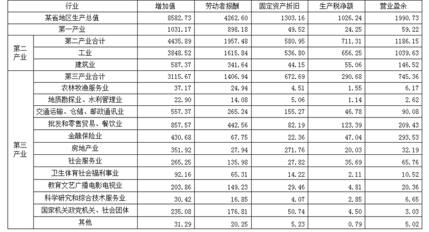

### 第 111 题

第三产业中增加值最多的行业是：

A. 金融保险业

B. 交通运输、仓储、邮电通讯业

C. 房地产业

D. 批发和零售贸易、餐饮业

第 111 题 · 答案与解析

**参考答案（粉笔题库参考内容）**

D

**解析**

由表可以看出，金融保险业的增加值为430.68亿元，交通运输、仓储、邮电通讯业为557.37亿元，房地产业为351.92亿元，批发和零售贸易、餐饮业为857.57亿元，四项中批发和零售贸易、餐饮业增加值最多。

故正确答案为D。

**考点**：直接找数、统计表

**来源**：2008年辽宁省公务员录用考试《行测》题第111题

### 第 112 题

第二产业增加值大约比第一产业与第三产业的和还多：

A. 290亿元

B. 310亿元

C. 330亿元

D. 350亿元

第 112 题 · 答案与解析

**参考答案（粉笔题库参考内容）**

A

**解析**

第二产业增加值是4435.89亿元，第一、三产业增加值分别是1031.17亿元、3115.67亿元，所以第二产业增加值比第一、三产业的和还多：4435.89 − (1031.17 + 3115.67)≈4430−(1030+3110)=290亿元。

故正确答案为A。

**考点**：简单加减计算、统计表

**来源**：2008年辽宁省公务员录用考试《行测》题第112题

### 第 113 题

在第三产业的十二个行业中，劳动者报酬超过100亿元的行业有：

A. 三个

B. 四个

C. 五个

D. 六个

第 113 题 · 答案与解析

**参考答案（粉笔题库参考内容）**

C

**解析**

在第三产业的十二个行业中，交通运输、仓储、邮电通讯业，批发和零售贸易、餐饮业，社会服务业，教育文艺广播电影电视业，国家机关政党机关、社会团体这五个行业劳动者报酬超过100亿元。

故正确答案为C。

**考点**：直接找数、统计表

**来源**：2008年辽宁省公务员录用考试《行测》题第113题

### 第 114 题

下列分析与实际情况不一致的是：

A. 在营业盈余方面，工业营业盈余最多，金融保险业其次

B. 在固定资产折旧方面，交通运输、仓储、邮电通讯业大约是地质勘探业、水利管理业的30多倍

C. 在劳动者报酬方面，金融保险业与卫生体育社会福利事业相差不多

D. 第三产业中，营业盈余方面有一半以上行业不超过10亿元

第 114 题 · 答案与解析

**参考答案（粉笔题库参考内容）**

D

**解析**

由表中可直接看出，在营业盈余方面，工业盈余最多，其次是金融保险业，A项正确；

固定资产折旧方面，交通运输、仓储、邮电通讯业155.27亿元，地质勘探业、水利管理业是5.06亿元，前者是后者的155.27 ÷ 5.06 ≈ 155 ÷ 5 = 31倍，B项正确；

劳动者报酬方面，金融保险业与卫生体育社会福利事业分别是67.75亿元、65.31亿元，二者相差不多，C项正确；

营业盈余方面不超过10亿元的总共5个，第三产业总共有12个产业，不到一半，所以D项分析与实际情况不一致。

本题为选非题，故正确答案为D。

**考点**：统计表、综合分析

**来源**：2008年辽宁省公务员录用考试《行测》题第114题

### 第 115 题

根据上述资料，下列分析不正确的有几项？

（1）在所有行业增加值中，劳动者报酬占绝大多数。

（2）科学研究和综合技术服务业，固定资产折旧与生产税净额之和没有营业盈余多。

（3）房地产业增加值中固定资产折旧占绝大多数。

（4）第三产业的十二个行业中，科学研究和综合技术服务业占比例最小。

A. 四项

B. 三项

C. 二项

D. 一项

第 115 题 · 答案与解析

**参考答案（粉笔题库参考内容）**

B

**解析**

（1）错：“绝大多数”指超过50%，而从地区生产总值来看，劳动者报酬所占比重还不到50%；

（2）错：科学研究和综合技术服务业固定资产折旧与生产税净额之和为4.07+2.85=6.92，而营业盈余为6.65；

（3）正确：由表中可直接看出房地产业增加值中固定资产折旧占绝大多数；

（4）错：第三产业的十二个行业中，占比例最小的是地质勘探业、水利管理业。

故正确答案为B。

**考点**：统计表、综合分析

**来源**：2008年辽宁省公务员录用考试《行测》题第115题

## 材料 4

2005年华东地区城市园林绿化情况统计表

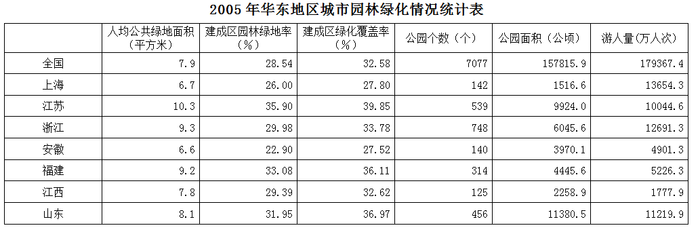

### 第 116 题

2005年全国大约有660个城市，每个城市平均约有多少个公园？

A. 11

B. 15

C. 17

D. 18

第 116 题 · 答案与解析

**参考答案（粉笔题库参考内容）**

A

**解析**

全国共有7077个公园，约660个城市，则每个城市大约有公园7077 ÷ 660 ≈ 7000 ÷ 600 ≈ 12，与A项最接近。

故正确答案为A。

**考点**：现期平均数、统计表

**来源**：2008年辽宁省公务员录用考试《行测》题第116题

### 第 117 题

在2005年华东六省一市中，建成区园林绿地率、建成区绿化覆盖率这两项低于全国平均值的有：

A. 浙江、江西

B. 江苏、安徽

C. 上海、安徽

D. 福建、山东

第 117 题 · 答案与解析

**参考答案（粉笔题库参考内容）**

C

**解析**

观察表格可得，建成区园林绿地率、绿化覆盖率低于全国平均值的省市是上海、安徽。

故正确答案为C。

**考点**：直接找数、统计表

**来源**：2008年辽宁省公务员录用考试《行测》题第117题

### 第 118 题

2005年华东六省一市，人均公共绿地面积超过全国平均值的有几个省市？

A. 7

B. 5

C. 4

D. 3

第 118 题 · 答案与解析

**参考答案（粉笔题库参考内容）**

C

**解析**

根据表中提供的信息可知，人均公共绿地面积低于全国平均值的有上海、安徽、江西，故超过全国平均值的有4个。

故正确答案为C。

**考点**：直接找数、统计表

**来源**：2008年辽宁省公务员录用考试《行测》题第118题

### 第 119 题

2005年华东六省一市平均每个公园面积超过20公顷的有几个省市？

A. 2

B. 4

C. 5

D. 6

第 119 题 · 答案与解析

**参考答案（粉笔题库参考内容）**

A

**解析**

用20公顷乘以公园个数，与公园面积对比：

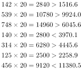

可得安徽、山东平均每个公园面积超过20公顷。

故正确答案为A。

**考点**：现期平均数、统计表

**来源**：2008年辽宁省公务员录用考试《行测》题第119题

### 第 120 题

下列关于2005年城市园林绿化统计分析中，正确的有几项：

（Ⅰ）华东六省一市的建成区园林绿地率平均值为30%

（Ⅱ）华东地区的公园个数最多和最少的分别是浙江省和江西省

（Ⅲ）上海市的游人量高于华东地区的其他六省

A. 0

B. 1

C. 2

D. 3

第 120 题 · 答案与解析

**参考答案（粉笔题库参考内容）**

D

**解析**

六省一市平均园林绿地率为(26.00+35.90+29.98+22.90+33.08+29.39 + 31.95)% ÷ 7 ≈ (26 + 36+30+23+33+29+32)%÷7=209%÷7≈30%，（Ⅰ）说法正确。

由表中数据可得，华东地区公园最多的为浙江省748个，最少是江西省125个，上海市游人为13654.3万人次，高于华东六省，（Ⅱ）（Ⅲ）说法正确。

综上所述，3项说法均正确。

故正确答案为D。

**考点**：统计表、综合分析

**来源**：2008年辽宁省公务员录用考试《行测》题第120题

## 材料 5

请根据下图所提供的信息完成各题：

（一）请仔细观察下图，左侧Y轴表示每月固定电话及移动电话用户总数，右侧Y轴表示每月新增固定电话及移动电话用户数。请根据下图所提供的信息回答问题：

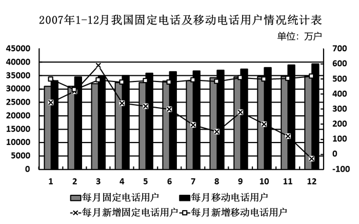

### 第 121 题

2007年新增固定电话用户与新增移动电话用户相差最大的月份是：

A. 4月

B. 8月

C. 11月

D. 12月

第 121 题 · 答案与解析

**参考答案（粉笔题库参考内容）**

D

**解析**

由图中直接可看出12月份新增固定电话用户与新增移动电话用户相差最大。

故正确答案为D。

**考点**：直接找数、统计图

**来源**：2008年辽宁省公务员录用考试《行测》题第121题

### 第 122 题

根据上图，下列说法错误的是：

A. 总体来看，2007年我国固定电话用户总数比去年有所增加

B. 总体来看，2007年我国移动电话用户总数比去年有所增加

C. 2007年我国固定电话用户总数量多次出现下降

D. 2007年我国移动电话用户每月新增数较为稳定，其平均数落在400－500万户之间

第 122 题 · 答案与解析

**参考答案（粉笔题库参考内容）**

C

**解析**

由图可看出2007年每月固定电话用户数与移动电话用户数均有所增加，所以A、B两项均正确；由图看出移动电话用户呈增长趋势，新增用户数值在400－500万户之间，D项正确；由图看出固定电话总用户数呈基本上升（12月有一次下降），所以不是“多次出现下降”，C项错误。

本题为选非题，故正确答案为C。

**考点**：统计图、综合分析

**来源**：2008年辽宁省公务员录用考试《行测》题第122题

### 第 123 题

2007年哪个月份我国固定电话用户新增数超过移动电话用户新增数？

A. 2月

B. 3月

C. 6月

D. 9月

第 123 题 · 答案与解析

**参考答案（粉笔题库参考内容）**

B

**解析**

由图中可知，3月份固定电话用户新增数超过移动电话用户新增数。

故正确答案为B。

**考点**：直接找数、统计图

**来源**：2008年辽宁省公务员录用考试《行测》题第123题

### 第 124 题

2007年总体来看，我国新增移动电话用户比新增固定电话用户要：

A. 少

B. 多

C. 一样

D. 无法判断

第 124 题 · 答案与解析

**参考答案（粉笔题库参考内容）**

B

**解析**

由图中可看出，除了3月份以外，其他11个月份新增移动电话用户数均大于新增固定电话用户数，所以2007年新增移动电话用户比新增固定电话用户要多。

故正确答案为B。

**考点**：直接找数、统计图

**来源**：2008年辽宁省公务员录用考试《行测》题第124题

### 第 125 题

根据上图，预计我国移动电话用户数与固定电话用户数的差距逐渐：

A. 扩大

B. 缩小

C. 保持不变

D. 无法判断

第 125 题 · 答案与解析

**参考答案（粉笔题库参考内容）**

A

**解析**

由图中可看出，每月移动电话用户数与固定电话用户数之间的差距呈增长趋势。

故正确答案为A。

**考点**：简单加减计算、统计图

**来源**：2008年辽宁省公务员录用考试《行测》题第125题

## 材料 6

下图是2007年1－12月某省农资、化肥、农药平均价格的变化走势图。仔细分析下图，完成以下各题。

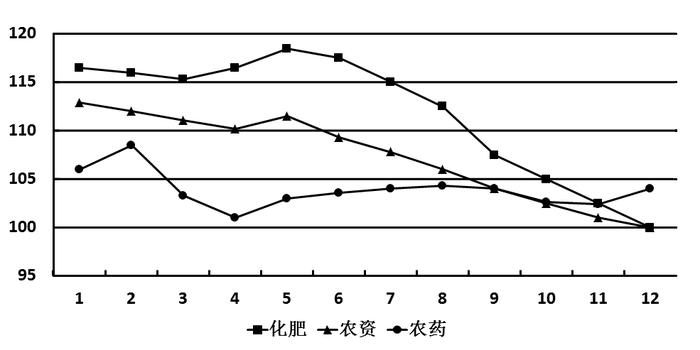

### 第 126 题

根据上图回答，2007年底农资的价格：

A. 约等于2007年底化肥的价格

B. 大于2007年底化肥的价格

C. 约等于2007年底农药的价格

D. 大于2007年底农药的价格

第 126 题 · 答案与解析

**参考答案（粉笔题库参考内容）**

A

**解析**

由图中可看出，2007年底农资的价格与化肥的价格大致重合，因此，两者价格大约相等。

故正确答案为A。

**考点**：直接找数、统计图

**来源**：2008年辽宁省公务员录用考试《行测》题第126题

### 第 127 题

根据走势图，判断农资价格走势受哪个的影响更大一些：

A. 化肥

B. 农药

C. 二者一样

D. 无法判断

第 127 题 · 答案与解析

**参考答案（粉笔题库参考内容）**

A

**解析**

由图中可看出，农资价格和化肥价格几乎是同增同减，因此，农资的价格走势受化肥影响更大些。

故正确答案为A。

**考点**：直接找数、统计图

**来源**：2008年辽宁省公务员录用考试《行测》题第127题

### 第 128 题

下列说法错误的是：

A. 化肥价格与农资价格的变化趋势大致相同

B. 2007年底的农药价格比2007年初的农药价格低

C. 总体来看，1－12月间化肥价格的变化幅度比农药价格变化幅度要小

D. 总体来看，1－12月间农资价格的变化幅度比农药价格变化幅度要大

第 128 题 · 答案与解析

**参考答案（粉笔题库参考内容）**

C

**解析**

由图中可看出，农资价格与化肥价格几乎是同增同减，所以A项正确；

2007年底农药价格低于105，而年初高于105，B项正确；

化肥年初的价格高于农药的价格，年底化肥的价格低于农药的价格，因此化肥价格的变化幅度要比农药价格变化幅度大，C项错误；

同理，D项正确。

本题为选非题，故正确答案为C。

**考点**：统计图、综合分析

**来源**：2008年辽宁省公务员录用考试《行测》题第128题

### 第 129 题

图中农药价格下降最大的月份是：

A. 3月

B. 10月

C. 9月

D. 12月

第 129 题 · 答案与解析

**参考答案（粉笔题库参考内容）**

A

**解析**

由图中可看出3月份农药价格下降最大。

故正确答案为A。

**考点**：直接找数、统计图

**来源**：2008年辽宁省公务员录用考试《行测》题第129题

### 第 130 题

2007年化肥价格最高的月份是：

A. 2月

B. 5月

C. 9月

D. 12月

第 130 题 · 答案与解析

**参考答案（粉笔题库参考内容）**

B

**解析**

由图中可看出5月份化肥的价格最高。

故正确答案为B。

**考点**：直接找数、统计图

**来源**：2008年辽宁省公务员录用考试《行测》题第130题

