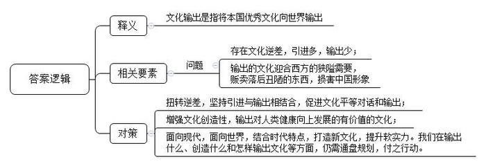
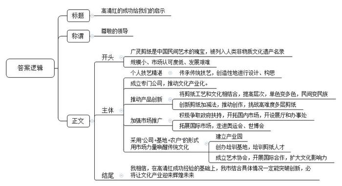
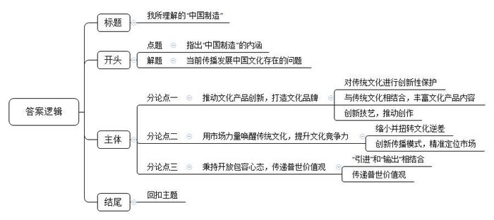

# 2014年公务员多省联考《申论》题（辽宁卷）

<!-- gwy:overview:start -->
> **辽宁 · 2014 · 申论 · 统考** ｜ 4 题 · 图片 4 处 · 答案随题折叠

导航：[题目](#题目) · [材料 1](#材料-1)
<!-- gwy:overview:end -->

> 候选采集稿。参考答案及解析来自粉笔页面，不代表官方答案或真实高分答卷；来源使用许可与原卷对应关系仍需人工核实。

## 给定材料

### 材料 1

随着网络和电视制造业的发展，全球电视剧市场已经进入了“大航海时代”，随意按动鼠标就能看到世界另一端同样在看的剧集。观众可以坐在家中尽享顶级剧集的极致体验，“追剧”俨然成为都市白领的一种生活方式。

而作为2014年最为火爆的美剧代表，《纸牌屋》一经推出便极度受宠，引起全民热议，连美国总统奥巴马也是《纸牌屋》的忠实粉丝。有观众看完《纸牌屋》后表示对于美国政治产生了浓厚的兴趣，对权力与爱情更有了新的认识，甚至翻出以往讲述美国政治历史的书籍、影片观看，参与到这部剧的讨论中。

美国电影和电视节目的总出口额是143亿美元（2011年），畅销100多个国家。2012年在法国播出美剧多达数十部，其中30多部单集观众超过百万，《超感神探》还一举成为当年的电视剧收视冠军。在德国，美剧基本处于垄断地位，占据约90%以上的播出份额，韩国2011年也从美国引进了122部电视剧。

“美剧《纸牌屋》这类全球剧的热播趋势有目共睹，它们真正开创了电视剧‘24小时全球联播’的奇迹。”英国某传媒的中华区首席执行官梁先生如此评价。专家认为，电视文化产品的价值日益凸显，中国应从中借鉴经验，提升电视剧制作水平，同时加强文化产品对外输出能力。

《纸牌屋》的热播并不影响《来自星星的你》赚取过亿眼球。由于两部电视剧对受众有明显的划分，出现了同期上映却“平分天下”的局面。《来自星星的你》在韩国播出时，网络最高收视率达68.9%。

美剧、韩剧在全球热播并非偶然。“以受众为导向，创新电视剧制作、播出模式，直接对接市场，接受评判。全新的制作模式给了电视剧全新的生命。”S大学新闻传播学院唐教授认为，与中国电视剧传统意义上的播出模式不同，美剧大都按“季”播出，通常一星期只播一集，边拍边播。由于美国电视剧播放平台不多，每年能在季播期黄金时间段播出的不到2000集，因此竞争异常激烈。近年来韩剧也采取边拍边播的模式，《来自星星的你》每周播出两集，每次网上更新剧集都会引发下载热。

这种开放的模式可以使制作方感受到观众对剧集的关注程度，根据每周更新的收视率和观众的反应，及时调整创作方向。美剧《越狱》第一季播出时，收视率曾高达1800万人次；而《生活大爆炸》主人公谢尔顿的性格是根据观众的反馈，几经改变才定型的。

更值得关注的是，这些热播剧大多高水准、大投入，保证质量精良，季播和周播的模式本身就拉高了电视剧制作成本。而对制作团队、剧本、导演、演员、道具等精益求精的追求，使得热播剧拍摄成本很高。

对比艾美奖得主《广告狂人》《斯巴达克斯》等美剧每集200万美元左右的制作费用，《纸牌屋》近400万美元的单集平均成本大大超过了一般制作标准。2011年美剧《史前新纪元》，重金打造的首集拍摄费用就接近2000万美元，甚至超过众多电影的投资成本。

这些热播剧还有一个特点，就是不同于中国的“武侠剧”“清宫剧”“名著剧”，而是以现实为题材，用写实手法描述生活中的酸甜苦辣，与观众不疏远。除科幻剧外，美剧大多务求内容真实，有时涉及技术层面还要请顾问或相关专家亲自操刀。《生活大爆炸》剧组甚至拥有一个真正的“科学顾问”，专门负责剧本中关于科学部分的内容创作。

现实题材的电视剧制播能最充分地反映电视剧生产流程的市场化属性。《来自星星的你》尽管有科幻成分，但人物感情进展、尊老爱幼的优良传统贯穿其中，传递出韩国普世价值观。

唐教授说，美剧和韩剧都通过简单的日常生活与谈话交流传递价值取向，剧中对生活中可能遇到的情感问题、生活细节问题的揭示，让人觉得真实可信，贴近生活的文化输出才容易被外国观众认同。

在国产电视剧产量猛增的背景下，专家建议中国加强对产品质量把关，积极探索并生产出既承载中国文化价值观，又符合国际主流“文化经验”和“感觉结构”的电视产品。

### 材料 2

当前，中国在中外文化交流中存在着逆差，中国优秀文化走向世界和外国文化涌入中国，在数量质量上都难成比例。为了扭转这种逆差，有学者提出了中国文化输出问题。

这个问题的提出不是偶然的，而是中国对外开放发展到一定程度后的必然产物。

随着中国对外开放的水平进一步的提高，人们认识到中国当代文化建设不仅要“引进”，而且要“输出”。有学者认为：“在最初的挪用套用之后，必须有自己的创造性输出，否则这个民族就会丧失真正的精神生命力。”“中国当代文化需要进一步奠定自己的文化精神生长点，藉此从中西文化交流的逆差中走出来，真正开始自己的文化创生性，走向中西文化平等对话和文化输出。”

从1934年鲁迅提出拿来主义到当前我们提出文化输出，已经整整过去80年了。科学发展观要求我们对外开放要坚持“引进”和“输出”相结合。拓展发展空间，增强发展后劲，不仅是对经济建设提出的要求，而且也适合文化建设。这就是说，我们的文化建设要坚持“拿来主义”与“文化输出”相结合。

学者指出，中国当代文化建设从拿来主义到文化输出虽然是一个巨大转变，但是，我们的文化输出不能为输出而输出，而是应在人类文化发展史上占有一席之地。正如我们拿来的是人类所创造的一切优秀文化成果，我们的文化输出也必须输出的是中国当代文化中对人类健康向上发展的有价值的东西。我们的文化输出应以我们的原创作品为主，即能够代表中国的国家形象，代表中国人民的形象，代表中国民族文化的形象。过去，我们也有一些文化产品输出，我们也输出了不少优秀的文化产品。但是，不可否认，我们输出的有些文化产品却是迎合西方一些人的狭隘需要，贩卖的是一些中国文化的落后的、丑陋的东西。这种文化输出损害了中国的国家形象，损害了中国人民的形象，损害了中国民族文化的形象。这是我们必须坚决反对的。

因此，中国当代文化解决中外文化交流中存在的“逆差”现象，就必须在努力解决现存冲突的过程中大力创造有价值的文化产品。这样，中华民族才能在人类的健康向上的发展中作出自己应有的独特贡献。这种“有价值的文化产品”，首先就内含着中国人自己的价值观。因此，有学者套用法国前总统德斯坦的话说：“中国在能够输出价值观之前，是不会成为一个真正的大国的。”

鉴于有人提出从文化拿来主义走向文化输出主义的理念，有学者也发表了自己的意见：一、少提“主义”，一提主义往往会走向极端；二、在文化上还是要“拿来”与“输出”并举。文化上的平等交流应该是互通的，一手进一手出，不应该只进不出或只出不进。现在没有哪个国家愿意只做进口生意不做出口生意的，文化上也如此，否则根本不符合世贸协定。“拿来”拿的是我们没有的，而且是必要的；“拿来”也不是全盘西化，囫囵吞枣，而是咀嚼消化，为我所用。“输出”也不是不分好歹地“倾销”，文化上的伪劣产品应该杜绝出口，以次充好必然败坏名声，后患无穷。即使是中国优秀的传统文化，尽管资源十分丰富，也需要经过现代的阐释，方能切合现时代世界的需要。最能体现中国当今文化软实力的，应该是经过中西会通又从现实需要出发，体现时代特点的原创性的文化观念、文化思想和文化产品。所以在输出什么、创造什么文化产品和怎样输出等方面，还需要作通盘的规划，并付之行动。

### 材料 3

“真的太美了！能把它送给我吗？”

“天哪，这是用剪刀剪出来的吗？太神奇了！”

这样的赞美，几乎不用打草稿，每一个看到高清红剪纸的人，都会不由自主发出这样的惊叹！

人群中的高清红与普通的中年妇女并无二致，但只要给她一张纸、一把剪刀，她仿佛顷刻间就拥有了化腐朽为神奇的魔力。

“我是为剪纸而生的。”因为有了剪纸，高清红的人生道路从此不同。

广灵剪纸作为中国民间剪纸三大流派之一，以彩色剪纸为特色，每件作品经二十余道工序成形，是集绘画、色彩、镂雕于一体的手工艺术品，被誉为“中华民间艺术一绝”。2009年广灵剪纸作为中国剪纸的部分申报项目，被联合国教科文组织列入人类非物质文化遗产代表作名录。

广灵剪纸传到高清红这里，已经是第六代了。也许是广灵的青山绿水赋予了她灵巧的心思，也许是祖祖辈辈的匠心造就了她杰出的基因，4岁起高清红跟着外祖母和母亲学剪窗花，年纪轻轻就已经能独立完成设计巧妙、构思独特的剪纸作品了。

和身边很多同龄人一样，高中毕业后高清红走上了工作岗位，然而1996年她所在的县水泥厂因企业效益滑坡，她只得被迫下岗。回到家一次偶然的机会，她听说上世纪80年代广灵剪纸的主要创作生产基地广灵工艺美术厂倒闭了，她心底埋藏多年的那个儿时的“剪纸梦”突然萌动了，于是，追随梦想的召唤，青红剪纸艺术有限公司应运而生。作为广灵民间剪纸艺术的带头人，高清红开始带领广灵剪纸走上民间文化产业化的道路。

从“一年一枯荣、岁岁上窗棂”的窗花做起，青红公司规模越做越大，层次越做越高，单色的变成了多彩的，民间的变成了民族的。由高清红创新的“剪纸加减法”让构图跃然纸上，出图力透纸背，把传统的广灵剪纸艺术推到了创作新阶段，在众多形式的剪纸中独成一家。据了解，广灵剪纸中难度最大的多层剪纸，高清红目前已经可以剪到八层，这在全世界也是绝无仅有的。而在民间，她的多幅作品的市场价值已达数万元。

不再是传统福禄寿禧和飞禽走兽，高清红的剪纸瞄准了更广的文化经典：历时半年完工的长达数米的《清明上河图》以精湛的刀工艺术将北宋时期的繁荣市井刻画得惟妙惟肖；色彩明艳的《醉迷红楼十二金钗》让曹雪芹笔下的十二位古典美人生动传神。2013年，当联合国秘书长潘基文收到高清红为其创作的剪纸肖像礼品时赞不绝口，连连说：“太神奇了，比我本人还漂亮。”

青红剪纸愈剪愈美，作品也愈传愈远。如今的广灵青红剪纸公司被山西省大同市指定为“民间手工艺术专业公司”和旅游产品定点生产公司，在全国各地开设了10余个展厅和办事处，而青红剪纸不仅走进了北京奥运会、上海世博会，也随着中国的文化开放走向了国际舞台，每年实现产能1500万元，出口创汇100万美元。

产品走出了国门，高清红的心却在广灵。“中国剪纸是中国民间文化的一部分，但发展道路却很艰难，多年来难登大雅之堂。为了保护传统文化，让传统文化焕发出新的活力，我们采用‘公司+基地+农户’的形式，带领全县上万农民从事剪纸产业，还专门建立了广灵县剪纸产业文化园，用市场的力量唤醒传统文化。”高清红告诉记者，前不久，她们与国际生态安全合作组织和联合国青年技术培训组织共同创办了“国际青年就业技能培训基地”，组织培训剪纸人才一万多人；同时还成立了剪纸民间艺术协会，与多个国际组织合作，力图将中国民间艺术推向国际市场。2013年7月，高清红带着剪纸作品《清明上河图》全卷走入联合国，受到联合国秘书长潘基文和联合国教科文组织总干事伊莉娜·博科娃的高度赞赏。

“事实证明，中国传统文化是能在市场上占据一席之地的，但是这条路并不好走，规模也比较小，市场认可度仍有待提升。”高清红呼吁社会更多地关注民间文化，为传统文化与现代市场创造更多的对接平台，只有这样，传统文化才能真正走向市场、发扬光大。

### 材料 4

大批赴美志愿者汉语教师在美国校园和社区内担任着文化使者的角色。来自四川的高中教师小琼就是其中之一。为期一年的赴美教学经验给她、她的美国学生乃至美国“街坊邻居”都留下珍贵记忆。

小琼在俄克拉荷马州的一座小城执教，借住在一对老夫妇家中。小城只有一家沃尔玛超市。用男主人加里的话说，“全镇人几乎都相互认识”。这个四川姑娘每次出门都会被当地人认出来，很多人都会友善地同她打招呼。

文化交流归根结底是人的交流、感情的交流。小琼说，自己在2008年汶川大地震中不幸失去双亲，很长时间难以从悲伤中走出来，但这对美国老夫妇的悉心照顾、小镇居民的热情让她真切感受到人间真情。

和其他汉语教师一样，小琼也配备了介绍中国文化的“资源包”，内容从神话故事、历史名人到古典名著不一而足。不过，在和孩子们的接触中，她本身就是当地人了解中国的一个“资源包”。“你们也有手机吗？”“家中有电视吗？”一个个问题背后是美国孩子对中国的不了解。当然，在打开“资源包”的同时也不可避免引发价值观的碰撞。“美国老师不加班，中国老师爱加班”“中国人爱储蓄”，甚至小琼想起万里之外家人时充盈的泪水，都让孩子们乃至大人们真切地感知着“中国人”的家庭观念，碰撞后带来的是了解和欣赏。

“我们觉得她是最好的‘中国制造’。”加里对记者幽默地说道，“如果你们国家要派出中国文化大使，选我们的琼准没错。”

当记者在世界各地问起：“提起中国文化，您会想到什么？”在赤道边春城内罗华，中非关系专业在读研究生瑟库拉这样告诉记者：“孔子，我会想到他。我上过不少有关中国外交、非中关系的课，每次遇到理解不了的思想时，我们就开玩笑说‘这是孔子的思想’，每次辩论课上找论据时，我们最后总会找到‘孔子曰……’。西方也有很多先贤，但中国先贤似乎我只了解孔子。

在内罗毕CBD地区一家大排档餐厅，28岁的顾客贝利对记者说：“我通过在内罗毕工作的中国人了解中国文化。我觉得要想让肯尼亚人了解中国文化，最重要的是生活在本地的中国人的态度，希望中国人能同当地人多交流。中国政府也应在非洲多办一些展览，比如饮食展览、传统服饰展览，这样我们才能了解更多中国文化。”

记者采访过程中最深刻的体悟是：在融合流动的地球村里，每个人都是一国最生动的“文化名片”，你传达什么，对方就感受什么。提高中国文化软实力，扩大中国文化的国际影响力，看似工程浩大，却始于足下。建设社会主义文化强国，政府需要做的还很多，而民间交流、业界合作也亟待进化升级。

## 题目

### 第 1 题

**“给定资料**1**”介绍了美剧、韩剧的成功事例，请根据“给定资料**1**”，概括我们从中能借鉴到哪些经验。（15分）**

关联材料：材料 1

作答要求：

要求：全面、准确、简明，不超过100字。

第 1 题 · 答案与解析

**参考答案（粉笔题库参考内容）**

中国应提升制作水平，加强对外输出能力，具体如下：1.利用网络和电视平台打开全球市场。2.定位市场，划分受众。3.创新制作播出模式，对接市场。4.保证高水准大投入、质量精良。5.贴近观众、生活、实际，传递价值观。

**解析**

**参考答案说明：**答案先整体上说明“应提升制作水平，加强对外输出能力”，再具体从“利用网络和电视平台”“划分受众”“创新电视剧播出模式”“保证质量精良”“贴近生活、传递普世价值观”这五个方面进行了分类撰写。各条要点之间在内容并列且没有交叉。

**考点**：经验启示类

**来源**：2014年公务员多省联考《申论》题（辽宁卷）

### 第 2 题

**根据“给定资料**2**”，谈谈你对“文化输出”的理解。（20分）**

关联材料：材料 2

作答要求：

要求：全面、准确、有概括力。不超过250字。

第 2 题 · 答案与解析

**参考答案（粉笔题库参考内容）**

文化输出是指将本国优秀文化向世界输出。

当前，中国在文化交流中存在如下问题：1.存在文化逆差，引进多，输出少；2.输出的文化迎合西方的狭隘需要，贩卖落后丑陋的东西，损害中国形象。
因此，我们要采取措施：1.扭转逆差，坚持引进与输出相结合，促进文化平等对话和输出；2.增强文化创造性，输出对人类健康向上发展有价值的文化；3.立足传统，面向现代，面向世界，结合时代特点，打造新文化，提升软实力。我们在输出什么、创造什么和怎样输出文化等方面，仍需通盘规划，付之行动。

**解析**

**参考答案说明：**（1）本参考答案按照词句解释类题型的答题思路：释义（解释“文化输出”的含义）+分析（相关要素：包括“文化输出”的问题）+总结评价（“文化输出”的对策），整理要点。（2）加上了“因此……”“当前，中国在文化交流中存在如下问题……”等词语承接上下文，做到了表意清楚。

**考点**：词句解释类

**来源**：2014年公务员多省联考《申论》题（辽宁卷）

### 第 3 题

**假如你是某单位派驻广灵的观察员，请根据“给定材料**3**”，以《高清红的成功给我们的启示》为题写一份材料，供领导参考。（25分）**

关联材料：材料 3

作答要求：

要求：

（1）内容具体，符合实际；

（2）目的明确，切合主题；

（3）条理清楚，有概括性；

（4）不超过500字。

第 3 题 · 答案与解析

**参考答案（粉笔题库参考内容）**

高清红的成功给我们的启示

尊敬的领导：

广灵剪纸是中国民间艺术的瑰宝，被列入人类非物质文化遗产名录。但其规模小、市场认可度低、发展艰难，高清红克服困难，积极创新，开拓市场，带领其走上文化产业化道路。具体启示如下：

一、个人技艺精湛。传承传统技艺，创造性地进行设计、构思。二、成立专门公司，推动文化产业化。三、推动产品创新。将剪纸工艺和文化相结合，提高层次，单色变多色，民间变民族，创新剪纸加减法，推动创作，挑战高难度多层剪纸。四、加强市场推广。积极争取政府扶持，开拓国内市场，开设展厅和办事处，拓展国际市场，走进奥运会、世博会。五、采用“公司+基地+农户”的形式，用市场力量唤醒传统文化。建立产业园，创办培训基地，培训剪纸人才，成立艺术协会，开展国际合作，扩大文化影响力。

我相信，在高清红成功经验的基础上，我市结合具体情况一定能突破创新，必将让文化产业迎来辉煌未来。

**解析**

**参考答案说明：**（1）格式方面，本参考答案按照总结材料的一般格式写到了“标题”“称谓”和“正文”。（2）正文部分，一方面从内容来看，围绕着“高清红的成功事例”，本参考答案的开头部分首先介绍了广灵剪纸的地位、价值，以及面临的发展问题，并对高清红的经验做法进行适当概括；主体部分分别从“个人技艺精湛”“推动产品创新”“推动产品创新”“加强市场推广”“采用‘公司+基地+农户’的形式”五个方面介绍了高清红的成功经验。另一方面，形式上，本参考答案做到了分段、分条撰写，整体上条理较为清晰。

**考点**：总结类

**来源**：2014年公务员多省联考《申论》题（辽宁卷）

### 第 4 题

**“给定资料**4**”划线部分写道：“我们觉得她是最好的‘中国制造’。”请结合你对给定资料的思考和对这句话的领悟，以《我所理解的“中国制造”》为题，写一篇文章。（40分）**

关联材料：材料 1、材料 2、材料 3、材料 4

作答要求：

要求：

（1）自选角度，立意明确；

（2）联系实际，不拘泥于“给定资料”；

（3）思路清晰，语言流畅；

（4）总字数1000-1200字。

第 4 题 · 答案与解析

**参考答案（粉笔题库参考内容）**

**我所理解的****“中国制造”**

**——以文化之基筑“中国制造”之魂**

小琼之所以被认为是“最好的‘中国制造’”，是因为作为一名文化传播的使者，她通过人的交流、情感的交融，将神话故事、历史名人、古典名著等积淀千年的中国历史文化带到西方，还将现代化的中国文明全面、真实地传播出去，更向世界传递了中国人努力勤奋、勤俭节约、重视家庭的价值观念，让世界了解中国、认可中国、欣赏中国。**因此，我所理解的****“中国制造”，不仅要创新文化产品，还要输出质优价好的有形产品，更要输出历久弥新、与时俱进的价值观，让世界记住我们的“中国元素”。**

尽管我们以“制造大国”自居，但人们往往将其与“山寨”“低端”挂钩。“制造大国”并非“制造强国”，缺乏文化内涵、文化创意，让“中国制造”缺少一张独具特色的名片，也导致世界对中国认知的片面性、狭隘性。为扭转错误认知，必须借文化输出之力，以文化之基筑“中国制造”之魂。

**“中国制造”需推动文化产品创新，****打造文化品牌，从****“中国制造”走向“中国创造”。**精妙绝伦的地方戏曲，栩栩如生的精美剪纸，美轮美奂的传统建筑，尽管我国的传统文化流传千年，生动丰富，但我们也必须承认：一些民间艺术已经日渐式微，面临失根断层的危险。为此，我们要对传统文化进行创新性保护，打造内容丰富、工艺精湛的文化产品，走文化产业化道路。创新文化产品，不仅要与传统文化相结合，丰富文化产品内容，提升文化产品层次；更要创新技艺，推动创作，挑战高难度工艺，争取把老工艺变成新产品，让“中国制造”具有更高的辨识度。

**此外，输出文化产品也至关重要，用市场力量唤醒传统文化，提升文化竞争力，助推****“中国制造”走向世界。**当前，我国在中外文化交流中存在着不容忽视的“文化逆差”，文化产品的引进和输出，在数量质量上都难成比例。为此，我们要开始自己的文化创生性，促进中西文化平等对话交流，逐步缩小并扭转文化逆差。在此基础上，学习借鉴韩剧美剧的成功经验，找准市场需求，划分受众群体，创新文化作品的制作传播模式，精准定位国内市场；同时利用网络和电视平台打开海外市场，让“中国制造”走出国门，为世界文化增添色彩。

**最后，****“中国制造”不仅要创新输出有形有质的文化产品，更需秉持开放包容心态，传递符合时代需要、符合世界潮流的普世价值观。**这就要求我们要坚持“引进”和“输出”相结合，以开放的胸襟向世界其他民族优秀文化学习，引进必要的文化产品；并立足传统，面向现代，面向世界，结合时代特点进行创造性融合，输出符合现代需求，符合世界需求，符合人类真善美需求的普世价值观，为人类的积极健康向上发展做出应有的独特贡献。

曾经，我们在战乱动荡的年代食不果腹、衣不蔽体，那时我们羞于面对世界；如今，“中国制造”犹如雨后春雷，在世界的舞台一鸣惊人。未来，在文化要素的驱动下，“中国制造”还将不断地创造惊喜，让我们拭目以待，一同见证中国奇迹！（1171字）

**文章分析**

**我所理解的****“中国制造”**

**——以文化之基筑“中国制造”之魂**

【**标题的优点**：严格按照题目的要求，以“我所理解的‘中国制造’”为标题。为了使文章写作角度更清晰，在副标题中凸显了“中国制造”中“文化”这一内涵。】

小琼之所以被认为是“最好的‘中国制造’”，是因为作为一名文化传播的使者，她通过人的交流、情感的交融，将神话故事、历史名人、古典名著等（1）积淀千年的中国历史文化带到西方，还将现代化的中国文明全面、真实地传播出去，更向世界传递了中国人努力勤奋、勤俭节约、重视家庭的价值观念，让世界了解中国、认可中国、欣赏中国。（3）**因此，我所理解的“中国制造”，****不仅要创新文化产品****，****还要输出质优价好的有形产品****，****更要输出历久弥新、与时俱进的价值观****，****让世界记住我们的****“中国元素”****。**

尽管我们以“制造大国”自居，但人们往往将其与“山寨”“低端”挂钩。“制造大国”并非“制造强国”，（2）缺乏文化内涵、文化创意，让“中国制造”缺少一张独具特色的名片，也导致世界对中国认知的片面性、狭隘性。为扭转错误认知，必须借文化输出之力，以文化之基筑“中国制造”之魂。

【**开头的优点**：★内容方面。范文的开头是紧扣题目给定的“中国制造”这一主题展开的。首先，开头第一句话点出了“中国制造”这一主题，做到了主题明确。其次，对“中国制造”这一主题进行了分析阐述，指出了：（1）“中国制造”的内涵；（2）“中国制造”存在的问题；（3）如何发展“中国制造”。★文字表达方面：长短句配合使用，使语言表达有节奏感。】

**“中国制造”需推动文化产品创新，打造文化品牌，从“中国制造”走向“中国创造”。**精妙绝伦的地方戏曲，栩栩如生的精美剪纸，美轮美奂的传统建筑，尽管我国的传统文化流传千年，生动丰富，但我们也必须承认：一些民间艺术已经日渐式微，面临失根断层的危险。为此，（1）我们要对传统文化进行创新性保护，打造内容丰富、工艺精湛的文化产品，走文化产业化道路。（2）创新文化产品，不仅要与传统文化相结合，丰富文化产品内容，提升文化产品层次；（3）更要创新技艺，推动创作，挑战高难度工艺，争取把老工艺变成新产品，让“中国制造”具有更高的辨识度。

【**论述段****1****的优点**：★观点句：范文的观点句是紧扣“中国制造”这一文章主题提出的。形式上，它在段首处直接写出，位置突出，容易被发现；内容上，关键词突出，内容要点明确，可以明显看出它是从“推动产品创新”“打造文化品牌”等角度入手，指出了要使“中国制造”走向“中国创造”。★论述内容：本段主要围绕“中国制造”这一主题进行分析阐述，指出了：（1）对传统文化进行创新性保护；（2）丰富文化产品内容，提升文化产品层次；（3）创新技艺，推动创作。注意：以上三个方面的内容都是紧扣观点句“‘中国制造’需推动文化产品创新，打造文化品牌，从‘中国制造’走向‘中国创造’”进行分析论述的，针对性强、内容层次丰富。并且，这三个方面的论述有内在逻辑顺序：先写“保护传统文化”，再写“不仅要与传统文化相结合，还要丰富文化产品”，最后写到“创新技艺，推动创作，挑战高难度工艺”。最后，在论证方法和论据选取方面，讲道理和举例子相结合，做到了丰富多样。】

**此外，输出文化产品也至关重要，用市场力量唤醒传统文化，提升文化竞争力，助推****“中国制造”走向世界。**当前，我国在中外文化交流中存在着不容忽视的“文化逆差”，文化产品的引进和输出，在数量质量上都难成比例。为此，（1）我们要开始自己的文化创生性，促进中西文化平等对话交流，逐步缩小并扭转文化逆差。在此基础上，（2）学习借鉴韩剧美剧的成功经验，找准市场需求，划分受众群体，创新文化作品的制作传播模式，精准定位国内市场；（3）同时利用网络和电视平台打开海外市场，让“中国制造”走出国门，为世界文化增添色彩。

【**论述段****2****的优点**：★观点句：范文的观点句是紧扣“中国制造”这一文章主题提出的。形式上，它在段首处直接写出，位置突出，容易被发现；内容上，关键词突出，内容要点明确，可以明显看出它是从“市场”角度入手，指出了如何“输出文化产品”。★论述内容：本段主要围绕“中国制造”这一主题进行分析阐述，指出了：（1）缩小并扭转文化逆差；（2）创新传播模式，精准定位国内市场；（3）打开国外市场。注意：以上三个方面的内容都是紧扣观点句“输出文化产品也至关重要，用市场力量唤醒传统文化，提升文化竞争力，助推‘中国制造’走向世界”进行分析论述的，针对性强、内容层次丰富。并且，这三个方面的论述有内在逻辑顺序：先写“缩小文化逆差”，再写“做好国内市场”，最后写“打开国外市场”。最后，在论证方法和论据选取方面，讲道理和举例子相结合，做到了丰富多样。】

**最后，****“中国制造”不仅要创新输出有形有质的文化产品，更需秉持开放包容心态，传递符合时代需要、符合世界潮流的普世价值观。**（1）这就要求我们要坚持“引进”和“输出”相结合，以开放的胸襟向世界其他民族优秀文化学习，引进必要的文化产品；（2）并立足传统，面向现代，面向世界，结合时代特点进行创造性融合，输出符合现代需求，符合世界需求，符合人类真善美需求的普世价值观，为人类的积极健康向上发展做出应有的独特贡献。

【**论述段****3****的优点**：★观点句：范文的观点句是紧扣“中国制造”这一文章主题提出的。形式上，它在段首处直接写出，位置突出，容易被发现；内容上，关键词突出，内容要点明确，可以明显看出它是从“包容心态”“传递价值观”等角度入手，指出要更好的输出“中国制造”。★论述内容：本段主要围绕“中国制造”这一主题进行分析阐述，指出了：（1）坚持“引进”和“输出”相结合；（2）输出普世价值观。最后，在论证方法和论据选取方面，做到了丰富多样。】

曾经，我们在战乱动荡的年代食不果腹、衣不蔽体，那时我们羞于面对世界；如今，“中国制造”犹如雨后春雷，在世界的舞台一鸣惊人。未来，在文化要素的驱动下，（1）“中国制造”还将不断地创造惊喜，让我们拭目以待，一同见证中国奇迹！

【**结尾的优点**：范文结尾回扣了“中国制造”这一主题。】

**解析状态：unknown（来源未提供）**

**考点**：文章写作题

**来源**：2014年公务员多省联考《申论》题（辽宁卷）

