# 2015年辽宁省选调生招录考试 行政职业能力测验试卷(精选)

<!-- gwy:overview:start -->
> **辽宁 · 2015 · 行测 · 选调** ｜ 92 题 · 图片 81 处 · 答案随题折叠

| 题型模块 | 题量 | 题号 |
| --- | ---: | ---: |
| 数量关系 | 12 | 1–12 |
| 言语理解与表达 | 27 | 13–39 |
| 判断推理 | 20 | 40–59 |
| 常识判断 | 20 | 60–79 |
| 资料分析 | 13 | 80–92 |
| **合计** | **92** | |

导航：[题型与作答说明](#题型与作答说明) · [题目](#题目) · [材料 1](#材料-1)
<!-- gwy:overview:end -->

> 候选采集稿。参考答案及解析来自粉笔页面，不代表官方答案或真实高分答卷；来源使用许可与原卷对应关系仍需人工核实。

## 题型与作答说明

数量关系

（12题）

在这部分试题中，每道题呈现一段表述数字关系的文字，要求你迅速、准确地计算出答案。

言语理解与表达

（27题）

本部分包括表达与理解两方面的内容。请根据题目要求，在四个选项中选出一个最恰当的答案。

判断推理

（20题）

本部分包括图形推理、定义判断、类比推理与逻辑判断四种类型的试题，在四个选项中选出一个最恰当的答案。

常识判断

（20题）

根据题目要求，在四个选项中选出一个最恰当的答案。

资料分析

（13题）

所给出的图、表、文字或综合性资料均有若干个问题要你回答。你应根据资料提供的信息进行分析、比较、计算和判断处理。

## 题目

### 第 1 题

4，2，2，3，6，15，（  ）

A. 16

B. 30

C. 45

D. 50

第 1 题 · 答案与解析

**参考答案（粉笔题库参考内容）**

C

**解析**

数列前后项存在明显倍数关系，后项与前项作商得：0.5，1，1.5，2，2.5，是公差为0.5的等差数列，则题目所求项为。

故正确答案为C。

**来源**：2015年辽宁省选调生招录考试 行政职业能力测验试卷(精选)第1题

### 第 2 题

1，-3，5，21，（  ），190965

A. 41

B. 437

C. 1996

D. 199037

第 2 题 · 答案与解析

**参考答案（粉笔题库参考内容）**

B

**解析**

观察数列，前后项差距成指数级扩大，观察发现：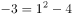，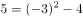 ，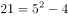 ，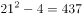 ,验证发现：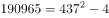，则题目所求项为437。

故正确答案为B。

**来源**：2015年辽宁省选调生招录考试 行政职业能力测验试卷(精选)第2题

### 第 3 题

（  ），36，19，10，5，2

A. 84

B. 69

C. 63

D. 57

第 3 题 · 答案与解析

**参考答案（粉笔题库参考内容）**

B

**解析**

方法一：数列数字依次递减，变化不大，优先考虑作差。前项减后项得到新数列为：（ ），17，9，5，3；再次作差得到（ ），8，4，2，后三项为公比为2的等比数列，则所求项为。

方法二：数列数字依次递减，变化不大，前项约为后项的2倍。观察数列可得：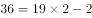，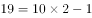，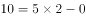，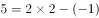，则所求项为。

故正确答案为B。

**来源**：2015年辽宁省选调生招录考试 行政职业能力测验试卷(精选)第3题

### 第 4 题

（  ），82，50，26，10，2

A. 101

B. 112

C. 121

D. 122

第 4 题 · 答案与解析

**参考答案（粉笔题库参考内容）**

D

**解析**

方法一：数列数字均在平方数附近，考虑幂次修正，原数列可转化为：（    ），，，，，，均为平方数+1，且底数是公差为-2的等差数列，故所求项为。

方法二：数列数字依次递减，变化不大，优先考虑作差。前项减后项得到新数列为：（    ），32，24，16，8，后四项是公差为8的等差数列，则所求项为82+32+8=122。

故正确答案为D。

**来源**：2015年辽宁省选调生招录考试 行政职业能力测验试卷(精选)第4题

### 第 5 题

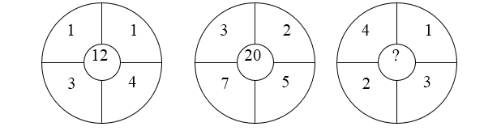

A. 7

B. 9

C. 11

D. 13

第 5 题 · 答案与解析

**参考答案（粉笔题库参考内容）**

D

**解析**

图形数列，中心数字较大，凑中心数。观察图形可得，12=(1+1+3+4)+3；20=(3+2+7+5)+3；则题目所求=(4+1+2+3)+3=13。

故正确答案为D。

**来源**：2015年辽宁省选调生招录考试 行政职业能力测验试卷(精选)第5题

### 第 6 题

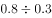如果商是2，那么余数是：

A. 2

B. 0.2

C. 0.02

D. 20

第 6 题 · 答案与解析

**参考答案（粉笔题库参考内容）**

B

**解析**

"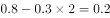" ，故正确答案为B。

**来源**：2015年辽宁省选调生招录考试 行政职业能力测验试卷(精选)第6题

### 第 7 题

有一个五位数，左边的三位数比右边的两位数的4倍还多4，如果把右边两位数移到最前面，新的五位数比原来的2倍还多11122，则原来的五位数是：

A. 18044

B. 24059

C. 27267

D. 30074

第 7 题 · 答案与解析

**参考答案（粉笔题库参考内容）**

B

**解析**

方法一：多位数问题，首先考虑代入排除。

A项：原五位数18044，新五位数44180，，不等于44180，排除；

B项：原五位数24059，新五位数59240，，当选；

C项：原五位数27267，新五位数67272，，尾数为6，与原五位数尾数不同，排除；

D项：原五位数30074，新五位数74300，，不等于74300，排除。

方法二：假设该五位数左边的三位数为A，右边的两位数为B，则该五位数为100A+B，根据题意有：A=4B+4···①；1000B+A=2（100A+B）+11122···②；两式联立，解得A=240，B=59；原来五位数为24059。

故正确答案B。

**来源**：2015年辽宁省选调生招录考试 行政职业能力测验试卷(精选)第7题

### 第 8 题

圆的半径由3厘米增加到4厘米，圆的面积增加了（  ）平方厘米。

A. 3.14

B. 12.56

C. 21.98

D. 25.76

第 8 题 · 答案与解析

**参考答案（粉笔题库参考内容）**

C

**解析**

根据圆面积计算公式：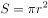， 平方厘米。

故正确答案为C。

**考点**：几何公式类-平面图形

**来源**：2015年辽宁省选调生招录考试 行政职业能力测验试卷(精选)第8题

### 第 9 题

如果2斤油可换5斤肉，7斤肉可换12斤鱼，10斤鱼可换21斤豆，那么27斤豆可换（  ）油。

A. 3斤

B. 4斤

C. 5斤

D. 6斤

第 9 题 · 答案与解析

**参考答案（粉笔题库参考内容）**

A

**解析**

采用赋值法，设豆子的单价为10，根据题意，则鱼的单价为21，肉的单价为36，油的单价为90，所以27斤豆的价格为，可换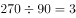斤油。

故正确答案为A。

**考点**：和差倍比问题

**来源**：2015年辽宁省选调生招录考试 行政职业能力测验试卷(精选)第9题

### 第 10 题

有一个电子钟，每走9分钟亮一次灯，每到整点响一次铃。中午12点整，电子钟响铃又亮灯。下一次既响铃又亮灯是：

A. 下午1点

B. 下午2点

C. 下午3点

D. 下午4点

第 10 题 · 答案与解析

**参考答案（粉笔题库参考内容）**

C

**解析**

每到整点就响一次铃，说明响铃的周期是60分钟；每走9分钟亮一次灯，说明亮灯的周期是9分钟。根据题意，求下次既响铃又亮灯的时间，实则求响铃和亮灯周期的最小公倍数，两者最小公倍数为180，则下次既响铃又亮灯是在12点再过180分钟后，即下午3点钟。

故正确答案为C。

**考点**：周期相遇问题

**来源**：2015年辽宁省选调生招录考试 行政职业能力测验试卷(精选)第10题

### 第 11 题

一家4口人，爸爸比妈妈大3岁，哥哥比妹妹大5岁。妹妹屈指一算，发现4年之后，兄妹二人的岁数之和、父母二人的岁数之和都能开方得到个位整数，则今年一家4口的岁数之和为：

A. 90

B. 94

C. 98

D. 102

第 11 题 · 答案与解析

**参考答案（粉笔题库参考内容）**

A

**解析**

根据常识，兄妹的岁数之和小于父母岁数之和，故让兄妹岁数之和的平方数尽可能小，父母岁数之和的平方数尽可能大。设妹妹今年x岁，则哥哥为x+5岁，4年后兄妹二人岁数之和开方得到整数，即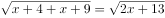为整数，x最小为6，即妹妹6岁，哥哥11岁；设妈妈今年y岁，则爸爸为y+3岁，4年后父母岁数之和开方得到个位整数，即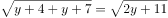为个位整数，y最大为35，即妈妈35岁，爸爸38岁；今年一家4口岁数之和为6+11+35+38=90。

故正确答案为A。

**考点**：年龄问题

**来源**：2015年辽宁省选调生招录考试 行政职业能力测验试卷(精选)第11题

### 第 12 题

一小型飞机上的座位分成两部分：商务舱20个座位，经济舱180个座位，如果40%的商务舱和20%的经济舱的座位是空闲的，那么整个飞机的座位上座率为：

A. 69%

B. 70%

C. 78%

D. 82%

第 12 题 · 答案与解析

**参考答案（粉笔题库参考内容）**

C

**解析**

根据题意，商务舱上座个 ，经济舱上座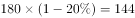个 ，上座12+144=156个，飞机共有座位20+180=200个，整个飞机上座率为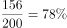。

故正确答案为C。

**考点**：和差倍比问题

**来源**：2015年辽宁省选调生招录考试 行政职业能力测验试卷(精选)第12题

### 第 13 题

社会主义核心价值观集中反映着当代中国人的精神追求和理想信念，这是我们的精神支柱和行动向导。发扬光大社会主义核心价值观，对坚持社会主义文化的前进方向、建设全民族的精神家园具有＿＿＿＿＿＿、决定性作用。

填入划横线部分最恰当的一项是：

A. 基础性

B. 基本性

C. 稳固性

D. 绝对性

第 13 题 · 答案与解析

**参考答案（粉笔题库参考内容）**

A

**解析**

横线处修饰“作用”，且与后文“决定性”构成并列关系，应与“决定性”语意相近。“决定性”体现了社会主义核心价值观的重要作用，故横线也应体现出“重要作用”之意。A项“基础性”有基本、根基的含义，能够体现出“社会主义核心价值观”的重要性，当选。B项“基本性”、D项“绝对性”均与作用搭配不当，排除；C项“稳固性”多强调物品牢固、扎实之意，但文段强调的是“重要性”，排除。

故正确答案为A。

【文段出处】《社会主义核心价值观应成为作家心灵的罗盘》

**考点**：关联关系-并列关系、实词填空

**来源**：2015年辽宁省选调生招录考试 行政职业能力测验试卷(精选)第13题

### 第 14 题

下列划线字注音全都正确的一项是：

A. 纠<u>葛</u>（gé） 债<u>券</u>（juàn） 亲<u>昵</u>（nì） 侃<u>侃</u>（kăn）而谈

B. 静<u>谧</u>（mì） 饶<u>恕</u>（shù） <u>蹉</u>（cuō）跎 良<u>莠</u>（xiù）不齐

C. <u>炽</u>（zhì）热 <u>栖</u>（qī）息 摩<u>挲</u>（suō） <u>拈</u>（zhān）轻怕重

D. 匀<u>称</u>（chèn） 造<u>诣</u>（yì） <u>湮</u>（yān）没 危言<u>耸</u>（sǒng）听

第 14 题 · 答案与解析

**参考答案（粉笔题库参考内容）**

D

**解析**

A项“债券”的“券”应读（quàn）；

B项“良莠不齐”的“莠”应读（yǒu）；

C项“拈轻怕重”的“拈”应读（niān），“炽热”的“炽”应读（chì）；

D项读音正确。

故正确答案为D。

**来源**：2015年辽宁省选调生招录考试 行政职业能力测验试卷(精选)第14题

### 第 15 题

种子，如果害怕＿＿＿＿，那它永远不能发芽；鲜花，如果害怕＿＿＿＿，那它永远不能开放；矿石，如果害怕＿＿＿＿，那它永远不能成钢；蜡烛，如果害怕＿＿＿＿，那它永远不能发光；航船，如果害怕风浪，那它永远不能到岸。

填入划横线部分最恰当的一项是：

A. 埋没 凋谢 熄灭 焚烧

B. 凋谢 埋没 熄灭 焚烧

C. 凋谢 埋没 焚烧 熄灭

D. 埋没 凋谢 焚烧 熄灭

第 15 题 · 答案与解析

**参考答案（粉笔题库参考内容）**

D

**解析**

第一空，横线处修饰“种子”，A、D两项“埋没”意为埋在地下不显露，可修饰“种子”，被“埋没”是种子发芽的前提，如果害怕埋没，显然永远不能发芽，均符合文意，保留。B、C两项“凋谢”多形容鲜花，不能形容“种子”，排除。

第二空，A、D两项均为“凋谢”，无法排除，保留。

第三空，横线处修饰“矿石”，矿石要想成钢需经历火烧、百炼成钢，D项“焚烧”符合文意，保留。A项“熄灭”不满足矿石成钢的前提，排除。

第四空，代入验证，D项“熄灭”与“蜡烛”搭配恰当，当选。

故正确答案为D。

**考点**：实词填空、词的辨析-搭配对象

**来源**：2015年辽宁省选调生招录考试 行政职业能力测验试卷(精选)第15题

### 第 16 题

下列句子中划横线的词语不能被后面括号中的词语替换的一句是：

A. 这个方面，情况就<u>迥乎不同</u>，而且是一反既往了。（截然不同）

B. 我认识奥本海默的时候，他已经是美国<u>尽人皆知</u>的人物了。（家喻户晓）

C. 他是一个拔尖的人物，<u>锋芒毕露</u>，常让人难堪。（出类拔萃）

D. 他潜心贯注，<u>心会神凝</u>，成了“何妨一下楼”的主人。（专心致志）

第 16 题 · 答案与解析

**参考答案（粉笔题库参考内容）**

C

**解析**

A项“迥乎不同”形容差别很大，完全不一样，“截然不同”形容两件事物毫无共同之处，词语表意相同，可以替换；

B项“尽人皆知”侧重人人都知道，“家喻户晓”是指家家户户都知道，形容人所共知，可以替换；

D项“心会神凝”形容精神高度集中、十分认真，“专心致志”形容一心一意，聚精会神，表意相同，可以替换；

C项“锋芒毕露”是说锐气和才华全都显露出来，可指人好表现自己，与后文“常让人难堪”形成对应，但“出类拔萃”是超出同类之上，多指人的品德才能，没有“喜欢表现”之意，不能产生“常让人难堪”的结果，故不能替换。

本题为选非题，故正确答案为C。

**来源**：2015年辽宁省选调生招录考试 行政职业能力测验试卷(精选)第16题

### 第 17 题

德国为什么没有踩踏事件？因为在德国举办大型活动时，主要强调主办方的责任义务，组织者事先必须对举办活动的设施、场地、人群状况等做多方面细致的＿＿＿＿，必须预留营救空间，以防事故的发生。

填入划横线部分最恰当的一项是：

A. 检查

B. 验收

C. 检验

D. 考察

第 17 题 · 答案与解析

**参考答案（粉笔题库参考内容）**

D

**解析**

根据文意可知，德国没有发生踩踏事件是因为在活动前，主办方对举办活动的诸多细节事先进行了细致的观察。D项“考察”是实地观察了解，符合文意，当选。

A项“检查”指用一定的标准来查看评定，常用于上级对下级，老师对学生等，文中没有上下级关系，排除；

B项“验收”指按照一定标准进行检验而后认可收下，不能对“人群”进行验收，排除；

C项“检验”指检查并验证，文中没有提到“验证”，排除。

故正确答案为D。

【文段出处】《德国如何避免踩踏事故》

**考点**：实词填空、词的辨析-词义侧重

**来源**：2015年辽宁省选调生招录考试 行政职业能力测验试卷(精选)第17题

### 第 18 题

下列句子的朗诵节奏划分有误的是：

A. 我必须/是你近旁/的一株/木棉。

B. 秋天/梦寐在/牧羊女的/眼里。

C. 黑色的躯壳/裹藏着/生命的信息。

D. 你/站在桥上/看风景，看风景的人/在楼上/看你。

第 18 题 · 答案与解析

**参考答案（粉笔题库参考内容）**

A

**解析**

虚词（如“不但”“那”“所”）、助词（如“的”）一般不单独划成一个音步，而是与其前或其后的实词划在一起。A项助词“的”与后面的“一株”相连，“一株”属于量词并非实词，划分错误，应将“是你近旁/的”修改为“是你近旁的/”，当选。

其余三项划分正确，排除。

本题为选非题，故正确答案为A。

**来源**：2015年辽宁省选调生招录考试 行政职业能力测验试卷(精选)第18题

### 第 19 题

有些司机只要开车上了高速公路，就如同上了赛车场，风驰电掣，超速行驶，把有关规定＿＿＿＿＿＿＿＿＿。

填入划横线部分最恰当的一项是：

A. 置若罔闻

B. 置于脑后

C. 熟视无睹

D. 置之不理

第 19 题 · 答案与解析

**参考答案（粉笔题库参考内容）**

B

**解析**

由“如同”可知，有些司机在高速公路的状态就像上了赛车场一样，只顾速度却忽略、遗忘了相关规定。B项“置于脑后”是指放在一边不再想起，符合文意，当选。

A项“置若罔闻”是说好像没有听见似的，不予理睬，多用于“说话”的语境，文中并未有人对司机“说话”，排除；

C项“熟视无睹”指看惯了就像没看见一样，侧重“看”，但司机超速行驶显然无法“看”相关规定，排除；

D项“置之不理”指放在一边，不予理睬，形容对某人某事十分冷淡，侧重于故意不管不理，文中强调司机喜欢超速，但没有体现出是不是故意不管有关规定，且“把······置之不理”搭配不当，排除。

故正确答案为B。

**考点**：对应关系-前后呼应、成语填空

**来源**：2015年辽宁省选调生招录考试 行政职业能力测验试卷(精选)第19题

### 第 20 题

下列不属于比喻句的一项是：

A. 那时的我，真好像死了亲人似的那么悲伤。

B. 山这边，梯田里的庄稼像绿海里卷来的一道道浪头。

C. 石头就是书。你们看，这石头一层一层的，不就像一册厚厚的书吗？

D. 小河清澈见底，如同一条透明的蓝绸子，静静地躺在大地的怀抱里。

第 20 题 · 答案与解析

**参考答案（粉笔题库参考内容）**

A

**解析**

A项，比喻句就是把一个物体或人（本体）比喻成另一个物体（喻体），故句中虽然有“好像”一词，但并未将“我”比作其他事物，故缺少“喻体”，无法构成比喻句，当选；

B项，把“庄稼”比作“浪头”，属于比喻句，排除；

C项，把“石头”比作“书”，属于比喻句，排除；

D项，把“小河”比作“蓝绸子”，属于比喻句，排除。

此题为选非题，故正确答案为A。

**来源**：2015年辽宁省选调生招录考试 行政职业能力测验试卷(精选)第20题

### 第 21 题

文字可将一个人思考之所得传诸他人，于是不仅可以＿＿＿＿＿＿＿＿，而且可以利用他人的思考为出发点。文字的发展成为传到远方与后世的书籍，书籍也就成了人类思考结果的库藏。读书者可以从此库藏中＿＿＿＿＿＿＿＿，手执一卷可以上对邃古的哲人，远对绝域的学者，而仿佛亲聆其以言词＿＿＿＿毕生思考的心得。

填入划横线部分最恰当的一项是：

A. 群策群力 任意索求 显露

B. 取长补短 无厌求取 诉说

C. 集思广益 予取予求 吐露

D. 传承文明 随心所欲 倾诉

第 21 题 · 答案与解析

**参考答案（粉笔题库参考内容）**

C

**解析**

第一空，根据文意可知，文字有助于人们“思考”过程中的传递、交流，A项“群策群力”指大家共同想办法，一起出力，C项“集思广益”指集中群众的智慧，广泛吸收有益的意见，均可体现出“思考”的交流，符合文意，保留。B项“取长补短”是指吸取别人的长处，来弥补自己的不足之处，文中没有“长”与“短”之意，排除；D项“传承文明”词义较宽泛，文段主要围绕“思考”这一话题，排除。

第二空，由文意可知，读者可以通过书籍这一库藏与古代哲人、远方学者对话，求取知识，故A项“任意索求”、C项“予取予求”均可指随心所欲，任意索取，符合文意，保留。

第三空，“亲聆”指亲耳听（含尊敬意），故文段应体现出读书者仿佛亲耳听到学者们用言语“说出”毕生心得，横线应体现出“说出”之意。C项的“吐露”指显露、说出实情或真心话，符合语境，当选。A项的“显露”指显现、呈现，不如“吐露”贴切，排除。

故正确答案为C。

【文段出处】《漫谈读书》

**考点**：对应关系-前后呼应、对应关系-形象表达、混搭填空

**来源**：2015年辽宁省选调生招录考试 行政职业能力测验试卷(精选)第21题

### 第 22 题

县城玲珑＿＿＿＿，整洁可爱，人口不足五千，是个风光＿＿＿＿的疗养圣地。但是如织的游人当中又有几人晓得这是在反动派＿＿＿＿过的废墟上建立起来的呢？

填入划横线部分最恰当的一项是：

A. 娇小 诱人 血染

B. 娇小 宜人 血洗

C. 狭小 宜人 血洗

D. 狭小 诱人 血染

第 22 题 · 答案与解析

**参考答案（粉笔题库参考内容）**

B

**解析**

第一空，由“整洁可爱”“圣地”可知，作者对县城满是喜欢之意，横线应含有积极感情色彩，A、B两项“娇小”意为娇柔细小，与“玲珑”呼应得当，含有积极感情色彩，符合文意，保留；C、D两项“狭小”即狭隘窄小，含有消极感情色彩，排除。

第二空，“宜人”和“诱人”均能体现风光吸引人，均保留。

第三空，搭配“废墟”，根据文意可知，县城是在反动派严重破坏后建立的，故横线应体现出消极感情色彩、语意较重，B项“血洗”指极其残酷的屠杀，可体现出“反动派”对县城严重破坏，使其变为废墟，符合文意，当选；A项“血染”指鲜血染成，多为正面行为，与“反动派”搭配不当，排除。

故正确答案为B。

**考点**：实词填空、词的辨析-感情色彩、词的辨析-搭配对象

**来源**：2015年辽宁省选调生招录考试 行政职业能力测验试卷(精选)第22题

### 第 23 题

下列句子中划横线的成语使用不正确的一项是：

A. 在酒泉卫星发射基地，随着指令的发出，火箭载着承担首次载人交会对接任务的神舟九号腾空而起，飞向苍穹，壮观的景象令人<u>叹为观止</u>。

B. “英雄司机”吴斌和“最美女教师”张丽莉都是闪亮的道德坐标，他们为我们展示了人类最朴素、最伟大、最珍贵的情感，最应受到民众的<u>顶礼膜拜</u>。

C. 此次旅游曲终幕落，我们虽已身在回程，但对喀纳斯湖那<u>不可名状</u>的美仍然神驰心往。

D. 近年来，浙江水军名扬天下，孙杨、吴鹏等泳坛名将在国内外赛场上<u>叱咤风云</u>，屡创佳绩。

第 23 题 · 答案与解析

**参考答案（粉笔题库参考内容）**

B

**解析**

A项“叹为观止”意为赞美看到的事物好到了极点，且“令人叹为观止”为常见搭配，使用正确，排除；

B项“顶礼膜拜”比喻对人特别崇拜，多是搭配对别人顶礼膜拜，而非受到顶礼膜拜，用法错误，当选；

C项“不可名状”是指无法用言语表达出来，可用来形容“喀纳斯湖的美”，使用正确，排除；

D项“叱咤风云”形容威力极大，形容起支柱作用的人或集体，与“名扬天下”、“屡创佳绩”对应得当，使用正确，排除。

此题为选非题，故正确答案为B。

**来源**：2015年辽宁省选调生招录考试 行政职业能力测验试卷(精选)第23题

### 第 24 题

青春是一首歌，她＿＿＿着我们年轻的心弦；青春是一团火，她＿＿＿了我们沸腾的热血；青春是一面旗帜，她＿＿＿着我们勇敢前行；青春是一本教科书，她＿＿＿着我们的智慧和心灵。

填入划横线部分最恰当的一项是：

A. 弹奏 染红 呼唤 启发

B. 摇动 烧开 招呼 引导

C. 拨动 点燃 召唤 启迪

D. 吟唱 燃烧 呼喊 教导

第 24 题 · 答案与解析

**参考答案（粉笔题库参考内容）**

C

**解析**

第一空，“青春之歌”对“心弦”的作用，A项“弹奏”、C项“拨动”均可搭配“心弦”，符合文意，保留。B项“摇动”与“心弦”搭配不当，排除；D项“吟唱”多是吟唱歌曲，与“心弦”搭配不当，排除。

第二空，“青春之火”对“热血”的作用，C项“点燃”，既符合“火”的特点，也可体现出青春之火释放了人们的激情，让人们的热血更加沸腾，保留。A项“染红”置于此处应是“热血”染红了其他事物，而非“染红”了热血，搭配不当，排除。

第三空，代入验证，旗帜起到“召唤”作用，与勇敢前行对应恰当，C项保留。

第四空，代入验证，教科书“启迪”了人们的智慧和心灵，符合文意，C项当选。

故正确答案为C。

**考点**：实词填空、词的辨析-搭配对象

**来源**：2015年辽宁省选调生招录考试 行政职业能力测验试卷(精选)第24题

### 第 25 题

下列词语中有错别字的一项是：

A. 罕见 人迹罕至 仲裁 臃肿不堪

B. 提防 提心吊胆 暮霭 和蔼可亲

C. 立即 一反既往 履行 步履蹒跚

D. 急切 迫不急待 习惯 潜心贯注

第 25 题 · 答案与解析

**参考答案（粉笔题库参考内容）**

D

**解析**

D项“迫不急待”应为“迫不及待”，当选；

其他三项没有错误，排除。

此题为选非题，故正确答案为D。

**来源**：2015年辽宁省选调生招录考试 行政职业能力测验试卷(精选)第25题

### 第 26 题

①青春意味着勇气多于怯懦，青春意味着冒险多于＿＿＿。

②阅读使人充实，交谈使人敏捷，写作使人＿＿＿。

③悔恨自己的错误，而且力求不重蹈覆辙，这才是真正的＿＿＿。

④愿上帝在这艰难的时刻＿＿＿大家并给你们安慰。

填入划横线部分最恰当的一项是：

A. 安逸 严谨 悔悟 保佑

B. 安静 严谨 感悟 保护

C. 安逸 严格 感悟 保佑

D. 安静 严格 悔悟 保护

第 26 题 · 答案与解析

**参考答案（粉笔题库参考内容）**

A

**解析**

第一空，前后两个分句形成并列关系，“勇气”与“怯懦”是反义对应，故横线处词语与“冒险”形成反义对应，A、C两项“安逸”是指安闲舒适，对应恰当，保留；B、D两项的“安静”形容不嘈杂没声音，与喧嚣、吵闹相对，排除。

第二空，“严格”和“严谨”均能与人搭配，暂不排除。

第三空，由“悔恨自己的错误”可知，横线处词语含有“后悔”之意，A项“悔悟”指因为后悔而觉悟，当选；C项“感悟”是有所感触而醒悟或领悟，没有“后悔”之意，排除；

第四空，代入验证，“上帝保佑”为常见搭配，符合文意，A项当选。

故正确答案为A。

**考点**：关联关系-并列关系、实词填空、对应关系-前后呼应、词的辨析-搭配对象

**来源**：2015年辽宁省选调生招录考试 行政职业能力测验试卷(精选)第26题

### 第 27 题

目前亚太粮食问题紧迫，全球饥饿人口数量已接近10亿人，全球1/4饥饿人口在亚太地区。据报道，我国仅餐饮业一项，每年就要倒掉两亿人一年的口粮。一项有2707人参与的调查显示，94.3%的人感觉身边的浪费现象普遍，92.6%的人认为“商务消费”方面的浪费最严重。原国家粮食局副局长张桂凤说，“目前我国的粮食问题已不是‘供应’，而是‘浪费’！我们就想唤起人们对节约粮食、爱惜粮食这一观点的重视，从我做起，做节约粮食的模范。”

用一句话概括上文的主要内容最恰当的是：

A. 我们号召人们节约粮食，爱惜粮食

B. 我国餐饮业一项，每年就要倒掉两亿人一年的口粮

C. 我国粮食浪费严重，爱惜粮食从我做起

D. 我国“商务消费”方面的浪费最严重

第 27 题 · 答案与解析

**参考答案（粉笔题库参考内容）**

C

**解析**

文段开篇提到粮食问题紧张，接着指出我国粮食浪费严重，仅餐饮业就浪费很多粮食，又通过列举调查和他人发言佐证我国粮食浪费，最后提出倡议，号召爱惜粮食从我做起。C项对文段的问题和对策均概括全面，当选。

A项，虽也提及“爱惜粮食”，但不如C项表述全面，对比择优，排除；

B项，是对问题的描述，并非文段重点，排除；

D项，“商务消费”只是例子中的内容，并非文段重点，排除。

故正确答案为C。

**考点**：关联词-对策

**来源**：2015年辽宁省选调生招录考试 行政职业能力测验试卷(精选)第27题

### 第 28 题

任月丽出现在西单地铁通道时唱的另外一首歌名为《再见》，据说是为任月丽量身定做的新歌，它能打动多少歌迷的心，目前尚不得而知，＿＿＿可以肯定的是，草根明星走向舞台不容易，＿＿＿守住舞台上的那份精彩，就更为艰难。歌手能够吸引歌迷的，永远都是作品，否则，＿＿＿衣服再艳丽，炒作再精心，＿＿＿无法长久地让歌迷为你停步。

填入划横线部分最恰当的一项是：

A. 但 而 即使 都

B. 而 但 虽然 就

C. 虽然 但是 因为 所以

D. 因为 所以 不但 而且

第 28 题 · 答案与解析

**参考答案（粉笔题库参考内容）**

A

**解析**

第一空，由“还不知道”“可以肯定的是”可知，横线处词语为转折含义，A项“但”为转折关联词，符合文意，保留；B项“而”有较多含义，可先保留。C项“虽然”、D项“因为”均不是转折含义，排除。

第二空，由“不容易”“更为艰难”可知，前后语意加重，A项“而”有多种含义，可表示递进关系，相当于“而且”，符合文意，保留；B项“但”表转折关系，不符合文意，排除。

第三、四空，代入验证，均符合文意。

故正确答案为A。

【文段出处】“西单女孩”任月丽重返地铁通道唱起《天使的翅膀》

**考点**：关联关系-转折关系、词的辨析-程度轻重

**来源**：2015年辽宁省选调生招录考试 行政职业能力测验试卷(精选)第28题

### 第 29 题

在人们的传统认识中，考研，就是要做学术研究，否则，还考研做啥。以此认识分析考研生的考研动机，就会为只有9%的学生考研是为了做学术研究感到“震惊”，而其实，研究生教育，并不都是培养学术型人才，总体看来，研究生教育主要有两个目的：一是向博士教育过渡，输送学术型人才；二是职业化教育，完成本科生走向社会的职业化过程，或者对在职人员进行提升。前一个目的是培养学术型人才，后一个目的是培养应用型人才。如果研究生教育能有如此定位，那么，只有9%的考研生想做学术研究，其实很正常，而之所以大家认为不正常，这是因为我国的研究生教育定位并不清晰。

本文认为只有9%的学生考研是为了做学术研究让大家感到“震惊”的原因是：

A. 中国的学生考研太功利化了

B. 中国的研究生教育没有完全职业化

C. 中国的研究生教育没有向学术型发展

D. 我国研究生教育定位不清晰

第 29 题 · 答案与解析

**参考答案（粉笔题库参考内容）**

D

**解析**

根据尾句“只有9%的考研生想做学术研究，其实很正常，而之所以大家认为不正常，这是因为我国的研究生教育定位并不清晰”可知，研究生教育定位不清晰导致人们的震惊，对应D项。

A项“功利化”、B项“职业化”、C项“学术型发展”均不是其原因，排除。

故正确答案为D。

【文段出处】《“只有9%学生考研是为学术研究”的正常与不正常》

**考点**：细节判断题

**来源**：2015年辽宁省选调生招录考试 行政职业能力测验试卷(精选)第29题

### 第 30 题

在当今世界上，航空、航天和海洋开发，无疑是科技领域的最尖端，同时具有广泛市场。这三个领域当中，航空是我们的短板。一旦中国在这个领域实现了突破性发展，就意味着我们整体的科技实力，进入到了更高的、新的水准。歼-20、歼-31的现身已经证明我们有足够的科研实力涉足向来被认为是欧美发达国家独占的领域，运-20的出现无疑会让<u>这种观念</u>更加深入人心。

文中划横线的“这种观念”是指：

A. 航空、航天和海洋开发，无疑是科技领域的最尖端

B. 航空、航天和海洋开发具有广泛市场

C. 航空领域实现了突破性发展意味着我国整体的科技实力提高

D. 我们国家有足够的科研实力涉足向来被认为是欧美发达国家独占的领域

第 30 题 · 答案与解析

**参考答案（粉笔题库参考内容）**

D

**解析**

文段开篇介绍“航空、航天和海洋开发”对世界各国的意义，指明“航空”是我国发展的短板，并利用“一旦”引导假设来表明“航空”对我国发展的重要性。随后，歼-20、歼-31的现身证明“我们有足够的科研实力涉足向来被认为是欧美发达国家独占的领域”这一观点，运-20的出现会让“这种观念”更加深入人心。故划横线的“这种观念”应指代前文观点，对应D项。

A、B两项，均对应首句，是文段背景的引入部分，不是“这种观念”所指代内容，排除；

C项，是由“一旦”假设的内容，也不是“这种观念”指代内容，排除。

故正确答案为D。

**考点**：代词

**来源**：2015年辽宁省选调生招录考试 行政职业能力测验试卷(精选)第30题

### 第 31 题

新华网报道，国家工商行政管理总局将负责组织、指导、协调和督办跨省广告违法案件的查处工作，直接或参与办理全国性重大违法虚假广告案件。这是中国系列打击欺诈犯罪的一个环节，事实上，从食品案例到股票市场内幕交易，正在建立反欺诈的系列攻势。我们已经看到在毒胶囊等事件中，政府不隐讳、一查到底的决心。从奶粉等产品上，我们看到了信用折价的可怕，对于消费市场有釜底抽薪的作用。重建信用并非一朝一夕之事，需要集社会之力、以严厉的惩处，让诚信者获得溢价、让失信者血本无归，以法律、行政、市场的三重力量，建立信用根基。

上文告诉我们社会建立信用要靠：

A. 国家工商行政管理总局负责组织、指导、协调和督办

B. 建立反欺诈的系列攻势

C. 法律、行政、市场的三重力量

D. 食品行业信用不折价

第 31 题 · 答案与解析

**参考答案（粉笔题库参考内容）**

C

**解析**

文段开篇介绍一则新闻案件，接着指出我国正在建立反欺诈的系列攻势，后面又列举案例证明这一情况。尾句用“需要”指出“重建信用”的对策，即需要法律、行政、市场的三重力量，对应C项。

A项，为首句新闻报道的内容，并非对策，排除；

B项，是针对“打击欺诈反馈”的对策，而非“建立信用”的对策，排除；

D项，“信用不折价”无中生有，排除。

故正确答案为C。

【文段出处】《突破罗姆尼的围剿》

**考点**：关联词-对策

**来源**：2015年辽宁省选调生招录考试 行政职业能力测验试卷(精选)第31题

### 第 32 题

昨天，一篇小学生凌晨三点熬夜写作业的报道“激怒”了正带队训练的西北工业大学男篮主帅王立彬。他立即在微博上情绪激动地发言，要求全体中国人联合签名、人大代表紧急提案，从立法的高度强制所有学校进行体育锻炼。微博发表后，不断被转发和热议。王立彬这条微博其实引出一个让人无限纠结的话题：我国学生体质不断下滑喊了多年难有改观，已成老生常谈。而曾经作为解决之道的强制学生体育锻炼计划（阳光体育），为何说起来容易、做起来难？

对王立彬发怒的原因分析最合理的一项是：

A. 小学生作业做到凌晨三点太不人道了

B. 国家没有立法强制所有学校进行体育锻炼

C. 学校课业负担太重让学生体质不断下滑

D. 阳光体育计划有些学校没有开展

第 32 题 · 答案与解析

**参考答案（粉笔题库参考内容）**

C

**解析**

文段开篇提到小学生凌晨三点熬夜写作业的报道“激怒”了王立彬，王教练在微博发言希望“通过立法强制所有学校进行体育锻炼”并引发热议。随后进一步表明，微博热议的背后是“我国学生体质不断下滑却难有改观、阳光体育难以推行”，即学生课业负担太重、体质下滑这一情况难以改观，也是王立彬发怒的根本原因，对应C项。

A项，“不人道”无中生有，排除；

B、D两项，均没有提到“课业过重、体质下滑”，排除。

故正确答案为C。

【文段出处】《小学生凌晨写作业激怒前国手 叹担心再成东亚病夫》

**考点**：细节判断题

**来源**：2015年辽宁省选调生招录考试 行政职业能力测验试卷(精选)第32题

### 第 33 题

古琴，蕴含着丰富而深刻的文化内涵，千百年来一直是中国古代文人、士大夫手中爱不释手的器物。特殊的身份使得琴乐在整个中国音乐结构中具有高度文化属性。“和雅”“清淡”是琴乐标榜和追求的审美情趣，“味外之旨、韵外之致、弦外之音”是琴乐深远意境的精髓所在。陶渊明“但识琴中趣，何劳弦上音”与白居易“入耳淡无味，惬心潜有情。自弄还自罢，亦不要人听”所讲述的正是这个道理。

上文中引用陶渊明和白居易的诗是为了告诉人们：

A. 古琴蕴含着丰富而深刻的文化内涵

B. 中国古代文人、士大夫对古琴爱不释手

C. 古琴是具有高度文化属性的一种乐器

D. “味外之旨、韵外之致、弦外之音”是琴乐深远意境的精髓所在

第 33 题 · 答案与解析

**参考答案（粉笔题库参考内容）**

D

**解析**

“······正是这个道理”这两句诗是为了解释上文的道理。陶渊明的“何劳弦上音”以及白居易的“入耳淡无味，惬心潜有情”均可体现出古人对琴乐“味外之旨、韵外之致、弦外之音”的追求，故陶渊明和白居易的诗应是前面的“‘味外之旨、韵外之致、弦外之音’是琴乐深远意境的精髓所在”进行的举例说明，对应D项。

A、B两项，均为首句内容，是对“古琴”的解释定位，但尾句的诗句是对“琴乐”的解释说明，排除；

C项，文中提到“琴乐在整个中国音乐结构中具有高度文化属性”而非是古琴，排除。

故正确答案为D。

【文段出处】《古琴的文化内涵》

**考点**：分述句特征-举例子、分述句特征-引入铺垫

**来源**：2015年辽宁省选调生招录考试 行政职业能力测验试卷(精选)第33题

### 第 34 题

真正的好文章，一定要鲜明而有力地拥护那应当拥护的东西，同时也一定要鲜明而有力地反对那应当反对的东西。这才会是生气勃勃的好文章。

这段话直接支持了这样一种观点：

A. 真正的好文章有两条衡量标准

B. 真正的好文章应爱憎分明

C. 写好文章的人应该知道每件事的好坏标准

D. 真正的好文章应有鲜明而正确的观点

第 34 题 · 答案与解析

**参考答案（粉笔题库参考内容）**

D

**解析**

文段指出“真正的好文章”要有两个特点，即鲜明的拥护值得拥护的和反对应该反对的，即鲜明地拥护正确的观点，对应D项。

A项，“两条标准”表述不明确，排除；

B项，“爱憎分明”仅能体现出“鲜明的态度”，却忽略了“正确观点”，排除；

C项，文段论述的主题是“真正的好文章”而非“写好文章的人”，排除。

故正确答案为D。

**考点**：中心理解题

**来源**：2015年辽宁省选调生招录考试 行政职业能力测验试卷(精选)第34题

### 第 35 题

非审美联想相当于心理学上的自由联想，这是一种偶然的、随意的、杂乱的、不定向的联想。英国美学家布洛称这种联想为“非融化的”联想，即这种联想所引起的实用情感与审美对象所展示的情境不相融合，从而与审美无关。譬如：当我们心中想坐船时，便想到它航行的海，想到海便想到风暴等等。尽管这种联想是对一种接近事物的联想，人们是容易理解的，但它没有定向性，没有主旨，不能构成审美的情境，因而是与审美无关的非审美性联想。

根据上文内容断定下列不属于“非审美联想”的一项是：

A. 见到博物馆展出的清代官窑瓷器，就联想到它比金子还值钱

B. 见到西湖中鱼儿游动，就联想到今天晚餐也许会有红烧鲤鱼

C. 读到贺知章的“二月春风似剪刀”，就联想到花匠用剪子精巧地把柳叶剪成绿丝绦

D. 读到张若虚的《春江花月夜》，就联想到我国发射的“嫦娥一号”飞行器绕月飞行

第 35 题 · 答案与解析

**参考答案（粉笔题库参考内容）**

C

**解析**

根据文意可知，“非审美联想”是一种自由、随意的联想，与审美无关。

A项，由“清代官窑瓷器”联想到“它比金子值钱”，属于自由联想，且与“审美”无关，属于“非审美联想”，排除；

B项，由“见到西湖中鱼儿游动”联想到“晚餐可能会吃红烧鲤鱼”，也是一种随意的联想，与“审美”无关，属于“非审美联想”，排除；

C项，“花匠把柳叶剪成绿丝绦”与“二月春风似剪刀”所展示的审美情境相近，故这一联想与“审美”有关，不属于“非审美联想”，当选；

D项，由《春江花月夜》联想到“嫦娥一号”的飞行，是一种自由联想，与“审美”无关，属于“非审美联想”，排除。

本题为选非题，正确答案为C。

【文段出处】《联想与审美》

**考点**：故事类

**来源**：2015年辽宁省选调生招录考试 行政职业能力测验试卷(精选)第35题

### 第 36 题

全球化造就了品牌经济时代。一个成功品牌往往是任何有形资产所不能比拟的。现代化经营管理的核心已经从纯粹的实体经营转移到了品牌经营上了。品牌既是企业的标志和根基，也是企业出奇制胜、战胜对手、争夺市场、开辟财源的强大武器。

这段话主要支持了这样一个观点，即：

A. 品牌是任何企业的标志和根基

B. 品牌能帮助企业获得商战胜利

C. 企业应围绕品牌开展经营管理

D. 实体经济已不能满足现实需要

第 36 题 · 答案与解析

**参考答案（粉笔题库参考内容）**

C

**解析**

文段开篇引出“品牌”这一概念，接着提到成功品牌的重要性，接着指出现代化经营管理的核心已经转移到品牌经营上，后面又进一步强调品牌对企业发展的两方面重要作用。故文段重点强调了品牌对企业发展的重要意义，即企业发展需要经营品牌，对应C项。

A项，“任何企业”表述过于绝对，排除；

B项，对应“也是企业出奇制胜、战胜对手、争夺市场、开辟财源的强大武器”，“也”表并列，表述片面，排除；

D项，“实体经济不能满足需要”无中生有，排除。

故正确答案为C。

【文段出处】《中国本土品牌到了最危险的时候》

**考点**：分述句特征-引入铺垫

**来源**：2015年辽宁省选调生招录考试 行政职业能力测验试卷(精选)第36题

### 第 37 题

中国国家主席习近平在海南博鳌提出，要“着力推进合作，为促进共同发展提供有效途径”。他说：“＿＿＿＿＿＿＿＿＿＿。”习近平指出，世界各国联系紧密、利益交融，要互通有无、优势互补，在追求本国利益时兼顾他国合理关切，在谋求自身发展中促进各国共同发展，不断扩大共同利益汇合点。习近平强调，要加强南南合作和南北对话，推动发展中国家和发达国家平衡发展，夯实世界经济长期稳定发展基础。要积极创造更多合作机遇，提高合作水平，让发展成果更好惠及各国人民，为促进世界经济增长多作贡献。

根据上下文的内容，文中横线处习近平引用的诗句应该是：

A. 无可奈何花落去，似曾相识燕归来

B. 一花独放不是春，百花齐放春满园

C. 落红不是无情物，化作春泥更护花

D. 竹外桃花三两枝，春江水暖鸭先知

第 37 题 · 答案与解析

**参考答案（粉笔题库参考内容）**

B

**解析**

横线在文段中间，要兼顾上下文内容。横线前指出“推进合作、促进共同发展”，横线后面提到“世界各国联系紧密、优势互补”“扩大共同利益汇合点”，可知横线处应有“合作共赢”之意。B项“一花独放不是春，百花齐放春满园”意思是只有一支花朵开放，不能算是春天，只有百花齐放的时候，满园都是春天，体现出世界各国合作共赢之意，当选。

A项“无可奈何花落去，似曾相识燕归来”，多指怀念已经消逝了的事物的惆怅心情，与文意不符，排除；

C项“落红不是无情物，化作春泥更护花”，指花不是无情之物，落在泥土里成了绿肥，还可以哺育花。作者以花自喻，表达自己虽然处境艰难，但忠贞报国之心始终不变，文段强调的并非“忠贞报国之情”，排除；

D项“竹外桃花三两枝，春江水暖鸭先知”形容春天到来的美好景色，与文意不符，排除。

故正确答案为B。

【文段出处】《习近平博鳌演讲中的精彩用典》

**考点**：横线在中间

**来源**：2015年辽宁省选调生招录考试 行政职业能力测验试卷(精选)第37题

### 第 38 题

“敢问路在何方，路在脚下”······曾去美国访问的习近平用这句中国流行歌歌词形容中美关系，表示中美双方完全有智慧、有能力、有办法维护和发展好合作伙伴关系，树立一个“前无古人但后启来者”的典范。

对习近平用歌词形容的中美关系理解正确的是：

A. 中美关系没有路可走，前途不能预料

B. 中美关系的出路完全由美国决定

C. 中美关系是双方要共同探寻并要努力维护和发展的合作伙伴关系

D. 中美关系的出路完全由中国决定

第 38 题 · 答案与解析

**参考答案（粉笔题库参考内容）**

C

**解析**

C项，由“中美双方完全有智慧、有能力、有办法维护和发展好合作伙伴关系”可知，中美关系需要双方共同努力发展合作伙伴关系，符合文意，当选；

A项，由最后一句“树立一个‘前无古人但后启来者’的典范”可知，中美关系积极向好发展，故“没有路可走”过于消极，排除；

B、D两项强调中、美单方面的作用，均表意错误，排除。

故正确答案为C。

【文段出处】《习近平用中国流行歌歌词形容中美关系》

**考点**：细节判断题

**来源**：2015年辽宁省选调生招录考试 行政职业能力测验试卷(精选)第38题

### 第 39 题

知识爆炸不一定就是智慧增高。我相信，今人的知识一定胜过古人，但智慧则未必。新知识往往比旧知识丰富、正确，但是真正的智慧却难分新旧。知识，只要收到就行了。智慧却需要再三玩味，反复咀嚼，不断印证。如果一本书愈读愈有味，而所获也愈丰，大概就是智慧之书了。据说《天路历程》的作者班扬，生平只熟读一部书：《圣经》。弥尔顿是基督教的大诗人，当然也熟读《圣经》，不过他更博览群书。其结果，班扬的成就也不比弥尔顿逊色多少。真能善读一本智慧之书的读者，离真理总不会太远，无论知识怎么爆炸也会得鱼忘筌的吧。

文中举班扬和弥尔顿的例子是为了证明：

A. 知识爆炸不一定就是智慧增高

B. 今人的智慧一定不如古人

C. 人生要有智慧读一本书就够了

D. 弥尔顿不如班扬有智慧

第 39 题 · 答案与解析

**参考答案（粉笔题库参考内容）**

A

**解析**

例子出现文段最后，是为了证明观点的，故需把握前文中心。文段开篇提出“知识爆炸不一定就是智慧增高”这一观点。接着进行分析，指出今人的知识一定胜过古人，智慧则未必胜过古人，因为新知识往往比旧知识丰富、正确，而真正的智慧难分新旧。后举班扬和弥尔顿的例子来说明“知识爆炸不一定就是智慧增高”，对应到A项；

B项“一定”过于绝对，排除；

C项，文中仅指出“善读一本智慧之书离真理不会太远”，并未强调“一本书就够了”，故表述过于绝对，排除；

D项，与原文“班扬的成就也不比弥尔顿逊色多少”表述矛盾，排除。

故正确答案为A。

【文段出处】《智慧之书》

**考点**：分述句特征-举例子、分述句特征-其他

**来源**：2015年辽宁省选调生招录考试 行政职业能力测验试卷(精选)第39题

### 第 40 题

从所给四个选项中，选择最合适的一个填入问号处，使之呈现一定的规律性：

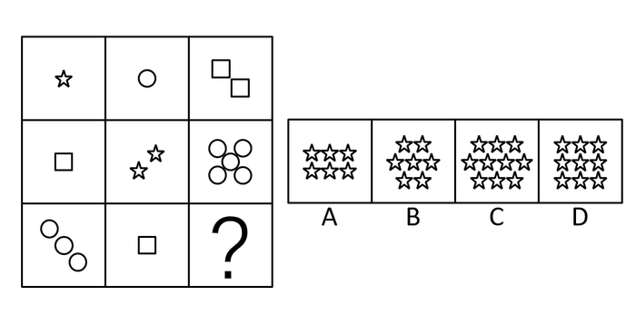

A. A

B. B

C. C

D. D

第 40 题 · 答案与解析

**参考答案（粉笔题库参考内容）**

C

**解析**

元素组成不同，且无明显属性规律，考虑数量规律。题干都是小元素，考虑小元素个数或种类，九宫格优先横行看，第一行元素个数为1、1、2,第二行元素个数为1、2、5，均满足前两项平方和等于第三项，即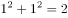，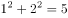；第三行元素个数为3、1，则？处元素个数为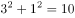，只有C是10个小元素。

故正确答案为C。

**考点**：数量规律-素

**来源**：2015年辽宁省选调生招录考试 行政职业能力测验试卷(精选)第40题

### 第 41 题

从所给四个选项中，选择最合适的一个填入问号处，使之呈现一定的规律性：

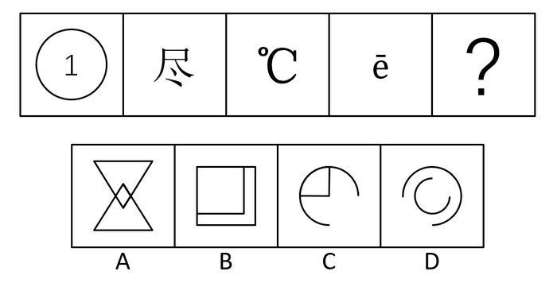

A. A

B. B

C. C

D. D

第 41 题 · 答案与解析

**参考答案（粉笔题库参考内容）**

C

**解析**

元素组成不同，且无明显属性规律，考虑数量规律。题干有明显的窟窿，考虑面数量，题干面数量均为1，则？处面数量也为1。A项面数量为3，B项面数量为2，C项面数量为1，D项面数量为0。

故正确答案为C。

**考点**：数量规律-面

**来源**：2015年辽宁省选调生招录考试 行政职业能力测验试卷(精选)第41题

### 第 42 题

从所给四个选项中，选择最合适的一个填入问号处，使之呈现一定的规律性：

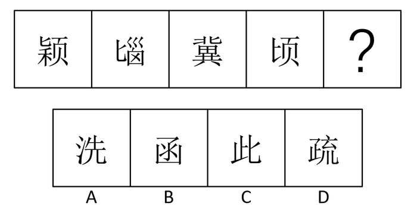

A. A

B. B

C. C

D. D

第 42 题 · 答案与解析

**参考答案（粉笔题库参考内容）**

C

**解析**

元素组成不同，且属性和数量无规律，观察发现题干均为汉字，且都有相同部分“匕”，则？处应该有“匕”，只有C项有“匕”。

故正确答案为C。

**考点**：数量规律-素、文字/字母/数字类、样式规律-遍历

**来源**：2015年辽宁省选调生招录考试 行政职业能力测验试卷(精选)第42题

### 第 43 题

从所给四个选项中，选择最合适的一个填入问号处，使之呈现一定的规律性：

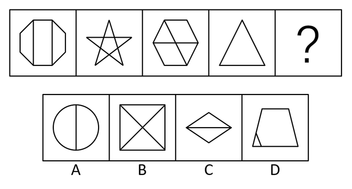

A. A

B. B

C. C

D. D

第 43 题 · 答案与解析

**参考答案（粉笔题库参考内容）**

B

**解析**

元素组成不同，且无属性规律，考虑数量规律。观察发现，图2是五角星，图3是“田”字变形图，考虑笔画数。题干笔画数分别为：2、1、2、1，因此？处笔画数为2，A项笔画数为1，B项笔画数为2，C项笔画数为1，D项笔画数为1。

故正确答案为B。

**考点**：数量规律-线

**来源**：2015年辽宁省选调生招录考试 行政职业能力测验试卷(精选)第43题

### 第 44 题

从所给四个选项中，选择最合适的一个填入问号处，使之呈现一定的规律性：

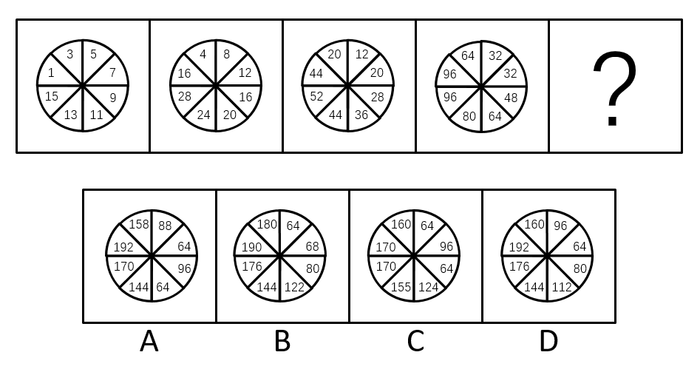

A. A

B. B

C. C

D. D

第 44 题 · 答案与解析

**参考答案（粉笔题库参考内容）**

D

**解析**

观察发现，每幅图内部数字部分递增，部分递减，无规律，考虑相邻两个图数字之间的规律。图1中“1+3”等于图2中的“4”，图1中“3+5”等于图2中的“8”，规律为图2中某位置数字为图1中相同位置与逆时针位置相邻数字之和；图2、图3、图4内部数字均满足此规律。则？处圆圈内从左上角开始，数字依次为96+96=192，96+64=160，64+32=96，32+32=64，D项符合。

故正确答案为D。

**来源**：2015年辽宁省选调生招录考试 行政职业能力测验试卷(精选)第44题

### 第 45 题

从所给四个选项中，选择最合适的一个填入问号处，使之呈现一定的规律性：

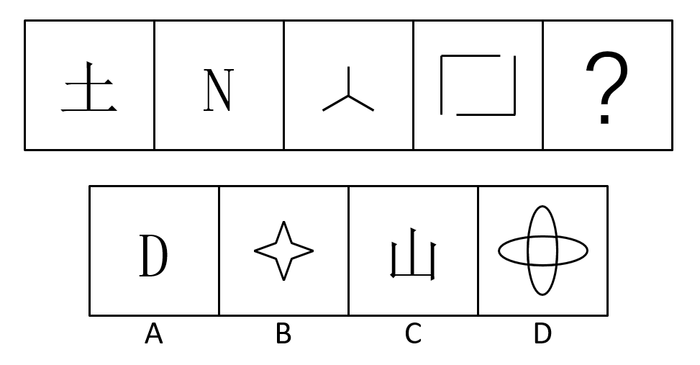

A. A

B. B

C. C

D. D

第 45 题 · 答案与解析

**参考答案（粉笔题库参考内容）**

C

**解析**

元素组成不同，优先考虑属性规律。题干都是开放图形，？处为开放图形。A、B、D项均是封闭图形，C项是开放图形。

故正确答案为C。

**考点**：属性规律-开闭性

**来源**：2015年辽宁省选调生招录考试 行政职业能力测验试卷(精选)第45题

### 第 46 题

明朝大思想家王守仁提倡“知行合一”说。知，主要指人的道德意识和思想意念；行，主要指人的道德践履和实际行动。所谓“知行合一”，即要求人们不光要知晓道理，更要出于本心，主动地付诸实践。

根据上述定义，下列属于知行合一的是：

A. 为了拍宣传片，全体师生上大街清扫马路

B. 自从在学校里学了“乌鸦反哺”的课文后，小朋友们开始懂得了体谅和孝顺父母，经常帮父母做家务

C. 慑于中央禁令，部分官员不再像从前那样在高级酒店大吃大喝

D. 明知道随便对父母发脾气不好，处于青春叛逆期的小李同学还是忍不住对父母发了火

第 46 题 · 答案与解析

**参考答案（粉笔题库参考内容）**

B

**解析**

第一步：找出定义关键词。

“不光要知晓道理，更要出于本心，主动付诸实践。”

第二步：逐一分析选项。

A项：为拍摄宣传片，上街清扫马路属于“实际行动”，但未提及道理，不符合定义，排除；

B项：“开始懂得了体谅和孝顺父母”对应“知晓道理”，“帮父母做家务”对应“出于本心，主动付诸实践”，符合定义，当选；

C项：“慑于中央禁令”不属于出于本心，不符合定义，排除；

D项：“知道随便对父母发脾气不好”对应“知晓道理”，但“忍不住对父母发火”说明没有付诸实践，不符合定义，排除。

故正确答案为B。

**考点**：拆词

**来源**：2015年辽宁省选调生招录考试 行政职业能力测验试卷(精选)第46题

### 第 47 题

法律意义上的重大误解：是指行为人因对行为的性质、对方当事人、标的物的品种、质量、规格和数量等发生错误认识，使行为的后果与自己的意思相悖，并造成较大损失的行为。

根据上述定义，下列属于重大误解的是：

A. 小张从服装摊贩处买来一条裤子，发现价格比网上同款贵了两倍

B. 甲立下遗嘱，误将乙的字画分配给继承人

C. 老李误将祖传的名人字画当成现代复制品，低价出售给藏友

D. 房价大涨之前，为了治病，老张低价出售了一套住房

第 47 题 · 答案与解析

**参考答案（粉笔题库参考内容）**

C

**解析**

第一步：找出定义关键词。

“行为人因对行为的性质、对方当事人、标的物的品种、质量、规格和数量等发生错误认识，使行为的后果与自己的意思相悖，并造成较大损失的行为。”

第二步：逐一分析选项。

A项：小张从服装摊贩购买裤子虽然比网上贵两倍，但不存在错误认识，不符合定义，排除；

B项：甲立下遗嘱处置乙的财产，属于无权处分行为，不符合定义，排除；

C项：“祖传名人字画当成现代复制品”符合对标的物的品种、质量、规格发生错误认识，并造成较大损失，符合定义，当选；

D项：老张在房价大涨之前出售住房，不存在错误认识，不符合定义，排除。

故正确答案为C。

**考点**：原因结果

**来源**：2015年辽宁省选调生招录考试 行政职业能力测验试卷(精选)第47题

### 第 48 题

仲裁：是指发生争议的当事人双方根据争议发生前或争议发生后的有关协议或有关规定，将该争议交付有一定社会威望、无直接利害关系的第三方居中评判是非，并承认其做出有约束力的明确双方权利义务的裁决的一种法律制度。

根据定义，下列属于仲裁的是：

A. 某市场摊主秦某因多收顾客10元钱，与顾客发生纠纷，市场管理部门提请消协仲裁

B. 医院与患者发生纠纷，请求公共关系科解决

C. 吴某修房子时圈了邻居蒋某的一部分地，双方发生争执进而大打出手，村支书要求吴某将圈占的蒋某的地退出来

D. 李某与公司因薪资发生纠纷，提请劳动仲裁委员会仲裁

第 48 题 · 答案与解析

**参考答案（粉笔题库参考内容）**

D

**解析**

第一步：找出定义关键词。

“发生争议的当事人双方根据争议发生前或争议发生后的有关协议或有关规定，将该争议交付有一定社会威望、无直接利害关系的第三方居中评判是非，并承认其做出有约束力的明确双方权利义务的裁决的一种法律制度。”

第二步：逐一分析选项。

A项：摊主与顾客之间未签订相关协议，且提请消协仲裁属于调解，不属于仲裁，不符合定义，排除；

B项：公共关系科属于医院的内部组织，不属于无直接利害关系的第三方，不符合定义，排除；

C项：“村支书要求吴某将圈占的蒋某的地退出来”不属于有约束力的明确双方权利义务的裁决，不符合定义，排除；

D项：劳动仲裁委员会属于无直接利害关系的第三方，且做出有约束力的明确双方权利义务的裁决，符合定义，当选。

故正确答案为D。

**考点**：单定义-其他句式

**来源**：2015年辽宁省选调生招录考试 行政职业能力测验试卷(精选)第48题

### 第 49 题

企业再造：是对企业业务流程进行根本的再思考和彻底的再设计，以显著提高企业的效率，企业再造的对象是企业流程。

根据上述定义，下列不属于企业再造的是：

A. 重新设计和安排海信彩电企业的整个生产、服务和经营过程，使之合理化

B. 对海尔空调原有生产流程进行全面的功能和效率分析，发现问题，进行改进

C. 开发绿源电动车新品种新市场，为企业创造更大的经济效益

D. 设计大众汽车新的生产流程改进方案，并进行评估和实施

第 49 题 · 答案与解析

**参考答案（粉笔题库参考内容）**

C

**解析**

第一步：找出定义关键词。

“对企业业务流程进行根本的再思考和彻底的再设计，以显著提高企业的效率，企业再造的对象是企业流程。”

第二步：逐一分析选项。

A项：“重新设计企业的整个生产、服务、和经营过程”对应“对企业业务流程进行根本的再思考和彻底的再设计”，符合定义，排除；

B项：“对原有生产流程进行全面的功能和效率分析”对应“对企业业务流程进行根本的再思考和彻底的再设计”，符合定义，排除；

C项：“开发新品种新市场”是在开拓市场，不属于“对企业业务流程进行根本的再思考和彻底的再设计”，不符合定义，当选；

D项：“设计新的生产流程改进方案”对应“对企业业务流程进行根本的再思考和彻底的再设计”，符合定义，排除。

本题为选非题，故正确答案为C。

**考点**：方式目的

**来源**：2015年辽宁省选调生招录考试 行政职业能力测验试卷(精选)第49题

### 第 50 题

体验营销：指企业以客户为中心，通过对事件、情景的安排以及特定体验过程的设计，让客户在体验中产生美妙而深刻的印象，并获得精神上最大程度的满足过程。

根据上述定义，下列不属于体验营销的是：

A. 某民办技工培训学校为吸引生源扩大影响，针对应届初中毕业生推出先学习后交费不满意直接退学的政策

B. 在购买一包某品牌酸奶后可以报名“超女训练营”，上台一展歌喉，让消费者体验歌星登上舞台的感觉

C. 某房产开发商将正在建设的一个高档别墅小区的内部装修、景观提前“释放”，让购房者亲临其境

D. 东方酒店依托庞大数据库对消费者进行分析，提前感知消费者的需求偏好，进行产品定位

第 50 题 · 答案与解析

**参考答案（粉笔题库参考内容）**

D

**解析**

第一步：找出定义关键词。

“企业以客户为中心，通过对事件、情景的安排以及特定体验过程的设计，让客户在体验中产生美妙而深刻的印象，并获得精神上最大程度的满足过程。”

第二步：逐一分析选项。

A项：“先学习后交费不满意直接退学”说明企业提供了体验过程，符合定义，排除；

B项：“上台一展歌喉，让消费者体验歌星登上舞台的感觉”说明企业提供了体验过程，符合定义，排除；

C项：“高档别墅小区的内部装修、景观提前‘释放’，让购房者亲临其境”说明企业提供了体验过程，符合定义，排除；

D项：企业通过对消费者分析，感知消费者需求偏好，进行产品定位，不涉及提供体验过程，不符合定义，当选。

本题为选非题，故正确答案为D。

**考点**：方式目的

**来源**：2015年辽宁省选调生招录考试 行政职业能力测验试卷(精选)第50题

### 第 51 题

印记学习：是指发生在动物生活的早期阶段、由直接印象形成的学习行为，是一种高度特化，但有局限性的学习方式。这种学习能力的高峰，一般时间极短。

根据上述定义，下列属于印记学习的是：

A. 刚出生的小鸭在与母鸭隔离的情况下，会跟着一个缓慢步行的人走

B. 猩猩学会用手语来表达自己的感情

C. 羚羊为了自己的领域而互相攻击

D. 金翅雀对田间的稻草人不再害怕

第 51 题 · 答案与解析

**参考答案（粉笔题库参考内容）**

A

**解析**

第一步：找出定义关键词。

“发生在动物生活的早期阶段、由直接印象形成的学习行为”。

第二步：逐一分析选项。

A项：“刚出生的小鸭”对应“发生在动物生活的早期阶段”，“跟着一个缓慢步行的人走”属于“直接印象形成的学习行为”，符合定义，当选；

B项：不清楚猩猩是否是在生活的早期阶段学会的用语言表达自己的感情，不符合定义，排除；

C项：“为了自己的领域而互相攻击”不属于学习行为，且不清楚是不是在生活早期阶段的一种行为，不符合定义，排除；

D项：“对田间的稻草人不再害怕”不属于学习行为，不符合定义，排除。

故正确答案为A。

**考点**：大前提

**来源**：2015年辽宁省选调生招录考试 行政职业能力测验试卷(精选)第51题

### 第 52 题

软新闻：是指富有人情味、纯知识、纯趣味的新闻，向受众提供娱乐，使其开阔眼界，增长见识，陶冶情操，或作为人们茶余饭后的谈资，它和人们的切身利益并无直接关系。

根据上述定义，下列属于软新闻的是：

A. 某世界著名足球运动员儿时被父母丢弃，在孤儿院长大

B. 长江今年第二次洪峰昨日凌晨已过汉口，百里长堤巍然屹立

C. 拉登昨晚遇刺

D. 国家出台房地产市场调控政策

第 52 题 · 答案与解析

**参考答案（粉笔题库参考内容）**

A

**解析**

第一步：找出定义关键词。

“富有人情味、纯知识、纯趣味的新闻，向受众提供娱乐，使其开阔眼界，增长见识，陶冶情操，或作为人们茶余饭后的谈资”、“和人们的切身利益并无直接关系”。

第二步：逐一分析选项。

A项：著名足球运动员的童年生活属于富有人情味、纯知识、纯趣味的新闻，且与人们的切身利益无直接关系，符合定义，当选；

B项：“长江今年第二次洪峰” 与人们的切身利益有直接关系，不属于富有人情味、纯知识、纯趣味的新闻，不符合定义，排除；

C项：“拉登昨晚遇刺”属于国际政治新闻，不属于富有人情味、纯知识、纯趣味的新闻，且与恐怖主义活动区的居民切身利益有直接关系，不符合定义，排除；

D项：“国家出台房地产市场调控政策”与人们的切身利益有直接关系，不符合定义，排除。

故正确答案为A。

**考点**：单定义-其他句式

**来源**：2015年辽宁省选调生招录考试 行政职业能力测验试卷(精选)第52题

### 第 53 题

经常参加篮球运动的人通常比不参加篮球运动的人身体更健康，因此，篮球运动有助于增进健康。

以下哪项如果为真，最能削弱上述认证？

A. 每年都有少数人在篮球运动中因意外事故而受伤

B. 只有身体健康的人才参加篮球运动

C. 篮球运动能够训练人的反应能力，增强人的敏感性

D. 有的篮球运动参加者的健康状况不如没有参加篮球运动的人

第 53 题 · 答案与解析

**参考答案（粉笔题库参考内容）**

B

**解析**

第一步：找出论点和论据。

论点：篮球运动有助于增进健康。

论据：经常参加篮球运动的人通常比不参加篮球运动的人身体健康。

第二步：逐一分析选项。

A项：论点讨论的是篮球运动增进健康，该项讨论的是意外事故，话题不一致，无关项，排除；

B项：论点为篮球运动有助于增进健康，该项为只有身体健康才能参加篮球运动，因果倒置，可以削弱，保留；

C项：论点讨论的是有助于增进健康，该项讨论的是训练人的反应能力，增强人的敏感性，无关项，排除；

D项：有的篮球参加运动者健康状况不如没有参加篮球运动的人，削弱论据，削弱力度较弱，保留；

B、D项相比，因果倒置削弱力度大于削弱论据，B项当选。

故正确答案为B。

**考点**：因果倒置

**来源**：2015年辽宁省选调生招录考试 行政职业能力测验试卷(精选)第53题

### 第 54 题

当CD刚进入市场时，它们的价格远远高于磁带，生产商说这是由于采用了不同寻常的新技术导致生产CD的高成本所造成的。随着生产技术的日益成熟，CD的价格的确下降了，相反的是，经过了长期生产的磁带的价格反而上升了。

以下哪一项最好地解释了上文中磁带价格的上升？

A. 消费者十分肯定CD提供的高品质的音响效果，并愿意为此付出更高的价格

B. 有些消费者因为价格原因而继续购买磁带

C. 随着消费者更多地购买CD，磁带的生产不断萎缩，其生产成本随着销量的下降而上升

D. 当CD刚进入市场时，人们仍购买磁带，而不愿花高价购买使用CD的设备

第 54 题 · 答案与解析

**参考答案（粉笔题库参考内容）**

C

**解析**

第一步：找出题干矛盾。

CD的价格的确下降了，相反的是，经过了长期生产的磁带的价格反而上升了。

第二步：逐一分析选项。

A项：解释了CD刚进入市场时为什么价格高，但不能解释后期CD价格降低，磁带价格升高，不能解释题干矛盾，排除；

B项：因为价格原因不能解释磁带在CD刚进入市场价格低，后期价格高，不能解释题干矛盾，排除；

C项：解释了后期磁带价格上升是因为生产成本随着销量下降上升，解释题干矛盾，当选；

D项：讨论CD刚进入市场的情况，但是不能解释后期磁带价格高，不能解释题干矛盾，排除。

故正确答案为C。

**考点**：原因解释

**来源**：2015年辽宁省选调生招录考试 行政职业能力测验试卷(精选)第54题

### 第 55 题

大物理学家牛顿小的时候在班上的学习成绩倒数第一名，因而曾被老师和同学称作“笨蛋”。生物学家达尔文的日记记载：教师和家长都曾认为他智力低下。世界著名的伟大作家高尔基只读过小学三年级。陶行知先生曾提醒老师们说：“你的教鞭下有瓦特，你的冷眼里有牛顿，你的讥笑中有爱迪生”。

由此可见：

A. 小时候学习成绩越差，长大后的成就就越大

B. 人的才能表现有早晚之别

C. 一个人的成就与他所受教育的多少无关

D. 名人们小时候的学习成绩都不好

第 55 题 · 答案与解析

**参考答案（粉笔题库参考内容）**

B

**解析**

日常结论题，根据题干信息逐一分析选项。

A项：题干只指出牛顿、达尔文和高尔基三个人，不能推出小时候学习成绩差，长大后成绩就越大，无法推出，排除；

B项：题干指出牛顿、达尔文和高尔基三人小时候成绩差或智力低下，但是长大后成就很大，可以推出人的才能表现有早晚之别，可以推出，当选；

C项：没有提及成就与所受教育的多少的关系，无中生有，无法推出，排除；

D项：题干只指出牛顿、达尔文和高尔基三个人，不能推出所有的名人小时候成绩都不好，无法推出，排除。

故正确答案为B。

**考点**：日常结论

**来源**：2015年辽宁省选调生招录考试 行政职业能力测验试卷(精选)第55题

### 第 56 题

中国市场经济发展模式的运作，付出了很大成本。以土地的资本积累为例，其后遗症就非常突出。现在我国中西部地区重大群体事件频发的主要原因，就是由普遍低价征地行为引起的。同时，当前中国工业化发展开始进入新的阶段，一方面从全国总体看处于工业化中期发展阶段，另一方面长三角等发达地区已出现向后工业化阶段发展的势头，工业化转型和增长方式转变的趋势逐步扩展。在新的发展条件下，国家主导型市场经济模式自身存在的问题和矛盾，就越来越多地显露出来。

根据这段文字可以推出：

A. 征地造成了中西部地区重大群体事件的频发

B. 中国市场经济模式是国家主导型市场经济模式

C. 土地的资本积累是中国市场经济发展模式付出了巨大成本的主要原因

D. 随着中国市场经济发展模式的运作，各省基本已处于工业化中期发展阶段

第 56 题 · 答案与解析

**参考答案（粉笔题库参考内容）**

B

**解析**

日常结论题，根据题干信息逐一分析选项。

A项：根据第一句可知，中西部地区重大群体事件的频发是因为普遍低价征地引起的，不是因为征地，偷换概念，排除；

B项：根据最后一句可知，国家主导型市场经济模式自身存在的问题和矛盾，可推出中国市场经济模式是国家主导型市场经济模式，可以推出，当选；

C项：题干未提及中国市场经济发展模式付出巨大成本的主要原因，无中生有，排除；

D项：根据第三句可知，从全国总体看处于工业化中期发展阶段，不能推出各省基本已处于工业化中期发展阶段，无法推出，排除。

故正确答案为B。

**考点**：日常结论

**来源**：2015年辽宁省选调生招录考试 行政职业能力测验试卷(精选)第56题

### 第 57 题

某大学计划于1月底举行一次大型露天文艺汇演活动，学校相关负责人问当地气象部门的负责人：“很多人都说本月底要降雪，是真的吗？”气象部门负责人说：“根据我们的观察，最近不必然降雪。”学校相关负责人说：“那是不是最近肯定不会降雪了？”

气象部门负责人说他说得不对，以下哪句话与气象部门负责人的意思最为接近？

A. 最近必然不降雪

B. 最近可能不降雪

C. 最近可能降雪

D. 最近不可能降雪

第 57 题 · 答案与解析

**参考答案（粉笔题库参考内容）**

B

**解析**

第一步：翻译题干。

根据“不必然=可能不”，气象部门负责人的意思为“最近可能不降雪”。

第二步：逐一分析选项。

A项：与气象部门负责人意思不一致，排除；

B项：与气象部门负责人意思一致，当选；

C项：与气象部门负责人意思不一致，排除；

D项：与气象部门负责人意思不一致，排除。

故正确答案为B。

**考点**：常规翻译

**来源**：2015年辽宁省选调生招录考试 行政职业能力测验试卷(精选)第57题

### 第 58 题

儿童节到了，明明、欢欢、媛媛、兰兰一起去买气球。明明指着黄色和红色的气球说：如果非要我选一个，我宁愿选红色。欢欢看到一对蓝色和白色的气球，便说：我很不喜欢白色，但我更讨厌蓝色。媛媛说：红色和粉色我都喜欢，但我更愿意要粉色。兰兰最后说：我对蓝色不如对黄色那样喜欢。

如果四位小朋友对颜色的喜好都是一样的，则下列说法正确的是：

A. 明明更讨厌黄色而喜欢粉色

B. 欢欢更讨厌白色而喜欢蓝色

C. 兰兰讨厌黄色但更讨厌红色

D. 媛媛更喜欢蓝色而讨厌粉色

第 58 题 · 答案与解析

**参考答案（粉笔题库参考内容）**

A

**解析**

第一步：分析题干。

根据题干小朋友对颜色的喜好排序为：

①由明明的话可知，红色>黄色；

②由欢欢的话可知，白色>蓝色；

③由媛媛的话可知，粉色>红色；

④由兰兰的话可知，黄色>蓝色；

四位小朋友对颜色的喜好是一样的，由此可知，粉色>红色>黄色>蓝色，白色>蓝色。

第二步：逐一分析选项。

A项：翻译为粉色>黄色，符合题干，当选；

B项：翻译为蓝色>白色，与题干不符，排除；

C项：翻译为黄色>红色，与题干不符，排除；

D项：翻译为蓝色>粉色，与题干不符，排除。

故正确答案为A。

**考点**：组合排列-单题-其他

**来源**：2015年辽宁省选调生招录考试 行政职业能力测验试卷(精选)第58题

### 第 59 题

所有的金属都能导电，铜是金属，所以铜能导电。

以下哪项与上文推理形式相同？

A. 所有教育程度高的家长都重视小孩学前教育，张先生重视小孩的学前教育，所以张先生的教育程度高

B. 太阳系的大行星都以轨道绕太阳运行，火星是太阳系的大行星，所以火星以椭圆轨道绕太阳运行

C. 自然数是整数，6是整数，所以6是自然数

D. 所有阔叶植物都是落叶的，葡萄树是落叶的，所以葡萄树是阔叶植物

第 59 题 · 答案与解析

**参考答案（粉笔题库参考内容）**

B

**解析**

第一步：翻译题干。

题干逻辑关系为：金属→导电，铜是金属→导电，推理形式为肯前推肯后。

第二步：逐一分析选项。

A项：翻译为：教育程度高→重视学前教育，张先生重视学前教育→张先生教育程度高，推理形式为肯后推肯前，与题干推理形式不一致，排除；

B项：翻译为：大行星→绕太阳运行，火星是太阳系的大行星→火星绕太阳运行，推理形式为肯前推肯后，与题干推理形式一致，当选；

C项：翻译为：自然数→整数，6是整数→6是自然数，推理形式为肯后推肯前，与题干推理形式不一致，排除；

D项：翻译为：阔叶植物→落叶，葡萄树是落叶的→葡萄树是阔叶植物，推理形式为肯后推肯前，与题干推理形式不一致，排除。

故正确答案为B。

**考点**：推理形式

**来源**：2015年辽宁省选调生招录考试 行政职业能力测验试卷(精选)第59题

### 第 60 题

2015年3月12日，（    ）宣布有意成为亚洲基础设施投资银行（AIIB）的未来创始成员国之一，这意味着该国将成为第一个寻求加入亚洲基础设施投资银行的主要西方国家。

A. 美国

B. 英国

C. 德国

D. 法国

第 60 题 · 答案与解析

**参考答案（粉笔题库参考内容）**

B

**解析**

本题考查政治常识。

2015年3月12日，英国财政大臣乔治·奥斯本宣布，英国有意在本月内成为亚洲基础设施投资银行（AIIB）的未来创始成员国之一，这意味着英国将成为第一个寻求加入亚洲基础设施投资银行的主要西方国家。

故正确答案为B。

**考点**：重要事件

**来源**：2015年辽宁省选调生招录考试 行政职业能力测验试卷(精选)第60题

### 第 61 题

“路歧之险夷，必待身亲履历而后知。岂有不待身亲履历而已先知路歧之险夷者邪？”

下列对这一说法理解正确的是：

A. 直接经验比间接经验重要

B. 理论对实践具有指导作用

C. 实践是认识的来源

D. 一切从实际出发

第 61 题 · 答案与解析

**参考答案（粉笔题库参考内容）**

C

**解析**

本题考查政治常识。

该句出自王阳明，意思是说路途的坎坷曲折，需要亲身经历才能知道，哪有未等亲身经历就先知道路途的坎坷曲折呢？

A项错误，直接经验是指亲身参加变革现实的实践而获得的知识，间接经验是指从书本或别人那里得来的知识。直接经验是间接经验的基础，但直接经验和间接经验何者更为重要，没有明确的判断标准，并且题干内容强调实践第一的观点。

B项错误，理论对实践具有指导作用，正确的、科学的理论可以促进实践的发展。题干所述内容并未体现出理论的作用。

C项正确，实践是认识的来源，人的认识只能在实践的基础上产生。题干中提到路途的坎坷曲折与否只有“亲履历而后知”，充分体现实践是认识的来源，是认识的发展动力。

D项错误，一切从实际出发是指我们想问题、办事情要把客观存在的实际事物作为根本出发点。题干所述内容涉及实践与认识的关系，未体现从实际出发的观点。

故正确答案为C。

**考点**：认识论

**来源**：2015年辽宁省选调生招录考试 行政职业能力测验试卷(精选)第61题

### 第 62 题

社会主义核心价值体系的灵魂是：

A. 爱国主义

B. 改革创新

C. 马克思主义指导思想

D. 社会主义荣辱观

第 62 题 · 答案与解析

**参考答案（粉笔题库参考内容）**

C

**解析**

本题考查政治常识。

A、B项错误，以爱国主义为核心的民族精神和以改革创新为核心的时代精神是社会主义核心价值体系的精髓,是推进中国特色社会主义伟大事业的精神动力。

C项正确，马克思主义指导思想是社会主义核心价值体系的灵魂。马克思主义是我们立党立国的根本指导思想，是社会主义意识形态的旗帜和灵魂。

D项错误，社会主义荣辱观是社会主义核心价值体系的基础，是时代精神的鲜明表达。

故正确答案为C。

**来源**：2015年辽宁省选调生招录考试 行政职业能力测验试卷(精选)第62题

### 第 63 题

被国际司法界誉为东方经验的是：

A. 调解

B. 仲裁

C. 诉讼

D. 和解

第 63 题 · 答案与解析

**参考答案（粉笔题库参考内容）**

A

**解析**

本题考查法律常识。调解制度在中国有着悠久的历史，发轫于数千年前的中国调解制度，与现在社会发展的价值观有着明显的契合，国际法学界也越来越重视对中国调解制度的研究。调解制度开创了纠纷解决的多元途径，有利的防止了矛盾的激化，维护了社会的和谐与稳定，被国际司法界誉为“东方经验”。因此，A项正确，B、C、D三项错误。

故正确答案为A。

**考点**：民法典

**来源**：2015年辽宁省选调生招录考试 行政职业能力测验试卷(精选)第63题

### 第 64 题

下列产品或劳务应计入当年GDP的是：

A. 某人购买的一套二手房

B. 某企业当年生产的库存品

C. 某人持有国债的利息收入

D. 某人在家从事家务劳动

第 64 题 · 答案与解析

**参考答案（粉笔题库参考内容）**

B

**解析**

本题考查经济常识。国内生产总值（GDP）是指一个国家（或地区）所有常住单位在一定时期内生产的全部最终产品和服务价值的总和，常被认为是衡量国家（或地区）经济状况的指标。

A项错误，GDP强调的是一定时期内“新”增加的最终产品和提供的劳务，二手房属于往年最终产品，不应计入当年GDP；

B项正确，当年生产的库存品属于当年内生产的全部最终产品，应计入当年GDP；

C项错误，国债利息收入不是最终产品和服务价值，不属于GDP计入范围；

D项错误，某人在家从事家务劳动并未参与交换和获得收益，不会产生市场价值，不应计入当年GDP。

故正确答案为B。

**考点**：市场经济

**来源**：2015年辽宁省选调生招录考试 行政职业能力测验试卷(精选)第64题

### 第 65 题

下列选项中货币在执行价值尺度职能的是：

A. 某企业给工人发放月度奖金2000元

B. 张某购买了500000元的翡翠

C. 电子市场里一台IPAD的售价是3800元

D. 韩某用80元钱买了2本书

第 65 题 · 答案与解析

**参考答案（粉笔题库参考内容）**

C

**解析**

本题考查经济常识。价值尺度是用来衡量和表现商品价值的一种职能。货币在执行价值尺度的职能时，并不需要有现实的货币，只需要观念上的货币。流通手段是货币充当商品交换媒介的职能。货币在执行流通手段的职能时，需要现实的货币。

A项错误，发放月度奖金2000元是货币在执行支付手段职能；

B项错误，购买了500000元的翡翠是货币在执行流通手段职能；

C项正确，IPAD的售价3800元是衡量和表现该商品的价值，是货币在执行价值尺度职能；

D项错误，用80元买了2本书是货币在执行流通手段职能。

故正确答案为C。

**考点**：市场经济

**来源**：2015年辽宁省选调生招录考试 行政职业能力测验试卷(精选)第65题

### 第 66 题

根据新修订的《中华人民共和国安全生产法》，安全生产工作应强化和落实（    ）的主体责任。

A. 政府监管部门

B. 生产经营单位

C. 生产经营单位主要负责人

D. 职工

第 66 题 · 答案与解析

**参考答案（粉笔题库参考内容）**

B

**解析**

本题考查法律常识。

根据《中华人民共和国安全生产法》第三条规定：“安全生产工作应当以人为本，坚持安全发展，坚持安全第一、预防为主、综合治理的方针，强化和落实生产经营单位的主体责任，建立生产经营单位负责、职工参与、政府监管、行业自律和社会监督的机制。”因此，B项正确，A、C、D三项错误。

故正确答案为B。

**考点**：其他法律法规

**来源**：2015年辽宁省选调生招录考试 行政职业能力测验试卷(精选)第66题

### 第 67 题

二审法院审理刑事上诉案件：

A. 一律实行开庭审理

B. 实行书面审理，必要时可进行调查讯问

C. 以调查讯问方式为原则

D. 以开庭审判方式为主，以调查讯问方式为补充

第 67 题 · 答案与解析

**参考答案（粉笔题库参考内容）**

D

**解析**

本题考查法律常识。根据《刑事诉讼法》第二百三十四条第一款、第二款规定：“第二审人民法院对于下列案件，应当组成合议庭，开庭审理：（一）被告人、自诉人及其法定代理人对第一审认定的事实、证据提出异议，可能影响定罪量刑的上诉案件；（二）被告人被判处死刑的上诉案件；（三）人民检察院抗诉的案件；（四）其他应当开庭审理的案件。第二审人民法院决定不开庭审理的，应当讯问被告人，听取其他当事人、辩护人、诉讼代理人的意见。”由此可知，二审法院在审理刑事上诉案件时应以开庭审判方式为主，以调查讯问方式为补充。因此，D项正确，A、B、C三项错误。

故正确答案为D。

**考点**：诉讼法

**来源**：2015年辽宁省选调生招录考试 行政职业能力测验试卷(精选)第67题

### 第 68 题

李某为了修建农场向张某借钱，双方约定将李某在村里承包的4亩耕地以及田里的小麦抵押给张某。但后来由于李某无力偿还而引起了纠纷，那么下列说法正确的是：

A. 该抵押合同无效

B. 抵押合同全部有效

C. 抵押合同中关于4亩耕地的抵押无效

D. 抵押合同里涉及的小麦抵押是无效的

第 68 题 · 答案与解析

**参考答案（粉笔题库参考内容）**

B

**解析**

本题考查法律常识。根据《中华人民共和国民法典》第三百九十五条规定：“债务人或者第三人有权处分的下列财产可以抵押：······（四）生产设备、原材料、半成品、产品。”根据《中华人民共和国民法典》第三百九十九条规定：“下列财产不得抵押：（一）土地所有权；（二）宅基地、自留地、自留山等集体所有土地的使用权，但是法律规定可以抵押的除外；（三）学校、幼儿园、医疗机构等为公益目的成立的非营利法人的教育设施、医疗卫生设施和其他公益设施；（四）所有权、使用权不明或者有争议的财产；（五）依法被查封、扣押、监管的财产；（六）法律、行政法规规定不得抵押的其他财产。”由此可知，李某和张某约定的抵押合同中，耕地是可以抵押的，而小麦作为原材料或半成品也是可以抵押的，因此合同全部有效。因此，B项正确，A、C、D三项错误。

故正确答案为B。

（本题存在瑕疵，如果抵押的是耕地的所有权，那么合同中关于耕地的抵押无效，如果抵押的是耕地的使用权，那么合同全部有效。）

**考点**：民法典

**来源**：2015年辽宁省选调生招录考试 行政职业能力测验试卷(精选)第68题

### 第 69 题

关于我国兵役制度，下列表述错误的是：

A. 我国实行义务兵与志愿兵相结合、民兵与预备役相结合的兵役制度

B. 普通高等学校毕业生征集服现役的年龄可以放宽至二十四周岁

C. 士兵预备役的年龄，为十八周岁至三十五周岁，根据需要可适当延长

D. 义务兵服现役的期限为三年，士官服现役的期限一般不超过三十年

第 69 题 · 答案与解析

**参考答案（粉笔题库参考内容）**

D

**解析**

本题考查法律常识。

A项正确，根据《兵役法》第二条规定：“中华人民共和国实行义务兵与志愿兵相结合、民兵与预备役相结合的兵役制度。”

B项正确，根据《兵役法》第十二条规定：“每年十二月三十一日以前年满十八周岁的男性公民，应当被征集服现役。当年未被征集的，在二十二周岁以前仍可以被征集服现役，普通高等学校毕业生的征集年龄可以放宽至二十四周岁。”

C项正确，根据《兵役法》第二十四条规定：“士兵预备役的年龄，为十八周岁至三十五周岁，根据需要可以适当延长。具体办法由国务院、中央军事委员会规定。”

D项错误，根据《兵役法》第十九条规定：“义务兵服现役的期限为二年。”第二十条第二款规定：“士官服现役的期限一般不超过三十年，年龄不超过五十五周岁。” 该项中的义务兵服现役的期限为三年表述错误。

本题为选非题，故正确答案为D。

**考点**：其他法律法规

**来源**：2015年辽宁省选调生招录考试 行政职业能力测验试卷(精选)第69题

### 第 70 题

“窥一斑而知全豹”的观点提示了：

A. 矛盾的同一性和斗争性的关系

B. 矛盾的普遍性和特殊性的关系

C. 主要矛盾和次要矛盾的关系

D. 思维矛盾和客观矛盾之间的关系

第 70 题 · 答案与解析

**参考答案（粉笔题库参考内容）**

B

**解析**

本题考查政治常识。“窥一斑而知全豹”比喻可以从观察的部分推测到全貌。

A项错误，矛盾的同一性是指矛盾双方相互联系、相互吸引、相互转化的性质和趋势。矛盾的斗争性是指矛盾双方相互排斥、相互分离的性质和趋势。矛盾同一性和斗争性相结合推动事物发展。题干没有体现“斑”和“全豹”相互吸引或相互排斥的性质和趋势。

B项正确，矛盾普遍性和特殊性的关系，是共性和个性的关系，题干意思为通过“斑”看到整个豹子，通过特殊性来认识普遍性。

C项错误，矛盾分主要矛盾和次要矛盾，主要矛盾居支配地位，起主导和决定作用，次要矛盾处于从属地位，起次要作用。题干没有体现矛盾主次方面。

D项错误，思维矛盾和客观矛盾之间的关系即指思维和存在的关系问题，其包含思维和存在何者为第一性、有无同一性两个方面。题干中只提到了矛盾，并未突出意识与物质。

故正确答案为B。

**考点**：唯物辩证法

**来源**：2015年辽宁省选调生招录考试 行政职业能力测验试卷(精选)第70题

### 第 71 题

促进个人与社会和谐的关键是：

A. 正确认识个人在社会中的定位

B. 正确认识个体性与社会性的统一关系

C. 正确认识享受个人权利与承担社会责任的统一关系

D. 正确认识个人利益与社会整体利益的统一关系

第 71 题 · 答案与解析

**参考答案（粉笔题库参考内容）**

A

**解析**

本题考查政治常识。

A项正确，个人与社会不可分离，社会是个人生存和发展的基础，个人是构成社会的前提，二者既对立又统一。要促进个人与社会和谐，关键在于把握个人在社会中的定位，其涉及多方面因素，例如个体性与社会性、个人需要与社会需要、个人权利与社会责任、个体与社会利益，A项包含B、C、D项内容，更为全面准确。

B项错误，人具有个体性，有其特定的思维、行为方式和需要。人又具有社会性，处于一定的社会关系之中，在社会中获得生存和发展条件。人的个体性与社会性是辩证统一、相辅相成的，且包含在个人在社会中定位的概念中。

C项错误，个人权利是在社会中获得的，没有社会，个人的权利无从谈起。离开了个人对社会所承担的责任，个人的权利也无从实现。享受个人权利与承担社会责任是统一的。其包含在个人在社会中定位的概念中。

D项错误，个人与社会的关系，归根到底是个人利益与社会整体利益的关系。个人与社会都有生存和发展的需要，个人生存和发展的需要体现在社会关系中就是个人利益，社会生存和发展的需要体现在社会关系中就是社会整体利益。其包含在个人在社会中定位的概念中。

故正确答案为A。

**考点**：哲学-其他

**来源**：2015年辽宁省选调生招录考试 行政职业能力测验试卷(精选)第71题

### 第 72 题

下列哪方面的创新是其他方面创新的重要保障，是推进社会主义政治文明建设的强大力量？

A. 文化创新

B. 理论创新

C. 制度创新

D. 科技创新

第 72 题 · 答案与解析

**参考答案（粉笔题库参考内容）**

C

**解析**

本题考查政治常识。创新包括理论创新、制度创新、技术创新、文化创新及其他各方面的创新。实践基础上的理论创新是社会发展和变革的先导，制度创新是其他一切创新的重要保障，科技创新是国家竞争力的核心，大力推进文化创新是社会主义先进文化繁荣发展的需要。即：理论创新是先导，制度创新是保障，科技创新是核心，文化创新是基础。

A项错误，文化创新是繁荣发展社会主义先进文化的需要。

B项错误，理论创新是社会发展和变革的先导。

C项正确，制度创新是其他一切创新的重要保障，是推进社会主义政治文明建设的强大力量。

D项错误，科技创新是国家竞争力的核心。

故正确答案为C。

**考点**：政治建设

**来源**：2015年辽宁省选调生招录考试 行政职业能力测验试卷(精选)第72题

### 第 73 题

依法治国的主体是：

A. 国家

B. 中国共产党

C. 人民群众

D. 人民代表大会

第 73 题 · 答案与解析

**参考答案（粉笔题库参考内容）**

C

**解析**

本题考查政治常识。坚持党的领导、人民当家作主、依法治国有机统一，是我国社会主义民主法治建设的基本经验，是中国特色社会主义法治道路的本质特征。

A项错误，国家是阶级统治的工具，阶级性是国家的根本属性。国家不是依法治国的主体。

B项错误，党的领导是人民当家作主和依法治国的根本保证。依法治国是党领导人民治理国家的基本方式。

C项正确，国家一切权力属于人民，人民是社会主义国家的主人，是依法治国的主体和力量源泉。人民当家作主是坚持依法治国的坚实基础。坚持人民主体地位，是中国特色社会主义法治的内在要求。

D项错误，中华人民共和国全国人民代表大会是最高国家权力机关，不是依法治国的主体。

故正确答案为C。

**考点**：其他建设

**来源**：2015年辽宁省选调生招录考试 行政职业能力测验试卷(精选)第73题

### 第 74 题

一般情况，行政处罚由（  ）的享有行政处罚权的行政机关管辖。

A. 违法行为人所在地

B. 违法行为人经常居住地

C. 违法行为发生地

D. 行政机关所在地

第 74 题 · 答案与解析

**参考答案（粉笔题库参考内容）**

C

**解析**

本题考查法律常识。根据《行政处罚法》第二十二条规定：“行政处罚由违法行为发生地的行政机关管辖。法律、行政法规、部门规章另有规定的，从其规定。”

故正确答案为C。

**考点**：行政法

**来源**：2015年辽宁省选调生招录考试 行政职业能力测验试卷(精选)第74题

### 第 75 题

在法律运行中，最大量、最经常的工作指的是：

A. 立法

B. 执法

C. 司法

D. 守法

第 75 题 · 答案与解析

**参考答案（粉笔题库参考内容）**

B

**解析**

本题考查法律常识。法律运行是一个从创制、实施到实现的过程。这个过程主要包括法律制定（立法）、法律遵守（守法）、法律执行（执法）、法律适用（司法）等环节。

A项错误，立法即法律制定，是法律运行的起始性和关键性环节，保持法律的相对稳定性是法律制定的基本原则之一，所以立法不是最大量、最经常性工作。

B项正确，执法即法律执行，是指国家机关及其公职人员，在国家和公共事务管理中依照法定职权和程序，贯彻和实施法律的活动。在法律运行中，行政执法是最大量、最经常的工作，是实现国家职能和法律价值的重要环节。

C项错误，司法即法律适用，是指国家司法机关及其公职人员依照法定职权和程序适用法律处理案件的专门活动，不是最大量、最经常性工作。

D项错误，守法即法律遵守，是指一切国家机关及其工作人员、社会团体、企事业单位和全体公民，自觉遵守法律的规定，将法律的要求转化为自己的行为，从而使法律得以实现的活动。守法须内化于心，外化于行，其是法的实现最基本的形式，而不是最大量、最经常性的工作。

故正确答案为B。

**考点**：法理学

**来源**：2015年辽宁省选调生招录考试 行政职业能力测验试卷(精选)第75题

### 第 76 题

表扬、奖励员工，让他们参与管理，给他们提供培训机会，主要是为了满足员工的：

A. 尊重需要

B. 交往需要

C. 安全需要

D. 生理需要

第 76 题 · 答案与解析

**参考答案（粉笔题库参考内容）**

A

**解析**

本题考查管理学常识。马斯洛需求层次理论把人的需要分成生理需要、安全需要、情感和归属感需要、尊重和自我实现需要五类，依次由较低层次到较高层次排列。

A项正确，尊重包括内部尊重（自尊）和外部尊重，外部尊重是指一个人希望有地位、有威信，受到别人的尊重、信赖和高度评价。题干体现了满足员工外部尊重需要。

B项错误，交往需要，属于情感和归属感需要，人人都希望得到相互的关心和照顾。题干没有体现相互的关心照顾。

C项错误，安全需要包括人身安全、健康保障、财产所有权、道德保障、工作职位保障、家庭安全等。题干没有体现对安全的需要。

D项错误，生理需要包括对呼吸、水、食物等保证个人生理机能正常运转的需要。生理需要是推动人们行动最首要的动力。题干没有体现满足生理需要。

故正确答案为A。

**来源**：2015年辽宁省选调生招录考试 行政职业能力测验试卷(精选)第76题

### 第 77 题

应用斜面原理省力的是：

A. 开瓶器

B. 扳手

C. 订书机

D. 螺丝钉

第 77 题 · 答案与解析

**参考答案（粉笔题库参考内容）**

D

**解析**

本题考查科技常识。斜面指同水平面成一倾斜角度的平面，是一种简单机械，用于克服垂直提升重物的困难，省力但是费距离。斜面与平面的倾角越小，斜面越长，则省力越大。

A项错误，啤酒开瓶器运用了杠杆原理，开瓶器手柄相对较长，利用大的动作幅度来换取小的行程，实现省力。支点离瓶盖越近，开啤酒瓶就越轻松。

B项错误，扳手运用的是杠杆原理，活动手柄为动力臂，手柄越长即动力臂越长，动力臂大于阻力臂故为省力杠杆。

C项错误，订书机涉及的物理原理主要为压强、杠杆原理，不涉及斜面原理。如：压柄做得宽大有利于减小压强；钉书针（出针口）很尖细有利于增大压强；底座做得宽大有利于减小压强；订书机是以转轴为支点的杠杆，压柄、弹簧、转轴构成一个省力杠杆。

D项正确，螺丝钉是利用物体的斜面省力原理，螺钉的螺纹展开就是一个长长的斜面,但是角度很小，拧螺丝钉的时候就相当于在斜面上推一个方块。

故正确答案为D。

**考点**：物理常识

**来源**：2015年辽宁省选调生招录考试 行政职业能力测验试卷(精选)第77题

### 第 78 题

雨果，法国伟大作家，欧洲19世纪现实主义文学最卓越的代表，主要作品是：

A. 《奥赛罗》

B. 《李尔王》

C. 《致西伯利亚的囚徒》

D. 《巴黎圣母院》

第 78 题 · 答案与解析

**参考答案（粉笔题库参考内容）**

D

**解析**

本题考查人文常识。

A项错误，《奥赛罗》是莎士比亚创作的四大悲剧之一。故事讲述将军奥赛罗凭借着自身的丰富阅历赢得了苔丝德梦娜的心，并与之结婚，但是因为小人的挑拨、自身的疑心，奥赛罗越来越不相信自己的妻子，他杀死了妻子，并在知道真相后自杀。莎士比亚是英国文学史上最杰出的戏剧家，也是欧洲文艺复兴时期最重要、最伟大的作家，代表作有四大悲剧：《哈姆雷特》《奥赛罗》《李尔王》《麦克白》；四大喜剧：《仲夏夜之梦》《威尼斯商人》《第十二夜》《皆大欢喜》。

B项错误，《李尔王》是莎士比亚创作的四大悲剧之一。故事讲述了年事已高的国王李尔王退位后，被大女儿和二女儿赶到荒郊野外，成为法兰西皇后的三女儿率军救父，却被杀死，李尔王伤心地死在她身旁。

C项错误，《致西伯利亚的囚徒》是俄国诗人普希金创作的诗歌，它向在残酷的环境里受难的革命者送去了诗人忠诚的友谊、必胜的信念、热情的鼓励和崇高的敬意。普希金，俄国伟大的诗人、小说家，被誉为“俄国文学之父”“俄国诗歌的太阳”。

D项正确，《巴黎圣母院》是法国文学家维克多·雨果所著小说。维克多·雨果是19世纪前期浪漫主义作家，被人们称为“法兰西的莎士比亚”。代表作品：《笑面人》《巴黎圣母院》《悲惨世界》。

故正确答案为D。

**考点**：文学常识

**来源**：2015年辽宁省选调生招录考试 行政职业能力测验试卷(精选)第78题

### 第 79 题

科学实验有四种类型：理想实验、观察实验、模拟实验、控制实验。下列科学实验的分类正确的是：

A. 研究牛顿第一运动定律属于控制实验

B. 爱因斯坦的相对论属于模拟实验

C. 研究河虾的运动方式属于观察实验

D. 研究阿基米德原理属于理想实验

第 79 题 · 答案与解析

**参考答案（粉笔题库参考内容）**

C

**解析**

本题考查科技常识。

A项错误，控制实验是指控制相关变量进行实验，为了确保因变量的任何效应都能被归结为自变量的操作，实验中应该做到的保持无关变量恒定，实验中将研究对象分为“实验组”和“控制组”。牛顿第一运动定律，又称惯性定律，即任何物体都要保持匀速直线运动或静止状态，直到外力迫使它改变运动状态为止。这个结论不能直接从实验中得出，因为实验做不到物体不受任何力的作用，例如空气阻力、摩擦力，该实验属于理想实验。

B项错误，模拟实验是在人为控制研究对象的条件下进行观察，模仿实验的某些条件进行的实验。爱因斯坦相对论是关于时空和引力的理论，包括“同时的相对性”“四维时空”“弯曲时空”等概念，这些理论无法通过模拟实验实现，因为不能实现模拟时空的条件。

C项正确，观察实验是通过观察被调查对象行为或特点，记录数据、统计整理、对照分析等得出实验结果。研究河虾的运动方式可以通过将河虾放入水中观察其运动情况得出结论。

D项错误，“理想实验”，又叫“假想实验”“抽象实验”或“思想上的实验”，它是人们在思想中塑造的理想过程，是一种逻辑推理的思维过程和理论研究的重要方法。阿基米德原理是指浸入静止流体（气体或液体）中的物体受到一个浮力，其大小等于该物体所排开的流体重量，方向垂直向上并通过所排开流体的形心。其可以通过实验来验证，属于模拟实验。

故正确答案为C。

**考点**：物理常识

**来源**：2015年辽宁省选调生招录考试 行政职业能力测验试卷(精选)第79题

## 材料 1

日前，A市市场监管局发布内资企业半年度分析报告。

        2014年上半年，该市新设内资企业19674户，注册资本（金）1179.4亿元，同比分别增长37.7%和166%。其中私营企业19167户，注册资本（金）1046.76亿元，同比分别增长39.7%和213%。

        从设立总量来看，批发零售业、制造业、租赁商务服务业仍位居前三，三个行业新设户数占上半年新设企业总量的73.9%。但从增长率来看，信息传输及软件信息技术服务业、农林牧渔业、文化创意业居前，分别比去年同期增长了94%、77.5%和50.1%。

        自3月1日实施注册资本改革登记起至6月30日，该市新设公司制企业12505家。注册资本440亿元，日均登记140余家，较去年同期分别增长了68%和58%，呈明显放量增长态势。

        3～6月，全市新设一人有限责任公司为2680户，注册资本88.67亿元，分别为去年同期的5.3倍和1.7倍。尤其是自然人独资公司登记量暴增，新设2467家，占一人公司的92%，去年同期仅339家，增速达6倍以上。大多由原来准备设立个体工商户和个人独资企业的投资者出资设立，注册资本低于10万元（含10万元）的有707家，占29%。

        截至2014年6月底，A市累计实有内资企业204990户，注册资本（金）9930.84亿元；其中私营企业187644户，注册资本（金）6523.36亿元。累计实有个体工商户378822户，资金数额231.74亿元。累计实有农民专业合作社4636户，成员出资总额52.7亿元。

### 第 80 题

A市2014年上半年新设私营企业平均注册资本（金）约是上年的（    ）倍。

A. 1.4

B. 2.2

C. 4.2

D. 5.4

第 80 题 · 答案与解析

**参考答案（粉笔题库参考内容）**

B

**解析**

方法一：由题干问“A市2014年······资本（金）约是上年的······倍”，判定题型为现期倍数问题。定位文字材料第二段“其中私营企业19167户，注册资本（金）1046.76亿元，同比分别增长39.7%和213%”，可知新设内资企业19167户，同比增长率39.7%，注册资本（金）1046.76亿元，同比增长率213%，则题目所求为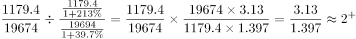，B项满足。

方法二：已知新设私营企业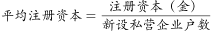，结合平均数的增长率公式：，（a为注册资本（金）同比增速，b为新设私营企业户数同比增速），代入计算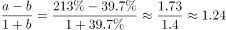，即新设私营企业平均注册资本（金）同比增长1.24倍，则题目所求倍数为1.24+1=2.24倍，与B项最接近。

故正确答案为B。

**考点**：文字资料、现期倍数

**来源**：2015年辽宁省选调生招录考试 行政职业能力测验试卷(精选)第80题

### 第 81 题

A市2013年3～6月新设非自然人一人公司为（    ）家。

A. 213

B. 339

C. 167

D. 1578

第 81 题 · 答案与解析

**参考答案（粉笔题库参考内容）**

C

**解析**

由题干问“A市2013年3～6月新设非自然人······家”，定位文字材料第五段“3～6月，全市新设一人有限责任公司为2680户······为去年同期的5.3倍······自然人独资公司······去年同期仅339家”，新设非自然人一人公司=新设一人有限公司-自然人独资公司，判定本题为基期和差问题，则2013年新设一人有限公司为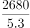家，题目所求为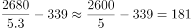家，与C项最接近。

故正确答案为C。

**考点**：基期和差、文字资料

**来源**：2015年辽宁省选调生招录考试 行政职业能力测验试卷(精选)第81题

### 第 82 题

以下说法正确的是：

A. A市2014年上半年新设内资企业较上年增加7417家

B. A市2014年上半年新设内资企业中，信息传输及软件信息技术服务业、农林牧渔业、文化创意业数量不少于5135家

C. A市2014年1～2月新设公司制企业数量不多于7169家

D. 截至2013年6月底，A市累计实有私营企业数量不少于168477家

第 82 题 · 答案与解析

**参考答案（粉笔题库参考内容）**

C

**解析**

A项：定位文字材料第二段“2014年上半年，该市新设内资企业19674户，······同比分别增长37.7%······”，2014年较上年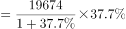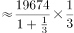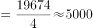，错误；

B项：定位文字材料第三段“从设立总量来看，批发零售业、制造业、租赁商务服务业仍位居前三，三个行业新设户数占上半年新设企业总量的73.9%”，则批发零售业、制造业、租赁商务服务业数量为： ，信息传输及软件信息技术服务业、农林牧渔业、文化创意业数量不多于：19674-14539=5135，错误；

C项：由材料第一段“本篇材料叙述A市内资企业2014上半年分析报告”。另根据材料第二段、第三段可得，上半年共新设内资企业19674户，3月1日实施注册资本改革登记起至6月30日，该市新设公司制企业12505家，则2014年1～2月该市新设公司制企业数量应小于19674-12505=7169家，正确；

D项：定位文字材料第二段、第六段“其中私营企业19167户”“其中私营企业187644户”，则2013年6月底，A市累积实有私营企业数量不多于187644-19167=168477家，错误。

故正确答案为C。

**考点**：文字资料、综合分析

**来源**：2015年辽宁省选调生招录考试 行政职业能力测验试卷(精选)第82题

## 材料 2

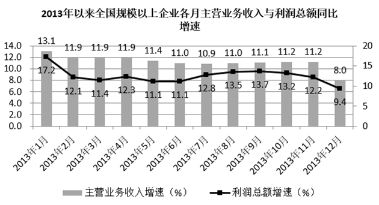

### 第 83 题

2013年以来，全国规模以上企业主营业务收入同比增速与利润总额同比增速差距最大的月份是：

A. 1月

B. 8月

C. 9月

D. 12月

第 83 题 · 答案与解析

**参考答案（粉笔题库参考内容）**

A

**解析**

定位统计图可知，全国规模以上企业主营业务收入同比增速与利润总额同比增速差距中，1月为：|13.1%-17.2%|=4.1% ，8月为：|11.0%-13.5%|=2.5%，9月为：|11.1%-13.7%|=2.6%，12月为：|8.0%-9.4%|=1.4%，其中4.1%最大，即全国规模以上企业主营业务收入同比增速与利润总额同比增速差距最大的月份是1月。

故正确答案为A。

**考点**：简单加减计算、统计图

**来源**：2015年辽宁省选调生招录考试 行政职业能力测验试卷(精选)第83题

### 第 84 题

2013年全国规模以上企业主营业务收入每月同比增速平均约为：

A. 10.5%

B. 11.2%

C. 12.5%

D. 13.2%

第 84 题 · 答案与解析

**参考答案（粉笔题库参考内容）**

B

**解析**

由题干问“2013年······平均约为”，结合统计图所给时间为2013年，判定题型为现期平均数问题。根据统计图可知，2013年1-12月规模以上企业主营业务收入每月同比增速在12%附近，与12.0%的差依次为：1.1%，-0.1%，-0.1%，-0.1%，-0.6%，-1%，-1.1%，-1%，-0.9%，-0.8%，-0.8%，-4%，则2013年全国规模以上企业主营业务收入每月同比增速平均为：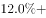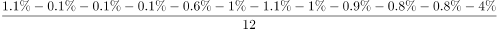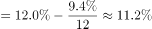。

故正确答案为B。

**考点**：现期平均数、统计图

**来源**：2015年辽宁省选调生招录考试 行政职业能力测验试卷(精选)第84题

### 第 85 题

2013年全国规模以上企业每月利润总额同比上年：

A. 先减后增再减

B. 先增后减再增

C. 均是增加

D. 无明显规律变化

第 85 题 · 答案与解析

**参考答案（粉笔题库参考内容）**

C

**解析**

根据统计图可知，2013年全国规模以上企业每月利润总额增速均大于零，则2013年全国规模以上企业每月利润总额同比上年均是增加。

故正确答案为C。

**考点**：直接找数、统计图

**来源**：2015年辽宁省选调生招录考试 行政职业能力测验试卷(精选)第85题

### 第 86 题

2013年，全国规模以上企业利润总额每月同比增速的中位数是：

A. 12.15%

B. 12.25%

C. 12.35%

D. 12.45%

第 86 题 · 答案与解析

**参考答案（粉笔题库参考内容）**

B

**解析**

根据统计图，2013年规模以上企业利润总额同比增速从低到高依次为：9.4%、11.1%、11.1%、11.4%、12.1%、12.2%、12.3%、12.8%、13.2%、13.5%、13.7%、17.2%，中位数为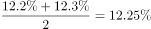。

（备注：中位数，又称中点数，中值，是按顺序排列的一组数据中居于中间位置的数。）

故正确答案为B。

**考点**：简单加减计算、统计图

**来源**：2015年辽宁省选调生招录考试 行政职业能力测验试卷(精选)第86题

### 第 87 题

若保持2013年最后两个月变化幅度的趋势，到（  ）全国规模以上企业主营业务收入将首次同比减少。

A. 2014年1月

B. 2014年2月

C. 2014年3月

D. 2014年4月

第 87 题 · 答案与解析

**参考答案（粉笔题库参考内容）**

C

**解析**

由题干问“若保持2013年最后两个月变化幅度的趋势，······收入将首次同比减少”，即增长率小于0，判定题型为一般增长率问题。根据统计图，最后两月增速分别为11.2%、8%，减幅为3.2个百分点，则2014年1月全国规模以上企业主营业务收入同比增速为8%-3.2%=4.8%，2014年2月同比增速为4.8%-3.2%=1.6%，2014年3月同比增速为1.6%-3.2%=-1.6%&lt;0，首次增长率小于零，全国规模以上企业主营业务收入将首次同比减少。

故正确答案为C。

**考点**：一般增长率、统计图

**来源**：2015年辽宁省选调生招录考试 行政职业能力测验试卷(精选)第87题

## 材料 3

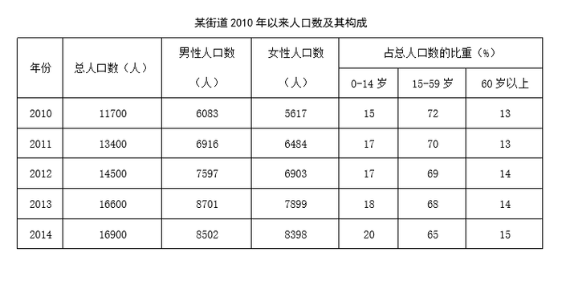

### 第 88 题

2010年至2014年，男性人口数占总人口数的比重最接近的两个年份是：

A. 2011年与2013年

B. 2012年与2013年

C. 2012年与2014年

D. 2013年与2014年

第 88 题 · 答案与解析

**参考答案（粉笔题库参考内容）**

B

**解析**

由题干问“男性人口数占总人口数的比重最接近的两个年份是”，判定题型为现期比重问题。定位表格数据第二、三列，可知2011年男性人口比重约为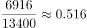，2012年男性人口比重约为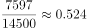，2013年男性人口比重约为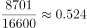，2014年男性人口比重约为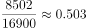，其中2012年与2013年男性人口比重最接近。

故正确答案为B。

**考点**：现期比重、统计表

**来源**：2015年辽宁省选调生招录考试 行政职业能力测验试卷(精选)第88题

### 第 89 题

女性人口数同比增长率最大的年份为：

A. 2011年

B. 2012年

C. 2013年

D. 2014年

第 89 题 · 答案与解析

**参考答案（粉笔题库参考内容）**

A

**解析**

根据题干“······同比增长率最大的年份为”，可判定本题为一般增长率问题。定位材料表格第四列，根据公式：增长率，可得各年份女性人口数同比增长率分别为：

2011年：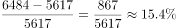；

2012年：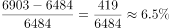；

2013年：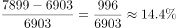；

2014年：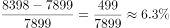。

则2011年女性人口同比增长率最大。

故正确答案为A。

**考点**：一般增长率、统计表

**来源**：2015年辽宁省选调生招录考试 行政职业能力测验试卷(精选)第89题

### 第 90 题

以下年份中，15岁以上人口数最多的年份是：

A. 2011年

B. 2012年

C. 2013年

D. 2014年

第 90 题 · 答案与解析

**参考答案（粉笔题库参考内容）**

C

**解析**

由题干问“以下年份中，15岁以上人口数最多的年份”，定位材料表格第一列和最后两列，根据部分=总体×比重，判定题型为现期比重问题。选项对应年份的15岁以上人口数分别为：

2011年：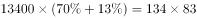，

2012年：，

2013年：16600×（68%+14%）=166×82=166×83-166=166×83-83×2=164×83，

2014年：16900×（65%+15%），

即2013年15岁以上人口数最多。

故正确答案为C。

**考点**：现期比重、统计表

**来源**：2015年辽宁省选调生招录考试 行政职业能力测验试卷(精选)第90题

### 第 91 题

2014年，0～14岁人口数较60岁以上人口数多：

A. 723人

B. 765人

C. 801人

D. 845人

第 91 题 · 答案与解析

**参考答案（粉笔题库参考内容）**

D

**解析**

由题干问“2014年，0～14岁人口数较60岁以上人口数多”结合材料表格所给人口总数与人口构成占比，判定题型为现期比重问题。定位材料表格第六行，2014年总人口数16900，0～14岁比重为20%，60岁以上比重为15%，则0～14岁人口数较60岁以上人口数多16900×（20%-15%）=845人。

故正确答案为D。

**考点**：现期比重、统计表

**来源**：2015年辽宁省选调生招录考试 行政职业能力测验试卷(精选)第91题

### 第 92 题

2013年，以下各项人口数同比增长率最高的是：

A. 男性人口数

B. 0～14岁人口数

C. 15～59岁人口数

D. 60岁以上人口数

第 92 题 · 答案与解析

**参考答案（粉笔题库参考内容）**

B

**解析**

由题干问“2013年，以下各项人口数同比增长率最高的是”，判定题型为一般增长率问题。定位材料表格第四、五行可得

A项：，

B项：，

C项：\=，

D项：，由于则B、C、D项中B项增长率最大；而B项增长率，则四个选项中，B项增长率最大。

故正确答案为B。

**考点**：一般增长率、统计表

**来源**：2015年辽宁省选调生招录考试 行政职业能力测验试卷(精选)第92题

