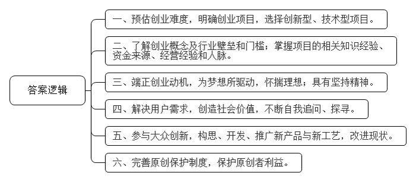
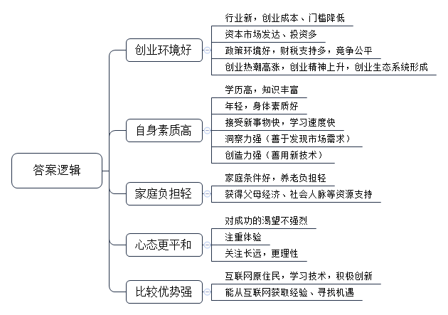

# 2016年公务员多省联考《申论》题（辽宁卷）

> 候选采集稿。参考答案及解析来自粉笔页面，不代表官方答案或真实高分答卷；来源使用许可与原卷对应关系仍需人工核实。

## 给定材料

### 材料 material-ce7d07f468bc76b5

在某大学生创业大赛现场，5名女孩准备筹集40万元资金，到武汉近郊去承包50亩地，种植有机蔬菜。台上陈述的女孩充满激情和自信，台下观众也不时报以阵阵掌声。当评委问到“你们种过蔬菜吗？”“你们的创业资金从哪里来？”“农民凭什么把土地转包给你？”“你们种出来的有机蔬菜准备卖给谁？”等问题时，她们的回答却难以令人满意。如今，创业已经成为青年人口中的高频词语，对大学生而言，创业正在变得“简单”，曾经的理想似乎也触手可及。

机械专业硕士小杨，进入杭州一家民营企业从事技术工作不满半年。因没有期待中的高薪，没有理想中的激情，他开始琢磨创业。此后，他每天都在与人交谈，项目、资金、人脉、经验等问题弄得他头疼，深感创业之艰的他最终放弃了创业梦。

某投资基金首席合伙人阎先生拥有20多年投资经历，曾位列《福布斯》中国年度最佳创业投资人榜首。他参与过投资的企业包括完美世界、环球雅思、凡客、分众传媒、百度、阿里巴巴、巨人网络等著名企业。在阎先生看来，当创业成了一种“时尚”和“运动”时，多数人都急功近利地把创业当成了投机行为。他说：“从时下来看，创业的动机大多是源自对财富和名声的渴望。”

某著名网站策略营销总监范女士认为，赚钱是创业的应有之意，但更多成功的创业者却是从想要赚钱开始，“继而”解决了用户需求，是在解决用户需求、创造社会价值这条路上不断自我追问、探寻并最终走向成功之地的。如果仅仅停留在“为了赚钱”上是赚不到钱的。星巴克CEO舒尔茨曾说：为钱创业是肤浅的，应为梦想所驱动。在创业路上有太多诱惑，也有太多艰险，只有怀揣理想的人才能够抵抗诱惑，才能够不惧艰险，朝着自己的目标前行，百折而不回。诺奖得主菲尔普斯在《大繁荣》中指出：大多数创新并非是亨利·福特类型的孤独的梦想家带来的，而是由千百万普通人共同推动，他们有自由的权利去构思、开发和推广新产品与新工艺，或对现状进行改进。正是这种大众参与的创新带来了普通民众的繁荣兴盛——物质条件的改善加上广义的“美好生活”。大众创新带来了国家繁荣。

某公司创始人卢先生在接受记者采访时说，目前创业氛围很好，但创业却也成为一种时尚，仿佛不去创业就是落伍了。创业项目的选择部分属于异想天开型的，部分属于复制型的。而现实需要创新型、技术型的项目，那些通过移动互联网，把原有的商业模式去中间化，搞流量，然后再找商业模式，这样的创新都是伪创新。仅怀着一腔热血，就幻想着自己只要去创业就能成为下一个马云，而对创业的概念，对行业隐形的壁垒和门槛却知之甚少，这是许多大学生创业伊始的真实写照。在国内的互联网创业环境中，有一个特别不好的特性就是抄袭成风。很多创业者经常因为有一个好的创意，但却因为没有好的原创保护制度来保护，导致被其他一些公司抄袭过去，这些公司凭借着更雄厚的资本实力，迅速把原创者打败并挤出市场。

领英中国区总裁在日前的一次公开演讲中，用自身经验阐述了关于创业的两个公理：第一，创业成功是一个小概率的事件，每一个成功故事背后更多是失败；第二，创业没有失败者。即使是创业项目失败，作为创业者而言，过程中积累的经验将促进个人成长，即可定义为成功者。他认为，创业是没有失败者的历程。

ZUK联合创始人陈先生同样表达了对年轻人创业的观点。陈先生说：“创业是一件很复杂的事情，其实做好每一件事情就是创业。”

### 材料 material-a2543d3049782af4

在北京西北部一栋办公楼冷飕飕的地下室里，一群想要成为企业家的人正聚集在计算机屏幕前，注视着他们最新的项目雏形。而在几公里之外，在一个暖意融融、装修更为豪华的地下演讲厅里，30多名经理和创业者也在讨论有关新产品和新公司的创意。这两群人都验证着中国社会对创业热潮日益增长的兴趣。英语在线教学服务“英语流利说”创始人王某表示：“初创是令人迷恋的新事物。”“中国的创业精神呈现一种上升趋势。顶级风投公司正在寻找年轻的创业者——整套生态系统逐步形成。”

据不完全统计，从2013年5月至今中央层面已经出台至少22份相关文件促进创业创新。各地方政府也纷纷出台政策，简政放权，从财税、金融、保障服务、政策激励等方面支持创新型企业特别是创新型小微企业发展，使各种创新资源向企业集聚，让更多金融产品和服务对接创新需求，用创新的翅膀使中国企业飞向新高度。2015年10月19日，在全国大众创业万众创新活动周启动仪式上，李克强总理被现场热烈气氛所感染而登台发表即席演讲，称“要为创新创业者站台”。李克强总理指出，大企业员工和草根创业者通过创新创业都可以成为更多财富的创造者和拥有者。这既是收入分配结构调整的重要内容，也促进了社会公平正义。双创为所有人提供了公平竞争的机会，让有能力的人通过自身奋斗获得上升通道。

### 材料 material-8157651f4919cf7e

深圳的创业者乔峤想要做一款智能耳机，他发现，60%的人都会在跑步过程中听歌，并用手机APP记录运动数据。如果有产品能同时解决跑步人群运动数据记录和听歌的需求，又能通过音乐来实现运动激励，会有很好的市场前景。乔峤对记者说，他想针对每个人的身体特征，设计和提供有效的音乐服务产品，做到每一个硬件设备都是针对个人定制的。

可是，光有好点子还不行，初始创业的乔峤，面临既缺资金、又缺人才的尴尬，他尝试着用股权众筹的方式来实现自己的创业梦想。在众筹网上，他发布了自己的股权众筹商业计划书，以出让公司10%股份的方式，融资187万元，最低投资额1万元。最终，吸引了16名投资者参与。乔峤告诉记者，这些投资者为他引入了互联网、音乐、体育领域的强大资源，其中，几个最志同道合的投资人干脆直接加入了创业团队。

## 题目

### 第 1 题

**给定资料**1**提到"创业成功是一个小概率的事件"。请你根据给定资料**1**，就大学生如何提高创业成功率提出建议。（15分）**

关联材料：material-ce7d07f468bc76b5

作答要求：

要求：

（1）观点明确，建议可行；

（2）语言简洁，有逻辑性；

（3）不超过200字。

### 第 2 题

**根据给定资料**2**、**3**，概括当代社会中"90后"群体开展创业的优势。（20分）**

关联材料：material-a2543d3049782af4

作答要求：

要求：内容全面、观点明确、语言简洁。不超过300字。

### 第 3 题

**假定你是有关部门的一名工作人员，准备将“比逗咖啡馆”的创业经验向广大学生进行推介。请根据给定资料**4**\-**6**，归纳总结“比逗咖啡馆”的主要成功经验。(25分)**

关联材料：material-8157651f4919cf7e

作答要求：

要求：内容准确全面，总结有深度、有条理。字数不超过300字。

### 第 4 题

**英国探险家乔治·马洛里的名句：“因为山在那里！”影响了无数勇于探索、勇于攀登的人。请你从给定资料出发，联系实际，以“创业者心中的山”为题写一篇文章。（40分）**

关联材料：material-ce7d07f468bc76b5

作答要求：

要求：

（1）自选角度，立意明确；

（2）参考给定材料，但不拘泥于给定材料；

（3）思路清晰，语言流畅；

（4）总字数1000-1200字。

## 答案与解析

第 1 题

**参考答案（粉笔题库参考内容）**

一、预估创业难度，明确创业项目，选择创新型、技术型项目。

二、了解创业概念及行业壁垒和门槛；掌握项目的相关知识经验、资金来源、经营经验和人脉。

三、端正创业动机，为梦想所驱动，怀揣理想；具有坚持精神。

四、解决用户需求，创造社会价值，不断自我追问、探寻。

五、参与大众创新，构思、开发、推广新产品与新工艺，改进现状。

六、完善原创保护制度，保护原创者利益。

**解析**

**参考答案说明**：本参考答案从“项目选择”“经验准备”“创业动机”“用户需求”“大众创新”“保护原创”等不同的方面进行了分条撰写。各条要点之间在内容上是并列关系，没有交叉。

**考点**：考点提出对策类

**来源**：来源2016年公务员多省联考《申论》题（辽宁卷）

粉笔申论页面对本题只提供「解析视频」入口，该入口是会员推广位，页面无视频地址与文字解析。

第 2 题

**参考答案（粉笔题库参考内容）**

1.创业环境好。行业新，创业成本、门槛降低；资本市场发达、投资多；政策环境好，财税支持多，竞争公平；创业热潮高涨，创业精神上升，创业生态系统形成。

2.自身素质高。学历高，知识丰富；年轻，身体素质好；接受新事物快，学习速度快；洞察力强（善于发现市场需求），创造力强（善用新技术）。

3.家庭负担轻。家庭条件好，养老负担轻；获得父母经济、社会人脉等资源支持。

4.心态更平和。对成功的渴望不强烈，注重体验，关注长远，更理性。

5.比较优势强。互联网原住民，学习技术，积极创新；能从互联网获取经验、寻找机遇。

**解析**

**参考答案说明：**本参考答案从“创业环境好”“自身素质高”“家庭负担轻”“心态更平和”“比较优势强”这五个不同的方面进行了分条撰写。各条答案要点之间在内容上相互并列，没有交叉。

**考点**：考点特点类

**来源**：来源2016年公务员多省联考《申论》题（辽宁卷）

粉笔申论页面对本题只提供「解析视频」入口，该入口是会员推广位，页面无视频地址与文字解析。

第 3 题

**参考答案（粉笔题库参考内容）**

比逗咖啡馆采用众筹模式，解决了资金、人才、销售、资源不足等问题，促进跨界合作。其成功的主要经验有：

1.前期准备充分。进行深入调研，确定股东目标群体，制定投资标准、金额，科学选址。

2.组建管理团队，确定经营理念。坚持“专业的事给专业的人做”的原则；建立董事会，股东拥有建议权，核心运营团队具有决策权。

3.优化股东结构。设置股东流转计划，根据贡献确定永久股东；并将毕业生股份流转给在校生，解决股权流动问题。

4.拓展业务。明确定位，利用校园优势，发展校内业务；举办创业交流活动，拓展校外业务；加强合作，整合校外资源。

5.公平合理分配。研发APP，加强股东交流，提高股东活跃度；进行数据化管理，公平分配股权、红利。

**解析**

**参考答案说明**：本答案以总分结构总结了“比逗咖啡馆”的成功经验。首先对“比逗咖啡馆”的成功经验进行了整体说明；接着从“前期准备”“团队建设与经营理念”“股东流转”“拓展业务”“公平分配”这几个方面进行了具体介绍。各条要点之间彼此独立，互不交叉，每条具体经验还提炼出了概括性较强的总括词前置。

**考点**：考点经验启示类

**来源**：来源2016年公务员多省联考《申论》题（辽宁卷）

第 4 题

**参考答案（粉笔题库参考内容）**

**创业者心中的山**

像王石先生一样登顶喜马拉雅山也许是众多创业者的梦想。**对创业者来说，****“山”意寓着高远的目标、梦想、对自身价值的体认、对社会使命和责任的自觉。**今天，在“大众创业，万众创新”的政策激励下，群众创业热情高涨，创业潜能喷涌而出。又赶上智能科技时代，创业成本大幅下降，创业门槛降低，创业更加大众化。但创业成功仍然还是小概率事件。乔治·马洛里三次登山的故事，或许给了一些启示：**坚持梦想、咬定目标，及时总结经验教训，越挫越勇，不达目标不罢休。**因为，山在那里。

**这****“山”是梦想、是目标。有坚定目标，才会坚持不懈、有力行动。**一方面，每一位创业者都应当为梦想驱动，应当把创业和社会群众、国家民族的利益融为一体，做“社会创业家”。创业当然首先为营收和利润，要活下去，但也必须考虑践行社会使命和责任，为公共利益行事。创业者要能够在商业效率与社会公平之间架起桥梁，通过有效经营，为顾客提供优质产品，优良服务，行为商之德。另一方面，创业者要为自己制定清晰的目标，做好详细的规划，做到步步为营，稳扎稳打。联想集团，正是在柳传志循序渐进的市场扩展策略下，由一个区域间小有名气的产品，逐步扩张到全国、全世界，成为首屈一指的计算机品牌厂商的。

**登****“山”之路凶险艰辛，创业之旅充满荆棘。作为登“山”者，创业者必须具备创业者素质，要充分准备，善于学习，总结创业的经验教训。**创业不可盲目，不能冒进。马洛里首次登山之所以失败，正是因为前期对珠穆朗玛峰的地形一无所知。因此，创业前期的准备必须做好、做足，这包括项目知识、专业技术、融资渠道、人才资源等。只有万事俱备才可如鱼得水。即便如此，创业之路也很少一帆风顺的。倘若遇到困苦与挫折，我们应该迎难而上还是裹足不前？坚持到底还是草草放弃？只有坚持能终将证明，谁是创业的主人，谁是匆匆过客。坚持到最后的创业者才有机会成为一名优秀的企业家。

**登****“山”还需要好天气。谋事在人成事在天，个人努力之外，创业者还要学会研判创业的社会氛围、国家政策等大环境。**创业的起步、发展与成功，每一个环节都脱离不了政府大力扶持。李克强总理说“要为创新创业者站台”，“双创”要为所有人提供公平竞争机会，让有能力的人通过自身奋斗获得上升通道。总理的态度，以及中央、各地方政府出台政策，简政放权，从财税、金融、保障服务、政策激励等方面支持，给创业者们吃下了定心丸。社会各界创办的众多创客空间、企业孵化园等，更是为个体创业者们提供了技术、资金支持，直接帮扶他们创业成功。可以说，只要有创意，又能埋头苦干，坚韧不拔的创业者都有机会成功。

习近平总书记说，有梦想，有机会，有奋斗，一切美好的东西都能够创造出来。创业之山巍峨、壮丽，只有想要追梦、善于追梦、敢于追梦的勇者，才能在经历挫折、成功、悲伤、喜悦之后，体会到“会当凌绝顶，一览众山小”的激昂与兴奋。

**解析**

**文章分析**

**创业者心中的山**

【**标题的优点**：严格按照题目的要求，以“创业者心中的山”为标题。】

像王石先生一样登顶喜马拉雅山也许是众多创业者的梦想。（1）**对创业者来说****，****“山”意寓着高远的目标、梦想、对自身价值的体认、对社会使命和责任的自觉****。**今天，（2）在“大众创业，万众创新”的政策激励下，群众创业热情高涨，创业潜能喷涌而出。又赶上智能科技时代，创业成本大幅下降，创业门槛降低，创业更加大众化。但创业成功仍然还是小概率事件。乔治·马洛里三次登山的故事，或许给了一些启示：（3）**坚持梦想、咬定目标****，****及时总结经验教训****，****越挫越勇****，****不达目标不罢休****。**因为，山在那里。

【**开头的优点：**★内容方面：范文的开头是紧扣题目给定的“创业者的梦想”这一主题展开的。首先，开头第一句话点出主题，做到了主题明确。其次，对“创业者的梦想”进行了分析阐述，指出了（1）“山”的内涵。（2）“创业”的背景。（3）用乔治·马洛里登山的故事引出对“创业者心中的梦想”的启示。★文字表达方面：长短句配合使用，使语言表达有节奏感。】

**这****“山”是梦想、是目标。有坚定目标，才会坚持不懈、有力行动。**一方面，（1）每一位创业者都应当为梦想驱动，应当把创业和社会群众、国家民族的利益融为一体，做“社会创业家”。创业当然首先为营收和利润，要活下去，但也必须考虑践行社会使命和责任，为公共利益行事。创业者要能够在商业效率与社会公平之间架起桥梁，通过有效经营，为顾客提供优质产品，优良服务，行为商之德。（2）另一方面，创业者要为自己制定清晰的目标，做好详细的规划，做到步步为营，稳扎稳打。联想集团，正是在柳传志循序渐进的市场扩展策略下，由一个区域间小有名气的产品，逐步扩张到全国、全世界，成为首屈一指的计算机品牌厂商的。

【**论述段****1****的优点：**★观点句：范文的观点句是紧扣“创业者的梦想”这一文章主题提出的。形式上，它在段首处直接写出，位置突出，容易发现。内容上，关键词突出，内容要点明确，可以明显看出它是从“梦想、目标”入手，指出了“有坚定目标，才会坚持不懈、有力行动”。★论述内容：（1）论述了“每一个创业者都应该做‘社会企业家，把创业与社会和国家联系在一起’”，（2）介绍了“创业者要制定目标，做好规划”。注意：以上两个方面的内容都是紧扣“有坚定目标，才会坚持不懈、有力行动”这个观点句进行分析论述的，论述的针对性强，内容层次丰富。最后，在论述方法和论据的选取上做到了讲道理、举例子相结合，做到了丰富多样。】

**登****“山”之路凶险艰辛，创业之旅充满荆棘。作为登“山”者，创业者必须具备创业者素质，要充分准备，善于学习，总结创业的经验教训。**创业不可盲目，不能冒进。（1）马洛里首次登山之所以失败，正是因为前期对珠穆朗玛峰的地形一无所知。因此，创业前期的准备必须做好、做足，这包括项目知识、专业技术、融资渠道、人才资源等。只有万事俱备才可如鱼得水。即便如此，（2）创业之路也很少一帆风顺的。倘若遇到困苦与挫折，我们应该迎难而上还是裹足不前？坚持到底还是草草放弃？只有坚持能终将证明，谁是创业的主人，谁是匆匆过客。坚持到最后的创业者才有机会成为一名优秀的企业家。

【**论述段****2****的优点：**★观点句：范文的观点句是紧扣“创业者的梦想”这一文章主题提出的。形式上，它在段首处直接写出，位置突出，容易发现。内容上，关键词突出，内容要点明确，可以明显看出它是从“困难”入手，指出了“创业者必须具备创业者素质，要充分准备，善于学习，总结创业的经验教训”。★论述内容：（1）以马洛里为例，指出了创业前期准备的重要性；（2）面对“困苦与挫折”的正确做法。以上2个方面的内容都是紧扣“作为登‘山’者，创业者必须具备创业者素质，要充分准备，善于学习，总结创业的经验教训”这个观点句进行分析论述的，论述的针对性强，内容层次丰富。最后，在论述方法和论据的选取上做到了讲道理、举例子相结合，做到了丰富多样。】

**登****“山”还需要好天气。谋事在人成事在天，个人努力之外，创业者还要学会研判创业的社会氛围、国家政策等大环境。**（1）创业的起步、发展与成功，每一个环节都脱离不了政府大力扶持。李克强总理说“要为创新创业者站台”，“双创”要为所有人提供公平竞争机会，让有能力的人通过自身奋斗获得上升通道。总理的态度，以及中央、各地方政府出台政策，简政放权，从财税、金融、保障服务、政策激励等方面支持，给创业者们吃下了定心丸。（2）社会各界创办的众多创客空间、企业孵化园等，更是为个体创业者们提供了技术、资金支持，直接帮扶他们创业成功。可以说，只要有创意，又能埋头苦干，坚韧不拔的创业者都有机会成功。

【**论述段****3****的优点：**★观点句：范文的观点句是紧扣“创业者的梦想”这一文章主题提出的。形式上，它在段首处直接写出，位置突出，容易发现。内容上，关键词突出，内容要点明确，可以明显看出它是从“社会氛围、环境”入手，指出了“社会、政府支持”的重要性。★论述内容：（1）介绍了“政府扶持”的对策；（2）介绍了“社会支持”的对策。以上2个方面的内容都是紧扣“创业者还要学会研判创业的社会氛围、国家政策等大环境”这个观点句进行分析论述的，论述的针对性强，内容层次丰富。最后，在论述方法和论据的选取上做到了讲道理、打比方相结合，做到了丰富多样。】

【**论述段之间的关系：**★内容的内在逻辑：范文的论述段之间是依照“由微观到宏观”的逻辑展开的。论述段1先写了“有坚定目标，才会坚持不懈、有力行动”，论述段2再写了“创业者必须具备创业者素质，要充分准备，善于学习，总结创业的经验教训”，论述段3接着写了“创业者还要学会研判创业的社会氛围、国家政策等大环境”。★段与段的外在衔接：文章开头的段尾句“因为，山在那里”与论述段1的段首句“这‘山’是梦想、是目标”相呼应，段2的段首处的过渡句“登‘山’之路凶险艰辛，创业之旅充满荆棘”，起到了承接论述段1、引出了论述段2的作用。论述段3的段首处的过渡句“登‘山’还需要好天气”，起到了承接论述段2、引出了论述段3的作用。】

习近平总书记说，有梦想，有机会，有奋斗，一切美好的东西都能够创造出来。创业之山巍峨、壮丽，只有想要追梦、善于追梦、敢于追梦的勇者，才能在经历挫折、成功、悲伤、喜悦之后，体会到“会当凌绝顶，一览众山小”的激昂与兴奋。

【**结尾的优点：**范文的结尾回扣了“创业者的梦想”这一主题。】

**考点**：考点文章写作题

**来源**：来源2016年公务员多省联考《申论》题（辽宁卷）

