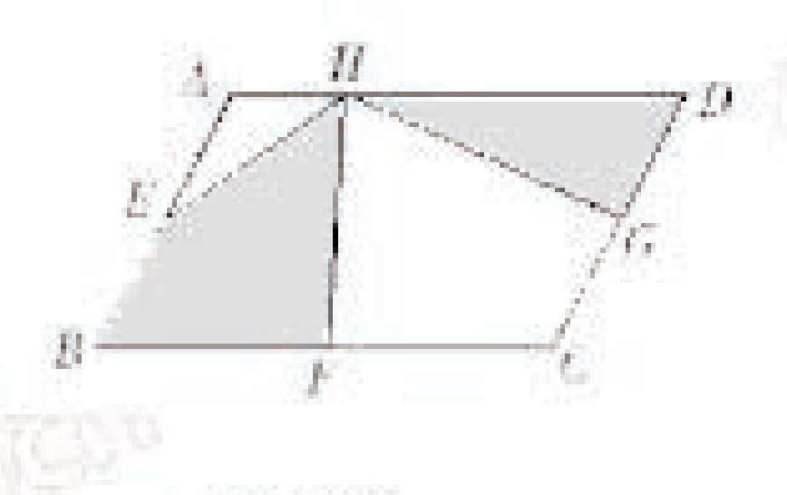
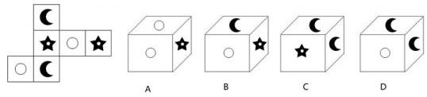
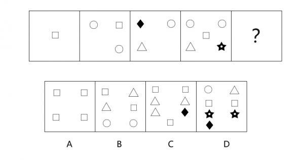
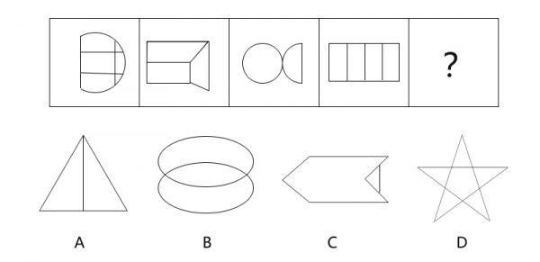
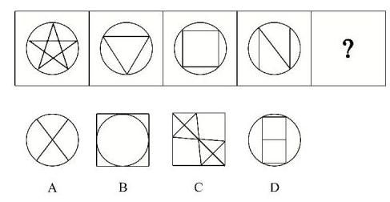
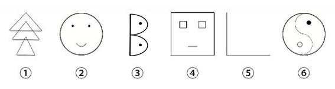
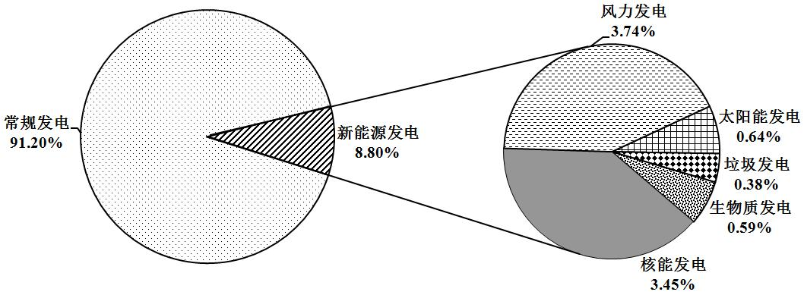
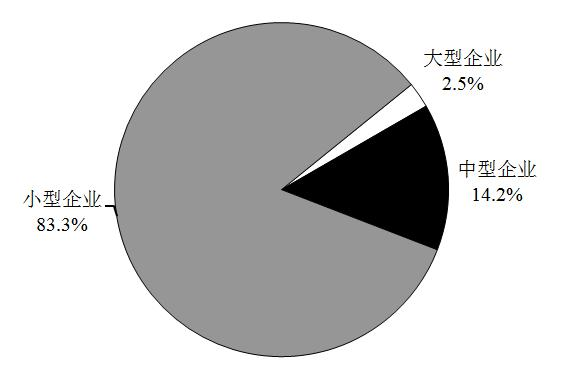
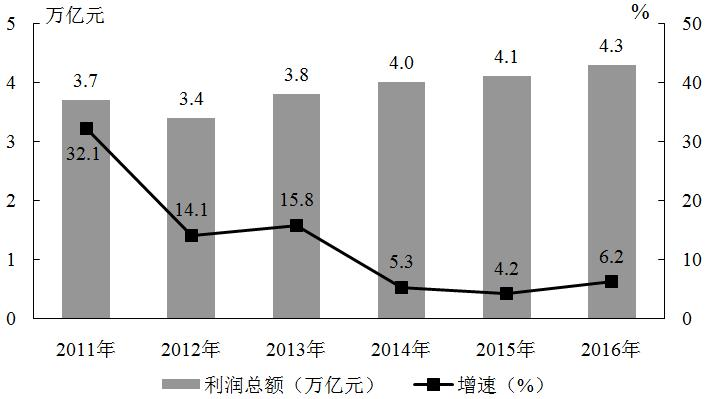

# 2017 辽宁省公务员录用考试 行测（公安）

> 行测 · 120 题 · 辽宁 2017

> 本卷是「公安机关及省属监狱戒毒系统考试录用公务员（人民警察）」的**公共科目《行政职业能力测验》**；该系统另有《公安专业科目》单独考试，与本卷无关，本卷不含。

> ⚠ 答案来自同批下载的官方《行政职业能力测验》解析 PDF（编号同为 1~120）；**解析正文未收录** —— 它在源 PDF 里是排版数学式，文本层抽取后分式跨行失真，照抄会误导，原文见 `work/inbox/ln2017_huatu_b.pdf`。

## 第 1 题　常识判断

关于一带一路表述，错误的是：

- **A**. 一带一路是丝绸之路经济带和21 世纪海上丝绸之路的简称
- **B**. 丝绸之路经济带是中国与西亚各国之间形成的经济合作区域
- **C**. 海上丝绸之路是唐朝时期开通的
- **D**. 一带一路建设是系统性工程，要坚持共商，共建，共享

## 第 2 题　常识判断

习近平总书记强调良好的______是最公平的公共产品和最普惠的民生福祉。

- **A**. 生态环境
- **B**. 社会环境
- **C**. 政治环境
- **D**. 文化环境

## 第 3 题　常识判断

两个一百年奋斗目标，是指在中国共产党成立一百年时全面建成小康社会，在新中国成立一百周年建成：

- **A**. 富强民主文明的国家
- **B**. 富强民主文明和谐的社会主义现代化国家
- **C**. 富强民主法治的国家
- **D**. 富强民主美丽的国家

## 第 4 题　常识判断

_____是关系党的事业兴衰成败第一位的问题

- **A**. 制度问题
- **B**. 法治问题
- **C**. 道路问题
- **D**. 改革问题

## 第 5 题　常识判断

下列对中国经济新常态的理解，不正确的是：

- **A**. 中国经济从中高速增长转为高速增长
- **B**. 发展方式由规模速度型向质量效率型转变
- **C**. 增长动力从要素驱动，投资驱动转向创新驱动
- **D**. 经济结构不断优化升级

## 第 6 题　常识判断

党的群众路线教育实践活动中要集中解决的“四风”问题是：

- **A**. 形式主义、官僚主义、享乐主义、腐败之风
- **B**. 形式主义、官僚主义、享乐主义、奢靡之风
- **C**. 形式主义、官僚主义、享乐主义、懒怠之风
- **D**. 形式主义、官僚主义、享乐主义、骄奢之风

## 第 7 题　常识判断

2016 年9 月4 日-5 日，二十国集团领导人第十一次峰会（G20 峰会）在中国杭州举行，下列不是本届峰会的主题的是：

- **A**. 创新
- **B**. 活力
- **C**. 联动
- **D**. 改革

## 第 8 题　常识判断

关于创新，下列表述错误的是：

- **A**. “创新驱动发展战略，必须摆在国家发展全局的核心位置”这是党的十八大提出的
- **B**. 创新创业首先不是取决于个人的兴趣爱好，而是满足社会需求
- **C**. 在科技创新企业资本市场融资中，股权融资分为境外和境内两大市场
- **D**. 创新等同于发明

## 第 9 题　常识判断

2017 年是香港回归祖国20 周年，香港特别行政区的区花是：

- **A**. 芙蓉花
- **B**. 牡丹花
- **C**. 紫荆花
- **D**. 玫瑰花

## 第 10 题　常识判断

辽宁振兴发展，干部作风转变是关键，保持战略定力，牢记使命担当大力弘扬______的“干”字精神

- **A**. 雷锋
- **B**. 焦裕禄
- **C**. 郭明义
- **D**. 毛丰美

## 第 11 题　常识判断

酶是生物体内的一种特殊的：

- **A**. 核酸
- **B**. 蛋白质
- **C**. 酶分子
- **D**. DNA

## 第 12 题　常识判断

尽管白天阳光有时不能照在房间里，但房间里仍然很亮，其主要原因是：

- **A**. 光的衍射
- **B**. 光的反射
- **C**. 光的折射
- **D**. 光的散射

## 第 13 题　常识判断

关于雾霾治理与绿色发展，下列说法错误的是：

- **A**. 我国所面临的资源环境与发展的挑战，已经接近世界平均水平
- **B**. 北方地区冬季清洁取暖可减少雾霾
- **C**. 中国不能走先污染后治理之路
- **D**. “十三五”时期，我国节能减排从单一目标即总量控制目标、减排目标，变成双目标即环境质量改善和污染物总量控制

## 第 14 题　常识判断

关于光污染的危害，下列理解错误的是：

- **A**. 我国高中生近视率达60％以上的主要原因是不良的用眼习惯所致，光污染影响很小
- **B**. 夜间，各种霓虹灯、广告灯形成了“人工白昼”，扰乱人体正常生物钟
- **C**. 光污染是继水污染、大气污染、噪声污染、固体废弃物污染之后的第五大污染
- **D**. 彻夜亮灯睡觉，夜间使用的小夜灯，都形成了光污染

## 第 15 题　常识判断

夏天，人们大多都愿意穿浅色的衣服，其主要原因是浅色衣服：

- **A**. 比较时尚
- **B**. 比较吸汗
- **C**. 人们比较愿意接受
- **D**. 吸收的太阳光比较少

## 第 16 题　常识判断

关于人体常识，下列表述正确的是：

- **A**. 人体唾液是舌头分泌的
- **B**. 人体内易于疲劳的肌肉是骨骼肌
- **C**. 人的大肠比小肠长
- **D**. 当心房收缩时测得的血压是低压

## 第 17 题　常识判断

人类对宇宙空间的认识，由探索阶段进入利用开发阶段的是：

- **A**. 由苏联发射的“火星”号探测器
- **B**. 美国的“阿波罗”登月计划实施
- **C**. 世界第一架航天飞机试航成功
- **D**. 我国第一颗人造地球卫星发射成功

## 第 18 题　常识判断

下列不属于礼贤下士典故的是：

- **A**. 吐哺握发
- **B**. 虚左以待
- **C**. 拥慧先驱
- **D**. 闭关却扫

## 第 19 题　常识判断

下列诗句与作者对应错误的是：

- **A**. 春蚕到死丝方尽，蜡炬成灰泪始干——李商隐
- **B**. 不是花中偏爱菊，此花开尽更无花——陶渊明
- **C**. 海上生明月，天涯共此时——张九龄
- **D**. 清水出芙蓉，天然去雕饰——李白

## 第 20 题　常识判断

下列表述错误的是：

- **A**. 中国现存最早的一部完整的农书是《齐民要术》
- **B**. 中国历史上第一部地理学专著是《山海经》
- **C**. 中国历史上第一部大百科全书是《永乐大典》
- **D**. 中国古代第一部词典是《尔雅》

## 第 21 题　常识判断

关于民族和节日之间的对应关系，下列说法错误的是：

- **A**. 彝族-火把节
- **B**. 壮族-那达慕
- **C**. 傣族-泼水节
- **D**. 藏族-雪顿节

## 第 22 题　常识判断

中华人民共和国恢复在联合国合法席位的时间是：

- **A**. 1949
- **B**. 1962
- **C**. 1971
- **D**. 1984

## 第 23 题　常识判断

关于管理学，下列表述错误的是：

- **A**. “鲶鱼效应”是企业领导层激发员工活力的有效措施之一
- **B**. “破窗理论”指出环境可以对一个人产生强烈的暗示性和诱导性
- **C**. “刺猬法则”提醒领导在管理实践中，要与下属保持一种不远不近的恰当合作关系
- **D**. “羊群效应”在经济领域形成了“强者恒强，弱者恒弱”的现象

## 第 24 题　常识判断

在经济繁荣时期为降低经济过热的风险，可以采取的方法是：

- **A**. 增加政府支出
- **B**. 降低公司所得税
- **C**. 降低个人所得税
- **D**. 提高贷款利率

## 第 25 题　常识判断

中国人对不同年龄会有不同称谓，下列年龄称谓从小到大排列顺序正确的是：

- **A**. 弱冠之年—而立之年—耳顺之年—古稀之年
- **B**. 弱冠之年—而立之年—古稀之年—耳顺之年
- **C**. 耳顺之年—弱冠之年—而立之年—古稀之年
- **D**. 而立之年—耳顺之年—弱冠之年—古稀之年

## 第 26 题　常识判断

地球陆地上淡水资源多数储存在：

- **A**. 冰川
- **B**. 地下
- **C**. 江河
- **D**. 湖泊

## 第 27 题　常识判断

世界最大的内陆国家是：

- **A**. 哈萨克斯坦
- **B**. 吉尔吉斯斯坦
- **C**. 塔吉克斯坦
- **D**. 阿富汗

## 第 28 题　常识判断

法律面前人人平等是指：

- **A**. 公民在法律上一律平等
- **B**. 国家机关在创制法律上一律平等
- **C**. 执法人员在执法上一律平等
- **D**. 公民在适用法律上一律平等

## 第 29 题　常识判断

刑事诉讼中的强制措施里指公检法机关保证刑事诉讼的顺利进行，依法对犯罪嫌疑人所采取的强制方法。下列不属于刑事强制措施的一项是：

- **A**. 拘传
- **B**. 刑事拘留
- **C**. 罚金
- **D**. 取保候审

## 第 30 题　常识判断

我国房地产市场的土地转让是指：

- **A**. 土地收益权的转让
- **B**. 土地处分权的转让
- **C**. 土地使用权的转让
- **D**. 土地所有权的转让

## 第 31 题　言语理解与表达

这篇小说的构思既精巧又严密，真是________。依次填入划横线部分最恰当的一项是：

- **A**. 无可非议
- **B**. 无懈可击
- **C**. 回味无穷
- **D**. 不可思议

## 第 32 题　言语理解与表达

张军在一次羽毛球训练中不慎拉伤了手臂。要是在平常，这样的伤根本不算什么，但________是在就要走上比武场的时候，这样的伤，________让人揪心。依次填入划横线部分最恰当的一项是：

- **A**. 偏偏 异常
- **B**. 恰巧 很是
- **C**. 刚好 非常
- **D**. 恰逢 有些

## 第 33 题　言语理解与表达

①甲醛的有毒成分可通过呼吸道侵入人体，吸入过多易引发白血病。专家向消费者________发出警告。尽量购买甲醛含量达到国家标准的装饰材料，要注意自我保护。②最近，S 市政府针对某地区的房屋征收问题，专门在政府网站公布调查问卷，就是否应该征收、征收补偿以及后续安置等问题，向广大市民________意见。依次填入划横线部分最恰当的一项是：

- **A**. 严重 咨询
- **B**. 郑重 征询
- **C**. 慎重 征求
- **D**. 审重 寻求

## 第 34 题　言语理解与表达

艺术的助人伦、成教化，不是如演说家那样带有着直接的________。它在潜移默化中，使人们________，趋向社会的崇高、激励着人们的心灵。依次填入划横线部分最恰当的一项是：

- **A**. 功利性 身临其境
- **B**. 实用性 耳濡目染
- **C**. 功用性 心服首肯
- **D**. 目的性 心悦诚服

## 第 35 题　言语理解与表达

我们认为，财权理论的________提出与论证，赋予了现代财务理论以灵魂与核心，使得财权成为现代财务区别于传统财务的根本标志，和判断企业是否真正开展财务活动的标准，犹如________，寓意深邃，为财务理论研究开辟了一片崭新天空。依次填入划横线部分最恰当的一项是：

- **A**. 系统性 阳春白雪
- **B**. 创造性 空谷足音
- **C**. 实证性 千古绝唱
- **D**. 规范性 空穴来风

## 第 36 题　言语理解与表达

在奥斯维辛解放60 周年纪念活动的电视实况转播里，看到奥斯维辛正飘飞着鹅毛大雪，仿佛老天也为之动容，流下冬天的眼泪，洒下祭祀的白花。远处苍茫的背景下，奥斯维辛集中营那些处在低洼之地的木制和砖砌的营房和毒气室，在洁白飞舞的雪花中，静静地________着，无言地出示着历史的一份________着血泪的证言。依次填入划横线部分最恰当的一项是：

- **A**. 伫立 浸透
- **B**. 肃立 书写
- **C**. 站立 浸染
- **D**. 树立 饱含

## 第 37 题　言语理解与表达

发光二极管对人类社会的贡献已经得到诺贝尔奖的________，但这一发明对昆虫世界的危害却________。发表于《生态学应用》上的最新研究指出，在LED 光源旁设置的捕虫装置捉到的昆虫比钠汽灯旁的装置多48%。LED 光源对昆虫导航能力的________可能增加他们意外死亡的风险。依次填入划横线部分最恰当的一项是：

- **A**. 认可 知之甚少 破坏
- **B**. 认定 不为人知 干预
- **C**. 肯定 鲜为人知 干扰
- **D**. 中肯 不予理睬 侵扰

## 第 38 题　言语理解与表达

中国的300 多个戏曲剧种，不但综汇了古典诗歌辞赋和民间说唱文学的精华，也用独具民族个性的音乐，舞蹈，展现了艺术创造的聪明智慧。但在当代社会中，有的传统戏曲________，以放弃艺术法则的代价，试图趋附于流行时尚；有的________，以传统经典的自大心态，不做与时俱进的文化提升与艺术更新。依次填入划横线部分最恰当的一项是：

- **A**. 生拉硬套 坐井观天
- **B**. 低声下气 针锋相对
- **C**. 委曲求全 执迷不悟
- **D**. 削足适履 抱残守缺

## 第 39 题　言语理解与表达

经济学家约瑟夫曾经说过，光是制造令人满意的肥皂还不够，还必须________大家洗澡，于是，公司发明并传播了体臭和口臭的概念，有人说，需求决定供给，但是公司决不________，公司制造了需求。依次填入划横线部分最恰当的一项是：

- **A**. 劝说 固步自封
- **B**. 诱导 墨守成规
- **C**. 引导 因循守旧
- **D**. 规劝 一孔之见

## 第 40 题　言语理解与表达

按常理______做出的消费决策应该更稳固，而事实恰恰相反，他们的结论往往更容易________，这种现象尤其在人们需要进行高消费如购房，买车时表现得更突出。依次填入划横线部分最恰当的一项是：

- **A**. 深思熟虑 动摇
- **B**. 深谋远虑 改变
- **C**. 思前想后 推翻
- **D**. 老谋深算 变化

## 第 41 题　言语理解与表达

在早餐方面，美国人缺乏想象力。在世界的许多地方，早餐温暖、美味。父母要想让孩子接受更加大胆的早餐，就得自己也这样吃。孩子在子宫里时就开始品尝腌蛋和豆酱的味道了，出生后婴儿会喜欢他们在子宫里_________过的食物，科学家称之为产前味道学习。但孩子们天生会喜欢某种东西并不等于他们的舌头第一次________到它时会很愉悦，网上有很多韩国婴儿第一次吃到泡菜时抓舌头甚至________的视频。依次填入划横线部分最恰当的一项是：

- **A**. 感应 接触 推拒
- **B**. 感受 碰触 摇头
- **C**. 接受 品尝 拒绝
- **D**. 接触 体验 哭泣

## 第 42 题　言语理解与表达

非物质文化遗产，是人类________，世代传承的无形的活态流变的文化遗产，它鲜活地扎根生存于民族民间。对非物质文化遗产，国家确定的方针是“保护为主，抢救第一，合理利用，传承发展”。一些专家认为，相当大一部分非物质文化遗产属无形或隐性，是人的精神创造，更________了对其保护抢救的重要性。依次填入划横线部分最恰当的一项是：

- **A**. 口传心授 凸显
- **B**. 口耳相传 彰显
- **C**. 薪火相传 显示
- **D**. 薪尽火传 突显

## 第 43 题　言语理解与表达

鸦片战争结束后，当得知英军已经撤出长江，道光皇帝的第一个________就是下令沿海各省撤军，清政府的军政大员________。有人形容当时文恬武嬉的状态：“大有雨过忘雷之意。”中国的一切仿佛又回到________。依次填入划横线部分最恰当的一项是：

- **A**. 反映 额手称庆 起点
- **B**. 决定 欣喜若狂 初始
- **C**. 反应 弹冠相庆 原点
- **D**. 旨意 欢欣鼓舞 平静

## 第 44 题　言语理解与表达

诗在其所具有的诸般品格中，十分重要的一条，便是对生活的________的打量。诗人的目光仿佛具有________的本领，生活中许多琐碎，平淡甚至枯燥的事物，经过它的描述，便产生了丰富的意味。依次填入划横线部分最恰当的一项是：

- **A**. 别具一格明察秋毫
- **B**. 独树一帜力透纸背
- **C**. 别具匠心点石成金
- **D**. 别开生面目光如炬

## 第 45 题　言语理解与表达

________长江是一条忽高忽低、忽曲忽直、忽细忽宽的漫长的跑道，________，金沙江所跑的更是陡坡挨着陡坡，拐弯挨着拐弯啊。哦，它不是从高到低往下滑，而是猛地跳下来，突然地冲下去。_____，正因为征途如此艰险，所以金沙江显得格外刚毅顽强，豪放潇洒。可以说，他是一位充满着浪漫主义色彩的运动员啊，金沙江不但浪漫而且英俊，________古人称它为“丽水神川”。依次填入划横线部分最恰当的一项是：

- **A**. 假如 或许 仿佛 因此
- **B**. 假如 那么 也许 所以
- **C**. 如果 那么 也许 因此
- **D**. 如果 或者 莫非 所以

## 第 46 题　言语理解与表达

种子，如果害怕________，那它永远不能发芽。鲜花，如果害怕____________，那它永远不能开放。矿石，如果害怕_________，那它永远不能成钢。航船，如果害怕风浪，那它永远不能到达彼岸。依次填入划横线部分最恰当的一项是：

- **A**. 埋藏 凋零 燃烧
- **B**. 掩埋 凋落 烧毁
- **C**. 凋谢 埋没 焚烧
- **D**. 埋没 凋谢 焚烧

## 第 47 题　言语理解与表达

S 县城玲珑娇小，整洁可爱，人口不足五万，是个风光________的疗养胜地。但是川流不息的游客当中又有几人知晓这是在反动派________过的废墟上建立起来的呢？依次填入划横线部分最恰当的一项是：

- **A**. 诱人 洗劫
- **B**. 宜人 血洗
- **C**. 迷人 血染
- **D**. 诱人 掠夺

## 第 48 题　言语理解与表达

党和国家机关工作人员在国内交往中，_________收受_______影响公正执行公务的礼品馈赠，因为各种原因________拒收的礼品，________登记上交。依次填入划横线部分最恰当的一项是：

- **A**. 不能 可能 未能 一定
- **B**. 不该 或许 没有 务必
- **C**. 不应 或许 没有 应该
- **D**. 不得 可能 未能 必须

## 第 49 题　言语理解与表达

一个好的创业者，至少需要两方面精神动力。一是创新精神，它强调思想的灵动、思维的________；二是工匠精神，它强调__________、一丝不苟。有的创业者过于求新求异，追求新点子、新包装，只有破坏没有建设，而以持续、稳定、渐变为特征的工匠精神，则对此有纠偏和矫正功能。依次填入划横线部分最恰当的一项是：

- **A**. 活跃 持之以恒
- **B**. 缜密 精益求精
- **C**. 跳跃 锲而不舍
- **D**. 连贯 坚持不懈

## 第 50 题　言语理解与表达

我国一些城市在旧城改造中，少了些如履薄冰的文化敬畏，让优秀的历史文化_______在了推土机的滚滚狼烟里；城市独特的传统文化即便被简单复制，也丢失了历史_______的文化精髓。城市记忆变得_________甚至从此消失殆尽。依次填入划横线部分最恰当的一项是：

- **A**. 埋葬 沉淀 模模糊糊
- **B**. 葬送 积淀 不伦不类
- **C**. 丢失 累积 面目全非
- **D**. 消逝 沉积 遥不可及

## 第 51 题　言语理解与表达

习近平在“一带一路”国际合作高峰论坛开幕式上说，“一带一路”具有开放包容的特征，其中，我们的愿景和行动当中提到一系列的机制，包括上海合作组织、清迈倡议、中国东盟自贸区、亚投行丝路基金，未来会有RCEP 的机制，通过上述机制的建立，以便推进未来“一带一路”建设走向繁荣。这段文字强调的是：

- **A**. 合作理念的开放包容
- **B**. 合作空间的开放包容
- **C**. 合作领域的开放包容
- **D**. 合作方式的开放包容

## 第 52 题　言语理解与表达

皮肤老化的原因很多，其中有些与个人体质有关，有些则因外界因素影响造成。不规律的饮食习惯会导致过度肥胖或体重不足，更可能造成两种情况交替产生。此外机体各种组合成分，如碳水化合物、油脂、蛋白质、维生素及机体必需的微量元素等分配不均衡，也会造成皮肤老化现象。这段文字想表达的是：

- **A**. 微量元素分配不均衡
- **B**. 肥胖或体重不足与个人体质有关
- **C**. 皮肤老化的原因
- **D**. 不规律的饮食习惯会导致肥胖或体重不足

## 第 53 题　言语理解与表达

站在风口的物联网应用，2016 年居然是自行车。共享经济让自行车回归了城市，因其灵活便捷、低碳环保成为许多城市常见的“短途代步神器”，最大限度地实现了资源共享。但随之发生的共享单车乱停放问题——绿化带内、人行道边、上场前等随处可见；随意丢弃垃圾堆旁、大江大河的有之；停进自家车库占为己有的有之；偷换二维码借机敛财的有之……公民规则意识淡薄、社会信用体系缺失、城市基础设施不到位……原本多赢的局面，极有可能会因为少数人不遵守规则而造成“多输”。最适合做这段文字标题的是：

- **A**. 共享单车叩问共享经济发展短板
- **B**. 共享单车引发的思考
- **C**. 共享经济时代规则意识的确立
- **D**. 共享经济互换社会诚信

## 第 54 题　言语理解与表达

人口激增，让地球的粮食供应面临严峻的考验，有科学家预计，到2050年，需要增加70%的耕地，人类才能养活自己。但地球上根本没有这么多可增加的耕地。于是，科学家转向海洋求助，在远离海岸的开阔海域中养鱼，这样就可以给人类提供足够的营养。我们可以大胆的预测，人类食物的蓝色革命即将拉开序幕。这段文字用“人类食物的蓝色革命”来说明：

- **A**. 对海域的深度开发，可以弥补地球上耕地的不足
- **B**. 海洋鱼类资源将在人类食物结构中占较大比重
- **C**. 加大深海养殖的力度，可以解决食物供给不足的现象
- **D**. 海水养殖业将成为第一产业，在国民经济中占主导地位

## 第 55 题　言语理解与表达

无论西方政治精英们多么不情愿，全民公投最后以微弱优势确定英国退出欧盟。这一件事件直接导致政治海啸瞬间生成；英镑暴跌、美元和黄金大涨；亚洲股市剧烈震荡；英国首相卡梅尔隆重宣布辞职；脱欧事件引起了许多英国人民的强烈不满等。此次脱欧，英国的世界大国地位和文化影响力，既是聚变，也是裂变，使世界在不同层面都陷入阶段性的迷茫，前途叵测，安知非福。这段文字意在强调：

- **A**. 世界政治海啸瞬间生成
- **B**. 世界经济态势剧烈震荡
- **C**. 英国的世界大国地位和文化影响力将被削弱
- **D**. 英国脱欧对世界局势将产生诸多影响

## 第 56 题　言语理解与表达

南海仲裁案仲裁结果否定了中国在南海的主权。为此，全体中国人都为这一非法裁定感到愤慨，这个仲裁结果比之前很多人预测的更加极端、无耻，堪称是人们可以想象的“最坏版本”，这是对中国领土主权和海洋权益的悍然否决。仲裁庭通过对这些争端的再定义，对中菲领土和海洋划界争端强行裁决，这是无耻的越权和滥权。中国政府和中国人民都绝不可能接受这一种仲裁结果，我们对仲裁“不接受、不参与”的态度坚定不移，谁都休想撼动我们。这段文字意在表明：

- **A**. 仲裁结果就是废纸一张，中国人民必须支持政府予以针锋相对地回击
- **B**. 对仲裁“不接受、不参与”的态度坚定不移
- **C**. 中国人都为这一非法裁定感到愤慨
- **D**. 仲裁结果是对海洋法公约以及整个国际法体系的粗暴践踏

## 第 57 题　言语理解与表达

M 市将20 多年来发行股票的工作首次予以公开，共有八家公司股票上市。为此，M 市某报社就股票发行问题对5000 余人进行调查。结果显示：公众中的非股民对八家公司股票发行价的评价较温和，60%以上的人因无炒股经历而不做评价。虽然亦有五分之一以上股民认为股票发行价偏高，认为偏低的几近于零，但这更应视为人之常情，买东西的人多倾向于认为东西贵。老股民亦认为新股发行价格偏高。根据上文可以得出的是：

- **A**. 股票发行价格偏高，因此，购股者甚少
- **B**. 老股民选择不购买新股的原因
- **C**. 公众中非股民对新股发行价格评价较温和，可能考虑购买
- **D**. 该市大部分人对股票知之甚少

## 第 58 题　言语理解与表达

当下，我国各类真人秀综艺栏目的发展呈现出井喷状态。然而，由于栏目扎推，风格雷同，一部分作品缺乏质感、灵性和情怀，格调低下，大有走向“愚乐”之途的不良趋势。甚至个别栏目重形式而轻内容，重经济效益而轻社会效益，这种创作观念上的误区严重制约了栏目文化认知功能、教育功能和审美功能的发挥。在这种“泛娱乐化”的背景下，《中国汉字听写大会》《中国诗词大会》《朗读者》《见字如面》等文化类栏目异军突起，实现了口碑和收视率的双赢。这段文字意在说明：

- **A**. 综艺栏目要强调寓教于乐
- **B**. 电视媒体人负有文化传承的使命担当
- **C**. 以传统文化扭转“泛娱乐化”现状
- **D**. 综艺栏目应制作成更高层次的带有娱乐属性的文化产品

## 第 59 题　言语理解与表达

千百年来，食物就这样随着人们的脚步，不停迁移，不停流变。无论脚步多远，在人的脑海中，只有故乡的味道，熟悉而顽固，它就像一个味觉定位系统，一头锁定了千里之外的异地，另一头则永远牵绊着记忆深处的故乡。这里的“它”指的是：

- **A**. 故乡
- **B**. 脚步
- **C**. 食物
- **D**. 味道

## 第 60 题　言语理解与表达

可别小瞧了那些在路边沉默而低调的野生果树，它们是大自然赋予我们的珍贵自然遗产。自人类出现以来，野果就是人类赖以生存的主要食物来源之一。随着农业技术的发展，它们中的一部分被驯化为优质水果，比如现在风靡市场的猕猴桃，起初也是其貌不扬的野果。然而大部分野果还默默地隐居于林间亦或是已经被破坏掉，需要我们在开发利用它们的同时，共同保护这些野生的果树资源。这段文字意在强调的是：

- **A**. 野生果树是大自然赋予我们的珍贵遗产
- **B**. 野生果树成为优质水果需要驯化
- **C**. 我们应该重视野生果树的培育开发同时加强保护
- **D**. 野果其貌不扬但却是人类的主要食物来源之一

## 第 61 题　言语理解与表达

为了解新媒介对儿童的影响，近日，中国青少年宫协会下属一研究中心对18 个中心城市的3 万多名3 岁-14 岁的儿童及其家长进行了调研。调研结果显示：幼儿园时期（3 岁-6 岁），44.1%的孩子开始玩网游；小学中年级时期（9 岁-10岁），儿童周末用在电子媒介的平均时长达63.57 分钟；初中时期（13 岁-14岁），使用QQ 的孩子达到91.8%，其中33.7%的孩子有陌生网友。这段文字意在说明：

- **A**. 新媒介发展影响儿童成长
- **B**. 城市儿童使用新媒介的人数在激增
- **C**. 城市儿童新媒介使用低龄化趋势明显
- **D**. 新媒介已成为儿童的主要娱乐方向

## 第 62 题　言语理解与表达

总体来说，银行获得的存款量决定了银行的贷款能力，但是，在许多时候银行的贷款数量会超出它所获得的存款数量，这是一个众所周知的事实。如果这种贷款的数量超出过多，就会造成通货膨胀。这段文字意在说明：

- **A**. 银行的贷款数量超出它所获得的存款数量是一个众所周知的事实
- **B**. 银行向外的贷款数量超过了存款数量会造成通货膨胀
- **C**. 应该采取一种有效的策略用以控制通货膨胀
- **D**. 银行的贷款量与银行获得的存款量成正比

## 第 63 题　言语理解与表达

作家毕飞宇提及阅读与写作的关系时说，作家的写作不是盲目的，写作一定有它的指向，这个指向无非是两个方面，一个是理性诉求，第二个就是美学标准。所谓写作，就是向自己心中的那个美学标准靠近的一个过程。没有一个母亲能把自己有关小说的美学标准生给自己的子女，_________________。填入划横线部分最恰当的一句是：

- **A**. 美学标准是需要建立的
- **B**. 要在心中逐步建立起美学标准
- **C**. 必须是这个人自己去建立
- **D**. 每个人都有自己的美学标准

## 第 64 题　言语理解与表达

中国陶瓷，凡一新品种诞生，其由小到大、由弱到强的演变，脉络清晰。但元青花没有童年，没有少年，当你看见它时，它俨然已是一个风华正茂的青年。在人们的印象中，蒙古人善武而不善文，所以如此精美的青花瓷出自蒙古人之手太让人不可思议。再有，元青花出现之前，中华文明的传统色调鲜有蓝色的身影。近年在南海打捞出的多套精美的蓝色青花瓷器，经考证为明代郑和下西洋带入东南亚的明青花。这更让世人质疑元青花的身份。这段文字意在说明：

- **A**. 元青花没有清晰的演变过程
- **B**. 元青花让世人质疑
- **C**. 元代陶瓷的发展状况
- **D**. 元青花被世人质疑的原因

## 第 65 题　言语理解与表达

①我们相信要对成千上万的项目说不，这样我们才能真正专注于那些对我们来说确实重要和有意义的少数项目②我们相信，我们在地球上存在的目的就是创造伟大的产品③我们崇尚简约而不是复杂④这一点不会改变⑤我们相信团队间的深度合作和相互启发，这让我们用别人没有的方式进行创新⑥我们一直专注于创新将以上六个句子重新排列，语序正确的是：

- **A**. ⑥④②③⑤①
- **B**. ③④①⑥②⑤
- **C**. ②④⑥③①⑤
- **D**. ①③⑥④⑤②

## 第 66 题　言语理解与表达

①但是，在读书中，就是要过河拆桥②既然知道了那个意思以后③这就是古人所说的“得意忘言”④语言文字是帮助了解书的意思的拐棍⑤最好扔了拐棍⑥在人与人的关系中，过河拆桥是不道德的事将以上六个句子重新排列，语序正确的是：

- **A**. ④②⑤③⑥①
- **B**. ⑥①③④②⑤
- **C**. ④⑤②⑥①③
- **D**. ②⑤⑥③①④

## 第 67 题　言语理解与表达

当下，越来越多的家长逐渐意识到情商的重要性，对培训机构打出的“儿童情商培养”的宣传心动不已，一年动辄几万的学费也挡不住他们的热情。有专家分析其原因，有几种可能：一种是意识到要对孩子进行情商的培养；另一种则是家长感觉到自己教育孩子出现了问题，宁愿将孩子送出去教育，而不从自己的教育理念上找原因，这实际上是一种推脱责任的表现；此外还有来源于白领阶层日常工作模式中铸就的“自我实现”价值观，使年轻的父母在教育子女过程中过于焦虑，也是导致培训班火热的原因。接下来最可能讨论的是：

- **A**. 选择情商培训班的方法
- **B**. 儿童情商培训现存状态
- **C**. 如何理性认识情商培训
- **D**. 情商教育对孩子成长的重要意义

## 第 68 题　言语理解与表达

加拿大科学家近日研究出一种装置，使人说话或吃东西时都能通过下颚活动产生电能并储存起来。实验对象佩戴该装置后连续咀嚼口香糖60 秒，紧贴着下巴的索带可产生大约10 微瓦至18 微瓦电力，而进餐时每次咀嚼食物平均约产生7 微瓦。据预期，这种发电方法经改进后，未来可能用于助听器、智能听觉保护器甚至手机等小型电子装置充电。不符合上述文段意思的一项是：

- **A**. 新研究的发电方法可以用于助听器充电
- **B**. 加拿大科学家研究出一种通过运动使身体产生和储存电能的装置
- **C**. 连续咀嚼口香糖60 秒，可产生10-18 微瓦的电力
- **D**. 人说话或吃东西能产生电能

## 第 69 题　言语理解与表达

新技术是伟大的“改变者”，然而新技术的生死时速，是否会纵容“所见即所得”的肤浅，带来“既得繁花，亦生野稗”的现象？已经有人痛心文化空气的日益稀薄，认为中国正在进入文化上的“小时代”图书馆修得越来越好，好书和读书人却越来越少；实体书店和报刊亭逐渐凋零，城市正失去文化之肺……难怪有人疾呼，从电脑和手机中拯救阅读吧！下列说法理解正确的是：

- **A**. 新技术的发展是造成中国文化“小时代”的直接原因
- **B**. 技术手段的升级发展引起文化焦虑
- **C**. 回到真正的文化生活必须对新技术适当拒绝
- **D**. 电脑和手机可以拯救阅读

## 第 70 题　言语理解与表达

现代的火锅，最初随北方游牧民族传入中原，并催生出不同的形制。北京的涮肉火锅，羊肉细薄如纸，吃的是嫩。云南的菌子火锅，菌菇清甜鲜美，吃的是香。潮汕的牛肉火锅，牛肉丸筋道多汁，吃的是韧。火锅，最集中地体现了中国人对于团圆的向往。但是，谁都比不上重庆人对火锅的挚爱。山城里，遍布2 万多家火锅餐厅，每30 个重庆人就有1 个从事与火锅相关的职业。花椒和辣椒的香艳相逢，不仅是味蕾和神经之间电光火石般的碰撞，也是亚洲和美洲之间的越洋聚首。下列说法与原文意思不符的是：

- **A**. 火锅形制因地域不同而存在差异
- **B**. 火锅产生于北方游牧民族
- **C**. 人们爱吃火锅最主要的原因是对团圆的向往
- **D**. 人类的迁徙推动食物的发展融合

## 第 71 题　数量关系

某商业银行的总利润与贷款量之间的函数关系为：。当贷款数量为（ ）万元时，总利润最大。

- **A**. 100
- **B**. 150
- **C**. 200
- **D**. 250

## 第 72 题　数量关系

某高校举办一次读书会共有37 位同学报名参加，其中中文、历史、哲学专业各有10 位同学报名参加此次读书会，另外还有4 位化学专业学生和3 位物理专业学生也报名参加此次读书会，那么一次至少选出（ ）位学生，能保证选出的学生中至少有5 位学生是同一专业的。

- **A**. 17
- **B**. 20
- **C**. 19
- **D**. 39

## 第 73 题　数量关系

小周记住了自己身份证号码的前14 位，但他肯定，后面4 位数字全是奇数，最后一个数字是1 且后4 个数字中相邻数字不相同，那么小周的身份证号码有（ ）种可能。

- **A**. 24
- **B**. 27
- **C**. 48
- **D**. 64

## 第 74 题　数量关系

有一项工作，甲单位干需要10 小时能完成。乙单位干需要12 小时能完成，甲乙两人同时工作5 小时后，甲另有其他的事情去做，只有乙继续工作，那么完成这项工作共用了（ ）小时。

- **A**. 5
- **B**. 6
- **C**. 7
- **D**. 8

## 第 75 题　数量关系

从一个装有三个红球两个白球的盒子里摸球，那么前两次连续摸中红球的概率为：

- **A**. 0.1
- **B**. 0.16
- **C**. 0.3
- **D**. 0.45

## 第 76 题　数量关系

某服装商场举行店庆优惠活动，全场商品满199 减100，满399 减200元，满599 减300 元，该服装商场平时全场5.5 折销售服装，小王买了价值680元，440 元，250 元服装各一件，那么参加店庆活动与平时相比：

- **A**. 少花了16.5 元
- **B**. 多花了16.5 元
- **C**. 少花了15.5 元
- **D**. 多花了15.5 元

## 第 77 题　数量关系

如图，平行四边形ABCD 的面积是54 平方厘米，点E、F、G 分别是平行四边形ABCD 边上的中点，H 为AD 边上的任意一点，则阴影部分的面积为（ ）平方厘米。

- **A**. 27
- **B**. 28
- **C**. 32
- **D**. 36

## 第 78 题　数量关系

母亲现在的年龄个位数跟十位数对调再减10 岁就是儿子的年龄，再过3 年母亲的年龄就是儿子年龄的2 倍，则母亲现在的年龄是：

- **A**. 53
- **B**. 52
- **C**. 43
- **D**. 42

## 第 79 题　数量关系

甲乙两辆车从A 地驶往120 公里外的B 地，甲乙两辆车的速度比为2:3，甲车于上午8 点30 分出发，乙车晚出发20 分钟，最终乙车比甲车早到B 地，那么乙车（ ）时追上甲车。

- **A**. 9:00
- **B**. 9:10
- **C**. 9:30
- **D**. 9:40

## 第 80 题　数量关系

某木场有甲，乙，丙三位木匠师傅生产桌椅，甲每天能生产12 张书桌或13 把椅子；乙每天能生产9 张书桌或12 把椅子，丙每天能生产9 张书桌或15 把椅子，现在书桌和椅子要配套生产（每套一张书桌一把椅子），则7 天内这三位师傅最多可以生产桌椅（ ）套。

- **A**. 116
- **B**. 129
- **C**. 132
- **D**. 142

## 第 81 题　图形推理

由左侧展开图折成的立方体是：（忽略图形方向问题）

- **A**. A
- **B**. B
- **C**. C
- **D**. D

## 第 82 题　图形推理

从所给的四个选项中，选择最合适的一个填入问号处，使之呈现一定规律性：

- **A**. A
- **B**. B
- **C**. C
- **D**. D

## 第 83 题　图形推理

从所给的四个选项中，选择最合适的一个填入问号处，使之呈现一定规律性：

- **A**. A
- **B**. B
- **C**. C
- **D**. D

## 第 84 题　图形推理

从所给的四个选项中，选择最合适的一个填入问号处，使之呈现一定规律性：

- **A**. A
- **B**. B
- **C**. C
- **D**. D

## 第 85 题　图形推理

从所给的四个选项中，选择最合适的一个填入问号处，使之呈现一定规律性：

- **A**. A
- **B**. B
- **C**. C
- **D**. D

## 第 86 题　定义判断

超限效应，是指当人们所接受的刺激过多，过强或者作用时间过久时，引起的心理极不耐烦或逆反的心理现象。根据上述定义，下列不符合超限效应的是：

- **A**. 在图书馆工作的小林因为媳妇总是埋怨他挣不到钱，一赌气辞职下海和朋友到南方做生意去了
- **B**. 小王买彩票中了大奖，兴奋得一夜未眠
- **C**. 小方因工作绩效不好，多次受到领导的批评后，产生了辞职的念头
- **D**. 小华连续加班一周，感到非常疲惫，因琐事与家人大吵

## 第 87 题　定义判断

调整性行政指导和助成性行政指导是两种不同的行政指导形式。前者是行政相对方之间发生利害冲突而又协商不成时，由行政机关出面调停以求达成妥协的行政指导。助成性行政指导是指行政机关为行政相对方出主意以保护和帮助行政相对方利益的行政指导。根据上述定义，下列属于调整性行政指导的是：

- **A**. 2003 年中东发生严重流血事件之后，美国总统布什派出沃尔夫前往中东幹旋，调停巴以冲突
- **B**. 甲乙两家相邻的饭店因为客户停车问题发生了冲突，后来当地商会会长召集两家饭店的经理进行协商，实现了和解
- **C**. 某市两家公交公司因为争线路发生冲突，导致停运，后来政府出面，召集两家公司进行协商，重新明确了公交线路之后，两家公司均恢复了运营
- **D**. 某市甲乙两家食品厂因为商标问题发生冲突，工商局经过调查后得出结论认为甲公司拥有该商标所有权，责令乙公司停止使用该商标所有权，责令乙公司停止使用该商标

## 第 88 题　定义判断

焦虑性神经官能症是以广泛性焦虑症（慢性焦虑症）和发作性惊恐状态（急性焦虑症）为主要临床表现，是一种无根据的惊慌和紧张或其紧张惊恐程度与现实情况很不相称，心理上体验为泛化的、无固定目标的担心惊恐，生理上伴有警觉增高的躯体症状。根据上述定义，下列属于焦虑性神经官能症的是：

- **A**. 上高三的小李平时上课表现得非常正常，但是遇到老师提问他时就紧张的说不出话来，即便自己会的问题也回答不出来
- **B**. 老李查出来患有肿瘤，一想到自己可能不久于人世，老李就非常的惊恐
- **C**. 最近某市发生了几起入室盗窃杀人案，一天晚上小丽老公加班没有回来，小丽整晚都非常担心，几乎没睡觉
- **D**. 小孙最近刚失恋，她每天把自己关在家里，伤心欲绝，痛苦不已

## 第 89 题　定义判断

犯罪未遂是指已经着手实行犯罪，由于犯罪分子意志以外的原因而未得逞；犯罪中止是指在犯罪预备、犯罪实行和实行终了之后犯罪结果发生之前，出于自己的意志自动中止犯罪或自动有效地防止犯罪结果发生。根据上述定义，下列属于犯罪中止的是：

- **A**. 钱某准备开车撞死周某，行驶在路上，钱某想起可能会因此入狱，便打消了杀人的念头，掉头回家
- **B**. 李某一直猜疑邻居老王和自己媳妇有染，一天晚上他堵在老王平时回家的必经之路上准备趁老王路过时将其暴打一顿。然而，当晚老王由于加班没有回家，李某等到凌晨三点便悻悻而归
- **C**. 孙某与宿舍同学赵某发生过纠纷，一日趁赵某上课，孙某在饮水机里投下了剧毒氰化物便离开宿舍，妄图毒死赵某。当日，校园里正在举办普法活动，听了法律宣讲之后，孙某迅速跑回宿舍准备把水倒掉。不料赵某当日因为身体不舒服提前回到了宿舍，等孙某到宿舍后发现赵某已经中毒死亡
- **D**. 张某到一户别墅入室行窃，撬开房门之后，正欲行窃之时，突然看到地上有一摊血，晕血的他突然就晕倒在地

## 第 90 题　定义判断

社会方言是同一地域的社会成员由不同的职业、社会地位、政治信仰、受教育程度等因素或由这些因素构成的社区交际习惯所形成语言的差异。主要差别是语言风格和表达方式以及一些特殊词汇的使用。根据上述定义，下列不属于社会方言是：

- **A**. 贵族语言
- **B**. 学生腔
- **C**. 客家话
- **D**. 法律术语

## 第 91 题　类比推理

投资：股票

- **A**. 储蓄：债券
- **B**. 债券：国债
- **C**. 上市公司：证券公司
- **D**. 证券：负债

## 第 92 题　类比推理

端午节：吃粽子

- **A**. 元宵节：元宵
- **B**. 中秋节：赏月
- **C**. 重阳节：游湖
- **D**. 除夕：守岁

## 第 93 题　类比推理

利率：本金：利息

- **A**. 边长：高：面积
- **B**. 压强：压力：面积
- **C**. 电流：功率：电压
- **D**. 密度：体积：质量

## 第 94 题　类比推理

寒冷：穿衣

- **A**. 停机：话费
- **B**. 漂亮：化妆
- **C**. 生病：住院
- **D**. 饥饿：吃饭

## 第 95 题　类比推理

七窍生烟：气愤

- **A**. 同流合污：腐败
- **B**. 哀鸿遍野：荒凉
- **C**. 琴瑟和鸣：恩爱
- **D**. 高雅脱俗：骄傲

## 第 96 题　逻辑判断

尽管许多专家都大力宣传多参加课外兴趣活动能有效开拓学生视野，提升孩子的求知欲，但是许多家长甚至老师还是会把参加课外兴趣活动与学业对立起来，认为孩子应该把更多的时间放在学业上，以提高学习成绩。而有专家表示，参加课外兴趣活动越多的孩子，学习成绩越好，建议家长、老师给孩子更多的时间去参加课外兴趣活动。以下哪个选项如果为真，则最能削弱专家的推论：

- **A**. 参加课外兴趣活动多的孩子更能获得老师的关心
- **B**. 参加课外兴趣活动能让孩子在上课时求知欲更强，从而提高学习成绩
- **C**. 家长、老师倾向于让学习成绩好的孩子有更多参加课外兴趣活动的时间
- **D**. 参加课外兴趣活动占用了课后复习的时间

## 第 97 题　逻辑判断

美联储对以华尔街为中心的证券交易市场影响同样是巨大的。美国政府本身没有货币发放权，美国政府要获得美元，必须将美国的未来税收以国债的形式抵押给美联储，纽约联邦储备银行代理发行美国政府各种债券，并投入到了证券交易市场。更重要的是，美联储对美元发放数量和利率的调整直接影响华尔街的走势，甚至全球经济。根据以上论述，可以推出的是：

- **A**. 美元的发放和利率的调整可能是美国政府影响世界经济的一个重要手段
- **B**. 美联储是美国联邦政府的一个部门
- **C**. 美联储发行美元的条件是美国政府将税收以国债的形式抵押给美联储
- **D**. 美联储具体履行美国中央银行的职能

## 第 98 题　逻辑判断

在一次大学毕业十年同学聚会上发现，所有女生都已婚，有的已婚男生有过出国旅行的经历，但是参加聚会的同学中也有既未婚也没有出国旅行经历的同学。根据以上情况，下列选项一定正确的是：

- **A**. 有的女生没有出国旅行经历
- **B**. 有的女生有出国旅行经历
- **C**. 所有的男生有出国旅行经历
- **D**. 有的男生没有出国旅行经历

## 第 99 题　逻辑判断

在侦办某网络诈骗案时办案人员发现，涉案的三名嫌疑人甲、乙、丙分别来自A、B、C 三地，三人分别负责编写诈骗脚本，拨打诈骗电话，收取诈骗款，根据嫌疑人的供述（1）负责编写诈骗脚本的嫌疑人向来自C 地的嫌疑人借过钱（2）来自B 地的嫌疑人向负责拨打诈骗电话的嫌疑人学习过普通话（3）负责编写诈骗脚本的嫌疑人和B 曾经是另一起诈骗案的同案犯（4）乙和A 在同一城市打过工（5）B、乙比丙的年龄都大根据以上信息，下列判断正确的是：

- **A**. 丙负责拨打诈骗电话，甲来自B 地
- **B**. 乙负责拨打诈骗电话
- **C**. 甲负责编写诈骗脚本
- **D**. 来自C 地的嫌疑人负责收取诈骗款

## 第 100 题　逻辑判断

中国多样化的地理环境和气候，日出而作，日落而息，人们春种，秋收，夏耕，冬藏，四季轮回中，隐藏着一套严密的历法，历经千年而不衰，相比农耕时代，今天的人们与自然日渐疏远，然而，沿袭祖先的生活智慧，并以此安排自己的饮食，已内化为中国人特有的基因。最能支持上述结论的是：

- **A**. 在年轻人的日常饮食中洋快餐占据了重要地位
- **B**. 在大城市中有很多家庭开始选择到饭店吃年夜饭
- **C**. 罗宋汤、炸猪排等舶来品，最终被同化为上海人自己的味道
- **D**. 川菜在全国许多地方都受到当地人的喜欢

## 材料 1

根据中华人民共和国2016 年国民经济和社会发展统计公报公布的数据显示，2016 年末全部金融机构本外币各项存款余额155.5 万亿元，比年初增加15.7 万亿元，其中人民币各项存款余额150.6 万亿元，增加14.9 万亿元。全部金融机构本外币各项贷款余额112.1 万亿元，增加12.7 万亿元，其中人民币各项贷款余额106.6万亿元，增加12.6 万亿元。金融机构境内住户人民币消费贷款余额250472 亿元，增加60998 亿元。其中，短期消费贷款余额49313 亿元，增加8347 亿元；中长期消费贷款余额201159 亿元，增加52651 亿元。全年保险公司原保险保费收入30959 亿元，比上年增长27.5%，其中，寿险业务原保险保费收入17442 亿元，健康险和意外伤害险业务原保险保费收入4792 亿元，财产险业务原保险保费收入8725 亿元。支付各类赔款及给付10513 亿元，其中，寿险业务给付4603 亿元，健康险和意外伤害险赔款及给付1184 亿元，财产险业务赔款4726 亿元。

注：【1】原保险保费收入是指保险企业确认的原保险合同保费收入。

## 第 101 题　资料分析

2016 年金融机构境内住户人民币消费贷款的增长率是多少？

- **A**. 24%
- **B**. 30%
- **C**. 32%
- **D**. 34%

## 第 102 题　资料分析

2015 年末金融机构境内住户人民币中长期消费贷款余额比短期消费贷款余额约多（ ）倍。

- **A**. 3.8
- **B**. 3.6
- **C**. 2.6
- **D**. 2.2

## 第 103 题　资料分析

2016 全年保险公司各类赔款及给付占原保险保费收入约为：

- **A**. 1/2
- **B**. 1/4
- **C**. 2/3
- **D**. 1/3

## 第 104 题　资料分析

2016 全年保险公司寿险业务原保险保费，健康险和意外伤害险业务原保险保费，财产险业务原保险保费的收付比最高的是：

- **A**. 寿险业务原保险保费
- **B**. 健康险和意外伤害险业务原保险保费
- **C**. 财产险业务原保险保费
- **D**. 无法判断

## 第 105 题　资料分析

根据上述资料，下列说法不正确的是：

- **A**. 2016 年末全部金融机构本外币贷款的增长率高于存款的增长率
- **B**. 2016 年末全部金融机构本外币贷款的增长率低于存款的增长率
- **C**. 2016 年末全部金融机构本外币贷款的数量低于存款的数量
- **D**. 2016 年初全部金融机构本外币贷款的数量低于存款的数量

## 材料 2

新能源发电量快速增长。7 月份，新能源发电量同比增长19.9%，增速比6 月份提高6.3 个百分点。根据国家统计局披露，2016 年1~7 月份，新能源发电量增长19.2%，高于全部发电量增速17.2 个百分点，1~7 月份，新能源发电量占全部发电量的比重为8.8%。核电、风电和太阳能发电占全部发电量比重分别为3.45%、3.74%和0.64%，其中风电比上年同期提高0.4 个百分点。1~7 月份规模以上工业发电量比重图风力发电量仍占新能源发电量首位。1~7 月份，风力发电量1209.5 亿千瓦时，同比增长14.8%；核能发电量1115.2 亿千瓦时，增长24.5%；太阳能发电量206.9亿千瓦时，增长27.5%；生物质发电量190.7 亿千瓦时，增长10.3%；垃圾焚烧发电量122.8 亿千瓦时，增长17.8%。

1~7 月份规模以上工业发电量比重图

## 第 106 题　资料分析

2015 年1~7 月，规模以上工业发电量约为多少亿千瓦时？

- **A**. 31600
- **B**. 32300
- **C**. 42100
- **D**. 55300

## 第 107 题　资料分析

2016 年1~7 月份，新能源发电增长量同比最多的是：

- **A**. 核能发电
- **B**. 风力发电
- **C**. 太阳能发电
- **D**. 生物质发电

## 第 108 题　资料分析

2016 年1~7 月常规发电量约为多少亿千瓦时？

- **A**. 29500
- **B**. 32700
- **C**. 35900
- **D**. 43700

## 第 109 题　资料分析

2016 年1~7 月全国新能源发电量增长约为多少亿千瓦时？

- **A**. 540
- **B**. 480
- **C**. 460
- **D**. 370

## 第 110 题　资料分析

下列说法正确的是：

- **A**. 2016 年1~7 月，新能源发电量占全部发电量的比重同比下降
- **B**. 2016 年1~6 月，新能源发电量增速同比超过19.5%
- **C**. 2016 年1~7 月，垃圾焚烧发电量同比增加小于18 亿千瓦时
- **D**. 2016 年1~7 月，规模以上工业发电量同比增加约为640 亿千瓦时

## 材料 3

2016 年中国货物进出口总额243386 亿元，比上年下降0.9%。其中，出口138455 亿元，下降1.9%；进口104932 亿元，增长0.6%。货物进出口差额（出口减进口）33523 亿元，比上年减少3308 亿元。

2016 年对主要国家和地区货物进出口额及其增长速度

| 国家或地区 | 出口额（亿元） | 比上年增长（%） | 占我全部出口比重（%） | 进口额（亿元） | 比上年增长（%） | 占我全部进口比重（%） |

| --- | --- | --- | --- | --- | --- | --- |

| 欧盟 | 22369 | 1.3 | 16.2 | 13747 | 5.9 | 13.1 |

| 美国 | 25415 | 0.0 | 18.4 | 8887 | -3.2 | 8.5 |

| 东盟 | 16894 | -1.9 | 12.2 | 12978 | 7.4 | 12.4 |

| 中国香港 | 19009 | -7.6 | 13.7 | 1107 | 39.2 | 1.1 |

| 日本 | 8529 | 1.3 | 6.2 | 9626 | 8.4 | 9.2 |

| 韩国 | 6185 | -1.7 | 4.5 | 10496 | -3.2 | 10.0 |

| 中国台湾 | 2665 | -4.3 | 1.9 | 9203 | 3.4 | 8.8 |

| 印度 | 3850 | 6.6 | 2.8 | 2128 | -6.4 | 0.7 |

| 俄罗斯 | 2466 | 14.2 | 1.8 | 777 | 3.1 | 2.0 |

## 第 111 题　资料分析

同2015 年相比，2016 年中国对俄罗斯货物出口额增长约多少亿元？

- **A**. 307
- **B**. 352
- **C**. 460
- **D**. 516

## 第 112 题　资料分析

同2015 年相比，2016 年出口额占进出口总额的比重上升的国家或和地区有几个？

- **A**. 8
- **B**. 7
- **C**. 6
- **D**. 5

## 第 113 题　资料分析

2015 年中国对日本进口额约为多少亿元？

- **A**. 8880
- **B**. 8820
- **C**. 8760
- **D**. 8340

## 第 114 题　资料分析

2016 年，对进口拉动最为明显的是哪个国家的的进口？

- **A**. 中国香港
- **B**. 日本
- **C**. 俄罗斯
- **D**. 东盟

## 第 115 题　资料分析

同2015 年相比，2016 年中国贸易顺差下降了约：

- **A**. 4.5%
- **B**. 9.0%
- **C**. 9.3%
- **D**. 9.7%

## 材料 4

国家统计局数据显示，2016 年末，全国规模以上中小工业企业（以下简称“中小企业”）37.0 万户，比2015 年末增加0.5 万户企业，其中，中型企业5.4 万户，占中小企业户数的14.6%，小型企业31.6 万户，占中小企业户数的85.4%。图1 2016 年末中小企业户数占比全国企业情况分地区看，东部、中部、西部和东北地区中小企业户数分别为21.4 万户、8.5万户、5.0 万户和2.0 万户，同比分别增长0.8%、5.8%、6.6%和-18.6%，分别占中小企业户数的58.0%、23.1%、13.6%和5.3%。2016 年，中小企业实现利润总额4.3 万亿元，同比增长6.2%，增速比上年提高2.0 个百分点，其中，中型企业利润总额1.8 万亿元，同比增长6.4%，小型企业利润总额2.5 万亿元，同比增长6.1%。图2 2011~2016 年中小企业利润总额及增速情况分地区看，东部、中部、西部和东北地区利润总额分别为2.6 万亿元、1.0 万亿元、0.6 万亿元和0.2 万亿元，同比分别增长7.8%、6.0%、8.6%和-19.2%。

图 1　2016 年末中小企业户数占比全国企业情况

图 2　2011~2016 年中小企业利润总额及增速情况

## 第 116 题　资料分析

2016 年末全国大型企业大约为（ ）万户。

- **A**. 0.86
- **B**. 0.95
- **C**. 1.02
- **D**. 1.21

## 第 117 题　资料分析

分地区看，东部、中部、西部中小企业户数增长从小到大排列是：

- **A**. 东部、中部、西部
- **B**. 东部、西部、中部
- **C**. 中部、东部、西部
- **D**. 中部、西部、东部

## 第 118 题　资料分析

2011~2016 年利润增加最多的是：

- **A**. 2013 年
- **B**. 2014 年
- **C**. 2015 年
- **D**. 2016 年

## 第 119 题　资料分析

2012~2016 年中小企业利润总额增速最快的是：

- **A**. 2012 年
- **B**. 2013 年
- **C**. 2015 年
- **D**. 2016 年

## 第 120 题　资料分析

2015 年中小企业利润总额中，中型企业利润所占比重约为：

- **A**. 41.7%
- **B**. 41.9%
- **C**. 58.1%
- **D**. 58.3%

## 答案与解析

第 1 题

**答案**：C

---

第 2 题

**答案**：A

---

第 3 题

**答案**：B

---

第 4 题

**答案**：C

---

第 5 题

**答案**：A

---

第 6 题

**答案**：B

---

第 7 题

**答案**：D

---

第 8 题

**答案**：D

---

第 9 题

**答案**：C

---

第 10 题

**答案**：D

---

第 11 题

**答案**：B

---

第 12 题

**答案**：B

---

第 13 题

**答案**：A

---

第 14 题

**答案**：A

---

第 15 题

**答案**：D

---

第 16 题

**答案**：B

---

第 17 题

**答案**：C

---

第 18 题

**答案**：D

---

第 19 题

**答案**：B

---

第 20 题

**答案**：B

---

第 21 题

**答案**：B

---

第 22 题

**答案**：C

---

第 23 题

**答案**：D

---

第 24 题

**答案**：D

---

第 25 题

**答案**：A

---

第 26 题

**答案**：A

---

第 27 题

**答案**：A

---

第 28 题

**答案**：D

---

第 29 题

**答案**：C

---

第 30 题

**答案**：C

---

第 31 题

**答案**：B

---

第 32 题

**答案**：A

---

第 33 题

**答案**：B

---

第 34 题

**答案**：D

---

第 35 题

**答案**：B

---

第 36 题

**答案**：A

---

第 37 题

**答案**：C

---

第 38 题

**答案**：D

---

第 39 题

**答案**：B

---

第 40 题

**答案**：A

---

第 41 题

**答案**：D

---

第 42 题

**答案**：A

---

第 43 题

**答案**：C

---

第 44 题

**答案**：C

---

第 45 题

**答案**：B

---

第 46 题

**答案**：D

---

第 47 题

**答案**：B

---

第 48 题

**答案**：D

---

第 49 题

**答案**：C

---

第 50 题

**答案**：B

---

第 51 题

**答案**：D

---

第 52 题

**答案**：C

---

第 53 题

**答案**：B

---

第 54 题

**答案**：B

---

第 55 题

**答案**：D

---

第 56 题

**答案**：B

---

第 57 题

**答案**：C

---

第 58 题

**答案**：C

---

第 59 题

**答案**：D

---

第 60 题

**答案**：C

---

第 61 题

**答案**：C

---

第 62 题

**答案**：B

---

第 63 题

**答案**：C

---

第 64 题

**答案**：D

---

第 65 题

**答案**：C

---

第 66 题

**答案**：A

---

第 67 题

**答案**：C

---

第 68 题

**答案**：A

---

第 69 题

**答案**：B

---

第 70 题

**答案**：B

---

第 71 题

**答案**：C

---

第 72 题

**答案**：B

---

第 73 题

**答案**：D

---

第 74 题

**答案**：B

---

第 75 题

**答案**：C

---

第 76 题

**答案**：B

---

第 77 题

**答案**：A

---

第 78 题

**答案**：A

---

第 79 题

**答案**：C

---

第 80 题

**答案**：B

---

第 81 题

**答案**：B

---

第 82 题

**答案**：D

---

第 83 题

**答案**：B

---

第 84 题

**答案**：D

---

第 85 题

**答案**：A

---

第 86 题

**答案**：B

---

第 87 题

**答案**：C

---

第 88 题

**答案**：A

---

第 89 题

**答案**：A

---

第 90 题

**答案**：C

---

第 91 题

**答案**：B

---

第 92 题

**答案**：B

---

第 93 题

**答案**：D

---

第 94 题

**答案**：D

---

第 95 题

**答案**：C

---

第 96 题

**答案**：C

---

第 97 题

**答案**：A

---

第 98 题

**答案**：D

---

第 99 题

**答案**：B

---

第 100 题

**答案**：B

---

第 101 题

**答案**：C

---

第 102 题

**答案**：C

---

第 103 题

**答案**：D

---

第 104 题

**答案**：B

---

第 105 题

**答案**：B

---

第 106 题

**答案**：A

---

第 107 题

**答案**：A

---

第 108 题

**答案**：A

---

第 109 题

**答案**：C

---

第 110 题

**答案**：D

---

第 111 题

**答案**：C

---

第 112 题

**答案**：D

---

第 113 题

**答案**：A

---

第 114 题

**答案**：D

---

第 115 题

**答案**：B

---

第 116 题

**答案**：B

---

第 117 题

**答案**：B

---

第 118 题

**答案**：A

---

第 119 题

**答案**：B

---

第 120 题

**答案**：A

---

