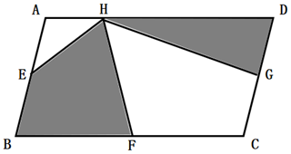
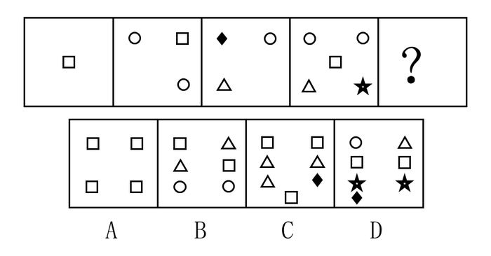
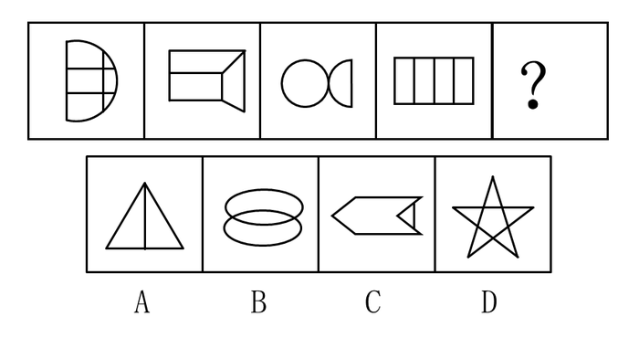
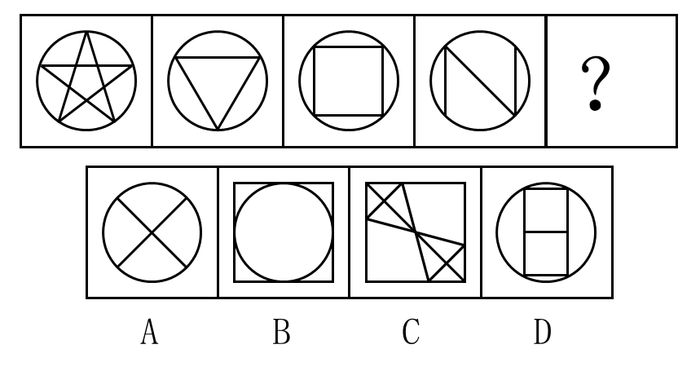
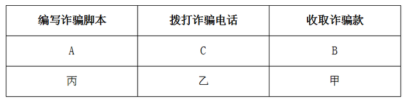
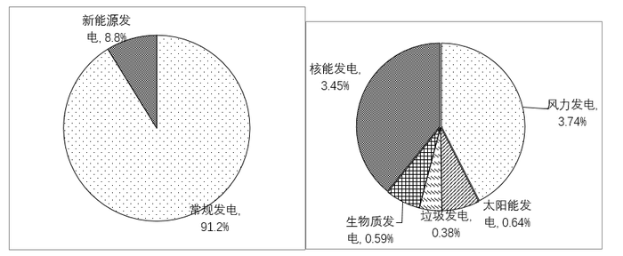
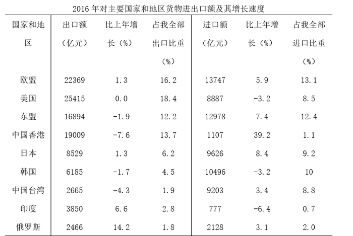
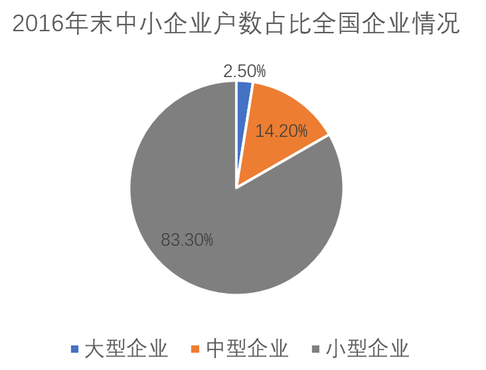
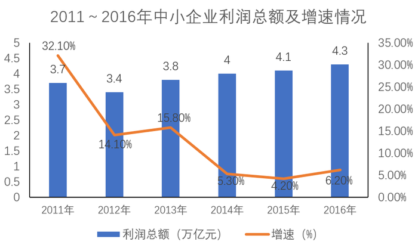

# 2017年辽宁省公安机关及省属监狱系统考试录用公务员（人民警察）考试《行测》题

<!-- gwy:overview:start -->
> **辽宁 · 2017 · 行测 · 公安** ｜ 120 题 · 图片 12 处 · 答案随题折叠

| 题型模块 | 题量 | 题号 |
| --- | ---: | ---: |
| 言语理解与表达 | 40 | 1–40 |
| 数量关系 | 10 | 41–50 |
| 常识判断 | 30 | 51–80 |
| 判断推理 | 20 | 81–100 |
| 资料分析 | 20 | 101–120 |
| **合计** | **120** | |

导航：[题型与作答说明](#题型与作答说明) · [题目](#题目) · [材料 1](#材料-1)
<!-- gwy:overview:end -->

> 候选采集稿。参考答案及解析来自粉笔页面，不代表官方答案或真实高分答卷；来源使用许可与原卷对应关系仍需人工核实。

## 题型与作答说明

言语理解与表达

（40题）

本部分包括表达与理解两方面的内容。请根据题目要求，在四个选项中选出一个最恰当的答案。

数量关系

（10题）

在这部分试题中，每道题呈现一段表述数字关系的文字，要求你迅速、准确地计算出答案。

常识判断

（30题）

根据题目要求，在四个选项中选出一个最恰当的答案。

判断推理

（20题）

本部分包括图形推理、定义判断、类比推理与逻辑判断四种类型的试题，在四个选项中选出一个最恰当的答案。

资料分析

（20题）

所给出的图、表、文字或综合性资料均有若干个问题要你回答。你应根据资料提供的信息进行分析、比较、计算和判断处理。

## 题目

### 第 1 题

这篇小说的构思既精巧又严密，真是（ ）。

A. 无可非议

B. 无懈可击

C. 回味无穷

D. 不可思议

第 1 题 · 答案与解析

**参考答案（粉笔题库参考内容）**

B

**解析**

根据文段“小说的构思既精巧又严密”可知，填入空白处的词语应与“精巧”“严密”相对应，强调小说逻辑的严密性，B项“无懈可击”形容十分严密，找不到一点漏洞，能够体现小说逻辑严密，当选。A项“无可非议”形容没有什么可以指责的，表示做得妥当，无法体现“逻辑的严密性”，排除；C项“回味无穷”比喻回想某一事物，越想越觉得有意思，文中并未体现“回想”之意，排除；D项“不可思议”多指无法想象，难以理解，与文意不符，排除。

故正确答案为B。

**考点**：对应关系-前后呼应、成语填空

**来源**：2017年辽宁省公安机关及省属监狱系统考试录用公务员（人民警察）考试《行测》题第1题

### 第 2 题

张军在一次羽毛球训练中不慎拉伤了手臂。要是在平常，这样的伤根本不算什么，但是\_\_\_\_\_在就要走上比武场的时候，这样的伤，\_\_\_\_\_让人揪心。

依次填入画横线部分最恰当的一项是（ ）。

A. 偏偏 异常

B. 恰巧 很是

C. 刚好 非常

D. 恰逢 有些

第 2 题 · 答案与解析

**参考答案（粉笔题库参考内容）**

A

**解析**

第一空，根据后文“走上比武场”“让人揪心”可知，作者对于张军受伤的事情感到痛心，不希望这件事情发生，对应A项“偏偏”，表示动作、行为或事情的发生，跟愿望、预料或常理相反。B项“恰巧”、C项“刚好”和D项“恰逢”体现不出“不希望事情发生”的语义，排除。

第二空，代入验证，“异常”强调不同于平常，与前面“要是在平常，这样的伤根本不算什么”构成转折关系，符合文意，当选。

故正确答案为A。

**考点**：实词填空、对应关系-前后呼应、关联关系-转折关系

**来源**：2017年辽宁省公安机关及省属监狱系统考试录用公务员（人民警察）考试《行测》题第2题

### 第 3 题

①甲醛的有毒成分可通过呼吸道侵入人体，吸入过多易引发白血病。专家向消费者发出\_\_\_\_\_警告：尽量购买甲醛含量符合国家标准的装饰材料，要注意自我保护。

②最近，S市政府针对某地区的房屋征收问题，专门在政府网站公布调查问卷，就是否应该征收、征收补偿以及后续安置等问题，向广大市民\_\_\_\_\_意见。

依次填入画横线部分最恰当的一项是（ ）。

A. 严谨 咨询

B. 郑重 征询

C. 慎重 征求

D. 审重 寻求

第 3 题 · 答案与解析

**参考答案（粉笔题库参考内容）**

B

**解析**

第一空，与“警告”搭配，A项“严谨”多形容作风、态度，与“警告”搭配不当，排除；C项“慎重”和D项“审重”都是审慎持重的意思，文段前面已经给出了确定的科学结论，故专家只是就此发出警告，没有审慎之意，均排除。B项“郑重”侧重严肃认真，符合文意，答案锁定B项。

第二空，代入验证，根据文意，横线词语表达政府就“是否应该······等问题”了解市民意见，B项“征询”是指征求询问，“征询意见”为固定搭配，当选。

故正确答案为B。

**考点**：词的辨析-搭配对象、实词填空

**来源**：2017年辽宁省公安机关及省属监狱系统考试录用公务员（人民警察）考试《行测》题第3题

### 第 4 题

艺术的助人伦、成教化，不是如演说家那样带有着直接的\_\_\_\_\_。它在潜移默化中，使人们\_\_\_\_\_，趋向社会的崇高、激励着人们的心灵。

依次填入画横线部分最恰当的一项是（ ）。

A. 功利性 身临其境

B. 实用性 耳濡目染

C. 功用性 心服首肯

D. 目的性 心悦诚服

第 4 题 · 答案与解析

**参考答案（粉笔题库参考内容）**

D

**解析**

第一空，搭配“演说家”，演说家的演讲可以带有一种功利性或者是一种目的性，B项“实用性”侧重强调事物有没有用，C项“功用性”侧重强调事物的功能，均与“演说家”搭配不当，排除。

第二空，文段是指艺术在潜移默化中使人们趋向崇高，D项“心悦诚服”是指真心的服气或服从，体现出艺术对人心灵的激励作用，当选。A项“身临其境”指亲自到了那个境地，与文意不符，排除。

故正确答案为D。

【文段出处】《魂魄犹在江山图》

**考点**：词的辨析-搭配对象、对应关系-前后呼应、混搭填空

**来源**：2017年辽宁省公安机关及省属监狱系统考试录用公务员（人民警察）考试《行测》题第4题

### 第 5 题

我们认为，财权理论的\_\_\_\_\_提出与论证，赋予了现代财务理论以灵魂与核心，使得财权成为现代财务区别于传统财务的根本标志和判断企业是否真正开展财务活动的标准，犹如\_\_\_\_\_，寓意深邃，为财务理论研究开辟了一片崭新的天空。

依次填入画横线部分最恰当的一项是（ ）。

A. 系统性 阳春白雪

B. 创造性 空谷足音

C. 实证性 千古绝唱

D. 规范性 空穴来风

第 5 题 · 答案与解析

**参考答案（粉笔题库参考内容）**

B

**解析**

分析文段，由“使得财权成为现代财务区别于传统财务的根本标志”以及“为财务理论研究开辟了一片崭新的天空”可知，文段强调财权理论与传统财务不同，它的提出是具有创新性的，对应B项“创造性”，A项“系统性”、C项“实证性”和D项“规范性”均体现不出“创新”的意思，排除。

第二空，代入验证，“空谷足音”比喻极难得的音信、言论或事物，置于此处用以强调“财权理论”来之不易，有很重要的意义，符合题意，当选。

故正确答案为B。

【文段出处】《财政理论研究：动态演进与学术争鸣》

**考点**：对应关系-前后呼应、混搭填空、对应关系-形象表达

**来源**：2017年辽宁省公安机关及省属监狱系统考试录用公务员（人民警察）考试《行测》题第5题

### 第 6 题

在奥斯维辛解放60周年纪念活动电视实况转播里看到奥斯维辛正飘着鹅毛大雪，远处苍茫的背景下，奥斯维辛集中营那些处在低洼之地的木制和砖砌的营房和毒气室在洁白飞舞的雪花中静静地\_\_\_\_\_着，无声地出示着历史的一份\_\_\_\_\_着血泪的证言。

依次填入画横线部分最恰当的一项是（ ）。

A. 伫立 浸透

B. 肃立 书写

C. 站立 侵染

D. 树立 饱含

第 6 题 · 答案与解析

**参考答案（粉笔题库参考内容）**

A

**解析**

第一空，所填词语搭配“营房和毒气室”，A项“伫立”、C项“站立”均符合，保留。B项“肃立”指恭敬严肃地站着，用来形容人的站姿，不能和“营房和毒气室”搭配，排除；D项“树立”指“建立”，常搭配抽象的事物，如树立榜样，树立目标，不能和“营房和毒气室”搭配，排除。

第二空，所填词语和“血泪”搭配，A项“浸透”指液体渗透，搭配恰当，当选；C项“侵染”指细菌、病毒等进入并感染机体的过程，与“血泪”搭配不当，排除。

故正确答案为A。

【文段出处】《奥斯维辛的雪》

**考点**：词的辨析-搭配对象、实词填空

**来源**：2017年辽宁省公安机关及省属监狱系统考试录用公务员（人民警察）考试《行测》题第6题

### 第 7 题

发光二极管对人类社会的贡献已经得到诺贝尔奖的\_\_\_\_\_，但这一发明对昆虫世界的危害却\_\_\_\_\_。发表于《生态学应用》上的最新研究指出，在LED光源旁设置的捕虫装置捉到的昆虫比钠汽灯旁的装置多48%，LED光源对昆虫导航能力的\_\_\_\_\_可能增加它们意外死亡的风险。

依次填入画横线部分最恰当的一项是（ ）。

A. 认可 知之甚少 破坏

B. 认定 不为人知 干预

C. 肯定 鲜为人知 干扰

D. 中肯 不予理睬 侵扰

第 7 题 · 答案与解析

**参考答案（粉笔题库参考内容）**

C

**解析**

第一空，根据文段可知，横线词语用以表示诺贝尔奖对发光二极管这一研究的态度，A、B、C三项均符合文意，保留；D项“中肯”指言论击中要害或恰到好处，与“诺贝尔奖”搭配不当，排除。

第二空，根据文意可知，横线词语表示这一发明对昆虫世界的危害很少有人知道，A项“知之甚少”指知道的非常少、C项“鲜为人知”指很少有人知道，均符合文意，保留；B项“不为人知”指不被人所知道了解，语义过重，排除。

第三空，所填词语形容LED光源对昆虫导航能力会产生不良的影响，C项“干扰”指扰乱、妨碍，与后文“可能增加它们意外死亡的风险”构成对应，符合文意，当选；A项“破坏”指摧毁，毁坏，置于此处语义过重，且和“能力”搭配不当，排除。

故正确答案为C。

【文段出处】《LED的隐忧》

**考点**：词的辨析-搭配对象、词的辨析-程度轻重、对应关系-前后呼应、混搭填空

**来源**：2017年辽宁省公安机关及省属监狱系统考试录用公务员（人民警察）考试《行测》题第7题

### 第 8 题

中国的300多个戏曲剧种，不但综汇了古典诗歌辞赋和民间说唱文学的精华，也用独具民族个性的音乐、舞蹈，展现了艺术创造的聪明智慧。但在当代社会中，有的传统戏曲\_\_\_\_\_，以放弃艺术法则的代价，试图依附于流行时尚；有的\_\_\_\_\_，以传统经典的自大心态，不做与时俱进的文化提升与艺术更新。

依次填入画横线部分最恰当的一项是（ ）。

A. 生拉硬套 坐井观天

B. 低声下气 针锋相对

C. 委曲求全 执迷不悟

D. 削足适履 抱残守缺

第 8 题 · 答案与解析

**参考答案（粉笔题库参考内容）**

D

**解析**

第一空，“以放弃艺术法则的代价，试图依附于流行时尚”是对横线处的解释说明。C项“委曲求全”指勉强迁就，以求保全；D项“削足适履”比喻不合理的迁就凑合或不顾具体条件，生搬硬套，均可，保留。A项“生拉硬套”指不顾实际情况，机械地运用别人的经验，照抄别人的办法，文段强调有的传统戏曲为了迎合时尚而放弃艺术原则，与照搬他人经验无关，排除；B项“低声下气”形容说话和态度卑下恭顺的样子，常用来形容人，与“传统戏曲”搭配不当，排除。

第二空，“以传统经典的自大心态，不做与时俱进的文化提升与艺术更新”是对横线处的解释说明，强调有的传统戏曲骄傲自大，不能与时俱进。D项“抱残守缺”指抱着残缺破旧的东西不放，形容思想保守，不求改进，符合文意，当选。C项“执迷不悟”指坚持错误而不觉悟，无法与文段构成对应，排除。

故正确答案为D。

【文段出处】《文化基因如何植入孩子生命中？传扬经典需有标准》

**考点**：对应关系-前后呼应、成语填空

**来源**：2017年辽宁省公安机关及省属监狱系统考试录用公务员（人民警察）考试《行测》题第8题

### 第 9 题

经济学家约瑟夫·熊彼特曾经说过：“光是制造令人满意的肥皂还不够，还必须\_\_\_\_\_大家洗澡。”于是，公司发明并传播了体臭和口臭的概念。有人说，需求决定供给，但是公司绝不\_\_\_\_\_，公司制造了需求。

依次填入画横线部分最恰当的一项是（ ）。

A. 劝说 固步自封

B. 诱导 墨守成规

C. 引导 因循守旧

D. 规劝 一孔之见

第 9 题 · 答案与解析

**参考答案（粉笔题库参考内容）**

B

**解析**

第一空，分析文意可知，为了达到让大家洗澡从而更多的购买肥皂的目的，公司发明了新的概念，B项“诱导”符合文意，保留。A项“劝说”指用语言打动，D项“规劝”指郑重的劝告，二者均侧重于强调语言，而文段则是通过新的概念推动消费者思想的转变，与文意不符，排除；C项“引导”指通过行为帮人走出困境，与“洗澡”搭配不当，排除。

第二空代入验证，B项“墨守成规”指思想保守，守着老规矩不肯改变，对应后文的“公司制造了需求”，匹配文段的转折关系，当选。

故正确答案为B。

【文段出处】《崭新生活的巨大推手》

**考点**：词的辨析-搭配对象、对应关系-前后呼应、混搭填空、关联关系-转折关系

**来源**：2017年辽宁省公安机关及省属监狱系统考试录用公务员（人民警察）考试《行测》题第9题

### 第 10 题

按常理\_\_\_\_\_做出的消费决策应该更稳固，而事实恰恰相反，他们的结论往往更容易\_\_\_\_\_，这种现象尤其在人们需要进行高消费如购房，买车时表现得更突出。

依次填入画横线部分最恰当的一项是（ ）。

A. 深思熟虑 动摇

B. 深谋远虑 改变

C. 思前想后 推翻

D. 老谋深算 变化

第 10 题 · 答案与解析

**参考答案（粉笔题库参考内容）**

A

**解析**

分析文意可知，第一空表示按照常理，人们经过深入考虑的消费决策会更稳固，A项“深思熟虑”指反复深入地考虑，C项“思前想后”形容反复思考，均可，保留。B项“深谋远虑”指计划得很周密，考虑得很长远，文段中体现不出消费者“长远的考虑”，不符合文意，排除；D项“老谋深算”形容人办事精明老练，与按常理做出决策的文意不符，排除。

第二空，搭配“他们的结论”，根据“事实恰恰相反”可知，横线词语与前文“稳固”语义相反，A项“动摇”搭配恰当，符合文意，当选。C项“推翻”与“他们的结论”搭配不当，可以改成“他们的结论被推翻”，排除。

故正确答案为A。

**考点**：对应关系-前后呼应、混搭填空、关联关系-转折关系

**来源**：2017年辽宁省公安机关及省属监狱系统考试录用公务员（人民警察）考试《行测》题第10题

### 第 11 题

父母想要让孩子接受更加大胆的早餐，就得自己也这样吃。孩子在子宫里就开始品尝腌蛋和豆酱的味道了，出生后婴儿会喜欢他们在子宫里\_\_\_\_\_过的食物，科学家称之为产前味道学习。但孩子们天生会喜欢某种东西并不等于他们的舌头第一次\_\_\_\_\_到它时会很愉悦，网上有很多韩国婴儿第一次吃到泡菜时抓舌头甚至\_\_\_\_\_的视频。

依次填入画横线部分最恰当的一项是（ ）。

A. 感应 接触 推拒

B. 感受 碰触 摇头

C. 接受 品尝 拒绝

D. 接触 体验 哭泣

第 11 题 · 答案与解析

**参考答案（粉笔题库参考内容）**

D

**解析**

第一空，与“食物”搭配，并根据“孩子在子宫里就开始品尝腌蛋和豆酱的味道了”可知，此食物是在子宫中碰到过的，D项“接触”指碰触，符合文意，保留。A项“感应”指受外界影响而引起相应的反应、B项“感受”侧重强调体会、感想，均不能与“食物”搭配，排除；C项“接受”是人的一种认同行为，婴儿在子宫中只能被动接受食物，而非主动选择，与文意不符，排除。

将后两空代入验证，D项“体验”指亲身经历，与“舌头”搭配恰当；“哭泣”可以形容婴儿吃到泡菜时的状态，且比“抓舌头”程度更重，构成递进关系，当选。

故正确答案为D。

【文段出处】《该给孩子吃什么》

**考点**：词的辨析-搭配对象、实词填空

**来源**：2017年辽宁省公安机关及省属监狱系统考试录用公务员（人民警察）考试《行测》题第11题

### 第 12 题

非物质文化遗产，是人类\_\_\_\_\_，世代传承的无形的活态流变的文化遗产，它鲜活地扎根生存于民族民间。对非物质文化遗产，国家确定的方针是“保护为主，抢救第一，合理利用，传承发展”。一些专家认为，相当大一部分非物质文化遗产属无形或隐性，是人的精神创造，更\_\_\_\_\_了对其保护抢救的重要性。

依次填入画横线部分最恰当的一项是（ ）。

A. 口传心授 凸显

B. 口耳相传 彰显

C. 薪火相传 显示

D. 薪尽火传 突显

第 12 题 · 答案与解析

**参考答案（粉笔题库参考内容）**

A

**解析**

本题可从第二空入手，由表示递进的关联词“更”可知，文段意在强调对于非物质文化遗产保护抢救的重要性，语义较重，B项“彰显”指鲜明地显示、C项“显示”指明显地表示，程度较轻，均无法体现强调之意，排除。对比A、D两项，A项“凸显”指突出地显露，符合文意，保留。D项“突显”指突出地显示，与“重要性”搭配不当，排除。

验证第一空，A项“口传心授”指师徒间口头传授，内心领会，常用来形容文化的传承，与后文构成对应，当选。

故正确答案为A。

【文段出处】《守住民族的记忆 保护非物质文化遗产》

**考点**：词的辨析-搭配对象、词的辨析-程度轻重、混搭填空

**来源**：2017年辽宁省公安机关及省属监狱系统考试录用公务员（人民警察）考试《行测》题第12题

### 第 13 题

鸦片战争结束后，当得知英军已经撤出长江，道光皇帝的第一个\_\_\_\_\_就是下令沿海各省撤军，清政府的军政大员\_\_\_\_\_。有人形容当时文恬武嬉的状态：“大有雨过忘雷之意。”中国的一切仿佛又回到\_\_\_\_\_。

依次填入画横线部分最恰当的一项是（ ）。

A. 反映 额手称庆 起点

B. 决定 欣喜若狂 初始

C. 反应 弹冠相庆 原点

D. 旨意 欢欣鼓舞 平静

第 13 题 · 答案与解析

**参考答案（粉笔题库参考内容）**

C

**解析**

第一空，分析文意可知，指道光皇帝得知英军撤出长江所做的第一个回应，B项“决定”指人类对某一事物经过了主观分析判断，然后作出主张的过程；C项“反应”指事情所引起的意见、态度或行动；D项“旨意”指圣旨或者主要的目的和意图，均符合文意，保留。A项“反映”指将客观事物的本质表现出来，偏主动，文段是得到消息之后的被动反应，而非主动行为，排除。

第二空，由“大有雨过忘雷之意”“文恬武嬉”可知，文段强调撤军之后军政大员以为又都有安稳的官职可做了，而全然忘记了曾经受过的耻辱，带有明显的贬义色彩，C项“弹冠相庆”比喻一个人做了官，其他人互相庆贺，将有官可做，含贬义，符合文意，保留。D项”欢欣鼓舞“形容高兴而振奋，B项“欣喜若狂”形容高兴到了极点，均与文段的感情色彩不符，排除。

第三空，代入验证，“回到原点”为常见搭配，与“大有雨过忘雷之意”对应，C项符合文意，当选。

故正确答案为C。

【文段出处】《<复兴之路>解说词》

**考点**：词的辨析-搭配对象、词的辨析-感情色彩、对应关系-前后呼应、混搭填空

**来源**：2017年辽宁省公安机关及省属监狱系统考试录用公务员（人民警察）考试《行测》题第13题

### 第 14 题

诗在其所具有的诸般品格中，十分重要的一条便是对生活的\_\_\_\_\_的打量。诗人的目光仿佛具有\_\_\_\_\_的本领，生活中许多琐碎、平淡甚至枯燥的事物，经过它的描述，便产生了丰富的意味。

依次填入画横线部分最恰当的一项是（ ）。

A. 别具一格 明察秋毫

B. 独树一帜 力透纸背

C. 别具匠心 点石成金

D. 别开生面 目光如炬

第 14 题 · 答案与解析

**参考答案（粉笔题库参考内容）**

C

**解析**

本题可从第二空入手，根据后文“生活中许多琐碎、平淡甚至枯燥的事物，经过它的描述，便产生了丰富的意味”可知，横线处应体现诗人通过其独特的目光，使“琐碎、平淡甚至枯燥的事物”焕发出“丰富的意味”，突出一种将平凡转化为精彩的艺术能力。C项“点石成金”比喻把不好的或平凡的事物改变成很好的事物，符合文意，保留。A项“明察秋毫”形容人目光敏锐，任何细小的事物都能看得很清楚，文段并没有体现“看的清”，排除；B项“力透纸背”形容写字、画画技巧精湛，力道十足，和“目光”搭配不当，排除；D项“目光如炬”形容眼光明亮有神或见识高明，无法体现出“普通平淡的事物变得丰富”之意，排除。

第一空，代入验证。“别具匠心”指在技巧和艺术等方面具有与众不同的巧妙构思，和“打量”搭配恰当，符合文意，当选。

故正确答案为C。

**考点**：词的辨析-搭配对象、对应关系-前后呼应、成语填空

**来源**：2017年辽宁省公安机关及省属监狱系统考试录用公务员（人民警察）考试《行测》题第14题

### 第 15 题

\_\_\_\_\_长江是一条忽高忽低、忽曲忽直、忽细忽宽的漫长的跑道，\_\_\_\_\_，金沙江所跑的更是陡坡挨着陡坡，拐弯挨着拐弯啊。哦，它不是从高到低往下滑，而是猛地跳下来，突然地冲下去。可以说，正因为征途如此艰险，所以金沙江显得格外刚毅顽强，豪放潇洒。\_\_\_\_\_说，他是一位充满着浪漫主义色彩的运动员啊，金沙江不但浪漫而且英俊，\_\_\_\_\_古人称它为“丽水神川”。

依次填入画横线部分最恰当的一项是（ ）。

A. 假如 或许 仿佛 因此

B. 假如 那么 也许 所以

C. 如果 那么 也许 因此

D. 如果 或者 莫非 所以

第 15 题 · 答案与解析

**参考答案（粉笔题库参考内容）**

B

**解析**

根据文意可知，文段前两空表示假设关系，B、C两项均符合文意，保留。而“假如······或许”“如果······或者”搭配不当，且“或许”“或者”表示选择关系，不符合文意，排除A、D两项。

第三空，B、C两项词语一样，不做区分。

第四空，“所以”“因此”均表示总结，符合文意，无法区分。

故正确答案为BC。

【文段出处】《话说长江》

备注：本题为争议题，B、C两项从语法上无法区分。

**来源**：2017年辽宁省公安机关及省属监狱系统考试录用公务员（人民警察）考试《行测》题第15题

### 第 16 题

种子，如果害怕\_\_\_\_\_，那它永远不能发芽。鲜花，如果害怕\_\_\_\_\_，那它永远不能开放。矿石，如果害怕\_\_\_\_\_，那它永远不能成钢。航船，如果害怕风浪，那它永远不能到达彼岸。

依次填入画横线部分最恰当的一项是（ ）。

A. 埋藏 凋零 燃烧

B. 掩埋 凋落 烧毁

C. 凋谢 埋没 焚烧

D. 埋没 凋谢 焚烧

第 16 题 · 答案与解析

**参考答案（粉笔题库参考内容）**

D

**解析**

第一空，与“种子”搭配，指要想发芽必须经历在泥土中的黑暗，B项“掩埋”、D项“埋没”都符合种子发芽前埋在地下的状态，保留；A项“埋藏”侧重隐藏之意，与文意不符，排除；C项“凋谢”与“种子”搭配不当，排除。

第三空，搭配“矿石”，D项“焚烧”形容矿石成钢的必要经历，符合文意，保留；B项“烧毁”指焚烧毁坏，侧重于毁坏，与“矿石”搭配不当，排除。

第二空，代入验证，形容鲜花要想开放不能害怕凋谢，符合文意，D项当选。

故正确答案为D。

【文段出处】《成功与失败》

**考点**：词的辨析-搭配对象、实词填空、对应关系-前后呼应

**来源**：2017年辽宁省公安机关及省属监狱系统考试录用公务员（人民警察）考试《行测》题第16题

### 第 17 题

S县城玲珑娇小，整洁可爱，人口不足五万，是个风光\_\_\_\_\_的疗养胜地。但是川流不息的游客当中又有几人知晓这是在反动派\_\_\_\_\_过的废墟上建立起来的呢？

依次填入画横线部分最恰当的一项是（ ）。

A. 诱人 洗劫

B. 宜人 血洗

C. 迷人 血染

D. 诱人 掠夺

第 17 题 · 答案与解析

**参考答案（粉笔题库参考内容）**

B

**解析**

本题从第二空入手，搭配“废墟”，强调反动派对废墟造成的严重破坏，语义较重，B项“血洗”指极其残酷的屠杀，程度较重，符合文意，保留。A项“洗劫”和D项“掠夺”均强调抢劫财物，置于此处程度过轻，排除；C项“血染”指鲜血染成的，与“反动派”搭配不当，排除。

第一空，代入验证，B项“宜人”指使人舒服、舒适，和“疗养胜地”搭配恰当，且符合文意，当选。

故正确答案为B。

【文段出处】《宁德2015年事业单位真题》

**考点**：词的辨析-搭配对象、词的辨析-程度轻重、实词填空

**来源**：2017年辽宁省公安机关及省属监狱系统考试录用公务员（人民警察）考试《行测》题第17题

### 第 18 题

党和国家机关工作人员在国内交往中，\_\_\_\_\_收受\_\_\_\_\_影响公正执行公务的礼品馈赠，因为各种原因\_\_\_\_\_拒收的礼品，\_\_\_\_\_登记上交。

依次填入画横线部分最恰当的一项是（ ）。

A. 不能 可能 未能 一定

B. 不该 或许 没有 务必

C. 不应 或许 没有 应该

D. 不得 可能 未能 必须

第 18 题 · 答案与解析

**参考答案（粉笔题库参考内容）**

D

**解析**

本题从第三空入手，文段围绕国家机关工作人员的工作作风展开，可知语体风格较为书面化，“没有”表述过于口语化，排除B、C两项。

第四空，根据文意可知，横线词语带有明显的强制性，对应D项“必须”，A项“一定”指确定、肯定，体现不出“强制性”，排除。

故正确答案为D。

【文段出处】《关于对党和国家机关工作人员在国内交往中收受的礼品实行登记制度的规定》

**来源**：2017年辽宁省公安机关及省属监狱系统考试录用公务员（人民警察）考试《行测》题第18题

### 第 19 题

一个好的创业者，至少需要两方面精神动力。一是创新精神，它强调思想的灵动、思维的\_\_\_\_\_；二是工匠精神，它强调\_\_\_\_\_，一丝不苟。有的创业者过于求新求异，追求新点子、新包装，只有破坏没有建设，而以持续、稳定、渐变为特征的工匠精神，则对此有纠偏和矫正功能。

依次填入画横线部分最恰当的一项是（ ）。

A. 活跃 持之以恒

B. 缜密 精益求精

C. 跳跃 锲而不舍

D. 连贯 坚持不懈

第 19 题 · 答案与解析

**参考答案（粉笔题库参考内容）**

C

**解析**

第一空，顿号表并列，横线词语与“灵动”语意相近，表达“灵活”的意思，A项“活跃”指积极踊跃、B项“缜密”指谨慎周密、D项“连贯”指相连沟通，均与文意无关，无法体现“灵活”的意思，排除。

第二空，代入验证，C项“锲而不舍”形容有恒心有毅力，对应后文“以持续、稳定、渐变为特征的工匠精神”，符合文意，当选。

故正确答案为C。

【文段出处】《新一代创业者应如何传承发展工匠精神?》

**考点**：对应关系-前后呼应、混搭填空、关联关系-并列关系

**来源**：2017年辽宁省公安机关及省属监狱系统考试录用公务员（人民警察）考试《行测》题第19题

### 第 20 题

我国一些城市在旧城改造中，少了些如履薄冰的文化敬畏，让优秀的历史文化\_\_\_\_\_在了推土机的滚滚狼烟里；城市独特的传统文化即便被简单复制，也丢失了历史\_\_\_\_\_的文化精髓。城市记忆变得\_\_\_\_\_甚至从此消失殆尽。

依次填入画横线部分最恰当的一项是（ ）。

A. 埋葬 沉淀 模模糊糊

B. 葬送 积淀 不伦不类

C. 丢失 积累 面目全非

D. 消逝 沉积 遥不可及

第 20 题 · 答案与解析

**参考答案（粉笔题库参考内容）**

B

**解析**

第一空，强调一些城市的旧城改造使得优秀的历史文化不复存在，C项“丢失”指遗失，无法与后文的“推土机的滚滚狼烟”构成对应，且语义过轻，排除。

第二空，与“历史”搭配，A项“沉淀”指溶液中难溶解的固体物质从溶液中释出，D项“沉积”指物质在溶液中沉淀堆积起来，均与“历史”搭配不当，排除。

第三空，代入验证，B项“不伦不类”形容不成样子或不规范，对应前文“城市独特的传统文化即便被简单复刻，也丢失了文化精髓”，符合文意，当选。

故正确答案为B。

【文段出处】《让城市成为文化的容器》

**考点**：词的辨析-搭配对象、对应关系-前后呼应、混搭填空

**来源**：2017年辽宁省公安机关及省属监狱系统考试录用公务员（人民警察）考试《行测》题第20题

### 第 21 题

习近平在“一带一路”国际合作高峰论坛开幕式上说，“一带一路”具有开放包容的特征，其中，我们的愿景和行动当中提到一系列的机制，包括上海合作组织、清迈倡议、中国东盟自贸区、亚投行丝路基金，未来会有RCEP的机制，通过上述机制的建立，以便推进未来“一带一路”建设走向繁荣。

这段文字强调的是（ ）。

A. 合作理念的开放包容

B. 合作空间的开放包容

C. 合作领域的开放包容

D. 合作方式的开放包容

第 21 题 · 答案与解析

**参考答案（粉笔题库参考内容）**

D

**解析**

文段首句提出观点，即“‘一带一路’具有开放包容的特征”，后文“其中······一系列机制······”是对“包容特征”的详细阐述，每一种机制的建立就是一种合作的方式，因此多种机制的建立便是合作方式的开放包容，对应D项。

A、B、C三项中的“理念”“空间”“领域”均不能与文段中“机制”的含义相对应，排除。

故正确答案为D。

常识补充：文段列举的这些机制中，“上海合作组织”是哈、中、吉、俄、塔、乌成立的永久性政府间国际组织，合作内容包括政治、安全、经济、教育、国际司法等；“清迈倡议”是相关国家为预防金融危机的发生达成的外汇储备协议，最终目的是建立亚洲版的国际货币基金组织；“中国东盟自贸区”是为了促进中国和东盟各自的经济发展，扩大双方贸易和投资规模；“亚投行丝路基金”是“一带一路”发展进程中寻找投资机会并提供相应的投融资服务，主要涉及经济领域。

【文段出处】《发改委：“一带一路”是促进世界共同发展的中药良方》

**考点**：关联词-因果

**来源**：2017年辽宁省公安机关及省属监狱系统考试录用公务员（人民警察）考试《行测》题第21题

### 第 22 题

皮肤老化的原因很多，其中有些与个人体质有关，有些则因外界因素影响造成。不规律的饮食习惯会导致过度肥胖或体重不足，更可能造成两种情况交替产生。此外机体各种组合成分，如碳水化合物、油脂、蛋白质、维生素及机体必需的微量元素等分配不均衡，也会造成皮肤老化现象。

这段文字想表达的是（ ）。

A. 微量元素分配不均衡

B. 肥胖或体重不足与个人体质有关

C. 皮肤老化的原因

D. 不规律的饮食习惯会导致肥胖或体重不足

第 22 题 · 答案与解析

**参考答案（粉笔题库参考内容）**

C

**解析**

文段首句提出观点“皮肤老化的原因很多”，即内因与外因，后文从“不规律饮食”“机体组成成分不均衡”两个方面论述了造成皮肤老化的原因，C项符合文段中心，当选。其他三项均是文段一部分的内容，表述片面，不是文段的中心，排除。

故正确答案为C。

【文段出处】《皮肤老化的原因》

**考点**：分述句特征-其他、分述句特征-多角度论述

**来源**：2017年辽宁省公安机关及省属监狱系统考试录用公务员（人民警察）考试《行测》题第22题

### 第 23 题

站在风口的物联网应用，2016年居然是自行车。共享经济让自行车回归了城市，因其灵活便捷、低碳环保成为许多城市常见的“短途代步神器”，最大限度地实现了资源共享。但随之发生的共享单车乱停放问题——绿化带内、人行道边、商场前等随处可见；随意丢弃垃圾堆旁、大江大河的有之；停进自家车库占为己有的有之；偷换二维码借机敛财的有之······公民规则意识淡薄、社会信用体系缺失、城市基础设施不到位······原本多赢的局面，极有可能会因为少数人不遵守规则而造成“多输”。

最适合做这段文字标题的是（ ）。

A. 共享单车叩问共享经济发展短板

B. 共享单车引发的思考

C. 共享经济时代规则意识的确立

D. 共享经济呼唤社会诚信

第 23 题 · 答案与解析

**参考答案（粉笔题库参考内容）**

A

**解析**

文段开篇引出核心话题“共享单车”，首先指出共享单车带来的积极影响。接着通过转折关联词“但”指出共享单车现存的问题，并举例说明，接下来进一步分析问题背后的原因，即公民规则意识淡薄、社会信用体系缺失、城市基础设施不到位等，而这都属于共享经济发展中存在的问题，故文段重在强调由共享单车这一维度折射出的共享经济中存在的问题，对应A项。

B项，“思考”表述不明确，文段已经具体指出了共享经济存在的现实问题，排除；C项“规则意识”和D项“社会诚信”均只涉及问题的一个方面，表述片面，且没有提及文段主题词“共享单车”，排除。

故正确答案为A。

【文段出处】《单车无桩,文明有位:叩问分享经济发展短板》

**考点**：标题填入题

**来源**：2017年辽宁省公安机关及省属监狱系统考试录用公务员（人民警察）考试《行测》题第23题

### 第 24 题

人口激增，让地球的粮食供应面临严峻的考验，有科学家预计，到2050年，需要增加70%的耕地，人类才能养活自己。但地球上根本没有这么多可增加的耕地。于是，科学家转向海洋求助，在远离海岸的开阔海域中养鱼，这样就可以给人类提供足够的营养。我们可以大胆地预测，人类食物的蓝色革命即将拉开序幕。

这段文字用“人类食物的蓝色革命”来说明（ ）。

A. 对海域的深度开发，可以弥补地球上耕地的不足

B. 海洋鱼类资源将在人类食物结构中占较大比重

C. 加大深海养殖的力度，可以解决食物供给不足的现象

D. 海水养殖业将成为第一产业，在国民经济中占主导地位

第 24 题 · 答案与解析

**参考答案（粉笔题库参考内容）**

B

**解析**

文段开篇指出人口激增使地球粮食供应面临考验，需要增加耕地但因无足够可增加耕地科学家转向海洋求助，提出在开阔海域养鱼为人类提供足够营养，最后指出“人类食物的蓝色革命即将拉开序幕”。结合上下文可知，“蓝色革命”指代的是在开阔海域养鱼。故文段用“人类食物的蓝色革命”来说明通过在开阔海域养鱼来解决人类食物问题，即海洋鱼类资源在人类食物结构中会占据较大比重，对应B项。

A项，文段强调的是在开阔海域养鱼，“对海域的深度开发”表述不准确，且“弥补耕地不足”并非“在开阔海域养鱼”所要解决的核心问题，排除；

C项，文段强调的是在开阔海域养鱼，而非“加大深海养殖力度”，且“可以解决食物供给不足”表述过于绝对，排除；

D项“成为第一产业”“在国民经济中占主导地位”文段未提及，无中生有，排除。

故正确答案为B。

**考点**：句子

**来源**：2017年辽宁省公安机关及省属监狱系统考试录用公务员（人民警察）考试《行测》题第24题

### 第 25 题

无论西方政治精英们多么不情愿，全民公投最后以微弱优势确定英国退出欧盟。这一事件直接导致政治海啸瞬间生成；英镑暴跌、美元和黄金大涨；亚洲股市剧烈震荡；英国首相卡梅伦隆重宣布辞职；脱欧事件引起了许多英国人民的强烈不满等。此次脱欧，英国的世界大国地位和文化影响力，既是聚变，也是裂变，使世界在不同层面都陷入阶段性的迷茫，前途叵测，安知非福。

这段文字意在说明（ ）。

A. 世界政治海啸瞬间生成

B. 世界经济态势剧烈震荡

C. 英国的世界大国地位和文化影响力将被削弱

D. 英国脱欧对世界局势将产生诸多影响

第 25 题 · 答案与解析

**参考答案（粉笔题库参考内容）**

D

**解析**

文段首先提出英国退出欧盟的事件，然后分析该事件带来了一系列的影响，并举例说明。之后进行总结，指出英国脱欧使世界不同层面都陷入迷茫、前途叵测。故文段重在强调英国脱欧带来了诸多影响，对应D项。

A项“政治海啸”、B项“世界经济”均只是英国脱欧产生影响的一方面，表述片面，排除；

C项，根据文意，“英国的世界大国地位和文化影响力，既是聚变，也是裂变”，并不能得知英国的国际地位和文化影响力“被削弱”，无中生有，排除。

故正确答案为D。

【文段出处】《英国脱欧对中国的影响》

**考点**：分述句特征-引入铺垫

**来源**：2017年辽宁省公安机关及省属监狱系统考试录用公务员（人民警察）考试《行测》题第25题

### 第 26 题

南海仲裁案仲裁结果否定了中国在南海的主权。为此，全体中国人都为这一非法裁定感到愤慨，这个仲裁结果比之前很多人预测的更加极端、无耻，堪称是人们可以想象的“最坏版本”，这是对中国领土主权和海洋权益的悍然否决。仲裁庭通过对这些争端的再定义，对中菲领土和海洋划界争端强行裁决，这是无耻的越权和滥权。中国政府和中国人民都绝不可能接受这一仲裁结果，我们对仲裁“不接受、不参与”的态度坚定不移，谁都休想撼动我们。

这段文字意在表明（ ）。

A. 仲裁结果就是废纸一张，中国人民必须支持政府予以针锋相对的回击

B. 对仲裁“不接受、不参与”的态度坚定不移

C. 中国人都为这一非法裁定感到愤慨

D. 仲裁结果是对海洋法公约以及整个国际法体系的粗暴践踏

第 26 题 · 答案与解析

**参考答案（粉笔题库参考内容）**

B

**解析**

文段围绕南海仲裁案展开论述，强调其是对我国南海主权的否定和践踏，文段尾句针对这一问题提出对策，即“对仲裁结果‘不接受、不参与’”，故文段重点在于强调这一应对态度，对应B项。

A项，文段只强调了要秉持“不接受、不参与”的态度，而中国政府是否予以针锋相对的回击文段未提及，无中生有，排除；

C项，“表示愤慨”仅表示我国人民在对待这一事件的态度，文段则重点强调对策，排除；

D项，为问题表述，非重点，排除。

故正确答案为B。

【文段出处】《南海仲裁案结果比最坏的预测还要无耻》

**考点**：分述句特征-引入铺垫

**来源**：2017年辽宁省公安机关及省属监狱系统考试录用公务员（人民警察）考试《行测》题第26题

### 第 27 题

M市将20多年来发行股票的工作首次予以公开，共有八家公司股票上市。为此，M市某报社就股票发行问题对5000余人进行调查。结果显示：公众中的非股民对八家公司股票发行价的评价较温和，60%以上的人因无炒股经历而不做评价。显然亦有五分之一以上股民认为股票发行价偏高，认为偏低的几近于零，但这更应视为人之常情，买东西的人多倾向于认为东西贵。老股民亦认为新股发行价格偏高。

根据上文可以得出的是（ ）

A. 股票发行价格偏高，因此，购股者甚少

B. 老股民选择不购买新股的原因

C. 公众中非股民对新股发行价格评价较温和，可能考虑购买

D. 该市大部分人对股票知之甚少

第 27 题 · 答案与解析

**参考答案（粉笔题库参考内容）**

D

**解析**

文段中某报社提供的调查结果显示，“60%以上的人因无炒股经历而不做评价”，由此可知，该市大部分人缺乏炒股经验，没炒过股，对股票知之甚少。所以，结合选项可知，D项表述可由文段得出，当选。

A项，“股票发行价格偏高，因此，购股者甚少”，文段未提及此因果关系，无中生有，排除；

B项，“老股民选择不购买新股”，文段未提及，文段只在末尾提到“老股民亦认为新股发行价格偏高”，并没有说老股民不购买新股，排除；

C项，非股民是否考虑购买新股一事文段未提及，文段中只给出了非股民对于新股发行价的评价，并没有提及非股民的购买意向，无中生有，排除。

故正确答案为D。

**考点**：细节判断题

**来源**：2017年辽宁省公安机关及省属监狱系统考试录用公务员（人民警察）考试《行测》题第27题

### 第 28 题

当下，我国各类真人秀综艺栏目的发展呈现出井喷状态。然而，由于栏目扎堆，风格雷同，一部分作品缺乏质感、灵性和情怀，格调低下，大有走向“愚乐”之途的不良趋势。甚至个别栏目重形式而轻内容，重经济效益而轻社会效益，这种创作观念上的误区严重制约了栏目文化认知功能、教育功能和审美功能的发挥。在这种“泛娱乐化”的背景下，《中国汉字听写大会》、《中国诗词大会》、《朗读者》、《见字如面》等文化类栏目异军突起，实现了口碑和收视率的双赢。

这段文字意在说明（ ）。

A. 综艺栏目要强调寓教于乐

B. 电视媒体人负有文化传承的使命担当

C. 以传统文化扭转“泛娱乐化”现状

D. 综艺栏目应制作成更高层次的带有娱乐属性的文化产品

第 28 题 · 答案与解析

**参考答案（粉笔题库参考内容）**

C

**解析**

文段开篇引出综艺节目发展迅速背景，接着通过转折关联词“然而”，强调综艺栏目发展中的问题，即有“走向‘愚乐’之途”这一不良趋势，并通过“甚至”进一步强调错误的创作观念所带来的危害，即缺乏“文化认知功能、教育功能和审美功能”。文段尾句通过指代词“在这种背景下”指代前文，对上文进行总结，强调文化类栏目的出现扭转了真人秀节目“泛娱乐化”的局面。故文段为分总结构，意在说明综艺栏目的创作要重视与传统文化相结合，对应C项。

A项，“寓教于乐”无中生有，文段未提及要通过娱乐节目达到教育的目的，排除；

B项，“电视媒体人”无中生有，文段并未提及电视媒体人的使命，排除；

D项，表述错误，由尾句可知，对于综艺栏目应扭转走向“愚乐”的趋势，改变“泛娱乐化”的状态，重视文化功能的发挥，而不是要制作成“带有娱乐属性”的文化产品，排除。

故正确答案为C。

【文段出处】《文化类栏目应当追求“慢”与“深”》

**考点**：关联词-因果

**来源**：2017年辽宁省公安机关及省属监狱系统考试录用公务员（人民警察）考试《行测》题第28题

### 第 29 题

千百年来，食物就这样随着人们的脚步，不停迁移，不停流变。无论脚步多远，在人的脑海中，只有故乡的味道，熟悉而顽固，它就像一个味觉定位系统，一头锁定了千里之外的异地，另一头则永远牵绊着记忆深处的故乡。

这里的“它”指的是（ ）

A. 故乡

B. 脚步

C. 食物

D. 味道

第 29 题 · 答案与解析

**参考答案（粉笔题库参考内容）**

D

**解析**

首先定位原文，“它”出现在文段第二句，文段首先指出“食物跟随人们迁移、变化”，之后强调“故乡的味道”熟悉而顽固，故“它”指代“故乡的味道”，对应D项“味道”。

故正确答案为D。

【文段出处】《舌尖上的中国之脚印》

**考点**：代词

**来源**：2017年辽宁省公安机关及省属监狱系统考试录用公务员（人民警察）考试《行测》题第29题

### 第 30 题

可别小瞧了那些在路边沉默而低调的野生果树，它们是大自然赋予我们的珍贵自然遗产。自人类出现以来，野果就是人类赖以生存的主要食物来源之一。随着农业技术的发展，它们中的一部分被驯化为优质水果，比如现在风靡市场的猕猴桃，起初也是其貌不扬的野果。然而大部分野果还默默地隐居于林间亦或是已经被破坏掉，需要我们在开发利用它们的同时，共同保护这些野生的果树资源。

这段文字意在强调：

A. 野生果树是大自然赋予我们的珍贵遗产

B. 野生果树成为优质水果需要驯化

C. 我们应该重视野生果树的培育开发同时加强保护

D. 野果其貌不扬但却是人类的主要食物来源之一

第 30 题 · 答案与解析

**参考答案（粉笔题库参考内容）**

C

**解析**

文段首先介绍“野生果树”对人类非常珍贵、是主要食物来源之一，之后以介绍“野果”变为“优质水果”的过程，并以“猕猴桃”为例进行解释说明。尾句“然而”转折后引出重点，指出“大部分野果隐居林间或被破坏”这一问题，并提出对策“开发的同时要共同保护”。文段重点强调对策，对应C项。

A、D项对应文段转折之前的内容，非重点，排除；B项，文段重点强调应对野生果树予以保护，而非需要对野生果树进行驯化，与文意不符，排除。

故正确答案为C。

【文段出处】《野生果树作用知多少》

**考点**：关联词-对策、关联词-转折

**来源**：2017年辽宁省公安机关及省属监狱系统考试录用公务员（人民警察）考试《行测》题第30题

### 第 31 题

为了解新媒介对儿童的影响，近日，中国青少年宫协会一下属研究中心对18个中心城市的3万多名儿童（3岁至14岁）及其家长进行了调研。调研结果显示：幼儿园时期（3岁至6岁），44.1%的孩子开始玩网游；小学中年级时期（9岁至10岁），儿童周末玩电子媒介的平均时长达63.57分钟；初中时期（13岁至14岁），使用QQ的孩子达到91.8%，其中33.7%的孩子有陌生网友。

这段文字意在说明（ ）。

A. 新媒介发展影响儿童成长

B. 城市儿童使用新媒介的人数在激增

C. 城市儿童新媒介使用低龄化趋势明显

D. 新媒介已成为儿童的主要娱乐方向

第 31 题 · 答案与解析

**参考答案（粉笔题库参考内容）**

C

**解析**

文段开篇指出讨论的话题“新媒介对儿童的影响”，之后详细论述调查结果，通过具体数据“44.1%的幼儿园孩子玩网游”、“小学生周末接触电子媒体时长63.57分钟”、“初中生91%使用QQ”可知，“新媒介”对14岁以下的儿童影响较大。C项“低龄化趋势明显”可概括调查结论，当选。

A项“影响成长”，无中生有，排除；B项，文段未对“使用新媒介的儿童人数”进行过去与现在的对比，故“激增”属无中生有的表述，排除；D项，“主要娱乐方向”无中生有，排除。

故正确答案为C。

【文段出处】《城市儿童媒介使用低龄化趋势明显》

**考点**：关联词-并列

**来源**：2017年辽宁省公安机关及省属监狱系统考试录用公务员（人民警察）考试《行测》题第31题

### 第 32 题

总体来说，银行获得的存款量决定了银行的贷款能力，但是，在许多时候银行的贷款数量会超出它所获得的存款数量，这是一个众所周知的事实。如果这种贷款的数量超出过多，就会造成通货膨胀。

这段文字意在说明（ ）

A. 银行的贷款数量超出它所获得的存款数量是一个众所周知的事实

B. 银行向外的贷款数量超过了存款数量会造成通货膨胀

C. 应该采取一种有效的策略用以控制通货膨胀

D. 银行的贷款量与银行获得的存款量成正比

第 32 题 · 答案与解析

**参考答案（粉笔题库参考内容）**

B

**解析**

文段首句说明银行贷款能力由存款量决定。接着，叙述了银行贷款量超过存款量的事实。最后，提出观点，强调了银行贷款量超过存款量会造成通货膨胀，对应B项。A项，为叙述事实部分，非文段重点，排除；C项，文段强调的是存款量与贷款能力之间的关系，而不是如何解决通货膨胀问题，排除；D项，文段没有说明贷款量与存款量之间为正比例关系，无中生有，排除。

故正确答案为B。

【文段出处】《2000年中央及国家机关行政能力测试真题》

**考点**：分述句特征-引入铺垫

**来源**：2017年辽宁省公安机关及省属监狱系统考试录用公务员（人民警察）考试《行测》题第32题

### 第 33 题

作家毕飞宇提及阅读与写作的关系时说，作家的写作不是盲目的，写作一定有它的指向，这个指向无非是两个方面，一个是理性诉求，第二个就是美学标准。所谓写作，就是向自己心中的那个美学标准靠近的一个过程。没有一个母亲能把自己的美学标准生给自己的子女，\_\_\_\_\_\_\_\_。

填入画横线部分最恰当的一句是（ ）。

A. 美学标准是需要建立的

B. 要在心中逐步建立起美学标准

C. 必须是这个人自己去建立

D. 每个人都有自己的美学标准

第 33 题 · 答案与解析

**参考答案（粉笔题库参考内容）**

C

**解析**

横线前的句子强调了“写作是向自己心中的那个美学标准靠近的一个过程”，即美学标准是自己的，且由“没有一个母亲能把自己的美学标准生给自己的子女”可知，横线填入的内容应为美学的标准只能靠自己去建立，对应C项。A、B二项与“自己”无关，排除；D项与“建立”无关，排除。

故正确答案为C。

【文段出处】《毕飞宇开讲小说课 帮助人建立起审美标准》

**考点**：横线在结尾

**来源**：2017年辽宁省公安机关及省属监狱系统考试录用公务员（人民警察）考试《行测》题第33题

### 第 34 题

中国陶瓷，凡一新品种诞生，其由小到大、由弱到强的演变，脉络清晰。但元青花没有童年，没有少年，当你看见它时，它俨然已是一个风华正茂的青年。在人们的印象中，蒙古人善武而不善文，所以如此精美的青花瓷出自蒙古人之手太让人不可思议。再有，元青花出现之前，中华文明的传统色调鲜有蓝色的身影。近年在南海打捞出的多套精美的蓝色青花瓷器，经考证为明代郑和下西洋带入东南亚的明青花。这更让世人质疑元青花的身份。

这段文字意在说明（ ）。

A. 元青花没有清晰的演变过程

B. 元青花让世人质疑

C. 元代陶瓷的发展状况

D. 元青花被世人质疑的原因

第 34 题 · 答案与解析

**参考答案（粉笔题库参考内容）**

D

**解析**

文段首先介绍了中国陶瓷的特征，接着通过转折词“但”指出元青花的情况，随后分别从元青花演变脉络不清、蒙古人不擅长文化创作，蓝色不是中华文明的传统色调进行了详解阐述，尾句“这”总结前文引出结论，即“世人质疑元青花的身份”，故文段重在阐述元青花受质疑的原因，对应D项。

A项，为元青花的特点，非重点，排除；B项，文段重在介绍元青花让人质疑的原因，而非“质疑”本身，排除；C项，“元代陶瓷”概念扩大，文段重点在介绍元青花，排除。

故正确答案为D。

【文段出处】《高中二年期中考试试卷》

**考点**：关联词-并列

**来源**：2017年辽宁省公安机关及省属监狱系统考试录用公务员（人民警察）考试《行测》题第34题

### 第 35 题

①我们相信要对成千上万的项目说不，这样我们才能真正专注于那些对我们来说确实重要和有意义的少数项目

②我们相信，我们在地球上存在的目的就是创造伟大的产品

③我们崇尚简约而不是复杂

④这一点不会改变

⑤我们相信团队间的深度合作和相互启发，这让我们用别人没有的方式进行创新

⑥我们一直专注于创新

将以上六个句子重新排列，语序正确的是（ ）

A. ⑥④②③⑤①

B. ③④①⑥②⑤

C. ②④⑥③①⑤

D. ①③⑥④⑤②

第 35 题 · 答案与解析

**参考答案（粉笔题库参考内容）**

C

**解析**

首先对比选项确定首句，特征不明显，不好判断；进一步观察发现，③提及要简约，①论述专注于少数重要和有意义的项目，也在论述要简约，故③①话题一致，且其他句均未论述简约，捆绑③①，排除A、B两项。

对比C、D两项，判断③①后接⑤，还是①③后接⑥。C项，①“我们相信”提及创新项目，⑤“我们相信”提及创新方式，衔接得当，当选；D项，①③均提及创新要简约，⑥论述要专注于创新，按照逻辑顺序，应先提出“创新”，再论述创新的特点，逻辑有误，排除。

故正确答案为C。

【文段出处】《史蒂夫·乔布斯传》

**考点**：确定捆绑、确定顺序

**来源**：2017年辽宁省公安机关及省属监狱系统考试录用公务员（人民警察）考试《行测》题第35题

### 第 36 题

①但是，在读书中，就是要过河拆桥

②既然知道了那个意思以后

③这就是古人所说的“得意忘言”

④语言文字是帮助了解书的意思的拐棍

⑤最好扔了拐棍

⑥在人与人的关系中，过河拆桥是不道德的事

将以上六个句子重新排列，语序正确的是：

A. ④②⑤③⑥①

B. ⑥①③④②⑤

C. ④⑤②⑥①③

D. ②⑤⑥③①④

第 36 题 · 答案与解析

**参考答案（粉笔题库参考内容）**

A

**解析**

首先观察选项，判断首句，④句、⑥句均为客观陈述，不好判断，②句出现指代词“那个意思”，前面需要出现其指代内容，不适合做首句，排除D项。

②句出现指代词“那个意思”，观察剩余句子，只有④句出现“了解书的意思”，故②句的“那个意思”指代④句中“书的意思”，④②两句捆绑，排除C项。

对比A、B两项，判断③句前面为⑤句，还是①句。A项，③句出现指代词“这”，提及“得意忘言”，⑤句及之前句子论述知道书的意思后，扔掉语言文字这个“拐棍”，与③句提及的“得意忘言”含义相同，衔接恰当，当选；B项，①句提及读书中“过河拆桥”，③句提及“得意忘言”，二者衔接不够紧密，排除。

故正确答案为A。

【文段出处】《冯友兰：我的八十年读书经验》

**考点**：确定首句-非首句特征、确定捆绑

**来源**：2017年辽宁省公安机关及省属监狱系统考试录用公务员（人民警察）考试《行测》题第36题

### 第 37 题

当下，越来越多的家长逐渐意识到情商的重要性，对培训机构打出的“儿童情商培养”的宣传心动不已，一年动辄几万的学费也挡不住他们的热情。有专家分析其原因，有几种可能：一种是意识到要对孩子进行情商的培养；另一种则是家长感觉到自己教育孩子出现了问题，宁愿将孩子送出去教育，而不从自己的教育理念上找原因，这实际上是一种推脱责任的表现；此外还有来源于白领阶层日常工作模式中铸就的“自我实现”价值观，使年轻的父母在教育子女过程中过于焦虑，也是导致培训班火热的原因。

接下来最可能讨论的是：

A. 选择情商培训班的方法

B. 儿童情商培训现存状态

C. 如何理性认识情商培训

D. 情商教育对孩子成长的重要意义

第 37 题 · 答案与解析

**参考答案（粉笔题库参考内容）**

C

**解析**

根据提问方式可知，本题为接语选择题，应在通读全文的基础上，重点关注文段最后论述的核心话题。文段开篇指出越来越多的家长对于儿童情商培训的热衷现象，接着从三方面分析了家长这种行为的原因，由“推脱责任”“过于焦虑”可知，家长在这一问题上的认知偏差，故接下来应围绕如何解决此问题进行论述，C项“如何理性认识”与文段内容衔接恰当，当选。

A项“选择情商培训班的方法”、D项“重要意义”均与文段最后论述的核心话题不一致，且与文段的消极态度不符，排除；

B项“儿童情商培训现存状态”属于现象描述，前文已充分呈现，下文应聚焦对策，排除。

故正确答案为C。

【文段出处】《家长热捧高价情商培训班：情商也能“补”出来？》

**考点**：接语选择题

**来源**：2017年辽宁省公安机关及省属监狱系统考试录用公务员（人民警察）考试《行测》题第37题

### 第 38 题

加拿大科学家近日研究出一种装置，使人说话或吃东西时都能通过下颚活动产生电能并储存起来。实验对象佩戴该装置后连续咀嚼口香糖60秒，紧贴着下巴的索带可产生大约10微瓦至18微瓦电力，而进餐时每次咀嚼食物平均约产生7微瓦。据预期，这种发电方法经改进后，未来可能用于助听器、智能听觉保护器甚至手机等小型电子装置充电。

下列说法与原文不符的是：

A. 新研究的发电方法可以用于助听器充电

B. 加拿大科学家研究出一种通过运动使身体产生和储存电能的装置

C. 连续咀嚼口香糖60秒，可产生10-18微瓦的电力

D. 人说话或吃东西能产生电能

第 38 题 · 答案与解析

**参考答案（粉笔题库参考内容）**

A

**解析**

A项，根据文段尾句“据预期，这种发电方法经改进后，未来可能用于助听器智能听觉保护器甚至手机等小型电子装置充电”可知，文段强调的是“可能用于”而非“可以”，表述绝对，当选；

B项，对应文段首句“加拿大科学家近日研究出一种装置，使人说话或吃东西时都能通过下颚活动产生电能并储存起来”，排除；

C项，对应文段“实验对象佩戴该装置后连续咀嚼口香糖60秒，紧贴着下巴的索带可产生大约10微瓦至18微瓦电力”，排除；

D项，根据文段首句可知，人说话或吃东西可以产生电能，排除。

本题为选非题，故正确答案为A。

【文段出处】《科学家研究“下巴发电”：靠吃饭说话产生能量》

**考点**：细节判断题

**来源**：2017年辽宁省公安机关及省属监狱系统考试录用公务员（人民警察）考试《行测》题第38题

### 第 39 题

新技术是伟大的“改变者”，然而新技术的生死时速，是否会纵容“所见即所得”的肤浅，带来“既得繁花，亦生野稗”的现象？已经有人痛心于文化空气的日益稀薄，认为中国正在进入文化上的“小时代”。图书馆修得越来越好，好书和读书人却越来越少；实体书店和报刊亭逐渐凋零，城市正在失去文化之肺······难怪有人疾呼，从电脑和手机中拯救阅读吧！甚至说拔掉网线，关闭手机，才能回到真正的文化生活。

下列说法理解正确的是：

A. 新技术的发展是造成中国文化“小时代”的直接原因

B. 技术手段的升级发展引起文化焦虑

C. 回到真正的文化生活必须对新技术适当拒绝

D. 电脑和手机可以拯救阅读

第 39 题 · 答案与解析

**参考答案（粉笔题库参考内容）**

B

**解析**

A项，“直接原因”无中生有，文段并未说明造成中国文化“小时代”的直接原因是什么，排除；

B项，根据后文“已经有人”可知，技术的发展已经给人们带来了很多文化焦虑，当选；

C项，根据文段尾句可知，“必须”表述过于绝对，排除；

D项，“可以”表述有误，“从电脑和手机中拯救阅读”只是人们面对文化焦虑时的一种呼吁，文段并未说明电脑和手机可以拯救阅读，排除。

故正确答案为B。

【文段出处】《人民日报评论部：谁来加厚信息时代的文化土层？》

**考点**：细节判断题

**来源**：2017年辽宁省公安机关及省属监狱系统考试录用公务员（人民警察）考试《行测》题第39题

### 第 40 题

现代的火锅，最初随北方游牧民族传入中原，并催生出不同的形制。北京的涮肉火锅，羊肉细薄如纸，吃的是嫩。云南的菌子火锅，菌菇清甜鲜美，吃的是香。潮汕的牛肉火锅，牛肉丸筋道多汁，吃的是韧。火锅，最集中地体现了中国人对于团圆的向往。但是，谁都比不上重庆人对火锅的挚爱。山城里，遍布2万多家火锅餐厅，每30个重庆人就有1个从事与火锅相关的职业。花椒和辣椒的香艳相逢，不仅是味蕾和神经之间电光火石般的碰撞，也是亚洲和美洲之间的越洋聚首。

下列说法与原文意思不符的是：

A. 火锅形制因地域不同而存在差异

B. 火锅产生于北方游牧民族

C. 人们爱吃火锅最主要的原因是对团圆的向往

D. 人类的迁徙推动食物的发展融合

第 40 题 · 答案与解析

**参考答案（粉笔题库参考内容）**

D

**解析**

A项，根据北京火锅吃的是嫩，云南火锅吃的是香等表述可知，不同地区的火锅有所不同，故表述正确，排除；

B项，根据“火锅最初随北方游牧民族传入中原”可知，火锅产生于北方游牧民族，故表述正确，排除；

C项，根据“火锅，最集中地体现了中国人对于团圆的向往”可知表述正确，排除；

D项，“人类的迁徙”“食物的发展融合”表述无中生有，当选。

本题为选非题，故正确答案为D。

【文段出处】《舌尖上的中国》

**考点**：细节判断题

**来源**：2017年辽宁省公安机关及省属监狱系统考试录用公务员（人民警察）考试《行测》题第40题

### 第 41 题

某商业银行的总利润P与贷款数量Q之间的函数关系为：P=10000+400Q−Q^2，当贷款数量为（ ）万元时，总利润最大。

A. 100

B. 150

C. 200

D. 250

第 41 题 · 答案与解析

**参考答案（粉笔题库参考内容）**

C

**解析**

根据题意可得：P=10000+400Q−Q^2=−(Q^2−400Q + 40000) + 40000 + 10000=-(Q-200)^2+50000，所以当Q=200时，P取最大值50000。

故正确答案为C。

**考点**：函数最值问题

**来源**：2017年辽宁省公安机关及省属监狱系统考试录用公务员（人民警察）考试《行测》题第41题

### 第 42 题

某高校举办一次读书会共有37位同学报名参加，其中中文、历史、哲学专业各有10位同学报名参加此次读书会，另外还有4位化学专业学生和3位物理专业学生也报名参加此次读书会，那么一次至少选出（ ）位学生，将能保证选出的学生中至少有5位学生是同一专业的。

A. 17

B. 20

C. 19

D. 39

第 42 题 · 答案与解析

**参考答案（粉笔题库参考内容）**

B

**解析**

要保证选出的学生中至少有5位学生是同一专业的，考虑最不利情况：选出中文、历史、哲学和化学专业各4位学生，物理专业3位学生。在此极端情况下依然不满足条件，此时从剩下的中文、历史和哲学专业中选出一人，即可满足条件“保证选出的学生中至少有5位学生是同一专业的”。所以至少需要选出4+4+4+4+3+1=20位学生。

故正确答案为B。

**考点**：最不利构造

**来源**：2017年辽宁省公安机关及省属监狱系统考试录用公务员（人民警察）考试《行测》题第42题

### 第 43 题

小周记住了自己身份证号码的前14位，但他肯定，后面4位数字全是奇数，最后一个数字是1，且后4个数字中相邻数字不相同，那么小周的身份证号码有（ ）种可能。

A. 24

B. 27

C. 48

D. 64

第 43 题 · 答案与解析

**参考答案（粉笔题库参考内容）**

D

**解析**

根据题意，从倒数第二位分析，该位数字是奇数且不为1，共4种选择；再分析倒数第三位，该位数字是奇数且与倒数第二位数字不同，共4种选择；最后分析倒数第四位，该位数字是奇数且与倒数第三位数字不同，共4种选择；其余数字均为固定数字。所以小周的身份证号码有4×4×4=64种可能。

故正确答案为D。

**考点**：基础排列组合

**来源**：2017年辽宁省公安机关及省属监狱系统考试录用公务员（人民警察）考试《行测》题第43题

### 第 44 题

有一项工作，甲单独干需要10小时能完成。乙单独干需要12小时能完成，甲乙两人同时工作5小时后，甲另有其他的事情去做，只有乙继续工作，那么完成这项工作共用了（ ）小时。

A. 5

B. 6

C. 7

D. 8

第 44 题 · 答案与解析

**参考答案（粉笔题库参考内容）**

B

**解析**

设这项工作的工作总量为60，则甲的工作效率为60÷10＝6，乙的工作效率为60÷12＝5。甲乙两人同时工作5小时，完成的工作量为(6+5)×5=55，剩余工作量为5，乙单独做还需要5÷5=1小时完成。所以完成这项工作共用了5+1=6小时。

故正确答案为B。

**考点**：给完工时间型

**来源**：2017年辽宁省公安机关及省属监狱系统考试录用公务员（人民警察）考试《行测》题第44题

### 第 45 题

从一个装有三个红球两个白球的盒子里摸球，那么连续两次摸中红球的概率为（ ）。

A. 0.1

B. 0.16

C. 0.3

D. 0.45

第 45 题 · 答案与解析

**参考答案（粉笔题库参考内容）**

C

**解析**

分步计算：第一次摸中红球的概率为3/(3+2) = 0.6；第一次摸中红球后，盒子里还有两个红球两个白球，此时摸中红球的概率为2/(2+2) = 0.5。所以连续两次摸中红球的概率为0.6×0.5=0.3。

故正确答案为C。

**考点**：给情况求概率

**来源**：2017年辽宁省公安机关及省属监狱系统考试录用公务员（人民警察）考试《行测》题第45题

### 第 46 题

某服装商场举行店庆优惠活动，全场商品满199减100元，满399减200元，满599减300元，该服装商场平时全场5.5折销售服装，小王买了价值680元，440元，250元服装各一件，那么参加店庆活动与平时相比（ ）。

A. 少花了16.5元

B. 多花了16.5元

C. 少花了15.5元

D. 多花了15.5元

第 46 题 · 答案与解析

**参考答案（粉笔题库参考内容）**

B

**解析**

方法一：由题意知，小王购买的三件服装按参加店庆活动需花费(680-300)+(440-200)+(250-100)=770元；按平时全场5.5折需花费(680+440+250)×0.55=753.5元。所以参加店庆活动与平时相比多花了770-753.5=16.5元。

方法二：由题意知，小王购买的三件服装按参加店庆活动可优惠300+200+100=600元；按平时全场5.5折可优惠(680+440+250)×0.45=616.5元。所以参加店庆活动与平时相比少优惠了616.5-600=16.5元，即多花了16.5元。

故正确答案为B。

**考点**：分段计算问题

**来源**：2017年辽宁省公安机关及省属监狱系统考试录用公务员（人民警察）考试《行测》题第46题

### 第 47 题

如图，平行四边形ABCD的面积是54平方厘米，点E、F、G分别是平行四边形ABCD边上的中点，H为AD边上的任意一点，则阴影部分的面积为（ ）平方厘米。

A. 27

B. 28

C. 32

D. 36

第 47 题 · 答案与解析

**参考答案（粉笔题库参考内容）**

A

**解析**

方法一：因为H是AD边上的任意一点，而答案是固定值，与H的位置无关，所以设H点为AD边的中点，则△AEH与△DGH面积相等。所以S△DGH+S四边形BEHF= S△AEH + S四边形BEHF = S平行四边形ABFH= (1/2)S_平行四边形ABCD = 1/2 × 54 = 27。

方法二：因为H是AD边上的任意一点，而答案是固定值，与H的位置无关，所以设H点与A点重合，则S△ABF + S△ADG = 1/2 S△ABC + 1/2 S△ADC = 1/2 S平行四边形ABCD = 1/2 × 54 = 27。

方法三：因为H是AD边上的任意一点，而答案是固定值，与H的位置无关，所以设H点与D点重合，则S△BED+S△BFD = (1/2)S△BAD+(1/2)S△BCD = (1/2)S平行四边形ABCD = (1/2)×54 = 27。

故正确答案为A。

**考点**：几何公式类-平面图形

**来源**：2017年辽宁省公安机关及省属监狱系统考试录用公务员（人民警察）考试《行测》题第47题

### 第 48 题

母亲现在的年龄个位数跟十位数对调再减10岁就是儿子的年龄，再过3年母亲的年龄就是儿子年龄的2倍，则母亲现在的年龄是（ ）。

A. 53

B. 52

C. 43

D. 42

第 48 题 · 答案与解析

**参考答案（粉笔题库参考内容）**

A

**解析**

本题属于年龄问题，并且题干中出现明显的倍数关系（母亲3年后年龄是儿子年龄的2倍），故可以考虑代入排除法。由题干，母亲3年后年龄是儿子年龄的2倍，可知母亲3年后年龄必然是一个偶数，所以可得母亲现在的年龄为奇数，排除B选项和D选项。则可代入A选项，母亲为53岁，则儿子年龄为35-10=25岁，则3年后母亲为56岁，儿子为28岁，恰好为2倍，满足题意。

故正确答案为A。

**考点**：年龄问题

**来源**：2017年辽宁省公安机关及省属监狱系统考试录用公务员（人民警察）考试《行测》题第48题

### 第 49 题

甲乙两辆车从A地驶往120公里外的B地，甲乙两辆车的速度比为2：3，甲车于上午8点30分出发，乙车晚出发20分钟，最终乙车比甲车早到B地，那么乙车（ ）时追上甲车。

A. 9：00

B. 9：10

C. 9：30

D. 9：40

第 49 题 · 答案与解析

**参考答案（粉笔题库参考内容）**

C

**解析**

本题属于行程问题，题干中并没有给出两车的具体速度及两车到达B地的时间，只给出了甲乙两车的速度比及出发时间，故只能从速度比入手，距离相等，两车所用时间的比是速度比的反比。由题干，当乙车追上甲车，则两车行驶距离相等，速度比为时间比的反比，甲乙速度比为2：3，则可得时间比为3：2，可设甲车所用时间为3x，则乙车为2x，可得3x-2x=20分钟（乙车晚出发20分钟），推出x=20分钟，甲车从出发到被追上共用3x=60分钟，则此时时间为9:30。

故正确答案为C。

**考点**：相遇追及

**来源**：2017年辽宁省公安机关及省属监狱系统考试录用公务员（人民警察）考试《行测》题第49题

### 第 50 题

某木场有甲，乙，丙三位木匠师傅生产桌椅，甲每天能生产12张书桌或13把椅子；乙每天能生产9张书桌或12把椅子，丙每天能生产9张书桌或15把椅子，现在书桌和椅子要配套生产（每套一张书桌一把椅子），则7天内这三位师傅最多可以生产桌椅（ ）套。

A. 116

B. 129

C. 132

D. 142

第 50 题 · 答案与解析

**参考答案（粉笔题库参考内容）**

B

**解析**

本题属于统筹规划问题，需要比较三位师傅做椅子快，还是做桌子快，然后让擅长做桌子的专门做桌子，擅长做椅子的专门做椅子，剩下的来调整桌椅的数量使其凑成套。

甲师傅：每做一张书桌，可做13/12张椅子，乙师傅：每做一张书桌，可做12/9张椅子，丙师傅：每做一张书桌，可做15/9张椅子，13/12 ＜ 12/9 ＜ 15/9，可得丙师傅最擅长做椅子，甲师傅最不擅长做椅子，即擅长做桌子。则可安排丙师傅7天全部做椅子，甲师傅7天全部做桌子，则可得7天，丙师傅共做105把椅子，甲师傅共做84张桌子，则还差21张桌子，由乙师傅完成。则可设乙师傅做桌子花了x天，做椅子花了y天，x+y=7①，9x-21=12y②，联立两式：x=5，y=2，则乙师傅共做了45张桌子，加上两位师傅的84套可得84+45=129套。

故正确答案为B。

**考点**：工程问题-其他、统筹规划问题

**来源**：2017年辽宁省公安机关及省属监狱系统考试录用公务员（人民警察）考试《行测》题第50题

### 第 51 题

关于“一带一路”表述，错误的是（ ）。

A. “一带一路”是丝绸之路经济带和21世纪海上丝绸之路的简称

B. 丝绸之路经济带是中国与西亚各国之间形成的经济合作区域

C. 丝绸之路是唐朝时期开通的

D. “一带一路”建设是系统性工程，要坚持共商、共建、共享

第 51 题 · 答案与解析

**参考答案（粉笔题库参考内容）**

C

**解析**

本题考查政治常识，涉及“一带一路”这一时政热点。

A项正确，“一带一路”是“丝绸之路经济带”和“21世纪海上丝绸之路”的简称。

B项正确，2013年中国国家主席习近平在哈萨克斯坦纳扎尔巴耶夫大学演讲时提出：丝绸之路经济带，是中国与中西亚各国之间形成的一个经济合作区域。

C项错误，丝绸之路是西汉时期张骞出使西域开辟的以长安（今陕西西安）为起点，经关中平原、河西走廊、塔里木盆地，到锡尔河与乌浒河之间的中亚河中地区、大伊朗，并联结地中海各国的陆上通道。

D项正确，“共商、共建、共享”是习近平主席倡导的全球治理理念，“一带一路”建设这一系统性工程自然也当坚持这一理念。

本题为选非题，故正确答案为C。

**考点**：经济建设、重要事件

**来源**：2017年辽宁省公安机关及省属监狱系统考试录用公务员（人民警察）考试《行测》题第51题

### 第 52 题

习近平总书记强调良好的（ ）是最公平的公共产品和最普惠的民生福祉。

A. 生态环境

B. 社会环境

C. 政治环境

D. 文化环境

第 52 题 · 答案与解析

**参考答案（粉笔题库参考内容）**

A

**解析**

本题考查政治常识，主要涉及国家领导人重要讲话。

A项正确，2013年，习近平总书记在海南考察时强调：“良好生态环境是最公平的公共产品，是最普惠的民生福祉。”

故正确答案为A。

**考点**：重要会议讲话、生态文明建设

**来源**：2017年辽宁省公安机关及省属监狱系统考试录用公务员（人民警察）考试《行测》题第52题

### 第 53 题

“两个一百年”奋斗目标，是指在中国共产党成立一百年时全面建成小康社会，在新中国成立一百周年建成（ ）。

A. 富强民主文明的国家

B. 富强民主文明和谐的社会主义现代化国家

C. 富强民主法治的国家

D. 富强民主美丽的国家

第 53 题 · 答案与解析

**参考答案（粉笔题库参考内容）**

B

**解析**

本题考查政治常识，主要涉及党的奋斗目标。

B项正确，十八大报告中提出“两个一百年”的奋斗目标，包括两个方面：一是在中国共产党成立一百年时全面建成小康社会，二是在中华人民共和国成立一百年时建成富强民主文明和谐的社会主义现代化国家。

故正确答案为B。

**考点**：新思想总论、重要文件

**来源**：2017年辽宁省公安机关及省属监狱系统考试录用公务员（人民警察）考试《行测》题第53题

### 第 54 题

（ ）是关系党的事业兴衰成败第一位的问题。

A. 制度问题

B. 法治问题

C. 道路问题

D. 改革问题

第 54 题 · 答案与解析

**参考答案（粉笔题库参考内容）**

C

**解析**

本题考查政治常识，主要涉及中国共产党的相关知识。

C项正确，2013年1月5日，新进中央委员会的委员、候补委员学习贯彻党的十八大精神研讨班在中央党校开班。中共中央总书记、中共中央军委主席习近平在开班式上发表重要讲话。他强调，道路问题是关系党的事业兴衰成败第一位的问题，道路就是党的生命。

故正确答案为C。

**考点**：重要会议讲话、其他建设

**来源**：2017年辽宁省公安机关及省属监狱系统考试录用公务员（人民警察）考试《行测》题第54题

### 第 55 题

下列对中国经济新常态的理解，不正确的是（ ）。

A. 中国经济从中高速增长转为高速增长

B. 发展方式由规模速度型向质量效率型转变

C. 增长动力从要素驱动，投资驱动转向创新驱动

D. 经济结构不断优化升级

第 55 题 · 答案与解析

**参考答案（粉笔题库参考内容）**

A

**解析**

本题考查经济常识，主要涉及国家对于经济形式的认识。

A项错误，中国经济新常态主要包括以下几个特征：一、经济增长速度由高速向中高速转换；二、发展方式由规模速度型粗放增长向质量效率型集约增长转变；三、产业结构由中低端向中高端转换；四、增长动力由要素驱动向创新驱动转换；五、资源配置由市场起基础性作用向起决定性作用转换；六、经济福祉由非均衡型向包容共享型转换。而A项中的前后顺序颠倒，故表述错误。

B、C、D三项均正确。

本题为选非题，故正确答案为A。

**考点**：宏观经济与调控政策

**来源**：2017年辽宁省公安机关及省属监狱系统考试录用公务员（人民警察）考试《行测》题第55题

### 第 56 题

党的群众路线教育实践活动中要集中解决的“四风”问题是（ ）

A. 形式主义、官僚主义、享乐主义、腐败之风

B. 形式主义、官僚主义、享乐主义、奢靡之风

C. 形式主义、官僚主义、享乐主义、懒怠之风

D. 形式主义、官僚主义、享乐主义、骄奢之风

第 56 题 · 答案与解析

**参考答案（粉笔题库参考内容）**

B

**解析**

本题考查时政常识。

B项正确，2013年6月18日，党的群众路线教育实践活动工作会议在北京召开。习近平强调，这次教育实践活动的主要任务聚焦到作风建设上，集中解决形式主义、官僚主义、享乐主义和奢靡之风这“四风”问题。

故正确答案为B。

**考点**：重要会议讲话、其他建设

**来源**：2017年辽宁省公安机关及省属监狱系统考试录用公务员（人民警察）考试《行测》题第56题

### 第 57 题

2016年9月4日-5日，二十国集团领导人第十一次峰会（G20峰会）在中国杭州举行，下列不是本届峰会主题的是（ ）

A. 创新

B. 活力

C. 联动

D. 改革

第 57 题 · 答案与解析

**参考答案（粉笔题库参考内容）**

D

**解析**

本题考查时政常识。

20国集团（G20）是一个国际经济合作论坛，前身是1999年9月25日在德国柏林成立的八国集团（G8）。2008年，由原八国集团以及其余12个重要经济体在华盛顿举办了第一届G20峰会。2016年9月4日-5日在中国杭州召开了G20峰会，峰会主题确定为“构建创新、活力、联动、包容的世界经济”，不包含“改革”，D项错误。

本题为选非题，故正确答案为D。

**考点**：重要事件

**来源**：2017年辽宁省公安机关及省属监狱系统考试录用公务员（人民警察）考试《行测》题第57题

### 第 58 题

关于创新，下列表述错误的是（ ）

A. “创新驱动发展战略，必须摆在国家发展全局的核心位置”这是党的十八大提出的

B. 创新创业首先不是取决于个人的兴趣爱好，而是满足社会需求

C. 在科技创新企业资本市场融资中，股权融资分为境外和境内两大市场

D. 创新等同于发明

第 58 题 · 答案与解析

**参考答案（粉笔题库参考内容）**

D

**解析**

本题考查时政常识。

A项正确，中共十八大报告提到“加快完善社会主义市场经济体制和加快转变经济发展方式”时要求“实施创新驱动发展战略。科技创新是提高社会生产力和综合国力的战略支撑，必须摆在国家发展全局的核心位置”。

B项正确，创业要有持久的生命力，其创新就不能只看到个人的兴趣偏好，而是要满足社会需求。创新必须与国家的经济社会发展和民生紧密联系起来，它是经济增长的内生引擎。

C项正确，在科技创新企业资本市场融资中，股权融资分为境外和境内两大市场（即企业国内上市和国外上市）。国家加大对外资创业投资企业的支持力度，引导境外资本投向创新领域。

D项错误，创新并不等同于发明，发明只是一种创造，可能会成为创新，也可能不会成为创新。而创新是指能够得到使用的、包含新的产品和推出产品的新方法或新做法。

本题为选非题，故正确答案为D。

**考点**：经济建设

**来源**：2017年辽宁省公安机关及省属监狱系统考试录用公务员（人民警察）考试《行测》题第58题

### 第 59 题

2017年是香港回归祖国20周年，香港特别行政区的区花是（ ）

A. 芙蓉花

B. 牡丹花

C. 紫荆花

D. 玫瑰花

第 59 题 · 答案与解析

**参考答案（粉笔题库参考内容）**

C

**解析**

本题考查国情社情，主要结合香港回归20周年的热点考查香港的相关知识。

C项正确，香港特别行政区的区花是紫荆花。

故正确答案为C。

**考点**：中国地理

**来源**：2017年辽宁省公安机关及省属监狱系统考试录用公务员（人民警察）考试《行测》题第59题

### 第 60 题

辽宁振兴发展，干部作风转变是关键，保持战略定力，牢记使命担当大力弘扬（ ）的“干”字精神。

A. 雷锋

B. 焦裕禄

C. 郭明义

D. 毛丰美

第 60 题 · 答案与解析

**参考答案（粉笔题库参考内容）**

D

**解析**

本题考查时政常识，主要结合辽宁省情考查辽宁发展战略等知识。

《中共辽宁省委关于开展向毛丰美同志学习活动的决定》中指出，要学习毛丰美同志敢于担当、攻坚克难的实干精神。为彻底改变家乡贫困落后面貌，毛丰美同志提出并带头践行“干”字精神，即“苦干——弯大腰、流大汗，实干——重规律、求实效，巧干——讲科学、闯市场”。可知，D项正确。

故正确答案为D。

**来源**：2017年辽宁省公安机关及省属监狱系统考试录用公务员（人民警察）考试《行测》题第60题

### 第 61 题

酶是生物体内的一种特殊的（ ）

A. 核酸

B. 蛋白质

C. 酶分子

D. DNA

第 61 题 · 答案与解析

**参考答案（粉笔题库参考内容）**

B

**解析**

本题考查了生物常识。

A项错误，核酸是由许多核苷酸聚合成的生物大分子化合物，为生命的最基本物质之一。

B项正确，酶是指具有生物催化功能的高分子物质，几乎所有的细胞活动进程都需要酶的参与，以提高效率，通常它以蛋白质形式存在。

C项错误，酶就是酶分子的简称。分子是构成物质的基本粒子，核酸、蛋白质、维生素等人体营养素均是分子结构形态。“酶是特殊的酶分子”，此表述没有意义。

D项错误，DNA又称脱氧核糖核酸，是一种生物大分子，可组成遗传指令，引导生物发育与生命机能运作。

故正确答案为B。

**考点**：生物常识

**来源**：2017年辽宁省公安机关及省属监狱系统考试录用公务员（人民警察）考试《行测》题第61题

### 第 62 题

尽管白天阳光有时不能照在房间里，但房间里仍然很亮，其主要原因是（ ）

A. 光的衍射

B. 光的反射

C. 光的折射

D. 光的散射

第 62 题 · 答案与解析

**参考答案（粉笔题库参考内容）**

B

**解析**

本题考查了物理常识。

A项错误，光的衍射是光在传播过程中，遇到障碍物或小孔时，光将偏离直线传播的途径而绕到障碍物后面传播的现象，不是题干现象的主要成因。

B项正确，阳光照射到室外物体的表面上，产生漫反射，导致一部分光进入屋子里面，室内就亮了起来。

C项错误，光的折射是光从一种介质斜射入另一种介质时，传播方向发生改变，从而使光线在不同介质的交界处发生偏折，不是题干现象的主要成因。

D项错误，光的散射是指光通过不均匀介质时一部分光偏离原方向传播的现象，不是题干现象的主要成因。

故正确答案为B。

**考点**：物理常识

**来源**：2017年辽宁省公安机关及省属监狱系统考试录用公务员（人民警察）考试《行测》题第62题

### 第 63 题

关于雾霾治理与绿色发展，下列说法错误的是（ ）

A. 我国所面临的资源环境与发展的挑战，已经接近世界平均水平

B. 北方地区冬季清洁取暖可减少雾霾

C. 中国不能走先污染后治理之路

D. “十三五”时期，我国节能减排从单一目标即总量控制目标、减排目标，变成双目标即环境质量改善和污染物总量控制

第 63 题 · 答案与解析

**参考答案（粉笔题库参考内容）**

A

**解析**

本题考查了政治常识。

A项错误，改革开放以来，我国经济快速发展，对能源资源的消耗不断上升，加上我国原本就是一个能源资源较为匮乏的国家，因而能源资源的供需缺口不断加大，对外依存度不断攀升，目前五大矿产的对外依存度都超过了50%。所以我国目前面临的资源环境与发展的挑战，已经超越了世界平均水平。

B项正确，北方冬季烧煤供暖所产生的废气，是造成雾霾的原因之一，故推进北方地区冬季清洁取暖是减少雾霾的有力措施。

C项正确，我国地大物博，但是由于人口众多加上各种资源的时空分布不均匀。加之要考虑到社会和经济效益的相互协调，先污染后治理只会给环境带来更大的创伤，只有坚持可持续发展战略才是我国经济发展的好出路。

D项正确，环保“十三五”规划从单一目标即总量控制目标、减排目标，变成双目标即环境质量改善和污染物总量控制，内容涉及绿色经济、土壤环境保护、生态环境保护等诸多方面。

本题为选非题，故正确答案为A。

**考点**：生态文明建设

**来源**：2017年辽宁省公安机关及省属监狱系统考试录用公务员（人民警察）考试《行测》题第63题

### 第 64 题

关于光污染的危害，下列理解错误的是（ ）

A. 我国高中生近视率达60%以上的主要原因是不良的用眼习惯所致，光污染影响很小

B. 夜间，各种霓虹灯、广告灯形成了“人工白昼”，扰乱人体正常生物钟

C. 光污染是继水污染、大气污染、噪声污染、固体废弃物污染之后的第五大污染

D. 彻夜亮灯睡觉，夜间使用的小夜灯，都形成了光污染

第 64 题 · 答案与解析

**参考答案（粉笔题库参考内容）**

A

**解析**

本题考查了生活常识。

A项错误，根据最新科学研究，我国高中生近视率达60%以上的主要原因，并非用眼习惯所致，而是视觉环境受到污染，即光污染造成的。光污染分为三类，一是室外视环境污染，如建筑物外墙，典型的是玻璃幕墙；二是室内视环境污染，如内装修、室内不良的光色环境等，较典型的有歌舞厅等；三是局部视环境污染，如书本、纸张以及电脑等。

B项正确，在“人工白昼”营造的“不夜城”中，人们难以入睡，人体正常的生物钟就会被扰乱。

C项正确，环境污染除了水污染、大气污染、噪声污染、固体废物污染这四大类污染外，还有光污染，这种污染影响到了绝大多数人的正常生活和身体健康。

D项正确，彻夜亮灯睡觉、夜间长期使用小夜灯，会造成光污染，对我们的身体健康造成各种各样的危害。这种习惯会增加患癌几率、抑制褪黑素分泌、易使“阴阳失调”、引起儿童早熟、使人出现眼疾。

本题为选非题，故正确答案为A。

**考点**：生活常识

**来源**：2017年辽宁省公安机关及省属监狱系统考试录用公务员（人民警察）考试《行测》题第64题

### 第 65 题

夏天，人们大多都愿意穿浅色的衣服，其主要原因是浅色衣服（ ）

A. 比较时尚

B. 比较吸汗

C. 人们比较愿意接受

D. 吸收的太阳光比较少

第 65 题 · 答案与解析

**参考答案（粉笔题库参考内容）**

D

**解析**

本题考查物理常识。

在夏天，人们大多都愿意穿浅色的衣服，主要原因是浅色衣服与深色衣服相比，浅色衣服吸收热量较少，把吸收到的光线都反射了出去，而深色衣服易吸收热量，反射能力差，导致衣服表面温度升高较快。因此，与比较时尚、比较吸汗和人们比较愿意接受相比，吸收的太阳光比较少是人们愿意穿浅色衣服的主要原因。

故正确答案为D。

**考点**：物理常识

**来源**：2017年辽宁省公安机关及省属监狱系统考试录用公务员（人民警察）考试《行测》题第65题

### 第 66 题

关于人体常识，下列表述正确的是（ ）

A. 人体唾液是舌头分泌的

B. 人体内易于疲劳的肌肉是骨骼肌

C. 人的大肠比小肠长

D. 当心房收缩时测得的血压是低压

第 66 题 · 答案与解析

**参考答案（粉笔题库参考内容）**

B

**解析**

本题考查生物常识，需结合选项逐一分析。

A项错误，人体唾液主要是由唾液腺所分泌，而非舌头分泌。

B项正确，骨骼肌是由具有收缩能力的肌细胞所组成，人的身体活动和参与体育活动，都是由骨骼肌的收缩所完成，这直接影响人体的力量和耐力，是人体内易于疲劳的肌肉。

C项错误，人体内小肠是消化道中最长的一部分，其长度大约在5-6米，而大肠的长度大约在1.5米左右，小肠要比大肠长。

D项错误，当心房收缩时测得的血压是高压，因为心室收缩时，血液将从心室流入动脉，此时血液对血管内壁的压力最高，形成收缩压，即高压。

故正确答案为B。

**考点**：生物常识

**来源**：2017年辽宁省公安机关及省属监狱系统考试录用公务员（人民警察）考试《行测》题第66题

### 第 67 题

人类对宇宙空间的认识，由探索阶段进入利用开发阶段的是（ ）

A. 由苏联发射的“火星”号探测器

B. 美国的“阿波罗”登月计划实施

C. 世界第一架航天飞机试航成功

D. 我国第一颗人造地球卫星发射成功

第 67 题 · 答案与解析

**参考答案（粉笔题库参考内容）**

C

**解析**

本题考查科技常识，需结合选项逐一分析。

A项错误，1962年11月1日，前苏联发射“火星1号”探测器，在飞离地球1亿公里时与地面失去联系，从此下落不明，它被看作是人类火星探测的开端。

B项错误，“阿波罗”计划是美国从1961年到1972年组织实施的一系列载人登月飞行任务，目的是实现载人登月飞行和人对月球的实地考察，为载人行星飞行和探测进行技术准备，由此可知此阶段仍处于探索阶段。

C项正确，1981年4月12日，美国成功发射了世界上第一架航天飞机“哥伦比亚”号。“哥伦比亚”号是美国史上第一架正式服役的航天飞机，它是第一架用于在太空和地面之间往返运送宇航员和设备的航天飞机，这也标志人类对于宇宙空间的认识，开始从探索阶段进入开发利用阶段。

D项错误，1970年4月24日，“东方红一号”卫星发射成功，这是我国发射的第一颗人造地球卫星，它的主要用途是进行卫星技术试验及一些探测，此时还未达到对于宇宙空间探索的开发利用阶段。

故正确答案为C。

**考点**：科技理论与成就

**来源**：2017年辽宁省公安机关及省属监狱系统考试录用公务员（人民警察）考试《行测》题第67题

### 第 68 题

下列不属于礼贤下士典故的是（ ）

A. 吐哺握发

B. 虚左以待

C. 拥彗先驱

D. 闭关却扫

第 68 题 · 答案与解析

**参考答案（粉笔题库参考内容）**

D

**解析**

本题考查文化常识，需结合选项逐一分析。

A项正确，出自《史记•鲁周公世家》：“我一沐三捉发，一饭三吐哺，起以待士，犹恐失天下之贤人。”该典故是周公在其儿子伯禽前往鲁国就任时所讲，主要是说自己治理周朝的心得，为了招揽人才而操心忙碌，告诫其儿子也要礼贤下士。

B项正确，出自《史记•魏公子列传》：“坐定，公子从车骑，虚左，自迎夷门侯生。”该典故讲的是魏公子信陵君为看门人侯生驾车并前去拜访侯生朋友屠夫朱亥的故事，体现出信陵君礼贤下士。

C项正确，出自《史记•孟子荀卿列传》：“如燕，昭王拥彗先驱，请列弟子之座而受业，筑碣石宫，身亲往师之。”该典故讲的是齐国人邹衍到魏国时，燕昭王拿着扫帚清除道路为他作先导，并请求坐在弟子的座位上向他学习，还曾为他修建碣石宫，亲自去拜他为老师，体现出燕昭王礼贤下士。

D项错误，出自南朝•梁•江淹《恨赋》：“至乃敬通见抵，罢归田里，闭关却扫，塞门不仕。”该典故讲的并非是礼贤下士，而是东汉辞赋家冯衍晚年受排挤，闭门不出，不和外界往来。

本题为选非题，故正确答案为D。

**考点**：文化常识

**来源**：2017年辽宁省公安机关及省属监狱系统考试录用公务员（人民警察）考试《行测》题第68题

### 第 69 题

下列诗句与作者对应错误的是（ ）

A. 春蚕到死丝方尽，蜡炬成灰泪始干——李商隐

B. 不是花中偏爱菊，此花开尽更无花——陶渊明

C. 海上生明月，天涯共此时——张九龄

D. 清水出芙蓉，天然去雕饰——李白

第 69 题 · 答案与解析

**参考答案（粉笔题库参考内容）**

B

**解析**

本题考查文学常识，需结合选项逐一分析。

A项正确，出自唐代诗人李商隐《无题•相见时难别亦难》。

B项错误，出自唐代诗人元稹《菊花》。

C项正确，出自唐代诗人张九龄《望月怀远》。

D项正确，出自唐代诗人李白《经乱离后天恩流夜郎忆旧游书怀赠江夏韦太守良宰》。

本题为选非题，故正确答案为B。

**考点**：文学常识

**来源**：2017年辽宁省公安机关及省属监狱系统考试录用公务员（人民警察）考试《行测》题第69题

### 第 70 题

下列表述错误的是（ ）

A. 中国现存最早的一部完整的农书是《齐民要术》

B. 中国历史上第一部地理学专著是《山海经》

C. 中国历史上第一部大百科全书是《永乐大典》

D. 中国古代第一部词典是《尔雅》

第 70 题 · 答案与解析

**参考答案（粉笔题库参考内容）**

B

**解析**

本题考查了文学常识。

A项正确，《齐民要术》大约成书于北魏末年，为中国杰出农学家贾思勰所著，是世界农学史上最早的专著之一，也是中国现存最早的一部完整的农书。

B项错误，《山海经》是中国志怪古籍，大体是战国中后期到汉代初中期的楚国或巴蜀人所作；中国历史上第一部地理学专著指的是《水经注》，其作者是北魏晚期的郦道元。

C项正确，《永乐大典》编撰于明朝永乐年间，由内阁首辅解缙编修，书中汇集了古今图书七八千种，显示了中国古代科学文化的光辉成就。它是中国历史上第一部大百科全书，《不列颠百科全书》称其为“世界有史以来最大的百科全书”。

D项正确，《尔雅》是我国古代第一部词典，书中收集了比较丰富的古代汉语词汇，是中国传统文化的核心组成部分。

本题为选非题，故正确答案为B。

**考点**：文学常识

**来源**：2017年辽宁省公安机关及省属监狱系统考试录用公务员（人民警察）考试《行测》题第70题

### 第 71 题

关于民族和节日之间的对应关系，下列说法错误的是（ ）

A. 彝族-火把节

B. 壮族-那达慕

C. 傣族-泼水节

D. 藏族-雪顿节

第 71 题 · 答案与解析

**参考答案（粉笔题库参考内容）**

B

**解析**

本题考查文化常识。主要涉及民族节日的相关内容。

A项正确，火把节是彝族、白族、纳西族、基诺族、拉祜族等民族的古老传统节日，有着深厚的民俗文化内涵，被称为“东方的狂欢节”。

B项错误，“那达慕”是以“娱乐、游戏”表示丰收喜悦的大会，是蒙古族历史悠久的传统节日。歌圩节，又称三月三，是中国多个民族的传统节日，其中以壮族为典型。

C项正确，泼水节是展现傣族水文化、音乐舞蹈文化、饮食文化、服饰文化和民间崇尚等传统文化的综合舞台，是研究傣族历史的重要窗口，具有较高的学术价值。

D项正确，雪顿节是藏族人民的传统宗教节日，大都在藏历二月初、四月中旬或六月中旬举行。雪顿节按藏语解释就是吃酸奶子的节日，因此又叫“酸奶节”。因有隆重的藏戏演出和规模盛大的晒佛仪式，所以也称“藏戏节”“晒佛节”。

本题为选非题，故正确答案为B。

**考点**：文化常识

**来源**：2017年辽宁省公安机关及省属监狱系统考试录用公务员（人民警察）考试《行测》题第71题

### 第 72 题

中华人民共和国恢复在联合国合法席位的时间是（ ）

A. 1949

B. 1962

C. 1971

D. 1984

第 72 题 · 答案与解析

**参考答案（粉笔题库参考内容）**

C

**解析**

本题考查中国历史。1971年10月25日，联合国第二十六届大会通过2758号决议，恢复中华人民共和国在联合国一切合法权利，并立即把国民党集团的代表从联合国及其所属一切机构中驱逐出去。

故正确答案为C。

**考点**：中国历史

**来源**：2017年辽宁省公安机关及省属监狱系统考试录用公务员（人民警察）考试《行测》题第72题

### 第 73 题

关于管理学，下列表述错误的是（ ）

A. “鲶鱼效应”是企业领导层激发员工活力的有效措施之一

B. “破窗理念”指出环境可以对一个人产生强烈的暗示性和诱导性

C. “刺猬法则”提醒领导在管理实践中，要与下属保持一种不远不近的恰当合作关系

D. “羊群效应”在经济领域形成了“强者恒强，弱者恒弱”的现象

第 73 题 · 答案与解析

**参考答案（粉笔题库参考内容）**

D

**解析**

本题考查管理常识。主要涉及管理学的相关内容。

A项正确，鲶鱼效应指鲶鱼在搅动小鱼生存环境的同时，也激活了小鱼的求生能力。鲶鱼效应是采取一种手段或措施，刺激一些企业活跃起来投入到市场中积极参与竞争，从而激活市场中的同行业企业。其实质是一种负激励，是激活员工队伍之奥秘。

B项正确，破窗效应认为环境中的不良现象如果被放任存在，会诱使人们仿效，甚至变本加厉。

C项正确，刺猬法则强调的就是人际交往中的“心理距离效应”。运用到管理实践中，就是领导者如要搞好工作，应该与下属保持亲密关系，但这是“亲密有间”的关系，是一种不远不近的恰当合作关系。

D项错误，“羊群效应”也叫“从众效应”：是个人的观念或行为由于真实的或想象的群体的影响或压力，而向与多数人相一致的方向变化的现象。人们会追随大众所同意的，将自己的意见默认否定，且不会主观上思考事件的意义。

马太效应，指强者愈强、弱者愈弱的现象，广泛应用于社会心理学、教育、金融以及科学领域。社会学家和经济学家们常用来反映社会现象两极分化，富的更富，穷的更穷。

本题为选非题，故正确答案为D。

**来源**：2017年辽宁省公安机关及省属监狱系统考试录用公务员（人民警察）考试《行测》题第73题

### 第 74 题

在经济繁荣时期为降低经济过热的风险，可以采取的方法是（ ）

A. 增加政府支出

B. 降低公司所得税

C. 降低个人所得税

D. 提高贷款利率

第 74 题 · 答案与解析

**参考答案（粉笔题库参考内容）**

D

**解析**

本题考查经济常识。主要涉及宏观经济与调控政策的相关内容。经济过热指市场供给大于市场需求，造成的供给失衡。资本因虚假需求导致的供给增加是市场经济过热的根本原因。解决办法就是要减少供给。

A项错误，增加政府支出，会使资本更多的流入市场。

B项错误，降低公司所得税有利于刺激投资，使经济过热加剧。

C项错误，降低个人所得税会使得个人手中的资金更多，造成消费旺盛，加剧经济过热。

D项正确，贷款利率提高，相应贷款就会减少，投资欲望也会降低，能够缓解经济过热。

故正确答案为D。

**考点**：宏观经济与调控政策

**来源**：2017年辽宁省公安机关及省属监狱系统考试录用公务员（人民警察）考试《行测》题第74题

### 第 75 题

中国人对不同年龄会有不同称谓，下列年龄称谓从小到大排列顺序正确的是（ ）

A. 弱冠之年-而立之年-耳顺之年-古稀之年

B. 弱冠之年-而立之年-古稀之年-耳顺之年

C. 耳顺之年-弱冠之年-而立之年-古稀之年

D. 而立之年-耳顺之年-弱冠之年-古稀之年

第 75 题 · 答案与解析

**参考答案（粉笔题库参考内容）**

A

**解析**

本题考查文化常识。主要涉及年龄称谓的相关内容。

弱冠：古人二十岁行冠礼，以示成年，但体犹未壮，故称“弱冠”。指刚成年，指二十岁。

而立之年，来源于《论语》：“子曰：三十而立”，后为男子三十岁的代称。

耳顺之年，来源于《论语》：“子曰：六十而耳顺”，后为六十岁的代称。

古稀之年，指人到70岁的时候。出自唐•杜甫《草堂诗笺》十二《曲江二首》诗：“酒债寻常行处有，人生七十古来稀。”

故正确答案为A。

**考点**：文化常识

**来源**：2017年辽宁省公安机关及省属监狱系统考试录用公务员（人民警察）考试《行测》题第75题

### 第 76 题

地球陆地上淡水资源多数储存在（ ）

A. 冰川

B. 地下

C. 江河

D. 湖泊

第 76 题 · 答案与解析

**参考答案（粉笔题库参考内容）**

A

**解析**

本题考查世界水资源情况。

冰川是地球上最大的淡水资源，也是地球上继海洋以后最大的天然水库，约占世界淡水总量的69%。B、C、D项错误，地下、江河、湖泊的淡水占世界淡水总量的比重较低。

故正确答案为A。

**考点**：自然地理

**来源**：2017年辽宁省公安机关及省属监狱系统考试录用公务员（人民警察）考试《行测》题第76题

### 第 77 题

世界最大的内陆国家是（ ）

A. 哈萨克斯坦

B. 吉尔吉斯斯坦

C. 塔吉克斯坦

D. 阿富汗

第 77 题 · 答案与解析

**参考答案（粉笔题库参考内容）**

A

**解析**

本题考查地理常识。

A项正确，哈萨克斯坦是一个位于中亚的内陆国家，是世界上最大的内陆国，面积约为272.49万平方公里。

B项错误，吉尔吉斯斯坦面积约为19.85万平方公里，是位于中亚东北部的内陆国。

C项错误，塔吉克斯坦面积约为14.31万平方公里，是中亚诸国之中最小的国家。

D项错误，阿富汗是亚洲中部的内陆国家，位于西亚、南亚和中亚交汇处，面积约为65.23万平方公里。

故正确答案为A。

**考点**：世界地理

**来源**：2017年辽宁省公安机关及省属监狱系统考试录用公务员（人民警察）考试《行测》题第77题

### 第 78 题

法律面前人人平等是指（ ）

A. 公民在法律上一律平等

B. 国家机关在创制法律上一律平等

C. 执法人员在执法上一律平等

D. 公民在适用法律上一律平等

第 78 题 · 答案与解析

**参考答案（粉笔题库参考内容）**

D

**解析**

本题考查宪法知识。

A项错误，公民在法律上并不是一律平等的，法律允许合理的差别对待。如选举权和被选举权，年龄不满十八周岁的中华人民共和国公民是没有的。

B项错误，立法机关在创制法律上是不平等的，不过国家机关制定的法律，在效力上有层次高低之分。

C项错误，执法人员在执法上不是平等的，不同机关的执法人员有执法权限范围和大小之分，不过在针对执法的对象上也需要贯彻法律面前人人平等的原则，因此C项不是最佳选项。

D项正确，《宪法》第33条规定：“中华人民共和国公民在法律面前一律平等。”公民在法律面前一律平等是指公民在适用法律上一律平等。相比C项，D项更符合题意。

故正确答案为D。

**考点**：宪法

**来源**：2017年辽宁省公安机关及省属监狱系统考试录用公务员（人民警察）考试《行测》题第78题

### 第 79 题

刑事诉讼中的强制措施里（ ）指公检法机关保证刑事诉讼的顺利进行，对犯罪嫌疑人、被告人依法强制其到案接受讯问的强制方法。

A. 拘传

B. 刑事拘留

C. 罚金

D. 取保候审

第 79 题 · 答案与解析

**参考答案（粉笔题库参考内容）**

A

**解析**

本题考查刑事诉讼中的强制措施。刑事诉讼中的强制措施指公检法机关保证刑事诉讼的顺利进行，依法对犯罪嫌疑人所采取的强制方法。包括：拘传、取保候审、监视居住、刑事拘留、逮捕5种。

A项正确，拘传是公安机关、人民检察院、人民法院都可以行使的强制措施，是对未被羁押的犯罪嫌疑人、被告人强制其到案接受讯问的一种强制措施。

B项错误，刑事拘留是公安机关、人民检察院行使的，在侦查过程中，遇到法定的紧急情况时，对于现行犯或者重大嫌疑分子所采取的临时剥夺其人身自由的强制方法。

C项错误，罚金，是指人民法院判处犯罪分子向国家缴纳一定数额金钱的刑罚方法，不是刑事诉讼中的强制措施。

D项错误，取保候审是指在刑事诉讼中公、检、法机关对未被逮捕或逮捕后需要变更强制措施的犯罪嫌疑人、被告人，责令其提出保证人或者交纳保证金，并出具保证书，保证随传随到，对其不予羁押或暂时解除其羁押的一种强制措施。

故正确答案为A。

**考点**：诉讼法

**来源**：2017年辽宁省公安机关及省属监狱系统考试录用公务员（人民警察）考试《行测》题第79题

### 第 80 题

我国房地产市场的土地转让是指（ ）

A. 土地收益权的转让

B. 土地处分权的转让

C. 土地使用权的转让

D. 土地所有权的转让

第 80 题 · 答案与解析

**参考答案（粉笔题库参考内容）**

C

**解析**

本题考查宪法基本经济制度。

房地产市场是指城市商品房买卖市场。我国城市土地所有权归国家所有，建设用地只能向国家购买使用权。《土地管理法》第五十四条规定：建设单位使用国有土地，应当以出让等有偿使用方式取得。

故正确答案为C。

**考点**：宪法

**来源**：2017年辽宁省公安机关及省属监狱系统考试录用公务员（人民警察）考试《行测》题第80题

### 第 81 题

左边给定的是立方体外表面的展开图，右边哪一项能由它折叠而成？请把它找出来。

A. A

B. B

C. C

D. D

第 81 题 · 答案与解析

**参考答案（粉笔题库参考内容）**

B

**解析**

给展开图各面编号，如下图所示：

发现面1和面6、面2和面4在同一行间隔排列，图3和图5在Z字两端，均为相对面，不能同时出现。A、C、D三项中均存在同时出现的情况，排除。

故正确答案为B。

**考点**：空间类-空间重构-六面体

**来源**：2017年辽宁省公安机关及省属监狱系统考试录用公务员（人民警察）考试《行测》题第81题

### 第 82 题

从所给四个选项中，选择最合适的一个填入问号处，使之呈现一定规律性：

A. A

B. B

C. C

D. D

第 82 题 · 答案与解析

**参考答案（粉笔题库参考内容）**

D

**解析**

图形均由多个小元素构成，元素数量没有规律，考虑元素的种类，发现题干的元素种类分别为1、2、3、4、？，则？处应该为5种元素。A项1种，B项3种，C项3种，D项5种。

故正确答案为D。

**考点**：数量规律-素

**来源**：2017年辽宁省公安机关及省属监狱系统考试录用公务员（人民警察）考试《行测》题第82题

### 第 83 题

从所给四个选项中，选择最合适的一个填入问号处，使之呈现一定规律性：

A. A

B. B

C. C

D. D

第 83 题 · 答案与解析

**参考答案（粉笔题库参考内容）**

B

**解析**

图形组成不同，优先考虑数量规律。但均无明显的数量规律，考虑属性规律，发现图2图4均为直线图形，图1图3均有曲线，考虑曲直性，则？处应包含曲线，只有B项有曲线。

故正确答案为B。

**考点**：属性规律-曲直性

**来源**：2017年辽宁省公安机关及省属监狱系统考试录用公务员（人民警察）考试《行测》题第83题

### 第 84 题

从所给四个选项中，选择最合适的一个填入问号处，使之呈现一定规律性：

A. A

B. B

C. C

D. D

第 84 题 · 答案与解析

**参考答案（粉笔题库参考内容）**

D

**解析**

图形组成不同，考虑数量规律。题干图形的构成为外部轮廓为圆，内部线条为直线，因此排除B、C两项；因为第一幅图的五角星，A选项为田字形的变形，因此考虑笔画数，题干均为一笔画图形，A选项是两笔画，D选项为一笔画，排除A项。

故正确答案为D。

**考点**：数量规律-线

**来源**：2017年辽宁省公安机关及省属监狱系统考试录用公务员（人民警察）考试《行测》题第84题

### 第 85 题

把下面的六个图形分为两类，使每一类图形都有各自的共同特征或规律，分类正确的一项是：

A. ①④⑤，②③⑥

B. ①④⑥，②③⑤

C. ①③⑤，②④⑥

D. ①②③，④⑤⑥

第 85 题 · 答案与解析

**参考答案（粉笔题库参考内容）**

A

**解析**

本题为分组分类题目。

元素组成不同，考虑数量规律。观察发现图①④⑤均是由直线构成，图②③⑥都有曲线和小黑点，故①④⑤一组，②③⑥一组。

故正确答案为A。

**考点**：属性规律-曲直性

**来源**：2017年辽宁省公安机关及省属监狱系统考试录用公务员（人民警察）考试《行测》题第85题

### 第 86 题

超限效应，是指当人们所接受的刺激过多，过强或者作用时间过久时，引起的心理极不耐烦或逆反的心理现象。

根据上述定义，下列不符合超限效应的是：

A. 在图书馆工作的小林因为媳妇总是埋怨他挣不到钱，一赌气辞职下海和朋友到南方做生意去了。

B. 小王买彩票中了大奖，兴奋得一夜未眠。

C. 小方因工作绩效不好，多次受到领导的批评后，产生了辞职的念头。

D. 小华连续加班一周，感到非常疲惫，因琐事与家人大吵。

第 86 题 · 答案与解析

**参考答案（粉笔题库参考内容）**

B

**解析**

第一步：找出定义关键词。

“接受的刺激过多，过强或者作用时间过久”、“引起心理极不耐烦或逆反”。

第二步：逐一分析选项。

A项：小林的媳妇总埋怨他对小林是一种刺激，且时间过久，最后小林赌气辞职是一种心理逆反现象，符合定义，排除；

B项：买彩票中大奖属于刺激过强，但是兴奋得一夜未眠属于正常现象，不属于心理极不耐烦或逆反现象，不符合定义，当选；

C项：小方多次受到领导批评是一种作用过多的刺激，产生的辞职念头是一种逆反的心理现象，符合定义，排除；

D项：小华连续加班一周所受的刺激作用时间过久，因琐事与家人大吵是一种心理极不耐烦的心理现象，符合定义，排除。

本题为选非题，故正确答案为B。

**考点**：原因结果

**来源**：2017年辽宁省公安机关及省属监狱系统考试录用公务员（人民警察）考试《行测》题第86题

### 第 87 题

调整性行政指导和助成性行政指导是两种不同的行政指导形式。前者是行政相对方之间发生利害冲突而又协商不成时，由行政机关出面调停以求达成妥协的行政指导。助成性行政指导是指行政机关为行政相对方出主意以保护和帮助行政相对方利益的行政指导。

根据上述定义，下列属于调整性行政指导的是：

A. 2003年中东发生严重流血事件之后，美国总统布什派出沃尔夫前往中东斡旋，调停巴以冲突

B. 甲乙两家相邻的饭店因为客户停车问题发生了冲突，后来当地商会会长召集两家饭店的经理进行协商，实现了和解

C. 某市两家公交公司因为争线路发生冲突，导致停运，后来政府出面，召集两家公司进行协商，重新明确了公交线路之后，两家公司均恢复了运营

D. 某市甲乙两家食品厂因为商标问题发生冲突，工商局经过调查后得出结论认为甲公司拥有该商标所有权，责令乙公司停止使用该商标所有权，责令乙公司停止使用该商标

第 87 题 · 答案与解析

**参考答案（粉笔题库参考内容）**

C

**解析**

第一步：找出定义关键词。

“行政相对方之间发生利害冲突而又协商不成”、“由行政机关出面调停以求达成妥协的行政指导”。

第二步：逐一分析选项。

A项：巴以冲突是国家之间的矛盾，不属于行政相对方之间的冲突，不符合定义，排除；

B项：商会是商人依法组建的、以维护会员合法权益、促进工商业繁荣为宗旨的社会团体，不属于行政机关，不符合定义，排除；

C项：公交公司是行政相对方，两家发生冲突，政府属于行政机关，政府召集两家公司协调，并帮助其达成妥协的行政指导，符合定义，当选；

D项：工商局是直接根据商标的所有权进行了相应的责罚，不属于行政指导，不符合定义，排除。

故正确答案为C。

**考点**：常规问法

**来源**：2017年辽宁省公安机关及省属监狱系统考试录用公务员（人民警察）考试《行测》题第87题

### 第 88 题

焦虑性神经官能症是以广泛性焦虑症（慢性焦虑症）和发作性惊恐状态（急性焦虑症）为主要临床表现，是一种无根据的惊慌和紧张或其紧张惊恐程度与现实情况很不相称，心理上体验为泛化的、无固定目标的担心惊恐，生理上伴有警觉增高的躯体症状。

根据上述定义，下列属于焦虑性神经官能症的是( )

A. 上高三的小李平时上课表现得非常正常，但是遇到老师提问他时就紧张的说不出话来，即使自己会的问题也回答不出来

B. 老李被查出来患有肿瘤，一想到自己可能不久于人世，老李就非常的惊恐

C. 最近某市发生了几起入室盗窃杀人案，一天晚上小丽老公加班没有回来，小丽整晚都非常担心，几乎没睡觉

D. 小孙最近刚失恋，她每天把自己关在家里，伤心欲绝，痛苦不已

第 88 题 · 答案与解析

**参考答案（粉笔题库参考内容）**

C

**解析**

第一步：找出定义关键词。

“无根据的惊慌和紧张”、“紧张惊恐程度与现实情况很不相称”、“心理上为泛化的、无固定目标的担心惊恐”、“生理上警觉增高”。

第二步：逐一分析选项。

A项：小李是因为老师提问他才紧张，不符合关键词“无根据的惊慌和紧张”，不符合定义，排除；

B项：老李的惊恐是因为被查出来患有肿瘤，不符合关键词“无根据的惊慌和紧张”，不符合定义，排除；

C项：小丽的老公只是加班没回家，小丽就整晚几乎没有睡觉，其紧张惊恐程度与现实情况不符，且小丽的紧张是一种泛化的、无固定目标的担心惊恐，符合定义，当选；

D项：小孙是因为失恋伤心，不属于紧张和惊慌，不符合定义，排除。

故正确答案为C。

**考点**：单定义-其他句式

**来源**：2017年辽宁省公安机关及省属监狱系统考试录用公务员（人民警察）考试《行测》题第88题

### 第 89 题

犯罪未遂是指已经着手实行犯罪，由于犯罪分子意志以外的原因而未得逞；犯罪中止是指在犯罪预备、犯罪实行和实行终了之后犯罪结果发生之前，出于自己的意志自动中止犯罪或自动有效地防止犯罪结果发生。

根据上述定义，下列属于犯罪中止的是（ ）

A. 钱某准备开车撞死周某，行驶在路上，钱某想起可能会因此入狱，便打消了杀人的念头，掉头回家

B. 李某一直猜疑邻居老王和自己媳妇有染，一天晚上他堵在老王平时回家的必经之路上准备趁老王路过时将其暴打一顿。然而，当晚老王由于加班没有回家，李某等到凌晨三点便悻悻而归

C. 孙某与宿舍同学赵某发生过纠纷，一日趁赵某上课，孙某在饮水机里投下了剧毒氰化物便离开宿舍，妄图毒死赵某。当日，校园里正在举办普法活动，听了法律宣讲之后，孙某迅速跑回宿舍准备把水倒掉。不料赵某当日因为身体不舒服提前回到了宿舍，等孙某到宿舍后发现赵某已经中毒死亡

D. 张某到一户别墅入室行窃，撬开房门之后，正欲行窃之时，突然看到地上有一摊血，晕血的他突然就晕倒在地

第 89 题 · 答案与解析

**参考答案（粉笔题库参考内容）**

A

**解析**

第一步：找出定义关键词。

犯罪未遂：“已经着手实行犯罪”、“由于犯罪分子意志以外的原因而未得逞”。

犯罪中止：“在犯罪预备、犯罪实行和实行终了之后犯罪结果发生之前”、“出于自己的意志自动中止犯罪或自动有效地防止犯罪结果发生”。

第二步：逐一分析选项。

A项：钱某在开车撞死周某之前掉头回家，属于“在犯罪预备、犯罪实行和实行终了之后犯罪结果发生之前”，主动打消了杀人的念头，符合“出于自己的意志自动中止犯罪”，符合定义，当选；

B项：李某准备趁老王路过时将其暴打一顿，属于“已经着手实行犯罪”，老王由于加班没有回家，使得李某犯罪未能得逞，符合“由于犯罪分子意志以外的原因而未得逞”，属于犯罪未遂，排除；

C项：孙某在饮水机里投下了剧毒氰化物，妄图毒死赵某，犯罪已经实行，赵某中毒死亡，犯罪结果已经发生，不符合“在犯罪预备、犯罪实行和实行终了之后犯罪结果发生之前”，排除；

D项：张某撬开房门正欲行窃，符合“已经着手实行犯罪”，由于地上有一摊血，突然晕倒在地，符合“由于犯罪分子意志以外的原因而未得逞”，属于犯罪未遂，排除。

故正确答案为A。

**考点**：常规问法

**来源**：2017年辽宁省公安机关及省属监狱系统考试录用公务员（人民警察）考试《行测》题第89题

### 第 90 题

社会方言是同一地域的社会成员由不同的职业、社会地位、政治信仰、受教育程度等因素或由这些因素构成的社区交际习惯所形成语言的差异。主要差别是语言风格和表达方式以及一些特殊词汇的使用。

根据上述定义，下列属于社会方言是( )

A. 东北人称膝盖为“波棱盖儿”

B. 小张去台湾交流学习一年后回来，一天她对妈妈说“我宣你”（意思是“我喜欢你”），弄得妈妈一脸茫然

C. 旧时一些老北京生意人特创了一些表示数字的词语，如“旦底、空工、横川、侧目”分别表示“一、二、三、四”

D. 古代“金”泛指一切金属，现在专指黄金

第 90 题 · 答案与解析

**参考答案（粉笔题库参考内容）**

C

**解析**

第一步：找出定义关键词。

“同一地域的社会成员由不同的职业、社会地位、政治信仰、受教育程度等因素或由这些因素构成的社区交际习惯所形成语言的差异”、“主要差别是语言风格和表达方式以及一些特殊词汇的使用”。

第二步：逐一分析选项。

A项：东北人称膝盖为“波棱盖儿”，是由地域形成的语言差异，没有体现“由不同的职业、社会地位、政治信仰、受教育程度等因素形成的语言差异”，不符合定义，排除；

B项：小张去台湾交流学习一年后回来对家人说台湾地区方言，没有体现“同一地域的社会成员由不同的职业、社会地位、政治信仰、受教育程度等因素形成的语言差异”，不符合定义，排除；

C项：老北京生意人对数字的特殊称呼，体现了“同一地域的社会成员由不同的职业、社会地位、政治信仰、受教育程度等因素形成的语言差异”，符合定义，当选；

D项：只是一种古今词义的变化，不是方言的范畴，不符合定义，排除。

故正确答案为C。

**考点**：原因结果

**来源**：2017年辽宁省公安机关及省属监狱系统考试录用公务员（人民警察）考试《行测》题第90题

### 第 91 题

投资：股票

A. 储蓄：债券

B. 债券：国债

C. 上市公司：证券公司

D. 证券：负债

第 91 题 · 答案与解析

**参考答案（粉笔题库参考内容）**

B

**解析**

第一步：判断题干词语间逻辑关系。

股票是一种投资，二者为种属关系。

第二步：判断选项词语间逻辑关系。

A项：债券也是一种投资，而不是一种储蓄，与题干逻辑关系不一致，排除；

B项：国债是债券的一种，为种属关系，与题干逻辑关系一致，当选；

C项：上市公司是指可以在证券交易所公开交易其公司股票、证券等的股份有限公司，证券公司是从事证券经营业务的有限责任公司或者股份有限公司，两者为交叉关系，与题干逻辑关系不一致，排除；

D项：证券是一种资产，不是负债，与题干逻辑关系不一致，排除。

故正确答案为B。

**考点**：逻辑关系-包容关系

**来源**：2017年辽宁省公安机关及省属监狱系统考试录用公务员（人民警察）考试《行测》题第91题

### 第 92 题

端午节：吃粽子

A. 元宵节：元宵

B. 中秋节：赏月

C. 重阳节：游湖

D. 除夕：守岁

第 92 题 · 答案与解析

**参考答案（粉笔题库参考内容）**

B

**解析**

第一步，判断题干词语间逻辑关系。

吃粽子是端午节的习俗，二者为节日和习俗的对应关系。

第二步，判断选项词语间逻辑关系。

A项：吃元宵是元宵节的习俗，而不是元宵，与题干逻辑关系不一致，排除；

B项：赏月是中秋节的习俗，二者为节日和习俗的对应关系，与题干逻辑关系一致，保留；

C项：重阳节的习俗是登高和插茱萸，不是游湖，与题干逻辑关系不一致，排除；

D项：除夕的习俗是守岁，二者为节日和习俗的对应关系，与题干逻辑关系一致，保留；

比较B、D两项，B选项的月亮和题干的粽子都是实物，但是D项的守岁是抽象的概念，因此B项更符合题干逻辑关系，当选。

故正确答案为B。

**考点**：逻辑关系-对应关系

**来源**：2017年辽宁省公安机关及省属监狱系统考试录用公务员（人民警察）考试《行测》题第92题

### 第 93 题

利率：本金：利息

A. 边长：高：面积

B. 压强：压力：面积

C. 电流：功率：电压

D. 密度：体积：质量

第 93 题 · 答案与解析

**参考答案（粉笔题库参考内容）**

D

**解析**

第一步，判断题干词语间逻辑关系。

利率与本金相乘可以得到利息，三者为对应关系。

第二步，判断选项词语间逻辑关系。

A项：有的图形的面积是底边乘以高（如，平行四边形），有的图形的面积是底边乘以高再乘以二分之一（如，三角形），而边长的描述不准确，与题干逻辑关系不一致，排除；

B项：压力除以压强等于面积，而不是压强乘以压力等于面积，与题干逻辑关系不一致，排除；

C项：电压是电流与电阻相乘，而不是与功率相乘，与题干逻辑关系不一致，排除；

D项：质量是密度与体积相乘得到，与题干逻辑关系一致，当选。

故正确答案为D。

**考点**：逻辑关系-对应关系

**来源**：2017年辽宁省公安机关及省属监狱系统考试录用公务员（人民警察）考试《行测》题第93题

### 第 94 题

寒冷：穿衣

A. 停机：话费

B. 漂亮：化妆

C. 生病：住院

D. 饥饿：吃饭

第 94 题 · 答案与解析

**参考答案（粉笔题库参考内容）**

D

**解析**

第一步，判断题干词语间的逻辑关系。

穿衣可以避免寒冷，为对应关系。

第二步，逐一分析选项。

A项：充话费才可以避免停机，与题干逻辑关系不一致，排除；

B项：化妆可以漂亮，与题干逻辑关系不一致，排除；

C项：住院是治疗生病，不能避免生病，与题干逻辑关系不一致，排除；

D项：吃饭可以避免饥饿，为对应关系，与题干逻辑关系一致，当选。

故正确答案为D。

**考点**：逻辑关系-对应关系

**来源**：2017年辽宁省公安机关及省属监狱系统考试录用公务员（人民警察）考试《行测》题第94题

### 第 95 题

七窍生烟：气愤

A. 同流合污：腐败

B. 哀鸿遍野：荒凉

C. 琴瑟和鸣：恩爱

D. 高雅脱俗：骄傲

第 95 题 · 答案与解析

**参考答案（粉笔题库参考内容）**

C

**解析**

第一步：判断题干词语间逻辑关系。

七窍生烟形容气愤、焦急或干渴之极，好像耳目口鼻都冒火。二者是近义关系。

第二步：判断选项词语间逻辑关系。

A项：同流合污形容思想、言行与恶劣的风气、污浊的世道相合，多指跟着坏人一起做坏事。与腐败不是近义关系，与题干逻辑关系不一致，排除；

B项：哀鸿遍野比喻啼饥号寒的灾民，还比作在天灾人祸中到处都是流离失所、呻吟呼号的饥民。与荒凉不是近义关系，与题干逻辑关系不一致，排除；

C项：琴瑟和鸣比喻夫妇情笃和好。与恩爱是近义关系，与题干逻辑关系一致，当选；

D项：高雅脱俗指高尚优雅脱离凡俗。与骄傲不是近义关系，与题干逻辑关系不一致，排除。

故正确答案为C。

**考点**：语义关系-近义关系

**来源**：2017年辽宁省公安机关及省属监狱系统考试录用公务员（人民警察）考试《行测》题第95题

### 第 96 题

尽管许多专家都大力宣扬多参加课外兴趣活动能有效开拓孩子视野，提升孩子的求知欲，但是许多家长甚至老师还是会把参加课外兴趣活动与学业对立起来，认为孩子应该把更多的时间放在学业上，以提高学习成绩。而有专家表示，参加课外兴趣活动越多的孩子，学习成绩越好，建议家长、老师给孩子更多的时间去参加课外兴趣活动。

以下哪个选项如果为真，则最能削弱专家的推论（ ）。

A. 参加课外兴趣活动多的孩子更能获得老师的关心

B. 参加课外兴趣活动能让孩子在上课时求知欲更强，从而提高学习成绩

C. 家长、老师倾向于让学习成绩好的孩子有更多参加课外兴趣活动的时间

D. 参加课外兴趣活动占用了课后复习的时间

第 96 题 · 答案与解析

**参考答案（粉笔题库参考内容）**

C

**解析**

第一步：找出论点和论据。

论点：参加课外兴趣活动越多的孩子，学习成绩越好，建议家长、老师给孩子更多的时间去参加课外兴趣活动。

论据：无。

第二步：逐一分析选项。

A项：孩子更能获得老师的关心与孩子的学习成绩无关，不能削弱，排除；

B项：该项解释了为什么参加课外兴趣活动越多的孩子学习成绩越好，是加强项，不能削弱，排除；

C项：该项说明是因为孩子成绩好所以会更多地参加课外活动，这与论点表述的是因为更多地参加课外活动所以学习成绩好的因果关系是相反的，是因果倒置，可以削弱，当选；

D项：占用了课后复习的时间与学习成绩的关系不明确，排除。

故正确答案为C。

**考点**：因果倒置

**来源**：2017年辽宁省公安机关及省属监狱系统考试录用公务员（人民警察）考试《行测》题第96题

### 第 97 题

美联储对以华尔街为中心的证券交易市场影响同样是巨大的。美国政府本身没有货币发放权，美国政府要获得美元，必须将美国的未来税收以国债的形式抵押给美联储，纽约联邦储备银行代理发行美国政府各种债券，并投入到了证券交易市场。更重要的是，美联储对美元发放数量和利率的调整直接影响华尔街的走势，甚至全球经济。

根据以上论述，可以推出的是：

A. 美元的发放和利率的调整可能是美国政府影响世界经济的一个重要手段

B. 美联储是美国联邦政府的一个部门

C. 美联储发行美元的条件是美国政府将税收以国债的形式抵押给美联储

D. 美联储具体履行美国中央银行的职能

第 97 题 · 答案与解析

**参考答案（粉笔题库参考内容）**

A

**解析**

日常推理题，根据题干信息逐一分析选项。

A项：题干最后一句“美联储对美元发放数量和利率的调整直接影响华尔街的走势，甚至全球经济”说明美元的发放和利率的调整确实是影响世界经济的一个重要手段，可以推出，当选；

B项：美联储与美国联邦政府的关系题干未提，无中生有，无法推出，排除；

C项：题干说的“美国政府将税收以国债的形式抵押给美联储”是美国政府要获得美元的条件，而不是美联储发行美元的条件，偷换概念，无法推出，排除；

D项：“美国中央银行”题干未提，无中生有，无法推出，排除。

故正确答案为A。

**考点**：日常结论

**来源**：2017年辽宁省公安机关及省属监狱系统考试录用公务员（人民警察）考试《行测》题第97题

### 第 98 题

在一次大学毕业十年同学聚会上发现，所有女生都已婚，有的已婚男生有过出国旅行的经历，但是参加聚会的同学中也有既未婚也没有出国旅行经历的同学。

根据以上情况，下列选项一定正确的是（ ）。

A. 有的女生没有出国旅行经历

B. 有的女生有出国旅行经历

C. 所有的男生有出国旅行经历

D. 有的男生没有出国旅行经历

第 98 题 · 答案与解析

**参考答案（粉笔题库参考内容）**

D

**解析**

第一步：翻译题干。

（1）女生→已婚；

（2）有的已婚男→有出国经历；

（3）有的参加聚会的同学→未婚 且 -出国经历。

第二步：逐一分析选项。

A项：翻译为“有的女生→-出国经历”，题干并没有提到“女生”和“出国经历”之间的关系，无法推出，排除；

B项：翻译为“有的女生→出国经历”，题干并没有提到“女生”和“出国经历”之间的关系，无法推出，排除；

C项：翻译为“男生→有出国经历”，题干条件（2）是“有的已婚男→有出国经历”，“有的”不能推出“所有”，无法推出，排除；

D项：翻译为“有的男生→-出国经历”，根据条件（3）有的参加聚会的同学→未婚 且 -出国经历，根据条件（1）可知未婚的都是男生，因此可以得出：有些参加聚会的同学→男生 且 -出国经历，可以推出，当选。

故正确答案为D。

**考点**：集合推理

**来源**：2017年辽宁省公安机关及省属监狱系统考试录用公务员（人民警察）考试《行测》题第98题

### 第 99 题

在侦办某网络诈骗案时办案人员发现，涉案的三名嫌疑人甲、乙、丙分别来自A、B、C三地，三人分别负责编写诈骗脚本，拨打诈骗电话，收取诈骗款。根据嫌疑人的供述：

（1）负责编写诈骗脚本的嫌疑人向来自C地的嫌疑人借过钱

（2）来自B地的嫌疑人向负责拨打诈骗电话的嫌疑人学习过普通话

（3）负责编写诈骗脚本的嫌疑人和来自B地的嫌疑人曾经是另一起诈骗案的同案犯

（4）乙和来自A地的嫌疑人在同一城市打过工

（5）来自B地的嫌疑人比乙、丙的年龄都大

根据以上信息，下列判断正确的是（ ）。

A. 丙负责拨打诈骗电话，甲来自B地

B. 乙负责拨打诈骗电话

C. 甲负责编写诈骗脚本

D. 来自C地的嫌疑人负责收取诈骗款

第 99 题 · 答案与解析

**参考答案（粉笔题库参考内容）**

B

**解析**

第一步：分析题干条件。

（1）编写诈骗脚本 ≠ C

（2）拨打诈骗电话≠B

（3）编写诈骗脚本≠B

（4）乙≠A

（5）B≠乙、B≠丙

根据最大信息法，题干条件（2）（3）都提到了B，优先从B开始推。已知B不是拨打诈骗电话，也不是编写诈骗脚本，所以B是收取诈骗款。根据条件（5）B≠乙、B≠丙，所以B是甲，甲是收取诈骗款。再根据条件（4）可知，乙≠A，所以乙=C，丙= A。最后根据条件（1）编写诈骗脚本 ≠ C，那只能是A，所以可以推出：A=编写诈骗脚本，那么乙=拨打诈骗电话。如下图所示：

第二步：逐一分析选项。

A项：丙负责编写诈骗脚本，而非拨打诈骗电话，排除；

B项：满足题干，当选；

C项：甲负责收取诈骗款，而非编写诈骗脚本，排除；

D项：来自C地的嫌疑人负责拨打诈骗电话，而非收取诈骗款，排除。

故正确答案为B。

**考点**：从最大信息开始推

**来源**：2017年辽宁省公安机关及省属监狱系统考试录用公务员（人民警察）考试《行测》题第99题

### 第 100 题

中国多样化的地理环境和气候，日出而作，日落而息，人们春种，秋收，夏耕，冬藏，四季轮回中，隐藏着一套严密的历法，历经千年而不衰，相比农耕时代，今天的人们与自然日渐疏远，然而，沿袭祖先的生活智慧，并以此安排自己的饮食，已内化为中国人特有的基因。

最能支持上述结论的是（ ）。

A. 在年轻人的日常饮食中洋快餐占据了重要地位

B. 在大城市中有很多家庭开始选择到饭店吃年夜饭

C. 罗宋汤、炸猪排等舶来品，最终被同化为上海人自己的味道

D. 川菜在全国许多地方都受到当地人的喜欢

第 100 题 · 答案与解析

**参考答案（粉笔题库参考内容）**

B

**解析**

第一步：找出论点和论据。

论点：沿袭祖先的生活智慧，并以此安排自己的饮食，已内化为中国人特有的基因。

无明显论据。

第二步：逐一分析选项。

A项：洋快餐占重要地位说明现在的年轻人并没有沿袭祖先的生活智慧，并以此安排自己的饮食，削弱了题干论点，排除；

B项：很多家庭开始选择到饭店吃年夜饭，年夜饭是沿袭祖先的生活智慧，补充论据，可以加强，当选；

C项：舶来品是外来品的意思，将外来品同化为上海人自己的味道，不是沿袭祖先的生活智慧，因为外来品不是祖先的生活智慧，为无关项，排除；

D项：川菜在全国许多地方都受到当地人的喜欢，这是川菜美食的扩散，而非沿袭，为无关项，排除。

故正确答案为B。

**考点**：补充论据

**来源**：2017年辽宁省公安机关及省属监狱系统考试录用公务员（人民警察）考试《行测》题第100题

## 材料 1

根据中华人民共和国2016年国民经济和社会发展统计公报公布的数据显示，2016年末全部金融机构本外币各项存款余额155.5万亿元，比年初增加15.7万亿元，其中人民币各项存款余额150.6万亿元，增加14.9万亿元。全部金融机构本外币各项贷款余额112.1万亿元，增加12.7万亿元，其中人民币各项贷款余额106.6万亿元，增加12.6万亿元。

金融机构境内住户人民币消费贷款余额250472亿元，增加60998亿元。其中，短期消费贷款余额49313亿元，增加8347亿元；中长期消费贷款余额201159亿元，增加52651亿元。

全年保险公司原保险保费收入[1]30959亿元，比上年增加27.5%。其中，寿险业务原保险保费收入17442亿元，健康险和意外伤害险业务原保险保费收入4792亿元，财产险业务原保险保费收入8725亿元。支付各类赔款及给付10513亿元。其中寿险业务给付4603亿元，健康险和意外伤害险赔款及给付1184亿元，财产险业务赔款4726亿元。

注：\[1\]原保险保费收入是指保险企业确认的原保险合同保费收入。

### 第 101 题

2016年金融机构境内住户人民币消费贷款的增长率约为（ ）。

A. 24%

B. 30%

C. 32%

D. 34%

第 101 题 · 答案与解析

**参考答案（粉笔题库参考内容）**

C

**解析**

由题干问“2016年…增长率约为多少”，可知本题考查一般增长率。定位材料第二段“金融机构境内住户人民币消费贷款余额250472亿元，增加60998亿元”，根据增长率计算公式：增长率=增长量/(现期-增长量)=60988/(250472-60988)≈610/1890≈0.32，即增长率约为32%，与C项较接近。

故正确答案为C。

**考点**：文字资料、一般增长率

**来源**：2017年辽宁省公安机关及省属监狱系统考试录用公务员（人民警察）考试《行测》题第101题

### 第 102 题

2015年末金融机构境内住户人民币中长期消费贷款余额比短期消费贷款余额约多（ ）倍。

A. 3.8

B. 3.6

C. 2.6

D. 2.2

第 102 题 · 答案与解析

**参考答案（粉笔题库参考内容）**

C

**解析**

由题干问“2015年末······中长期消费贷款余额比短期消费贷款余额约多多少倍”，可知本题考查基期倍数。定位材料第二段“短期消费贷款余额49313亿元，增加8347亿元；中长期消费贷款余额201159亿元，增加52651亿元。”计算倍数为：(201159-52651)/(49313-8347)≈149/41≈3.6倍，则多3.6-1=2.6倍，C项满足。

故正确答案为C。

**考点**：基期倍数、文字资料

**来源**：2017年辽宁省公安机关及省属监狱系统考试录用公务员（人民警察）考试《行测》题第102题

### 第 103 题

2016年全年保险公司各类赔款及给付占原保险保费收入的比例约为（ ）。

A. 1/2

B. 1/4

C. 2/3

D. 1/3

第 103 题 · 答案与解析

**参考答案（粉笔题库参考内容）**

D

**解析**

由题干问“2016年全年······占原保险保费收入约为多少”，可知本题考查现期比重。定位材料第三段“支付各类赔款及给付10513亿元，原保险保费收入30959亿元”，根据比重计算公式：占比 = 部分量/总量 = 10513/30959 ≈ 11/31 ≈ 1/3，D项满足。

故正确答案为D。

**考点**：文字资料、现期比重

**来源**：2017年辽宁省公安机关及省属监狱系统考试录用公务员（人民警察）考试《行测》题第103题

### 第 104 题

2016全年保险公司寿险业务原保险保费，健康险和意外伤害险业务原保险保费，财产险业务原保险保费的收付比最高的是（ ）。

A. 寿险业务原保险保费

B. 健康险和意外伤害险业务原保险保费

C. 财产险业务原保险保费

D. 无法判断

第 104 题 · 答案与解析

**参考答案（粉笔题库参考内容）**

B

**解析**

由题干问“2016年…收付比最高的是”，收付比=收入/给付，可知本题为比值比较问题。定位材料第三段可得各项保费收入及给付（赔款）费用，代入计算可得：

A项：17442/4603 ≈ 174/46 ≈ 3.8；B项：4792/1184 ≈ 48/12 = 4；C项：8725/4726 ≈ 87/47 ≈ 1.9。

故收付比最高的是健康险和意外伤害险业务原保险保费。

故正确答案为B。

**考点**：文字资料、比值比较

**来源**：2017年辽宁省公安机关及省属监狱系统考试录用公务员（人民警察）考试《行测》题第104题

### 第 105 题

根据上述资料，下列说法不正确的是（ ）。

A. 2016年末全部金融机构本外币贷款的增长率高于存款的增长率

B. 2016年末全部金融机构本外币贷款的增长率低于存款的增长率

C. 2016年末全部金融机构本外币贷款的数量低于存款的数量

D. 2016年初全部金融机构本外币贷款的数量低于存款的数量

第 105 题 · 答案与解析

**参考答案（粉笔题库参考内容）**

B

**解析**

A项：2016年末全部金融机构本外币贷款的增长率为12.7/(112.1 − 12.7) ≈ 13/99 ≈ 13%；2016年末全部金融机构本外币存款的增长率为15.7/(155.5-15.7) ≈ 16/140 ≈ 11%前者高于后者，正确；

B项：由A项计算可得，2016年末全部金融机构本外币贷款的增长率高于存款的增长率，错误；

C项：2016年末全部金融机构本外币各项贷款余额112.1万亿元，存款余额为155.5万亿元，前者低于后者，正确；

D项：由A项计算可得，2016年初全部金融机构本外币各项贷款余额约为99万亿元；存款余额约为140万亿元，前者低于后者，正确。

本题为选非题，故正确答案为B。

**考点**：文字资料、综合分析

**来源**：2017年辽宁省公安机关及省属监狱系统考试录用公务员（人民警察）考试《行测》题第105题

## 材料 2

新能源发电量快速增长。7月份，新能源发电量同比增长19.9%,增速比6月份提高6.3个百分点。根据国家统计局披露，2016年1～7月份，新能源发电量增长19.1%，高于全部发电量增速17.2个百分点。1～7月份，新能源发电量占全部发电量的比重8.8%。核电、风电和太阳能发电占全部发电量比重分别为3.45%、3.74%、0.64%。其中，风电比上年同期提高0.4个百分点。

1-7月份规模以上工业发电量比重图

风力发电量仍占新能源发电量首位，1～7月份风力发电量1209.5亿千瓦时，同比增长14.8%。核能发电量1115.2亿千瓦时，增长24.5%，太阳能发电量206.9亿千瓦时，增长27.5%，生物能发电量190.7亿千瓦时，增长10.3%，垃圾焚烧发电量122.8亿千瓦时，增长17.8%。

### 第 106 题

2015年1～7月，规模以上工业发电量约为（ ）亿千瓦时。

A. 31600

B. 32300

C. 421000

D. 553000

第 106 题 · 答案与解析

**参考答案（粉笔题库参考内容）**

A

**解析**

根据题干“2015年······亿千瓦时”，以及材料时间为2016年，判断本题是基期计算问题。定位材料第一段，新能源发电量增长19.1%，高于全部发电量增速17.2个百分点。则规模以上工业发电量的同比增速为19.1%-17.2%=1.9%。核能发电量1115.2亿千瓦时，核电占全部发电量比重为3.45%。则2015年规模以上工业发电量= 1115.2/3.45% ÷ (1 + 1.9%) ≈ 32300/1.02 ≈ 31600亿千瓦时。

故正确答案为A。

**考点**：综合资料、基期计算

**来源**：2017年辽宁省公安机关及省属监狱系统考试录用公务员（人民警察）考试《行测》题第106题

### 第 107 题

2016年1～7月，新能源发电增长量同比最多的是（ ）。

A. 核能发电

B. 风力发电

C. 太阳能发电

D. 生物能发电

第 107 题 · 答案与解析

**参考答案（粉笔题库参考内容）**

A

**解析**

根据“2016年1~7月，······增长量同比最多的是”，判断本题为增长量比较问题。定位文字材料，1~7月份风力发电量1209.5亿千瓦时，同比增长14.8%。核能发电量1115.2亿千瓦时，增长24.5%，太阳能发电量206.9亿千瓦时，增长27.5%，生物能发电量190.7亿千瓦时，增长10.3%。

根据增长量公式，各项指标增长量为：

风力：1209.5/(1 + 14.8%) × 14.8% ≈1209.5/(1 + 1/7) × 1/7 = 1209.5/8 ≈ 151亿千瓦时；

核能：1115.2/(1 + 24.5%) × 24.5% ≈ 1115.2/(1 + 1/4) × 1/4 = 1115.2/5 ≈ 223亿千瓦时；

太阳能：206.9/(1+27.6%)×27.6%≈206.9/(1+1/4)×1/4=206.9/5≈41亿千瓦时；

生物能：(190.7/(1+10.3%)) × 10.3% ≈ (190.7/(1+1/10)) × 1/10 = 190.7/11 ≈ 17亿千瓦时。

因此核能发电同比增长最多 。

故正确答案为A。

**考点**：增长量比较、综合资料

**来源**：2017年辽宁省公安机关及省属监狱系统考试录用公务员（人民警察）考试《行测》题第107题

### 第 108 题

2016年1～7月，常规发电量约为（ ）亿千瓦时。

A. 29500

B. 32700

C. 35900

D. 43700

第 108 题 · 答案与解析

**参考答案（粉笔题库参考内容）**

A

**解析**

根据“2016年1~7月，常规发电量是多少亿千瓦时”，且图中已知常规发电所占比重为91.2%，判断本题为现期比重问题。定位文字材料，核能发电量1115.2亿千瓦时，核电占全部发电量比重为3.45%。则2016年规模以上工业发电量= 1115.2/3.45% ≈ 32300亿千瓦时。常规发电量≈32300×91.2%<32300亿千瓦时，只有A项符合。

故正确答案为A。

**考点**：现期比重、综合资料

**来源**：2017年辽宁省公安机关及省属监狱系统考试录用公务员（人民警察）考试《行测》题第108题

### 第 109 题

2016年1～7月全国新能源发电量增长约为（ ）亿千瓦时。

A. 540

B. 480

C. 460

D. 370

第 109 题 · 答案与解析

**参考答案（粉笔题库参考内容）**

C

**解析**

根据“2016年1~7月……增长……亿千瓦时”，判断本题为增长量计算问题。定位材料，新能源发电量占全部发电量的比重为8.8%，新能源发电量增长19.1%。结合上题全部发电量数据，2016年新能源发电量为1115.2/3.45% × 8.8% ≈ 32325 × 8.8% ≈ 2850亿千瓦时。增长量= 2850/(1+19.1%) × 19.1% ＜ 2850/(1+1/5) × 1/5 = 2850/6 ≈ 475亿千瓦时。C项是小于但接近于475的最佳选项。

故正确答案为C。

**考点**：增长量计算、综合资料

**来源**：2017年辽宁省公安机关及省属监狱系统考试录用公务员（人民警察）考试《行测》题第109题

### 第 110 题

下列说法正确的是：

A. 2016年1～7月，新能源发电量占全部发电量的比重同比下降

B. 2016年1～6月，新能源发电量增速同比超过19.5%

C. 2016年1～7月，垃圾焚烧发电量同比增长小于18亿千瓦时

D. 2016年1～7月，规模以上工业发电量同比增加约为640亿千瓦时

第 110 题 · 答案与解析

**参考答案（粉笔题库参考内容）**

D

**解析**

A项：定位材料，新能源发电量增长19.1%，高于全部发电量增速17.2个百分点。根据两期比重，部分增长率快于整体增长率，则其所占比重为上升，而新能源发电量的增速高于全部发电量。错误；

B项：2016年7月份，新能源发电量同比增长19.9%。1-7月份，新能源发电量增长19.1%。根据混合增长率口诀，总体增长率居中，则1-6月份新能源的发电量同比增长小于19.1%，所以不会超过19.5%。错误；

C项：定位材料，垃圾焚烧发电量122.8亿千瓦时，增长17.8%。增长量= 122.8/(1+17.8%) × 17.8% ≈ 122.8/(1+1/5.5) × 1/5.5 = 122.8/6.5 ≈ 18.9亿千瓦时>18亿千瓦时。错误；

D项：定位材料可知： 2016年1～7月份，新能源发电量增长19.1%，高于全部发电量增速17.2个百分点。1～7月份，风电占全部发电量比重分别为3.74%。1～7月份风力发电量1209.5亿千瓦时。则2016年1～7月份，全部发电量的增长率=19.1%-17.2%=1.9%，全部发电量= 1209.5/3.74% ≈ 32339.6亿千瓦时。根据公式：增长量= 现期/(1+r) × r，可得2016年1～7月，规模以上工业发电量同比增加约为32339.6/(1+1.9%)×1.9%≈603亿千瓦时。严格来讲不能约等于640亿千瓦时，但是A、B、C三项一定是错的，而D项相对来说有“约”字，所以选D项。

故正确答案为D。

**考点**：综合分析、综合资料

**来源**：2017年辽宁省公安机关及省属监狱系统考试录用公务员（人民警察）考试《行测》题第110题

## 材料 3

2016年全年货物进出口总额为243386亿元，比上年下降0.9%。其中，出口138455亿元，下降1.9%；进口104932亿元，增长0.6%，货物进出口差额（出口减进口）33523亿元，比上年减少3308亿元。

### 第 111 题

同2015年相比，2016年中国对俄罗斯货物出口额增长约（ ）亿元。

A. 307

B. 352

C. 460

D. 516

第 111 题 · 答案与解析

**参考答案（粉笔题库参考内容）**

A

**解析**

根据“同2015年相比，2016年……增长……亿元”，判断本题为增长量计算问题。定位材料表格，2016年中国对俄罗斯货物出口额2466亿元，比上年增长14.2%。根据增长量计算公式，则增长量= 2466/(1+14.2%)×14.2%≈ 2466/(1+1/7) × 1/7 = 2466/8 ≈ 309亿元，与A项最接近。

故正确答案为A。

**考点**：增长量计算、综合资料

**来源**：2017年辽宁省公安机关及省属监狱系统考试录用公务员（人民警察）考试《行测》题第111题

### 第 112 题

同2015年相比，2016年出口额占进出口总额比重上升的国家有（ ）个。

A. 8

B. 7

C. 6

D. 5

第 112 题 · 答案与解析

**参考答案（粉笔题库参考内容）**

D

**解析**

根据“同2015年相比，2016年……比重上升的国家有几个”，判断本题为两期比重问题。根据两期比重比较的结论，部分增长率大于总体增长率，则比重上升。根据文字材料第一句可得进出口的增速为-0.9%。结合表格材料，有欧盟（1.3%）、美国（0.0%）、日本（1.3%）、印度（6.6%）、俄罗斯（14.2%）五个国家出口额的增速大于-0.9%，故有五个国家满足条件。

故正确答案为D。

附：本题有两种理解方式，第一种对某国出口额占全部进出口总额的比重上升的有几个国家，第二种是对某国出口额占对本国进出口总额的比重，上述解析为第一种理解的解题思路。若理解为第二种，则分析如下：材料没有我国对主要国家和地区的进出口总额同比增长率。根据混合增长率，总体增长率居中，则要使比重上升，应是出口额增长率大于进口额增长率。定位表格第三列和第六列，出口额增长率大于进口额增长率的国家和地区有美国、韩国、印度、俄罗斯，共4个，没有答案。

**考点**：两期比重、综合资料

**来源**：2017年辽宁省公安机关及省属监狱系统考试录用公务员（人民警察）考试《行测》题第112题

### 第 113 题

2015年中国对日本进口额约为（ ）亿元。

A. 8880

B. 8820

C. 8760

D. 8340

第 113 题 · 答案与解析

**参考答案（粉笔题库参考内容）**

A

**解析**

根据“2015年……亿元”，判断本题为基期计算问题。定位表格，2016年中国对日本进口额为9626亿元，比上年增长8.4%，则2015年中国对日本进口额为9626/(1+8.4%)≈9626/1.08≈8910亿元，与A项最接近。

故正确答案为A。

**考点**：综合资料、基期计算

**来源**：2017年辽宁省公安机关及省属监狱系统考试录用公务员（人民警察）考试《行测》题第113题

### 第 114 题

2016年，中国对主要国家和地区进口额拉动全部进口额拉动最为明显的是（ ）。

A. 中国香港

B. 日本

C. 俄罗斯

D. 东盟

第 114 题 · 答案与解析

**参考答案（粉笔题库参考内容）**

D

**解析**

根据“拉动最为明显的是”，以及拉动增长率= 部分增长量/总体基期值，又因为总体基期值都是2015年进口总值，所以实际比较的是部分的增长量，判断本题为增长量比较问题。定位表格材料，对中国香港进口增长量= 1107/(1+39.2%) × 39.2% ≈ 1107/1.4 × 0.4 ≈1107×0.3=332.1亿元；中国对日本进口增长量= 9626/(1 + 8.4%) ×8.4%≈9626/(1+1/12)×1/12= 9626/13 ≈ 740亿元；中国对俄罗斯进口增长量=2128/(1+3.1%)×3.1%≈ 2128/(1+1/30) × 1/30= 2128/31 ≈ 69亿元；中国对东盟进口增长量= 12978/(1 + 7.4%) ×7.4% ≈ 12978/(1 + 1/14)× 1/14 = 12978/15 ≈ 865亿元。因此中国对主要国家和地区进口额拉动全部进口额最为明显的是东盟。

故正确答案为D。

**考点**：增长量比较、综合资料

**来源**：2017年辽宁省公安机关及省属监狱系统考试录用公务员（人民警察）考试《行测》题第114题

### 第 115 题

同2015年相比，2016年中国贸易顺差下降了约（ ）。

A. 4.5%

B. 9.0%

C. 9.3%

D. 9.7%

第 115 题 · 答案与解析

**参考答案（粉笔题库参考内容）**

B

**解析**

根据“同2015年相比，2016年……下降了”，以及选项中是百分数，判断本题为一般增长率问题。定位第一段材料，货物进出口差额（出口减进口）33523亿元，比上年减少3308亿元。根据增长率计算公式，2016年中国贸易顺差下降了3308/(33523+3308)=3308/36831≈3300/37000≈8.9%，B项最接近。

故正确答案为B。

**考点**：一般增长率、综合资料

**来源**：2017年辽宁省公安机关及省属监狱系统考试录用公务员（人民警察）考试《行测》题第115题

## 材料 4

国家统计局数据显示，2016年末，全国规模以上中小工业企业（以下简称“中小企业”）37.0万户，比2015年末增加0.5万户企业，其中，中型企业5.4万户，占中小企业户数的14.6%，小型企业31.6万户，占中小企业户数的85.4%。

分地区看，东部、中部、西部和东北地区中小企业户数分别为21.4万户、8.5万户、5.0万户和2.0万户，同比分别增长0.8%、5.8%、6.6%和-18.0%，分别占中小企业户数的58.0%、23.1%、13.6%和5.3%。

2016年，中小企业实现利润总额4.3万亿元，同比增长6.2%，增速比上年提高2.0个百分点，其中，中型企业利润总额1.8万亿元，同比增长6.4%，小型企业利润总额2.5万亿元，同比增长6.1%。

分地区看，东部、中部、西部和东北地区利润总额分别为2.6万亿元、1.0万亿元、0.6万亿元和0.2万亿元。同比分别增长7.8%、6.0%、8.6%和-19.2%。

### 第 116 题

2016年末全国大型企业大约为（ ）万户。

A. 0.86

B. 0.95

C. 1.02

D. 1.21

第 116 题 · 答案与解析

**参考答案（粉笔题库参考内容）**

B

**解析**

题干所求为“2016年末…大型企业数”，可判定本题为现期计算问题。结合文字材料第一段与饼状图可得，2016年末全国规模以上中小工业企业37.0万户，占全国企业比重=83.3%+14.2%=97.5%，大型企业占全国企业比重为2.5%。可得全国企业数=37/97.5%，则大型企业数 = 37/97.5% × 2.5%= (37/(39/40)) × 1/40 = 37/39，直除首位商9，B项满足。

故正确答案为B。

**考点**：现期计算、综合资料

**来源**：2017年辽宁省公安机关及省属监狱系统考试录用公务员（人民警察）考试《行测》题第116题

### 第 117 题

分地区看，东部、中部、西部中小企业户数增长从小到大排列为（ ）。

A. 东部、中部、西部

B. 东部、西部、中部

C. 中部、东部、西部

D. 中部、西部、东部

第 117 题 · 答案与解析

**参考答案（粉笔题库参考内容）**

B

**解析**

由题干“企业户数增长从小到大”，可判定本题为增长量比较问题。定位文字材料第二段，东部、中部、西部地区中小企业户数分别为21.4万户、8.5万户、5.0万户，同比分别增长0.8%、5.8%、6.6%。根据增长量计算公式可得三个地区的增长量分别为：

东部：21.4/(1 + 0.8%) × 0.8%= 21.4/(1+1/125) × 1/125 = 21.4/126 ≈ 1/6；

中部：8.5/(1 + 5.8%) × 5.8% ≈ 8.5/(1 + 1/17) × 1/17 =8.5/18 ≈ 1/2；

西部：5.0/(1 + 6.6%) × 6.6% ≈ 5.0/(1 + 1/15) × 1/15 =5/16≈1/3。

从小到大的排序为东部、西部、中部，符合排序的选项为B。

故正确答案为B。

**考点**：增长量比较、综合资料

**来源**：2017年辽宁省公安机关及省属监狱系统考试录用公务员（人民警察）考试《行测》题第117题

### 第 118 题

2011**\-**2016年中小企业利润总额增加最多的是（ ）。

A. 2013年

B. 2014年

C. 2015年

D. 2016年

第 118 题 · 答案与解析

**参考答案（粉笔题库参考内容）**

A

**解析**

由题干“利润总额增加最多的是”，可判定本题为增长量比较问题。定位柱状图材料可得，各选项年份的利润增长量分别为（单位：万亿元）：

2013年：3.8-3.4=0.4；2014年：4.0-3.8=0.2；

2015年：4.1-4.0=0.1；2016年：4.3-4.1=0.2。

综上所述，增加最多的为2013年。

故正确答案为A。

**考点**：增长量比较、综合资料

**来源**：2017年辽宁省公安机关及省属监狱系统考试录用公务员（人民警察）考试《行测》题第118题

### 第 119 题

2012-2016年中小企业利润总额增速最快的是（ ）。

A. 2012年

B. 2013年

C. 2015年

D. 2016年

第 119 题 · 答案与解析

**参考答案（粉笔题库参考内容）**

B

**解析**

直接查看柱状图，2012-2016年中小企业利润总额增速最快的是2013年，同比增长15.8%。

故正确答案为B。

**考点**：直接找数、综合资料

**来源**：2017年辽宁省公安机关及省属监狱系统考试录用公务员（人民警察）考试《行测》题第119题

### 第 120 题

2015年中小企业利润总额中，中型企业利润所占比重约为（ ）。

A. 41.7%

B. 41.9%

C. 58.1%

D. 58.3%

第 120 题 · 答案与解析

**参考答案（粉笔题库参考内容）**

A

**解析**

题干所求为“2015年······所占比重”，结合材料为2016年，可判定本题为基期比重计算问题。定位文字材料第三段，2016年中小企业实现利润总额4.3万亿元，同比增长6.2%，其中中型企业利润总额1.8万亿元，同比增长6.4%。代入基期比重计算公式：A/B × (1+b)/(1+a) = 1.8/4.3 × (1+6.2%)/(1+6.4%)。因选项差距较小，需精确计算。原式≈ 41.86%×1^−，所得答案应比41.86%略小，只有A项满足。

故正确答案为A。

**考点**：基期比重、综合资料

**来源**：2017年辽宁省公安机关及省属监狱系统考试录用公务员（人民警察）考试《行测》题第120题

