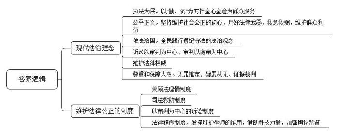
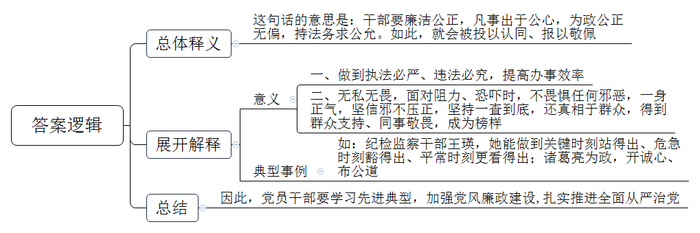
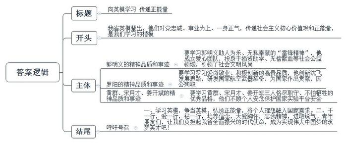
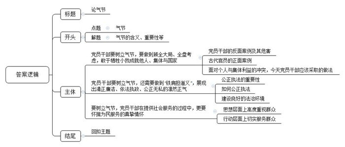

# 2018年辽宁省公考《申论》题

<!-- gwy:overview:start -->
> **辽宁 · 2018 · 申论 · 统考** ｜ 4 题 · 图片 4 处 · 答案随题折叠

导航：[题目](#题目)
<!-- gwy:overview:end -->

> 候选采集稿。参考答案及解析来自粉笔页面，不代表官方答案或真实高分答卷；来源使用许可与原卷对应关系仍需人工核实。

## 给定材料

### 材料 material-cba82f716d551876

1979年，33岁的邱娥国从部队转业，当上一名普通的派出所民警。从警以来，他勤走、勤问、勤记、勤思考，他创立的“警民联系卡”“警民联系牌”等便民措施，在全国公安系统推广，为基层治理发挥了重要作用。邱娥国给自己的工作定了“勤、沉”两字方针，做到了串百家门、认百家人、知百家情、办百家事，全心全意为群众服务。在邱娥国串门走访过程中，街坊们也慢慢记住了这位身高一米八三、脸上总是挂着微笑、亲切和蔼而又一身正气的民警，把他当成无话不谈的老朋友，都亲切地称他为“老邱”。没有多久，邱娥国就对自己辖区的情况了如指掌，小巷里的人和事都清晰地印在他的脑子里。在邱娥国的案头曾放着孤寡老人帮扶记录本，上面记着辖区一个个孤寡老人的基本情况。他们爱吃什么、爱做什么、需要什么帮助，详尽周全。

全国模范检察官张飚曾是新疆石河子市人民检察院一名普通的检察官。遇到在押人员的举报和申诉时，他总说“有申诉咱就得当回事，件件都要有回应”。从事政法工作30余年来，他始终保持着一颗“维护社会公正”的初心。2007年，张飚到石河子监狱巡视检察时，见到了浙江张氏叔侄案主角之一的张高平。从此，他与这个案件联系在了一起。五年多时间里，他针对案件中发现的疑点问题，搜集证据线索、反映案件疑点，推动了案件再审。最终使蒙冤多年的张氏叔侄被改判无罪。2011年退休后，张飚并没有闲下来，全国各地群众来信、来电不断。每次看到群众的诉求，他都感同身受，希望群众的合理诉求能早日得到依法解决。“退休后与群众交流过程中，我深刻地感受到人民群众遵纪守法的法治观念不断增强，这说明我们国家推进全面依法治国迈出重大步伐，也为改革开放再出发打下了坚实基础。”张飚说。一直把张飚视为老师的新疆乌鲁木齐市水磨沟区检察院检察官邱秉坤说，张老师是他们心中的“标杆”，作为年轻的检察官，一定要将他“忠诚、执着、担当、奉献”的精神接力传递下去。“检察官要运用好手中的法律武器，让人民群众在每个案件中，都能感受到公平正义，决不能让不公正的审判损害人民群众的权益。”张飚说。

江苏省泗洪县归仁镇村民老徐，提起人民调解员赵传平很是敬佩服气，“老赵调解矛盾纠纷认理不认人，很公平！”两年前，老徐因为土地界线问题与赵传平的亲戚发生了矛盾。作为调解员，赵传平经过现场查看、向左邻右舍调查，认定是亲戚挤占了老徐的土地，当场让亲戚退回了多占的土地，并赔礼道歉。像赵传平这样的人民调解员根植基层、来自群众，熟悉社情民意，他们处于预防化解矛盾的最前沿，用兼顾法理情的方式化解矛盾，一碗水端平，老百姓更买账。

2014年1月23日，资源县石掌坪村村民唐某由于疏忽大意引发山林火灾，肖某等村民闻讯后前往救火。在救火过程中，肖某夫妻二人以及其他两位村民不慎被火烧伤，烧伤程度均为特重度烧伤，并且四人烧伤处都有达到四级伤残的。在随后的诉讼中，资源县法院判决唐某贴偿肖某等4人各7万元。判决生效后，唐某一直未履行赔偿义务。2016年1月，肖某等四人向资源县法院申请强制执行。“在执行的过程中，我们发现被执行人唐某确无财产可供执行，且其本人因失火罪被判处两年有期徒刑，案件执行陷入僵局。”资源县法院执行局的法官李某说。考虑到肖某等四人的救火行为系见义勇为，且目前四人都已丧失劳动能力，没有任何经济来源，因此法院决定采取司法救助的形式，暂时解决四人的基本生活困难。

当前，越来越多的民间矛盾纠纷以案件的形式进入司法领域，一些刑事犯罪案件、民事侵权案件，因案件暂时无法侦破、被告人没有赔偿能力或赔偿能力不足，致使受害人及其近亲属依法得不到有效赔偿，陷入生活困境的情况不断增多。国家司法救助就是对遭受犯罪侵害或民事侵权，无法通过诉讼获得有效赔偿的当事人，采取的辅助性救济措施，重点解决符合条件的特定案件当事人生活面临的急迫困难。

“司法救助金的发放本着救急救弱的原则，对于这些受害方，给予适当的经济资助，帮助他们摆脱眼前的生活困境，有利于实现社会公平正义。”一位专家说。

### 材料 material-1ec2e6528621cd91

“王瑛同志是我们纪检监察干部的优秀代表。党的十八大以来，我们有幸见证了全面从严治党带来的巨大变化，我相信王瑛大姐在九泉之下也会为我们点赞的！”看到庆祝改革开放40周年大会上王瑛被授予“改革先锋”称号，曾参与王瑛先进事迹宣传的四川省成都市纪委办公厅主任刘某激动地说。

奋战在纪检监察工作一线20余年的王瑛，在纪委书记这个岗位上，让人们见识了纪检干部的铮铮铁骨。有案必查，查就查个水落石出，办就办个铁钉钉木。王瑛同志看似娇小柔弱，却一身正气，从不畏惧任何邪恶。

2003年5月，一封举报“南江县公安局城东派出所干警何某，在办案中玩忽职守致人死亡却逍遥法外”的信访件从市纪委转到了王瑛手中。王瑛当即召集县纪委、监察局一班人认真分析案情，迅速展开调查。

当案件查办到关键时刻，各种阻力接踵而至，有人甚至扬言：“敢查这个案子，你是不想活了。”王瑛同志没有退缩，更没有被吓倒。她鼓励办案人员：“自古邪不压正，只要我们坚持一查到底，真相终将大白于天下。”专案组同志深受鼓舞，又全力以赴投入到办案之中，最后办成了铁案。

关键时刻站得出、危急时刻豁得出、平常时刻更看得出，王瑛便是这样的党员干部。王瑛曾经被四川省纪委、省监察厅表彰为“办案先进个人”，是全省基层纪委书记中唯一获此殊荣的。同事们都敬重她，说她是一个无私无畏的人。有人问王瑛：“都说干纪检这一行容易得罪人，你一介弱女子，就没有顾虑吗？”

“如果我怕得罪人，那我就得罪了‘纪委书记’这个称谓！”“邪不压正，只要我们还真相于群众，我们就一定能得到人民的支持。”王瑛的每一个字迸发出的都是“铁肩担道义”的凛然正气。

据史载，三国时期，诸葛亮为蜀国丞相，曾上表建议罢黜廖立、李严，放逐到南中。诸葛亮病逝后，廖立闻之痛哭流涕，李严更是发病而死。为什么受到如此严厉惩罚，二人却心无怨恨？《三国志》作者陈寿评价说，诸葛亮为政，开诚心、布公道，“尽忠益时者虽仇必赏，犯法怠慢者虽亲必罚。”凡事出于公心，为政公正无偏，持法务求公允，哪怕是受罚之人也会投以认同、报以敬佩，正所谓“吏不畏吾严而畏吾廉，民不服吾能而服吾公”。

### 材料 material-e46878b2be2cde44

辽宁是一个英模辈出的地方。新中国成立以来，辽宁涌现出大量的英雄模范，其持续时间之长，涉及领域之广，社会影响之大，都足以让我们引以为豪。

英模共同的品质，是具有深厚的家国情怀，具有对人民深沉的热爱。其核心定义，就是对党忠诚、事业为上、一身正气。

党的十八大以来，习近平总书记多次对辽宁英模人物的先进事迹作出重要指示、给予高度评价、提出殷切期望。辽宁英模人物，传承和弘扬了光明正大、积极向上的浩然正气。英模精神，是社会主义核心价值观和正能量的集中体现。

郭明义是鞍钢集团矿业有限公司齐大山铁矿生产技术室业务主管，中华全国总工会副主席（兼职），第十八届、十九届中央候补委员。郭明义爱心团队正式成立于2009年7月，下设希望工程爱心联队、无偿献血志愿者应急服务大队、造血干细胞捐献志愿者大队、遗体（器官）捐献志愿者俱乐部、慈善义工大队、红十字志愿者急救队和红十字志愿者服务队七支大队。仅在鞍钢，加入爱心团队的干部职工就达8000多人。

多年来，在郭明义同志的感召、激励和引领下，爱心团队的广大志愿者积极投身捐资助学、无偿献血、捐献造血干细胞、捐献遗体（器官）、慈善义工、红十字志愿服务等社会公益领域，致力于服务帮助弱势群体，给无数困难家庭、困难学生送去帮助和希望，以实际行动倡导无私奉献精神，引领社会文明风尚，为推进社会主义核心价值体系建设、构建社会主义和谐社会做出了积极贡献，逐渐成为具有全国影响力的志愿者团队品牌。目前，全国各地已有17个省市自治区成立了170余支郭明义爱心团队的大队、分队，注册志愿者达到6万多名，参加活动的志愿者遍布全国。郭明义40多年如一日学雷锋做好事，时时处处发挥共产党员的先锋模范作用，弘扬正气，传递正能量，被人民群众誉为“爱心使者”“雷锋传人”，他用实际行动证明，在改革开放和市场经济条件下，“雷锋精神”依然具有强大的生命力、示范力和感召力。郭明义先后荣获“全国优秀共产党员”“全国助人为乐道德模范”“全国五一劳动奖章”“改革先锋”等荣誉称号。

罗阳，男，汉族，中共党员，1961年6月出生，辽宁沈阳人，航空工业沈阳飞机工业（集团）有限公司党委原副书记、董事长、总经理。作为航空工业沈飞的“掌舵人”，他胸怀报国强军赤子之情，创新提出“十个统筹”发展思路，推进管理创新、技术发展、体制机制改革等，推动企业经营模式转型，提升企业综合实力，带领沈飞迈入持续跨越发展的快车道。任期内企业营业收入、工业总产值等主要指标大幅提高，利润跃升61.8%。担任多个型号战斗机研制现场总指挥，带领沈飞完成了歼—15舰载机等多个重点型号战斗机研制并成功实现设计定型和首飞，推动军用战斗机研制取得重大进展，为国家航空武器装备发展作出了突出贡献。2012年11月，立志航空报国的罗阳，连续奋战八天七夜，倒在了航母舰载机成功试飞之后。习近平总书记沉痛哀悼因公殉职的罗阳同志，要求广大党员干部学习罗阳同志的优秀品质和可贵精神。罗阳同志被追授“航空工业英模”“全国优秀共产党员”“改革先锋”等荣誉称号。

黄群、宋月才、姜开斌，中船重工七六〇所的三位专家。当台风肆虐大连，国家重点实验平台在海浪冲击中面临危险的危急时刻，七六〇所的勇士们不顾个人安危，冲上平台，与狂风恶浪搏击，保护着实验平台的安全。黄群、宋月才、姜开斌为保护国家财产和同事的生命，毅然冲进险区，在与危险的殊死搏击中，被卷入巨浪，献出了宝贵的生命。习近平总书记充分肯定黄群等3名同志对党忠诚、恪尽职守、不怕牺牲的优秀品格，褒扬他们是共产党员的优秀代表和时代楷模。

新时代的我们，应该在学习英模、争当英模、弘扬正能量中实现人生价值。个人的理想只有融入国家的需求，才能实现。我们无论身处何种岗位，都应干一行、爱一行、钻一行，不断培养信念的能量、大爱的胸怀、忘我的精神、进取的锐气。有了这样的精神传承，具备这样的必胜气概，我们就一定能够担负起辽宁全面振兴的时代使命，成为实现伟大中国梦的筑梦英才！

### 材料 material-c425a9109e93b09c

苏武是我国西汉时期的官员。当时中原地区的汉朝和西北少数民族政权匈奴的关系时好时坏。公元前100年，匈奴政权新单于即位，汉武帝为了表示友好，派遣苏武率领一百多人出使匈奴。不料，就在苏武完成了出使任务准备返回时，匈奴上层发生了内乱，苏武一行受到牵连，被扣留下来。最初，单于许以丰厚的俸禄和高官，想劝降苏武，但苏武严辞拒绝了。匈奴见劝说没有用，就用酷刑逼迫。苏武受尽折磨仍不投降。单于见逼迫苏武投降无望，就把苏武流放到了人迹罕至的贝加尔湖边。在这里，与苏武作伴的，只有那根代表汉朝的使节和一小群羊。苏武每天拿着这根使节放羊，心想总有一天能够拿着它回到汉朝。这样日复一日，年复一年，在长达十九年的时间里，使节上挂着的旄牛尾装饰物都掉光了，苏武的头发和胡须也都变花白了。直到公元前81年，新单于执行与汉朝和好的政策，汉昭帝才派使臣把苏武接了回来。

文天祥是南宋杰出的民族英雄和爱国诗人。德佑元年（1275）正月，闻元军入侵，文天祥在赣州组织义军，开赴临安（今杭州，当时南宋的首都）。次年被任为右丞相兼枢密使。此时元军已进逼临安，文天祥被派往元营中谈判，遭扣留。二月底，文天祥等十二人连夜逃出来到福建，仍然坚持抗元。不久，为元重兵所败，妻子儿女皆被俘，将士牺牲甚众，文天祥只身逃脱，乃退广东继续抗元。后因叛徒引元兵袭击，同年十二月，在五坡岭（今广东海丰县）被俘。面对敌方的威逼利诱，文天祥写下《过零丁洋》诗以斥之。末句云：“人生自古谁无死，留取丹心照汗青。”次年，被押送大都（今北京），囚禁四年，经历种种严酷考验，始终不屈，最后从容就义，年仅47岁，留下了《过零丁洋》《正气歌》等千古绝唱。

朱自清先生是一位极具气节的爱国主义者，参加过“五四运动”“一二九运动”，在每次学生运动中都和学生站在一起。1948年6月18日，他毫不迟疑地在著名的《抗议美国扶日政策并拒绝领取美援面粉宣言》上签了字。在这一天的日记上，他写道：“此事每月须损失600万法币，影响家中甚大。但余仍决定签名，因余等既反美扶日，自应直接由己身做起。”由此，朱自清先生不顾身体每况愈下，坚决拒领美国的救济粮。8月12日，朱自清先生病逝。逝世的前一天，他还不忘叮嘱夫人陈竹隐：“有件事要记住，我是在拒绝美援面粉文件上签过名的，我们家以后不买配给的美国面粉。”毛泽东同志在《别了，司徒雷登》中说：“我们中国人是有骨气的……闻一多拍案而起，横眉怒对国民党的手枪，宁可倒下去，不愿屈服。朱自清一身重病，宁可饿死，不领美国的救济粮……我们应当写闻一多颂，写朱自清颂，他们表现了我们民族的英雄气概。”

“任脚下响着沉重的铁镣，任你把皮鞭举得高高，我不需要什么自白，哪怕胸口对着带血的刺刀！人，不能低下高贵的头，只有怕死鬼才乞求‘自由’；毒刑拷打算得了什么？死亡也无法叫我开口！对着死亡我放声大笑，魔鬼的宫殿在笑声中动摇；这就是我——一个共产党员的自白，高唱凯歌埋葬蒋家王朝。”《我的“自白”书》写于1948年4月，作者陈然。处于地下状态的中共重庆市委机关报《挺进报》被国民党当局破获，中共地下党员、《挺进报》特支书记陈然被捕。在狱中，陈然受尽种种酷刑，始终只承认《挺进报》从编辑、印刷到发行，全部是他一人所为——他决心牺牲自己，保护组织和同志们。在白公馆集中营里，特务们用威胁利诱的办法要他写自白书，陈然拿起笔，写下了惊天动地的诗篇——《我的“自白”书》。他以浩然正气，抒发了对国民党反动派的仇恨，对无耻叛徒的蔑视，昭示着革命者视死如归的英雄气概。

习近平总书记在《从政杂谈》一文中说：“纵观人类历史，凡有成就者，必有高风亮节”“我认为，高尚的气节是每一个领导者所应有的品质。没有气节，就没有了脊梁骨。”在我国古代，孔子以“三军可夺帅也，匹夫不可夺志也”赞扬不畏强暴的精神；孟子把“富贵不能淫，贫贱不能移，威武不能屈”看作为人处世不可或缺的气节。可见，气节是衡量一个人是否有人格、有脊梁的一把尺子。

## 题目

### 第 1 题

**概括材料**2**、**3**中的现代法治理念及维护法律公正的制度。（****15****分）**

关联材料：材料 material-cba82f716d551876

作答要求：

要求：全面、准确、简明，不超过250字。

第 1 题 · 答案与解析

**参考答案（粉笔题库参考内容）**

一、现代法治理念：1.执法为民。以“勤、沉”为方针全心全意为群众服务；2.公平正义。坚持维护社会公正的初心，用好法律武器，救急救弱，维护群众利益；3.依法治国。全民践行遵纪守法的法治观念；4.诉讼以审判为中心、审判以庭审为中心； 5.维护法律权威；6.尊重和保障人权。无罪推定、疑罪从无、证据裁判。

二、维护法律公正的制度：1.兼顾法理情制度； 2.司法救助制度；3.以审判为中心的诉讼制度；4.法律程序制度，发挥辩护律师的作用，借助科技力量，加强舆论监督。

**解析**

**参考答案说明：**本参考答案思路上从“现代法治理念”“维护法律公正的制度”这两个方面进行内容阐述。此外，各条的要点之间是并列关系，内容之间不存在重复、交叉。

**考点**：考点其他类

**来源**：来源2018年辽宁省公考《申论》题

粉笔申论页面对本题只提供「解析视频」入口，该入口是会员推广位，页面无视频地址与文字解析。

### 第 2 题

**请结合实际，谈谈对材料**4**中****“吏不畏吾严而畏吾廉，民不服吾能而服吾公”****的理解。（****20****分）**

关联材料：材料 material-1ec2e6528621cd91

作答要求：

要求：全面、准确、深刻、简明，不超过350字。

第 2 题 · 答案与解析

**参考答案（粉笔题库参考内容）**

这句话的意思是：干部要廉洁公正，凡事出于公心，为政公正无偏，持法务求公允。如此，就会被投以认同、报以敬佩。
廉洁公正可以：一、做到执法必严、违法必究，提高办事效率。二、无私无畏，面对阻力、恐吓时，不畏惧任何邪恶，一身正气，坚信邪不压正，坚持一查到底，还真相于群众，得到群众支持、同事敬畏，成为榜样。如：纪检监察干部王瑛，她能做到关键时刻站得出、危急时刻豁得出、平常时刻更看得出；诸葛亮为政，开诚心、布公道。
因此，党员干部要学习先进典型，加强党风廉政建设，扎实推进全面从严治党。

**解析**

**参考答案说明：**思路方面，本参考答案按照词句解释题“总体释义+展开解释+总结”的一般答题思路展开。内容方面，本参考答案先对“吏不畏吾严而畏吾廉，民不服吾能而服吾公”的含义进行了解释；“展开解释”部分先分析了“工作方式”方面的意义,接着分析了“思想态度”方面的意义，而后列举了先进典型；最后进行了总结。词句表达方面，本答案加上了“如此、因此”等连接词来承接上下文。

**考点**：考点词句解释类

**来源**：来源2018年辽宁省公考《申论》题

粉笔申论页面对本题只提供「解析视频」入口，该入口是会员推广位，页面无视频地址与文字解析。

### 第 3 题

**根据材料**5**，以****XX****团省委名义，拟写一份给全省青年的向英模学习，做传递正能量使者的倡议书。（****25****分）**

关联材料：材料 material-e46878b2be2cde44

作答要求：

要求：符合“倡议书”的写作要求，400字左右。

第 3 题 · 答案与解析

**参考答案（粉笔题库参考内容）**

向英模学习 传递正能量

广大青年朋友：

我省英模辈出，他们对党忠诚、事业为上、一身正气，传递社会主义核心价值观和正能量，是我们学习的楷模。

我们号召向英模学习：一、要学习郭明义助人为乐、无私奉献的“雷锋精神”，他成立爱心团队，投身于无偿献血、遗体捐赠等社会公益领域，引领了社会文明风尚；二、要学习罗阳爱岗敬业、积极创新的高贵品质，他创新沈飞发展思路，研发国家航空武器装备，为国家作出贡献，因公殉职；三、要学习黄群、宋月才、姜开斌三人恪尽职守、不怕牺牲的优秀品格，他们不顾个人安危保护国家实验平台安全。

在此我们倡议：一、学习英模，争当英模，弘扬正能量，将个人理想融入国家需求。二、干一行，爱一行，钻一行，培养信念，大爱胸怀，忘我精神，进取锐气。青年朋友们，让我们负担起我省全面振兴的时代使命，成为实现伟大中国梦的筑梦英才吧！

XX团省委

XXXX年XX月XX日

**解析**

**参考答案说明：**（1）格式方面，本参考答案写到了“标题”“称谓”“正文”“落款”。（2）正文部分，一方面从内容来看，围绕着“向英模学习，做传递正能量使者”这一主题，本参考答案的开头写到了“对党忠诚”“事业为上”“传递社会主义核心价值观”等英模共同的品质；主体部分通过列举郭明义、罗阳、黄群等五位英模的事迹，指出向英模学习的具体内容。另一方面，形式上，本参考答案做到了分段分条撰写，整体上条理较为清晰。（3）本参考答案能够结合倡议书特点，在语言表达上使用了“让我们”“吧”等具有号召性、有感染力的词汇。

**考点**：考点宣传类

**来源**：来源2018年辽宁省公考《申论》题

粉笔申论页面对本题只提供「解析视频」入口，该入口是会员推广位，页面无视频地址与文字解析。

### 第 4 题

**根据材料，以“论气节”为题，写一篇文章。（****40****分）**

关联材料：材料 material-c425a9109e93b09c

作答要求：

要求：中心明确，内容充实，结构严谨，语言流畅，不准照抄照搬给定材料，1000～1200字。

第 4 题 · 答案与解析

**参考答案（粉笔题库参考内容）**

**参考范文一：**

**论气节**

气节，是一个人精神生活方面的价值取向，也是人格的体现。朱自清先生曾说：“气节是我国固有的道德标准，是士人的立身处世之道。”诚哉斯言，当我们为文天祥、夏完淳击节浮白的时候，我们看中的是他们的气节激励了代代志士仁人。从历史走到今天，高尚的气节已经成为当下每个党员干部应有的品质。“执政为民，立党为公”，这些党员干部的气节，体现在深厚的家国情怀，体现在事业为上的一身正气，更体现在维护社会公正，全心全意为人民服务。

**社会结构日益复杂的今天，要想促进社会发展，实现社会的公平正义，真正做到服务于民，就需要党员干部展现出****“铁肩担道义”的凛然正气。**古语有云：“吏不畏吾严而畏吾廉，民不服吾能而服吾公”。当做事出于公正之心，执政时能做到公正无偏，服务人民时做到大公无私，必然能得到百姓的支持和认同。从一级法官沈德勇，到普通派出所民警邱娥国；从现代雷锋郭明义，到航空工业“掌舵人”罗阳，他们用实际行动倡导“忠诚、执着、担当、奉献”的精神力量，引领社会文明风尚，于推动国家发展大有裨益。

然而，司法方面相继出现冤假错案；执法人员作风不正、责任心不强，政绩观错位的情况也时有出现，种种问题的发生，伤了百姓，失了公允，丢了公信力。其原由就是执政人员没有树立起一心为公，执政为民的气节和情怀。

**党员干部要树立气节，就要始终保持清正廉洁，依法行使手中权力，以法律为心中准绳，以制度为原则，坚守执法底线**。全国模范检察官张飚，从事政法工作30余年，不改初心，始终秉持“维护社会公正”的信念；纪检监察干部优秀代表王瑛，不畏邪恶强权，以“我以我血荐轩辕”的气节，秉公执法，将真相大白于天下。这些人持法务求公允，力求给人民和法律最公正的交代。当然，我们也要重视硬件环境的建设，完善法律程序制度，依法治国，从严治党；要合理的发挥司法人才的作用，学会借助网络力量，加强舆论监督，更好的为我们的党员气节保驾护航。

**以民之所望，为施政之所向。要树立气节，党员干部在提供社会服务的过程中，更要怀揣真挚的情怀。**这种情怀，既要体现在心里装着百姓，有同理心，多考虑百姓的感受，也要求能够采取合理方法，为群众办好事、办实事、解难事。同时，要有敬业精神，做好本职工作，这才是心里装着百姓的题中之义。除此之外，还要改善工作方式方法，提升工作能力，切实服务百姓，这既需要党员干部注重调查研究，创新工作方式方法，采取技术创新，加强政策落细落实，在执法中兼顾法与情，也需要各部门回归专业主义，以更具专注度的履职行为，实现对社会生活的精准介入与有效服务。

“人生自古谁无死，留取丹心照汗青”。在这个新的时代，有了气节才能行的端，坐得住；有了气节才能面对困难，冲锋陷阵，回馈社会；有了气节才能面对利益诱惑，强权威胁，仍能坚守自我，维护公平。唯有此，中华气节，才能千年传承，英才筑梦，国运昌隆！

**参考范文二：**

**论气节**

气节，是一个人精神生活方面的价值取向，也是人格的体现。朱自清先生曾说：“气节是我国固有的道德标准，是士人的立身处世之道。”诚哉斯言，当我们为文天祥、夏完淳击节浮白的时候，我们看中的是他们的气节激励了代代志士仁人。凡有成就者，必有气节。从历史走到今天，高尚的气节已经成为当下每个党员干部应有的品质。“立党为公，执政为民”，**这些党员干部的气节**，**体现在深厚的家国情怀，体现在事业为上的一身正气，更体现在维护社会公正，全心全意为人民服务。**

**党员干部要树立气节，要做到顾全大局、全盘考虑，敢于牺牲小我成就他人、集体与国家。**当前，部分党员干部利用职权为己谋私，大搞享乐主义、奢靡之风，只顾自己高兴，践踏国家的利益、人民的权益，给党组织的形象带来了巨大的负面影响，更加损害了党组织在人民群众心目中庄严、神圣、光辉的形象与威信。这不仅是违法违规的行为，更是有失共产党员气节的表现。反观苏武、文天祥，面对敌军，无论是酷刑拷打，还是糖衣炮弹，始终坚守爱国情操，置小我于不顾，牺牲个人成全大局。今天的共产党人也要向前辈学习，让无私奉献的精神永存，让保家卫国的情怀常在。

**党员干部要树立气节，还需要做到****“铁肩担道义”，展现出清正廉洁、依法执政、公正无私的凛然正气。**古语有云：“吏不畏吾严而畏吾廉，民不服吾能而服吾公”。当做事出于公正之心，执政时能做到公正无偏，服务人民时做到大公无私，必然能得到百姓的支持和认同。纪检监察干部优秀代表王瑛，不畏邪恶强权，以“我以我血荐轩辕”的气节，秉公执法，将真相大白于天下。这些人持法务求公允，力求给人民和法律最公正的交代。当然，我们也要重视硬件环境的建设，完善法律程序制度，依法治国，从严治党。

**此外，以民之所望，为施政之所向。要树立气节，党员干部在提供社会服务的过程中，更要怀揣为民服务的真挚情怀。**这种情怀，既要体现在心里装着百姓，有同理心，多考虑百姓的感受，也要求能够采取合理方法，为群众办好事、办实事、解难事。同时，要有敬业精神，做好本职工作，这才是心里装着百姓的题中之义。除此之外，还要改善工作方式方法，提升工作能力，切实服务百姓，这既需要党员干部注重调查研究，创新工作方式方法，采取技术创新，加强政策落细落实，在执法中兼顾法与情，也需要各部门回归专业主义，以更具专注度的履职行为，实现对社会生活的精准介入与有效服务。

“人生自古谁无死，留取丹心照汗青”。在这个新的时代，有了气节才能行的端，坐得住；有了气节才能面对困难，冲锋陷阵，回馈社会；有了气节才能面对利益诱惑，强权威胁，仍能坚守自我，维护公平。唯有此，中华气节，才能千年传承，英才筑梦，国运昌隆！

**解析**

**文章分析**

**论气节**

【**标题的优点：**严格按照题目的要求，以“论气节”为标题。】

（1）气节，是一个人精神生活方面的价值取向，也是人格的体现。朱自清先生曾说：“气节是我国固有的道德标准，是士人的立身处世之道”。诚哉斯言，当我们为文天祥、夏完淳击节浮白的时候，我们看中的是他们的气节激励了代代志士仁人。（2）凡有成就者，必有气节。从历史走到今天，（3）高尚的气节已经成为当下每个党员干部应有的品质。“立党为公，执政为民”，**这些党员干部的气节****，****体现在深厚的家国情怀****，****体现在事业为上的一身正气****，****更体现在维护社会公正****，****全心全意为人民服务****。**

【**开头的优点：**★内容方面。范文的开头是紧扣“气节”这一主题展开的。首先，开头第一句话点出主题，做到了主题明确。其次，对“气节”这一主题进行了分析阐述：（1）先指出了“气节的含义”；（2）接着指出了“气节的重要性”；（3）最后指出了“党员干部应当具备的气节”。★文字表达方面：长短句配合使用，使语言表达有节奏感。】

**党员干部要树立气节，要做到顾全大局、全盘考虑，敢于牺牲小我成就他人、集体与国家。**（1）当前，部分党员干部利用职权为己谋私，大搞享乐主义、奢靡之风，只顾自己高兴，践踏国家的利益、人民的权益，给党组织的形象带来了巨大的负面影响，更加损害了党组织在人民群众心目中庄严、神圣、光辉的形象与威信。这是不仅是违法违规的行为，更是有失共产党员气节的表现。（2）反观苏武、文天祥，面对敌军，无论是酷刑拷打，还是糖衣炮弹，始终坚守爱国情操，置小我于不顾，牺牲个人成全大局。（3）今天的共产党人也要向前辈学习，让无私奉献的精神永存，让保家卫国的情怀常在。

【**论述段****1的优点：**★观点句：范文的观点句是紧扣“气节”这一文章主题提出的。形式上，它在段首处直接写出，位置突出，容易发现。内容上，关键词突出，内容要点明确，可以明显看出它是从“牺牲小我成全大局”入手，指出了“党员干部应具备气节”。★论述内容：（1）介绍了“党员干部的反面案例及其危害”；（2）介绍了“古代官员的正面案例”；（3）介绍了“面对个人与集体利益的冲突，今天党员干部应该采取的做法”。注意：以上三个方面的内容都是紧扣“党员干部要树立气节，要做到顾全大局、全盘考虑，敢于牺牲小我成就他人、集体与国家”这个观点句进行分析论述的，论述的针对性强，内容层次丰富。最后，在论述方法和论据的选取上做到了讲道理、举例子，做到了丰富多样。】

**党员干部要树立气节，还需要做到****“铁肩担道义”，展现出清正廉洁、依法执政、公正无私的凛然正气。**古语有云：“吏不畏吾严而畏吾廉，民不服吾能而服吾公”。（1）当做事出于公正之心，执政时能做到公正无偏，服务人民时做到大公无私，必然能得到百姓的支持和认同。（2）纪检监察干部优秀代表王瑛，不畏邪恶强权，以“我以我血荐轩辕”的气节，秉公执法，将真相大白于天下。这些人持法务求公允，力求给人民和法律最公正的交代。（3）当然，我们也要重视硬件环境的建设，完善法律程序制度，依法治国，从严治党。

【**论述段****2的优点：**★观点句：范文的观点句是紧扣“气节”这一文章主题提出的。形式上，它在段首处直接写出，位置突出，容易发现。内容上，关键词突出，内容要点明确，可以明显看出它是从“公正执法、清正廉洁”入手，指出了“党员干部应具备气节”。★论述内容：（1）介绍了“公正执法的重要性”；（2）以“王瑛”为例，介绍了“如何公正执法”；（3）介绍了“建设良好的法治环境”。注意：以上三个方面的内容都是紧扣“党员干部要树立气节，还需要做到‘铁肩担道义’，展现出清正廉洁、依法执政、公正无私的凛然正气”这个观点句进行分析论述的，论述的针对性强，内容层次丰富。最后，在论述方法和论据的选取上做到了讲道理、举例子，做到了丰富多样。】

**此外，以民之所望，为施政之所向。要树立气节，党员干部在提供社会服务的过程中，更要怀揣为民服务的真挚情怀。**这种情怀，（1）既要体现在心里装着百姓，有同理心，多考虑百姓的感受，也要求能够采取合理方法，为群众办好事、办实事、解难事。同时，要有敬业精神，做好本职工作，这才是心里装着百姓的题中之义。除此之外，（2）还要改善工作方式方法，提升工作能力，切实服务百姓，这既需要党员干部注重调查研究，创新工作方式方法，采取技术创新，加强政策落细落实，在执法中兼顾法与情，也需要各部门回归专业主义，以更具专注度的履职行为，实现对社会生活的精准介入与有效服务。

【**论述段****3的优点：**★观点句：范文的观点句是紧扣“气节”这一文章主题提出的。形式上，它在段首处直接写出，位置突出，容易发现。内容上，关键词突出，内容要点明确，可以明显看出它是从“全心全意服务群众”入手，指出了“党员干部应具备气节”。★论述内容：（1）介绍了“思想层面上高度重视群众”；（2）介绍了“行动层面上切实服务群众”。注意：以上两个方面的内容都是紧扣“要树立气节，党员干部在提供社会服务的过程中，更要怀揣为民服务的真挚情怀”这个观点句进行分析论述的，论述的针对性强，内容层次丰富。最后，在论述方法和论据的选取上以讲道理为主，做到了鞭辟入里，层次清晰。】

【**论述段之间的关系**：★内容的内在逻辑：范文的论述段之间是依照“并列”的逻辑展开的。论述段1先写了“大局意识”，论述段2再写了“秉公职守”，论述段3接着写了“全心全意为人民服务”。★段与段的外在衔接：论述段1、2、3的段首句中，分别有“要”“还要”“此外”等关联词衔接，体现了三段之间的并列关系。】

“人生自古谁无死，留取丹心照汗青”。在这个新的时代，有了气节才能行的端，坐得住；有了气节才能面对困难，冲锋陷阵，回馈社会；有了气节才能面对利益诱惑，强权威胁，仍能坚守自我，维护公平。唯有此，中华气节，才能千年传承，英才筑梦，国运昌隆！

【**结尾的优点**：范文的结尾回扣了“气节”这一主题。（1）再次提到“气节”这一主题词；（2）阐述了“气节”的深远意义。】

**考点**：考点文章写作题

**来源**：来源2018年辽宁省公考《申论》题

粉笔申论页面对本题只提供「解析视频」入口，该入口是会员推广位，页面无视频地址与文字解析。

