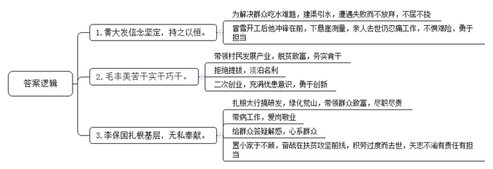
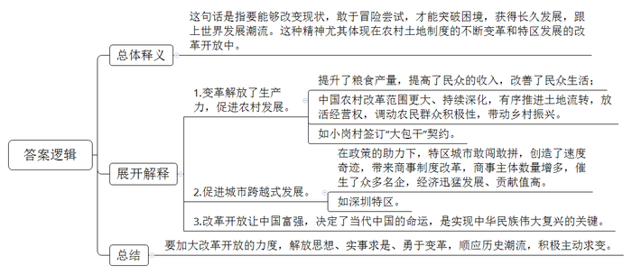
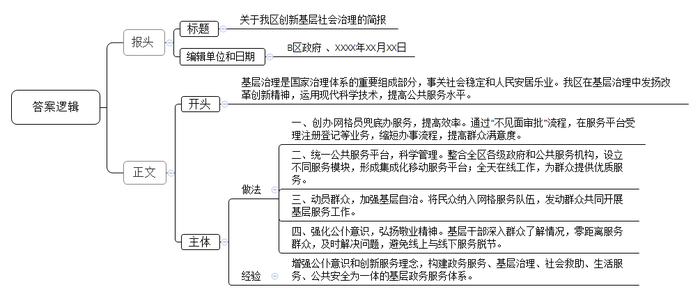
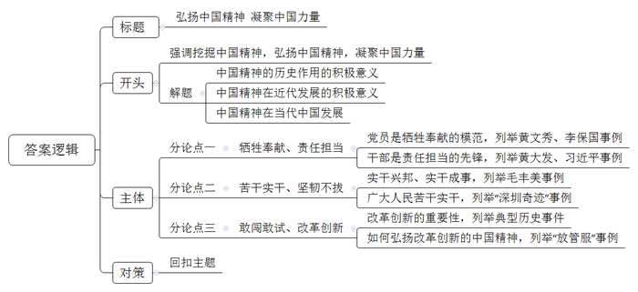

# 2019年辽宁省公考《申论》题

<!-- gwy:overview:start -->
> **辽宁 · 2019 · 申论 · 统考** ｜ 4 题 · 图片 4 处 · 答案随题折叠

导航：[题目](#题目) · [材料 1](#材料-1)
<!-- gwy:overview:end -->

> 候选采集稿。参考答案及解析来自粉笔页面，不代表官方答案或真实高分答卷；来源使用许可与原卷对应关系仍需人工核实。

## 给定材料

### 材料 1

黄大发，1935年11月出生，贵州省遵义市播州区平正仡佬族乡团结村半坎组人，1959年11月加入中国共产党，曾任贵州省遵义市播州区平正仡佬族乡草王坝大队大队长、村长、村支部书记，现任团结村名誉村支书。

草王坝曾缺水严重，村里人去最近的水源地挑水来回也要走两个小时。1958年，黄大发当选草王坝大队大队长。他许下承诺“一定要想方设法通上水，让大家吃上米饭。”这句话成了黄大发的人生信条。于是，由公社牵头，村里组成施工队，在黄大发指挥下，开始修建“红旗大沟”，打通隧道建成沟渠，引来大山背后的螺丝河水。由于资金、技术等原因，只打通了116米长的隧道，水渠后来被废弃。但黄大发并没有放弃，因为他心中始终有一个念头：我是村支书，有责任修通水渠，解决村里人畜饮水问题，改变贫困现状。1989年，54岁的黄大发向组织申请到枫香水利站跟班学习水利知识和开凿技术。

经过多方奔走和申请，1992年底，修渠工程终于立项。第二年正月初三，水渠工程冒着大雪开工。黄大发既当指挥长又当技术员，年近六旬的他总是冲在最前面。在修擦耳岩段时，一处倒悬的崖壁成了难题，黄大发把麻绳系在自己身上吊下悬崖测量。修渠期间，黄大发的女儿和孙子相继因病去世，他承受着悲痛，坚守在修渠一线。1994年，水渠的主渠贯通，河水第一次满满当当地流进草王坝村。

黄大发带领群众，历时30多年，靠着锄头、钢钎、铁锤和双手，在绝壁上凿出一条长9400米、地跨3个村的“生命渠”，结束了草王坝长期缺水的历史，改善了当地的生活条件，乡亲们亲切地把这条渠称为“大发渠”，称黄大发为“当代愚公”。

### 材料 2

简陋的小土屋、粗糙的小木桌、一盏煤油灯、几个矮木墩、一方红泥印，40年前，小岗村18户村民在这里立下生死状，摁下“红手印”，以一纸大包干契约，拉开了中国农村改革的大幕，写就了波澜壮阔的时代故事。

小岗村位于安徽省凤阳县东部，隶属小溪河镇，距京沪铁路5公里，距省道307线7公里，距明光、临淮两个淮河航运码头均20公里。但这些看似方便的交通网络说明不了任何问题，因为在1978年之前此地一直为饥饿和贫穷困扰，是当时全县有名的“吃粮靠返销、用钱靠救济、生产靠贷款”的“三靠村”，每年秋收后几乎家家外出讨饭。

1978年，在“不准分田单干”“三级所有、队为基础”的三令五申中，小岗村18户村民以“托孤”的形式，立下生死状，按下红手印，敢冒天下之大不韪提出了“包产到户”，签订大包干契约，敢闯、敢试、敢为天下先，小岗村闯出了一片新天地。束缚生产力的生产关系一经变革，很快就唤醒了沉睡的大地。这也让大包干带头人之一的严俊昌感到，生产队长比以前好干了。“每天天不亮，家家户户就下地干活了，不用操一户的心。”实行大包干后的第一年，全队粮食总产量达十几万斤，相当于1955年至1970年粮食产量的总和……

把选择权交给农民，由农民自己决定而不是代替农民选择——尽管曾经有过激烈的争论，但这一理念一直被秉承，并驱动了中国农村更大范围的改革。小岗村的星星之火，迅速燎原全国，“小岗精神”，也成为追求梦想、敢为人先的代名词。

近年来，随着我国农村改革的深入，小岗村坚持以处理好农民和土地的关系为主线，持续深化农村改革，有序推进土地流转，放活经营权，着力调动农民群众积极性，为乡村振兴注入新活力。

如今，走在小岗村的友谊大道上，两侧的商店鳞次栉比，让人目不暇接。同为大包干带头人的严金昌和关友江，在相距不远的道路旁边分别开起了农家乐，仅此一项每家年收入就能达到十几万元；作为村里最早进行土地流转的农户之一，严金昌家的50多亩土地除了分给6个孩子外，剩余的一次性流转给了上海一家公司。

从40年前的“分田单干”，到现在的土地集中流转、适度规模经营，在一些人看来，小岗村似乎又回到了原点。但最有发言权的，莫过于小岗村村民。“当年大包干，是为了吃饱肚子；现在流转土地，是为了致富。”75岁的严金昌说，分与合只是形式的不同，其内在追求一脉相承。

2016年4月25日，习近平总书记来到小岗村考察，在小岗村“当年农家”院落，了解到18户村民按下红手印的情景，感慨道：“当年贴着身家性命干的事，变成中国改革的一声惊雷，成为中国改革的标志。”

### 材料 3

改革开放40年，我国在发展经济同时，大力推进国家治理体系和治理能力现代化，着力抓好重大制度创新，着力提升人民群众的获得感、幸福感、安全感，各项便民、惠民、利民举措持续实施，改革呈现全面发力、多点突破、纵深推进的局面。

“经邦有术，持之以理”。推进国家治理体系和治理能力现代化，是全面深化改革的重要目标。基层治理是国家治理体系的重要组成部分，事关社会稳定和人民安居乐业。A市B区创新社会治理的做法和经验，从一个侧面反映了我国社会治理体制改革的显著成效。

B区政府在社会治理中发扬改革创新精神，积极应变，主动求变，运用互联网、大数据、人工智能等现代科学技术，不断提高公共服务的能力和水平。

不久前，刚从大学毕业的小李打算创办一家小型科技公司，实现自主创业。但是，他对公司注册等流程不熟悉，就想起社区里张贴的“网格员兜底办”的服务内容，于是联系到所属社区的网格员。网格员立即通过“不见面审批”流程，在“政务通”平台为小李进行了营业执照全程电子化注册登记。网络的另一头，审批人员确认资料无误后即出具营业执照、备案和刻章。当天下午，小李到区政务服务中心顺利领取营业执照及公章、完成银行开户并办理税务登记。“原来可能需要个把月办完的流程，现在一个工作日之内就办完了，比想象中方便高效得多！”小李对于“政务店小二”服务十分满意。

不仅创业的小李感受明显，全区的80万群众也是直接受益者，“原来每个单位都有自己的帐号，用起来很麻烦，现在没有了这个烦恼，关注一个APP就够了。”家住幸福社区的罗阿姨说，前段时间她感冒咳嗽，在家打开手机上的“政务通”APP就预约成功了，凭二维码到医院扫码签到即可完成挂号，身边的家人朋友也都从“政务通”上获得各种政务服务和生活服务。

目前，全区“政务通”APP客户端已整合全区各级政府工作机关和公共服务机构，接入了108个功能模块，集成了880项行政审批服务、124项公共服务、106项便民服务、9项公益服务和10项资讯服务，有效破解了原有服务平台分散等问题，形成行政、公共、公益、便民、资讯“五位一体”的集成化移动网络服务平台。24小时在线智慧生活服务，让群众随时随地享受到优质高效的服务，亲身体会科学管理带来的便利。

B区在推进社会治理中，还抓准相信和依靠人民群众解决基层问题这个切入点，发动群众参与治理，将村居（社区）平安志愿者、村居（社区）法律顾问、物业管理人员、离退休老干部以及热心群众纳入网格服务队伍，发动大家一起开展帮贫济困、法律服务、民事调解、环境整治等服务工作，为群众解决实际困难。

B区在公务员和社区干部中强化公仆意识教育，弘扬敬业奉献精神。在实现各部门信息互联互通、资源整合共享、工作协调联动同时，把“键对键”服务与“面对面”服务结合起来，要求基层公务员和社区干部深入群众了解情况，“工作围着民意转、干部围着百姓转”，打通服务群众的“最后一公里”，及时解决涉及群众切身利益的矛盾和问题，零距离服务群众，避免“网络虚拟服务”与面对面服务脱节。

目前，全区从基层治理矛盾最突出、改革呼声最高和人民需求最迫切的问题入手，通过增强公仆意识和创新服务理念和手段，初步构建起了政务服务、基层治理、社会救助、生活服务、公共安全为一体的基层政务服务体系和模式。

## 题目

### 第 1 题

**概括资料**1**、**2**、**3**中典型人物的特点。（15分）**

关联材料：材料 1

作答要求：

要求：全面、准确、简明，不超过250字。

第 1 题 · 答案与解析

**参考答案（粉笔题库参考内容）**

1.黄大发信念坚定，持之以恒。为解决群众吃水难题，建渠引水，遭遇失败而不放弃，不屈不挠；冒雪开工后他冲锋在前，下悬崖测量，亲人去世仍忍痛工作，不惧艰险、勇于担当。

2.毛丰美苦干实干巧干。带领村民发展产业，脱贫致富，务实肯干；拒绝提拔，淡泊名利；二次创业，充满忧患意识，勇于创新。

3.李保国扎根基层，无私奉献。扎根太行搞研发，绿化荒山，带领群众致富，尽职尽责；带病工作，爱岗敬业；给群众答疑解惑，心系群众；置小家于不顾，奋战在扶贫攻坚前线，积劳过度而去世，矢志不渝有责任有担当。

**解析**

**参考答案说明：**答案从“黄大发信念坚定，持之以恒”“毛丰美苦干实干巧干”“李保国扎根基层，无私奉献”等方面进行分条撰写，各条要点在内容上是并列且无交叉的。

**考点**：特点类

**来源**：2019年辽宁省公考《申论》题

粉笔申论页面对本题只提供「解析视频」入口，该入口是会员推广位，页面无视频地址与文字解析。

### 第 2 题

**根据资料**4**、**5**，谈谈你对“****穷则变，变则通，通则久****”的理解及其现实意义。（20分）**

关联材料：材料 2

作答要求：

要求：全面、准确、深刻，不超过350字。

第 2 题 · 答案与解析

**参考答案（粉笔题库参考内容）**

这句话是指要能够改变现状，敢于冒险尝试，才能突破困境，获得长久发展，跟上世界发展潮流。这种精神尤其体现在农村土地制度的不断变革和特区发展的改革开放中。

现实意义为：1.变革解放了生产力，促进农村发展。提升了粮食产量，提高了民众的收入，改善了民众生活；中国农村改革范围更大、持续深化，有序推进土地流转，放活经营权，调动农民群众积极性，带动乡村振兴。如小岗村签订“大包干”契约。2.促进城市跨越式发展。在政策的助力下，特区城市敢闯敢拼，创造了速度奇迹，带来商事制度改革，商事主体数量增多，催生了众多名企，经济迅猛发展、贡献值高。如深圳特区。3.改革开放让中国富强，决定了当代中国的命运，是实现中华民族伟大复兴的关键。

因此，要加大改革开放的力度，解放思想、实事求是、勇于变革，顺应历史潮流，积极主动求变。

**解析**

**参考答案说明：**思路方面，本参考答案按照词句解释题“总体释义+展开解释+总结”的一般答题思路展开。内容方面，本参考答案先对“穷则变，变则通，通则久”的含义进行了解释；“展开解释”部分主要分析了现实意义；最后“总结”部分提出了践行“穷则变，变则通，通则久”的对策。

**考点**：词句解释类

**来源**：2019年辽宁省公考《申论》题

粉笔申论页面对本题只提供「解析视频」入口，该入口是会员推广位，页面无视频地址与文字解析。

### 第 3 题

**根据资料**6**，以B区政府名义，就该区创新基层社会治理的做法和经验编写一期简报。（25分）**

关联材料：材料 3

作答要求：

要求：符合“简报”的写作要求，400字左右。

第 3 题 · 答案与解析

**参考答案（粉笔题库参考内容）**

关于我区创新基层社会治理的简报

B区政府 XXXX年XX月XX日

基层治理是国家治理体系的重要组成部分，事关社会稳定和人民安居乐业。我区在基层治理中发扬改革创新精神，运用现代科学技术，提高公共服务水平。具体做法为：

一、创办网格员兜底办服务，提高效率。通过“不见面审批”流程，在服务平台受理注册登记等业务，缩短办事流程，提高群众满意度。

二、统一公共服务平台，科学管理。整合全区各级政府和公共服务机构，设立不同服务模块，形成集成化移动服务平台；全天在线工作，为群众提供优质服务。

三、动员群众，加强基层自治。将民众纳入网格服务队伍，发动群众共同开展基层服务工作。

四、强化公仆意识，弘扬敬业精神。基层干部深入群众了解情况，零距离服务群众，及时解决问题，避免线上与线下服务脱节。

上述做法为今后开展类似工作提供了经验：增强公仆意识和创新服务理念，构建政务服务、基层治理、社会救助、生活服务、公共安全为一体的基层政务服务体系。

**解析**

**参考答案说明：**（1）格式方面，本参考答案写到了“报头”“正文”。（2）正文部分，一方面从内容来看，围绕着“基层社会治理”这一主题，本参考答案的开头先写到了“B区基层社会治理的背景”；主体部分从“网格员兜底办服务”“统一公共服务平台”“基层自治”“公仆意识”等几个方面给出了具体的做法和经验。另一方面，形式上，本参考答案做到了分段、分条撰写，整体上条理较为清晰。

**考点**：总结类

**来源**：2019年辽宁省公考《申论》题

粉笔申论页面对本题只提供「解析视频」入口，该入口是会员推广位，页面无视频地址与文字解析。

### 第 4 题

**围绕给定资料中体现的“中国精神”，自选角度，自拟题目，写一篇议论文。（40分）**

关联材料：材料 1

作答要求：

要求：主题明确，内容充实，结构严谨，语言流畅，不准照抄照搬给定资料，1000-1200字。

第 4 题 · 答案与解析

**参考答案（粉笔题库参考内容）**

**弘扬中国精神 凝聚中国力量**

中国精神是中华民族赖以长久生存的灵魂，为中华民族的传承发展提供不竭的精神动力。中国精神不是抽象的、理论性的，而是通过历史事件生动表现出来的，通过人物事迹鲜明刻画出来的。因为中国精神，中华民族在一百多年屈辱的近代史上没有倒下，中国共产党团结带领全国人民成立新中国，实现了民族独立；因为中国精神，无数个“改革先锋”敢闯敢试，探索出一条中国特色的改革道路，实现了人民富裕。

中国精神永不褪色。十九大指出，中国特色社会主义进入新时代。我们面临着新的时代环境、社会环境，面对着各种风险挑战愈加复杂，人民群众对美好生活的需要日益提高，这就更**需要我们要挖掘中国精神，弘扬中国精神，凝聚中国力量，为国家繁荣富强输出强劲的精神动力。**

**弘扬牺牲奉献、责任担当的中国精神。**中国共产党是先进的、纯洁的党，共产党员是弘扬中国精神的先锋模范。无数奋斗在基层一线的党员干部，为了脱贫攻坚，乡村振兴不顾自身健康，甚至献出宝贵生命。时代楷模黄文秀，在脱贫攻坚第一线倾情投入、奉献自我，牺牲在扶贫路上；“太行愚公”李保国，扎根山区35年，把“拼命”当作工作常态，不顾亲友群众关爱，终因过度劳累而牺牲。责任担当是共产党员最亮丽的底色，“爱民为民”始终是党员干部的崇高信仰和人生追求。30多年间，不忘群众吃水难的黄大发；知青时期立下“为人民做点实事”志向的习近平，都是怀揣对人民赤子情怀的典范，实现了为民服务的人生理想。

**弘扬苦干实干、坚韧不拔的中国精神。**“人民对美好生活的向往就是我们的奋斗目标。”习近平总书记这朴素的语言为各行各业的奋斗者明确了远大目标。空谈误国，实干兴邦。远大目标要通过苦干实干、久久为功方可实现。例如毛丰美同志将实干精神融入生命，从苦干实干，发展产业带领乡亲们脱贫致富，到实干巧干，开启了“二次创业”的新征程实现全村富裕。中国的成绩更是不计其数的无名实干英雄创造的。例如，深圳的创业者、企业家凭借了“拓荒牛”精神，创造了无数“深圳奇迹”。

**弘扬敢闯敢试，改革创新的中国精神。**改革开放是决定当代中国命运的关键一招。四十年前，中国人民在寻找发展道路的历史岔路口，从“小岗村”的农民到党和国家领导人都选择了改革开放的道路。四十年来，改革创新成为了时代精神的核心，为各项事业发展作出了方向指引。从农村的家庭联产承包责任制到城市的商品经济繁荣发展；从政府职能转变、机构改革到乡镇企业异军突起，个体工商户铺天盖地。这些成绩证明了改革开放是正确的伟大选择。改革创新，没有完成时，只有进行时。当下，我们需要改革再出发，顺应历史潮流，积极应变，主动求变，才能与时代同行。例如当下的“放管服”改革，运用互联网、大数据、人工智能等现代科学技术，不断提高公共服务的能力和水平。

习近平总书记指出，实现中国梦必须弘扬中国精神。只要将个人理想同民族梦想统一起来，不断增强团结一心的精神纽带、自强不息的精神动力，就一定能汇聚13亿多中国人民的磅礴伟力，永远朝气蓬勃迈向未来。

**解析**

**文章分析**

**弘扬中国精神 凝聚中国力量**

【**标题的优点：**首先，范文的标题突出了“中国精神”这一主题。其次，它在形式上采用对称式结构，标题更加完整、饱满。】

（1）中国精神是中华民族赖以长久生存的灵魂，为中华民族的传承发展提供不竭的精神动力。中国精神不是抽象的、理论性的，而是通过历史事件生动表现出来的，通过人物事迹鲜明刻画出来的。因为中国精神，中华民族在一百多年屈辱的近代史上没有倒下，中国共产党团结带领全国人民成立新中国，（2）实现了民族独立；因为中国精神，无数个“改革先锋”敢闯敢试，探索出一条中国特色的改革道路，实现了人民富裕。

中国精神永不褪色。（3）十九大指出，中国特色社会主义进入新时代。我们面临着新的时代环境、社会环境，面对着各种风险挑战愈加复杂，人民群众对美好生活的需要日益提高，这就更**需要我们要挖掘中国精神，弘扬中国精神，凝聚中国力量，为国家繁荣富强输出强劲的精神动力。**

【**开头的优点**：★内容方面。范文的开头是紧扣题目给定的“中国精神”这一主题展开的。首先，开头第一句话点出了“中国精神”这一主题，做到了主题明确。其次，对“中国精神”这一主题进行了分析阐述，指出了：（1）中国精神的历史作用，（2）中国精神在近代发展的积极意义，（3）中国精神在当代中国发展的积极意义。注意，以上三个方面的论述是有内在逻辑顺序的：先写“总意义”，再按照时间顺序从过去到现在，说明“中国精神”的重要性。★文字表达方面。使用了“而是”等关联词，使语言表达有逻辑性。】

**弘扬牺牲奉献、责任担当的中国精神。**（1）中国共产党是先进的、纯洁的党，共产党员是弘扬中国精神的先锋模范。（2）无数奋斗在基层一线的党员干部，为了脱贫攻坚，乡村振兴不顾自身健康，甚至献出宝贵生命。时代楷模黄文秀，在脱贫攻坚第一线倾情投入、奉献自我，牺牲在扶贫路上；“太行愚公”李保国，扎根山区35年，把“拼命”当作工作常态，不顾亲友群众关爱，终因过度劳累而牺牲。（3）责任担当是共产党员最亮丽的底色，“爱民为民”始终是党员干部的崇高信仰和人生追求。30多年间，不忘群众吃水难的黄大发；知青时期立下“为人民做点实事”志向的习近平，都是怀揣对人民赤子情怀的典范，实现了为民服务的人生理想。

【**论述段****1的优点**：★观点句：范文的观点句是紧扣“中国精神”这一文章主题提出的。形式上，它在段首处直接写出，位置突出，容易被发现；内容上，关键词突出，内容要点明确，可以明显看出它是从“牺牲奉献、责任担当”的角度入手，指出了“中国精神”的内涵。★论述内容：本段主要围绕“中国精神”这一主题进行分析阐述，指出了：（1）党员是牺牲奉献的模范，（2）干部是责任担当的先锋。注意：以上两个方面的内容都是紧扣观点句“弘扬牺牲奉献、责任担当的中国精神”进行分析论述的，针对性强、内容层次丰富。最后，在论证方法和论据选取方面，讲道理和举例子相结合，做到了丰富多样。】

**弘扬苦干实干、坚韧不拔的中国精神。**“人民对美好生活的向往就是我们的奋斗目标。”习近平总书记这朴素的语言为各行各业的奋斗者明确了远大目标。（1）空谈误国，实干兴邦。远大目标要通过苦干实干、久久为功方可实现。（2）例如毛丰美同志将实干精神融入生命，从苦干实干，发展产业带领乡亲们脱贫致富，到实干巧干，开启了“二次创业”的新征程实现全村富裕。中国的成绩更是不计其数的无名实干英雄创造的。例如，深圳的创业者、企业家凭借了“拓荒牛”精神，创造了无数“深圳奇迹”。

【**论述段****2****的优点**：★观点句：范文的观点句是紧扣“中国精神”这一文章主题提出的。形式上，它在段首处直接写出，位置突出，容易被发现；内容上，关键词突出，内容要点明确，可以明显看出它是从“苦干实干、坚韧不拔”的角度入手，指出了“中国精神”的内涵。★论述内容：本段主要围绕“中国精神”这一主题进行分析阐述，指出了：（1）实干兴邦、实干成事（2）无名实干英雄创造成绩。注意：以上两个方面的内容都是紧扣观点句“弘扬苦干实干、坚韧不拔的中国精神”进行分析论述的，针对性强、内容层次丰富。最后，在论证方法和论据选取方面，讲道理和举例子相结合，做到了丰富多样。】

**弘扬敢闯敢试，改革创新的中国精神。**（1）改革开放是决定当代中国命运的关键一招。四十年前，中国人民在寻找发展道路的历史岔路口，从“小岗村”的农民到党和国家领导人都选择了改革开放的道路。四十年来，改革创新成为了时代精神的核心，为各项事业发展作出了方向指引。从农村的家庭联产承包责任制到城市的商品经济繁荣发展；从政府职能转变、机构改革到乡镇企业异军突起，个体工商户铺天盖地。这些成绩证明了改革开放是正确的伟大选择。改革创新，没有完成时，只有进行时。当下，（2）我们需要改革再出发，顺应历史潮流，积极应变，主动求变，才能与时代同行。例如当下的“放管服”改革，运用互联网、大数据、人工智能等现代科学技术，不断提高公共服务的能力和水平。

【**论述段****3****的优点**：★观点句：范文的观点句是紧扣“中国精神”这一文章主题提出的。形式上，它在段首处直接写出，位置突出，容易被发现；内容上，关键词突出，内容要点明确，可以明显看出它是从“敢闯敢试，改革创新”的角度入手，指出了“中国精神”的内涵。★论述内容：本段主要围绕“中国精神”这一主题进行分析阐述，指出了：（1）改革创新的重要性，（2）如何弘扬改革创新的中国精神。注意：以上两个方面的内容都是紧扣观点句“弘扬苦干实干、坚韧不拔的中国精神”进行分析论述的，针对性强、内容层次丰富。并且，这两个方面的论述有内在逻辑顺序：先写“重要性”，再写“对策”。最后，在论证方法和论据选取方面，讲道理和举例子相结合，做到了丰富多样。】

习近平总书记指出，实现中国梦必须弘扬中国精神。只要将个人理想同民族梦想统一起来，不断增强团结一心的精神纽带、自强不息的精神动力，就一定能汇聚13亿多中国人民的磅礴伟力，永远朝气蓬勃迈向未来。

【**结尾的优点**：（1）再次提到了“中国精神”；（2）发出了号召。】

**考点**：文章写作题

**来源**：2019年辽宁省公考《申论》题

粉笔申论页面对本题只提供「解析视频」入口，该入口是会员推广位，页面无视频地址与文字解析。

