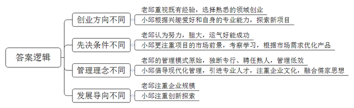
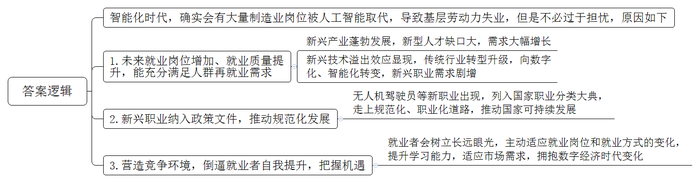
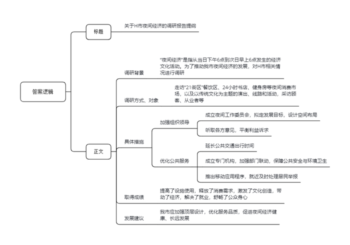
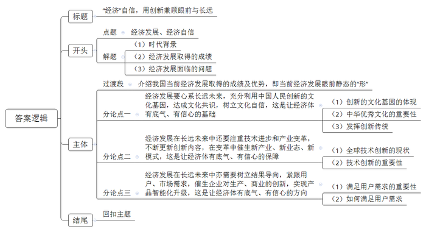

# 2020年0822公务员多省联考《申论》题（辽宁A卷）

<!-- gwy:overview:start -->
> **辽宁 · 2020 · 申论 · A类** ｜ 4 题 · 图片 4 处 · 答案随题折叠

导航：[题目](#题目) · [材料 1](#材料-1)
<!-- gwy:overview:end -->

> 候选采集稿。参考答案及解析来自粉笔页面，不代表官方答案或真实高分答卷；来源使用许可与原卷对应关系仍需人工核实。

## 给定材料

### 材料 1

小邱个头不高，皮肤白皙，结实强壮，喜欢穿运动装和运动鞋，一点都不像他的父亲老邱，老邱总是穿着皮鞋、西裤。他们相差近30岁，对商业的看法颇有不同。

1979年，老邱从B市建筑公司辞职，成立了自己的工程队，1992年成立了一家建筑公司，2000年组建了集团公司，如今家乡人都称他为“建筑大王”。老邱是个老派，在他看来，做企业只要胆大、灵活、肯吃苦，再加上运气，似乎就能做起来，小邱却不大认同。1994年，老邱计划让上海交大毕业的儿子回来接班，小邱对此纠结了很久。最后，小邱只答应了父亲一半的要求，回去，但他回去的目的不是守业，而是创业。“我父亲已经做到了省内建筑业的第一，但在我看来，这个行业技术门槛比较低，同时与我个人兴趣及所学格格不入。所以我和父亲协商，这个行业他继续做，能不能让我根据自己的兴趣做一个新的行业，父亲答应了。”

这之后的大半年时间，小邱一直在做市场调研，“我一直在思考如何突破现状，每天在报纸中寻找与‘电’或‘自动化’有关的技术，分析什么是有市场前景的产品和项目，最终将目光集中在厨房家电上。”1996年，找到创业方向的小邱，在父亲提供的一笔创业基金支持下，自立门户成立了家电公司。1999年，小邱前往欧洲考察，发现欧洲使用的洗碗机机型普遍比中国当时的所有产品都漂亮，跟厨房搭配起来很美观。“但我们也发现，国外欧式机虽然很美观，却存在油污处理能力较弱的不足，我突发奇想，做一款欧式外观，内部结构中国化的洗碗机。”小邱说。小邱通过对传统欧式机进行改进，开发出外观漂亮、洗涤效果更佳的产品。这款洗碗机一经推向市场，第一年销量就达1万多台，随之确立了公司在这一领域的领导地位。在谈到自己的成功时，小邱说：“这次成功，我认为最根本的原因在于，我们比洋品牌更加了解中国。”

公司成立之初，小邱希望新的公司拥有现代化的管理制度，“在市场调研期间，我以一个旁观者的身份去观察父亲的企业，发现了很多问题。比如，公司员工乡里乡亲的复杂关系，使有些简单问题处理起来变成了难题。”小邱在成立新公司的时候就与父亲约法三章：第一，新公司要从村里移到B市的开发区；第二，除了小邱选中的一些人，老员工不能到新公司来；第三，有关新业务的重大决策，要尽可能尊重小邱的想法。公司成立的前10年，小邱是一个“狂热”的西方管理学徒。他大力推行美式卓越绩效管理，引进跨国集团管理人才。但他发现，西方管理模式与本地员工存在较大的文化隔阂。小邱说：“2000年，家电公司快速增长达到了一个瓶颈，有两年没有太大增长，我们分析原因是管理滞后。我发现西方的管理固然有它先进的一面，但单纯照搬无疑是在步别人的后尘，中国的企业必须探索出自己的模式，才能具备持续不断的先发优势。”2002年，小邱到清华、北大先后学了四年的传统文化课，听着听着，思路越来越清晰了。如何将中国传统文化精髓与西方的管理体系相结合？这个问题开始萦绕在小邱的脑海里。2012年开始，他逐渐将自己的所学所思运用到企业管理中。他将儒家的基本精神“仁、义、礼、智、信”写进了公司的价值观。“最初的导入，还跟管理模式没有关系。慢慢地一边实践一边探索一边总结，如今我们逐渐摸索出一套中国特色、中西合璧的管理模式。”二十多年的创业磨砺，让小邱最感欣慰的不是企业越来越大，而是企业文化的塑造。他说：“在企业发展的过程中，经营管理只是企业的骨架，文化才是一个企业的血脉、灵魂。”

从老邱到小邱，两代人一直在奔跑。有人问小邱企业的边界在哪里时，他的回答是没有边界。如果你认为这是一种战略的迷茫，是找不到重点，那就错了，这恰恰是一种最为正确的认识。竞争从来不是静态的，你在变，对手也在变，只有不断奔跑，才能生存。对于不断奔跑者，哪里会有边界呢？

### 材料 2

日前，一家电商企业的智能配送机器人率先进行了5G测试运行，这标志着我国在物流领域向实现人工智能化作业又迈进了一步。人工智能在科研、医疗、教育、工业制造等诸多领域，都有愈来愈多的应用。科技进步助力产业与社会发展是令人兴奋的时代变化，但由此带来的就业问题也同样令人忧虑。某调研公司新近发布的报告指出，到2030年全球将有约两千万的制造业岗位被人工智能所取代。一些国家为避免大量基层劳动力失业，采取行政或立法手段强行迟滞人工智能的发展，这显然既不现实，亦不符合科技与经济发展的规律。但如何满足被人工智能替代人群的再就业需求，就成了必须回答的问题。

随着大数据、物联网和云计算的广泛运用，与此相关的新兴产业蓬勃发展，对从业人员需求大幅增长。N科技公司作为一家民营智能移动办公平台供应商，培训数字化管理人才正成为它的第一副业。某研究机构发布的《2018年中国人工智能人才白皮书》保守估计，截至2018年10月，仅民营企业人工智能人才缺口至少在100万以上。中国人力资源协会副会长苏博士说：“像数字化管理师、无人机驾驶员这样的新职业在许多民营企业中早就存在，这些新职业能为国家可持续发展贡献力量。2019年4月，无人机驾驶员与数字化管理师、人工智能工程技术员等13个职业已列入国家职业分类大典。”此外，新兴技术溢出效应正在显现，传统第一、第二产业向数字化智能化转变，使得企业对工业机器人系统操作员和系统运维员的需求剧增，成为了现代工业生产一线的新兴职业。

人力资源专家王博士认为：“从经济社会整体来看，人们不必为智能化时代的就业问题过于担忧，因为更多新的职业、新的就业形态将应运而生。同时，就业岗位的增加、就业质量的提升都将为社会创造更多经济效益。”未来在新兴领域，专业的技术人才、创新人才，尤其是数字人才的供给缺口会逐渐增大，但由于人才之间的竞争也在加剧，倘若就业者没有做好应对的准备，不去主动适应竞争，便只能在机遇面前望而却步。为了适应就业岗位和就业方式的变化，需要就业者放眼长远，提高自身学习能力，不断适应社会市场需求，拥抱数字经济时代的变化。总之，人类经历的任何一场技术革命，都是机遇与挑战并存的，对未来的就业问题，亦应如是观。

### 材料 3

八月的H市，已进入高温炙烤模式。夜，却未因此而平静。晚上十点，市区最大商场的主体部分已经打烊，人们陆续从商场大门走出。与此同时，另一批“意犹未尽”的顾客走进了地下一层和地下二层东侧的“21街区”。这片主营餐饮的区域营业时间一直会延长到凌晨两点，是名副其实的“深夜食堂”。人们在炸糕店前排队买着炸糕、在奶茶店外挑选着饮料、手捧着冰淇淋和炸鸡，街区内无论面条米饭、饺子煎包，中餐西餐种类都很丰富。

H市商务局的陈科长介绍说，所谓“夜间经济”，是指从当日下午6点到次日早上6点发生的经济文化活动。在不少人看来，夜间经济无非就是“啤酒烤串加唱歌”。事实上，夜间经济的内涵远比“吃吃喝喝”丰富得多。它已经由早期的灯光夜市转变为包括“食、游、购、娱、体、展、演”等在内的多元夜间消费市场。

H市以传统文化为主题，推出一系列具有当地特色的精品演出、夜游线路和消费活动。在已有800多年历史的沿江路上漫步，可以观“水陆并行、河街相邻”，赏“粉墙黛瓦、橹声船影”。夜晚的市博物馆不再冷冷清清，夜间开放满足了上班族的观展需求。近郊湖畔，优美的舞蹈、婉转的歌曲，在高楼大厦灯光秀的衬托下充满别样风情。

夜间经济的发展，不只着眼于物质消费。随着生活水平的提高，H市越来越多的消费者开始注重愉悦身心、兴趣学习、健身运动等精神文化消费。H市一家著名的24小时书店，就给人们的夜生活增加了一种新的方式。位于临窗位置的阅读区，摆放着一张长桌和七把圆形座椅，其中六把已被读者占用。年轻姑娘小赵戴着耳机，全神贯注地看着手机播放的“中国会计网校”课程。小赵说，自己参加工作不到一年，打算自学考注册会计师。合租环境比较吵闹，下班晚餐后就来书店学到10点多再回去。“这里环境好，手机用来听课，也没有电脑玩儿，效率还是很高的。”已是夜里九点半，位于H市南二环附近的一家健身工作室灯火通明。“每天人最多的时候是八点左右，现在好多人已经练完走了。”健身教练表示，“我们工作室成立近三年，明显感觉到健身的人在增多。来这里的大部分是附近的住户，下班之后过来健身。正常情况下，我们是晚上十点关门，但有的人下班晚，跟教练约了，过来练到十一点、十二点也没问题，我们都等。”

为了做好夜间经济这篇大文章，H市于2019年年初成立了由政府相关部门和行业协会组成的夜间工作委员会，拟定夜间经济发展目标。设计夜间经济空间布局，并通过与场地经营者、工作人员、夜间消费者以及周边居民对话的方式听取各方意见，平衡相关群体的利益诉求。同时，交通部门延长了地铁、公交夜间行车时间，为夜间经济的消费者和从业人员提供安全、便捷、舒适的交通工具。

夜间经济的安全、噪音、垃圾等问题最为人们所诟病。H市成立专门机构加强公安、消防、城市管理等多部门联动，确保了夜市附近的公共安全、环境卫生。此外还推出了移动应用程序，供居民举报夜间滋扰情况，可通过网络联系所在区域社区的负责人，直接对问题进行处理。

“夜间经济提高了设施使用、释放了消费需求、激发了文化创造、带动了区域发展。此外，夜间具有与常规工作时间错位的优势，更多的潜在劳动力也能够通过夜间上岗解决就业问题，缓解社会就业压力。如何让夜间经济健康有序地成长，政府的顶层设计尤为关键。政策质量高了，服务品质好了，投资者信心才更强，‘夜间经济’才会走得更好，走得更远。”陈科长感慨地说。

夜间经济既舒畅了公众的身心，也让经济热度、消费暖流持续高涨。调查显示，H市城市居民消费中，有60%发生在夜间，大型商场每天18时至22时的销售额占比超过全天的50%。夜间经济已然成为带动消费提升、增添经济活力的有效抓手。

### 材料 4

日前，清华大学陈教授在接受记者采访时说，中国有着创新的历史和文化基因，中国古代的四大发明对世界文明发展进程产生了重要影响。在今天，中国不少民营企业在全球科技领域激烈竞争中占有一席之地，推动了经济发展方式的转换、经济结构的调整，比如中国的移动支付、无人机、生物医药、分享经济等方面有许多领先世界的科技成果，有着比国外同类产品更好的用户体验。他认为，创新是推动经济发展的第一动力，没有科技创新的突破，就难以建成现代化经济体系，就难以实现高质量发展。

“我们实现了豆浆机、电饭煲等数十款智能厨电的物联网应用。”著名的民营企业副总裁高总说。在用户需求倒逼之下，该企业对产品进行了智能化升级，目前产品已销售到世界50多个国家和地区，年销售额超过70亿元，拥有专利技术2047项。过去10多年，该企业凭借传感器等方面的制造优势，成为某些跨国大公司的重要供应商。“我们在产品的研发、设计等方面有长期积累，在创新中更容易将好点子转化为好产品。”高总说。陈教授认为，中国的企业，特别是民营企业，在世界经济舞台上走出了一条从模仿、追随到引领的发展轨迹，而这背后的“秘诀”便是创新。市场需求催生了中国民营企业对生产的创新、商业的创新，比如新零售、机器人、人工智能等等，这种创新不是短期的、偶然的，而是长期的、自发的，是一种迥然不同于欧美国家的创新路径，是深刻在中国经济肌体中独一无二的事实特征。毋庸置疑的是，中国经历了40多年的高速发展，已经积累了雄厚的经济、科研、人才等诸多方面的基础。特别是与第四次工业革命相关的技术，如数字技术、人工智能、量子技术、新能源、5G通信等方面，都走在了世界前头。此外，中国的移动互联网发达，拥有业态优势；网民群体庞大，比欧、美、日网民数量之和还多，拥有大数据优势。特别是党和政府提出的“创新是引领发展的第一动力”，无疑为这场工业革命提供了优良的政治环境。

“风物长宜放眼量”，创新是百年大计。纵观世界经济发展史，技术进步和产业变革是经济增长的重要引擎。历次工业革命均因重大技术变革兴起，逐渐催生了一大批新产业、新业态、新模式，进而大幅提高劳动生产率，推动经济增长步入黄金期。有研究显示，以人工智能为代表的新技术革命，到2035年有望拉动中国经济年增长率明显提升，推动中国劳动生产率大幅提高。<u>一个经济体的底气，既要看眼前静态的“形”，更要看长远发展的“势”。</u>

## 题目

### 第 1 题

**根据给定材料1，归纳邱氏父子创业理念的差异性。（15分）**

关联材料：材料 1

作答要求：

要求：准确、简明、全面，不超过200字。

第 1 题 · 答案与解析

**参考答案（粉笔题库参考内容）**

1.创业方向不同：老邱重视既有经验，选择熟悉的领域创业；小邱根据兴趣爱好和自身的专业能力，探索新项目。

2.先决条件不同：老邱认为努力，胆大，运气好能成功；小邱更注重项目的市场前景，考察学习，根据市场需求优化产品。

3.管理理念不同：老邱的管理模式原始，注重人脉、独断专行、聘任熟人，管理低效；小邱倡导现代化管理，引进专业人才，注重企业文化，融合儒家思想。

4.发展导向不同：老邱注重企业规模；小邱注重创新探索。

**解析**

**参考答案说明：**（1）本参考答案从“创业方向”“先决条件”“管理理念”“发展导向”四方面进行了分条撰写。（2）各条要点之间在内容上是并列的，没有交叉。

**考点**：其他类

**来源**：2020年0822公务员多省联考《申论》题（辽宁A卷）

### 第 2 题

**根据给定材料2，分析为什么不必为智能化时代的就业问题过于担忧。（20分）**

关联材料：材料 2

作答要求：

要求：表述准确，条理清晰，不超过300字。

第 2 题 · 答案与解析

**参考答案（粉笔题库参考内容）**

参考答案一：

智能化时代，确实会有大量制造业岗位被人工智能取代，导致基层劳动力失业，但是不必过于担忧，原因如下：

1.未来就业岗位增加、就业质量提升，能充分满足人群再就业需求。新兴产业蓬勃发展，新型人才缺口大，需求大幅增长；新兴技术溢出效应显现，传统行业转型升级，向数字化、智能化转变，新兴职业需求剧增。

2.新兴职业纳入政策文件，推动规范化发展。无人机驾驶员等新职业出现，列入国家职业分类大典，走上规范化、职业化道路，推动国家可持续发展。

3.营造竞争环境，倒逼就业者自我提升，把握机遇。就业者会树立长远眼光，主动适应就业岗位和就业方式的变化，提升学习能力，适应市场需求，拥抱数字经济时代变化。

**解析**

**参考答案说明：**本参考答案首先从总体上对智能化时代的就业问题进行了介绍，然后从“未来就业岗位增加、就业质量提升”“新兴职业纳入政策文件，推动规范化发展”“营造竞争环境，倒逼就业者自我提升，把握机遇”这三个方面具体阐述了不必担忧的原因，各条要点之间相互并列，没有交叉。

参考答案二：

1.新兴就业岗位增加，能充分满足人群再就业需求。新兴产业蓬勃发展，新型人才缺口大，需求大幅增长；企业提供培训，助力从业者适应新职业。

2.新兴技术溢出效应带动就业。新兴技术推动传统行业转型升级，向数字化、智能化转变，传统产业中新兴职业增加，带动传统产业从业者转型就业。

3.新兴职业纳入政策文件，推动规范化发展。无人机驾驶员等新职业出现，列入国家职业分类大典，走上规范化、职业化道路，推动国家可持续发展。

4.营造竞争环境，倒逼就业者自我提升，把握机遇。就业者会树立长远眼光，主动适应就业岗位和就业方式的变化，提升学习能力，适应市场需求，拥抱数字经济时代变化。

**考点**：原因类

**来源**：2020年0822公务员多省联考《申论》题（辽宁A卷）

### 第 3 题

**假如你随C市商务局考察团到H市调研“夜间经济”发展情况，请结合给定资料3，写一份调研报告提纲。（25分）**

关联材料：材料 3

作答要求：

要求：紧扣资料，内容全面，层次分明，有逻辑性，不低于400字。

第 3 题 · 答案与解析

**参考答案（粉笔题库参考内容）**

关于H市夜间经济的调研报告提纲

调研背景：“夜间经济”是指从当日下午6点到次日早上6点发生的经济文化活动。为了推动我市夜间经济的发展，对H市相关情况进行调研。

调研方式、对象：走访“21街区”餐饮区、24小时书店、健身房等夜间消费市场，以及以传统文化为主题的演出、线路和活动，采访顾客、从业者等。

具体措施：1.加强组织领导。成立夜间工作委员会，拟定发展目标，设计空间布局；听取各方意见，平衡利益诉求。2.优化公共服务。延长公共交通出行时间；成立专门机构，加强部门联动，保障公共安全与环境卫生；推出移动应用程序，就近及时处理居民举报。

取得成绩：提高了设施使用，释放了消费需求，激发了文化创造，带动了经济，解决了就业，舒畅了公众身心。

发展建议：我市应加强顶层设计，优化服务品质，促进夜间经济健康、长远发展。

**解析**

**参考答案说明：**（1）一方面，内容上，正文部分从调研背景，调研方式、对象，具体措施，取得成绩，发展建议五个方面介绍了H市发展夜间经济的具体情况。（2）另一方面，形式上，本参考答案做到了分段、分条撰写，整体上条理较为清晰。

**考点**：总结类

**来源**：2020年0822公务员多省联考《申论》题（辽宁A卷）

### 第 4 题

**给定资料4中提到“一个经济体的底气，既要看眼前静态的‘形’，更要看长远发展的‘势’”，请根据这句话的理解，联系实际，自拟题目，写一篇文章。（40分）**

关联材料：材料 1、材料 2、材料 3、材料 4

作答要求：

要求：自选角度，立意明确；思路清晰，语句流畅，不准照抄照搬给定资料；总字数1000-1200字。

第 4 题 · 答案与解析

**参考答案（粉笔题库参考内容）**

**“经济”自信，用创新兼顾眼前与长远**

在这片充满希望的田野上，大有可为的热土上，发展始终是每个时代的关键词，而经济则是衡量发展水平的重要指标，是一切发展的基础与保障。大数据、物联网、云计算，人脸识别、在线支付……我们曾经期待的，渴望的，都照进了现实。经济结构的优化转型，综合国力的增强提升……这些都在向全世界昭示着我国经济“乘长风，破万里浪”的汹涌气势。但国际发展时局瞬息万变，我国经济发展也面临新的挑战与困境。想突破重重阻碍，赢得经济发展的主动权，树立经济自信，要善于着眼当下的时局，看到眼前静态的“形”，更要心系长远的未来，勇于开拓创新，蓄势谋势、求变应变，抓住长远发展的“势”。

40多年的风云变幻，一代又一代人的使命背后，依靠的是我们“拔地而起”的优势，不仅包含雄厚的经济、科研、人才等多方面的积累，亦包括走在前端的、发达的移动互联网，特别是党和政府提供的宽松的、优良的政治环境。但是，一代人的安于现状、固步自封，就会让我们在时代变迁中，固化思维、困住手脚，难以实现持续发展。

因此，**经济发展要心系长远未来，充分利用中国人民创新的文化基因，达成文化共识，树立文化自信，这是让经济体有底气、有信心的基础**。一直以来，我国都有着创新的历史和文化基因：在古代，四大发明对世界文明发展进程产生了重要影响；在今天，高速铁路、扫码支付、共享单车和网络购物改变了人们的生活方式，提高人们的生活质量，被外国友人评选为中国的“新四大发明”……这些都是中国人民积极创新的生动体现。中华优秀文化积淀着中华民族最深沉的精神追求，也为中华儿女不断创新提供丰厚滋养。新时期，更应发扬创新传统，将中华优秀文化创造性转化，以文化创新增强经济自信。

**经济发展在长远未来中还要注重技术进步和产业变革，不断更新创新内容，在变革中催生新产业、新业态、新模式，这是让经济体有底气、有信心的保障**。“风物长宜放眼量”，创新是百年大计。近年来，在全球范围内出现了一系列有重大影响、颠覆性的新兴技术，这些技术互相交叉、融合、渗透，以人工智能为代表的新技术革命正在孕育中，这也是经济发展的引擎。在促进经济发展的同时，改变人们的思维，拓宽人们的视野，不断催生新的发展模式，让发展生生不息，让经济持续突破。

**经济发展在长远未来中亦需要树立结果导向，紧跟用户、市场需求，催生企业对生产、商业的创新，实现产品智能化升级，这是让经济体有底气、有信心的方向**。“顾客就是上帝”，满足用户需求是市场得以永续发展的关键要素；关注用户需求，重视用户体验，掌握用户在使用产品时的心理感受，是产品更新换代、推陈出新的必经阶段。用户需求关乎市场需求，或爱不释手，或厌恶至极，或欣喜若狂，或怒不可遏；用户需求就是商机，或稍纵即逝，或旷日持久，或昙花一现，或绵延不绝。因此，有目的、目标地去发展经济，是赢得胜利的保障，是拓展用户、扩大市场的指向标。

“正入万山圈子里，一山放过一山拦。”回望过去，无论中国经济经历多少坎坷风雨，都能一路披荆斩棘、自信满满。只要我们善于积势蓄势谋势，把握眼前的“形”，更勇于识变求变应变，积极开拓创新，看到长远发展的“势”，就会在危机中孕育新机，于变局中广开新局。

**解析**

**文章分析**

**“经济”自信，用创新兼顾眼前与长远**

【**标题的优点**：范文的标题突出了“经济底气（自信）”这一主题，并点明了“创新”这一角度，标题准确、简练。】

在这片充满希望的田野上，大有可为的热土上，（1）<u>发展始终是每个时代的关键词</u>，<u>而经济则是衡量发展水平的重要指标</u>，<u>是一切发展的基础与保障</u>。（2）大数据、物联网、云计算，人脸识别、在线支付……<u>我们曾经期待的，渴望的，都照进了现实</u>。经济结构的优化转型，综合国力的增强提升……<u>这些都在向全世界昭示着我国经济“乘长风，破万里浪”的汹涌气势</u>。（3）<u>但国际发展时局瞬息万变，我国经济发展也面临新的挑战与困境</u>。想突破重重阻碍，赢得经济发展的主动权，树立经济自信，要善于着眼当下的时局，看到眼前静态的“形”，更要心系长远的未来，勇于开拓创新，蓄势谋势、求变应变，抓住长远发展的“势”。

【**开头的优点**：★内容方面。范文的开头是紧扣题目给定的“经济底气（自信）”这一主题展开的。首先，开头第一句话点出了“经济发展”这一话题，做到了主题明确。其次，对“经济底气（自信）”这一主题进行了分析阐述，指出了：（1）时代背景，（2）经济发展取得的成绩，（3）经济发展面临的问题。注意，以上三个方面的论述是有内在逻辑顺序的：先写“背景”，再写“成绩”，最后写“问题”。★文字表达方面。使用了“但”“要……更要……”等关联词，使语言表达有逻辑性。】

<u>40多年的风云变幻，一代又一代人的使命背后</u>，<u>依靠的是我们“拔地而起”的优势</u>，不仅包含雄厚的经济、科研、人才等多方面的积累，亦包括走在前端的、发达的移动互联网，特别是党和政府提供的宽松的、优良的政治环境。但是，一代人的安于现状、固步自封，就会让我们在时代变迁中，固化思维、困住手脚，难以实现持续发展。

【**过渡段的优点：**范文的过渡段分析了“经济发展取得的成绩”，这也是经济发展眼前静态的“形”。此外，还要注意过渡段末尾的“一代人的安于现状、固步自封，就会让我们在时代变迁中，固化思维、困住手脚，难以实现持续发展”是用来引起下文的过渡句。】

因此，**经济发展要心系长远未来，充分利用中国人民创新的文化基因，达成文化共识，树立文化自信，这是让经济体有底气、有信心的基础**。一直以来，（1）<u>我国都有着创新的历史和文化基因</u>：在古代，四大发明对世界文明发展进程产生了重要影响；在今天，高速铁路、扫码支付、共享单车和网络购物改变了人们的生活方式，提高人们的生活质量，被外国友人评选为中国的“新四大发明”……这些都是中国人民积极创新的生动体现。（2）<u>中华优秀文化积淀着中华民族最深沉的精神追求</u>，<u>也为中华儿女不断创新提供丰厚滋养</u>。新时期，（3）<u>更应发扬创新传统</u>，<u>将中华优秀文化创造性转化</u>，<u>以文化创新增强经济自信</u>。

【**论述段1的优点**：★观点句：范文的观点句是紧扣“经济底气（自信）”这一文章主题提出的。形式上，它在段首处直接写出，位置突出，容易被发现；内容上，关键词突出，内容要点明确，可以明显看出它是从“利用中国人民创新的文化基因”的角度入手，指出了如何从长远角度保持经济自信。★论述内容：本段主要围绕“经济底气（自信）”这一主题进行分析阐述，指出了：（1）创新的文化基因的体现，（2）中华优秀文化的重要性，（3）发挥创新传统。注意：以上三个方面的内容都是紧扣观点句“经济发展要心系长远未来，充分利用中国人民创新的文化基因，达成文化共识，树立文化自信，这是让经济体有底气、有信心的基础”进行分析论述的，针对性强、内容层次丰富。最后，在论证方法和论据选取方面，讲道理和举例子相结合，做到了丰富多样。】

**经济发展在长远未来中还要注重技术进步和产业变革，不断更新创新内容，在变革中催生新产业、新业态、新模式，这是让经济体有底气、有信心的保障**。“风物长宜放眼量”，创新是百年大计。近年来，（1）<u>在全球范围内出现了一系列有重大影响、颠覆性的新兴技术</u>，这些技术互相交叉、融合、渗透，以人工智能为代表的新技术革命正在孕育中，这也是经济发展的引擎。（2）<u>在促进经济发展的同时</u>，改变人们的思维，拓宽人们的视野，不断催生新的发展模式，让发展生生不息，让经济持续突破。

【**论述段2的优点**：★观点句：范文的观点句是紧扣“经济底气（自信）”这一文章主题提出的。形式上，它在段首处直接写出，位置突出，容易被发现；内容上，关键词突出，内容要点明确，可以明显看出它是从“注重技术进步和产业变革”的角度入手，指出了如何从长远角度保持经济自信。★论述内容：本段主要围绕“经济底气（自信）”这一主题进行分析阐述，指出了：（1）全球技术创新的现状，（2）技术创新的重要性。注意：以上两个方面的内容都是紧扣观点句“经济发展在长远未来中还要注重技术进步和产业变革，不断更新创新内容，在变革中催生新产业、新业态、新模式，这是让经济体有底气、有信心的保障”进行分析论述的，针对性强、内容层次丰富。最后，在论证方法和论据选取方面，以讲道理为主，论述准确、贴切。】

**经济发展在长远未来中亦需要树立结果导向，紧跟用户、市场需求，催生企业对生产、商业的创新，实现产品智能化升级，这是让经济体有底气、有信心的方向**。“顾客就是上帝”，（1）<u>满足用户需求是市场得以永续发展的关键要素</u>；关注用户需求，重视用户体验，掌握用户在使用产品时的心理感受，是产品更新换代、推陈出新的必经阶段。用户需求关乎市场需求，或爱不释手，或厌恶至极，或欣喜若狂，或怒不可遏；用户需求就是商机，或稍纵即逝，或旷日持久，或昙花一现，或绵延不绝。因此，（2）<u>有目的、目标地去发展经济，是赢得胜利的保障，是拓展用户、扩大市场的指向标</u>。

【**论述段3的优点**：★观点句：范文的观点句是紧扣“经济底气（自信）”这一文章主题提出的。形式上，它在段首处直接写出，位置突出，容易被发现；内容上，关键词突出，内容要点明确，可以明显看出它是从“紧跟用户、市场需求，实现产品智能化升级”的角度入手，指出了如何从长远角度保持经济自信。★论述内容：本段主要围绕“经济底气（自信）”这一主题进行分析阐述，指出了：（1）满足用户需求的重要性，（2）如何满足用户需求。注意：以上两个方面的内容都是紧扣观点句“经济发展在长远未来中亦需要树立结果导向，紧跟用户、市场需求，催生企业对生产、商业的创新，实现产品智能化升级，这是让经济体有底气、有信心的方向”进行分析论述的，针对性强、内容层次丰富。最后，在论证方法和论据选取方面，以讲道理为主，论述准确、贴切。】

“正入万山圈子里，一山放过一山拦。”回望过去，无论中国经济经历多少坎坷风雨，都能一路披荆斩棘、自信满满。只要我们善于积势蓄势谋势，把握眼前的“形”，更勇于识变求变应变，积极开拓创新，看到长远发展的“势”，就会在危机中孕育新机，于变局中广开新局。

【**结尾的优点**：（1）再次提到了“经济底气（自信）”；（2）展望未来。】

**考点**：文章写作题

**来源**：2020年0822公务员多省联考《申论》题（辽宁A卷）

