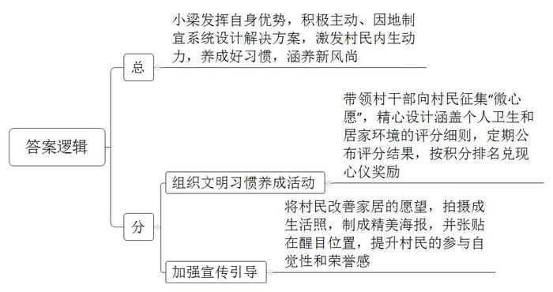
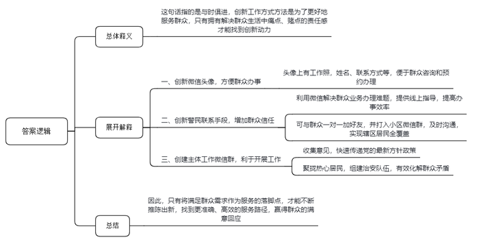
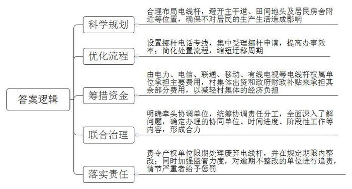
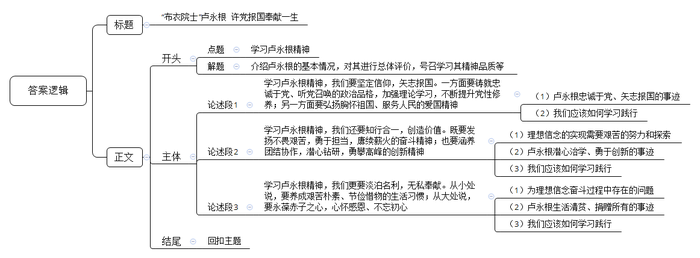

# 2020年0822公务员多省联考《申论》题（辽宁B卷）

<!-- gwy:overview:start -->
> **辽宁 · 2020 · 申论 · B类** ｜ 4 题 · 图片 4 处 · 答案随题折叠

导航：[题目](#题目)
<!-- gwy:overview:end -->

> 候选采集稿。参考答案及解析来自粉笔页面，不代表官方答案或真实高分答卷；来源使用许可与原卷对应关系仍需人工核实。

## 给定材料

### 材料 material-eee022c8d9e05b0a

杨家村是深度贫困村，经过几年的努力，村里绝大多数贫困户已经圆了脱贫梦。为了稳定增收，杨家村决定借助山清水秀的景致发展乡村旅游。2019年初，在政府和帮扶单位专项资金支持下，杨家村的美丽乡村项目顺利开工。水泥道路通村入户，古建民居修葺一新，竹木栅栏、青石台阶、小桥流水的景观设计，让这个昔日的深度贫困村华丽转身，好似世外桃源。

村里漂亮了，可是人居环境改善却是个“老大难”。远远望去村容村貌焕然一新，可是走进老百姓家里一看，庭院乱堆放、灶台藏污垢。以前村干部也多次上门做工作，但是群众认为这是自家的事，村干部管不着。关键时刻，省建筑装饰集团公司的驻村第一书记小梁发挥自身优势，为村里“量身设计”了一套解决方案。

8月的一天，一场“积分兑换心愿，勤劳改变习惯”的文明习惯养成活动在杨家村拉开帷幕。小梁和村干部一道向村民征集有关家居环境改善的“微心愿”，并精心设计了十项涵盖个人卫生和居家环境的评分细则，每周公布评分结果，最终按照积分排名兑现前20名的“微心愿”。“我们想通过‘微心愿’来激发村民的内生动力，帮助大家养成好习惯，涵养新风尚。”小梁说。

村民纷纷讲出了自己改善家居的愿望：“我就盼望着有台电脑，想看看外面的世界，也顺便把家里的土特产在网上卖一卖。”“要是有台大彩电，忙完一天的农活就可以陪孙子看动画片了！”“我想有台电冰箱，我家的鱼啊肉啊就能存起来了”……

他们这些心愿配上摄影师为他们拍摄的生活照，打印成精美的海报张贴在村里醒目的位置。看着像明星一样登在海报上的乡里乡亲，村民们的荣誉感更强了，改善家居环境一时蔚然成风。

几个月来，从锅碗瓢盆、个人起居，到房前屋后、禽畜养殖，杨家村发生了很大变化。65岁的唐大妈逢人就讲，自己多年的心愿终于实现了：“在整洁、干净的屋里做针线活儿，我心里那叫一个美啊！”村民夏姐的丈夫常年在外打工，她自己留在村里种地看孩子，一个人忙里忙外，难免顾不上收拾屋子。“自从参加活动以来，养成了好习惯，房前屋后都干净了，自己住着也舒服。”她说。

从爱美之心人皆有之，到护美之行人人为之，杨家村这个新建成的美丽乡村，处处透着美的气息。省建筑装饰集团公司也如约为表现优异的家庭兑现了“微心愿”，同时也为其他家庭送去棉服、抱枕、围巾等暖冬礼物。在活动现场，夏姐领到了盼望已久的热水器，脸上露出了开心的笑容。

### 材料 material-ca0d23b942e6e1ae

民警小童的微信头像，很是特别。除了一张工作照，还留有姓名、联系电话、地址，并配着一行双色标注的文字——“如果你需要办理户口、居住证，及调解家庭、邻里纠纷，请添加此微信号进行咨询和预约办理。”

小童是云沟派出所的一名社区民警，他的工作内容都浓缩到这张小小的头像里了。“再以传统的思维方式工作，可就跟不上时代啦。现在大人小孩都会玩微信，辖区里越来越多的大爷大妈玩得比我还好！我的工作方式和方法必须有所改变。”小童手机里存着近8千个居民的手机号码，微信好友中有近5千名居民，几乎覆盖了整个辖区。

前不久，一位已经办理过居住证的居民，在微信上紧急呼叫小童。原来，他去车管所办理轿车年审业务，但由于忘了居住证年审而无法正常完成业务办理，按照过去的做法，要来回奔波50多公里。小童让他立即将居住证的正面通过微信拍照传回处理，只花了一分钟就解决了问题。还有一次，一位现住国外的本社区居民，临时想开具无违法犯罪记录证明，但是不知具体该怎么办，最终，在小童的微信指点下，这位居民顺利办理了事项。

社区工作面广、事杂。一方面，群众临时有事或者出门在外，往往不知道如何联系上民警；另一方面，由于人口流动性大，民警在进行人口、房屋、场所、行业等信息登记时，也常联系不到人。怎样才能加强和居民的联系呢？“和群众一对一联系是最好的，虽然花的时间多，但是更到位。”小童利用上门签订治安管理责任书的机会，与居民见面时互加微信、留手机号，又“打入”小区所有微信群，凭借特点突出、颇具诚意的微信头像，一个个加为好友。慢慢地，群众有事就直接通过微信联系他，小小的微信头像也成了一张群众信任的名片。

通过微信，小童还建立了多个跟工作有关的微信群。打开他的微信群，有社区治安群、社区意见箱群，还有“党声群”等。小童说，“在‘党声群’中，我还可以将最新的党的方针政策，以最快的方式传给社区群众”。小童还聚拢了治安群内的热心居民，发起组建“红袖标”志愿者队伍。现在，这支队伍已经从最初的46人发展到了270人。当谈到看微信群会不会增加工作量时他认为：“从表面上看花费的时间是多了，实际上工作起来反而更快更简捷。有些问题，发生了再去处理，不如将问题直接杜绝在苗头状态。”

“创新，为了更贴心；贴心，才能够创新”说到自己的工作秘笈，小童笑言都在微信头像里。基层警务人少事多，只有不断创新工作方式才能更好地为群众服务，而创新的动力恰恰来自于解决群众生活中痛点、堵点的责任感。将满足群众需求作为服务的落脚点，才能不断推陈出新，找到更准确、高效的服务路径，也才能赢得群众更多的满意回应。“我们都是小童的粉丝，社区好了大家都好！”居民张大姐说。

### 材料 material-b9257460a7722ff6

乡间公路，两米多宽，刚好供辆轿车通行。不巧的是，路中“长”出一根电线杆，占了路面近半米。车行至此，弯转不得，直行也不畅，一长段出村的道路成了摆设，J县星火村的村民们没少为废旧电线杆的事儿烦心。

“开车到这里，傻眼，只好倒回去。”顺着星火村党总支马副书记指的方向看过去——道路两旁、宅前屋后、田间地头，架空线杆不时见到，分布极不规则，还有不少已经闲置废弃。最近的杆子离村民家宅不过数米，村民们开玩笑抱怨，道路拓宽、房屋翻建，还都得看杆子的“脸色”。

废旧电线杆碍事，为啥不给挪个地儿?“想请走，没那么容易。”星火村党总支奚书记细数电线杆的“娘家”，“电力、电信、联通、移动、有线电视……就连小灵通的杆子现在还竖着呢！”这么多单位的电线杆，要挪，得一家家打电话咨询、打报告申请。电话那头听完诉求，都是先报价格，估算下来，废弃不用的杆，拔走，3000块钱一根；挪地方，更贵，一根得1万多块钱，而且流程走下来，移杆周期至少也得两三个月。星火村共34根废弃空杆要拔除，81根尚在使用的电线杆要迁移，算算账，这笔钱对基层来说可不是个小数目。这件事，尽管村民们常有反映，可几年下来，也只解决了几根。

拔根电线杆，事儿不大，却因“杆出多门”，多头管理，在基层治理中反倒成了“盲区”。据县建设局调研统计，辖区内农村地区95%以上的架空线杆竖在村民的宅前屋后、村主干道旁或田间地头，有的废弃线杆权属单位为减少处理废杆的成本，任由废杆随意丢弃。“解决不好这个问题，村子村容村貌受影响，会给整个美丽乡村建设拖后腿。”奚书记说。

去年J县大调研，乡村废弃电线杆的处理问题被县建设局上报到了县政府，被定性为典型的跨地区、跨部门、跨事权的“三跨”问题。县里立即启动复杂重大问题处理机制，迅速进入上报、流转、解决流程。“三跨”问题多出现在基层治理的薄弱区域、盲点区域，通过大调研解决复杂重大问题的过程，也是推动建立健全体制机制的过程。

打开J县探索建立的复杂重大问题统筹协调推进“流程图”，这类疑难问题有着明确的流转规定。在“流程图”上可以看到，问题进入上报环节后，需立即在有关会议上进行统筹协调、责任分工；随后进入流转环节，协调单位对问题进行全面深入了解，确定问题办理的协同单位、时间进度、阶段性工作等内容；最后由协调相关单位依据授权发挥牵头协调作用，多方攥起拳头，形成解决问题的合力。

## 题目

### 第 1 题

**根据给定资料**1**，请谈谈小梁是如何解决杨家村人居环境改善这个****“老大难”问题的。（15分）**

关联材料：材料 material-eee022c8d9e05b0a

作答要求：

要求：准确，全面，有条理，不超过200字。

第 1 题 · 答案与解析

**参考答案（粉笔题库参考内容）**

小梁发挥自身优势，积极主动、因地制宜系统设计解决方案，激发村民内生动力，养成好习惯，涵养新风尚。

一、组织文明习惯养成活动。带领村干部向村民征集“微心愿”，精心设计涵盖个人卫生和居家环境的评分细则，定期公布评分结果，按积分排名兑现心仪奖励。

二、加强宣传引导。将村民改善家居的愿望，拍摄成生活照，制成精美海报，并张贴在醒目位置，提升村民的参与自觉性和荣誉感。

**解析**

**参考答案说明：**本参考答案采用“总-分”的逻辑结构。先总说了小梁改善杨家村人居环境的主要做法，然后再分别从“组织文明习惯养成活动”“加强宣传引导”两个方面进行了分条撰写。各条要点之间在内容上是并列关系，没有交叉。并且撰写每条要点时，都提炼出了概括性强的总结词并前置，符合题目中“有条理”这一要求。

**考点**：考点概括措施类

**来源**：来源2020年0822公务员多省联考《申论》题（辽宁B卷）

粉笔申论页面对本题只提供「解析视频」入口，该入口是会员推广位，页面无视频地址与文字解析。

### 第 2 题

**给定材料**2**中提到，“创新，为了更贴心；贴心，才能够创新。”请谈谈你对这句话的理解。（20分）**

关联材料：材料 material-ca0d23b942e6e1ae

作答要求：

要求：准确，全面，有逻辑性，不超过300字。

第 2 题 · 答案与解析

**参考答案（粉笔题库参考内容）**

这句话指的是与时俱进，创新工作方式方法是为了更好地服务群众，只有拥有解决群众生活中痛点、堵点的责任感才能找到创新动力。

一、创新微信头像，方便群众办事。头像上有工作照，姓名、联系方式等，便于群众咨询和预约办理。二、创新警民联系手段，增加群众信任。利用微信解决群众业务办理难题，提供线上指导，提高办事效率；可与群众一对一加好友，并打入小区微信群，及时沟通，实现辖区居民全覆盖。三、创建主体工作微信群，利于开展工作。收集意见，快速传递党的最新方针政策；聚拢热心居民，组建治安队伍，有效化解群众矛盾。

因此，只有将满足群众需求作为服务的落脚点，才能不断推陈出新，找到更准确、高效的服务路径，赢得群众的满意回应。

**解析**

**参考答案说明：**思路方面，本参考答案按照词句解释题的一般答题思路展开，即：总体释义+展开解释+总结。内容方面，本参考答案先对“创新，为了更贴心；贴心，才能够创新”进行了解释；“展开解释”部分从“创新”与“贴心”关系的具体表现进行了分析，最后指出了关于“创新”与“贴心”的总结性对策。

**考点**：考点词句解释类

**来源**：来源2020年0822公务员多省联考《申论》题（辽宁B卷）

粉笔申论页面对本题只提供「解析视频」入口，该入口是会员推广位，页面无视频地址与文字解析。

### 第 3 题

**根据给定资料**3**，请你提出整治****J****县乡村电线杆乱象的具体措施。（****25分）**

关联材料：材料 material-b9257460a7722ff6

作答要求：

要求：

（1）紧扣资料，内容完整；

（2）条理清晰，措施可行；

（3）字数不超过400字。

第 3 题 · 答案与解析

**参考答案（粉笔题库参考内容）**

整治电线杆乱象的具体措施如下：

第一、科学规划。合理布局电线杆，避开主干道、田间地头及居民房舍附近等位置，确保不对居民的生产生活造成影响。

第二、优化流程。设置挪杆电话专线，集中受理挪杆申请，提高办事效率；简化处置流程，缩短迁移周期。

第三、筹措资金。由电力、电信、联通、移动、有线电视等电线杆权属单位承担主要费用，村集体出资和政府财政补贴来承担其余部分费用，以减轻村集体的经济负担。

第四、联合治理。明确牵头协调单位，统筹协调责任分工，全面深入了解问题，确定办理的协同单位、时间进度、阶段性工作等内容，形成合力。

第五、落实责任。责令产权单位限期处理废弃电线杆，并在规定期限内整改；同时加强监管力度，对逾期不整改的单位进行追责，情节严重者给予惩罚。

**解析**

**参考答案说明：**本参考答案从“科学规划”“优化流程”“筹措资金”“联合治理”“落实责任”等不同的方面进行了分条撰写。各条要点之间在内容上相互并列，没有交叉。

**考点**：考点提出对策类

**来源**：来源2020年0822公务员多省联考《申论》题（辽宁B卷）

粉笔申论页面对本题只提供「解析视频」入口，该入口是会员推广位，页面无视频地址与文字解析。

### 第 4 题

**根据材料**4**，围绕****“布衣院士”卢永根的先进事迹，自选角度****，****自拟题目，写一篇文章****。****（****40分）**

关联材料：材料 material-eee022c8d9e05b0a

作答要求：

要求：观点明确，见解深刻，思路清晰，语言流畅，不准照抄照搬给定资料，总字数800-1000字。

第 4 题 · 答案与解析

**参考答案（粉笔题库参考内容）**

**“布衣院士”卢永根 许党报国奉献一生**

说起“布衣院士”卢永根，他是中国科学院院士，著名水稻遗传学家，一生专注学术，为水稻育种事业发展鞠躬尽瘁；他是华南农业大学的老校长，桃李满天下，为教育事业捐献毕生积蓄；他更是有着70年党龄的老党员，一心爱党、护党、为党。他一生简朴却又很富足。我们要学习卢永根的精神品质，向榜样看齐。

**学习卢永根精神，我们要坚定信仰，矢志报国。一方面要铸就忠诚于党、听党召唤的政治品格，加强理论学习，不断提升党性修养；另一方面要弘扬胸怀祖国、服务人民的爱国精神。**信仰无言，坚定不渝就是最好的证明；爱国无声，以身许国就是最美的誓言。卢永根用一生践行对党、对国家、对人民的忠诚之心。他把党员身份放在第一位，把党的生活作为人生必修课。他主动放弃他国优厚条件，坚持为自己的祖国效力。取舍之中，照鉴家国情怀。作为新时代青年，我们要检视自己的思想言行，在国家坐标中找准个人定位，跟着时代的大潮往前走，尽到自己所有的力量，做好要做的事情，砥砺强国之志。

**学习卢永根精神，我们还要知行合一，创造价值。既要发扬不畏艰苦，勇于担当，赓续薪火的奋斗精神；也要涵养团结协作，潜心钻研，勇攀高峰的创新精神。**理想信念的兑现不是一蹴而就、轻而易举的，必须付出艰苦的努力甚至几代人的探索。同样，卢永根也在用行动证明着自己的努力，他继承恩师遗志，带领团队培育新品种、推广新做法、提高新产值。作为新时代接班人，在风起云涌大浪淘沙、大国博弈殊死搏斗的当下，我们应该敢于、勇于扛起时代的大旗，牢记使命责任，本职岗位上勤勉敬业，去耕耘和创造，为社会做贡献，为人民谋福祉。

**学习卢永根精神，我们更要淡泊名利，无私奉献。从小处说，要养成艰苦朴素、节俭惜物的生活习惯；从大处说，要永葆赤子之心****，****心怀感恩、不忘初心。**为理想信念奋斗的过程中，难免滋生懈怠求名，居功自傲，淡忘责任之心。名利于普通人而言，难以全然超脱，但可以做到不醉心、不沉迷。卢永根就用完全清爽干净一生诠释了“无求”“无私”的真谛。他“家徒四壁”“滴米不剩”“抠抠搜搜”，但是他给儿女不留一分、给自己不留遗体，完全地慷慨奉献。作为新时代的建设者，要少点物欲，践行一种适度、戒奢、节制的生活方式；要对他人、对党、对国家、对人民始终谨怀一颗感恩之心，不负信任和厚爱。

奉献担当方能实现人生价值。我们要立足实际，踏踏实实去奋斗，用实际行动诠释爱国爱人民的初心！

**解析**

**文章分析**

**“布衣院士”卢永根** **许党报国奉献一生**

【**标题的优点：**首先，标题的前半部分点明了学习的对象，后半部分点明了学习的品质；其次，形式上，文字简洁明快。】

（1）说起“布衣院士”卢永根，他是中国科学院院士，著名水稻遗传学家，一生专注学术，为水稻育种事业发展鞠躬尽瘁；他是华南农业大学的老校长，桃李满天下，为教育事业捐献毕生积蓄；他更是有着70年党龄的老党员，一心爱党、护党、为党。（2）他一生简朴却又很富足。（3）我们要学习卢永根的精神品质，向榜样看齐。

【**开头的优点：**★内容方面。范文的开头是紧扣题目给定的“‘布衣院士’卢永根”这一学习对象展开的，指出了（1）他的三重身份及相应的精神品质；（2）对其进行总体性评价；（3）发出呼吁号召，要向其学习。★文字表达方面。使用了“他是……”“他是……”“他更是……”的排比句式，使语言表达有气势、有逻辑。】

**学习卢永根精神，我们要坚定信仰，矢志报国。一方面要铸就忠诚于党、听党召唤的政治品格，加强理论学习，不断提升党性修养；另一方面要弘扬胸怀祖国、服务人民的爱国精神。**（1）信仰无言，坚定不渝就是最好的证明；爱国无声，以身许国就是最美的誓言。卢永根用一生践行对党、对国家、对人民的忠诚之心。他把党员身份放在第一位，把党的生活作为人生必修课。他主动放弃他国优厚条件，坚持为自己的祖国效力。取舍之中，照鉴家国情怀。（2）作为新时代青年，我们要检视自己的思想言行，在国家坐标中找准个人定位，跟着时代的大潮往前走，尽到自己所有的力量，做好要做的事情，砥砺强国之志。

【**论述段****1的优点：**★观点句：范文的观点句是紧扣“学习卢永根的先进事迹”这一文章主题提出的。形式上，它在段首处直接写出，位置突出，容易发现。内容上，关键词突出，内容要点明确，可以明显看出它是从“坚定信仰，矢志报国”这一角度入手，指出了卢永根的精神品质。★论述内容：（1）介绍了卢永根忠诚于党、矢志报国的事迹；（2）指出我们应该如何学习践行。注意：以上两个方面层次清晰，论述的针对性强。在论述方法上主要采用了讲道理、举例子相结合的方式，做到了丰富多样。】

**学习卢永根精神，我们还要知行合一，创造价值。既要发扬不畏艰苦，勇于担当，赓续薪火的奋斗精神；也要涵养团结协作，潜心钻研，勇攀高峰的创新精神。**（1）理想信念的兑现不是一蹴而就、轻而易举的，必须付出艰苦的努力甚至几代人的探索。同样，（2）卢永根也在用行动证明着自己的努力，他继承恩师遗志，带领团队培育新品种、推广新做法、提高新产值。（3）作为新时代接班人，在风起云涌大浪淘沙、大国博弈殊死搏斗的当下，我们应该敢于、勇于扛起时代的大旗，牢记使命责任，本职岗位上勤勉敬业，去耕耘和创造，为社会做贡献，为人民谋福祉。

【**论述段****2****的优点：**★观点句：范文的观点句是紧扣“学习卢永根的先进事迹”这一文章主题提出的。形式上，它在段首处直接写出，位置突出，容易发现。内容上，关键词突出，内容要点明确，可以明显看出它是从“知行合一，创造价值”这一角度入手，指出了卢永根的精神品质。★论述内容：（1）阐述了理想信念的实现需要艰苦的努力和探索；（2）介绍了卢永根潜心治学、勇于创新的事迹；（3）指出我们应该如何学习践行。注意：以上三个方面层次清晰，论述的针对性强。在论述方法上主要采用了讲道理、举例子相结合的方式，做到了丰富多样。】

**学习卢永根精神，我们更要淡泊名利，无私奉献。从小处说，要养成艰苦朴素、节俭惜物的生活习惯；从大处说，要永葆赤子之心****，****心怀感恩、不忘初心。**（1）为理想信念奋斗的过程中，难免滋生懈怠求名，居功自傲，淡忘责任之心。名利于普通人而言，难以全然超脱，但可以做到不醉心、不沉迷。（2）卢永根就用完全清爽干净一生诠释了“无求”“无私”的真谛。他“家徒四壁”“滴米不剩”“抠抠搜搜”，但是他给儿女不留一分、给自己不留遗体，完全地慷慨奉献。（3）作为新时代的建设者，要少点物欲，践行一种适度、戒奢、节制的生活方式；要对他人、对党、对国家、对人民始终谨怀一颗感恩之心，不负信任和厚爱。

【**论述段****3****的优点：**★观点句：范文的观点句是紧扣“学习卢永根的先进事迹”这一文章主题提出的。形式上，它在段首处直接写出，位置突出，容易发现。内容上，关键词突出，内容要点明确，可以明显看出它是从“淡泊名利、无私奉献”这一角度入手，指出了卢永根的精神品质。★论述内容：（1）阐述了为理想信念奋斗过程中存在的问题；（2）介绍了卢永根生活清贫、捐赠所有的事迹；（3）指出我们应该如何学习践行。注意：以上三个方面层次清晰，论述的针对性强。在论述方法上主要采用了讲道理、举例子相结合的方式，做到了丰富多样。】

奉献担当方能实现人生价值。我们要立足实际，踏踏实实去奋斗，用实际行动诠释爱国爱人民的初心！

【**结尾的优点**：范文的结尾回扣了主题，并强调了要付诸实际行动。语言精悍，不拖沓。】

**考点**：考点文章写作题

**来源**：来源2020年0822公务员多省联考《申论》题（辽宁B卷）

粉笔申论页面对本题只提供「解析视频」入口，该入口是会员推广位，页面无视频地址与文字解析。

