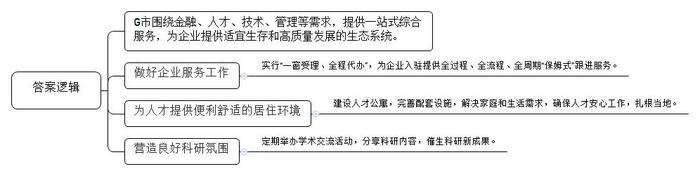
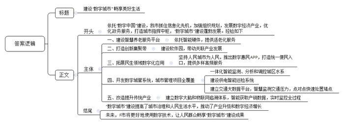

# 2021年公务员多省联考《申论》题（辽宁A卷）

<!-- gwy:overview:start -->
> **辽宁 · 2021 · 申论 · A类** ｜ 4 题 · 图片 4 处 · 答案随题折叠

导航：[题目](#题目) · [材料 1](#材料-1)
<!-- gwy:overview:end -->

> 候选采集稿。参考答案及解析来自粉笔页面，不代表官方答案或真实高分答卷；来源使用许可与原卷对应关系仍需人工核实。

## 给定材料

### 材料 1

2020年7月21日，习近平总书记在企业家座谈会上的讲话指出，打造市场化、法治化、国际化营商环境，依法平等保护国有、民营、外资等各种所有制企业产权和自主经营权，完善各类市场主体公平竞争的法治环境。要依法保护企业家合法权益，加强产权和知识产权保护，形成长期稳定发展预期，鼓励创新、宽容失败，营造激励企业家干事创业的浓厚氛围。要推进简政放权，全面实施市场准入负面清单制度，支持企业更好参与市场合作和竞争。要充分发挥市场在资源配置中的决定性作用，更好发挥政府作用。政府是市场规则的制定者，也是市场公平的维护者，要更多提供优质公共服务。

“入驻G市真的是对了！”源发科技有限公司总裁廖总说。G市对项目行政审批实行“一窗受理、全程代办”，为企业入驻提供全过程、全流程、全周期“保姆式”跟进服务。

源发公司聚集着一批轴承研发人才，这样平均年龄不到30岁的年轻人，是源发公司创新实验室的研发团队。创新实验室柳副主任说：“自2019年9月起，实验室研发团队已开始组建，成员都是我们面向全球选拔的行业优秀人才。”“加入这支团队的人虽然大多非常年轻，但都有很强的家国情怀、希望做出世界级的科研成果，让国家在轴承领域占据先发优势。”

2018年起，源发公司就在全球轴承销量榜上名列前茅。业界普遍认为，这家中国公司的快速成长，源于全球顶尖的人才储备和科技研发投入。

“市政府在营造良好的营商环境方面从不吝啬，甘当企业的服务者而非指挥官，始终不遗余力地在政策上给予我们各种优惠，这是我们成长壮大的重要因素。”廖总说。

柳副主任说：“我们成立创新实验室，要做的是‘从0到1’的原始创新研究，而不是在别人已有的技术基础之上做一些局部突破，要开发出自己的‘黑科技’，破解‘围猎’难题，促进我国轴承科技实力的整体提升。”“虽然我们身处三线小城，但我们与国内外的一流科研机构、高等院校一直有紧密的科研合作。”截至2019年年底，该公司拥有授权及正在申请的国内外专利合计5397项。

“我留学时，就是在一个很小的城市里。我很享受在安静环境里做科研的人生。G市不但环境优美空气清新，而且给我们提供了极为便利舒适的居住环境。”海归王博士说。为了给高科技人才提供更加便捷、舒适的居住环境，确保员工安心工作、扎根当地，G市建设了人才公寓。公寓与市重点小学仅一路之隔，配套设施完善，王博士和源发公司的许多同事就住在公寓。她表示:“从国外大学转到G市工作，我在科研上并没有感觉到有任何落差。公司对未来发展的顶层设计，让青年科研人才看到了一个广阔的未来。后顾无忧，前景又可期，剩下的就是大家在科研工作中的全情投入了。”

王博士说，G市的科研氛围非常好，定期会有“学术交流日”。大家在分享交流过程中，往往会碰撞出一些非常有意思的结果。在2020年8月举行的“学术交流日”上，她就自己的研究方向做了一次演讲。“当时就有其他科研单位的同志对我说：可以帮助做一些基础原理的确认工作。经过几次改进之后，大家发现这个东西还挺有价值的。目前，相关专利的申报工作已经启动。有这样的环境，有这样的团队，对一个喜欢科研工作的人来说，夫复何求。”王博士说。

G市企业发展局局长表示G市没有“官老爷”，只有“店小二”围绕金融、人才、技术、管理等需求，提供一站式综合服务，当好企业的管家，为企业提供适宜生存和高质量发展的生态系统，打造一个发展前景更加美好的G市。

### 材料 2

仙路控股有限公司是H县的一家食品企业，曾有过很长一段的高光时刻：1992年创办后，业绩一路高歌，旗下仙路鲜汁成为当时整个饮品行业中为数不多的百亿大单品，缔造了“中国零食龙头企业”的神话。如今，仙路公司却面临着“中年危机”。记者调查发现，仙路近年来的增长基本来自于几款多年前的老产品，而非新产品。仙路鲜汁这个单品几乎撑起了仙路的大半个江山，但鲜汁属于可替代产品，消费者对此类产品容易喜新厌旧。一位消费品行业专家告诉记者，仙路的第一代产品主要来自外国技术转移，借助中国经济快速发展和繁荣的东风，大胆生产扩张才获得后来的成绩。遗憾的是，一直以来，它主要依赖代工思维做品牌。如今，旗下主要品类经过多年发展，市场已经接近饱和，产品很难再有增量，业绩下滑是在所难免。

为了摆脱品牌老化的尴尬处境，仙路开启了疯狂的“中年变形记”。2017年，仙路一度推出了50多个新产品，几乎每月都有新产品上线，覆盖了咖啡、果汁、能量饮料等大类。但分析所谓的新品，不难发现只是在原来的产品结构上换汤不换药。对于仙路来说，面对庞大的市场，如果不尽快找到第二增长点，则很容易在品牌优势耗尽后，走入无可挽回的滑落之路。

同样位于H县的国欣家居用品有限公司，是一家老牌的制造企业，产品是家居行业极其细分的市场——化纤丝，董事长陆建国与总经理陆欣是一对父女。

“以前的牙刷，化纤丝都是圆柱形的，触感和舒适度都不好，我们将圆柱改成圆锥，变得更加柔软，且便于口腔清洁和牙龈保护。”陆建国说。从柱体到锥体并非靠磨，而是需要一系列复杂的工艺流程来打造，看似很小的行业，却需要很强的专业支撑。90年代初，国内市场对此类化纤丝的需求量非常大，但全部依赖进口，且价格昂贵。

1993年，陆建国毅然选择下海，创办了国欣家居，立足新材料方向，做国产化替代。经过不断学习、实践，陆建国终于让生产出来的牙刷丝更加柔软舒适，并先后拿下了许多知名公司的订单。

牙刷丝领域站稳脚跟后，国欣家居将目光瞄向了刷丝原理都是相通的油漆刷丝市场。在做市场调研的时候，陆建国发现，质量好的油漆刷用的都是猪鬃、羊毛等天然材料，原材料比较匮乏。“当时的油漆刷使用场景相对单一，实际上油漆是水性还是油性，刷的是墙面还是地板，对油漆刷是有不同要求的。”陆建国说。沿着这一思路，国欣家居将产品从牙刷丝扩展到油漆刷丝，并拿下了油漆行业的数家大客户。

陆建国告诉记者，公司每次产品的更新，都是有契机的。2007年一家合作伙伴因企业战略变化，欲让国欣接管整个制刷项目。这对于迅速扩充公司实力无疑是良机，但是从只生产其中的丝，到生产整个刷具，这样的转型能否成功？经过反复的考量，国欣家居决定接受这个挑战。

陆建国告诉记者，国欣家居如今能够在市场如鱼得水，与女儿陆欣的接班助力有很大关联。“让女儿接班，并非我的本意，毕竟她会有更好的选择。”陆欣曾在一家世界500强企业工作，可是偶然间看到的一幕，让她改变了主意。“有一天下班已经很晚了，看到父亲戴着老花镜，还在跟客户打电话，说着并不流畅的英语，两鬓已经斑白，真的觉得我有责任回来帮助他。”国外的学习和工作经历，让陆欣跟着父亲一起闯市场时显得游刃有余。父亲专业积累过硬，女儿胜在国际视野，两人互补联合，拿下了不少国际大单。

对于国欣家居的未来发展，陆欣也有自己的考量：“之前提到中国制造，大家的第一反应就是价格便宜，实际上不是我们做不出好产品，而是好产品需要供应链上下游的共同发力。”通过在化纤丝行业的精耕细作，陆欣看到了匠心的价值，她希望自己将来能够搭建一个平台，把好的资源整合起来，共同打造优质的产品。从产品部件，到生产成品，再到布局产业链，国欣家居在父女二代接力中也在发生着“蝶变”。

### 材料 3

“你好小福，我想订餐。”78岁的孙奶奶按下开关，向机器人小福发出语音指令。“有两荤两素加米饭13元的和两荤一素加米饭10元的两种，您选哪一种？”稚嫩的童声清脆悦耳。“13元的。”“好的，稍后会有工作人员与您联系。”不一会儿，福龄老年服务中心工作人员刘大姐拎着盒饭，一路小跑，来到孙奶奶的家。“对我们老年人来说这个太好了！我不会用手机，现在只需要对机器人发个语音指令，立马有人上门。”孙奶奶说。

变化，缘于智慧养老服务平台的建成。2019年，坐落于F市北区物联网产业园的乐享科技有限公司利用物联网、云计算及大数据等技术打造了这一平台。该平台的建成是F市绘制“数字城市”蓝图的靓丽一笔。乘着“数字中国”建设的东风，F市抓住信息化先机，积极拥抱数字浪潮，从成立“数字城市”建设领导小组到制定“数字城市”中长期发展规划；从“一枝独秀”的软件园到“百花齐放”的数字经济产业；从最早的办事“跑多趟”到如今“一趟不用跑”……F市的“神经网络”正在加速形成，一个能看、能用、能思考的指挥中枢，既连接起经济、生态、交通、公共安全、城市治理等信息数据，也能打通司法、安监、消防、环保等条状业务系统，“数字城市”建设蓬勃发展。

2000年6月，F市东区软件园创业楼迎来首批入园企业。“当时，园区内的研发楼宇只有寥寥几栋，产业规模仅12.7亿元。”东区软件园管委会负责人回忆道。如今，东区软件园产业发展突飞猛进，总收入已超千亿元。F市汪副市长说，在空间布局上，F市重点打造环中心城区“东区软件园——西区高新园——北区物联网产业园——南区大数据产业园”的数字经济创新集聚带，带动关联产业发展。

一座城市留给人们的印象，不能仅仅停留在拥有鳞次栉比的高楼大厦，更应让生活在其中的人感到温馨、舒适和便利。在推进“数字城市”建设过程中，F市坚持人民城市为人民的发展理念，不断拓展众多与百姓息息相关的数字化应用服务。“易民”App是F市全力打造的数字惠民品牌，居民足不出户轻点手机App，日常生活用品最快10多分钟送到家，出门购物、地铁进站，“刷脸”几秒钟即可完成付款。上线两年多来，该App已发展成F市移动互联网的统一便民入口，为市民提供各类高频的便民服务、公共服务、政务服务等近80项。

打开F市数字城管系统，一张覆盖全市所有公用设施、道路交通、市容环境等城市管理项目的“电子地图”呈现在眼前。在城区水系联排联调中心，工作人员可对城区的上千个库、湖、池、河、闸、站实现一体化在线监测、实时分析和远程调控。通过建设城市供电智能巡检系统，由传统人工巡视需20天才能完成的工作量，目前只需要2小时。“超级大脑”交通大数据平台则为全市交通编织了一张智慧大网，全息感知的十字路口可智慧监测交通压力，实现点对点快速处置堵点。

“数字城市”在提高城市治理和人民生活水平的同时，也为F市改造提升传统产业、推动新旧动能加快转换提供了新机遇。如锦绣家纺公司依托数字大脑，实现“产、供、销、人、财、物”数据的实时获取和智能挖掘，让生产更高效智能；福仙茶业集团建立了物联网追溯体系，对基地种植到终端销售全过程进行实时监控。

产业更兴旺，城市更智慧，生活更美好。目前，数字经济占F市地区生产总值的比重提高到45%，数字经济上市企业占全市上市企业的一半。展望未来，F市市委李书记说，运用大数据、云计算、区块链、人工智能等前沿技术推动城市管理手段、管理模式、管理理念创新，从数字化到智能化再到智慧化，让城市更聪明一些、更智慧一些，是推动城市治理体系和治理能力现代化的必由之路，前景广阔。“数字城市”的建设是民之所望、施政所向，F市将更好地使用数字技术，不断释放数字红利，让人民群众畅享数字城市建设成果。

### 材料 4

1949年3月23日下午，西柏坡阳光明媚，毛泽东同志从住了10个月的小院里走出来，正好碰到迎上来的周恩来同志。他望着远处连绵雄伟的太行山，意味深长地说：“今天是进京赶考的日子。”周恩来答道：“我们都应当考及格，不要退回来。”毛泽东坚定地说：“退回来就失败了。我们决不当李自成！我们共产党人进北平，是要继续革命，建设社会主义，直到实现共产主义。”

2013年7月，习近平总书记在河北省调研时指出：“当年党中央离开西柏坡时，毛泽东同志说是‘进京赶考’。60多年过去了，我们取得了巨大进步，中国人民站起来了，富起来了，但我们面临的挑战和问题依然严峻复杂，应该说，党面临的‘赶考’远未结束。”

在庆祝中国共产党成立95周年大会上，习近平总书记再次强调：“这场考试还没有结束，全党同志一定要不忘初心、继续前进，永远保持谦虚、谨慎、不骄、不躁的作风，永远保持艰苦奋斗的作风，勇于变革、勇于创新，永不僵化、永不停滞，继续在这场历史性考试中经受考验，努力向历史、向人民交出新的更加优异的答卷。”

2020年10月，党的十九届五中全会审议通过了《中共中央关于制定国民经济和社会发展第十四个五年规划和二〇三五年远景目标的建议》。对于中国发展来说，“五年规划”是党治国理政的重要方式。从1953年新中国开始实行第一个“五年计划”，到2020年“十三五”规划完成，一个又一个五年，诠释了不同时期的历史标识，推动中华民族迎来了从站起来、富起来到强起来的伟大飞跃。

山再高，往上攀，总能登顶；路再长，走下去，定能抵达。第二个百年奋斗目标开启、“十四五”规划开局、构建新发展格局、注重需求侧管理、增强产业链供应链自主可控能力、强化反垄断和防止资本无序扩张、加强科技战略支撑、扩大高水平对外开放……新的征程，重任多多，期待满满。

《管子·乘马》言：“<u>是故事者生于虑，成于务，失于傲。不虑则不生，不务则不成，不傲则不失</u>。”虽说前路并非一片坦途，但要坚信的是，一往无前、永不止步，谦虚谨慎、戒骄戒躁，从来都是成就伟大事业的最正确姿态。

## 题目

### 第 1 题

**根据****“给定资料**1**”，请概括G市在营造良好的营商环境方面做了哪些努力。(15分)**

关联材料：材料 1

作答要求：

要求：全面、准确、有条理；不超过200字。

第 1 题 · 答案与解析

**参考答案（粉笔题库参考内容）**

G市围绕金融、人才、技术、管理等需求，提供一站式综合服务，为企业提供适宜生存和高质量发展的生态系统。

1.做好企业服务工作。实行“一窗受理、全程代办”，为企业入驻提供全过程、全流程、全周期“保姆式”跟进服务。

2.为人才提供便利舒适的居住环境。建设人才公寓，完善配套设施，解决家庭和生活需求，确保人才安心工作，扎根当地。

3.营造良好科研氛围。定期举办学术交流活动，分享科研内容，催生科研新成果。

**参考答案说明：**本参考答案从“宏观做法”与“具体做法”两个层面展开，后者又从“做好企业服务工作”“为人才提供便利舒适的居住环境”“营造良好科研氛围”三个方面入手对G市在营造良好的营商环境方面做的努力进行了分类、分条撰写。各条要点彼此独立、没有交叉。

**解析状态：unknown（来源未提供）**

### 第 2 题

**根据****“给定资料**2**”，请分析为什么仙路控股有限公司遇到了“中年危机”，而国欣家居却能实现“蝶变”。(20分)**

关联材料：材料 2

作答要求：

要求：表述准确，条理清晰；不超过300字。

第 2 题 · 答案与解析

**参考答案（粉笔题库参考内容）**

仙路控股遇到“中年危机”的原因：

1.过分依赖老产品，产品可替代性强，消费者忠诚度不足，产品结构单一，品牌优势耗尽。2.缺乏技术创新，存在依赖代工的思维。3.市场饱和，产品难有增量，业绩下滑。

国欣家居实现“蝶变”的原因：

1.专注细分市场。加强专业支撑，改进工艺流程，立足新材料方向，自主创新。2.主动开拓新市场。注重市场调研，增加产品品类，满足市场需求。3.敢于应对挑战。不惧风险，把握契机，升级产品形态。4.培养接班人。实现专业积累与国际视野互补联合，推动国际化发展。5.布局产业链。搭建平台，整合资源，打造优质产品。

**参考答案说明：**本参考答案宏观上分成了“仙路控股遇到‘中年危机’的原因”和“国欣家居实现‘蝶变’的原因”两个方面。在“仙路控股遇到‘中年危机’的原因”内部，又从“过分依赖老产品，产品可替代性强”“缺乏技术创新”“市场饱和”这三个方面进行了分条撰写。各条要点之间在内容上相互并列，没有交叉。在“国欣家居实现‘蝶变’的原因”内部，又从“专注细分市场”“主动开拓新市场”“敢于应对挑战”“培养接班人”“布局产业链”这五个方面进行了分条撰写。各条要点之间在内容上相互并列，没有交叉。

**解析状态：unknown（来源未提供）**

### 第 3 题

**省里召开****“数字城市”建设座谈会，F市被邀请做经验介绍。假设由汪副市长参加此次会议，请根据“给定资料**3**”，为汪副市长拟写一份发言提纲。(25分)**

关联材料：材料 3

作答要求：

要求：紧扣资料，内容全面；层次分明，有逻辑性；不低于400字。

第 3 题 · 答案与解析

**参考答案（粉笔题库参考内容）**

建设“数字城市” 畅享美好生活

依托“数字中国”建设，我市抓住信息化先机，加强组织规划，发展数字经济产业，优化政务服务，打造城市指挥中枢，“数字城市”建设蓬勃发展。经验如下：

一、建设智慧养老服务平台。依托智能硬件，提供适老化服务。二、打造创新集聚带。建设软件园，带动关联产业发展。三、拓展民生领域数字化应用。坚持人民城市为人民，推出数字惠民APP，打造统一便民入口，提供多样高频服务。四、开发数字城管系统，城市管理项目全覆盖。一体化智能监测、分析和调控城区水系；建设供电智能巡检系统；建立交通大数据平台，智慧监测交通压力，点对点快速处置堵点。五、改造提升传统产业。建立数字大脑和物联网追溯体系，智能获取产销数据，实时监控全过程。

“数字城市”建设提高了城市治理和人民生活水平，推动了产业升级和数字经济增长。未来，F市将更好地使用数字技术，让人民群众畅享“数字城市”建设成果。

**参考答案说明：**（1）本参考答案包括标题、正文，符合发言提纲的格式要求。（2）正文部分，一方面，内容上，围绕着“F市‘数字城市’建设”这一主题，开头写到了F市“数字城市”建设的背景和宏观做法；主体部分从“建设智慧养老服务平台”“打造创新集聚带”“拓展民生领域数字化应用”“开发数字城管系统”“改造提升传统产业”五个方面介绍了经验；最后结尾部分总结了F市“数字城市”建设的意义并展望未来。另一方面，形式上，本参考答案做到了分段、分条撰写，整体上条理较为清晰。

**解析状态：unknown（来源未提供）**

### 第 4 题

**请深入理解****“给定资料**4**”中的划线句子“是故事者生于虑，成于务，失于傲。不虑则不生，不务则不成，不****傲****则不失****”，联系实际，自拟题目，自选角度，写一篇文章。（40分****）**

关联材料：材料 1、材料 2、材料 3、材料 4

作答要求：

要求：自选角度，立意明确；思路清晰，语言流畅；总字数1000-1200字。

第 4 题 · 答案与解析

**参考答案（粉笔题库参考内容）**

**事者** **谋定而动 行且坚毅**

《管子·乘马》言：“是故事者生于虑，成于务，失于傲。不虑则不生，不务则不成，不傲则不失。”在庆祝改革开放40周年大会上，习近平总书记引用了这句古语，强调伟大的梦想与事业都是拼出来、干出来的，告诫我们无论是政府建设、企业突围、个人发展，想成就一番事业都要用深谋远虑的眼光、真抓实干的行动和自我警醒的意识来干事创业，推动站起来、富起来、强起来的伟大飞跃。

**成就伟大事业，实现伟大梦想要有规划****，要全面性、系统性地规划，还要在规划中结合实际，兼具创新性和突破性。**谋定而动方能笃行致远，为了实现国家富强，我们深惟重虑，从对外开放到一带一路、从攻坚脱贫到乡村振兴、从服务型政府到数字化政府建设，在不同时期制定了不同的发展战略，不断突破自我，挑战自我，为国家建设提供指导性的政策规划。国家如此，企业亦如此。企业发展建设也要以市场为基、创新为源、技术为本，如华为在发展中，从生产用户交换机到发展智能移动通信设施，从安卓系统到鸿蒙系统，实现了自我的华丽转身。新时代的发展，需要我们不忘初心，砥砺前行，多一点从长计议、高瞻远瞩。

**成就伟大事业，实现伟大梦想要务实****，需躬行实践、深耕细作，还需在过程中善于变通、与时俱进。**“制心一处，无事不办”。从卖油翁到庖丁解牛、再到百步穿杨，众多能工巧匠通过执著实践，实现游刃有余、技进乎道的精妙技艺。如果说秉承匠心的探索能展现格物致知的深刻哲学，那当下随着开放的发展，我们还要顺应需求，主动求变。改革开放初期，邓小平同志创新提出经济特区建设，使得南方小渔村深圳，成为改革开放的试验场；国际餐饮巨头肯德基在发展初期因错估市场情况无奈撤出香港市场，而后耗时5年，打造符合中国人口味特点的系列产品，最终实现发展蝶变。

面对新形势下的挑战，做成一件事的关键不仅在于谋划决策的战略眼光、真抓实干的精气神，还要时刻警惕“傲”这一顽疾，始终保持谦虚谨慎、戒骄戒躁的作风，强化谦逊的血脉传承。

**成就伟大事业，实现伟大梦想不能因傲而失，****在功成名遂的时候，既不可满足已有成绩，固步自封，骄傲自满，失去忧患意识，亦不可丧失自我认识，盲目自信，莽撞冒进。**风靡一时的手机巨头诺基亚正是由于躺在过去的功劳簿上，安于现状、坐享其成，最终才会黯然退出手机市场。正所谓“生于忧患，死于安乐”，只有永葆危机意识，不断进行自我革新、挑战未来，才能取得最终的胜利。但是，在突破发展的道路上，也不能头脑发热、急于求成，照抄照搬他人经验，走上另一个极端。而是要明晰自我角色，利用自身优势，结合客观规律，稳扎稳打，积小胜为大胜，积跬步致千里。

“正入万山圈子里，一山放过一山拦。”追求成功的道路上布满荆棘坎坷，不仅要事前放宽视野、精心谋划，事中秉持匠心、抓住机遇，还需要时时小心在意、戒骄戒躁，方能成就伟大事业！

**文章分析**

**事者** **谋定而动 行且坚毅**

【**标题****的****优点：**标题中含有“事者”，即指代“成事”这一主题词，文章主题突出、清晰。】

《管子·乘马》言：“是故事者生于虑，成于务，失于傲。不虑则不生，不务则不成，不傲则不失。”在庆祝改革开放40周年大会上，习近平总书记引用了这句古语，（1）强调<u>伟大的梦想与事业都是拼出来、干出来的</u>，告诫我们无论是政府建设、企业突围、个人发展，想成就一番事业都要用<u>深谋远虑的眼光、真抓实干的行动和自我警醒的意识来干事创业</u>，（2）<u>推动站起来、富起来、强起来的伟大飞跃</u>。

【**开头的优点：**★内容方面。范文的开头是紧扣“成事”这一主题展开的。首先，开头在段首处点出主题，做到了主题明确。其次，对“成事”这一主题进行了分析阐述，指出了（1）“如何成事”的对策；（2）“成事”的意义。**★文字表达方面：**使用了名言警句，增强了文章的说服力。】

**成就伟大事业，实现伟大梦想要有规划****，要全面性、系统性地规划，还要在规划中结合实际，兼具创新性和突破性。**（1）<u>谋定而动方能笃行致远</u>，为了实现国家富强，我们深惟重虑，从对外开放到一带一路、从攻坚脱贫到乡村振兴、从服务型政府到数字化政府建设，<u>在不同时期制定了不同的发展战略</u>，<u>不断突破自我</u>，<u>挑战自我</u>，为国家建设提供指导性的政策规划。国家如此，企业亦如此。（2）<u>企业发展建设也要以市场为基</u>、<u>创新为源</u>、<u>技术为本</u>，如华为在发展中，从生产用户交换机到发展智能移动通信设施，从安卓系统到鸿蒙系统，<u>实现了自我的华丽转身</u>。新时代的发展，需要我们不忘初心，砥砺前行，多一点从长计议、高瞻远瞩。

【**论述段****1的优点：**★观点句：范文的观点句是紧扣“成事”这一文章主题提出的。形式上，它在段首处直接写出，位置突出，容易发现。内容上，关键词突出，内容要点明确，可以明显看出它侧重于“成就伟大事业，实现伟大梦想要有规划”入手。★论述内容：（1）指出谋虑本身需要有全局意识；（2）指出谋划过程中还应因地制宜、顺应时机进行创新。注意：以上两个方面层次清晰，论述的针对性强。在论述方法上主要采用了讲道理、举例子相结合的方式。】

**成就伟大事业，实现伟大梦想要务实****，需躬行实践、深耕细作，还需在过程中善于变通、与时俱进。**“制心一处，无事不办”。（1）<u>从卖油翁到庖丁解牛、再到百步穿杨</u>，<u>众多能工巧匠通过执著实践，实现游刃有余、技进乎道的精妙技艺</u>。（2）<u>如果说秉承匠心的探索能展现格物致知的深刻哲学</u>，<u>那当下随着开放的发展</u>，<u>我们还要顺应需求</u>，<u>主动求变</u>。改革开放初期，邓小平同志创新提出经济特区建设，使得南方小渔村深圳，成为改革开放的试验场；国际餐饮巨头肯德基在发展初期因错估市场情况无奈撤出香港市场，而后耗时5年，打造符合中国人口味特点的系列产品，最终实现发展蝶变。

【**论述段****2****的优点：**★观点句：范文的观点句是紧扣“成事”这一文章主题提出的。形式上，它在段首处直接写出，位置突出，容易发现。内容上，关键词突出，内容要点明确，可以明显看出它从“躬行实践、深耕细作”入手，指出了“成就伟大事业，实现伟大梦想要务实”。★论述内容：（1）真抓实干应该专注于事物，强调实践；（2）在实践中也应掌握创新的方式方法。注意：以上两个方面“先坚守匠心、再进行方式创新”都是紧扣观点句进行分析论述展开，论述的针对性强，内容层次丰富。】

面对新形势下的挑战，做成一件事的关键不仅在于谋划决策的战略眼光、真抓实干的精气神，还要时刻警惕“傲”这一顽疾，始终保持谦虚谨慎、戒骄戒躁的作风，强化谦逊的血脉传承。

【**过渡段的优点：**★过渡段旨在指出能够成事不仅应当有谋略的眼光、真抓实干的实践，还不能有“傲”，进而引出下文我们应该如何不傲，清晰点明“不傲”就是谦虚谨慎、戒骄戒躁。★文字表达方面。使用了“而”“并”等连接词，使语言表达有逻辑性。】

**成就伟大事业，实现伟大梦想不能因傲而失，****在功成名遂的时候，既不可满足已有成绩，固步自封，骄傲自满，失去忧患意识，亦不可丧失自我认识，盲目自信，莽撞冒进。**风靡一时的手机巨头诺基亚正是由于躺在过去的功劳簿上，安于现状、坐享其成，最终才会黯然退出手机市场。正所谓“生于忧患，死于安乐”，（1）<u>只有永葆危机意识，不断进行自我革新、挑战未来，才能取得最终的胜利</u>。但是，（2）在突破发展的道路上，也不能头脑发热、急于求成，照抄照搬他人经验，走上另一个极端。而是<u>要明晰自我角色，利用自身优势，结合客观规律，稳扎稳打，积小胜为大胜，积跬步致千里</u>。

【**论述段****3的优点：**★观点句：范文的观点句是紧扣“成事”这一文章主题提出的。形式上，它在段首处直接写出，位置突出，容易发现。内容上，关键词突出，内容要点明确，可以明显看出它是从“成就伟大事业，实现伟大梦想不能因傲而失”入手。★论述内容：（1）不能满足于当前的成绩；（2）应清醒认知自身优劣势，正确对待下一步发展。注意：以上几个方面的内容都是紧扣观点句进行分析论述的，论述的针对性强，内容层次丰富。在论述方法上采用了讲道理、举例子相结合，做到了丰富多样。】

【**论述段之间的关系：**★内容的内在逻辑：按时间顺序展开，论述段1从谋略论证成事的前提，论述段2从实干层面论证成事的过程，论述段3从戒骄戒躁层面论证成事后的进一步延续。三个论述段相互并列，逻辑清晰。】

“正入万山圈子里，一山放过一山拦。”追求成功的道路上布满荆棘坎坷，不仅要事前放宽视野、精心谋划，事中秉持匠心、抓住机遇，还需要时时小心在意、戒骄戒躁，方能成就伟大事业！

【**结尾的优点**：范文的结尾回扣了“成事”这个主题词，语言精悍富有文采，不拖沓。】

**解析状态：unknown（来源未提供）**

