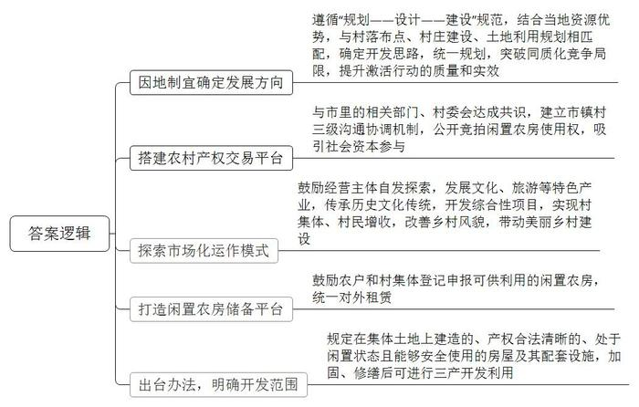

# 2021年公务员多省联考《申论》题（辽宁B卷）

<!-- gwy:overview:start -->
> **辽宁 · 2021 · 申论 · B类** ｜ 4 题 · 图片 4 处 · 答案随题折叠

导航：[题目](#题目) · [材料 1](#材料-1)
<!-- gwy:overview:end -->

> 候选采集稿。参考答案及解析来自粉笔页面，不代表官方答案或真实高分答卷；来源使用许可与原卷对应关系仍需人工核实。

## 给定材料

### 材料 1

新春伊始，《新农村》记者小梁到基层调研，以下是他在南北两个乡村采访的片段。

“村子真干净”，这是外来人对东各村的第一印象。村道上见不到一点儿垃圾，家家院里院外清清爽爽，79岁的高大妈笑着把小梁往屋里迎。冬季取暖煤改电以后，高大妈家装了地热，外面再冷，屋里也温暖。高大妈自己收拾得利索，家里拾掇得干净，言语间也透着喜悦，“儿子孝顺，春节前辞了城里的工作回来，专门照顾我们老两口。”“爸妈上了年纪，身体都不大好，有个头疼脑热，身边没个人照顾那肯定不成。”高大妈的儿子小曾买完菜刚一进门就接过了话头。

东各村是太行山脉的一个小山村。村子不大，一共250多口人，但老龄化程度较高，60岁以上的老人就有70多位。平时，村里就是这些老人“守着”，村委会一周放两次公益电影，捧场的也都是这些老人。“村里的大爷大妈都是居家养老，儿女负责赡养。子女外出打工的，只能是老两口互相照顾。村里打算建个‘托老所’，解决老人的日间吃饭和活动、照料问题。”村党支部委员李大姐介绍说。听说要建“托老所”，高大妈觉得不错，“老姊妹能时常见上一面，唠唠嗑。”但小曾觉得，老父亲腿脚不好，出不了门，还是儿女在眼前伺候着放心。村里买东西不太方便，买点油盐酱醋、买点菜得去镇上，单程4公里，走到公交站就得一刻钟，这对老年人是个“大挑战”。儿子能在身边尽孝，高大妈心里高兴，可也着急。她跟李大姐商量：“咱村里能不能办个产业，让我儿子也能有点收入，不然他光照顾我们了，以后咋办？”

东各村边有条远近闻名的宋代古道，村内还保留着古道上唯一的一座三孔拱桥，来的游客不少。李大姐对高大妈说：“村里已经有10多户拿到了农家乐的经营执照，要是乡村旅游搞起来，不愁您儿子没事儿干！”

坐落在太湖之滨的水乡小村开弓村，则是另外一种景象。弯弯的小清河穿村而过，如箭在弦，村名由此而来。上世纪30年代，费孝通先生来此调研，写下了著名的经济调研报告。岁月变迁，费老留下的精神财富，成了开弓村重要的文化资源和发展动力。

甜茶、昆曲、桥文化……在开弓村文化纪念馆，或图文、或影像、或模型，地方风土人情跃然眼前。陈列厅里，一件件旧物什，散发着浓浓的年代感，有不少是村民自己捐赠的。被村里人称为“农民教授”的老姚感叹，这里存放的是村民共同的乡村文化记忆。开弓村越来越富，村民的生活和城里无异，但老姚喜中有忧，开弓村曾经是“处处倚蚕箔，家家下鱼筌”，而如今农耕文化、蚕桑文化却有淡化之势，“这是我们的根啊！”老姚颇有感慨。

如何传承乡风民俗？老姚说：“首先要发挥好乡贤的力量。大家都有共识，要有个‘乡贤议事会’。”在乡贤议事会成立后的一次会议上，大家一致认为，要以有形的形式展现开弓村文化，如熏豆制作工艺，婚嫁习俗，摇三橹船，桑、蚕、丝到蚕丝被的一条龙产业……老姚的期盼是：让来到开弓村的人，从亲身参与民俗活动中体味到农耕文化和蚕桑文化的韵味。村民的文化活动要有载体，开弓村发展较早，能用的土地已经不多，怎么解决？经过商议，村里准备把老仓库改造成文化礼堂。按照规划，礼堂能容纳100人左右，今后村民的党员活动、小型培训、会议、文艺演出都可以使用。

### 材料 2

“去趟镇上就靠一双脚板子，都是山路，车子进不来呀！”说起自己的老家大姜山脉的双河村，小冯满是感慨。双河村地势陡峭，四面环山，人都住在半山腰上，道路不畅，外面的建材也很难运进来，村民只好就地取材，筑起了木房子。“木房时间长了就容易变形，腐烂的也有。”小冯说。遇到刮风下雨，就神经紧绷，生怕房子漏雨、塌了，觉都睡不安稳。一家守着不足3亩的陡坡地过活，靠天吃饭。成家后，虽然小冯也曾拖家带口地出去闯过，却没有攒下多少积蓄。后来，小冯有了第二个孩子，加之老母亲身体不好，常年吃药，夫妻俩只能辞职回家，没撑几年就成了贫困户。

接到易地扶贫搬迁的消息时，小冯还有点不敢相信：“一家子5口人还能搬出大山，做梦都没想到。”2018年7月，小冯全家从大山深处搬到了县城。挪了穷窝，小冯一家成了新市民。房子面积100平方米，宽敞的卧室、独立的厨房、干净的卫生间……下雨天终于能睡个安稳觉了。但没住几天，小冯却有点不自在，地面都铺了亮堂的瓷砖，稍微落点灰或者踩个脚印都看得清清楚楚。从村里人成为新市民，有很多新的不适应：垃圾得倒进楼下的垃圾桶，要开始交物业费了……让小冯尤其困惑的就是物业费：“住的是自己的房子，为啥每月还得交钱？”不只是他，许多搬迁户刚开始都想不通。针对居民们的新困惑，社区干部采取“两步走”：一方面挨家挨户走访，了解需求和想法；另一方面“一对一”讲政策、做工作，不让困惑“发酵”。经过一段时间的沟通和适应，搬迁户们慢慢习惯了社区生活。小冯有点不好意思：“啥事儿都有个过程嘛，懂了就习惯了。”

进了城，刚安顿好，小冯就开始找工作。一天，他突然有了一个想法：“谁都得吃饭，周围餐馆又不多，这是个机会。”但转头又犯难了：干惯了体力活，炒菜的水平也不高怎么办？妻子也发愁：店面租金是笔不小的数目，一时半会也难凑出来。2018年底，随着最后一批搬迁户入住，社区开始开展不同类型的就业技能培训。一看到有厨师培训班，早有想法的小冯和妻子立刻报了名。两个多月后，在社区的帮助下，小冯用凑齐的5万元租下了一间门面，期盼许久的小餐馆就这样开张了。小馆子环境卫生、口味地道，再加上两口子手脚勤快又热情，赢得了不少回头客。看着生意一天比一天好，一个月能挣七八千块，早已脱贫，小冯终于能缓口气了。

搬出大山，工作也有了着落，还能照顾家里人，小冯觉得很满足，但另一件心事也随之而来。以前村里没学校，孩子只能到镇上念书，一大早就得摸着黑出门，沿着山路要走两个多小时。时间长了，大人都受不了，更何况孩子。后来外出打工，孩子就跟了一路。“因为经常换工作，孩子几乎没有在固定的地方上完一年学。”一说到这儿，小冯满是愧疚。

搬到县城后，小冯家距学校只有十几分钟路程，上学不愁了。原以为在家门口上学是件高兴事儿，但出乎意料的是，开学第一周，小冯明显感觉孩子情绪不太高。几番询问，他才弄清楚：“之前我们外出打工，孩子常年跟着在外地念书。现在回到家乡的学校上学，反而有些不习惯。”老师也发现了这个问题，还专门来家里了解情况，跟小冯认真谈了一次心，临走时，提醒小冯夫妇也要多帮助孩子融入新生活。小冯说：“还是观念有问题，过去老觉得教育孩子就靠学校，不靠家长，以后我们对孩子的教育要更上心才行。”如今，孩子慢慢认识了不少新朋友，成绩也提高了不少。这一切，小冯看在眼里，乐在心里。

脱贫摘帽不是终点，而是新生活、新奋斗的起点。从搬出大山到在县城成家扎根，<u>尽管有些磕磕绊绊，但日子越过越有奔头</u>。

### 材料 3

位于Z市东湖镇新泉村的新泉中学，因优化农村学校布局，多年前已不再办学，老教学楼被列入闲置农房。虽然楼梯拐角墙上，还完整保留着当年捐资兴学的石刻铭文，但人去楼空。由于闲置，村里很多人提议拆掉学校建住宅，但村两委最终统一意见：拆掉“太可惜”，还是应该盘活利用，壮大村集体经济。但是留着开发什么项目呢？一时拿不定主意。

东湖镇产茶历史悠久，周边茶农集中，产出的茶叶主要由泉江茶业有限公司收购。随着市场的拓展，公司认为仅靠买卖茶叶项目单一，不利于长远发展。在实地考察了新泉中学情况后，董事长老郑脑中闪出一个念头：通过竞拍把学校租下来，改造成茶文化专题博物馆，让更多的人到这里感受越红工夫茶的历史文化传统。但是，要把设想付诸实施，需要得到房屋使用权，还要与市里的相关部门、村委会达成共识，并得到支持。

一座占地500多平方米、长期闲置的私塾老建筑，曾是唐仁村唐书记的一块心病。多年无人问津，只好用于村民堆货，成了村容村貌整治中的一处“死角”。唐仁村有酿酒的传统，许多村民都是酿酒的好把式，特别是乡贤老孙，不仅有酿酒的手艺，还有满肚子当地乡土文化的故事。老孙打算把这座老宅盘下来，改造成融生产销售、非遗传承和文化体验于一体的“越庄酒坊”。既能开门迎客，又能带动村集体经济实现增收，可谓一举两得。一年过去了，白墙黛瓦、青砖铺地、木格花窗，越庄酒坊修旧如旧，成为乡村风貌的一抹亮色。过去做仓库堆货，年租金不过4000多元，如今已涨到6万多元。唐书记感慨地说：“这座老建筑之所以能成功激活，关键是跟镇里的酿酒特色产业发展与美丽乡村建设挂上了钩，盘活利用要找对路子，因地制宜，才能真正激发活力，持续产生效益。”

然而，唐书记的心病仍然没有完全消除：唐仁村里的唐仁老街历史悠久，沿街百余间传统民宅，还有不少处于闲置状态，这些闲置房屋怎么办？来唐仁村考察的农村问题专家王教授感叹道：“虽然有的闲置房屋开发利用了，但是闲置农房利用改造要遵循‘规划——设计——建设’规范，与村落布点规划、村庄建设规划、土地利用规划相匹配，如何找准方向、善加利用，至关重要。”

岭北镇孚家村老于同儿子住在外地，老宅空置多年。老宅是个三间正房、有东西厢房的大院套，过去使用的石磨、农具等静静躺在那里。老于说这些东西留着用不上，扔了又舍不得。老于的儿子曾听说，外省某地有“闲置农房银行”，这个特殊的“银行”就是在镇里建立一个闲置农房储备平台，农户和村集体可供利用的闲置农房，都可登记申报，存进“银行”。正式“激活”前，房子归自己管，等有用户看中了闲置房屋激活利用了，再按租赁合同获得收益。但是，这毕竟是人家的做法。

如何唤醒“沉睡”的农房资源，既能给农民增加财产性收入，又能为下乡创业人员提供创业场所？如果将闲置农房激活同古村落的新规划有机结合起来，就能盘活出更多像“越庄酒坊”这样有特色的“点”，串联带动起美丽乡村建设、特色产业发展的“面”。

企业家黄某认为，Z市政府应该出台有关办法，明确规定农村范围内在集体土地上建造的、产权合法明晰的、处于闲置状态且能够安全使用的房屋及其配套设施（主要包括农户闲置住宅房、村集体闲置用房和原卫生院、学校、站所等闲置房屋），实施加固、修缮后可进行旅游、休闲等三产开发利用。

截至2020年底，Z市有激活意愿、尚待开发利用的闲置农房近50万平方米。由于缺少统一规划，大都是扎堆搞农家乐、经营民宿。如何避免“一窝蜂”开发、突破同质化竞争的局限？这是一个难题，直接关系到激活行动的质量和实效。

### 材料 4

走进李石村村民李姐的超市，她指着里面几个书柜说：“这就是微光书苑。现在有10多平方米、4000册书，既是阅读室，也是给孩子们上课的地方。”

2005年，李姐在村里开了个小超市，很多村民经常来买东西，并建议李姐“在超市支个麻将桌吧，俺们打牌，你挣钱。”李姐却有自己的想法。她自己爱书，也想让更多人能读书。2008年春天，李姐买来300本旧书，又拿出自己收藏的200本书，把它们摆在了店里，在超市里辟出一片阅读空间，在书边的墙上写了“微光书苑”4个大字。“为什么起名微光？就是一个农村小超市的货架上，摆了几本书，本身就非常非常微小。”李姐说，“微光虽微，但可以不断点燃火种。”

不要证件、不办手续、不收钱，零门槛借阅，书苑就这样办了起来。刚开始时，前来借阅的人寥寥无几，只有几个孩子来借书，有些人甚至根本没有注意到货架上还有书。于是，李姐采取措施鼓励阅读。借书的孩子来还书的时候，她就会问一些问题，回答上来的孩子可以领到铅笔、橡皮，写了读后感的还能得到笔记本……来的孩子越来越多，村里大人也开始感兴趣了，于是李姐准备了小毛巾、牙膏等作为阅读礼物，虽然不贵，但却很有效。李姐说，小手拉大手，大手拉小手，大人、孩子相互带动，村里阅读氛围越来越浓了。

借阅的人多起来，书渐渐不够用了。李姐把自己的藏书、亲戚朋友家的书，能找的全都找来了。除了家庭必需的开支，李姐把余下的钱都拿来买书，县城的旧书摊、大小书店，李姐跑了个遍。任何能想到的法子，她都试了个遍。这期间，村民们的支持也给了她很大鼓励，有的村民还把自己买来或找来的书送到书苑。这个小小的书苑，在悄悄地改变着村里的人。大家发现，平时打麻将的少了，茶余饭后串门唠家常的也少了，而聚在书苑里看书、交流的人多了……村民们平时在家里也时常拿起书来，科学养殖、农业科技等成为村民们交流的话题，读书逐渐成为他们的一种习惯。外村的人都说，李石村的村民变了，精气神都大不一样了。

李姐一家自费创办微光书苑、在乡间推广阅读的事迹，逐渐开始受到外界的关注。越来越多的机构、公益组织和爱心人士与她联系捐赠书籍。随着微光书苑名气增大，不断有其他人想要加入，李姐开始发展合作伙伴，由微光书苑免费配书，进一步扩大乡村阅读的推广范围。最多的时候，微光书苑零门槛借阅模式有27个合作伙伴，书苑走进了超市、旅店、诊所、幼儿园，还组建起百余人的基层阅读推广志愿服务团队，累计受众30多万人次。

“‘种下满地金黄的庄稼，才是为旷野除草的最好办法’，要驱赶心灵的荒芜，最好的办法就是推广阅读。也许乡村图书馆做成什么样，没有标准答案，我只想让这束在田野间聚起的光，照到更多乡亲。”李姐说。

习近平总书记曾说：“读书可以让人保持思想活力，让人得到智慧启发，让人滋养浩然之气。”一个人读书，能让心灵丰富；一群人读书，能激荡出思想火花；一个民族读书，必将使这个民族的文化焕发出更绚丽、更持久的风采。

## 题目

### 第 1 题

**根据****“****给定资料**1**”，请分别谈谈****高大妈和老姚****的****“喜”和“盼”。（15分）**

关联材料：材料 1

作答要求：

要求：准确、全面、有条理，不超过200字。

第 1 题 · 答案与解析

**参考答案（粉笔题库参考内容）**

高大妈的喜：1.村容村貌改善。设施完善，居家环境洁净。2.老有所依所养。定期放映公益电影；子女返乡照顾父母。盼：1.开办养老机构。提供日常服务，满足交流需求。2.发展产业。开发旅游业，提高收入。3.完善基础设施。增设售货点，优化公交站点。

老姚的喜：1.文化纪念馆建成。保留风土人情，存放文化记忆。2.经济提升。村民富裕，城乡生活水平无异。盼：传承乡风民俗。发挥乡贤作用；复兴桑蚕与农耕文化；改造文化礼堂，开展活动。

**解析**

**参考答案说明**：本参考答案宏观上围绕高大妈的“喜”和“盼”、老姚的“喜”和“盼”展开。在高大妈“喜”的方面，分别从“村容村貌改善”和“老有所依所养”两个方面分条撰写；在高大妈“盼”的方面，分别从“开办养老机构”“发展乡村产业”和“完善基础设施”三个方面分条撰写。在老姚“喜”的方面，分别从“文化纪念馆建成”和“经济提升”两个方面分条撰写；在老姚“盼”的方面，主要从“传承乡风民俗”这一方面分层撰写。各条要点在内容上是并列且无交叉的。

### 第 2 题

**“给定资料**2**”中提到，“尽管有些磕磕绊绊，但日子越过越有奔头”，请根据给定资料，谈谈对这句话的理解。（20分）**

关联材料：材料 2

作答要求：

要求：准确、全面、有逻辑性；不超过300字。

第 2 题 · 答案与解析

**参考答案（粉笔题库参考内容）**

这句话指搬迁户在融入城市的过程中虽然会遇到阻碍，但生活在逐渐改善，未来充满希望。

“磕磕绊绊”指：1.易地搬迁后，从村里人变成新市民，生活方式、生活环境改变，难以适应社区生活；2.创业过程中，技能不足、缺少资金；3.随迁子女回乡上学不习惯，情绪低落。

“越过越有奔头”指：1.居住条件改善，安全性、舒适度提高。社区干部耐心细致地答疑解惑，帮助习惯社区生活；2.社区提供就业技能培训，帮忙租赁店面，个人用心经营，生意红火，收入提升，实现脱贫；3.学校和家长共同努力，帮助孩子融入新环境，结识新朋友，成绩提高。

可见，脱贫摘帽不是终点而是新生活、新奋斗的起点。

**解析**

**参考答案说明：**思路方面，本参考答案按照词句解释题“总体释义+展开解释+总结”的一般答题思路展开。内容方面，本参考答案首先解释了“尽管有些磕磕绊绊，但日子越过越有奔头”的含义；接着分析了搬迁户遇到的问题、解决措施、意义等；最后，结合资料逻辑进行总结。词句表达方面，本参考答案加上了“可见”等词汇来承接上下文。

### 第 3 题

**请根据****“给定资料**3**”，提出有效激活Z市闲置农房的措施。（25分）**

关联材料：材料 3

作答要求：

要求：紧扣资料，内容完整；条理清晰，措施可行；不超过400字。

第 3 题 · 答案与解析

**参考答案（粉笔题库参考内容）**

1.因地制宜确定发展方向。遵循“规划——设计——建设”规范，结合当地资源优势，与村落布点、村庄建设、土地利用规划相匹配，确定开发思路，统一规划，突破同质化竞争局限，提升激活行动的质量和实效。

2.搭建农村产权交易平台。与市里的相关部门、村委会达成共识，建立市镇村三级沟通协调机制，公开竞拍闲置农房使用权，吸引社会资本参与。

3.探索市场化运作模式。鼓励经营主体自发探索，发展文化、旅游等特色产业，传承历史文化传统，开发综合性项目，实现村集体、村民增收，改善乡村风貌，带动美丽乡村建设。

4.打造闲置农房储备平台。鼓励农户和村集体登记申报可供利用的闲置农房，统一对外租赁。

5.出台办法，明确开发范围。规定在集体土地上建造的、产权合法清晰的、处于闲置状态且能够安全使用的房屋及其配套设施，加固、修缮后可进行三产开发利用。

**解析**

**参考答案说明**：本参考答案从“因地制宜确定发展方向”“搭建农村产权交易平台”“探索市场化运作模式”“打造闲置农房储备平台”“出台办法，明确开发范围”五个方面对有效激活Z市闲置农房的措施进行了分类、分条撰写，各条要点在内容上是并列且无交叉的。

### 第 4 题

**请深入理解****“给定资料**4**”中“种下满地金黄的庄稼，才是为旷野除草的最好办法”这句话，联系实际，自拟题目，自选角度，写一篇文章。（40分）**

关联材料：材料 1、材料 2、材料 3、材料 4

作答要求：

要求：观点明确，见解深刻；思路清晰，语言流畅；不准照抄照搬给定资料；总字数800-1000字。

第 4 题 · 答案与解析

**参考答案（粉笔题库参考内容）**

**以阅读之光照亮心灵旷野**

“种下满地金黄的庄稼，才是为旷野除草的最好办法。”这句充满智慧的话语揭示了改变精神荒芜的根本之道。“金黄的庄稼”象征着文明与希望的火种，“满地”意味着需要覆盖每个人的心灵和整个社会，而“旷野除草”则暗喻着驱散个体心灵的荒芜、改变社会的无知落后。**推广阅读便是那****“种下庄稼”之举，是驱散心灵荒芜、推动社会进步和民族发展的关键所在。**

**阅读如同一束光，照亮每个人心灵的角落，驱散内心的荒芜。**在物质丰富的今天，许多人却陷入精神空虚的困境，而阅读恰如一剂良方，能够充实生活，以知识滋养心灵。“读史使人明智，读诗使人灵秀”，书籍是人类智慧的结晶，通过阅读，我们能穿越时空，与古今中外的贤哲对话，汲取知识养分。正如李石村的村民，在微光书苑的滋养下，从沉迷麻将到热衷阅读，村民的生活不再单调，思想不再荒芜。一个人的精神世界若杂草丛生，便需让阅读在心田播下金黄的庄稼，让其不再荒芜。

**阅读是一把火炬，能够点燃社会的文化之火，激荡思想火花，引领社会风尚。**当一个社会充满阅读氛围，就会影响和带动更多人追求知识、崇尚文明。人们在阅读中交流思想，碰撞出创新的火花，从而提升整个社会的素质与技能。微光书苑从一个小小的乡村超市起步，逐渐发展壮大，吸引了众多村民参与，还组建了志愿服务团队，累计受众达30多万人次，这正是阅读凝聚人心、引领风尚的生动体现。从个体到群体，阅读构建了社会共同的精神家园，凝聚了向上向善的力量。

**阅读更是一面旗帜，能够指引民族文化前行的方向，让其焕发绚丽、持久的风采。**一个民族的文化传承与发展，离不开阅读。经典著作承载着民族的智慧与精神，通过阅读，我们能将优秀传统文化代代相传，使其源远流长。同时，阅读也能让民族文化不断吸收新的养分，与时俱进，丰富内涵。在全球化时代，阅读能让我们更好地了解世界文化，促进文化交流与融合，使民族文化在世界舞台上绽放更加绚丽的光彩，始终保持强大的生命力和影响力。

推广阅读不能一蹴而就，需要更多社会力量主动投身其中，扩大推广范围与覆盖面；与此同时，需建立科学的激励机制以调动群众阅读积极性，提升其主动阅读意识。

让我们以阅读为犁，耕垦心灵的旷野，种下知识的庄稼，让阅读之光照亮个人成长之路，点燃社会文明之火，指引民族文化前行。

**文章分析**

**以阅读之光照亮心灵旷野**

【**标题的优点：**首先，范文的标题突出了“推广阅读”这一主题。其次，形式上，文字简洁明快，不拖沓。】

（1）“种下满地金黄的庄稼，才是为旷野除草的最好办法。”<u>这句充满智慧的话语揭示了改变精神荒芜的根本之道</u>。“<u>金黄的庄稼</u>”<u>象征着文明与希望的火种</u>，“<u>满地</u>”<u>意味着需要覆盖每个人的心灵和整个社会</u>，而“<u>旷野除草</u>”<u>则暗喻着驱散个体心灵的荒芜</u>、<u>改变社会的无知落后</u>。（2）<u><b>推广阅读</b></u>**便是那****“种下庄稼”之举，**<u><b>是驱散心灵荒芜</b></u>**、**<u><b>推动社会进步和民族发展的关键所在</b></u>**。**

【**开头的优点：**★内容方面：范文的开头是紧扣“推广阅读”这一主题展开的。首先，开头点出主题，做到了主题明确。其次，对“推广阅读”这一主题进行了分析阐述：（1）解释了题干句子的含义；（2）提出文章观点，指出推广阅读的重要性。★文字表达方面。使用了“而”等连接词，使语言表达有逻辑性。】

**阅读如同一束光，照亮每个人心灵的角落，驱散内心的荒芜。**（1）在物质丰富的<u>今天</u>，<u>许多人却陷入精神空虚的困境</u>，<u>而阅读</u>恰如一剂良方，<u>能够充实生活</u>，<u>以知识滋养心灵</u>。“读史使人明智，读诗使人灵秀”，书籍是人类智慧的结晶，<u>通过阅读</u>，<u>我们能穿越时空</u>，<u>与古今中外的贤哲对话</u>，<u>汲取知识养</u><u>分</u>。（2）<u>正如李石</u><u>村的村民</u>，<u>在微光书苑的滋养下</u>，从沉迷麻将到热衷阅读，村民的生活不再单调，<u>思想不再荒芜</u>。一个人的精神世界若杂草丛生，便需让阅读在心田播下金黄的庄稼，让其不再荒芜。

【**论述段****1的优点：**★观点句：范文的观点句是紧扣“推广阅读”这一文章主题提出的。形式上，它在段首处直接写出，位置突出，容易发现。内容上，关键词突出，内容要点明确，可以明显看出它是从“个人”的角度出发，指出了推广阅读对个人的意义。★论述内容：（1）指出当前个人存在精神困境的问题以及阅读对个人的意义；（2）通过李石村微光书苑的事例说明个人阅读的意义。注意：以上两个方面的内容都是紧扣“阅读如同一束光，照亮每个人心灵的角落，驱散内心的荒芜”这个观点句进行分析论述的，论述的针对性强，内容层次丰富。最后，在论述方法上主要采用了讲道理、举例子相结合的方式，做到了丰富多样。】

**阅读是一把火炬，能够点燃社会的文化之火，激荡思想火花，引领社会风尚。**（1）当<u>一个社会充满阅读氛围</u>，<u>就会影响和带动更多人追求知识</u>、<u>崇尚文明</u>。人们在阅读中交流思想，<u>碰撞出创新的火花</u>，<u>从而提升整个社会的素质与技能</u>。（2）<u>微光书苑</u>从一个小小的乡村超市起步，逐渐发展壮大，吸引了众多村民参与，还组建了志愿服务团队，累计受众达30多万人次，<u>这</u><u>正是阅读凝聚人心</u>、<u>引领风尚的生动体现</u>。从个体到群体，阅读构建了社会共同的精神家园，凝聚了向上向善的力量。

【**论述段****2****的优点：**★观点句：范文的观点句是紧扣“推广阅读”这一文章主题提出的。形式上，它在段首处直接写出，位置突出，容易发现。内容上，关键词突出，内容要点明确，可以明显看出它是从“社会”的角度出发，指出了推广阅读对社会的意义。★论述内容：（1）指出阅读对社会的意义；（2）通过微光书苑的事例说明阅读对社会的意义。注意：以上两个方面的内容都是紧扣“阅读是一把火炬，能够点燃社会的文化之火，激荡思想火花，引领社会风尚”这个观点句进行分析论述的，论述的针对性强，内容层次丰富。最后，在论述方法上主要采用了讲道理、举例子相结合的方式，做到了丰富多样。】

**阅读更是一面旗帜，能够指引民族文化前行的方向，让其焕发绚丽、持久的风采。**（1）<u>一个民族的文化传承与发展</u>，<u>离不开阅读</u>。经典著作承载着民族的智慧与精神，<u>通过阅读</u>，我们能<u>将优秀传统文化代代相传</u>，<u>使其源远流长</u>。（2）同时，<u>阅读也能让民族文化不</u><u>断吸收新的养分</u>，与时俱进，丰富内涵。在全球化时代，<u>阅读能让我们更好地了解世界文化</u>，<u>促进文化交流与融合</u>，使民族文化在世界舞台上绽放更加绚丽的光彩，始终保持强大的生命力和影响力。

【**论述段****3****的优点：**★观点句：范文的观点句是紧扣“推广阅读”这一文章主题提出的。形式上，它在段首处直接写出，位置突出，容易发现。内容上，关键词突出，内容要点明确，可以明显看出它是从“民族”的角度出发，指出了推广阅读对民族的意义。★论述内容：（1）指出阅读利于民族文化传承；（2）阐述阅读利于吸收新文化养分、促进文化交流融合。注意：以上两个方面的内容都是紧扣“阅读更是一面旗帜，能够指引民族文化前行的方向，让其焕发绚丽、持久的风采”这个观点句进行分析论述的，论述的针对性强，内容层次丰富。最后，在论述方法上主要采用了讲道理的方式，论证深刻有力。】

推广阅读不能一蹴而就，需要更多社会力量主动投身其中，扩大推广范围与覆盖面；与此同时，需建立科学的激励机制以调动群众阅读积极性，提升其主动阅读意识。

【**过渡段的优点：**范文过渡段最后补充了推广阅读的对策，使文章更为完整、饱满。】

让我们以阅读为犁，耕垦心灵的旷野，种下知识的庄稼，让阅读之光照亮个人成长之路，点燃社会文明之火，指引民族文化前行。

【**论述段之间的关系：**★内容的内在逻辑：范文的论述段之间是依照并列的逻辑展开的。论述段1先写了“阅读如同一束光，照亮每个人心灵的角落，驱散内心的荒芜”，论述段2接着写了“阅读是一把火炬，能够点燃社会的文化之火，激荡思想火花，引领社会风尚”，论述段3最后写了“阅读更是一面旗帜，能够指引民族文化前行的方向，让其焕发绚丽、持久的风采”。这三个论述段之间按照“个人”“社会”“民族”展开，相互并列，逻辑清晰。】

【**结尾的优点：**范文的结尾回扣了“推广阅读”这个主题，并且进行了总结展望。】

**解析状态：unknown（来源未提供）**

