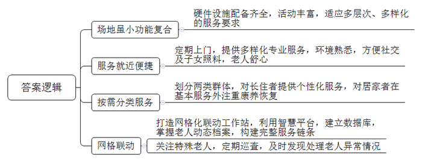
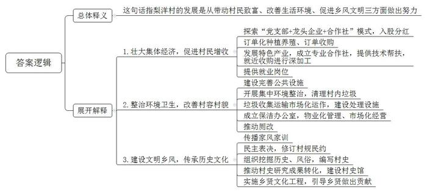
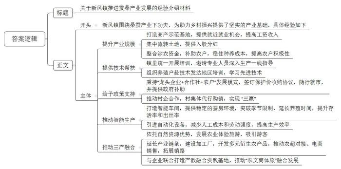
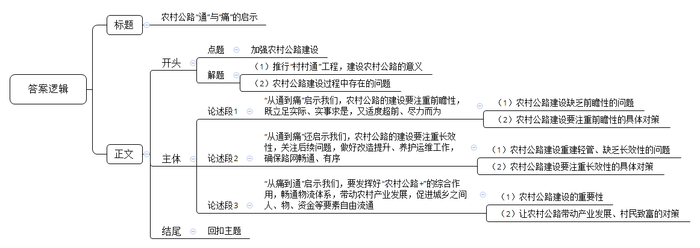

# 2022年公务员多省联考《申论》题（辽宁B卷）

<!-- gwy:overview:start -->
> **辽宁 · 2022 · 申论 · B类** ｜ 4 题 · 图片 4 处 · 答案随题折叠

导航：[题目](#题目) · [材料 1](#材料-1)
<!-- gwy:overview:end -->

> 候选采集稿。参考答案及解析来自粉笔页面，不代表官方答案或真实高分答卷；来源使用许可与原卷对应关系仍需人工核实。

## 给定材料

### 材料 1

这一天，在桐城街道驿道社区，30多名老人在社工的带领下，围在一起做风筝，今年76岁的赵大爷正专心致志地给风筝涂上自己喜欢的颜色。赵大爷说：“我们不出社区，就能与老伙伴摆摆龙门阵、唱唱歌、跳跳舞，感觉日子过得很充实，越活越精神，越活越高兴。”

“螺蛳壳里做道场”，驿道社区嵌入式养老服务中心场地虽小但功能复合，配套了无障碍通道、理疗间、多功能室、助餐室、护理间、康复室等，适应了养老服务多层次、多样化的要求。“我们积极开设老年课堂，每个星期都会提前把每一堂课的时间和内容以课程表的方式排好，轮流开展。我们的活动有趣味运动会、画画、红歌会、舞蹈比赛等。同时，联系社会上的志愿者或社区医院，嵌入整个活动流程，不断丰富老年人生活，让老人老有所养、老有所乐。”中心社工部赖主任说。

在这个中心，社工团队还会定期上门为老人开展义务理发、足浴和健康检查等嵌入式服务，为辖区老人提供更多便利。社区居民熊大姐说：“早上八点半跳舞，然后搞活动，还给我们检查眼睛和血压，我很高兴。”80岁的曹奶奶说：“20多年前我老伴儿去世，两个女儿嫁得比较远，长年不在身边，我在家很孤单。现在我们不用远离熟悉的环境，在家附近就能享受到服务，他们的照顾很专业，还能与街坊邻居拉家常，这样的养老方式让我觉得很舒心。”

端午节这天，社区居民张叔在家煲好鸽子汤，送到中心给中风卧床多年的老母亲尝尝鲜，不烫不凉，正好入口。他说：“我们双职工家庭无法长期留人在家看护老母亲，幸好中心就在家边上，下班后过来探视，送点吃的喝的都挺方便。”

不仅如此，中心将所服务的老人分为了两个群体，一个是住在里面的，一个是需要上门服务的。对于住在里面的，中心对每位老人都有一套个性化服务方案。针对晚上睡眠不好的老人，会安排工作人员通过睡觉前按摩等方式帮助老人放松心情，更好入睡；针对一些情绪经常波动的老人，会安排工作人员陪老人聊天谈心，帮助他们找出原因，恢复情绪。“大家对中心评价都非常高。我们每月只交不多的钱，就可以享受用餐、定期体检、心理咨询等一系列服务。我现在生活规律、开心，感激党的好政策。”91岁的刘奶奶高兴地说。

而对于需要上门服务的，除了基本服务外，考虑到他们大都是失能失智人员，中心则主要在康养恢复上下功夫。“我老伴已经卧床多年，许多功能开始萎缩，中心工作人员不仅没嫌弃，还专门为他订做了一套理疗方案，包括定时派人来针灸、按摩等。”居民老倪说。

除此之外，中心还积极打造网格化联动工作站，运用智慧网格化管理平台，建立人脸3D信息库，通过信息系统掌握社区老人的动态档案，包括基本情况、服务动态等，构建起完整的服务链条。75岁的陈大妈患有阿尔兹海默症，子女因工作原因不在身边，老人常常一出门就找不到回家的路。于是，中心工作人员对她给予了特别关注，并与亲属、保安、警察、热心居民等形成联络网，以便她意外走失时能及时处理。

“我们现在所在的是中控室，相当于我们的大脑，电视机里是我们掌握的老人数据库，能够体现社区所有老人的基本信息、定制需求和服务情况等，当然我们也为这些信息都做好了保密工作。同时，这些数据我们做到了每天及时更新。”驿道社区党总支秦书记介绍说。

中心在系统的帮助下，会定期对社区老人进行巡查。去年7月，中心工作人员巡查时发现有位独居老人躺在床上，呼其不应，身体僵硬且无法动弹。中心工作人员立即拨打应急救援电话，并第一时间通知其外地子女。由于现场应急处理措施得当，老人得到了及时救治，转危为安。

秦书记说：“今后，我们将进一步探索这种‘自家的养老院’嵌入式养老模式，将老人们的个体行动无缝嵌入整个服务网络，让他们在情感上更容易接受，为他们提供更完善的养老服务。”

### 材料 2

对于家乡的旧貌，土生土长的洋下镇梨洋村村民老钟仍记忆犹新：“我们村虽然有得天独厚的优美山水，但过去，村里污水横流，垃圾满地，‘室内现代化、室外脏乱差’，说的就是我们这里，经常被隔壁村的人看不起。”时隔两年，再次走进梨洋村，村里荒废的角落建起了休闲广场，健身器材、文化走廊、公共洗手间样样俱全，泥泞的乡间小路变成了宽阔的水泥路，农户房前院里，整齐地种着各种蔬菜和绿植，村容村貌焕然一新。“我们村开展环境卫生整治后，村庄道路宽了，出行更方便了，我家房前屋后也变得越来越整洁。乡亲们吃完饭，就在休闲广场上散步聊天，生活质量比以前提高了不少，‘腰杆子’都挺直了！”村民老吴自豪地说。

2021年以来，梨洋村已经开展了10余次集中环境整治，组织党员干部、村民、返乡大学生对村里的生活垃圾、牛羊粪、废弃建筑材料等进行了全面清理。村委会胡主任介绍说：“我们还通过招标方式实现生活垃圾收集运输市场化运作，建立了小型微动力污水处理系统，生活垃圾处理站的两台焚烧炉每天能‘吃掉’6吨生活垃圾，有效解决了大家的生活垃圾和污水处理难题。”

村里还成立了保洁办公室，将人居环境整治转向物业化管理、市场化经营。在保洁办公室的推动下，村里陆续对村民家里的旱厕进行了水冲厕所改造。村民老张家的卫生间已经改造完成，新安装的马桶上贴着一张用户联系卡，上面标有维修、监督和村级联系人的电话。为壮大村集体经济，村里积极探索“党支部+龙头企业+合作社”的模式，以入股的方式增加村集体收入，带动村民增收。胡主任介绍道，梨洋村在镇里的农产品开发公司投入股金80万元，村集体经济收入按占股比例分红，每年保底收益为5万元。同时，公司还通过订单种植养殖、订单收购带动240户农户增收致富。今年，村里将重点发展肉鸭养殖项目，推动村民收入水平再上新台阶。

今年开春以来，村民老吕忙得不亦乐乎，每天不仅要饲养好自己养的5000多只鸭子，还要忙着收捡鸭蛋，然后送到附近的合作社加工。而就在几年前，他还只是一个养鸭规模不大的农户。老吕高兴地说：“过去养殖规模很小，现在一年收入有10万元左右，这得益于产业发展的带动。”为了更好地带动群众增收，村里还引导村民成立了专业的养殖合作社，不仅免费为像老吕这样的养殖户提供更多的养殖技术，还就近收购他们的产品进行深加工。在壮大集体经济的同时，也为村民提供了更多的就业岗位。

村民老王说：“村子近年来变化很大，房子漂亮，住着舒服，每天都有专门的人打扫卫生，村容村貌改进非常明显，更重要的是邻里关系和睦，家家户户都挂有家风家训。”村里建设的“家风家训一条街”对教育后代帮助很大，村里的孩子现在都能把家风家训背出来了。

今年年初，在村委会的指导下，梨洋村召开了村民代表大会，大家一致举手通过了新修订的村规民约。此外，村里还组织大学生返乡开展社会实践，通过实地走访老前辈、查阅文史资料，挖掘梨洋村的历史文化，探究过去的风俗习惯，编写了一本图文并茂的《梨洋村史》。下一步，村里还要推进村史研究成果转化，建设村史馆，并进一步实施乡贤文化工程，引导乡贤为本村的发展建言献策、出资助力。这些举措得到了镇政府的肯定，多次组织镇村干部前来“取经”，胡主任高兴地说：“村里的发展，既要摘掉‘穷帽子’，又要改变‘老样子’，还要留住‘好根子’。”

### 材料 3

采摘、装篓、运送……新风镇年过六旬的老朱干起活儿来认真且麻利，丝毫不比年轻人逊色。他每天工作7、8个小时，大概能采到500多斤桑叶，每斤按照0.3元计算，收入一百多块不成问题。老朱高兴地说：“累吗？当然累，但想着干一天就有一百多块的收入，累也高兴。”对于一辈子没离开过土地的老人而言，能在家门口就获得赚钱的机会，着实是一件令人高兴的事。靠着勤劳，老朱夫妇每年在蚕桑基地务工两个月收入可达万余元，除此之外，老朱还将家里的6亩地入股当地龙头企业，每年可实现分红约4000元。

截至目前，通过旧产区“改造”、现产区“挖潜”、潜产区“扩容”等方式，新风镇蚕桑种植面积已达8800亩，每年养蚕1.1万张，产鲜茧56万斤。新风镇王镇长说：“其实，刚开始，我们推广种植、养殖不顺利，村民们认为种桑养蚕就是图个乐呵，靠这个怎么能增收。后来我们在几个村创建了蚕桑高产示范基地，带领农户们增收致富，并出台政策，整合各类涉农资金，对种植户、养殖户进行补助，稳住种养成本。大家看到这个真有钱赚，才慢慢铺开，达到现有的规模。”

老朱告诉我们：“你不要以为这只是简单种树，桑树种植也是需要技术的。如果镇里没有开展培训，邀请专家和技术人员到田间地头来指导我们，这片桑树林早就不行了。”为了促进桑蚕共育养殖，新风镇还组织小蚕共育户、养殖大户到蚕桑产业技术发达的地区进行培训，学习先进技术。同时，加大政策支持力度，秉持“龙头企业+合作社+农户”发展模式，引导龙头企业与政府签订保护价收购协议，在保护价协议基础上随行就市，并实行政府补助的政策机制，提高农户养殖积极性；扶持推动村集体与龙头企业结成合作伙伴，由村集体代行购销行为，实现企业、村集体、养殖户“三赢”。

2019年，新风镇引进了智能养蚕生产线，成为传统蚕桑产业“破茧成蝶”的关键节点。据了解，智能养蚕车间能够恒温恒湿控制蚕房环境，不仅突破了传统养蚕季节限制，最大程度延长了养蚕时间，同时也提高了蚕宝宝的存活率和出丝率。另一方面，机械化设备能够实现自动添桑、除沙、消毒、上簇、采茧等功能，极大减少了人工成本，减轻了劳动强度。提起智能养蚕车间，60多岁的智能蚕房负责人老李自豪地说：“智能养蚕生产线仅需单人操作，较传统养蚕效率提高30倍。”

依托优越的自然资源，上岭村种植果桑150亩，吸引了大批游客前来采摘、游玩。自2017年以来，村里已成功兴办5届桑果采摘节，累计接待游客8万多人次，实现旅游增收260余万元。在上岭村党群服务中心，慕名而来的游客采摘完桑果，正在选购村里开发出来的桑叶面产品。除了桑叶面，由蚕桑产业开发出来的桑葚酒、桑葚膏、桑叶茶、蚕丝被等产品琳琅满目，让人眼花缭乱。上岭村党支部张书记介绍道：“我们的产品很多，质量也好，很受欢迎，客商经常会上门来买，镇里也帮我们与商超对接直销，还引入电商帮助营销，拓展销路，产业链比较完善。”

王镇长也告诉我们，在农旅融合的基础上，新风镇还致力于延伸打造蚕桑全产业发展链条，统筹谋划桑果酒厂、蚕桑烘焙站、桑菌厂、桑葚加工厂和蚕纱综合加工厂建设，打造“线上有丝路、线下有销路”的产业体系。目前，该镇已经与省里的企业签订了协议，将打造产教融合蚕桑特色实践基地，推动蚕桑产业与劳动教育、研学实践与乡村旅游融合，提高农产品附加值，促进乡村全面振兴。该项目将围绕“学、讲、看、做”开设劳动大课堂，开展采摘、养蚕、参观蚕丝被和桑果酒制作工艺、品尝桑蚕宴等，推动“农文商体旅”融合发展，实现农业“接二连三”。

### 材料 4

在李家村的生态农场里，几名头戴草帽的村民早就忙得不可开交。农场技师老卢一边指挥着工友装运蔬菜，一边说：“前来收购的货车就停在路边，清晨采摘，上午运送，保证新鲜。幸亏路好，叶子不会被颠坏，我们的蔬菜水果都不愁销路了。”老卢提到的这条路是李家村通往外界的村路，宽8米，长700米，是新修的沥青路，平整宽敞，三轮车、小汽车、货车在路上川流不息。

这里最早是泥土路，一下雨就变成一片烂泥，又滑又臭，接着是砂石路，后来“村村通”时硬化成3米宽的水泥路，现在是升级改造后的沥青路。想起当时“村村通”工程把水泥路修到村口时的情景，李家村村支书老李记忆犹新：“虽然水泥路只修到了村口，村子里还是泥土路，但大伙儿个个都夸党的政策好，祖祖辈辈出行难的问题解决了。”但是没过多久，许多村民都买了小车，还有做生意的货车也多起来了，原来还算宽敞的水泥路很快就显得太窄了，两车相遇经常发生刮擦，甚至引发司机争吵，“村村通”变成了“村村痛”。为方便群众出行，县里启动农村公路升级改造工程。县政府提出要“村村通沥青路，组组通水泥路，户户通连户路。”李家村的村路经过翻新改造拓宽，从3米变成了8米，还建了两条水泥路从村子里穿过，然后又在每家每户门口修了一条小路连到村子里的水泥路上。

村里开客车的小李说：“以前道路狭窄，行人、摩托车都紧靠客车，自己开车提心吊胆，而且道路缺乏修护，有很多裂缝和坑坑洼洼，一路颠簸不停，让人很难受。现在新修的沥青路宽敞平整，乘客们很舒心，生意也越来越好。”

在村里开农家乐的村民小曾也是道路变迁的受益者。他说：“现在道路越来越宽，基础设施越来越好，开车来游玩的人越来越多，我们以前一天只有两三桌客人，现在每天都有六七桌。”这条路已经成为名副其实的“致富路”。村路拓宽后，旅游大巴都能开进来了，大家都想办法发展副业，番薯酒、腊味、自制的“土菜”通过新修建的村路运到了一个个买家的手中。

指着一辆运送快递的电动三轮车，老李说：“你看，自从道路改造升级后，我们这里也兴起了快递。以前道路不好，我们寄快递、拿快递都要走很远的路到镇上去。”在老李看来，快递的兴起不仅意味着提供生活便利，增加就业岗位，还意味着原本偏僻的村庄与外面的世界越来越紧密地联系起来了，“村村痛”又变成了“村村通”，看着村路上来来往往的车子和行人，老李满脸笑容地说：“这条路不仅是修到了村庄，也修到了我们群众的心里啊！”

## 题目

### 第 1 题

**根据“给定资料1”请谈谈桐城街道驿道社区嵌入式养老服务模式的特点。（15分）**

关联材料：材料 1

作答要求：

要求：全面、准确、有条理，不超过200字。

第 1 题 · 答案与解析

**参考答案（粉笔题库参考内容）**

1.场地虽小功能复合。硬件设施配备齐全，活动丰富，适应多层次、多样化的服务要求。

2.服务就近便捷。定期上门，提供多样化专业服务，环境熟悉，方便社交及子女照料，老人舒心。

3.按需分类服务。划分两类群体，对长住者提供个性化服务，对居家者在基本服务外注重康养恢复。

4.网格联动。打造网格化联动工作站，利用智慧平台，建立数据库，掌握老人动态档案，构建完整服务链条；关注特殊老人，定期巡查，及时发现处理老人异常情况。

**解析**

**参考答案说明：**本参考答案从“场地虽小功能复合”“服务就近便捷”“按需分类服务”“网格联动”这四个方面进行了分条撰写。各条答案要点之间在内容上相互并列，没有交叉。

**考点**：特点类

**来源**：2022年公务员多省联考《申论》题（辽宁B卷）

### 第 2 题

**根据给定资料2，请谈谈你对“村里的发展，既要摘掉‘穷帽子’，又要改变‘老样子’，还要留住‘好根子’”这句话的理解。（20分）**

关联材料：材料 2

作答要求：

要求：理解准确，分析透彻，简明扼要，不超过300字。

第 2 题 · 答案与解析

**参考答案（粉笔题库参考内容）**

这句话指梨洋村的发展是从带动村民致富、改善生活环境、促进乡风文明三方面做出努力。

1.壮大集体经济，促进村民增收。探索“党支部+龙头企业+合作社”模式，入股分红；订单化种植养殖、订单收购；发展特色产业，成立专业合作社，提供技术帮扶，就近收购进行深加工；提供就业岗位。

2.整治环境卫生，改善村容村貌。建设完善公共设施；开展集中环境整治，清理村内垃圾；垃圾收集运输市场化运作，建设处理设施；成立保洁办公室，物业化管理、市场化经营；推动厕改。

3.建设文明乡风，传承历史文化。传播家风家训；民主表决，修订村规民约；组织挖掘历史、风俗，编写村史；推动村史研究成果转化，建设村史馆；实施乡贤文化工程，引导乡贤做出贡献。

**解析**

**参考答案说明：**（1）思路方面，本参考答案按照词句解释题“总体释义+展开解释+总结”的思路展开。（2）内容方面，本答案首先对句子的含义作出了解释；接着“展开解释”部分从“壮大集体经济，促进村民增收”“整治环境卫生，改善村容村貌”“建设文明乡风，传承历史文化”这三个方面进行分析。词句表达方面，参考答案加上了“这句话指”等连接词来承接上下文。

**考点**：词句解释类

**来源**：2022年公务员多省联考《申论》题（辽宁B卷）

### 第 3 题

**新风镇推进蚕桑产业发展工作，入选了省乡村振兴局拟印发的乡村振兴典型经验汇编，请根据给定资料3，为新风镇撰写一份经验介绍材料。（25分）**

关联材料：材料 3

作答要求：

要求：

（1）符合经验材料的写作要求；

（2）内容全面，条理清晰；

（3）不少于400字。

第 3 题 · 答案与解析

**参考答案（粉笔题库参考内容）**

关于新风镇推进蚕桑产业发展的经验介绍材料

新风镇围绕桑蚕产业下功夫，为助力乡村振兴提供了坚实的产业基础，具体经验如下：

一、提升产业规模。打造高产示范基地，提供就近就业机会，提高工资收入；集中流转土地，提供入股分红；整合涉农资金，补助农户，稳住种养成本，提高农户积极性。二、提供技术帮扶。镇里统一开展培训，邀请专业人员深入生产一线指导；组织养殖户赴技术发达地区培训，学习先进技术。三、给予政策支持。秉持“龙头企业+合作社+农户”发展模式，签订保护价收购协议，随行就市，并提供政府补助；推动村企合作，村集体代行购销，实现“三赢”。四、推动智能生产。打造智能车间，提供稳定的蚕房环境，突破季节限制、延长养殖时间，提升存活率和出丝率；引进自动化设备，减少人工成本和劳动强度，提高生产效率。五、推动三产融合。依托自然资源优势，发展农业体验旅游，吸引游客；延长产业链条，建设加工厂，开发多元衍生农产品，推动农超对接、电商销售，拓展销路；与企业联合打造产教融合实践基地，推动“农文商体旅”融合发展。

**解析**

**参考答案说明：**（1）格式方面，本参考答案写到了“标题”和“正文”两个部分。（2）正文部分，一方面从内容上来看，围绕着“新风镇推进蚕桑产业发展工作”这一主题，本参考答案的开头先写到了“新风镇发展蚕桑产业的整体性概括及意义”；主体部分从“提升产业规模”“提供技术帮扶”“给予政策支持”“推动智能生产”和“推动三产融合”这五个方面介绍了具体经验。另一方面，形式上，本参考答案做到了分段、分条撰写，整体上条理较为清晰。

**考点**：总结类

**来源**：2022年公务员多省联考《申论》题（辽宁B卷）

### 第 4 题

**给定资料4中提到，“村村通”变成了“村村痛”、“村村痛”又变成了“村村通”。从“通”到“痛”，又从“痛”到“通”，这样的变化带给我们很多思考。请深刻理解给定资料，联系实际，自选角度，自拟题目，写一篇文章。（40分）**

关联材料：材料 1、材料 2、材料 3、材料 4

作答要求：

要求：

（1）观点明确，见解深刻；

（2）思路清晰，语言流畅；

（3）800-1000字。

第 4 题 · 答案与解析

**参考答案（粉笔题库参考内容）**

**农村公路“通”与“痛”的启示**

农村要发展，交通是基础。近年来，各地积极推行“村村通”工程，让一条条公路将乡村与城市相连，打破了农村发展的交通瓶颈，缓解了居民的出行难题。然而，“村村通”也曾一度变成了“村村痛”，如公路修建宽度过窄、错车困难，路面缺乏维护，坑坑洼洼、颠簸不平……因此，**加强农村公路建设，各地要充分认识到规划设计的重要性，增强规划前瞻性，强化公路日常维护，确保其长效运行，进而更好发挥“公路+”的综合作用。**

**“从通到痛”启示我们，农村公路的建设要注重前瞻性，既立足实际、实事求是，又适度超前、尽力而为。**当前，一些农村实施“村村通”工程时，未提前考虑到私家车、大型农机具等在农村日渐普及，导致后期道路拥挤、运行状况频发。因此，农村公路建设需瞻前顾后，科学规划，合理布局，既要做好前期调查研究，充分考虑当下和未来的发展情况，也要把规划权交给村民，广泛征求群众意见，了解其内在需求。如此，方能引领性地把党的好政策落实到位，避免后期返工，耗时耗力，劳民伤财。

**“从通到痛”还启示我们，农村公路的建设要注重长效性，关注后续问题，做好改造提升、养护运维工作，确保路网畅通、有序。**近年来，由于重建设，轻管护，导致农村公路耗损快，直接影响着公路的行车安全和长远发展。因此，一方面，要明确农村公路建、管、养责任主体，设立道路专管员，给每条农村公路配上“管家”，开展日常巡查检修。另一方面，也要根据农村发展需要，积极开展乡村公路升级改造工程，比如拓宽、加固路面，提高通行的通达性、舒适性。

**“从痛到通”启示我们，要发挥好“农村公路+”的综合作用，畅通物流体系，带动农村产业发展，促进城乡之间人、物、资金等要素自由流通。**所谓“修建一条公路，串联一路风景，带动一方产业”。农村公路不仅是农村居民便捷出行的保障，也是农村产业发展和经济增长的基础。一条条延伸的公路，串联的是城市与农村，打通的却是偏僻与繁华、贫困与富足。因此，要积极借助四通八达的农村公路，帮助农业生产经营者畅通农产品外销渠道，同时吸引城市资本下乡，优秀人才下沉，让深山里的绿水青山变成金山银山，让守住一方秀丽山水的农民吃上“旅游饭”。农村公路唯有变成产业路、旅游路、致富路，才算真正通到了群众的心里面啊！

建好乡村路，踏上新征程。希望各地在规划好、管护好乡村公路的基础上，不断发挥“公路+”的综合作用，真正让乡村公路成为乡村振兴的“幸福路”！

**解析**

**文章分析**

**农村公路“通”与“痛”的启示**

【**标题的优点：**首先，范文的标题突出了“农村公路建设”这一主题。其次，形式上，文字简洁明快。】

（1）<u>农村要发展</u>，<u>交通是基础</u>。近年来，各地积极推行<u>“村村通”工程</u>，让一条条<u>公路将乡村与城市相连</u>，<u>打破了农村发展的交通瓶颈</u>，<u>缓解了居民的出行难题</u>。然而，（2）“村村通”也曾一度变成了“村村痛”，如<u>公路修建宽度过窄</u>、<u>错车困难</u>，<u>路面缺乏维护</u>，坑坑洼洼、颠簸不平……因此，（3）**加强农村公路建设****，各地要充分认识到****规划设计****的重要性，增强****规划前瞻性****，强化****公路日常维护****，确保其****长效运行****，进而更好****发挥“公路+”的综合作用****。**

【**开头的优点：**★内容方面：范文的开头是紧扣题目给定的“‘村村通’变成了‘村村痛’”“‘村村痛’又变成了‘村村通’”这两句话展开的。首先，开头点出主题，做到了主题明确。其次，对“农村公路建设”这一主题进行了分析阐述，指出了（1）推行“村村通”工程，建设农村公路的意义。（2）农村公路建设过程中存在的问题。（3）引出文章的核心观点。★文字表达方面：使用了“然而”“因此”等关联词，使语言表达有逻辑性。】

**“从通到痛”启示我们，农村公路的建设要注重前瞻性，既立足实际、实事求是，又适度超前、尽力而为。**（1）当前，一些农村实施“村村通”工程时，<u>未提前考虑到私家车</u>、大<u>型农机具等在农村日渐普及</u>，导致后<u>期道路拥挤</u>、<u>运行状况频发</u>。因此，（2）农村公路建设需瞻前顾后，<u>科学规划</u>，<u>合理布局</u>，既要<u>做好前期调查研究</u>，<u>充分考虑当下和未来的发展情况</u>，也要<u>把规划权交给村民</u>，广泛<u>征求群众意见</u>，了解其内在需求。如此，方能引领性地把党的好<u>政策落实到位</u>，避免后期返工，耗时耗力，劳民伤财。

【**论述段1的优点：**★观点句：范文的观点句是紧扣“农村公路建设”这一文章主题提出的。形式上，它在段首处直接写出，位置突出，容易发现。内容上，关键词突出，内容要点明确，可以明显看出它是从“农村公路建设要注重前瞻性”入手，指出了解决“农村公路建设‘痛点’”的对策。★论述内容：（1）先介绍了农村公路建设缺乏前瞻性的问题；（2）再介绍了农村公路建设要注重前瞻性的具体对策。注意：以上两个方面的内容都是紧扣“‘从通到痛’启示我们，农村公路的建设要注重前瞻性，既立足实际、实事求是，又适度超前、尽力而为”这个观点句进行分析论述的，论述的针对性强，内容层次丰富。在论述方法上主要采用了讲道理的方式，做到了见解深刻。】

**“从通到痛”还启示我们，农村公路的建设要注重长效性，关注后续问题，做好改造提升、养护运维工作，确保路网畅通、有序。**（1）近年来，由于<u>重建设</u>，<u>轻管护</u>，导致<u>农村公路耗损快</u>，直接<u>影响着公路的行车安全和长远发展</u>。因此，（2）一方面，要<u>明确农村公路建、管、养责任主体</u>，<u>设立道路专管员</u>，给每条农村公路配上“管家”，<u>开展日常巡查检修</u>。另一方面，也要根据农村发展需要，积极<u>开展乡村公路升级改造工程</u>，比如拓宽、加固路面，<u>提高通行的通达性、舒适性</u>。

【**论述段2的优点：**★观点句：范文的观点句是紧扣“农村公路建设”这一文章主题提出的。形式上，它在段首处直接写出，位置突出，容易发现。内容上，关键词突出，内容要点明确，可以明显看出它是从“农村公路建设要注重长效性”入手，指出了解决“农村公路建设‘痛点’”的对策。★论述内容：（1）先介绍了农村公路建设重建轻管、缺乏长效性的问题；（2）再介绍了农村公路建设要注重长效性的具体对策。注意：以上两个方面的内容都是紧扣“‘从通到痛’还启示我们，农村公路的建设要注重长效性，关注后续问题，做好改造提升、养护运维工作，确保路网畅通、有序”这个观点句进行分析论述的，论述的针对性强，内容层次丰富。在论述方法上主要采用了讲道理的方式，做到了见解深刻。】

**“从痛到通”启示我们，要发挥好“农村公路+”的综合作用，畅通物流体系，带动农村产业发展，促进城乡之间人、物、资金等要素自由流通。**（1）所谓“修建一条公路，<u>串联一路风景</u>，<u>带动一方产业</u>”。农村公路不仅是<u>农村居民便捷出行</u>的保障，也是农村<u>产业发展和经济增长</u>的基础。一条条延伸的公路，<u>串联的是城市与农村</u>，<u>打通</u>的却是偏僻与繁华、<u>贫困与富足</u>。因此，（2）要积极借助四通八达的农村公路，帮助农业生产经营者<u>畅通农产品外销渠道</u>，同时<u>吸引城市资本下乡</u>，<u>优秀人才下沉</u>，让深山里的绿水青山变成金山银山，让守住一方秀丽山水的农民吃上“旅游饭”。农村公路唯有变成<u>产业路、旅游路、致富路</u>，才算真正通到了群众的心里面啊！

【**论述段3的优点：**★观点句：范文的观点句是紧扣“农村公路建设”这一文章主题提出的。形式上，它在段首处直接写出，位置突出，容易发现。内容上，关键词突出，内容要点明确，可以明显看出它是从“要发挥好‘农村公路+’的综合作用”入手，指出了“从痛到通”的对策。★论述内容：（1）先介绍了农村公路建设的重要性；（2）再介绍了让农村公路带动产业发展、村民致富的对策。注意：以上两个方面的内容都是紧扣“‘从痛到通’启示我们，要发挥好‘农村公路+’的综合作用，畅通物流体系，带动农村产业发展，促进城乡之间人、物、资金等要素自由流通”这个观点句进行分析论述的，论述的针对性强，内容层次丰富。在论述方法上主要采用了讲道理的方式，做到了见解深刻。】

【**论述段之间的关系**：★内容的内在逻辑：范文的论述段之间有两层逻辑。第一层，整体上是从“从通到痛”到“从痛到通”的逻辑展开的。第二层，其中观点1和观点2又是从“从通到痛”出发，论述段1先写了“‘从通到痛’启示我们，农村公路的建设要注重前瞻性，既立足实际、实事求是，又适度超前、尽力而为”，论述段2再写了“‘从通到痛’还启示我们，农村公路的建设要注重长效性，关注后续问题，做好改造提升、养护运维工作，确保路网畅通、有序”。★段与段的外在衔接：论述段1、2、3都在段首处直接点题，引出观点，使文章整体上看起来逻辑思路清晰。】

建好乡村路，踏上新征程。希望各地在规划好、管护好乡村公路的基础上，不断发挥“公路+”的综合作用，真正让乡村公路成为乡村振兴的“幸福路”！

【**结尾的优点**：范文的结尾回扣了“农村公路建设”这一主题，总结了文章的观点，做到了首尾呼应。】

**考点**：文章写作题

**来源**：2022年公务员多省联考《申论》题（辽宁B卷）

