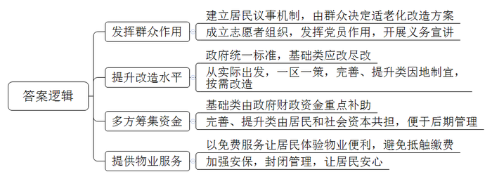
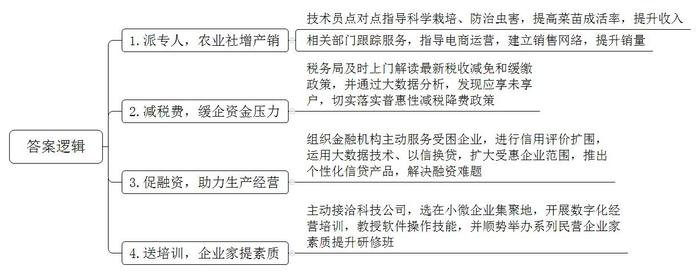
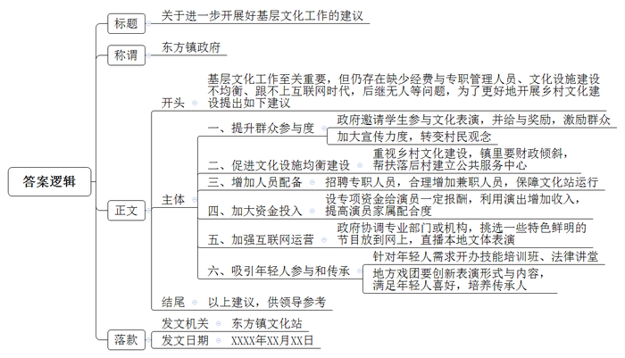
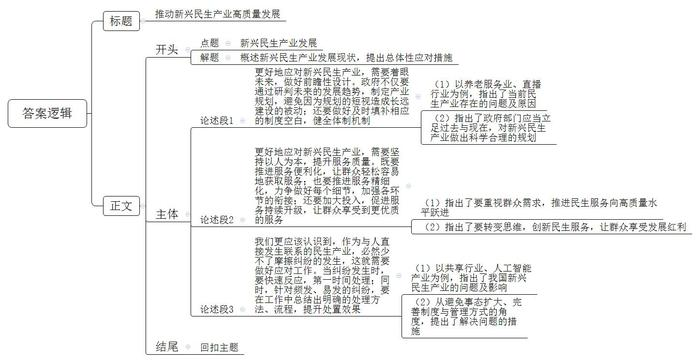

# 2022年公务员多省联考《申论》题（辽宁A卷）

> 候选采集稿。参考答案及解析来自粉笔页面，不代表官方答案或真实高分答卷；来源使用许可与原卷对应关系仍需人工核实。

## 给定材料

### 材料 material-f8ce62c41470a307

去年，陈阿姨执意要搬回D市进步新村的老房住，这让特意接她到新家养老的儿子有些不解：“老人家非说回去住着更舒心。”进步新村建于上世纪80年代，被D市市政府定位为老旧小区改造试点。根据小区老人较多的情况，小区进行了适老化改造：楼梯旁安了扶手，每层平台转角处放有折叠椅，还有新建的阳光餐厅、无障碍助浴室……陈阿姨看后觉得非常适合自己，坚决要搬回来和老邻居在一起。为什么这么改？街道党工委饶书记说：“都是大家在‘进步议事港’议出来的，小区60%以上居民都是老人，老人的需求必须考虑到。”

“进步议事港”是改造之初街道建立的居民议事机制。改不改、改什么、怎么改，都由居民来决定。刚开始，一些居民积极性不高，有居民不愿参与对改造方案的讨论，或者直接表态不同意。饶书记说：“只有群众参与进来，小区才有活力。于是我们在小区成立了志愿者组织，要求党员在小区改造中发挥作用。”杨老师是一位老党员，去年刚退休，他积极加入志愿者组织，成为一名小区改造的义务宣讲员。他说：“小区改造与我们每位居民切身利益息息相关，大家都应该出力加油。”已经搬家的周老太认为我房子都出租了，改造跟我没什么关系，因此不同意加装电梯。因为只要一户不同意，一栋楼都装不了电梯，这让楼里居住的其他老人很着急。为了说服周老太，杨老师愣是穿过大半个城市，上门数十趟，不厌其烦地给周老太讲道理，分析改造好处，周老太被这份真诚打动了，最后欣然在电梯安装协议书上签了字。

走进改造后的小区，过去坑坑洼洼的路面变得平坦宽敞，蜘蛛网般的电线全部入地，路灯全都亮起来了……陈阿姨竖起大拇指：“环境一天比一天好，住得越来越舒心！”让居民点赞的，除了环境变化，还有民生服务设施的提升完善：新划定的100个停车位，新安装的81个监控摄像头，新建三处电动车棚……不光改“面子”，更要改“里子”。本轮小区改造，不仅有市政配套等基础类改造，更多的是新建停车场、加装电梯等完善类改造，以及养老托育服务等提升类改造。基础类要应改尽改，完善类、提升类则要因地制宜，按需改造。为此，市政府制定了老旧小区统一改造标准，还特别提出从实际出发，一区一策。小区的老人休养中心是新建的提升类项目，一开业就迎来10位老人入住。“这地方过去是一个宾馆的闲置库房，物业承包后改造为休养中心，小区老年人比较多，身体有些小毛病，休养中心帮助他们进行日常调养。”饶书记说。

如今的进步新村焕然一新，投入的改造资金可不少。按照市政府的规划，市政府财政资金重点补助基础类改造内容，可是提升小区环境，引入公共服务这些完善类、提升类改造，所需资金也不是个小数目，由谁来承担？饶书记说：“居民要出一点，居民出资参与改造，可以提高小区居民的主人翁意识和归属感，为后续管理埋下了伏笔，更重要的是让社会力量参与进来，三方合理共担改造资金。目前，我们街道已在全市率先引入社会资本，委托前程集团参与改造。”

“目前我们在小区已投入改造资金200多万元，开始提供物业服务。”前程集团城区更新事业部刘经理说。进步新村长期没有物业，一开始，刘经理还很担心居民对交物业费会有抵触。然而，小区物业费缴纳率之高却超出了刘经理的预期。老潘就是缴纳物业费的积极分子：“我们先体验了几个月的免费服务，确实感受到了物业入驻后的便利，尤其是在疫情防控期间消毒检测等服务做得很到位。”如今，小区各出入口都安装了门禁，还有保安值班，实现封闭式管理，为控制人员流动、防控疫情起到了关键作用，居民们都很安心。“很多小区都是我们城市高速发展的产物，虽然逐渐老旧了，但经过精心改造后将旧貌换新颜，依然是我们城市的动人风景。我们将及时总结进步新村的试点经验，并进行推广，让老旧小区重新焕发生机活力，让老年居民过上更加幸福的生活，推动改革发展成果更多更公平地惠及全体人民。”市住建局张局长说。

### 材料 material-0ae469618980fb6c

走进Z市现代农业示范园区，农民专业合作社负责人老杨正在大棚内侍弄自己培育的瓜果蔬菜苗，一盆盆幼苗在阳光的照射下茁壮生长。市农村农业局派了技术员点对点指导合作社科学栽培、防治虫害，菜苗成活率比以前高多了。去年一年，仅种苗一项合作社就卖了500多万株，除去各种成本，一年下来能有40多万元的纯利润。说起去年的收入，老杨掩不住内心的喜悦：“以前我们只知道种自家的田，后来随着时代发展，几户人家成立起合作社。种植规模不断扩大，但种植的作物怎么卖出去却觉得力不从心，幸好市商务局等有关部门派工作人员跟踪服务，指导我们怎样做电商、建立销售网络，让农产品不愁卖不出去。”老杨说的是Z市帮扶小微企业行动中的一部分。小微企业是国民经济和社会发展的重要基础，在扩大就业、增加收入、改善民生、促进稳定等方面具有举足轻重的作用。“近年来，国家和省里都出台了一系列的政策，扶持小微企业发展，我们市也结合自身实际情况制定了相关的文件，把帮扶小微企业当作‘为群众办实事’活动的重要内容来抓。”Z市王副市长说。

“作为小企业，我们市场竞争力不强，面对突如其来的新冠肺炎疫情，企业发展资金压力很大，是税务局及时上门解读最新的税收减免和缓缴政策，帮助我们减免了40多万元税款，解了燃眉之急。”未来食品公司蔡经理感激地说。未来食品公司主要经营糕点糖果批发。去年，该企业实现利润总额274万元，原本按25%的税率应缴纳企业所得税61.87万元，由于该企业符合小微企业条件，享受小微企业普惠性减税降费政策，实际仅缴纳企业所得税19.75万元，减免税额达42.12万元。蔡经理说：“有些我们这样的小微企业并不了解国家税务政策的变化，是市税务局通过大数据分析，发现了我们这些应享未享户，切实给我们带来了国家减税降费政策的温暖。”

“小微贷情系小微”，在当地一家银行，有这样一面锦旗，7个字饱含了一个企业家对银行有力支持小微企业发展的衷心感谢。送锦旗的纳税人老魏是Z市一家五金模具厂的老板。受新冠肺炎疫情影响，该企业连续停业2个月，生产经营面临巨大困难。市政府组织多家金融机构主动服务受困企业，提供个性化融资支持服务。银行刘行长说：“我们积极配合市政府的行动，通过信用评价扩围，运用大数据分析技术和‘以信换贷’方式，将受惠企业范围由纳税信用A级和B级扩大至M级，推出多种个性化的信贷产品，最大限度帮助企业渡过难关。”2021年，全市数百家小微企业获得信用贷款，融资难、融资贵问题得到极大缓解。老魏的模具厂获得了银行线上发放的47.9万元低息信用贷款，他立即用这笔贷款购买开工原材料、支付人员工资等。这笔贷款像旱日的甘霖，给复工复产带来莫大的信心。

随着数字时代的到来，数字化运营成为企业发展的必由之路。但Z市小微企业离真正的数字化运营还很远，这成为企业发展的一个瓶颈，也成了市综合市场石材批发店老板老黄的一块心病。老黄凭着不怕吃苦的劲儿，生意越做越好，老伴一笔笔手工记账，很快就赶不上他们生意的节奏了。可石材批发店人手不多，专门雇人记账成本太高。针对这些情况，市政府主动接洽一家科技公司，对全市小微企业开展数字化运营的专门培训，目的是帮助小微企业尽快跟上数字化运营的时代步伐，不断做优做强。这是该市为群众办实事的具体实践。首场培训选在小微企业集中的市综合市场，大家热情高涨，包括老黄在内的近百名企业家参加了数字化运营培训班。老黄很快学会使用数字记账软件，每日、每周、每月的顾客人数、收款笔数、单笔款项等一目了然。看到这些企业如此踊跃参加培训班，市政府又顺势而为举办一系列民营企业家素质提升研修班，也受到众多小微企业的热捧。

“我们市小微企业居多，今后市委、市政府还打算聚焦募集资金难、招工用工荒、市场开拓难等问题，采取实际行动提升小微企业竞争能力。我们要结合本地特色谋发展，比如农村农业局正在协调推进建设商业化育种能力，加大培育抗病虫害的高产果苗，充分发挥本地瓜果个大果甜的特色，目前已经和几所农业科研院校进行了初步接洽。市里还打算找准产业发展方向，通过打造长途蔬菜冷链物流配送体系、发展蔬菜深加工产业等，凝聚小微企业，脚踏实地做大做强产业链。”王副市长说。

### 材料 material-26c3ccee6c7c5efc

临近春节时的天气还比较阴冷。周六一大早，东方镇文化站里有个身影正在忙碌，整理书报、摆放桌椅、打扫活动室、迎接来学舞蹈的孩子们……

他是东方镇文化站站长老沈，今年56岁，在这个镇从事基层文化工作已30多年了。在文化站二楼的活动室，每周六上午都有一堂舞蹈课。整个班虽然只有6个孩子，但专门从市里一家舞蹈学校过来的吴老师依然教得十分认真。

4年前，吴老师带着学生来演出，沈站长看到后，邀请她们来教这里的孩子。于是，吴老师和其他舞蹈老师每周末都会从市里来到东方镇。师资的问题是解决了，但让老沈挠头的是，村民却对送孩子上舞蹈班兴趣不大，到现在班上才6个孩子，很多村民觉得学舞蹈没有用，还不如在家补补语文和数学。

东方镇共有25个行政村和3个社区。目前，15个村已建成村级公共服务中心，用老沈的话说，相当于15个村级的文化站。老沈说：“以前农村追求的是富裕，现在不仅要富裕，还要文明。一处公共文化设施就是一个文化建设的阵地。目前我们镇乡村公共文化设施建设还不均衡，一些比较困难的行政村还没有建立公共服务中心。我们应该更加重视乡村文化建设，让广大村民有平等的机会享受文化服务。”

东方镇文化站设有图书室、电子阅览室，订阅多种报纸杂志，活动室配备围棋、象棋、乒乓球台……场地虽小，功能可是一应俱全。仅去年，镇文化站主办和协助组织开展篮球赛87场、排球赛25场、乒乓球赛26场、游园活动12次；组织地方戏团、武术协会和舞蹈协会开展了20多场文化下乡活动。老沈说：“文化站嘛，就是要为老百姓实实在在地服务。但可惜的是，文化站只有我一个人是专职工作人员，下乡开展活动时，文化站就只好锁门了。”

镇里的地方戏团用本地方言自编节目，非常接地气，成员主要是兼职的群众。有一天戏团里的二胡手老包来到文化站，又着急又委屈，让老沈赶紧帮他劝劝儿女。原来，老包的子女想要留他在自家的刺绣厂里帮忙，坚决反对他参加文化下乡演出。老沈两次到老包家里拜访，苦口婆心地劝说，老包的子女始终不肯松口，最后只能临时去请别人顶替。老沈有些无奈地说：“文化站经费少，能给的报酬不多，他们几乎是自愿参加文艺活动，遇到老包这样的情况我们也没有办法。”

春节将至，文化站在忙啥？老沈说：“忙着筹备迎新春歌舞晚会和跨年运动会。”近几年春节期间，文化站都会承办文体活动，迎新春歌舞晚会在元宵节举行，跨年运动会则从腊月二十五持续到正月初五，项目包括排球、篮球、象棋、陀螺展示表演等。春节期间，全镇老百姓都会参与活动，过个喜庆、热闹的新年。有些在外地过年的乡亲跟老沈反映，非常想看到家乡的文体表演，缓解乡愁，建议能不能挑选一些特色鲜明的节目放到网上。这提醒了老沈：“我们在这方面做得不够。现在是互联网时代，基层文化事业的发展要跟上时代。”

对今后的工作，老沈有些忧虑。他说：“现在文体活动的参与者普遍都是中老年人。很多年轻人忙于工作，觉得文化站设施老旧、文化活动没意思，还不如开办一些技能培训班、法律讲堂来得实在。有空的时候，有些年轻人也更愿意足不出户，通过手机或者电脑来搞定大部分文娱活动。就说地方戏团吧，队员们年龄普遍偏大，几乎没有年轻人加入。地方戏是我们镇流传了几百年的特色文化，如果发展到今天却没有人继承，就太可惜了。”

## 题目

### 第 1 题

**根据****“给定材料**1**”，请谈谈进步新村作为D市老旧小区改造试点，有哪些值得推广的经验。****（****15分****）**

关联材料：material-f8ce62c41470a307

作答要求：

要求：全面、准确、有条理，不超过200字。

### 第 2 题

**根据****“****给定材料**2**”，请谈谈Z市帮扶小微企业的做法对我们有哪些启示。****（****20分****）**

关联材料：material-0ae469618980fb6c

作答要求：

要求：理解准确，分析透彻，简明扼要，不超过300字。

### 第 3 题

**针对****“给定材料**3**”反映的东方镇文化站在开展基层文化工作中遇到的问题，以镇文化站的名义，拟写一份给该镇政府的建议。****（****25分****）**

关联材料：material-26c3ccee6c7c5efc

作答要求：

要求：符合建议的写作要求，所提建议具体明确、切实可行，不少于400字。

### 第 4 题

**“给定材料**4**”****中提到****“成长的烦恼总是在成长中化解的”，发展难免会带来新问题，而新问题是新发展的契机。请联系实际，自选角度，自拟题目，写****一****篇文章。****（****40分****）**

关联材料：material-f8ce62c41470a307

作答要求：

要求：

（1）观点明确，见解深刻；

（2）思路清晰，语言流畅；

（3）总字数1000-1200字。

## 答案与解析

第 1 题

**参考答案（粉笔题库参考内容）**

1.发挥群众作用。建立居民议事机制，由群众决定适老化改造方案；成立志愿者组织，发挥党员作用，开展义务宣讲。

2.提升改造水平。政府统一标准，基础类应改尽改；从实际出发，一区一策，完善、提升类因地制宜，按需改造。

3.多方筹集资金。基础类由政府财政资金重点补助；完善、提升类由居民和社会资本共担，便于后期管理。

4.提供物业服务。以免费服务让居民体验物业便利，避免抵触缴费；加强安保，封闭管理，让居民安心。

**解析**

**参考答案说明：**本参考答案从“发挥群众作用”“提升改造水平”“多方筹集资金”“提供物业服务”四个方面进行了分条撰写，各条答案要点之间在内容上相互并列，没有交叉。

**考点**：考点经验启示类

**来源**：来源2022年公务员多省联考《申论》题（辽宁A卷）

粉笔申论页面对本题只提供「解析视频」入口，该入口是会员推广位，页面无视频地址与文字解析。

第 2 题

**参考答案（粉笔题库参考内容）**

1.派专人，助农业社增产增销。技术员点对点指导科学栽培、防治虫害，提高菜苗成活率，提升收入；相关部门跟踪服务，指导电商运营，建立销售网络，提升销量。

2.减税费，缓解企业资金压力。税务局及时上门解读最新税收减免和缓缴政策，并通过大数据分析，发现应享未享户，切实落实普惠性减税降费政策。

3.促融资，助力生产经营恢复。组织金融机构主动服务受困企业，进行信用评价扩围，运用大数据技术、以信换贷，扩大受惠企业范围，推出个性化信贷产品，解决融资难题。

4.送培训，帮企业家提升素质。主动接洽科技公司，选在小微企业集聚地，开展数字化经营培训，教授软件操作技能，并顺势举办系列民营企业家素质提升研修班。

**解析**

**参考答案说明：**答案分别按照“派专人，助农业社增产增销”“减税费，缓解企业资金压力”“促融资，助力生产经营恢复”“送培训，帮企业家提升素质”这四个方面的启示进行了分条撰写。且对每条要点提炼出了总括词并前置。

**考点**：考点经验启示类

**来源**：来源2022年公务员多省联考《申论》题（辽宁A卷）

粉笔申论页面对本题只提供「解析视频」入口，该入口是会员推广位，页面无视频地址与文字解析。

第 3 题

**参考答案（粉笔题库参考内容）**

关于进一步开展好基层文化工作的建议

东方镇政府：

基层文化工作至关重要，但仍存在缺少经费与专职管理人员、文化设施建设不均衡、跟不上互联网时代，后继无人等问题，为了更好地开展乡村文化建设提出如下建议：

一、提升群众参与度。政府邀请学生参与文化表演，并给与奖励，激励群众；加大宣传力度，转变村民观念。

二、促进文化设施均衡建设。重视乡村文化建设，镇里要财政倾斜，帮扶落后村建立公共服务中心。

三、增加人员配备。招聘专职人员，合理增加兼职人员，保障文化站运行。

四、加大资金投入。设专项资金给演员一定报酬，利用演出增加收入，提高演员家属配合度。

五、加强互联网运营。政府协调专业部门或机构，挑选一些特色鲜明的节目放到网上，直播本地文体表演。

六、吸引年轻人参与和传承。针对年轻人需求开办技能培训班、法律讲堂；地方戏团要创新表演形式与内容，满足年轻人喜好，培养传承人。

以上建议，供领导参考。

东方镇文化站

XXXX年XX月XX日

**解析**

**参考答案说明：**（1）格式方面，本参考答案写到了“标题”“称谓”“正文”“落款”四个部分。（2）正文部分，一方面从内容上来看，围绕“东方镇文化站基层文化工作”这一主题，本参考答案的开头先写到了基层文化工作面临的问题；接着主体从“提升群众参与度”“促进文化设施均衡建设”“增加人员配备”“加大资金投入”“加强互联网运营”“吸引年轻人参与和传承”等六个方面给出了具体的建议；最后结尾部分进行了总结。另一方面，形式上，本参考答案做到了分条分段撰写，整体上条理较为清晰。

**考点**：考点方案类

**来源**：来源2022年公务员多省联考《申论》题（辽宁A卷）

粉笔申论页面对本题只提供「解析视频」入口，该入口是会员推广位，页面无视频地址与文字解析。

第 4 题

**参考答案（粉笔题库参考内容）**

**推动新兴民生产业高质量发展**

经济社会的高速发展催生了越来越多的新兴民生产业：智慧医疗、在线教育、新零售……，它们不仅满足了人民日益增长的需求，还为经济发展带来了新机遇。但这些新兴民生产业在发展的过程中，却渐渐暴露出了规划滞后、制度缺失、服务品质低等系列问题。**民生产业关乎民生，问题待解决，前路需笃行，要推动新兴民生产业高质量发展，不仅需要具备前瞻性思维和应对解决纠纷的能力，更要不断提升服务水平，始终将人民放在心中。**

**更好地应对新兴民生产业，需要着眼未来，做好前瞻性设计。政府不仅要通过研判未来的发展趋势，制定产业规划，避免因为规划的短视造成长远建设的被动；还要做好及时填补相应的制度空白，健全体制机制。**“凡事预则立，不预则废”。从养老服务机构摇号进入，到直播行业虚假宣传、价格误导……这些问题都是由于产业发展初期，政府只从当下需求和利益出发而做出相应的规划设计，但是随着产业不断发展，起初的规划设计逐渐远远落后于现实，导致问题频发。因此，在面对新兴民生产业时，政府部门必须通过研究产业的过去与现在，根据产业发展规模和速度的趋势，制定出具有可预见性的计划与部署，并且提前出台支撑产业发展的政策体系，为新事物打造良好的发展环境。

**更好地应对新兴民生产业，需要坚持以人为本，提升服务质量。既要推进服务便利化，让群众轻松容易地获取服务；也要推进服务精细化，力争做好每个细节，加强各环节的衔接；还要加大投入，促进服务持续升级，让群众享受到更优质的服务。**民生产业为人民，必须坚持以人民为中心，将群众需求放到首位，不断推动服务向便利化、精细化、优质化转型，加快新兴民生产业高质量发展。正如新材料产业通过特殊技术，为人们提供衣食住行新体验；新零售产业打通线上线下，给消费者带来更加贴心的服务。我们既要转变思维，想人民之所想，创新服务内容，还要查缺补漏，不断精进，强化资金支持，持续优化服务水平，让人民群众充分享受新兴民生产业发展红利。

**我们更应该认识到，作为与人直接发生联系的民生产业，必然少不了摩擦纠纷的发生，这就需要做好应对工作。当纠纷发生时，要快速反应，第一时间处理；同时，针对频发、易发的纠纷，要在工作中总结出明确的处理方法、流程，提升处置效果。**“前途是光明的，道路是曲折的”。从共享行业泄露个人信息，到人工智能冲击传统产业，再到新能源汽车充电难……不可否认，我国在新兴民生产业发展过程中存在问题，引起了人们的质疑和批判，制约了产业的进一步发展。如何快速解决并避免类似情况发生呢？一方面，我们要全面了解并根据实际情况，快速给出合理处置，做好解释工作，避免事态扩大；另一方面，要认真分析问题产生的深层次原因，通过完善制度、规范管理等方式堵塞漏洞，构建长效处理机制。

春天的道路依然充满泥泞。回顾过去，我们曾经面对很多看似难以克服的问题，但发展本身正是一个不断解决问题的过程。相信通过不断提高治理能力，新兴民生产业的发展必将蹄疾步稳、充满活力。

**推动新兴民生产业高质量发展**

**解析**

【**标题的优点：**标题中含有主题词，使文章主题更突出、清晰。】

（1）经济社会的高速发展催生了越来越多的新兴民生产业：智慧医疗、在线教育、新零售……，它们不仅满足了人民日益增长的需求，还为经济发展带来了新机遇。（2）但这些新兴民生产业在发展的过程中，却渐渐暴露出了规划滞后、制度缺失、服务品质低等系列问题。（3）**民生产业关乎民生，问题待解决，前路需笃行，要推动新兴民生产业高质量发展，不仅****需要具备前瞻性思维和应对解决纠纷的能力****，更要****不断提升服务水平****，****始终将人民放在心中****。**

【**开头的优点：**★内容方面。范文的开头是紧扣题目给定的“新兴民生产业发展”这一主题展开的。（1）介绍了新兴民生产业发展的良好态势及影响；（2）指出了当前新兴民生产业发展中存在的问题；（3）从整体上指出了推动新兴民生产业发展的措施。★文字表达方面。使用了“不仅……还”“但……”“不仅……更”等连接词，使语言表达具有严谨的逻辑性。】

**更好地应对新兴民生产业，需要着眼未来，做好前瞻性设计。政府不仅要通过研判未来的发展趋势，制定产业规划，避免因为规划的短视造成长远建设的被动；还要做好及时填补相应的制度空白，健全体制机制。**（1）“凡事预则立，不预则废”。从养老服务机构摇号进入，到直播行业虚假宣传、价格误导……这些问题都是由于产业发展初期，政府只从当下需求和利益出发而做出相应的规划设计，但是随着产业不断发展，起初的规划设计逐渐远远落后于现实，导致问题频发。（2）因此，在面对新兴民生产业时，政府部门必须通过研究产业的过去与现在，根据产业发展规模和速度的趋势，制定出具有可预见性的计划与部署，并且提前出台支撑产业发展的政策体系，为新事物打造良好的发展环境。

【**论述段****1的优点：**★观点句：范文的观点句是紧扣“新兴民生产业发展”这一文章主题提出的。形式上，它在段首处直接写出，位置突出，容易发现。内容上，关键词突出，内容要点明确，可以明显看出是从“前瞻规划”角度，对“促进新兴民生产业发展”展开了论述。★论述内容：（1）以养老服务业、直播行业为例，指出了当前民生产业存在的问题及原因；（2）指出了政府部门应当立足过去与现在，对新兴民生产业做出科学合理的规划。注意：以上两个方面的内容都是紧扣“更好地应对新兴民生产业，需要着眼未来，做好前瞻性设计。政府不仅要通过研判未来的发展趋势，制定产业规划，避免因为规划的短视造成长远建设的被动；还要做好及时填补相应的制度空白，健全体制机制”这个观点句进行分析论述的，论述的针对性强，内容层次丰富。在论述方法上采用了摆事实、讲道理相结合的方式，论述清晰透彻。】

**更好地应对新兴民生产业，需要坚持以人为本，提升服务质量。既要推进服务便利化，让群众轻松容易地获取服务；也要推进服务精细化，力争做好每个细节，加强各环节的衔接；还要加大投入，促进服务持续升级，让群众享受到更优质的服务。**（1）民生产业为人民，必须坚持以人民为中心，将群众需求放到首位，不断推动服务向便利化、精细化、优质化转型，加快新兴民生产业高质量发展。正如新材料产业通过特殊技术，为人们提供衣食住行新体验；新零售产业打通线上线下，给消费者带来更加贴心的服务。（2）我们既要转变思维，想人民之所想，创新服务内容，还要查缺补漏，不断精进，强化资金支持，持续优化服务水平，让人民群众充分享受新兴民生产业发展红利。

【**论述段****2的优点：**★观点句：范文的观点句是紧扣“新兴民生产业发展”这一文章主题提出的。形式上，它在段首处直接写出，位置突出，容易发现。内容上，关键词突出，内容要点明确，可以明显看出是从“提升服务质量”角度，对“促进新兴民生产业发展”展开了论述。★论述内容：（1）指出了要重视群众需求，推进民生服务向高质量水平跃进；（2）指出了要转变思维，创新民生服务，让群众享受发展红利。注意：以上两个方面的内容都是紧扣“更好地应对新兴民生产业，需要坚持以人为本，提升服务质量。既要推进服务便利化，让群众轻松容易地获取服务；也要推进服务精细化，力争做好每个细节，加强各环节的衔接；还要加大投入，促进服务持续升级，让群众享受到更优质的服务”这个观点句进行分析论述的，论述的针对性强，内容层次丰富。在论述方法上采用了摆事实、讲道理相结合的方式，论述清晰透彻。】

**我们更应该认识到，作为与人直接发生联系的民生产业，必然少不了摩擦纠纷的发生，这就需要做好应对工作。当纠纷发生时，要快速反应，第一时间处理；同时，针对频发、易发的纠纷，要在工作中总结出明确的处理方法、流程，提升处置效果。**（1）“前途是光明的，道路是曲折的”。从共享行业泄露个人信息，到人工智能冲击传统产业，再到新能源汽车充电难……不可否认，我国在新兴民生产业发展过程中存在问题，引起了人们的质疑和批判，制约了产业的进一步发展。（2）如何快速解决并避免类似情况发生呢？一方面，我们要全面了解并根据实际情况，快速给出合理处置，做好解释工作，避免事态扩大；另一方面，要认真分析问题产生的深层次原因，通过完善制度、规范管理等方式堵塞漏洞，构建长效处理机制。

【**论述段****3的优点：**★观点句：范文的观点句是紧扣“新兴民生产业发展”这一文章主题提出的。形式上，它在段首处直接写出，位置突出，容易发现。内容上，关键词突出，内容要点明确，可以明显看出是从“应对摩擦纠纷”角度，对“促进新兴民生产业发展”展开了论述。★论述内容：（1）以共享行业、人工智能产业为例，指出了我国新兴民生产业的问题及影响；（2）从避免事态扩大、完善制度与管理方式的角度，提出了解决问题的措施。注意：以上两个方面的内容都是紧扣“我们更应该认识到，作为与人直接发生联系的民生产业，必然少不了摩擦纠纷的发生，这就需要做好应对工作。当纠纷发生时，要快速反应，第一时间处理；同时，针对频发、易发的纠纷，要在工作中总结出明确的处理方法、流程，提升处置效果”这个观点句进行分析论述的，论述的针对性强，内容层次丰富。在论述方法上采用了摆事实、讲道理相结合的方式，论述清晰透彻。】

【**论述段之间的关系：**三个论述段分别从“前瞻规划”“提升服务质量”“应对摩擦纠纷”等三个角度，对文章主题“新兴民生产业发展”展开了论述，在内容上，彼此之间呈现出并列的逻辑。】

春天的道路依然充满泥泞。回顾过去，我们曾经面对很多看似难以克服的问题，但发展本身正是一个不断解决问题的过程。相信通过不断提高治理能力，新兴民生产业的发展必将蹄疾步稳、充满活力。

【**结尾的优点：**范文的结尾回扣了“新兴民生产业发展”这个主题，并且进行了总结升华。】

**考点**：考点文章写作题

**来源**：来源2022年公务员多省联考《申论》题（辽宁A卷）

粉笔申论页面对本题只提供「解析视频」入口，该入口是会员推广位，页面无视频地址与文字解析。

