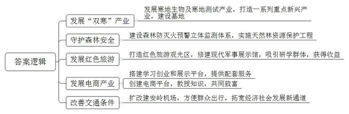
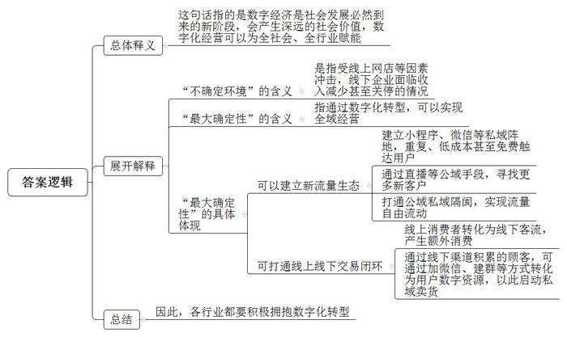
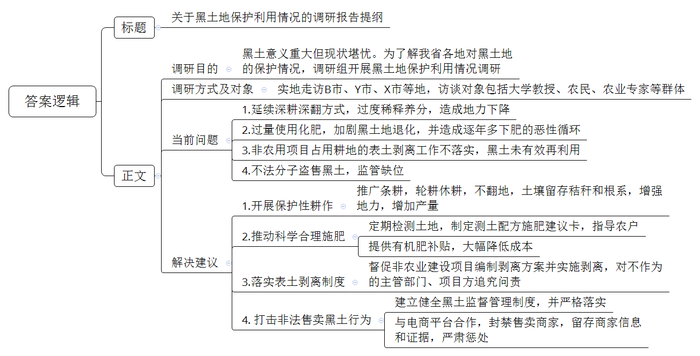
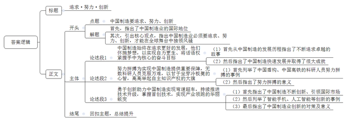

# 2023年公务员多省联考《申论》题（辽宁A卷）

<!-- gwy:overview:start -->
> **辽宁 · 2023 · 申论 · A类** ｜ 4 题 · 图片 4 处 · 答案随题折叠

导航：[题目](#题目) · [材料 1](#材料-1)
<!-- gwy:overview:end -->

> 候选采集稿。参考答案及解析来自粉笔页面，不代表官方答案或真实高分答卷；来源使用许可与原卷对应关系仍需人工核实。

## 给定材料

### 材料 1

地处我国东北的安岭林区是我国北方重要的生态安全防护屏障，党的十八大以来，特别是2014年全面停止天然林商业性采伐之后，林区走向转型发展之路。林区群众正从“绿水青山”中收获更多“金山银山”。

这段时间，安岭林区气温已降至零下20摄氏度，而安岭富林山野珍品科技开发有限责任公司生产车间却是一派火热，工人正忙碌着对林果、林菌等林下绿色有机食品进行加工作业。“我们立足寒地，正在进一步规划发展‘双寒’产业，让昔日‘冷资源’变成更多‘热产业’。”安岭地区负责人说，“安岭地区发展寒地生物、寒地测试产业，今年确定重点推进项目124个，总投资达280亿元，年度计划投资超40亿元。”

安岭地区白桦林场去年种植了赤芍、金莲花、防风等30多个品种的中药材，5000多亩药田成为当地热门景点。“寒地中药材给我们带来了新生机，成了‘致富草’。”白桦林场职工刘成说。他参加了当地成立的中药材专业种植合作社，年增收约7万元。

漂移的车影，疾驶的车轮，卷起一阵雪雾……每年10月到次年4月，来自全国各地的试车人员来到安岭，寒地测试产业正如火如荼发展。“我们充分利用极寒气候特点，主动创造条件，打造了一系列新兴产业形态。”安岭地区工信局王局长说，“我们将进一步推动特色林农、文化旅游、绿色生态食品等一系列重点产业发展，建设国家级寒地测试基地、寒地生物产业基地。”

森林里，一座高28米的瞭望塔上，张研身穿迷彩服、手持望远镜正在值守。张研是安岭林业集团公司一名“80”后职工，他告诉记者自己的父亲也是一名瞭望员，尽管孤寂辛苦，父子俩一直坚守，守护森林安全。

统计显示，安岭地区森林覆盖率已达85.3%。近年来，受气候变化等因素影响，当地火险形势更加严峻，但受害森林面积不断下降。这得益于森林防灭火预警立体监测体系发现早、处置快，更离不开一代代林区人默默坚守。

据安岭林业集团公司生态修复管理处统计，天然林资源保护工程实施以来，安岭地区已累计完成人工造林任务70.81万亩，后备资源培育超500万亩，引进推广育苗新技术，还进行了林业有害生物监测调查。“身在广袤林海，我们像保护眼睛一样保护生态环境。”安岭林区副书记王军说。

作为安岭林区葱岭林场的场长，最让李玉君感到自豪的是，他成功带领职工完成了“二次创业”。

“作为老牌林场，这里流传着宝贵且正宗的木帮文化血脉，作为东北抗联长期生活和战斗的重要核心区域，这里有着丰厚的红色文化基因。”李玉君说。2013年，他们便开始谋划新发展出路，在了解了场区的实际情况后，决定从红色旅游入手试水创业。2014年，他们启动了葱岭红色旅游观光区一期工程——修建了森林民俗文化博物馆和东北抗联葱岭密营文化展览馆，当年就获得了十分可观的收益。2021年夏天，这里又建成了葱岭现代军事展示馆，吸引了不少院校的研学教育群体。

“这大块的桦树茸就是‘黑金’。”安岭林区红旗林场职工赵丽举着圆鼓鼓的包装袋，向往来的游客介绍道。

赵丽拿出自己的电商记录本，上面清楚地写着：年销售额达到100多万元。近5年来，通过自主学习电商，她将这里盛产的蓝莓、红豆、黄芪等特色林下产品远销各地，不仅实现了脱贫，还成为了当地的致富带头人。

2018年，红旗林场成立了网红创业中心，分别设立了烹饪餐饮直播间、带货直播间、林下产业展区等，为赵丽这样的创业者搭建学习创业和展示的平台，并提供营销、美工、策划等配套服务。

赶上好时候，更要加油干。赵丽与当地山特产品店合作，组建了营销团队。她还积极参与红旗林场电商平台的创建，将所学所知传授给职工群众，带领大家共同致富。

2022年11月初，安岭机场改扩建工程通过验收。该项目按满足2030年旅客吞吐量47万人次、飞机起降量5596架次的需求设计，既方便当地百姓出行，更为经济社会发展拓宽新通道。

### 材料 2

中午点个外卖，下午和同事在小程序拼单奶茶，网约车、预约挂号、“无人工厂”“透明化生产线”……互联网等数字技术所带来的数字化红利正在覆盖我们生产生活的方方面面。

关于这一现象，在近日由某智库发布的《数字文明时代数字化经营的社会价值研究》报告中总结：在大数据、人工智能等数字技术占主导的时代下，人们在数字化生存场域从事物质生产、生活与生态实践活动中所呈现出的一种社会进步状态，即数字文明。

“数字经济不是区别于实体经济的所谓虚拟经济，而是人类社会发展必然到来的新发展阶段，所有的行业领域都会涉及到数字化转型。”该智库相关负责人在2022年世界互联网大会乌镇峰会数字经济论坛上提到。在迈向数字文明时代的过程中，尤其在不确定的当下，数字经济发展正在纵向延伸，产生更深远的社会价值。

在F市，有一家创办于1985年专售丝绸的店铺祥云绸艺，2020年以前已经在全国开设了30多家门店。2020年之后，来自线上网店等因素的冲击，使线下店收入减少，30多家门店超一半关停，老板张娴开始自救，把丝绸店铺搬到小程序上去。

为什么是小程序？张娴坦言：我们的老客户很多，都是导购加微信做的售后服务，复购率也不错。这是基于对私域用户的考虑。所谓私域，是指企业/品牌自身所拥有的，可以重复、低成本甚至免费触达用户的场域阵地。与之相对应的公域，则指公共阵地，往往需要通过不断的付费投放实现用户触达。

丝绸店小程序上有商品信息、展示视频，还有搭配，客户能直接下单，还可以加入社群看直播、享优惠等。视频号开通直播功能后，祥云绸艺从小程序转到了视频号直播上，在公域流量中找寻更多的新客户。

这两年，尽管祥云绸艺线下门店只剩下10多家，转型线上后产品均价也有所下调，不过年营业收入保持在2000万元左右，线上线下基本各占一半，直播带货每月营业收入达到近百万元。

而在用户群内，门店向客人们发送产品或促销信息，客人们通过小程序顺畅地完成交易，同时线上卖出的优惠卡券必须线下核销，这样每月可为门店额外带来3000-4000人次的客流，以及额外30%的连带消费，生意甚至比以前更好。

这首先依托的就是源源不断的新流量生态，即公域、私域没有隔阂、自由流动的流量，这是保证全域经营的先决条件之一。其次是以消费者为中心，也就是以人为本，这也是全域经营的本质特征。

榴香社是一家开在东北的榴莲披萨招牌店。早在2019年，在绝大多数餐饮品牌还不知如何盘活线下顾客的时候，榴香社已经有意识留存所有公域来的电话号码，还通过微信公众号、系统云会员积累用户，每个门店都专门配备一部手机，用来加客人微信、建粉丝群。因此榴香社积累了一定规模的用户数字资源。近年来，榴香社启动所有私域卖货，通过小程序店铺完全打通线上私域和线下门店的交易闭环：一是线上下单，客人门店自提；二是卖预制菜，榴香社发快递配送。

无论是各行各业无数的微观个体，还是大品牌、大企业，<u>进行数字化转型正在成为</u><u>不确定环境</u><u>下的最大确定性</u>。某产业研究院院长肖光说，这也是数字化经营更好地赋能全社会的典型表现。

### 材料 3

黑土是非常稀缺的土壤资源。我国东北黑土区产出的粮食，占全国粮食总产量超过1/4，商品粮调出占1/3，是名副其实的我国粮食安全的压舱石。然而，受各种因素影响，一些地方的黑土地正在变薄、变瘦、变硬。为保护黑土地，我国颁布了《中华人民共和国黑土地保护法》，相关各省也出台了地方性保护条例。为了了解各地对黑土地的保护情况，M省派出调研组对省内黑土地保护利用情况进行调研。

清明之后，B市城区附近，河里的冰雪尚未消尽，忙碌的农机已经开始旋地、耕地，为不久之后的春耕做准备。在这里，机器早就代替了人工耕作，但耕种仍延续着深耕深翻的方式。

某农业大学实验站里，有一个黑土地剖面观察点。这是一个宽一米左右、长两米左右、深一米五左右的土坑。土坑的断面上，可以看到土壤颜色的明显变化，接近地表大约30厘米的土层，都是黑色的土壤，断面上布满干枯的玉米根须。王教授正在指导学生实验，他认为，过度深耕深翻会造成深土层中的生土层土壤大量地翻到浅层熟土层土壤中，会造成适宜作物生长发育的熟土中的土壤有机养分与无机养分含量被过度稀释而造成地力下降，而且一旦出现大量深层生土与浅层活土掺混的情况，一般需要连续多年腐熟活化才能把变差的土壤恢复到正常状态。

在不远的某农业科技园区，技术人员正在忙碌着进行土壤化验。园区负责人说：“现在更多的地方，还会大量使用化肥。化肥是保持产量的主要方式，但必须配合有机肥或者秸秆还田来使用，否则会加剧黑土地的退化问题。我们园区围绕黑土地保护开展了重金属污染监测项目和测土配方施肥项目，定期检测黑土地中17项微量元素，为每一块地制定一张测土配方施肥建议卡，指导农户进行科学合理施肥，在保证土壤肥力的同时避免化肥污染。”

在Y市月照镇，一位正在田间施肥的农民对调研组说：“为了保产量，一年年化肥越下越多，产量却变低了，地也变瘦了。我们农民也心慌，但慌也没办法，只好再多下肥，恶性循环。”在农村工作了近30年的月照镇农业技术推广站张站长说：“我参加工作时就在乡镇，都是把玉米秆粉碎，加上粪肥，加上土，发酵后送地里。后来采取施化肥方法，人也变懒了。而且，施有机肥，施用量按1公顷30立方米计算，要2000多元成本，从产量上看，它产生的效果和施200斤化肥是一样的，而化肥只要300元左右成本。从长远看，施农家肥3年后，土地得到保护，化肥施用量可减少20%。但农民往往注重眼前利益，要改变生产方式、耕种方式，得有补贴等经济支撑。”

某家庭农场的技术负责人苗某某告诉调研组，他们在2016年就开始进行保护性耕作，除了秸秆还田，条耕也是其中的一项。“条耕是一种轮耕休耕的方式，把农田划分成条状，一条耕种，一条休耕，每年轮换一次，相当于只有一半的土地耕种。”

不翻地、土壤中留存着大量秸秆和根系、只种一半的土地面积，这种保护性的种植方式，是否会影响产量？苗某某说：“恰恰相反，保护性耕作的产量比农户用传统耕作方式种植的产量更高一点儿。原因是多方面的，轮作休耕，会让地力更强。条耕的方式，使得每一行都具有边行效应，植株的透光、通风等情况更好，长势也更好。”

受农场影响，周边的一些农户开始尝试保护性耕作方式，他们看到我们的收益，自然跟着学。不过，也有一些人，并不完全按照我们的原则去耕种，苗某某觉得这可能是一个必经的过程，“大家都是一点点学，我相信，慢慢会有更多人，采用更多的保护性耕作技术。”

农业专家刘教授介绍，在黑土地保护性耕作技术探索中，有两种不同的观念，一种是在利用中保护，一种是在保护中利用。前者以保障粮食产量为首要任务，保护放在利用之中。后者则以保护性的方式来利用。“两种观念其实都没问题。问题在于，坚持前一种观念的人，往往觉得后一种方法必然会造成减产，我们知道事实并非如此，但要说服他们并不容易。”

X市黑土地保护检测中心负责人王弦对调研组说：“非农业建设项目所占用耕地的耕作层土壤应进行剥离，就是将耕作层的熟土挖下来。剥离的土壤主要用于土地复垦和改良治理。”然而X市2017年以来实施的426个已办理用地审批手续的非农业建设项目中，仅有5个项目编制表土剥离方案并实施剥离，超过180万立方米的黑土资源没有得到有效再利用。

X市一位从事园林绿化行业的业内人士向调研组反映，使用黑土地种植的绿化植物成活率较高，黑土在园林绿化领域颇受欢迎。他说：“一些不法分子趁‘月黑风高’去湿地、农田等大量盗挖黑土出售，多的一晚上能挣十几万元，几乎是没有成本的暴利。”调研组浏览几个电商平台也发现，不少商家正在售卖“东北草炭土”“东北腐殖土”，售价约为每斤2元，购买量大还能优惠。

### 材料 4

2020年9月29日，中国中铁自主研制的第1000台盾构机，在郑州中铁工程装备集团有限公司下线。而在十几年前，中国盾构机还是零，这一天，车间标语“造中国人自己的盾构，造中国最好的盾构，造世界最好的盾构”显得格外醒目。

随着工业化水平的不断提高，机械力逐渐取代人力开挖。盾构机凭借快速、方便、安全的优势广泛应用于铁路、公路、地铁等各种隧道工程中，被誉为“工程机械之王”。盾构技术也成为衡量一个国家装备制造业水平的重要标志。

从自力更生、自主研发到突破关键技术，让民族盾装上“中国芯”，再到走出国门，成为亮眼的中国名片，中国盾构人一路走来着实不易。

就在欧美日大力推动盾构技术升级的20世纪后半叶，基于大量基础设施建设而对盾构机有巨大需求的中国，却没有一台真正属于自己的盾构机。

1996年12月18日，西安至安康的西康铁路开始修建，其中经过全长18.46公里的秦岭隧道。为了保障安全、缩短工期，国家以每台3.5亿元的价格从国外采购了两台盾构机。结果挖掘效率大大提升，隧道提前10个月贯通。

“‘洋盾构’有甜头，但越往后问题越多。买的是旧机器，却要按新设备付钱；机器维修保养时不许中方参加，还拉警戒线；维修进度中方说了不算，完全取决于外方……”中铁装备设计研究院总负责人告诉记者。

没有核心技术就没有话语权，就会受制于人，从那时起，“造中国人自己的盾构机”成为中国盾构人的梦想和追求。

时间进入21世纪，为打破西方技术垄断，2002年，“隧道掘进机关键技术研究”被列入“863计划”，成为国家级重点工程。由中铁隧道集团18人组成的盾构机研发项目组也于当年10月成立。

盾构机研发涵盖机械、力学、液压、电气等数十个领域，精密零部件达3万多个，一个控制系统就有2000多个控制点。“项目组没有技术指导，从零起步，硬是从设计图纸干起。仅是弄清刀盘刀具问题，就花了近5年时间。”中铁装备设计研究总院负责人说。为了印证数据，他们不断前往施工现场求证，加班熬夜是家常便饭，通宵也是常事。

就这样，啃了6年硬骨头，在无数科研人员与专家学者的共同努力下，2008年，中国首台具有自主知识产权的复合式土压平衡盾构机——中国中铁1号成功下线。至此，“洋盾构”一统天下的局面被打破了。

虽然有了国产盾构机，但不少人心里打鼓：国产盾构能行吗？

2012年1月，成都地铁2号线、4号线开工建设。当地地质复杂，漂石、砂卵石、涌水突出。在以往的地铁施工中，所有盾构都是国外品牌。“这并不是说进口设备在施工过程中不会出现问题，而是在当时，人们对我们自己研发的盾构机还心存顾虑。”中铁装备设计研究总院负责人说。

历经3个多月的交流与沟通，中铁装备团队慢慢打消了设计、施工等单位的疑虑，最终采用“1+1模式”，即国产盾构机和进口盾构机左右线同时始发。“这其实就给了我们一个同台较量的机会，当然要全力以赴！”此后，每名员工每天都紧张忙碌着，他们明白，这场较量不能输。

10个月后，国产盾构机的各项性能指标均优于进口盾构机，有力提振了中国盾构人的信心。

“工欲善其事，必先利其器”。经过多年探索与努力，我国研发团队不断突破核心技术封锁，实现了弯道超车，掌握了包含超大直径盾构超长距离掘进不换刀、超大直径盾构机创抗浮技术、光纤磨损检测、盾尾磨损检测、管片自动化拼装、同步掘进、智慧化远程安全监控管理、管片自动化拼装技术、绿色环保管路延长装置、泥水分层逆洗循环技术、刀盘伸缩摆动装置等世界首创先进技术。

从2008年第一台具有自主知识产权的复合式土压平衡盾构机下线至今，中国盾构机已出口至全球20多个国家和地区，连续五年销量世界第一，实现了从“跟跑”到“并跑”再到“领跑”的转变。支撑中国盾构机产业爆发的正是创新创造。

## 题目

### 第 1 题

**请根据****“给定资料**1**”，概括安岭林区为更好实现转型发展采取了哪些措施？（15分）**

关联材料：材料 1

作答要求：

要求：全面、准确、有条理；不超过200字。

第 1 题 · 答案与解析

**参考答案（粉笔题库参考内容）**

1.发展“双寒”产业。发展寒地生物及寒地测试产业，打造一系列重点新兴产业，建设基地。

2.守护森林安全。建设森林防灭火预警立体监测体系，实施天然林资源保护工程。

3.发展红色旅游。打造红色旅游观光区，修建现代军事展示馆，吸引研学群体，获得收益。

4.发展电商产业。搭建学习创业和展示平台，提供配套服务；创建电商平台，教授知识，共同致富。

5.改善交通条件。扩改建安岭机场，方便群众出行，拓宽经济社会发展新通道。

**解析**

**参考答案说明**：本参考答案从“发展‘双寒’产业”“守护森林安全”“发展红色旅游”“发展电商产业”和“改善交通条件”这五个方面展开。各条答案要点在内容上相互并列，没有交叉。

**考点**：概括措施类

**来源**：2023年公务员多省联考《申论》题（辽宁A卷）

### 第 2 题

**“给定资料**2**”中提到“进行数字化转型正在成为不确定环境下的最大确定性”，请根据“给定资料”谈谈你对这句话的理解。（20分）**

关联材料：材料 2

作答要求：

要求：分析全面，条理清晰；不超过300字。

第 2 题 · 答案与解析

**参考答案（粉笔题库参考内容）**

这句话指的是数字经济是社会发展必然到来的新阶段，会产生深远的社会价值，数字化经营可以为全社会、全行业赋能。

1.“不确定环境”是指：受线上网店等因素冲击，线下企业面临收入减少甚至关停的情况。

2.“最大确定性”指通过数字化转型，可以实现全域经营。具体体现在：①可以建立新流量生态。建立小程序、微信等私域阵地，重复、低成本甚至免费触达用户；通过直播等公域手段，寻找更多新客户；打通公域私域隔阂，实现流量自由流动。②可打通线上线下交易闭环。线上消费者转化为线下客流，产生额外消费；通过线下渠道积累的顾客，可通过加微信、建群等方式转化为用户数字资源，以此启动私域卖货。

因此，各行业都要积极拥抱数字化转型。

**解析**

**参考答案说明**：（1）思路方面，本参考答案按照词句解释题“总体释义+展开解释+总结”的思路展开。（2）内容方面，本参考答案首先对划线句子进行了解释；接着“展开解释”部分，先解释了“不确定环境”“最大确定性”的具体所指，再从“可以建立新流量生态”“可打通线上线下交易闭环”两个方面介绍了“最大确定性”的具体表现；最后在“总结”部分，进行简单的总结。

**考点**：词句解释类

**来源**：2023年公务员多省联考《申论》题（辽宁A卷）

### 第 3 题

**假如你是省调研组成员，请根据****“给定资料**3**”，撰写一份调研报告提纲。（25分）**

关联材料：材料 3

作答要求：

要求：

（1）符合调研报告的写作要求；

（2）准确简明，条理清晰；

（3）不超过500字。

第 3 题 · 答案与解析

**参考答案（粉笔题库参考内容）**

关于黑土地保护利用情况的调研报告提纲

一、调研目的：黑土意义重大但现状堪忧。为了解我省各地对黑土地的保护情况，调研组开展黑土地保护利用情况调研。

二、调研方式及对象：实地走访B市、Y市、X市等地，访谈对象包括大学教授、农民、农业专家等群体。

三、当前问题：1.延续深耕深翻方式，过度稀释养分，造成地力下降。2.过量使用化肥，加剧黑土地退化，并造成逐年多下肥的恶性循环。3.非农用项目占用耕地的表土剥离工作不落实，黑土未有效再利用。4.不法分子盗售黑土，监管缺位。

四、解决建议：1.开展保护性耕作。推广条耕，轮耕休耕，不翻地，土壤留存秸秆和根系，增强地力，增加产量。2.推动科学合理施肥。定期检测土地，制定测土配方施肥建议卡，指导农户；提供有机肥补贴，大幅降低成本。3.落实表土剥离制度。督促非农业建设项目编制剥离方案并实施剥离，对不作为的主管部门、项目方追究问责。4.打击非法售卖黑土行为。建立健全黑土监督管理制度，并严格落实；与电商平台合作，封禁售卖商家，留存商家信息和证据，严肃惩处。

**解析**

**参考答案说明**：（1）格式方面，本参考答案写到了“标题”“正文”两个部分。（2）正文部分，一方面从内容上来看，本参考答案先介绍了本次调研的目的，随后介绍了本次调研的方式及对象，最后，调研内容从问题和解决建议两个层面展开。另一方面，形式上，本参考答案做到了分段、分条撰写，整体上条理较为清晰。

**考点**：总结类

**来源**：2023年公务员多省联考《申论》题（辽宁A卷）

### 第 4 题

**深刻理解****“给定资料**4**”，以“追求·努力·创新”为题目，联系实际自选角度写一篇文章。（40分）**

关联材料：材料 1、材料 2、材料 3、材料 4

作答要求：

要求：

（1）观点明确，见解深刻；

（2）思路清晰，语言流畅；

（3）1000-1200字。

第 4 题 · 答案与解析

**参考答案（粉笔题库参考内容）**

**追求·努力·创新**

全球化时代的今天，中国制造已经成为了世界经济中不可忽视的一部分。作为世界上最大的制造业出口国，中国制造以其高效、低成本、多样化的生产方式，成为了全球消费品市场中的重要一员。制造业每一个环节中，我们始终追求更卓越的成就，努力提升技术水平和生产能力，不断寻求创新突破，推进产业高质量发展，正是这种开拓突破的勇气和一往无前的力量，让中国制造得以在全球舞台中独领风骚。

**中国制造始终在追求更好的发展，他们怀揣梦想，以实现自力更生、将话语权紧握手中为核心的奋斗目标。**中国制造的发展历程是一篇追求卓越的故事。从最初的简单加工制造到现在的高科技产业、智能制造等，中国制造一直保持着积极的姿态，不断探索前行的道路，我们永远铭记被国外实行技术封锁、受制于人的历史，中国制造始终秉持初心、稳健步伐，持之以恒追求技术创新、工艺改进、品质提升等多方面的提升，一步步迈向了更高的发展层次。与此同时，中国制造的快速发展吸引了更多的国际客户，伴随着中国制造在全球市场的逐步崛起，我们终于走入世界制造产业的中央，成为国际舞台上一股重要力量。

**努力拼搏为实现中国制造提供重要保障，无数科研人员克服万难，以甘于坐穿冷板凳的心智，高高举起自主知识产权的大旗**。他们用坚实的脚步，走过千山万水，用坚毅的信念，攻坚克难，创造出一个又一个惊人的成果。中国盾构6年磨一剑，众多科研专家励精图治，推出具有自主知识产权的中国中铁1号，打破“洋盾构”一统天下的局面；中国高铁直面西方技术掣肘，不懈地探索材料、工艺、质量等方面的问题，成功研发了可与国际顶尖高铁媲美的“复兴号”。正是这些科研人员的努力，让中国的航空器、核电站等重器械不断拥有更高的技术含量，藏在这些大国重器背后的不只是中国制造业的崛起，更是中国科技长足进步的真谛。

**勇于创新助力中国制造实现弯道超车，持续推进技术升级，掌握首创技术，实现产业领跑的华丽蜕变****。**作为全球最大的制造国之一，中国已经成为全球的零部件制造中心，而在亿亿级别的市场规模下，中国制造正在通过不断升级和创新的方式，开疆拓土，引领国际市场走向。以智能手机为例，中国品牌的崛起已经打破了国外品牌的垄断局面，而在大数据、人工智能等热门领域，中国企业也在不断涌现出更多的领先技术和产品。中国制造业通过持续强化科技研发力度，引导企业不断探索新技术，研究新产品、新工艺，为中国制造业的转型和升级提供有力的技术支撑和保障，助推中国制造实现从“跟跑”到“并跑”再到“领跑”的转变。

未来，中国制造必将以更为强大的姿态参与全球市场竞争，把握时代机遇，面对国内外环境的挑战，不断努力创新、提高品质，助力中国制造行业实现更加高质量、高效率、高水平的发展，向着世界制造中心的目标奋勇前行。

**文章分析**

**追求****·努力·创新**

【**标题的优点：**严格按照题目的要求，以“追求·努力·创新”为标题。】

（1）全球化时代的今天，<u>中国制造已经成为了世界经济中不可忽视的一部分</u>。作为<u>世界上最大的制造业出口国</u>，<u>中国制造</u>以其高效、低成本、多样化的生产方式，<u>成为了全球消费品市场中的重要一员</u>。（2）制造业每一个环节中，我们始终<u>追求更卓越的成就</u>，<u>努力提升技术水平和生产能力</u>，<u>不断寻求创新突破</u>，推进产业高质量发展，正是这种开拓突破的勇气和一往无前的力量，让中国制造得以在全球舞台中独领风骚。

【**开头的优点：**★内容方面：范文的开头是紧扣“中国制造要追求、努力、创新”这一主题展开的。首先，指出了中国制造业的国际地位；其次，引出核心观点，指出中国制造业必须要追求、努力、创新，才能在全球舞台中独领风骚。★文字表达方面：长短句配合使用，使语言表达有节奏感。】

**中国制造始终在追求更好的发展，他们怀揣梦想，以实现自力更生、将话语权紧握手中为核心的奋斗目标。**（1）<u>中国制造的发展历程是一篇追求卓越的故事</u>。<u>从最初</u>的简单加工制造<u>到现在</u>的高科技产业、智能制造等，中国制造<u>一直保持着积极的姿态</u>，<u>不断探索前行的道路</u>，我们<u>永远铭记</u>被国外实行技术封锁、受制于人的<u>历史</u>，中国制造<u>始终</u>秉持初心、稳健步伐，持之以恒<u>追求</u>技术创新、工艺改进、品质提升<u>等多方面的提升</u>，一步步迈向了更高的发展层次。（2）与此同时，中国制造的快速发展<u>吸引了更多的国际客户</u>，伴随着中国制造<u>在全球市场的逐步崛起</u>，我们终于<u>走入世界制造产业的中央</u>，<u>成为国际舞台上一股重要力量</u>。

【**论述段****1的优点：**★观点句：范文的观点句是紧扣“中国制造要追求、努力、创新”这一文章主题提出的。形式上，它在段首处直接写出，位置突出，容易发现。内容上，关键词突出，内容要点明确，可以明显看出他是从“追求”入手，指出了中国制造要追求发展。★论述内容：（1）首先从中国制造的发展历程指出了不断追求卓越的故事；（2）然后指出了中国制造快速发展并取得了很大成就。注意：以上两个方面的内容都是紧扣“中国制造始终在追求更好的发展，他们怀揣梦想，以实现自力更生、将话语权紧握手中为核心的奋斗目标”这个观点句论述的，论述的针对性强，内容层次丰富。在论述方法上主要采用了讲道理的方式，论述清晰透彻。】

**努力拼搏为实现中国制造提供重要保障，无数科研人员克服万难，以甘于坐穿冷板凳的心智，高高举起自主知识产权的大旗。**（1）他们用坚实的脚步，走过千山万水，用坚毅的信念，攻坚克难，创造出一个又一个惊人的成果。<u>中国盾构</u>6年磨一剑，<u>众多科研专家励精图治</u>，推出具有自主知识产权的中国中铁1号，<u>打破</u>“<u>洋盾构</u>”<u>一统天下的局面</u>；<u>中国高铁直面西方技术掣肘</u>，不懈地探索材料、工艺、质量等方面的问题，<u>成功研发了可与国际顶尖高铁媲美的</u>“<u>复兴号</u>”。（2）正是这些<u>科研人员的努力</u>，<u>让中国的</u>航空器、核电站等<u>重器械不断拥有更高的技术含量</u>，藏在这些大国重器背后的<u>不只是中国制造业的崛起</u>，<u>更是中国科技长足进步的真谛</u>。

【**论述段****2****的优点：**★观点句：范文的观点句是紧扣“中国制造要追求、努力、创新”这一文章主题提出的。形式上，它在段首处直接写出，位置突出，容易发现。内容上，关键词突出，内容要点明确，可以明显看出他是从“努力”入手，指出了中国制造要努力拼搏。★论述内容：（1）首先列举了中国盾构、中国高铁的科研人员努力拼搏的事例；（2）然后指出了努力拼搏的意义。注意：以上两个方面的内容都是紧扣“努力拼搏为实现中国制造提供重要保障，无数科研人员克服万难，以甘于坐穿冷板凳的心智，高高举起自主知识产权的大旗”这个观点句论述的，论述的针对性强，内容层次丰富。在论述方法上采用了讲道理、举例子相结合，做到了丰富多样。】

**勇于创新助力中国制造实现弯道超车，持续推进技术升级，掌握首创技术，实现产业领跑的华丽蜕变。**（1）作为全球最大的制造国之一，中国已经成为全球的零部件制造中心，而在亿亿级别的市场规模下，<u>中国制造正在通过不断升级和创新的方式</u>，<u>开疆拓土</u>，<u>引领国际市场走向</u>。（2）以<u>智能手机</u>为例，中国品牌的崛起已经<u>打破了国外品牌的垄断局面</u>，而在<u>大数据</u>、<u>人工智能等热门领域</u>，中国企业也在不<u>断涌现出更多的领先技术和产品</u>。（3）中国制造业<u>通过持续强化科技研发力度</u>，<u>引导企业不断探索新技术</u>，<u>研究新产品</u>、<u>新工艺</u>，<u>为中国制造业的转型和升级提供有力的技术支撑和保障</u>，<u>助推</u>中国制造实现<u>从</u>“<u>跟跑</u>”<u>到</u>“<u>并跑</u>”<u>再到</u>“<u>领跑</u>”<u>的转变</u>。

【**论述段****3****的优点：**★观点句：范文的观点句是紧扣“中国制造要追求、努力、创新”这一文章主题提出的。形式上，它在段首处直接写出，位置突出，容易发现。内容上，关键词突出，内容要点明确，可以明显看出他是从“创新”入手，指出了中国制造要勇于创新。★论述内容：（1）首先指出了中国制造不断创新、引领国际市场；（2）然后列举了智能手机、人工智能等创新的事例；（3）最后指出了中国制造业创新的对策及意义。注意：以上三个方面的内容都是紧扣“勇于创新助力中国制造实现弯道超车，持续推进技术升级，掌握首创技术，实现产业领跑的华丽蜕变”这个观点句论述的，论述的针对性强，内容层次丰富。在论述方法上采用了讲道理、举例子相结合，做到了丰富多样。】

【**论述段之间的关系：**★内容的内在逻辑：论述段1先写了“中国制造始终在追求更好的发展，他们怀揣梦想，以实现自力更生、将话语权紧握手中为核心的奋斗目标”，论述段2接着写了“努力拼搏为实现中国制造提供重要保障，无数科研人员克服万难，以甘于坐穿冷板凳的心智，高高举起自主知识产权的大旗”，论述段3最后写了“勇于创新助力中国制造实现弯道超车，持续推进技术升级，掌握首创技术，实现产业领跑的华丽蜕变”，各论述段分别从“追求”“努力”“创新”展开，论述段之间相互并列，逻辑清晰。】

未来，中国制造必将以更为强大的姿态参与全球市场竞争，把握时代机遇，面对国内外环境的挑战，不断努力创新、提高品质，助力中国制造行业实现更加高质量、高效率、高水平的发展，向着世界制造中心的目标奋勇前行。

【**结尾的优点：**范文的结尾回扣了“中国制造要追求、努力、创新”这个主题，并且进行了总结提升。】

**解析状态：unknown（来源未提供）**

**考点**：文章写作题

**来源**：2023年公务员多省联考《申论》题（辽宁A卷）

