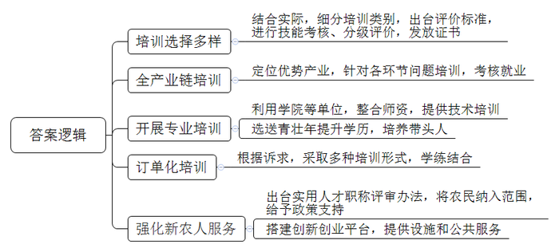
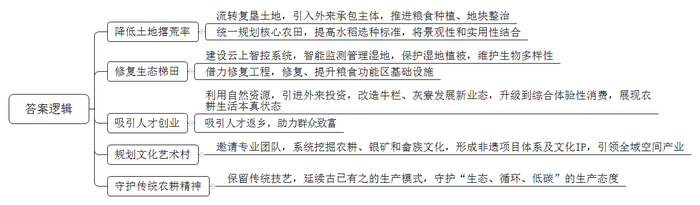
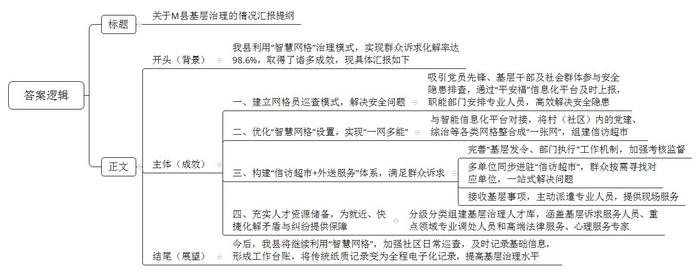
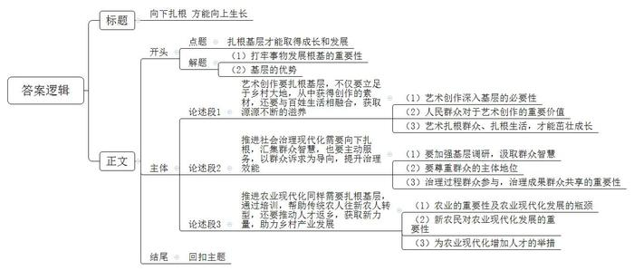

# 2023年公务员多省联考《申论》题（辽宁B卷）

<!-- gwy:overview:start -->
> **辽宁 · 2023 · 申论 · B类** ｜ 4 题 · 图片 4 处 · 答案随题折叠

导航：[题目](#题目) · [材料 1](#材料-1)
<!-- gwy:overview:end -->

> 候选采集稿。参考答案及解析来自粉笔页面，不代表官方答案或真实高分答卷；来源使用许可与原卷对应关系仍需人工核实。

## 给定材料

### 材料 1

在S省数字农业人才培训基地直播间里，61岁的老农民“八哥”操着乡音，对着手机屏幕介绍着当地的黄花。“八哥”，就是D市古家乡的农民老陈，因为对短视频直播有兴趣，就报名参加了当地的数字“新农人”直播培训班。拿到技能证书的“八哥”，和老伴一起直播分享农家生活，销售小米、黄花等土特产，一年能挣十五六万元。

近年来，S省实施“人人持证、技能社会”工程，大量传统农人通过培训、考核，掌握了一技之长，成为“新农人”。D市结合当地产业发展、考虑农民兴趣需求、调研市场情况，把培养目标分为农业经理人、返乡下乡创新创业者、新型农业经营与服务主体、种养加技术能手等类别。还先后出台20多个技能评价的地方标准，对参训农民进行技能考核与分级评价。不同的培训项目，不同的课程内容和培训时长，高、中、初三个等级的证书，为广大农民提供了多元选择。

S省农业发展的一个突破口在“特”与“优”，不同地方根据地域特色逐步形成优势产业，比如Z市聚焦小杂粮、菌类种植，C市重点发展药茶、红枣产业等。老陈所在的D市高素质农民培训学院依托园区企业，针对黄花种植、采摘、加工、物流等全产业链问题展开培训，农民考核通过后可直接进入相关企业工作。

X市的郝大姐曾是贫困户，在参加培训班后，学会了木耳吊袋种植技术。如今，她办起了合作社，年收入过百万元，带动几十户村民就业。她说：“没有政策的支持和老师们的帮助，我走不到今天。”X市利用专门学院、县乡级合作社等单位，整合农科院所和农业部门农技专家等师资，对农民进行培训，还选送一批农村青壮年到涉农大中专院校参加大中专学历教育。青年农民创业者王卫东在取得技能证书后，经常回培训班交流经验，还积极尝试学到的新种植方法，带动了不少人增收致富。

“我们坚持‘缺什么补什么’，采取‘订单式’‘菜单式’模式，实现‘农民下单、专家配菜’，通过课堂教学、实习实践、线上培训、跟踪辅导等形式，让农民在学中干、在干中学。”S省农业农村厅科教处许处长说，“无论是专业教师还是身边榜样，都是培养高素质农民的‘好老师’，都是可以动员起来的力量。”

S省出台了农村实用人才职称评审办法，将农民作为一项职业纳入职称评定范围，并在项目扶持、资金贷款、培训、招聘等方面享受倾斜支持。“农民可以评职称，我们感觉特自豪，干劲儿更足了。”刚获得中级职称的水稻种植大户老田说起这件事非常兴奋。

5年前，T市龙湖镇的方明从IT行业转战农村。多年的农业创业经历，让他感受到了“新农人”的不易。他说：“做农业，投入大、回本慢，招人用工遇到困难更是家常便饭。”T市的“星创天地”应运而生，这个半公益性质的农业孵化器，通过资源整合，面向入驻的“新农人”，提供现代农机作业、技能培训、用工推荐、商业资源对接等服务，几年时间见证了不少项目从雏形成长为年营业额超千万元的“潜力股”。

“我们以培育省级农村创新创业园区和孵化实训基地为抓手，搭建返乡下乡在乡人员创新创业平台，为‘新农人’创新创业提供完备的基础设施和更高效便捷的公共服务。”省农业农村厅詹处长说。截至2022年，全省已培育省级以上农村创新创业园区（基地）184个。

### 材料 2

盛夏时节，位于崇头镇的云和梯田层层叠叠，绿意盎然，高举红色绸带的祈福巡游队伍穿梭在田间，锣鼓声声。“祈福是村里的特色民俗活动，我们每年都会举办，在各地工作生活的村民们都会回到村里参加活动。每年开犁都会举行祈福巡游活动，祈求国泰民安、风调雨顺、五谷丰登。”村民老雷笑呵呵地说。

“芒种忙种，一人、一牛、一架犁；梅雨期期，蓑衣斗笠添稻香。”——这鲜活的传统农耕画面，历经千年依然在这里代代相传。然而，这样的传统农耕场景一度险些消失在历史中。现代农业兴起后，由于地块狭小，难以使用大型农机的梯田遭遇产粮瓶颈，加上农村劳动力流失，云和梯田核心区内土地撂荒率一度高达45%。

为留住千年梯田农耕文化之根，重现梯田农耕盛景，梯田核心区所在地崇头镇对土地进行流转复垦，通过引入外来承包主体推进粮食种植和地块整治。赵副镇长介绍说：“从2018年开始，梯田核心区农田的耕作就开始实行统一规划，水稻选种标准也一年比一年高，目前选育品种的生长期比一般稻米长，这既能满足景观建设的需求，也能提升稻米口感，切实提升农产品质量安全水平。”2021年以来，作为国家湿地公园的云和梯田，全面开启湿地保护“云上智控”系统建设。这套系统实现了湿地基础网络、小气候环境监测、鸟类监测识别等湿地监测智控管理，有效保护了湿地植被，维护了湿地生物多样性。“云上智控”项目让云和梯田国家湿地公园锦上添花，仅2021年前三季度，云和梯田景区营业收入就达3322万元。目前，核心区内土地撂荒率下降至5%，累计生态修复梯田超5000亩。“我们还将借力云和梯田国家湿地公园梯田修复工程，修复和提升多村粮食功能区的基础设施，建设内容包括农耕道路修复、灌溉与排水修复和荒废梯田修复等。”赵副镇长说。

海拔的巨大差异，成就了梯田的四季变幻，不断刷新着人们对自然之美的感官体验，也吸引着越来越多人前来云和摄影观光、自驾游玩、体验田园生活。几年前，张小雨来坑道村游玩，被这里的原始村貌吸引，最终选择留下创业。他陆续把村里的牛栏、灰寮等改造成咖啡屋、山野杂货铺、木玩工坊等新业态，从单纯住宿升级到综合体验性消费，让游客能更全面地感受当地农耕生活。他说：“我们客房以‘耕、读、渔、樵、闲’命名，日常餐食的食材也都是当地农家种植的新鲜瓜果蔬菜，展现农耕生活中最本真的生活状态。”

“去年，村里农家乐、民宿营业收入达800万元，生态直播间带动农户增收100余万元，越来越多的人选择返乡创业。”坑道村党支部钱书记说。如今，全村有100余人从事民宿行业，“我们正邀请专业设计团队做整体规划，打造一个‘梯田上的文化艺术古村’”。

梯田景区在创建过程中，还系统挖掘农耕文化、银矿文化和畲族文化，形成以开犁节为代表的非遗项目体系和“梯田十味”“稻草草、木积积”等文化IP。其中，“稻草草、木积积”被列入省文化和旅游IP库，受到大家的喜爱。

崇头镇的成功并非个例。自梯田景区创建以来，周边乡村都发展得风生水起，实现了全域空间产业发展。比如，以观看星空为特色的梅竹露营基地一经投入运营，立即赢得了都市游客的青睐，每年可为梅竹村增加15万元的固定收益，成为村集体经济的源头活水。位于海拔980米高山上的黄家畲村，则以夏季的凉爽气候，每天都吸引着300多名城市居民前往避暑打卡，顺势打开了高端民宿产业。

时至今日，当地农民种植梯田稻米，仍完整保留着传统的插秧、收割、筛选、晾晒技艺，并延续着古已有之的稻鱼共生、稻鸭共育等模式，守护“生态、循环、低碳”的传统农耕精神。这近乎严苛的坚守，并非简单源自对仪式感的执念，更是出于对稻米外形、口感和营养的一丝不苟。在此前省里举办的好稻米评选活动中，云和稻田大米在无数竞争对手中脱颖而出，一举夺魁。

云和梯田从最初的籍籍无名，到如今通过国家5A级旅游景区景观质量评审，拿到了5A级旅游景区的“入场券”，辐射带动了大批山区农民增收致富，<u>实现了从“藏在深山人未识”到“声名鹊起他乡知”的美丽蝶变</u>。一味守住旧的文明不去创新，不能称之为文化继承。

### 材料 3

“翠园里7号4楼阳台防盗网有两片铁皮眼看就要掉落，非常危险！”不久前，M县遭遇强降雨，前江街道柳翠社区网格员在排查时发现了这个隐患。业主当时不在家，网格员立刻通过“平安福”信息化平台上报“吹哨”，职能部门“接单”后，迅速安排专业人员到场，及时排除了“头顶上的隐患”。

“网格员的巡查，确实解决了很多安全问题。”聚城街道伍书记表示，小网格“过滤”风险隐患，兜住大民生。这一治理模式在疫情防控、防汛防风工作中也得到了很好的检验。目前，M县共有“智慧网格”954个，依托“平安福”平台实现群众诉求化解率达98.6%。

党员先锋、村（居）民小组长、民警辅警、各类志愿者，以及快递员、网约车司机等灵活就业群体，都可以成为“吹哨人”。2022年以来，M县进一步调整优化“智慧网格”设置，通过与智能信息化平台对接，实现“多网合一”“一网多能”，将村（社区）内的党建、综治、民政、城管、信访等各类网格整合成“一张网”，建成“信访超市”。

近日，某商场结业清货，因货款纠纷与供货商发生争执，导致商场门前拥堵。社区网格员掌握情况后，通过“平安福”平台“吹哨”发令，“信访超市”接单后，立即从“人才库”中就近安排擅长调解经济纠纷的调解员到达现场，不到1个小时就顺利化解了双方的纠纷。M县积极构建“信访超市＋外送服务”体系，完善“基层发令、部门执行”工作机制，加强考核监督。在“信访超市”，职能部门、人民调解、法律咨询、诉讼服务、社工等多个单位或组织同步进驻，群众到这里表达诉求、解决纠纷，可以像进超市一样，按需找到对应单位。无论反映什么问题、涉及多少部门，“超市”都会照单全收，让群众“只进一扇门，最多跑一次”。

“‘信访超市’除了一站式解决群众诉求，还提供‘外送服务’，就是在‘超市’接到基层‘吹哨’事项后，主动将服务‘外送’到现场。”外江街道综治中心胡副主任介绍说。家住园林东路的白大爷因脑卒中住院，因为没有亲人，多年来，邻居一对夫妇一直在照顾他，在住院期间，还为他垫付了部分医疗费用。出院后，白大爷表示，如果他再有不测，希望将自己的遗产留给这对夫妇，于是就联系到了社区进行法律咨询。社区立即联系了律师，帮助白大爷把遗产继承事宜处理好。据了解，通过分级分类组建基层治理“人才库”，目前M县共有基层诉求服务人员3000人，十大重点领域专业调处人员1074人，高端法律服务、心理服务专家105人。充足的人才资源储备，为就近、快捷化解矛盾与纠纷，提供了坚实的保障。

M县梁副县长介绍：“在今后工作中，我们将进一步利用智慧网格对社区进行日常巡查，并及时记录网格‘人、地、事、物、组织’等基础信息，形成《网格基础信息工作台账》，将传统纸质记录变成全程电子化记录，不断提高基层治理水平。”

### 材料 4

2021年，第一次来到马家岭村，美术学院的肖教授和学生们就爱上了它。马家岭村沿岭而建，有1000余户近4000人，主导产业是1100亩葡萄、600亩猕猴桃，村民们也种麦子、玉米。“背倚山峦，村庄、麦田、果园点缀其间，有一种自然的、纯粹的美感。”师生们决定：“实验艺术”就在这个村子展开。他们租下5亩麦田，用麦秆和钢架制作巨幅装置作品，用树枝、麦秆搭建高高耸起的巨型鸟巢……

然而，由于是师生们自己唱“独角戏”，所期待的“在农村创作”能和村民产生紧密的情感共振效果没能实现。肖教授说：“不能自顾自地展示，要和村民的日常生活联系起来。”于是，师生们转变思路，从田野调查做起，农田里、村民家、卫生所、商铺都留下了他们的身影……为了融入农村、融入村民，师生们尝试先从人们喜闻乐见的艺术形式着手，决定办个“农闲艺术节”。

第一届“农闲艺术节”就这样敲定了。远处，层峦叠嶂的山岭是背景；近处，师生们在麦收后的田里搭建起一个100平方米的舞台，受邀而来的当地剧团、健美操队伍、民谣组合依次登场。艺术节上，村民们的热情参与，让美术学院的师生们备受鼓舞和启发。小张同学感慨地说：“这些艺术形式都是我们平时在教室看不到的，我们一定抓住时机来丰富我们的创作。”肖教授接着说：“这就是我们在课堂上所讲的艺术来源于生活嘛！”

第二年，肖教授主动找到村干部商量“能不能再办一次‘农闲艺术节’”。双方一拍即合，好似有默契。一听还要到村里接着办“农闲艺术节”，学生们非常兴奋，纷纷要求加入，理由简单质朴：去年的艺术节学到了课堂上学不到的许多东西。

艺术节的展演需要场地，经过设计，麦田旁的一处堆满垃圾的涝池要被改造为临时剧场。于是，有的同学自告奋勇画出了设计图纸；有的同学负责放线测量；还有的同学与村民一起配合运输队，一车又一车地运走垃圾，再一车又一车地拉回黄土、填实地基，不久就建好了剧场。“回头再看，同学们亲手将满是污水的涝池改造成漂亮的户外剧场，这本身就充满了意义。”肖教授有点激动地说。

村里还破天荒地为“农闲艺术节”召开了一场新闻发布会，发布会就在这个新搭建的舞台上举行。

夏夜，收割后的麦田旁新搭建的舞台上已经铺上红地毯，身着礼服的艺术家们准备就绪，一场麦田里的“交响音乐会”开始奏响，一些村民也带着自己的“节目”来参加。

“迈着悠闲的步伐，麦田剧场转一趟；吹着凉风看节目，嘴上称赞手鼓掌；动情了抹把泪，激动了发个狂……”师生们看着70岁的农民王老伯第一个上台朗诵自己创作的诗歌，越朗诵嗓门越高，都不由自主地跟着激动地鼓起掌来，并连声叫好。师生们感叹这诗虽然简朴，但却飘着泥土的气息，令人回味。

翻开“农闲艺术节”的展演手册，多种艺术展演和文化活动持续上演。还有一些村民主动找到艺术家想参与创作、展示才艺。“你会发现，他们手巧心细，有时搭建的艺术装置、刻下的字比我们的好很多。”某艺术家说。

学生们拍下了丰收后老乡们喜悦大笑的照片，然后做成高高的刀旗，插在麦田中。湛湛晴空下，看着老乡们的巨幅画像，背后是绵延的山峦，脚下是翻腾的麦浪，这些久居城里的艺术学院的师生们，忽然间深刻理解了这个艺术作品的丰富内涵：“啥是艺术？割麦就是艺术，农民就是艺术家，艺术在田野里。”

“我现在明白了，你越理解这块土地你就越爱它，越爱它你就能从它身上学到更多东西，越爱它你就想做更多事情。”小马同学感慨地说。

“在实施乡村振兴战略过程中，马家岭村子变美了，老百姓的生活水平提高了，他们干农活的劲更足了，笑容也多了起来。跑到城里的年轻人回来了，也愿意留下来了，开餐馆、民宿、做旅游、种地，有人气的美丽乡村真是生机勃勃呀！”小杨同学笑容满面地对肖教授说，“这些丰富而鲜活的乡土文化资源给我们的艺术创作提供了难得的第一手素材，极大地激发了我们的创作热情。”

肖教授则说：“这两年，很多人问我，艺术到底能给村庄带来什么？比较而言，我更愿意回答‘村庄给艺术带来了什么’这个问题。艺术不是高高在上的，而是需要与百姓生活融合在一起。在这里，我们得到了源源不断的创作滋养。<u>所有向上生长的繁华，都源自向下扎根的力量</u>。”

## 题目

### 第 1 题

**请根据“给定资料1”，概括S省在帮扶“新农人”工作中的主要做法。（15分）**

关联材料：材料 1

作答要求：全面、准确、有条理；不超过200字。

第 1 题 · 答案与解析

**参考答案（粉笔题库参考内容）**

1.培训选择多样。结合实际，细分培训类别，出台评价标准，进行技能考核、分级评价，发放证书。

2.全产业链培训。定位优势产业，针对各环节问题培训，考核就业。

3.开展专业培训。利用学院等单位，整合师资，提供技术培训；选送青壮年提升学历，培养带头人。

4.订单化培训。根据诉求，采取多种培训形式，学练结合。

5.强化新农人服务。出台实用人才职称评审办法，将农民纳入范围，给予政策支持；搭建创新创业平台，提供设施和公共服务。

**解析**

**参考答案说明**：本参考答案从“培训选择多样”“全产业链培训”“开展专业培训”“订单化培训”“强化新农人服务”五个方面展开，各条答案要点之间在内容上相互并列，没有交叉。

**考点**：概括措施类

**来源**：2023年公务员多省联考《申论》题（辽宁B卷）

### 第 2 题

**请根据“给定资料2”，谈谈云和梯田是怎样“实现了从‘藏在深山人未识’到‘声名鹊起他乡知’的美丽蝶变”的。（20分）**

关联材料：材料 2

作答要求：分析全面，条理清晰；不超过300字。

第 2 题 · 答案与解析

**参考答案（粉笔题库参考内容）**

1.降低土地撂荒率。流转复垦土地，引入外来承包主体，推进粮食种植、地块整治；统一规划核心农田，提高水稻选种标准，将景观性和实用性结合。

2.修复生态梯田。建设云上智控系统，智能监测管理湿地，保护湿地植被，维护生物多样性；借力修复工程，修复、提升粮食功能区基础设施。

3.吸引人才创业。利用自然资源，引进外来投资，改造牛栏、灰寮发展新业态，升级到综合体验性消费，展现农耕生活本真状态；吸引人才返乡，助力群众致富。

4.规划文化艺术村。邀请专业团队，系统挖掘农耕、银矿和畲族文化，形成非遗项目体系及文化IP，引领全域空间产业。

5.守护传统农耕精神。保留传统技艺，延续古已有之的生产模式，守护“生态、循环、低碳”的生产态度。

**解析**

**参考答案说明**：本参考答案从“降低土地撂荒率”“修复生态梯田”“吸引人才创业”“规划文化艺术村”“守护传统农耕精神”这五个方面展开，各条答案要点之间在内容上相互并列，没有交叉。

**考点**：概括措施类

**来源**：2023年公务员多省联考《申论》题（辽宁B卷）

### 第 3 题

**市有关部门来M县了解基层治理的情况，请根据“给定资料3”，以县有关部门名义拟写一份基层治理情况汇报提纲。（25分）**

关联材料：材料 3

作答要求：

（1）符合情况汇报的写作要求；

（2）准确简明，条理清晰；

（3）不超过500字。

第 3 题 · 答案与解析

**参考答案（粉笔题库参考内容）**

关于M县基层治理的情况汇报提纲

背景：我县利用“智慧网格”治理模式，实现群众诉求化解率达98.6%，取得了诸多成效，现具体汇报如下：

成效：一、建立网格员巡查模式，解决安全问题。吸引党员先锋、基层干部及社会群体参与安全隐患排查，通过“平安福”信息化平台及时上报，职能部门安排专业人员，高效解决安全隐患。二、优化“智慧网格”设置，实现“一网多能”。与智能信息化平台对接，将村（社区）内的党建、综治等各类网格整合成“一张网”，组建信访超市。三、构建“信访超市+外送服务”体系，满足群众诉求。完善“基层发令、部门执行”工作机制，加强考核监督；多单位同步进驻“信访超市”，群众按需寻找对应单位，一站式解决问题；接收基层事项，主动派遣专业人员，提供现场服务。四、充实人才资源储备，为就近、快捷化解矛盾与纠纷提供保障。分级分类组建基层治理人才库，涵盖基层诉求服务人员、重点领域专业调处人员和高端法律服务、心理服务专家。

展望：今后，我县将继续利用“智慧网格”，加强社区日常巡查，及时记录基础信息，形成工作台账，将传统纸质记录变为全程电子化记录，提高基层治理水平。

**解析**

**参考答案说明：**（1）本题主要写到了标题和正文两部分。其中正文分别按照开头（主要写到了M县开展基层治理工作的整体情况）、主体（主要写到了“建立网格员巡查模式”“优化‘智慧网格’设置”“构建‘信访超市+外送服务’体系”“充实人才资源储备”这四个方面的成效）、结尾（展望了M县基层治理工作的未来）的结构展开。（2）为了体现公文题的逻辑性，还加上了“现具体汇报如下”“今后”等词语承接上下文。

**考点**：总结类

**来源**：2023年公务员多省联考《申论》题（辽宁B卷）

### 第 4 题

**“给定资料4”划线部分说“所有向上生长的繁华，都源自向下扎根的力量。”请你根据对这句话的理解，联系实际，自选角度，自拟题目，写一篇文章。（40分）**

关联材料：材料 1、材料 2、材料 3、材料 4

作答要求：

（1）观点明确，见解深刻；

（2）思路清晰，语言流畅；

（3）字数800-1000字。

第 4 题 · 答案与解析

**参考答案（粉笔题库参考内容）**

**向下扎根 方能向上生长**

根深才能叶茂，本固方可枝荣。事物的发展需打牢根基，才能持续向上生长，无论是艺术创作，还是社会治理，亦或是农业发展，各项事业都是如此。最丰富的养分，最肥沃的厚土，依然在广大基层地区，在广大的人民群众中。

**艺术创作要扎根基层，不仅要立足于乡村大地，从中获得创作的素材，还要与百姓生活相融合，获取源源不断的滋养。**习总书记在文艺工作座谈会上强调：“文艺是时代前进的号角，最能代表一个时代的风貌。”而要想创作出无愧于时代的艺术作品，就必须深入基层，在广袤的乡村大地上，从丰富而鲜活的乡土文化中，汲取灵感，寻找素材。同时，人民群众是艺术创作的源头活水，只有从百姓的伟大实践和丰富多彩的生活中汲取营养，才能让艺术创作百花竞放，繁荣发展。正如总书记所说，艺术可以放飞想象的翅膀，但一定要脚踩坚实的大地。只有扎根群众、扎根生活，艺术才能打牢根基，茁壮成长。

艺术创作的不竭动力来自群众，来自基层，而这种力量也是推动社会治理的灯塔，更是推进农业现代化的引擎。

**推进社会治理现代化需要向下扎根，汇集群众智慧，也要主动服务，以群众诉求为导向，提升治理效能。**李强总理在记者会上说：“坐在办公室都是问题，下去调研全是办法。”要大兴调研之风，从基层吸取民众力量，汲取民众智慧，让社会治理由政府的“独角戏”，变成人民群众共同参与的“大合唱”。尊重群众的主体地位，就是让群众不再是被动的管理者、旁观者，而是主动的治理者，更是服务的接受者、提供者。治理过程群众参与，治理成果群众共享，才能夯实基层治理基石，也才是推进中国特色社会治理现代化的根本所在、力量之源。

**推进农业现代化同样需要扎根基层，通过培训，帮助传统农人往新农人转型，还要推动人才返乡，获取新力量，助力乡村产业发展。**农业是国民经济的基础，但随着工业化、城镇化快速而深入地推进，农村人力资源向非农产业和城市大量转移，成为农业现代化发展的最大瓶颈。如果没有专业化的新农民，农业现代化便是无源之水，无本之木。必须要把人力资本开发放在首要位置。一方面要实施新型职业农民培育工程，就地培育一批具有专业技能的“土专家”“田秀才”；另一方面，筑巢引凤，从政策上对农村优秀人才回引提供支持和引领，为人才培育成长的“沃土”，给现代农业注入新鲜血液。

江河万里有源，树高千尺有根，无论时事如何变迁，只要我们与群众紧密相连，我们的各项事业就能扎牢根基，获取源源不断的向上力量，迎来满目繁华！

**解析**

**文章分析**

**向下扎根** **方能向上生长**

【**标题的优点：**标题中含有主题词，使文章主题更突出、清晰。】

（1）根深才能叶茂，本固方可枝荣。<u>事物的发展需打牢根基</u>，<u>才能持续向上生长</u>，<u>无论是艺术创作</u>，<u>还是社会治理</u>，<u>亦或是农业发展</u>，<u>各项事业都是如此</u>。（2）<u>最丰富的养分</u>，<u>最肥沃的厚土</u>，<u>依然在广大基层地区</u>，<u>在广大的人民群众中</u>。

【**开头的优点：**★内容方面。范文的开头是紧扣“扎根基层才能取得成长和发展”这一主题展开的。首先，开头点出主题，做到了主题明确。其次，对“扎根基层才能取得成长和发展”这一主题进行了分析阐述，指出了（1）打牢事物发展根基的重要性。（2）基层的优势。★文字表达方面。使用了“是……还是……亦或是……”等关联词，使语言表达有逻辑性。】

**艺术创作要扎根基层，不仅要立足于乡村大地，从中获得创作的素材，还要与百姓生活相融合，获取源源不断的滋养**。（1）习总书记在文艺工作座谈会上强调：“文艺是时代前进的号角，最能代表一个时代的风貌。”而<u>要想创作出无愧于时代的艺术作品</u>，<u>就必须深入基层</u>，<u>在广袤的乡村大地上</u>，<u>从丰富而鲜活的乡土文化中</u>，<u>汲取灵感</u>，<u>寻找素材</u>。（2）同时，<u>人民群众是艺术创作的源头活水</u>，<u>只有从百姓的伟大实践和丰富多彩的生活中汲取营养</u>，<u>才能让艺术创作百花竞放</u>，<u>繁荣发展</u>。（3）正如总书记所说，<u>艺术可以放飞想象的翅膀</u>，<u>但一定要脚踩坚实的大地</u>。<u>只有扎根群众</u>、<u>扎根生活</u>，<u>艺术才能打牢根基</u>，<u>茁壮成长</u>。

【**论述段1的优点：**★观点句：范文的观点句是紧扣“扎根基层才能取得成长和发展”这一文章主题提出的。形式上，它在段首处直接写出，位置突出，容易发现。内容上，关键词突出，内容要点明确，可以明显看出是从“艺术创作”的角度展开论述。★论述内容：（1）先介绍了艺术创作深入基层的必要性；（2）接着介绍了人民群众对于艺术创作的重要价值；（3）最后强调艺术扎根群众、扎根生活，才能茁壮成长。注意：以上三个方面的内容都是紧扣“艺术创作要扎根基层，不仅要立足于乡村大地，从中获得创作的素材，还要与百姓生活相融合，获取源源不断的滋养”这个观点句进行分析论述的，论述的针对性强，内容层次丰富。在论述方法上主要采用了讲道理的方式，论述清晰透彻。】

艺术创作的不竭动力来自群众，来自基层，而这种力量也是推动社会治理的灯塔，更是推进农业现代化的引擎。

【**过渡段的优点**：范文的过渡段分析了扎根群众、扎根基层对于艺术创作的重要性，同时指出扎根群众、扎根基层对于社会治理以及推进农业现代化也同样重要，起到承上启下的作用。】

**推进社会治理现代化需要向下扎根，汇集群众智慧，也要主动服务，以群众诉求为导向，提升治理效能**。（1）李强总理在记者会上说：“坐在办公室都是问题，下去调研全是办法。”<u>要大兴调研之风</u>，<u>从基层吸取民众力量</u>，<u>汲取民众智慧</u>，<u>让社会治理由政府的“独角戏”</u>，变成<u>人民群众共同参与</u>的“大合唱”。（2）<u>尊重群众的主体地位</u>，就是让群众不再是被动的管理者、旁观者，而是<u>主动的治理者</u>，更是<u>服务的接受者、提供者</u>。（3）<u>治理过程群众参与</u>，<u>治理成果群众共享</u>，才能夯实基层治理基石，也才是推进中国特色社会治理现代化的根本所在、力量之源。

【**论述段2的优点：**★观点句：范文的观点句是紧扣“扎根基层才能取得成长和发展”这一文章主题提出的。形式上，它在段首处直接写出，位置突出，容易发现。内容上，关键词突出，内容要点明确，可以明显看出是从“社会治理”的角度展开论述。★论述内容：（1）先通过总理的话引出要加强基层调研，汲取群众智慧；（2）接着指出了要尊重群众的主体地位；（3）最后介绍了治理过程群众参与，治理成果群众共享的重要性。注意：以上三个方面的内容都是紧扣“推进社会治理现代化需要向下扎根，汇集群众智慧，也要主动服务，以群众诉求为导向，提升治理效能”这个观点句进行分析论述的，论述的针对性强，内容层次丰富。在论述方法上主要采用了讲道理的方式，论述清晰透彻。】

**推进农业现代化同样需要扎根基层，通过培训，帮助传统农人往新农人转型，还要推动人才返乡，获取新力量，助力乡村产业发展**。（1）<u>农业是国民经济的基础</u>，但随着<u>工业化、城镇化快速而深入地推进</u>，<u>农村人力资源向非农产业和城市大量转移</u>，<u>成为农业现代化发展的最大瓶颈</u>。（2）如果<u>没有专业化的新农民</u>，<u>农业现代化便是无源之水</u>，<u>无本之木</u>。（3）<u>必须要把人力资本开发放在首要位置</u>。一方面<u>要实施新型职业农民培育工程</u>，<u>就地培育一批具有专业技能的“土专家”“田秀才”</u>；另一方面，<u>筑巢引凤</u>，<u>从政策上对农村优秀人才回引提供支持和引领</u>，为人才培育成长的“沃土”，给现代农业注入新鲜血液。

【**论述段3的优点：**★观点句：范文的观点句是紧扣“扎根基层才能取得成长和发展”这一文章主题提出的。形式上，它在段首处直接写出，位置突出，容易发现。内容上，关键词突出，内容要点明确，可以明显看出是从“农业现代化”的角度展开论述。★论述内容：（1）先介绍了农业的重要性及农业现代化发展的瓶颈；（2）接着介绍了新农民对农业现代化发展的重要性；（3）最后介绍了为农业现代化增加人才的举措。注意：以上三个方面的内容都是紧扣“推进农业现代化同样需要扎根基层，通过培训，帮助传统农人往新农人转型，还要推动人才返乡，获取新力量，助力乡村产业发展”这个观点句进行分析论述的，论述的针对性强，内容层次丰富。在论述方法上主要采用了讲道理的方式，论述清晰透彻。】

【**论述段之间的关系：**三个论述段分别从“艺术创作”“社会治理”“农业现代化”的角度，对文章主题“扎根基层才能取得成长和发展”展开了论述，彼此之间呈现出并列的逻辑。】

江河万里有源，树高千尺有根，无论时事如何变迁，只要我们与群众紧密相连，我们的各项事业就能扎牢根基，获取源源不断的向上力量，迎来满目繁华！

【**结尾的优点：**范文的结尾回扣了“扎根基层才能取得成长和发展”这个主题，并且进行了总结升华。】

**考点**：文章写作题

**来源**：2023年公务员多省联考《申论》题（辽宁B卷）

