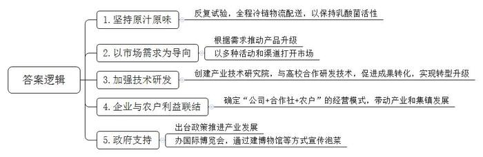
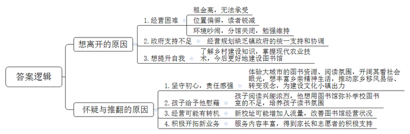
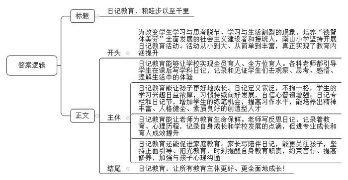
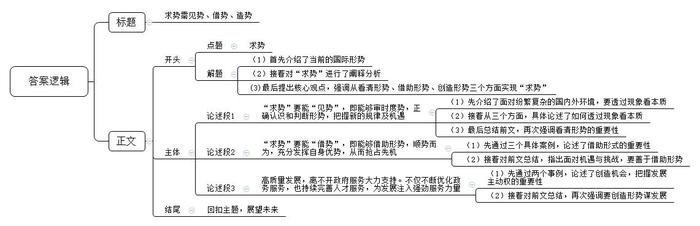

# 2024年公务员多省联考《申论》题（辽宁A卷）

<!-- gwy:overview:start -->
> **辽宁 · 2024 · 申论 · A类** ｜ 4 题 · 图片 4 处 · 答案随题折叠

导航：[题目](#题目) · [材料 1](#材料-1)
<!-- gwy:overview:end -->

> 候选采集稿。参考答案及解析来自粉笔页面，不代表官方答案或真实高分答卷；来源使用许可与原卷对应关系仍需人工核实。

## 给定材料

### 材料 1

“中田有庐，疆埸有瓜。是剥是菹，献之皇祖。”在没有冷藏技术的时代，古人慢慢摸索出用盐泡渍酱腌菜的制作技艺。

做泡菜是M市人人都会的小手艺。十五年前，老何还在外地工作。“回到家乡时吃到的泡菜是一个味，再回到工作地，即使吃的是产自家乡的泡菜，感觉也不是那个味了！”于是，抱着“让家乡泡菜原汁原味走向天南海北”的想法，老何辞职回乡，创办起泡菜厂。

“经过调查，我发现大多数泡菜产品均是对乳酸菌进行灭活后再包装运往市场的，泡菜的风味因而会发生变化。”老何说。在他公司的生产车间里，整齐摆放着数千个土陶泡菜坛。根据蔬菜品种的不同，泡制时间从一两天到一两年不等。坛子里因发酵产生的“咕噜”声此起彼伏，大家将此形容为“乳酸菌的呼吸”。“乳酸菌灭活后会影响泡菜的风味和口感，但不进行灭活，泡菜在常温下持续发酵就成为不可控因素，产品到达客户手上时就会出现涨袋或涨瓶的现象。经过反复试验，我们发现在0～8℃的温度区间，可以让泡菜保持乳酸菌活性。”为了让消费者吃到地道的泡菜，老何决定采用全程冷链物流配送产品。目前，M市每天有100多吨的“活泡菜”通过专门建立的泡菜冷链物流从土陶泡菜坛走向全国市场。

离老何公司不远的李记泡菜厂，一排排标准化腌渍池内，蔬菜正静静地沉睡着。300天后，这些泡菜会根据烧菜、炖菜、煲汤、馅料等需求被加工成不同系列产品。“我们一直在做试验，研发生产下饭小菜、开胃小零食系列泡菜，推动产品升级。”李记研发部负责人介绍说，新产品研发出来后，更重要的是打开市场。比如李记泡菜的酸菜鱼佐料系列产品，就是公司考虑到华东地区淡水鱼消费量较大，因而决定把目光锁定在“鱼米之乡”华东地区，先打开这里的市场。销售人员通过免费铺货、售后结账、现场制作、免费试吃等活动，以及线上销售、社区店代售等渠道挖掘市场潜力，让产品迅速打开局面。如今，这个系列的产品已经畅销全国，并出口到东南亚、欧美等地。

针对泡菜生产和技术研发方面存在的难题，M市泡菜企业联合创建了产业技术研究院。研究院与多家高校合作，协同开展泡菜产业共性技术和关键技术研究开发，并促进成果转化应用。目前研究院已建成泡菜典型微生物菌种资源库，并在直投式发酵剂制备关键技术、泡菜新工艺新技术开发应用等方面取得重大突破。“这些技术进步可以让泡菜质量更可控，更快推动传统泡菜产业实现转型升级。”研究院汪总工说。

2023年9月，M市又迎来一个种菜的季节。丰产农业合作社刘理事长流转了1000多亩土地种植芥菜，向泡菜企业提供原材料。合作社通过订单制，向泡菜企业销售5000多吨蔬菜，收入达250多万元。“首先是我们和企业签订单，再把订单分配给农户，农户按照订单进行种植，把种植出来的原材料交给泡菜企业之后，合作社直接付给农户现金。”刘理事长说。

M市王副市长介绍，在没有泡菜产业以前，菜农种蔬菜主要是为了自己食用或者就近销售，靠它很难致富。发展泡菜产业后，市里确定了“公司+合作社+农户”的经营模式，加强泡菜企业与农户的利益联结，一起发展。目前，在泡菜产业的带动下，全市共发展蔬菜原料基地40多万亩，带动近20万户农户增收，实现了从一家一户单打独斗到抱团共同发展。

在“大厂”的带动下，产业和集镇不断发展，人流、商流、物流不断向市里集聚，目前市区人口已有5万余人，第三产业也应运而生并持续壮大。

几年前，在家务农的小李到市区上的超市当起了售货员。“城里的超市、餐馆、茶楼多了，工作选择也更多了。”

M市早在“十一五”规划中将“以泡菜加工为特色的蔬菜产业化重点市”确立为发展目标，2009年，市里出台《关于强力推进泡菜产业发展的决定》。同年，M市以泡菜为主导产业成功入围“首批国家现代农业产业园”创建名单，泡菜产业的发展获得国家层面的支持。

从2009年开始，中国泡菜食品国际博览会已在M市连续举办了14届。在博览会期间，中国泡菜宣传片在国外的橱窗屏滚动播放，中国泡菜故事和泡菜滋味相融互促、享誉海外。M市还建设了泡菜博物馆，通过历史与文化、生产与加工、传承与创新、产品与品牌、品鉴与体验等各种形式的展示，让参观者可以领略到“三千年泡菜，中国人味道”的别样风情。“我们还建成了泡菜行业国家4A级景区，同时推动形成了从泡菜博物馆、泡菜风情街到特色企业生产线的工业旅游环线。”“泡菜城”管委会徐副主任说，泡菜企业也在保护传承和创新研究泡菜技艺的基础上，成功申报泡菜制作技艺非物质文化遗产，推出制作工艺“非遗”宣传、加工制作体验、泡菜美食视频等文化产品。

目前，M市聚集了泡菜加工上下游企业30多家，年加工泡菜150多万吨，提供就业岗位2.5万个，最终把泡菜从小手艺变成了大产业。

### 材料 2

今年是小陈经营图书馆的第九年。图书馆开在他家乡小镇一所小学对面的巷子里，是镇上唯一的图书馆。说是图书馆，看上去更像是一个陈旧的仓库，没有提醒，也没有其他任何标识。不到一人高的木质书架贴满每面墙壁，书架一侧的顶端，摆放着这家图书馆的身份认证：爱阅公益图书馆、爱家乡书屋。

起初，图书馆开在镇里的前街。因为借阅方便且不收押金，很快就登记了500多个读者。第二年，图书馆搬到了更靠近镇中心的位置，但租金猛涨，小陈在十几个支持者的赞助下，暂时稳住了局面。第三年，房租涨到了小陈无法承受的程度，他把图书馆搬到了偏僻的现址，带来的直接后果，就是读者数量锐减。2019年，镇上打造的仿古老街初具规模，小陈租了一间房作为分馆，起名“崇文图书馆”。当时想得挺好，还设计了售卖周边产品和喝咖啡的地方，但是好景不长，隔壁开了麻将馆和KTV，白天就挺闹，到了晚上就吵得更厉害了。坚持了一年多，分馆也关门了，只留下现在这间勉强维持的书屋和为数不多的读者，显得冷冷清清。

小陈做图书馆的资金基本靠捐赠，每年大约能够募集到四、五万元。说起开图书馆的初衷，小陈说，当年他高中因故辍学，外出打工，大城市优越的图书资源和阅读氛围让他兴奋不已。从鲁迅到沈从文，从陈寅恪到梁漱溟……大量的阅读让他看待社会的眼光开始不一样了。“城市的博物馆、美术馆、音乐厅、体育馆，农村全都没有。男人就是钓鱼，女人就是广场舞，更多的是打麻将。小镇上没有一个书报亭，图书馆也是县里边才有。”他开始想回乡，并踌躇满志地写下题为“试着回到故乡”的文章：“今天的家乡太需要移风易俗，需要观念的转变。这就是我想在家乡做的事情。虽然我知道这一切很难，甚至比发展经济更难。”

家乡小镇是一座千年古镇。近些年，本着打造历史文化名镇的目标，政府出资修建的古镇壁画、仿古老街、喷泉设施陆续完成，清雅幽静又古香古色。“都说建设文化小镇，阅读不是一种文化吗？中国人自古就讲究读书，我们本身就有深厚的耕读文化传统。”小陈认为，今天的小镇离真正的文化建设还有一定的距离。

在小陈的观察中，小镇的学生家长一般会重视孩子的学习成绩，但普遍不重视课外阅读。小陈说：“反倒是孩子对阅读感兴趣，家长和孩子们一起经过图书馆的时候，大人往往是不抬头的，但孩子们的眼神会不一样。”那种好奇和兴奋的光亮，也许是他图书馆事业里最大的慰藉。

图书馆的对面是一所小学，远远看去，高大的教学楼掩映在绿树红花之间，赏心悦目。临街教学楼的二层是学校图书室。图书室自开设以来，除了第一年购置的一些书籍和小陈捐赠的100多本书之外，就没有买过新书。“图书室一直没有配备专门的老师，也不怎么开放，虽然孩子们兴趣很高，但是却没有那种读书的氛围。”学校的田老师说。

图书馆所在的六和村党支部书记曾和小陈讨论，可以把附近几个村的农家书屋跟图书馆结合在一起管理，一来可以扩大图书馆的规模，二来这些农家书屋也能打理得更好。但他们马上发现，要整合盘活这些资源，目前看还有一定的难度，需要镇一级层面的统一支持和协调。

镇政府正在打造的另一个文旅项目是镇中心的一条步行街。这里有青砖黑瓦的徽派钟楼，有讲述古镇历史的博物馆，不远处还有一个荷塘，盛开的满池荷花引来更多的人们驻足观赏。每次经过这里，小陈都会情不自禁地感慨道：“要是能把图书馆搬到这儿，也许就不愁没人来了。”

不久前，小陈有了离开的打算，这个念头也在脑海里不停地经历着怀疑与推翻：镇上那所九年一贯制学校的新校址就在图书馆旁边，目前正在施工建设中。也许有了这个稳定的“流量”，图书馆的状况能变得好些？

这几年，除了借阅图书，图书馆还经常作为假期孩子们的“托管所”，写作业、组织读书会、夏令营；端午节带着包粽子，中秋节用模具做月饼。夏天最热的时候外出，会有家长送来西瓜给志愿者和孩子们，野炊的时候，也会有妈妈主动来教生火做饭……

在省城上大学的小贾做了图书馆的志愿者。假期里，他有时间都会过来。“就是带着小朋友做作业，小孩在家基本就是玩手机、打游戏，家长也头疼。在这里就做得快，玩得也开心。”除了辅导作业，小贾和其他志愿者还经常带着孩子们远足、野炊、做手工……印象最深的是去年7月，他带着孩子们到河里体验游泳，还请了专业的救援队给孩子们普及防溺水知识。“大概有20多个小孩，表现都很积极。”

谈及以后的打算，小陈说：“想出去看看，通过系统地了解乡村建设知识，掌握现代农业技术，不断地提升自己。等我实力强了，回来又能有助于这个图书馆，那不是更好的事吗？”

### 材料 3

基于当前学生学习与思考脱节、学习与生活割裂的现象仍比较普遍，K市南山小学从2017年10月开始，筹划开展日记写作校园特色活动，旨在引导学生有意识、有目的参加各项活动，让孩子们记住农时四季，让他们体会到父母劳作的辛苦。用日记写作这根线，努力引导学生从课本中走出来，从手机、电脑、网络游戏中跳出来，与音体美握手、与综合实践活动拥抱、与大自然和社会接轨，成为自然人、社会人，从而努力实现教育要培养德、智、体、美、劳全面发展的社会主义建设者和接班人的根本目标。

南山小学江校长说：“写日记就是对生活最好的牵挂方式，也是对自己、对工作最负责任的做法。”多年来，江校长一直保持着写日记的习惯。他的日记涵盖专业成长、读书心得、教育教学反思以及时政要闻等，收集和梳理教育碎片，并在书写和思考中实现教育思想的升华，坚持写日记让江校长受益良多。担任南山小学校长后，他在坚持校长写管理日记的基础上，开始推行日记教育。经过反复论证、实践和修订，从最初的语文日记到全学科日记，再到今天的日记教育，南山小学日记教育经历了从小到大、从简单到丰富、从做表面文章到内涵提升发展的历程。

在五年一班的数学课堂上，学生们交出了不同寻常的“数学作业”：有的记录了孩子们生活中应用数学时的体会和感想，有的写下了自己发现的数学奥秘、趣事，有的利用数学知识解释生活中的某些现象……这些“数学日记”，记录和见证着学生们去观察、思考、感悟、理解生活中的数学体验。“数学日记”是南山小学的创新举措，是该校开展特色校园活动的一个缩影。走进南山小学，语文、数学、英语、道德与法治、科学等学科的课后，老师都会引导学生写日记，实现全员育人、全方位育人。

好习惯源自于平时的教育，南山小学以日记教育为突破口，践行好习惯的培养。在这里，“日记”的定义很宽泛，学校鼓励学生写自己学习与生活中的真情实感，及时分享自己的喜怒哀乐。通过这种形式，学生在学习上的兴趣日益浓厚，习惯持续向好发展，自信心普遍增强。日记的形式不拘一格，记事日记、观察日记、诗歌日记、读报日记、照片日记、漫画日记、专题日记等等，给学生以最大的写作自由度。还有循环日记，即一个日记本在小组内循环，每名学生既是作者又是读者和评论者，大家互相学习，共同提高。

在南山小学的班级展示墙上辟有日记专栏，展示学生的优秀日记，定期更换，及时反馈鼓励，并进行表彰。南山小学还创建了“日记节”。以“日记节”为载体，每个月确定一两个主题开展日记写作。即先组织活动，活动后根据组织方案写日记、评选日记、表彰、展示，让学生在交流中拓展思维、端正认识，引导学生主动动脑、动口、动手，学会竞争与合作。日记教育不仅增加了学生的练笔机会，提高了学生的习作水平，而且以练笔育人，也有助于培养精神丰富、人格健全、素质良好的创造型人才。近几年，南山小学整体工作有了全面提升，在全市质量检测、征文大赛等活动中屡创佳绩。

老师写反思日记是为自己的教育生命保鲜的极佳方式。南山小学一直坚信：无反思，不成长。学校每位老师手中都有几个本子：与名家面对面、会议札记、工作日志、学思悟……这些本子真实地记录着老师的教育历程和心理历程，记录着老师成长和学校发展的点点滴滴。有的老师在自己的博客上写网络日记，不光有文字的记录，还有图片的记录，留住了难忘的瞬间。如今，写日记已经内化为学校老师的自觉行为，无论是对个人专业成长还是育人成效，都是最直接的促进和提升。

学校倡导家长写陪伴日记，就是让家长时刻关注孩子的点点滴滴，坚持正面引导、阳光教育，这也是南山小学的特色活动。学校通过专家讲座、家长会、家长沙龙等，引导家长运用家教日记，有效地和孩子沟通。家长用日记表达对孩子的爱，用日记来表现自己的教育思想，用日记来教育孩子，用日记来提醒自己要有耐心、要细心……学校每周都会有一至两个限定的家教日记题目，如“如何改变自己，再改变孩子”“如何打造书香家庭”“孩子当一天家”等，启发家长思考，参与讨论。班主任每周收集、批阅家教日记，及时了解家长的心声，及时发现问题、解决问题。班级、学校定期评比表彰优秀家教陪伴日记，并精选优秀文章在家委会杂志《心桥》上展示，使越来越多的家长重视并认真进行家教陪伴日记的写作。一位家长说，每天坚持写教育日记，既能时刻提醒自己，教育好孩子是自己应尽的职责，同时又能约束自己的言行，不断提高自身修养，最关键的是，这是一个与孩子进行心理沟通的极好平台。

南山小学德育、安全、惠民服务等工作也因为有了日记的分享，得到了家长、社会的普遍认可，教学质量逐年稳步提升，学校连续几年在办学满意度测评中都名列前茅，连年被评为市教学工作先进单位、市文明校园、市零投诉学校。2023年底，又被评为市教育工作先进单位、市文明校园、省绿色学校。南山小学坚持开展日记教育活动的相关做法，《K市日报》进行了专门报道。

### 材料 4

“我叫百灵，今年36岁，出口30余年，在国内却无人问津，所以我一直比别人努力。我不打广告不请代言，把钱都花在了成分上。包装虽然丑了点，但东西是真的好用……”

近两年，随处可见正在直播的老国货品牌，产品销量也翻了十几番。网友们都在感慨，老国货品牌这回可算抓住了风口。把老国货品牌送上风口“翻红”的，是愈演愈烈的怀旧风潮。在社交媒体上，有人感叹青春一去不复返，老牌国货的产品质量却一如当年；有人借老牌国货回望百年前风雨飘摇的历史，借以抒发自己的爱国情怀；还有人主打“实用主义”，找遍市面上的老国货，向大家推荐最好用的那款……

某大学电子商务研究所林研究员认为，老国货品牌能抓住这个机会固然是好事，但它如果没有持续吸引人的热点，也很容易在短时间内褪去热度。老国货还是要从根本上转变经营方式和经营思路，进行模式更新并不断迭代创新，才能长久赢得市场。

随着哈尔滨旅游爆火，各地文旅部门纷纷利用社交媒体“花式整活”。河北、吉林文旅“听劝”式改名，西安文旅创新展示唐诗秦腔等历史文化资源，内蒙古、重庆文旅请来明星代言……文旅部门卖力吆喝，在挖掘、彰显自身优势和特色方面下足了功夫，内容更新频率之高、花样之多，让网友直呼“卷疯了”。

流量时代，注意力是稀缺资源。从之前的文旅局长出镜代言，到如今用网络平台“借势营销”，各地文旅部门主动触网，用各种接地气的方式进行宣传，带来了网络流量和公众关注，体现着工作意识的转变、工作方法的创新。

但在热闹之下，也需要一些冷思考。文旅产业说到底拼的是产品和服务，“网红城市”还是要靠内在的硬实力，着眼长远，量力而行，尊重市场规律，扎实练好内功，才能成为可以长红的“网红”，也才能最终接住营销之后带来的“泼天的富贵”。

《孙子兵法·势篇》有云：“故善战者，求之于势，不责于人。”高明的用兵者，应该把取胜的重心放在寻求和创造有利的战略态势上，而不是局限在一兵一卒的对抗上，或一城一地的战术得失上。<u>“求势”，首先要能“见势”，然后才能“借势”，甚至“造势”，乘势而上。</u>

## 题目

### 第 1 题

**请根据****“给定资料**1**”，谈谈M市的泡菜是如何从小手艺变成大产业的。（15分）**

关联材料：材料 1

作答要求：

要求：

（1）全面，准确，有条理。

（2）不超过200字。

第 1 题 · 答案与解析

**参考答案（粉笔题库参考内容）**

1.坚持原汁原味。反复试验，全程冷链物流配送，以保持乳酸菌活性。

2.以市场需求为导向。根据需求推动产品升级；以多种活动和渠道打开市场。

3.加强技术研发。创建产业技术研究院，与高校合作研发技术，促进成果转化，实现转型升级。

4.企业与农户利益联结。确定“公司+合作社+农户”的经营模式，带动产业和集镇发展。

5.政府支持。出台政策推进产业发展；办国际博览会，通过建博物馆等方式宣传泡菜。

**解析**

**参考答案说明：**本参考答案从“坚持原汁原味”“以市场需求为导向”“加强技术研发”“企业与农户利益联结”“政府支持”五个方面展开，各条答案要点之间在内容上相互并列，没有交叉。

### 第 2 题

**“给定资料**2**”中提到“小陈有了离开的打算，这个念头也在脑海里不停地经历着怀疑与推翻”，请分析小陈为什么“不停地经历着怀疑与推翻”。（20分）**

关联材料：材料 2

作答要求：

要求：

（1）分析全面，条理清晰，简明扼要；

（2）不超过300字。

第 2 题 · 答案与解析

**参考答案（粉笔题库参考内容）**

想离开的原因：1.经营困难。租金高，无法承受；位置偏僻，读者锐减；环境吵闹，分馆关闭，勉强维持。2.政府支持不足。经营规划缺乏镇政府的统一支持和协调。3.想提升自我。了解乡村建设知识，掌握现代农业技术，今后更好地建设图书馆。

怀疑与推翻的原因：1.坚守初心，责任感强。体验大城市的图书资源、阅读氛围，开阔其看社会眼光，想丰富乡亲精神生活，推动家乡移风易俗、转变观念，为建设文化小镇出力。2.孩子给予他慰藉。孩子阅读兴趣浓烈，他想用图书馆弥补学校图书室的不足，培养孩子读书氛围。3.经营可能有转机。新校址可能增加人流量，改善图书馆经营状况。4.积极开拓新业务。服务内容丰富，得到家长和志愿者的积极支持。

**解析**

**参考答案说明：**本参考答案先对小陈离开的原因进行解释，具体从“经营困难”“政府支持不足”“想提升自我”三个方面展开，然后介绍了小陈的念头怀疑与推翻的原因，具体从“坚守初心，责任感强”“孩子给予他慰藉”“经营可能有转机”“积极开拓新业务”四个方面展开。每条答案要点之间在内容上是并列关系，没有交叉。

### 第 3 题

**《****K市日报》报道了“南山小学坚持开展日记教育活动”的做法，请根据“给定资料**3**”，为这篇报道写一则短评。（25分）**

关联材料：材料 3

作答要求：

要求：

（1）紧扣资料，观点明确，重点突出；

（2）逻辑清晰，语言流畅；

（3）字数400-500字。

第 3 题 · 答案与解析

**参考答案（粉笔题库参考内容）**

日记教育，积跬步以至千里

为改变学生学习与思考脱节、学习与生活割裂的现象，培养“德智体美劳”全面发展的社会主义建设者和接班人，南山小学坚持开展日记教育活动。活动从小到大、从简单到丰富，真正实现了教育内涵提升。

日记教育能够让学校实现全员育人、全方位育人。各科老师都引导学生在课后写学科日记，记录和见证学生们去观察、思考、感悟、理解生活中的体验。

日记教育能让孩子更好地成长。日记定义宽泛，不拘一格，学生的学习兴趣日益浓厚，习惯持续向好发展，自信心普遍增强；日记专栏和日记节，增加学生的练笔机会，提高习作水平，能培养出精神丰富、人格健全、素质良好的创造型人才。

日记教育能让老师为教育生命保鲜。老师写反思日记，记录着教育、心理历程，记录自身成长和学校发展的点滴，促进专业成长和育人成效提升。

日记教育还能促进家庭教育。家长写陪伴日记，能更关注孩子，坚持正面引导、阳光教育，时刻提醒自身教育职责，约束言行、提高修养，加强与孩子心理沟通。

日记教育，让所有教育主体更好、更全面地成长！

**解析**

**参考答案说明：**（1）格式方面，本参考答案包括标题、正文，符合短评的形式。（2）正文部分，一方面从内容来看，围绕“日记教育”这一主题，本参考答案的开头先介绍了南山小学开展日记教育活动的背景目的；主体部分，从“日记教育能够让学校实现全员育人、全方位育人”“日记教育能让孩子更好地成长”“日记教育能让老师为教育生命保鲜”“日记教育还能促进家庭教育”这四个方面进行介绍。另一方面，形式上，本参考答案做到了分段、分条撰写，整体上条理较为清晰。

### 第 4 题

**请根据对****“给定资料**4**”中划线句子的理解，参考给定资料，联系实际，自选角度，自拟题目，写一篇文章。（40分）**

关联材料：材料 1、材料 2、材料 3、材料 4

作答要求：

要求：

（1）观点明确，见解深刻；

（2）思路清晰，语言流畅；

（3）参考给定资料，但不拘泥于给定资料；

（4）字数1000-1200字。

第 4 题 · 答案与解析

**参考答案（粉笔题库参考内容）**

**求势需见势、借势、造势**

当今世界正处于百年未有之变局中，国际形势波诡云谲，有诸多的不确定性，且我国多种矛盾交织，改革发展任务艰巨。在此情形下，我们要“求势”，也就是通过观察、分析、判断后，明确我们的发展方向，要向第二个百年奋斗目标迈进、建设社会主义现代化强国。这是一种战略思维、全局思维，是寻求和创造有利态势谋求发展的智慧，而不是局限在一隅、一面的战术行为。**而****“求势”，需要我们首先看清形势，然后借助形势，甚至能创造形势，如此才能实现长远发展。**

**“求势”要能“见势”，即能够审时度势，正确认识和判断形势，把握新的规律及机遇。**当前的国外环境、国内环境，可谓“乱花渐欲迷人眼”，但我们应“不畏浮云遮望眼”，用全面、系统、运动、辩证的眼光看待事物，要透过现象看本质。我们要看到经济全球化大潮不可逆转，单边主义、保护主义仍然盛行；我们要看到新一轮科技革命和产业变革深入发展，催生新产业、新业态、新模式，给社会、乡村带来了诸多机遇；我们也要看到全面建成小康社会的基本目标虽已实现，但发展不平衡不充分问题仍然突出……总之，“察势者智”，准确识势、洞悉趋势，才能“拨开云雾”，抓住主要矛盾，抓住新的机遇。

**“求势”要能“借势”，即能够借助形势，顺势而为，充分发挥自身优势，从而抢占先机。**“所当乘者势也，不可失者时也”。中国共产党人认清井冈山时期的困难之后，主动顺势，走农村包围城市的道路，终让星星之火成燎原之势；河北、重庆等文旅部门在哈尔滨旅游爆火之后，顺应形势，利用网络媒体“营销”城市的旅游，吸引游客、助推城市经济发展；东北的泡菜企业，巧借潮流，研发泡菜腌制的新工艺、新技术，并用冷链配送产品，将小手艺发展成了大产业。种种案例启示我们，在机遇与挑战并存的当下，我们要有迎难而上、主动作为的胆量与魄力，因势利导、把握机会，才能下好发展的“先手棋”。

**“肯取势者可为人先，能谋势者必有所成”，“求势”不仅在于能顺势，还在于能主动谋势、兴势，这就要求我们着眼长远、修好内功，能够改革创新。**若是自身实力强劲，就能占据主导地位，自己创造发展机会，把握发展的主动权。譬如老国货的发展，将产品质量做好、服务做好外，还要转变经营方式和经营思路，才能赢得市场，成为“潮流”的引领者；又如我国在数字经济、生命健康、新材料等战略性新兴产业不断投入、不断创新，也是在提升自己，为能“造势”打下基础，推动产业的转型升级，实现经济的现代化发展。总之，我们要深化改革、开拓创新，一步一个脚印，从而积蓄能量，在变局中开新局。

驭势者赢，“势”在人为。面对世界之变、时代之变，我相信，通过用眼识势、顺势而为、主动创新，一定能乘风破浪、乘势而上，走在时代前列、实现全方位的发展，打造社会主义现代化强国！

**文章分析**

**求势需见势、借势、造势**

【**标题的优点****：**主题突出，角度鲜明，言简意赅。】

（1）<u>当今世界正处于百年未有之变局中</u>，<u>国际形势波诡云谲</u>，<u>有诸多的不确定性</u>，且<u>我国多种矛盾交织</u>，<u>改革发展任务艰巨</u>。（2）在此情形下，<u>我们要“求势”</u>，也就是<u>通过观察、分析、判断后</u>，<u>明确我们的发展方向</u>，<u>要向第二个百年奋斗目标迈进、建设社会主义现代化强国</u>。这是一种<u>战略思维、全局思维</u>，是<u>寻求和创造有利态势谋求发展的智慧</u>，而不是局限在一隅、一面的战术行为。（3）**而**<u><b>“求势”</b></u>**，需要我们**<u><b>首先看清形势</b></u>**，**<u><b>然后借助形势</b></u>**，甚至能**<u><b>创造形势</b></u>**，**<u><b>如此才能实现长远发展</b></u>**。**

【**开头的优点：**★内容方面。范文的开头是紧扣题目给定的“求势”这一主题展开的。（1）首先介绍了当前的国际形势。（2）接着对“求势”进行了阐释分析。(3)最后提出核心观点，强调从看清形势、借助形势、创造形势三个方面实现“求势”。★文字表达方面。使用了“是……是……而不是……”的句式，增强了表述的逻辑性与气势。】

**“求势”要能“见势”，即能够审时度势，正确认识和判断形势，把握新的规律及机遇。**（1）<u>当前的国外环境、国内环境</u>，可谓“乱花渐欲迷人眼”，<u>但我们应</u>“不畏浮云遮望眼”，<u>用全面、系统、运动、辩证的眼光看待事物</u>，<u>要透过现象看本质</u>。（2）我们<u>要看到经济全球化大潮不可逆转</u>，<u>单边主义、保护主义仍然盛行</u>；我们<u>要看到新一轮科技革命和产业变革深入发展</u>，<u>催生新产业、新业态、新模式</u>，<u>给社会、乡村带来了诸多机遇</u>；我们也要<u>看到全面建成小康社会的基本目标虽已实现</u>，但<u>发展不平衡不充分问题仍然突出</u>……（3）总之，“察势者智”，<u>准确识势、洞悉趋势</u>，<u>才能“拨开云雾”</u>，<u>抓住主要矛盾</u>，<u>抓住新的机遇</u>。

【**论述段****1****的优点：**★观点句：范文的观点句是紧扣“求势”这一主题提出的。形式上，它在段首处直接写出，位置突出，容易发现。内容上，关键词突出，内容要点明确，可以明显看出主要论述“看清形势”。★论述内容：（1）先介绍了面对纷繁复杂的国内外环境，要透过现象看本质；（2）接着从三个方面，具体论述了如何透过现象看本质；（3）最后总结前文，再次强调看清形势的重要性。注意：以上三个方面的内容都是紧扣“‘求势’要能‘见势’，即能够审时度势，正确认识和判断形势，把握新的规律及机遇”这个观点句进行分析论述的，论述的针对性强，内容层次丰富。在论述方法上主要采用了讲道理的方式，论述层层深入、严谨有力。】

**“求势”要能“借势”，即能够借助形势，顺势而为，充分发挥自身优势，从而抢占先机。**（1）“所当乘者势也，不可失者时也”。<u>中国共产党人认清井冈山时期的困难之后</u>，<u>主动顺势</u>，<u>走农村包围城市的道路</u>，终让星星之火成燎原之势；河北、重庆等<u>文旅部门在哈尔滨旅游爆火之后</u>，<u>顺应形势</u>，<u>利用网络媒体“营销”城市的旅游</u>，<u>吸引游客、助推城市经济发展</u>；东北的<u>泡菜企业</u>，<u>巧借潮流</u>，<u>研发泡菜腌制的新工艺、新技术</u>，并<u>用冷链配送产品</u>，<u>将小手艺发展成了大产业</u>。（2）种种案例启示我们，<u>在机遇与挑战并存的当下</u>，<u>我们要有迎难而上、主动作为的胆量与魄力</u>，<u>因势利导、把握机会</u>，<u>才能下好发展的“先手棋”</u>。

【**论述段****2****的优点：**★观点句：范文的观点句是紧扣“求势”这一主题提出的。形式上，它在段首处直接写出，位置突出，容易发现。内容上，关键词突出，内容要点明确，可以明显看出主要论述“借助形势”。★论述内容：（1）先通过三个具体案例，论述了借助形势的重要性；（2）接着对前文总结，指出面对机遇与挑战，要善于借助形势。注意：以上两个方面的内容都是紧扣“‘求势’要能‘借势’，即能够借助形势，顺势而为，充分发挥自身优势，从而抢占先机”这个观点句进行分析论述的，论述的针对性强，内容层次丰富。在论述方法上主要采用了讲道理、举例子相结合的方式。】

**“肯取势者可为人先，能谋势者必有所成”，“求势”不仅在于能顺势，还在于能主动谋势、兴势，这就要求我们着眼长远、修好内功，能够改革创新。**（1）<u>若是自身实力强劲</u>，<u>就能占据主导地位</u>，<u>自己创造发展机会</u>，<u>把握发展的主动权</u>。譬如<u>老国货的发展</u>，<u>将产品质量做好、服务做好外</u>，还要<u>转变经营方式和经营思路</u>，才能赢得市场，成为“潮流”的引领者；又如我国<u>在数字经济、生命健康、新材料等战略性新兴产业不断投入、不断创新</u>，也是在<u>提升自己</u>，<u>为能“造势”打下基础</u>，<u>推动产业的转型升级</u>，<u>实现经济的现代化发展</u>。（2）总之，我们<u>要深化改革、开拓创新</u>，<u>一步一个脚印</u>，<u>从而积蓄能量</u>，<u>在变局中开新局</u>。

【**论述段****3****的优点：**★观点句：范文的观点句是紧扣“求势”这一主题提出的。形式上，它在段首处直接写出，位置突出，容易发现。内容上，关键词突出，内容要点明确，可以明显看出主要论述“创造形势”。★论述内容：（1）先通过两个事例，论述了创造机会，把握发展主动权的重要性；（2）接着对前文总结，再次强调要创造形势谋发展。注意：以上两个方面的内容都是紧扣“‘求势’不仅在于能顺势，还在于能主动谋势、兴势，这就要求我们着眼长远、修好内功，能够改革创新”这个观点句进行分析论述的，论述的针对性强，内容层次丰富。在论述方法上主要采用了讲道理、举例子相结合的方式。】

【**论述段之间的关系**：★内在逻辑上：文章先论述“看清形势”，再论述“借助形势”，最后论述“创造形势”。在逻辑上，三个论述段呈现出层层递进的思路，论述十分严谨；在形式上，三个论述段都由主题引导出来，在视觉上给人以工整清晰的体验。】

驭势者赢，“势”在人为。面对世界之变、时代之变，我相信，通过用眼识势、顺势而为、主动创新，一定能乘风破浪、乘势而上，走在时代前列、实现全方位的发展，打造社会主义现代化强国！

【**结尾的优点：**范文的结尾回扣了“求势”这个主题，并且进行了展望，升华了主题。】

**解析状态：unknown（来源未提供）**

