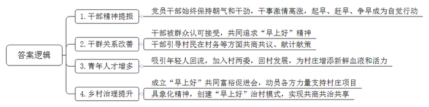
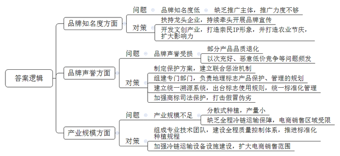
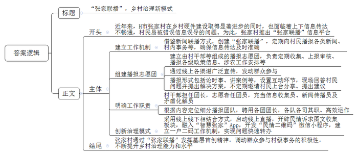

# 2024年公务员多省联考《申论》题（辽宁B卷）

> 候选采集稿。参考答案及解析来自粉笔页面，不代表官方答案或真实高分答卷；来源使用许可与原卷对应关系仍需人工核实。

## 给定材料

### 材料 material-273a67843716f39e

火热的七月，一批干修班学员来到达兴村“早上好”支部书记研学基地考察学习。达兴村党支部周书记激情澎湃的“治村经”，引发了学员们的共鸣。“全班五十多名学员全部加了我的微信，都希望跟我有更深入的交流。”老周自豪地说。

2017年，在外地做建材生意的老周响应市委市政府“凤凰归巢”行动的号召，回到老家达兴村，通过竞选担任村党支部书记。当时的达兴村，因为地处偏远，交通、产业基础差，不仅村民对本村的落后现状习以为常，连村干部也都觉得无所谓，这成为摆在老周面前最头疼最迫切的难题。一次偶然的机会，老周听到了村里的孩子在背诵课文《早》，从鲁迅先生刻在“三味书屋”课桌上的“早”字，他获得灵感：“早”不正是治理村庄所需要的精气神吗？“早起的鸟儿有虫吃，‘早’意味着机会、意味着主动，更意味着追求。”从此，老周养成了不管什么时间、什么场合，逢人便喊“早上好”的习惯。老周认为，“早”，是一种状态，以前达兴村穷，所以发展的路上要起早、赶早、争早；“上”，是一种劲头，就是要干、要冲、要拼，勇赶超、争上游、创标杆；“好”，是一种追求，要让村子好起来、村民富起来，做到家家好、人人好、事事好。

村庄要发展，首先就要改变村党员干部的精气神，“早上好”要求村干部无论何时都要当成早上，始终保持朝气和干劲，让“村里上班也有企业上班的样子”。村两委班子干事激情高涨，起早、赶早、争早成为大家的自觉行动，干部精神面貌在改变，干群关系在改善，村民们对村干部的看法也在一点点转变。从一开始被大家嘲笑，到逐渐被认可接受，再到大家一起追求“早的状态”“上的劲头”“好的追求”，“早上好”精神，在不知不觉中逐步形成。

“早上好！对村里有什么建议，或者对村干部有什么意见，都可以和我说！”傍晚，达兴村的“议事长廊”里，老周和往常一样，向村民们了解村情民意。村两委坚持“村里的事村民做主”的理念，引导村民在村庄发展、村民致富、乡村治理等方面共商共议、献计献策。达兴村有300亩荒了多年的旱地，有村民提议开发种桃树，既可赏花又可卖桃子。“等靠要，永远只能原地踏步，早干早得利，先干起来再说。”老周说。村里立即组织村民清理杂草平整土地，种上桃树。如今盛开的桃花已成为达兴村的一道风景，每年举办的桃花节，游客如潮，还能为村里带来十几万元的收入。

“早上好”蕴含的精神，不仅点燃了“老干部”的工作激情，更让年轻人看在眼里，深受感染。小黄17岁就外出打工，在杭州从事电商工作多年，有一份不错的收入。2019年，她回村休产假，看到村里的变化欣喜异常。“村干部都起得这么早，像单位上班一样。”就凭这一点，小黄认为这是一个充满希望的达兴村。于是，她决定留在了村里。2021年，小黄通过竞选，当上了村委委员兼妇女主任。在县城做物流生意的小王，同样受到“早上好”精气神的感染，回村参选担任了村委会副主任。

这些年轻人的加入，不仅为村两委带来了新鲜血液，也为达兴村增添了朝气和活力。1400多人的达兴村，以前在家的不足400人，如今越来越多的年轻人回流。周书记感慨道：“年轻人是早上八九点钟的太阳，以前他们认为达兴是‘被遗忘的村庄、回不去的故乡’，现在愿意回村发展，说明达兴的变化让他们看到了希望、发现了价值。”

达兴村成立了“早上好”共同富裕促进会，发动党员干部捐服务、乡贤能人捐资金、年轻大学生捐文化，在“一老一小”帮扶、青年人才创业等方面给予支持。

为了让“早上好”精神更加具象化，达兴村村民集思广益，设计出“早上好”徽标，总结提炼了“早上好”精神思维导图，还分解落实到35个能执行、可操作的行为“指标”上，把一句口头禅转化成为有抓手、可操作的“任务书”。在“早上好”精神的激励下，达兴村村民在实践中探索出了以“村务大家议、村事大家干、村风大家树、村福大家享”为主要内容的治村新模式，从“早上好”口头禅到“早上好”精神，再到“早上好”治村模式，这一声声充满魔力的“早上好”承载着村民对改变现状的呼唤和对美好生活的追求。

### 材料 material-bcc53a6e682be46f

地理标志产品是指产自特定地域，所具有的质量、声誉或其它特性本质上取决于该产地的自然与人文因素，经审核批准以地理名称进行命名的产品。近年来，S市大力推进地理标志产品登记保护工作，现有云峰水蜜桃、海河黄金小玉米、云台果酿、西里花椒等地理标志产品和商标达17件，这些具有独特区域特征的地理标志产品，为推动区域经济发展、富农增收提供了不竭动力。

在S市地理标志产品建设成果显现的同时，还应该清醒地看到，现有已批准的地理标志产品还存在着部分问题，并没有取得与其资源禀赋相称的市场业绩。为此，S市政府成立了联合调研组，围绕S市地理标志产品发展情况开展调研。

“以我们这里出产的西里花椒为例，由于缺乏龙头企业带动，一家一户又没有能力推广地理标志，因此年产值与保护前相比没有多大变化，仅是名称获得保护，实际效益不大。”花椒种植户老李说。

“好酒也怕巷子深，货好也得会吆喝。”西山镇农技中心的老蔡向调研组介绍说：“国家地理标志产品西山冀荷生产全过程，不仅不使用农药化肥，且富含硒、花青素、多种黄酮类物质，营养价值高，是真正的绿色有机产品。但因为缺少品牌认证和推广，其知名度并不高，一直被视为低档蔬菜，产品附加值低，农民实际收入并不高，直接影响了市场拓展。”

知名度较高的云峰水蜜桃、海河黄金小玉米也面临不少新的发展问题。比如，云峰水蜜桃虽然品牌影响力大，不愁种、不愁卖。但是，也有部分桃林存在品质退化的现象，严重影响水蜜桃的声誉。“去年，云峰水蜜桃的电商销售份额大约占40%左右，电商拓宽了销售渠道，然而，由于云峰水蜜桃名声大，市场上很快就出现了‘李鬼’。一些不良商家在网上用外地桃或劣质桃冒充云峰水蜜桃，以次充好、恶意低价竞争等问题不断出现。”云峰水蜜桃协会姜理事长说。近年来，为保护云峰水蜜桃品牌，S市制定实施了《云峰水蜜桃地理标志保护方案》等多项政策措施，责成相关职能部门建立联合惩治机制，打击假冒伪劣，保护地理标志产品。

“海河黄金小玉米果形小巧、色泽金黄、口感香糯，作为当地传统品种，种植历史比较悠久，但一直以农户分散的‘房前屋后’种植模式为主，没有规模化，更谈不上品牌化。”市农科院秦院长说。为此，他们组成了专业技术团队，建设全程质量控制体系，并联合玉米育种团队推进标准化种植规程，每亩综合种植效益较之前提高了3000多元。海河镇还通过连续举办“黄金小玉米节”，打造农业节庆，提升品牌声誉，实现优质优价。但在电商推广销售中，由于没有明确的品牌形象，缺乏全程冷链运输保障，仍难以面向全国扩大销售区域。

为学习借鉴先进经验，S市调研组赴C市学习考察。

“云海老醋是C市地理标志产品，为更好推动其保护发展，我们专门组建了云海老醋地理标志保护管理委员会，拟定和实施云海老醋地理标志产品保护、管理的规划。”C市市场监管局高局长说。相关主管部门在强化对C市产品质量、标志标签、包装和市场管理的同时，还建立了统一溯源系统，为地理标志产品开启“标志+标识”双重保护。

在源山杨梅种植基地，C市农业农村局王局长介绍说：“源山杨梅产业发展初期，也遇到重重问题，品牌提升程度不够，维权力度不足，产业发展受阻，社会公共利益受到侵害。为此，我们出台了《源山杨梅地理标志使用管理规则》，对源山杨梅进行统一标准化管理，以严格保障产品质量。我们还充分挖掘源山文化底蕴，开展调查走访、召开圆桌会议、听取专家意见等在IP形象打造、宣传推广等方面为源山文创产业开发提出建议。”王局长拿着身穿红衣、圆脸爱笑的乖巧“杨妹妹”介绍说：“亲民的文创形象受到广大消费者的喜爱，通过表情包、动漫、文学、影视等形式的产品，IP的影响力和受众群还在不断扩大。”“要想使源山杨梅等地理标志产品发挥出真正的经济效益和价值，不能只注重前期申报、注册、认定，还要加强地理标志证明商标的司法保护，加大对假冒地理标志产品违法行为的打击力度。”C市人民法院李副院长说。正是有了多部门的协同保护，源山杨梅不仅在市场上畅销，也成为消费者心中的明星品牌。

### 材料 material-67f850c281b53a56

“把新闻发布会开到村里，把新思想讲进百姓心里，把矛盾化解在沟通里。大家好，欢迎参加第19期‘张家联播’……”近日，在H市张家村的文化礼堂里，一场别开生面的“新闻发布会”正在进行。讲台上，村委会沈主任代表村委会向村民现场播报国内新闻、省内新闻和乡村新闻等。讲台下座无虚席，村民们认真倾听讲解，还不时举手提问。

近年来，张家村大力发展乡村产业，进行村庄建设，在硬件上有了很大地提升。但与此同时，上下信息传达不畅通，干部与村民之间面对面沟通少，村民易受各种小道消息、负面消息甚至谣言的误导。2021年，镇里开展违章建筑拆除行动，村里人心惶惶，各种小道消息满天飞。为此，村两委多次组织召开会议，研究解决办法。一次，在村民代表大会上，有人提出借鉴“新闻联播”方式向群众告知大事小情，得到了大家的一致认可。说干就干，经过一系列的商议，“张家联播”诞生了，并确定了工作机制。

建立由村干部、党员代表、乡贤代表等组成的播报志愿团，定期收集中央、省、市有关会议精神，热点时政要闻，镇党委政府近期涉农工作安排，以及与村民息息相关的各类惠民利民政策信息等。每月25日前，播报团成员汇总整理收集到的内容，交由村党支部审核签阅。同时，通过微信公众号、微信视频号、微信村民群、小组内交流群等方式广泛宣传，发动群众参与。每月25日当天，播报员以论时事、讲案例、说故事等形式，先播报20至30分钟；随后进入互动环节，播报员与村民当面交流，针对村民反映的热点、难点问题，由村干部进行现场回答并提出解决方案。根据播报的不同主题，不定期邀请村民上台分享体会、提出建议。有一期节目，村民老宋反映了八组的进村路有两个窟窿，让他没想到的是，他的诉求经村两委班子成员审议，提交上级部门审批后，很快就完成了道路施工改造。看到提出的问题得到实实在在的解决，参与的村民也越来越多了。

70多岁的陶老师是退休教师，以前她经常闭门不出。在“张家联播”上了解到上级政策和村两委的发展思路后，她自愿加入了播报志愿团。如今，每年寒暑假，她不仅义务给村里的孩子们辅导假期作业，还和退休的同事一起，为孩子们举办假期实践大课堂。

为充分发挥“张家联播”播报志愿团的作用，张家村规定播报团团长由村干部担任，团员来自村里的志愿者，确保志愿团有人管事。志愿者在“张家联播”中充当“三个员”的角色：一是信息收集员，由志愿者收集时政热点、村情村务等播报信息；二是新闻传播员，每次播报完毕，志愿者们在村庄小组等人员集聚的地方传播本期的“张家联播”内容；三是矛盾化解员，每期“张家联播”播报完毕，村民手里都有一张民情诉求表，志愿者针对村民提出的诉求，在走访中满足合理需求、化解社会矛盾。

张家村还将播报志愿团细分为“文明有主‘张’”播报团、“平安有‘张’法”播报团、“家闻天下”播报团、“文化有约”播报团，并且聘用了各个团队团长。每个团队都紧紧围绕内容定位，各司其职、高效运作。为激发村民参与志愿服务的积极性，各播报团想方设法，比如，“文明有主‘张’”播报团提出积分制，围绕文明实践活动、美丽乡村长效管理、垃圾分类、移风易俗、志愿服务、好人好事等方面量化具体行为评分细则，村民的日常文明行为均可攒积分，以兑换相应的商品。活动激发了村民的热情，村容村貌迅速得到改善。

以“张家联播”为平台，张家村党支部积极探索“党建+基层社会治理”新模式，深化社区（村庄）、社会组织、社会工作专业人才联动机制。2022年初，村里引入老赵调解工作室、平安志愿服务队、至美社工等社会组织，设置有综合接待区、公益慈善区等业务区，配备少儿谈心室、议事厅、智创空间、档案室等服务空间。

“一直以来，我们也在不断尝试线上模式，已经启动‘张家联播’线上直播，把便民信息、政策解读、活动发布等进行线上播报，提供多渠道服务，解决群众的问题。”张家村党支部张书记说。未来“张家联播”直播间里的播报员将不局限于固定的个人，而是要让村里的民间艺人、文艺骨干、微网格长、普通群众等都参与进来，走进田间地头、企业车间、网格里，以新型直播场景的搭建，吸引更多的人参与其中，不断增强“张家联播”的传播力和社会影响力。作为对“张家联播”的线下延伸，村里还专门开辟民情诉求图文收集板块，并融入“智慧张家”App，开发了“民情二维码”微信小程序，不断深化“网格化管理、组团式服务”工作机制，全面建立村民（企业）一户二“码”，实现问题“码”上转、事项“码”上办、作风“码”上变。“接下来，我们将继续发挥基层首创精神，进一步调动群众参与村级事务的积极性，将各方资源进行整合，打造‘张家联播’升级版，不断提升乡村治理能力和水平。”张书记接着说。

## 题目

### 第 1 题

**请根据****“给定资料**1**”，谈谈“早上好”精神给达兴村带来了哪些变化。（15分）**

关联材料：材料 material-273a67843716f39e

作答要求：

要求：全面、准确、有条理；不超过200字。

### 第 2 题

**假如你是****S市调研组工作人员，请根据“给定资料**2**”，明确S市地理标志产品发展困境的基础上，提出推进S市地理标志产品品牌建设的对策建议。（20分）**

关联材料：材料 material-bcc53a6e682be46f

作答要求：

要求：

（1）问题梳理全面、准确；

（2）所提建议具体明确、有针对性、切实可行；

（3）不超过300字。

### 第 3 题

**H市有关部门要将张家村创建“张家联播”的做法纳入乡村治理案例库。请根据“给定资料**3**”，撰写一份案例介绍材料。（25分）**

关联材料：材料 material-67f850c281b53a56

作答要求：

要求：

（1）紧扣资料，内容全面；

（2）要点突出，条理清晰，语言准确；

（3）字数400～500字。

### 第 4 题

**请根据对****“给定资料**4**”中划线句子的理解，参考给定资料，联系实际，自选角度，自拟题目，写一篇文章。（40分）**

关联材料：材料 material-273a67843716f39e

作答要求：

要求：

（1）观点明确，见解深刻；

（2）思路清晰，语言流畅；

（3）参考给定资料，但不拘泥于给定资料；

（4）字数800～1000字。

## 答案与解析

第 1 题

**参考答案（粉笔题库参考内容）**

1.干部精神提振。党员干部始终保持朝气和干劲，干事激情高涨，起早、赶早、争早成为自觉行动。

2.干群关系改善。干部被群众认可接受，共同追求“早上好”精神；干部引导村民在村务等方面共商共议、献计献策。

3.青年人才增多。吸引年轻人回流，加入村两委，回村发展，为村庄增添新鲜血液和活力。

4.乡村治理提升。成立“早上好”共同富裕促进会，动员各方力量支持村庄项目；具象化精神，创建“早上好”治村模式，实现共商共治共享。

**解析**

**参考答案说明**：本参考答案从“干部精神提振”“干群关系改善”“青年人才增多”“乡村治理提升”四个方面展开，各条答案要点之间在内容上相互并列，没有交叉。

**考点**：考点变化类

**来源**：来源2024年公务员多省联考《申论》题（辽宁B卷）

粉笔申论页面对本题只提供「解析视频」入口，该入口是会员推广位，页面无视频地址与文字解析。

第 2 题

**参考答案（粉笔题库参考内容）**

1.问题：品牌知名度低。缺乏推广主体，推广力度不够。对策：扶持龙头企业，持续牵头开展品牌宣传；开发文创产业，打造亲民IP形象，并打造农业节庆，扩大影响力。

2.问题：品牌声誉受损。部分产品品质退化；以次充好、恶意低价竞争等问题频发。对策：制定保护方案，建立联合惩治机制；组建专门部门，负责地理标志产品保护、管理的规划；建立统一溯源系统，出台标志使用规则，统一标准化管理；加强商标司法保护，打击假冒伪劣。

3.问题：产业规模不足。分散式种植，产量小；缺乏全程冷链运输保障，电商销售区域受限。对策：组成专业技术团队，建设全程质量控制体系，推进标准化种植规程；加强冷链运输设备设施建设，扩大电商销售范围。

**解析**

**参考答案说明：**本参考答案从“品牌知名度”“品牌声誉”“产业规模”这三个方面展开，每个方面内部先阐释问题，再给出相应的对策建议。各条答案要点之间在内容上相互并列，没有交叉。

**考点**：考点提出对策类

**来源**：来源2024年公务员多省联考《申论》题（辽宁B卷）

粉笔申论页面对本题只提供「解析视频」入口，该入口是会员推广位，页面无视频地址与文字解析。

第 3 题

**参考答案（粉笔题库参考内容）**

“张家联播”，乡村治理新模式

近年来，H市张家村在乡村硬件建设取得显著进步的同时，也面临着上下信息传达不畅通，村民易被错误信息误导的问题。为此，张家村推出“张家联播”信息平台。

一、建立工作机制。借鉴新闻联播方式，创建“张家联播”，定期向村民播报各类新闻、村内事务等，确保信息传达及时准确。二、组建播报志愿团。建立由村干部等组成的播报志愿团，负责定期收集、上报审核、播报各级政策信息、涉农工作安排等；通过线上各渠道广泛宣传，发动群众参与；播报形式包括论时事、讲案例等，设置互动环节，现场回答村民问题并提出解决方案，不定期邀请村民上台分享、提出建议。三、明确工作职责。村干部担任团长，志愿者任团员，充当信息收集员、新闻传播员及矛盾化解员；根据内容定位细分播报团队，聘用各团团长，各队各司其职、高效运作。四、创新治理模式。采用线上线下相结合方式，启动线上直播，开辟民情诉求图文收集板块，融入“智慧张家”App，开发“民情二维码”微信小程序，建立一户二码工作机制，实现问题快速转办。

张家村通过“张家联播”发挥基层首创精神，调动群众参与村级事务的积极性，不断提升乡村治理能力和水平。

**解析**

**参考答案说明：**（1）本题要求撰写“一份案例介绍材料”，需注意格式，介绍材料的一般格式为：标题+正文。（2）正文部分，一方面从内容上来看，围绕着“张家联播”这一主题，本参考答案的开头先写到了“‘张家联播’创建的背景、意义”；主体部分从“建立工作机制”“组建播报志愿团”“明确工作职责”“创新治理模式”这四个方面介绍了具体经验；结尾写到了对“张家联播”工作的总结。另一方面，形式上，本参考答案做到了分段、分条撰写，整体上条理较为清晰。

**考点**：考点总结类

**来源**：来源2024年公务员多省联考《申论》题（辽宁B卷）

粉笔申论页面对本题只提供「解析视频」入口，该入口是会员推广位，页面无视频地址与文字解析。

第 4 题

**参考答案（粉笔题库参考内容）**

**模仿与创新**

飞速变革的时代，模仿与创新是企业生存发展的关键。但仅靠模仿不足以支撑发展。正如箴言所说：“模仿可以是创新的开始，但也只是个开始。”企业不可停滞不前、墨守成规，唯有在借鉴后不断创新，方能在市场中稳操胜券。

**模仿是创新的起点。通过模仿，企业可以快速掌握行业的基础知识和技能，减少初期的摸索和试错成本，快速奠定后续发展基础。**模仿，作为一种有效的学习策略，允许企业通过学习和借鉴行业内已成功验证的模式和经验。小米科技在初创时期，就深受苹果公司的产品设计理念影响，模仿其简洁的设计风格和用户交互方式，使得小米在智能手机市场中快速占据了一席之地。这正体现了模仿的价值，它帮助企业站在一个相对较高的起点，减少了不必要的探索，使得企业能够更加聚焦于核心竞争力的提升，从而更高效地实现自身的成长。

然而，模仿仅仅是起点，它不能成为企业发展的终点。在快速变化的市场中，单纯的模仿很快就会被市场淘汰。因此，创新成为了模仿之后的必然选择。

**创新是模仿的延续和升华。在模仿的基础上，企业必须居安思危，在产品、技术等方面进行创新，形成自身的特色和优势，提升竞争力**。以华为为例，它在早期虽然参考了其他通信设备制造商的经验，但并没有止步于此。通过持续的研发和创新，华为不仅创造出了自己独有的技术与产品，更因此成为了全球通信设备行业的佼佼者。这足以说明，只有在模仿的基础上不断创新，企业才能实现实质性的突破，并走在行业的前沿。为此，企业应加大研发投入，吸引创新人才，建立创新机制，从而在自主创新的路径中找到最佳的发展方式。

**单纯的模仿或创新都有其局限性，只有将二者相结合，才能在稳健发展的同时实现持续的进步和突破。**一味地模仿可能让企业陷入“跟风”的怪圈，失去自身的特色和竞争力；而过度的创新则可能导致企业脱离市场实际需求，造成资源的浪费。为了实现最快的发展，企业必须根据自身的实际情况和市场环境，灵活运用模仿和创新两种手段。这意味着企业要首先站在巨人的肩膀上，了解市场的需求和趋势，而后不断革新，从而引领市场的走向，这种平衡和融合的能力，将是决定企业未来成功的关键。

故而，模仿与创新如车之两轮、鸟之双翼，缺一不可。唯有善于借鉴、勇于创新的企业，才能在激烈的市场竞争中乘风破浪，开创属于自己的辉煌篇章。

**解析**

**文章分析**

**模仿与创新**

【**标题的优点：**标题中含有主题词，使文章主题更突出、清晰。】

（1）飞速变革的时代，模仿与创新是企业生存发展的关键。（2）但仅靠模仿不足以支撑发展。（3）正如箴言所说：“模仿可以是创新的开始，但也只是个开始。”企业不可停滞不前、墨守成规，唯有在借鉴后不断创新，方能在市场中稳操胜券。

【**开头的优点：**★内容方面。范文的开头是紧扣题目给定的“模仿与创新”这一主题展开的。（1）概述模仿与创新对企业的重要性；（2）指出了模仿的局限性；（3）从整体上指出企业实现稳定、健康发展需要在借鉴基础上创新。★文字表达方面。使用了“但……”“唯有……方能”等连接词，使语言表达具有严谨的逻辑性。】

**模仿是创新的起点。通过模仿，企业可以快速掌握行业的基础知识和技能，减少初期的摸索和试错成本，快速奠定后续发展基础**。（1）模仿，作为一种有效的学习策略，允许企业通过学习和借鉴行业内已成功验证的模式和经验。小米科技在初创时期，就深受苹果公司的产品设计理念影响，模仿其简洁的设计风格和用户交互方式，使得小米在智能手机市场中快速占据了一席之地。（2）这正体现了模仿的价值，它帮助企业站在一个相对较高的起点，减少了不必要的探索，使得企业能够更加聚焦于核心竞争力的提升，从而更高效地实现自身的成长。

【**论述段****1的优点：**★观点句：范文的观点句是紧扣“模仿与创新”这一文章主题提出的。形式上，它在段首处直接写出，位置突出，容易发现。内容上，关键词突出，内容要点明确，可以明显看出是从“模仿对企业发展的意义”角度展开论述。★论述内容：（1）阐明企业可以模仿成功的模式和经验，实现有效学习；（2）指出了模仿的价值。注意：以上两个方面的内容都是紧扣“模仿是创新的起点。通过模仿，企业可以快速掌握行业的基础知识和技能，减少初期的摸索和试错成本，快速奠定后续发展基础”这个观点句进行分析论述的，论述的针对性强，内容层次丰富。在论述方法上采用了举例子、讲道理相结合的方式，论述清晰透彻。】

然而，模仿仅仅是起点，它不能成为企业发展的终点。在快速变化的市场中，单纯的模仿很快就会被市场淘汰。因此，创新成为了模仿之后的必然选择。

【**过渡段的优点：**范文过渡段起到了承上启下的作用，指出了模仿仅是起点，如果不想被市场淘汰，就必须进行创新，引起下文。】

**创新是模仿的延续和升华。在模仿的基础上，企业必须居安思危，在产品、技术等方面进行创新，形成自身的特色和优势，提升竞争力**。（1）以华为为例，它在早期虽然参考了其他通信设备制造商的经验，但并没有止步于此。通过持续的研发和创新，华为不仅创造出了自己独有的技术与产品，更因此成为了全球通信设备行业的佼佼者。（2）这足以说明，只有在模仿的基础上不断创新，企业才能实现实质性的突破，并走在行业的前沿。（3）为此，企业应加大研发投入，吸引创新人才，建立创新机制，从而在自主创新的路径中找到最佳的发展方式。

【**论述段****2的优点：**★观点句：范文的观点句是紧扣“模仿与创新”这一文章主题提出的。形式上，它在段首处直接写出，位置突出，容易发现。内容上，关键词突出，内容要点明确，可以明显看出是从“创新的必要性”角度展开论述。★论述内容：（1）以华为为例，阐述创新研发的意义；（2）创新对企业实现突破的必要性；（3）企业推进创新的举措。注意：以上三个方面的内容都是紧扣“创新是模仿的延续和升华。在模仿的基础上，企业必须居安思危，在产品、技术等方面进行创新，形成自身的特色和优势，提升竞争力”这个观点句进行分析论述的，论述的针对性强，内容层次丰富。在论述方法上采用了举例子、讲道理相结合的方式，论证充实有力。】

**单纯的模仿或创新都有其局限性，只有将二者相结合，才能在稳健发展的同时实现持续的进步和突破**。（1）一味地模仿可能让企业陷入“跟风”的怪圈，失去自身的特色和竞争力；而过度的创新则可能导致企业脱离市场实际需求，造成资源的浪费。（2）为了实现最快的发展，企业必须根据自身的实际情况和市场环境，灵活运用模仿和创新两种手段。这意味着企业要首先站在巨人的肩膀上，了解市场的需求和趋势，而后不断革新，从而引领市场的走向，这种平衡和融合的能力，将是决定企业未来成功的关键。

【**论述段****3的优点：**★观点句：范文的观点句是紧扣“模仿与创新”这一文章主题提出的。形式上，它在段首处直接写出，位置突出，容易发现。内容上，关键词突出，内容要点明确，可以明显看出是从“模仿与创新结合”角度展开论述。★论述内容：（1）指出模仿和创新的局限性；（2）企业灵活运用模仿和创新的具体举措。注意：以上两个方面的内容都是紧扣“单纯的模仿或创新都有其局限性，只有将二者相结合，才能在稳健发展的同时实现持续的进步和突破”这个观点句进行分析论述的，论述的针对性强，内容层次丰富。在论述方法上采用了摆事实、讲道理相结合的方式，论述清晰透彻。】

【**论述段之间的关系：**三个论述段分别从“模仿对企业发展的意义”“创新的必要性”“模仿与创新结合”等三个角度，对文章主题“模仿与创新”展开了论述。】

故而，模仿与创新如车之两轮、鸟之双翼，缺一不可。唯有善于借鉴、勇于创新的企业，才能在激烈的市场竞争中乘风破浪，开创属于自己的辉煌篇章。

【**结尾的优点：**范文的结尾回扣了“模仿与创新”这个主题，并且进行了总结升华。】

**考点**：考点文章写作题

**来源**：来源2024年公务员多省联考《申论》题（辽宁B卷）

粉笔申论页面对本题只提供「解析视频」入口，该入口是会员推广位，页面无视频地址与文字解析。

