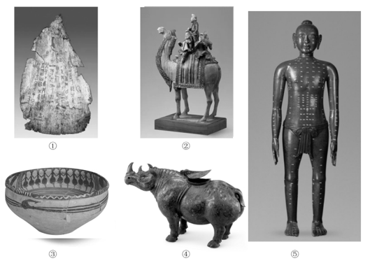
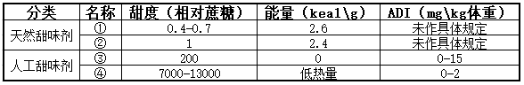
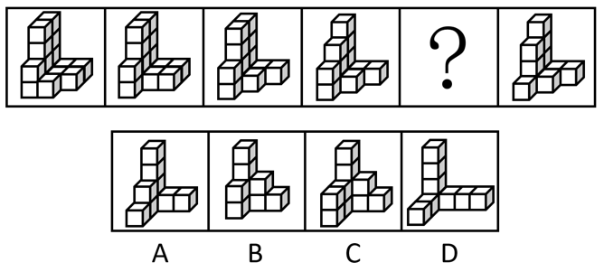
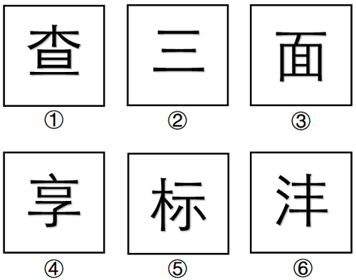
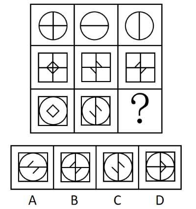
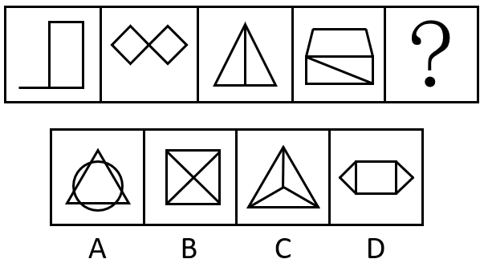
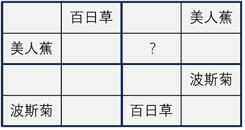
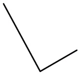
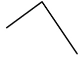
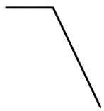

# 2024年辽宁省公务员录用考试《行测》题（网友回忆版）

> 候选采集稿。参考答案及解析来自粉笔页面，不代表官方答案或真实高分答卷；来源使用许可与原卷对应关系仍需人工核实。

## 题型与作答说明

常识判断

（20题）

根据题目要求，在四个选项中选出一个最恰当的答案。

言语理解与表达

（40题）

本部分包括表达与理解两方面的内容。请根据题目要求，在四个选项中选出一个最恰当的答案。

数量关系

（10题）

在这部分试题中，每道题呈现一段表述数字关系的文字，要求你迅速、准确地计算出答案。

判断推理

（30题）

本部分包括图形推理、定义判断、类比推理与逻辑判断四种类型的试题，在四个选项中选出一个最恰当的答案。

资料分析

（20题）

所给出的图、表、文字或综合性资料均有若干个问题要你回答。你应根据资料提供的信息进行分析、比较、计算和判断处理。

## 给定材料

### 材料 dom-material-a054b08566f09582

2023年前三季度，规模以上文化及相关产业企业（简称文化企业）实现营业收入91619亿元，同比增长7.7%。其中，文化新业态特征较为明显的16个行业小类实现营业收入36870亿元，同比增长15.2%。

分产业类型看，文化制造业实现营业收入29007亿元，同比下降1.0%；文化批发和零售业15024亿元，同比增长5.3%；文化服务业47588亿元，同比增长14.6%。

分领域看，文化核心领域实现营业收入59507亿元，同比增长12.4%；文化相关领域32112亿元，同比下降0.1%。

分行业类别看，新闻信息服务实现营业收入12203亿元，同比增长14.9%；内容创作生产19857亿元，同比增长10.3%；创意设计服务14973亿元，同比增长9.6%；文化传播渠道10712亿元，同比增长12.4%；文化投资运营473亿元，同比增长27.7%；文化娱乐休闲服务1289亿元，同比增长67.2%；文化生产和中介服务10894亿元，同比下降1.5%；文化装备生产4443亿元，同比下降4.3%；文化消费终端生产16775亿元，同比增长2.1%。

分区域看，东部地区实现营业收入71959亿元，同比增长8.1%；中部地区10600亿元，同比增长1.9%；西部地区8196亿元，同比增长12.2%；东北地区864亿元，同比增长7.0%。前三季度，文化企业实现利润总额7508亿元，同比增长31.4%。前三季度末，文化企业资产总计192849亿元，同比增长6.7%。

### 材料 dom-material-df5944bcd1ef2bb2

### 材料 dom-material-1d8dc60cdbc08091

### 材料 dom-material-482ac175e5b10a8d

## 题目

### 第 1 题

习近平总书记指出，要系统梳理传统文化资源，让收藏在故宫里的文物、陈列在广阔大地上的遗产、书写在古籍里的文字都活起来。关于中华古籍，下列说法正确的是：

①孔子整理“六经”，其中《易》《书》《诗》《礼》《春秋》传承至今

②经、史、子、集是中国古籍按内容区分的四大部类，《宋书》属于“集”部

③纸是古籍的主要载体，现存最古老的纸张“灞桥纸”距今已超过2000年

④隋唐雕版印刷术和北宋泥活字印刷术极大地促进了古籍制作和文化传播

A. ①②③

B. ①②④

C. ①③④

D. ②③④

### 第 2 题

习近平总书记指出，共建“一带一路”就是要建设一条开放发展之路，同时也必须是一条绿色发展之路。下列“绿色”项目与共建国家对应不正确的是：

A. 中国援建农业技术示范中心并在当地推广种植菌草——卢旺达

B. 由中国三峡集团为主投资方投资建设的卡洛特水电站——巴基斯坦

C. 中国企业在建设特马港新集装箱码头时建立一座“海龟孕育中心”——加纳

D. 中国企业在修建蒙内铁路时增加桥墩高度、设置声音屏障，保护野生动物迁徙通道——蒙古

### 第 3 题

习近平总书记指出，一部中国史，就是一部各民族交融成多元一体中华民族的历史。下列诗句中，描写了民族融合历史的是：

①城头山鸡鸣角角，洛阳家家学胡乐

②北风卷地白草折，胡天八月即飞雪

③天威卷地过黄河，万里羌人尽汉歌

④灵武西凉不用围，番家总待纳王师

A. ①②③

B. ①②④

C. ①③④

D. ②③④

### 第 4 题

马克思主义和中华优秀传统文化之所以能够有机结合，是因为彼此存在高度的契合性。下列马克思主义观点与中华优秀传统文化理念相契合的有几项?

①要通过批判旧世界发现新世界——兴天下之利，除天下之害

②共产党人可以把自己的理论概括为一句话：消灭私有制——大道之行也，天下为公

③哲学家们只用不同的方式解释世界，问题在于改变世界——祸兮，福之所倚；福兮，祸之所伏

④只有在社会中，自然界才是人自己的人的存在的基础——天地与我并生，而万物与我为一

A. 1项

B. 2项

C. 3项

D. 4项

### 第 5 题

新时代以来，我国保护个人信息的立法进程加快。关于个人信息的法律保护，下列说法不正确的是：

A. 《刑法修正案（十二）》新增“非法获取公民个人信息罪”

B. 《网络安全法》规定网络运营者不得泄露、改、毁损其收集的个人信息

C. 《民法典》将自然人的电子邮箱、健康信息、行踪信息等列入个人信息范围

D. 《个人信息保护法》以专章规定了个人信息跨境提供的规则

### 第 6 题

下列论述与其所蕴含的思维方式对应正确的是：

①现在的社会不是坚实的结晶体，而是一个能够变化并且经常处于变化过程中的有机体——底线思维

②我们分析一个事物，首先加以分解，分成两个方面，找出哪些是正确的，哪些是不正确的，哪些是应该发扬的，哪些是应该丢掉的，这就是批评——辩证思维

③现代化建设的任务是多方面的，各个方面需要综合平衡不能单打——系统思维

④科学判断形势，历来是作出正确决策的前提，是推动决策实施的基础——战略思维

A. ①②③

B. ②③④

C. ①③④

D. ①②④

### 第 7 题

核辐射存在于所有的物质之中。下列行为所接受的核辐射剂量由低到高排序最合理的是：

①X光胸肺照射一次

②乘飞机旅行2000千米

③每天吸烟20支，吸一年

④脑CT（计算机断层扫描）一次

⑤正常摄入空气、食物、水一年

A. ②①⑤③④

B. ②⑤①④③

C. ⑤②④①③

D. ⑤①②③④

### 第 8 题

中国自古以来就有尊贤重才的优良传统。下列与人才相关的诗句所反映的道理，说法不正确的是：

A. 罗隐“裨补明时望重才”昭示了匡正时弊、补救政误就需要重用大才的道理

B. 杜甫“安危须仗出群材”揭示了国家安危与否取决于是否有众多人才的道理

C. 陆游“人材衰靡方当虑”蕴含了人才的精神面貌对国家兴衰至关重要的道理

D. 张耒“人才之难万冀一”彰显了环境优劣对人成长成才具有重要影响的道理

### 第 9 题

根据2023年9月1日修正的《中华人民共和国民事诉讼法》，下列关于案件审理说法正确的是：

A. 人民法院审理民事案件，合议庭组成人员必须包括人民陪审员

B. 人民法院审理第一审民事案件，合议庭的成员人数必须是双数

C. 适用简易程序审理的第一审民事案件，由审判员一人独任审理

D. 人民陪审员在参加审判活动时不具有与审判员相同的权利义务

### 第 10 题

历史文物充分见证了中华五千多年文明的灿烂辉煌，实证了五千多年中华文明突出的连续性。下列文物按其代表的文明时代先后排序，正确的是：

A. ①③④②⑤

B. ①④③⑤②

C. ③①⑤④②

D. ③①④②⑤

### 第 11 题

2023年以来，超强地磁暴在地球上相继出现。下列与地磁暴相关的说法，不正确的是：

A. 地磁的成因主要是地核中带有磁性的固体铁矿在高温作用下产生电磁感应

B. 地磁中的带电粒子进入大气层，会使大气层分子或原子碰撞激发而产生极光

C. 与地磁暴有关的太阳爆发活动主要是太阳耀斑和日冕物质抛射

D. 超强地磁暴会引起大气向更高空间扩散，使低轨卫星因大气阻力而降低高度

### 第 12 题

关于我国古代体育运动，下列说法不正确的是：

A. 射箭是周朝官学要求学生学习掌握的基本技能

B. 角力是先秦时期国家军队进行操练的主要科目

C. 蹴鞠是起源于先秦时期盛行于唐宋的体育运动

D. 马球是在北宋之后出现并流行起来的运动项目

### 第 13 题

下列气象观测站与主要观测要素对应不正确的是：

A. 交通气象站：能见度、路面温度、路基温度、路面积水

B. 农业气象站：土壤水分、作物长势、红外温度、二氧化碳

C. 海洋气象站：风速风向、空气流动、太阳辐射

D. 景区气象站：温度、雨量、紫外线、负氧离子

### 第 14 题

关于常见体检指标，下列说法不正确的是：

A. 白细胞偏高说明身体可能有炎症，如扁桃体炎、肺炎等

B. 红细胞偏低会使血液黏度增大，引起血液流通不畅

C. 血小板偏高可能会存在骨髓增生性疾病

D. 总胆固醇偏低或存在甲亢、贫血、营养不良等症状

### 第 15 题

下列做法在日常生活中不可行的是：

A. 用纯净水将纯度95%的医用酒精稀释成75%的医用酒精

B. 喝牛奶、豆浆等富含蛋白质的食品缓解重金属中毒症状

C. 利用淀粉遇碘变蓝的特性，用淀粉检验食盐是否加碘

D. 通过食用高钠、高能量的食物缓解血压低的症状

### 第 16 题

我国中医存在五行相生相克学说，认为五脏对应五行，其中肺属金。中医分析儿童病症时认为脾虚者往往肺也虚，出现气喘病症，治肺补肺勿忘补脾健脾。据此分析，脾脏在五行中属于：

A. 木

B. 水

C. 火

D. 土

### 第 17 题

根据《未成年人网络保护条例》，下列说法正确的是：

A. 网络服务提供者为未成年人提供相关服务，不需要采集未成年人真实身份信息

B. 网络产品和服务提供者可以通过自动化决策方式向未成年人进行商业营销

C. 未成年人用户数量巨大的网络平台服务提供者应每年发布未成年人网络保护社会责任报告

D. 对未成年人群体具有显著影响的网络平台服务提供者，应成立内部机构，对未成年人网络保护情况进行监督

### 第 18 题

文旅爱好者小陈近期游览了我国五个省份，先后感受了当地的文创产品特色：

①在良渚国家考古遗址公园购买了神徽勋章；

②观赏了编钟乐舞并品尝了编钟卤蛋面；

③欣赏了古诗灯光秀并参与了互动节目“盛唐密盒”；

④购买了马踏飞燕玩偶；

⑤品尝了青铜面具冰激凌。

据此推断，小陈游览的省份依次是：

A. 江苏 湖北 陕西 四川 河南

B. 江苏 湖南 陕西 甘肃 四川

C. 浙江 湖南 河南 陕西 山西

D. 浙江 湖北 陕西 甘肃 四川

### 第 19 题

在中国吉祥文化体系中，吉祥物寓意的生成法式一般可归纳为谐音法、象征法、指事法、联想法等多种。下列吉祥物寓意与其生成法式对应恰当的是：

A. 松树、仙鹤同图，寄寓延年益寿的愿望——象征法

B. 花瓶、戟同图，寄寓“平升三级”的愿望——联想法

C. 葡萄、松鼠同图，寄寓家庭和美欢悦的愿望——指事法

D. 桂圆、荔枝、核桃同图，寄寓“连中三元”的愿望——谐音法

### 第 20 题

下面是几种常见甜味剂甜度、能量值及每日容许摄入量（ADI）一览表。根据表中相关信息，序号处的甜味剂名称依次应该是：

A. 木糖醇、山梨糖醇、纽甜、安赛蜜

B. 山梨糖醇、木糖醇、安赛蜜、纽甜

C. 安赛蜜、纽甜、山梨糖醇、木糖醇

D. 纽甜、山梨糖醇、木糖醇、安赛蜜

### 第 21 题

新中国成立以来，尤其是近45年以来，我国通过持续开展以“三北”工程为代表的一系列生态工程，致力于防沙治沙事业，创立了以举国之力开展生态工程的基本范式，探索出规模化开展植被建设的典型模式，取得了举世瞩目的辉煌成就，实现了从“沙进人退”到“绿进沙退”的历史性        ，在国际上产生了巨大影响，树立了生态治理的国际典范。

填入画横线部分最恰当的一项是：

A. 跨越

B. 变迁

C. 进步

D. 转变

### 第 22 题

人工智能已经参与到人们的生活、工作、学习等诸多方面，科研工作同样如此。古文字专业虽然属于传统学科，却与人工智能技术十分        ，相较于人文学科中的许多专业，古文字考释更为客观，其研究结论具有唯一性，研究过程也遵循一定的规律，在人文学科中最接近自然科学，这符合人工智能技术的工作原理。

填入画横线部分最恰当的一项是：

A. 相仿

B. 相配

C. 吻合

D. 契合

### 第 23 题

较早的飞机导航方式较为单一，而且容易失灵，再加上受复杂地貌和空中不稳定气流的影响，飞行员很容易迷失航向。例如，1978年，飞行员杰伊·普罗奇诺驾驶塞斯纳188型飞机执行飞行任务，因机载自动定向仪损坏，被困在南太平洋上空陷入绝境。此时，一架载有88名乘客的客机恰好从附近经过。于是，上演了“大飞机找小飞机”的神奇一幕，堪称现实版的“            ”。

填入画横线部分最恰当的一项是：

A. 缘木求鱼

B. 大海捞针

C. 水中捞月

D. 守株待兔

### 第 24 题

博物馆讲解，不是不能有“戏说”的成分，而是要在“戏说”的时候“事先告知”，在讲解正史之后可以告诉大家“还有一个民间的传说”，把民间传说讲解一下也未尝不可。但是绝不能“把戏说当正史”，故意        历史和传说，甚至添油加醋自己        。

依次填入画横线部分最恰当的一项是：

A. 歪曲 伪造

B. 模糊 发挥

C. 颠倒 篡改

D. 混淆 杜撰

### 第 25 题

中国现代漆画，在20世纪20年代        于传统漆器工艺，是一门年轻的画种。漆画以漆为主要        ，运用各种入漆材料，通过堆漆、刻漆、镶嵌、雕漆、彩绘、泼洒、变涂、磨漆等不同表现手法和工艺来实现丰富的艺术效果。

依次填入画横线部分最恰当的一项是：

A. 脱胎 媒介

B. 肇始 载体

C. 发轫 纽带

D. 孕育 引擎

### 第 26 题

中国式现代化以        的观念统筹推进经济、政治、文化、社会和生态文明各领域工作，而构建新发展格局与推进中国式现代化是逻辑一致的，从生产力、经济体系、奋斗方向和实践路径等        为推进中国式现代化提供了重要基础。

依次填入画横线部分最恰当的一项是：

A. 整体 立场

B. 辩证 层面

C. 系统 维度

D. 历史 视域

### 第 27 题

一般情况下，学术著作的通识性与学术性常常构成某种冲突，            的著作多有存在。观照学术著作的通识性，这是本书的一个总体特征。那么，如何保持通识性与学术性的        呢？对此，本书提供了一个成功的案例。

填入画横线部分最恰当的一项是：

A. 顾此失彼 平衡

B. 厚此薄彼 兼顾

C. 轻重失宜 对等

D. 此消彼长 协调

### 第 28 题

每个新物种命名的背后，都凝结了科研人员大量野外采样、鉴定描述、遍稽群籍的工作积累。不论它们的名字对我们而言是            ，还是新鲜陌生，它们都是独一无二的。正是这一点一滴的新发现，逐渐构建了人类对广袤世界中的生物多样性的认识。而我们现在所认识的物种数量，相较于隐藏在海洋深处、雨林秘境或者其他人迹罕至之地的丰富物种而言，还只是            。

依次填入画横线部分最恰当的一项是：

A. 如数家珍 初露端倪

B. 如雷贯耳 沧海一粟

C. 家喻户晓 管中窥豹

D. 耳熟能详 冰山一角

### 第 29 题

在地球漫长的演化史中，那些固化在岩石中的地球“成长痕迹”，在            中变得零零散散。如何在这些岩石记录中探寻地球演化的源头和脉络？这需要我们用一根时间线，将这些破碎的历史证据        起来，打造成可用于研究地球历史的时间框架，为人类把握现在和预测地球未来的变化提供依据。

依次填入画横线部分最恰当的一项是：

A. 白云苍狗 串联

B. 斗转星移 拼接

C. 翻天覆地 集合

D. 沧海桑田 连缀

### 第 30 题

作者在编写《汉语语音史教程》时并非只介绍前人的研究，            ，对于自己有研究有心得的观点，即使同师辈的看法有        ，他也以尊重语言事实为最高准则，将自己的观点写进教材，介绍给学生。

依次填入画横线部分最恰当的一项是：

A. 述而不作 抵牾

B. 照本宣科 隔膜

C. 人云亦云 分歧

D. 坐而论道 出入

### 第 31 题

土壤中的蚯蚓、蚂蚁等动物和真菌、细菌等微生物被称为土壤生物，这些生物在土壤中并不是            ，而是通过“吃”与“被吃”的关系建成一张食物网，在这一过程中，生物种类、数量和所占比例保持在相对稳定的状态，从而维持了土壤中的生物          。

依次填入画横线部分最恰当的一项是：

A. 各行其是 稳定性

B. 杂乱无章 多样性

C. 相安无事 安全性

D. 盘根错节 复杂性

### 第 32 题

消费者权益保护“无小事”。对于消费者个人及其家庭来说，那些看似不起眼的“小事”，实则是关乎自身合法权益的“大事”。如果处理不当，不仅侵害消费者的合法权益，还极易引发纠纷，削弱消费者的获得感与满意度。获得感要在一件件小事中体会，满意度要在一个个业务中积累，忽略“关键小事”有碍大局发展，正所谓“                      ”。

填入画横线部分最恰当的一项是：

A. 九层之台，起于累土

B. 千里之行，始于足下

C. 千里之堤，溃于蚁穴

D. 合抱之木，生于毫末

### 第 33 题

一首诗就是一个小宇宙，它包含了诗人自己生命个体的遭际，及其在艺术探索上的痕迹；同时也包含了大时代的烙印，及诗人群落的艺术影响。因此，若要对一篇作品有真切的理解，首先需要拿作者的其他作品来对读，对诗人有个通盘的了解，以期做到            ；然后要拿同时代的作家作品来对读，在诗歌内容和艺术上有个            式的认识。这样做，可以增加剖析作品的维度，庶乎更进一步贴近了作品。这样做，比局限在就一篇作品来谈，要更为靠谱。

依次填入画横线部分最恰当的一项是：

A. 举一反三 连类比物

B. 知人论世 高屋建瓴

C. 以点带面 融会贯通

D. 综核名实 兼权尚计

### 第 34 题

载人登月除了需要研制新一代载人运载火箭，还需要研制新一代载人飞船。我国神舟飞船的可靠性和稳定性            ，但对于载人登月来说，其服务舱提供的机动变轨能力较弱等因素，使得神舟飞船载人登月            ，新一代载人飞船采用更简单的返回舱加服务舱两舱构型，适应月球探测、火星探测等多种类型的载人飞行任务，是            的“多用途载人飞船”。

依次填入画横线部分最恰当的一项是：

A. 独领风骚 鞭长莫及 从心所欲

B. 举世无双 望洋兴叹 当之无愧

C. 交口称赞 爱莫能助 久经考验

D. 毋庸置疑 力不从心 名副其实

### 第 35 题

当机体受到各种伤害性刺激或者机体内部发生病变、炎症时，受损组织会        组织胺、缓激肽等致痛物质，这些物质作用于游离神经末梢会引发痛觉冲动，并迅速        至脊髓；然后，通过脊髓丘脑束和脊髓网状束上行至丘脑，并最终        到大脑皮层，从而引起疼痛感觉。

依次填入画横线部分最恰当的一项是：

A. 释放 传导 投射

B. 吸收 发展 映照

C. 衍生 延伸 反馈

D. 激发 输送 干扰

### 第 36 题

中国共产党人精神谱系的生成从来不是盲目冲动的，也不是主观臆想的，而是基于对社会现实的把握、对社会历史的总结，从客观现实和人民群众的伟大实践中阐发出来的。延安精神坚持实事求是的思想路线，“实事”就是客观存在的事物及其内部联系，“求是”就是去研究、探索真理。改革开放精神是中国共产党人在改革开放和建设中国特色社会主义这一特定的历史时期中所形成的解放思想、实事求是，开拓创新、勇于担当，开放包容、兼容并蓄的精神品格。至于新时代北斗精神，在尊重科学的基础上，“自主创新”“追求卓越”无疑都是制胜密码。

这段文字所反映的中国共产党人精神谱系的特征是：

A. 坚持党性与人民性的统一

B. 坚持理想性与现实性的统一

C. 坚持民族性与世界性的统一

D. 坚持客观规律性与主观能动性的统一

### 第 37 题

随着近些年来我国无障碍环境建设的绵绵用力和持续推进，无障碍环境建设取得了可喜的成就，极大地优化了相关群体的出行体验和尊严感。但毋庸讳言，关于无障碍设施，不少人还停留在铺设盲道并确保不被占用、公共场所指示牌标注盲文、地铁站出入口安装升降机等日常的物理设施层面，在管理的精细化方面还有进一步提升的空间。因此，有关主体不妨拓宽并畅通相关渠道，让最主要的使用者参与到相关的建设和管理中来，这些“首席体验官”带来的第一视角和经验，有助于减少过往建设盲区和误区，更有效提升无障碍设施的友好度。

对这段文字主旨概括最准确的一项是：

A. 无障碍设施的软环境建设有待进一步加强

B. 无障碍环境设计应以契合使用需求为导向

C. 优化无障碍环境要倾听设施使用者的声音

D. 试用体验是无障碍设施效果检验必要环节

### 第 38 题

明朝时，江阴有一徐姓巨富，高隐好义，性喜萧散，耽于园亭水木。富户生子三人，最是那次子心性随父，少年时便搜罗奇书，尤喜堪舆地理方志之类，悄悄藏在经书下偷读。稍长，即好出游，朝霞出而晚霞归，说丈夫志在四方，不能束缚一隅之地，当朝碧海而暮苍梧。其人生来异相，绿睛炯炯，有大名士见其眉宇烟霞气萦绕，称他为徐霞客。二十二岁那年，徐霞客戴上母亲缝制的远游冠，离乡远行。足迹千里，心系一文，纳山河大地于笔墨纸砚中，录人文地理、风土民情兼及草木虫鱼，积三十余年，得六十万言，是为《徐霞客游记》。

这段文字没有谈到：

A. 徐霞客的殷实家境

B. 徐霞客的踪迹所至

C. 徐霞客的读书偏好

D. 《徐霞客游记》的由来

### 第 39 题

羌笛是一种源于古羌人的民族民间乐器，传说是秦汉之际游牧在西北高原的羌人所发明，故名羌笛。传入中原后，形制经过了改变。从南朝至唐宋的诗词中，经常能见到它的身影。羌笛既是唐诗中最常出现的意象之一，也是我国历史上各民族交往交流交融的重要文化符号。林庚在《诗的活力与诗的新原质》中说：“只要碰见笛声，便似乎无往而不成为好句。”

这段文字没有介绍：

A. 羌笛的文化属性

B. 羌笛的乐器类属

C. 羌笛的象征对象

D. 羌笛名称的由来

### 第 40 题

卫星上天、太空探索，一次次成功的背后都有种特殊的材料在默默支撑，它就是陶瓷基复合材料，也被称为“摔不碎的陶瓷”。传统陶瓷是以黏土等为主要原料烧结而成，主要成分是硅酸盐化合物，像我们生活中常见的碗、盘、卫生洁具、瓷砖等等，都属于传统陶瓷。但是，传统陶瓷有一个致命的缺点，那就是脆，很容易破碎。而“摔不碎的陶瓷”则是以陶瓷为基体，用相关高性能陶瓷纤维作为增强体复合而成，具有耐高温、寿命长、重量轻、强韧性和抗氧化等优异性能，是航空航天、核电等前沿科技领域的明星材料。

最适合做这段文字标题的是：

A. “摔不碎的陶瓷”

B. 传统陶瓷的没落

C. 由脆而韧：陶瓷的蜕变

D. 复合材料：科技领域的新星

### 第 41 题

一座花园，对于游园者来说，如果你经常用心去观赏品鉴，这座花园就属于你，你就成了花园的主人。如果你心不在焉，虽然常去，却是走马观花，这座花园永远不属于你。心不在焉的人，即使到了庐山，也会觉得“就一瀑布，没意思”；到了欧洲，也会认为“全是教堂，没意思”。所以，要热爱自己的城市或故乡，或向往另外的城市和远方，最关键的不是客体怎么样，而是你自己怎么样。要看看自己是否内心丰盈，是否做一事专一事，从而配得上自己所面对的一景一物。

最能体现这段文字主旨的一项是：

A. 此心有安处，他乡亦吾乡

B. 若有赏花意，无处不芳菲

C. 心若空空也，万物皆无趣

D. 充实你自己，用心看世界

### 第 42 题

草原上的土壤厚度一般很薄，通常只有20厘米左右，没有明显的淋溶层，即使是在茂密的灌木丛下土层的厚度也不超过50厘米，且下面往往有钙积层。大量树木包括不少灌木的根系无法穿过钙积层，吸收不到底层的土壤营养，就不可能长期存活下去。树木生长需要一定厚度的土层，帮助根系吸收土壤中丰富的水分和养分，在土层浅的地方，树木不易扎根，且遇到大风天气容易被吹倒。草本植物的根系多数分布在地下50厘米深度以内，受钙积层影响较小，得以在草原上繁茂生长。

这段文字旨在说明：

A. 树木在草原上难以生长的土壤因素

B. 钙积层过浅对树木扎根的不利影响

C. 草本植物能在草原繁茂生长的原因

D. 植物的地理分布与土壤条件的关系

### 第 43 题

转眼间，《舌尖上的中国》播出已过去多年。多年来，作为纪录片从业者和美食研究者，我们见证了食物从满足温饱到追求风味享受的飞跃；见证了餐饮业从规模扩张到精细化经营的转型；见证了中国人从吃饱到吃好，从讲求质量到开始关注食物背后的情感与文化。其中折射的，不仅是美食的发展与演变，更是经济与社会的进步和变迁。这期间，人们的口味也发生了巨大的改变，涌现出许多新的饮食风尚。最显著的一个变化，恐怕要属“辣”了。

紧承这段文字最可能谈论的内容是：

A. “辣”味成为饮食新风尚的原因

B. 人们对“辣”味的口味偏好之变

C. “辣”在传统饮食文化中的地位

D. 不同群体对“辣”味的不同偏好

### 第 44 题

唐代是中国古代诗歌创作最为繁荣的时期，各路诗人层出不穷，大家名家指不胜屈，而民间的歌谣却远没有如同先前汉魏乐府、南北朝民歌那样引人注目，这时也确实未能推出像《陌上桑》《孔雀东南飞》《木兰诗》《敕勒歌》这种一流的名篇。因此除了发现甚晚而名声大噪的敦煌曲子词之外，时下的文学史一般不大讲这方面的内容。其实唐代民歌也很丰富，自有特色，是不宜只重视其一角的。

根据这段文字无法得知的是：

A. 现在的文学史中有敦煌曲子词的一席之地

B. 现在的文学史对唐代民歌的介绍不够全面

C. 敦煌曲子词代表唐代民间歌谣的艺术高峰

D. 唐代民歌的成就和影响不及汉魏乐府民歌

### 第 45 题

第一次世界大战中的主流作战样式是堑壕战，各国军队普遍列装了射程远、火力大的机枪，可以对集群冲锋的步兵造成伤亡。一战索姆河战役，展现出堑壕战的残酷性——英军一天内有6万人倒在机枪枪口下，这不仅是一战中死亡人数最多的一天，也打破了世界战争史上的单日伤亡纪录。残酷的堑壕战让交战双方意识到：军队迫切需要一种既能像机枪一样进行快速连发射击、高密集火力覆盖，又像步枪一样可轻便携带的轻武器。在战争的推动下，冲锋枪应运而生，德国枪械师研制出第一代冲锋枪——MP18冲锋枪。

这段文字意在说明：

A. 第一代冲锋枪——MP18产生的背景

B. 堑壕战是一战参战国的主流作战样式

C. 英军因何创下一战中的单日伤亡纪录

D. 冲锋枪与机枪在堑壕战中的不同作用

### 第 46 题

“惹不起躲得起”是犰狳独一无二的生存智慧，遇到危险它除了会蜷起来变成球之外，还会使用“土遁术”逃跑。它一两分钟就能挖出一个刚好容下身体的洞钻进去，再用自己坚硬的“铠甲”堵住洞口，在这样一身“金钟罩铁布衫”面前，再强大的敌人也束手无策。然而，近年来在南美洲亚马逊河流域，即使拥有这样奇特防御力的犰狳也沦为了濒危动物，数量迅速减少。犰狳虽嗅觉灵敏，却高度近视，仅凭听觉和记忆行走。比如它经常不知不觉走上公路，被疾驰的汽车撞飞，所以每年都会有一部分犰狳死在公路上。此外，人类还把它的外壳做成乐器或者吃它的肉。

这段文字意在说明：

A. 亚马逊河流域的犰狳面临灭绝危险

B. 犰狳的独门绝技难以助其逃脱厄运

C. 生理缺陷和人类猎杀是犰狳濒危的原因

D. 犰狳应被作为珍稀濒危动物而得到保护

### 第 47 题

今天，PPT已广泛流行于职场，而流行必然伴随争议。PPT软件使人人都能成为制作者的关键方法是提供各类使用模板；随着PPT的格式、动画和多媒体能力的渐趋多样，提供更为多样化的PPT模板和素材也形成了一个产业链条，与职场上越来越“卷”的PPT文化互相呼应。内容的要点、要点之间的关系、条件与结论间的逻辑，或多或少都要服从于模板的换片节奏、展示方式、动画效果、注意力抓取要求，而论题重要与否则取决于“展示”技巧的高低。某种意义上，PPT式思维已经等同于今天的“职场思维”。

根据这段文字，人们对PPT应用于职场产生的“争议”主要是：

A. 职场竞争变成PPT竞赛

B. “职场思维”的模板化

C. PPT简化了人们的思维

D. PPT的内容服从于形式

### 第 48 题

审美标准是一个统一体，包含两个方面：一方面是自然性（生理性）的标准，一方面是社会性的标准。也即，审美标准既有一致性（共性）又有差异性（个性）。人与人生理构造的一致性是构成生理性标准一致性的基础。社会文化环境、文化修养、社会阅历、社会生活实践的一致性是构成人类社会性标准一致性的客观条件。而社会性审美标准往往表现出比生理性审美标准更大的变异性和不一致性。每个人都会形成自己的审美标准，但评判美丑的标准确乎是纯然客观的。正因为是客观的，建立审美标准才是可能的。

根据这段文字可知：

A. 生理构造的差异性是构成生理性审美标准差异性的基础

B. 不同社会阅历是构成社会性审美标准差异性的客观因素

C. 生理性审美标准一般比社会性审美标准显现的差异性小

D. 建立审美标准因个人评判标准的客观性而具有了可能性

### 第 49 题

电池热失控是制约电动汽车与新型储能规模化发展的瓶颈，导致电池热失控的根源是电池内部一系列复杂且相互关联的“链式副反应”，从局部短路到大面积短路，电池内部温度快速提升，可高达以上，会引发电池起火爆炸。因此，亟须深入理解锂离子电池热失控演变机制，并提出早期预警策略，以防止爆炸事故的发生。而溯源电池热失控发生的内在诱因，厘清各分步反应之间的耦联关系，揭示热失控主导机制与动力学规律，前移热失控预警时间窗口，是从根本上解决储能安全问题的核心。

这段文字接下来最可能谈论的是：

A. 电池热失控的火灾案例

B. 电池热失控的演变机制

C. 电池热失控的诱因和危害

D. 电池热失控预判的新技术

### 第 50 题

地面上的水受太阳光照射后变成水蒸气。水蒸气上升到空中，遇到冷空气变成小水滴。这些小水滴有两种结局：又小又轻的被气流托在空中，变成了云；稍大的，经聚合后重力超过空气浮力，变成雨滴落到地面，稍大的雨滴若遇到急剧下降的温度，就会凝结成冰雹降落。由此得知，下雨属于物理变化。                    。据探测器得到的数据和科学家实验模拟还原钻石雨的过程得知，星球上空的雷电将气体中的甲烷分解，从而形成煤灰形态的碳，碳下落变成石墨，石墨落到星球深处因巨大的压力形成钻石。从甲烷到碳到石墨再到钻石，这个过程明显属于化学变化。

填入画横线部分最恰当的一句话是：

A. 想在地球上见到“钻石雨”是不可能的

B. 下钻石雨和地球上空下雨在本质上不同

C. 化学变化和物理变化之间存在天壤之别

D. 地球上下“钻石雨”须有特殊自然条件

### 第 51 题

汞作为一种全球性污染物，可引发水俣病等问题，长期以来被国内外科学家关注。作为环境友好型材料，生物炭可高效净化水体中的汞污染，但由于制备成本较高，极大地限制了其在环境治理中的大规模应用。因此，亟待开展技术经济评估以量化生物炭净化汞污染的成本，指导并推动生物炭从实验室走向市场。

下列表述与文意不符的一项是：

A. 生物炭因为制备成本高而很难实现规模化应用

B. 生物炭作为环境友好型材料可助力水俣病预防

C. 量化评估汞污染的生物炭治理成本是当务之急

D. 滞后的经济评估拖累了生物炭研究成果的转化

### 第 52 题

从气象的角度来讲，春分以后，太阳的直射点开始向北移动，到夏至日，太阳的直射点位于北回归线处，此时北半球获得的阳光最多。以北京为例，夏至日正午时分，太阳高度角约为。这时阳光穿过的大气层厚度最小，光和热被大气层吸收、散射和反射的量也小，到达地面的就多，有利于地面温度升高。夏至的日照时数最长，如北京夏至日白天长达15个小时，地表白天吸收热的时间远大于夜晚向大气中散热的时间，这就使得地面聚集的热量一天天增加。三伏天开始于夏至后约20天，其间地表热量的积累达到高峰，此时温度最高。

这段文字意在说明：

A. 三伏天天气最热的原因

B. 夏至日日照的主要特征

C. 太阳高度对温度的影响

D. 北京夏至日的昼夜温差

### 第 53 题

“剑锋所指，军之所至”，是各国军事家孜孜以求的目标。实际作战中，自然界存在的各种屏障，使这一梦想的实现充满挑战。高山深涧、河流峡谷，险要的地势会显著拖慢行军速度。除此之外，被破坏的公路、反坦克战壕等人工障碍，同样也会让进攻的难度系数陡增。此时，有一种兵器往往被“委以重任”，这就是有着战场“开路先锋”之称的架桥坦克。名称虽听上去有些“冷门”，但它往往在战争的紧要关头发挥“四两拨千斤”的作用。伴随着科技进步，架桥坦克已历经数十年多轮迭代发展。

这段文字是一篇文章的开头，文章的主题最可能是：

A. 架桥坦克是“冷门”一族

B. 架桥坦克的“昨天今天明天”

C. 架桥坦克的“开路搭桥”本领

D. 架桥坦克“四两拨千斤”的奇效

### 第 54 题

中国古代，将正月初一称为“岁朝”，文人们在此日喜欢将鲜花、蔬果、文玩供于案前，以求春意盎然、新年好运，被称为“岁朝清供”。但是，当时能在隆冬时节摆上鲜花、果蔬之类的鲜物者毕竟是少数，于是文人们便将这些“清供”之物绘成画悬挂室内，称为“岁朝图”，成为祈福纳祥的“年画”。此类画作通常以静物画的面貌出现，采用的是写生技法，形象逼真，内容也是以冬天不易看到的花卉、果蔬为主，有的还配以贺岁诗词。

这段文字主要谈论的是：

A. 岁朝

B. 岁朝清供

C. 岁朝图

D. 年画习俗

### 第 55 题

文艺评价是评价主体拥有对文艺作品的鉴赏能力，结合自己的价值观念表达自己对作品的感受。从本质上来说，文艺评价是一种以人类的价值判断为基础的审美行为，审美产生的根本原因是人类的社会实践活动，人的感觉和认知必须和人所处的身体和环境相结合，这构成审美判断的有机组成部分。人工智能应用于文艺评价，是将评价的主体由人变成了智能机器。人工智能通过机器学习、自然语言处理等技术，对文艺作品的评论只能是一种认知性的识别，机器需要通过对人类以往文艺作品的学习而产生评判标准。

关于人工智能应用于文艺评价，作者的观点是：

A. 人工智能可为文艺评价提供技术性标准但无法产生审美

B. 人工智能可以从整体意识的层面来评价和鉴赏文艺作品

C. 人工智能进行的文艺评价会比以人为主体的评价更科学

D. 人工智能评价会对大众的审美标准和评价尺度产生影响

### 第 56 题

一般而言，每一处沉船遗址都是一次不幸船难的事故现场。人们常说，考古学就像刑侦学，只不过一个是对过去事件现场的研究，一个是对现在案件现场的勘察。从这个角度说，对沉船考古遗址的调查就是对沉船事故现场的勘察，只不过这个现场在历经千百年后早已成为“故场”（遗址）。但无论考古还是刑侦，遗址还是现场，二者都特别关注事件的6个W问题（when、where、who、what、how、why）。对于一号、二号沉船的发现，我们首先关注的就是两艘沉船的年代（when）、性质（what、who）、始发港和目的地（where）等问题。笔者在本文将试做初步分析，意在抛砖引玉，推动对两艘沉船的深入研究。

这段文字没有谈到：

A. 文章接下来将要谈论的话题

B. 这段文字所属文章的写作目的

C. 一、二号沉船考古工作的难点

D. 刑侦现场勘察和考古的共同点

### 第 57 题

如果说人类是最聪明的脊椎动物，作为头足类动物的章鱼，便是最聪明的无脊椎动物。头足类动物的脑不但远远大于其他无脊椎动物，甚至比很多体型相当的哺乳动物还要大。和生物研究常用的小白鼠相比，体型相当的章鱼有5亿个神经细胞，比小白鼠的神经细胞数量多一个数量级，章鱼脑重量占身体的比重也接近人类，如此巨大的神经系统，使得它们表现出很多复杂的行为和高级的认知功能，比如能学习新技能，进行复杂操作等。科学家们发现，如果把章鱼关在一个罐子里，它们能很快找到办法从里面把罐子旋开。它们还能记住在迷宫里走过的路径，能观察同类行为进行学习等等。

这段文字旨在说明：

A. 章鱼的脑为何远大于其他头足类动物

B. 如何判断出章鱼有着巨大的神经系统

C. 关在罐子里的章鱼为何表现如此神奇

D. 为什么说章鱼是最聪明的无脊椎动物

### 第 58 题

早晨的玫瑰花经过了一夜的呼吸作用，体内有机物和水分储备较少，二氧化碳浓度较高，呈现弱酸性，并且气孔处于开放状态，失水较多。二氧化碳浓度会对玫瑰花枯萎有影响，这是因为二氧化碳浓度会影响植物体内的酶的活性。酶是一种能够促进化学反应的生物催化剂，它对温度、pH值等环境因素很敏感。当二氧化碳浓度高时，植物体内的pH值会降低变成酸性，这会抑制一些酶的活性，导致植物的新陈代谢减慢，无法有效利用水分和营养。

从这段文字可以推出的是：

A. 早晨采摘的玫瑰更容易枯萎

B. 夜间玫瑰花中酶的活性最低

C. 酶的活性受水分多少的影响

D. 植物新陈代谢慢源于温度低

### 第 59 题

①关于贺、杨二先生尤其贺先生，学界知之较多

②“黑学”能传入并扎根中国，实赖三位川人：张颐（1887-1969，四川叙永人）、贺麟（1902-1992，四川金堂人）和杨一之（1912-1989，重庆潼南人）

③此处的“黑学”，是指黑格尔哲学

④贺先生以翻译《小逻辑》著称，杨先生则以翻译《逻辑学》著称

⑤历史上，宋人云“易学在蜀”；现当代，则可曰，“黑学赖川”

⑥照直说，若无“三先生”早期的研究、译介与推广，中国的“黑学”研究恐怕要另当别论了

将以上6个句子重新排列，语序正确的一项是：

A. ①④②③⑥⑤

B. ②⑥①④⑤③

C. ④②⑤⑥③①

D. ⑤③②⑥①④

### 第 60 题

①1979年，波斯波利斯被列入联合国教科文组织世界文化遗产名录

②波斯波利斯始建于公元前约518年，主要建筑包括万国门、觐见厅、百柱宫、阿帕达纳宫、薛西斯宫殿、书房、金库等，整个宫殿建筑群历经3个朝代才得以完成

③去伊朗一定要看看波斯波利斯古城遗址

④联合国教科文组织评价说，波斯波利斯古城遗址提供了许多关于古代波斯文明的珍贵资料，具有重要考古价值

⑤这座显赫一时、规模宏大的王城后来在马其顿王亚历山大东征时被烧毁

⑥虽遭焚毁，又历经千年风雨侵蚀，但如今依然高柱林立、巨石横卧

将以上6个句子重新排列，语序正确的一项是：

A. ②③⑤①④⑥

B. ③②⑤⑥①④

C. ③①②④⑤⑥

D. ②①④⑤⑥③

### 第 61 题

在一次选举中，某候选人需得到全部选票的才能当选。当统计到的选票时，他已得到当选所需的。问他若能当选还要得到剩下选票中的：

A. 

B. 

C. 

D. 

### 第 62 题

现有一容器，装有100克浓度为75%的盐水，从中倒出40克盐水后，再加入40克纯净水，如此反复三次。问此时盐水的浓度是：

A. 16.20%

B. 9%

C. 1.62%

D. 0.90%

### 第 63 题

有一批零件，如果甲车间单独完成需要50小时，乙车间单独完成需要30小时，在甲车间单独完成若干小时后，由于要承担其他紧急任务，剩余的任务由乙车间继续完成，这样一共用了42小时。问乙车间完成的零件量占这批零件总量的：

A. 

B. 

C. 

D. 

### 第 64 题

某商家购进一批商品，每件成本为27元，最初将商品定价为每件40元，该商家经过百分率相等的连续两次降价后，每件商品的利润率不超过20%。问每次降价的百分率至少是：

A. 20%

B. 15%

C. 10%

D. 5%

### 第 65 题

甲、乙两个圆柱容器底面积之比为3：4，分别盛有7厘米高和10厘米高的液体，现在向两个容器内注入同样多的液体，直至两个容器内液体的高度相等，问甲容器内液面上升至：

A. 9厘米

B. 12厘米

C. 15厘米

D. 19厘米

### 第 66 题

甲、乙二人在某项工作结束后，统计数据显示：甲比乙的工作量多，乙比甲所用的时间多，问甲、乙二人工作效率的比值所在范围的区间是：

A. (1，1.5\]

B. (1.5，2\]

C. (2，2.5\]

D. (2.5，3\]

### 第 67 题

某包装车间包装甲、乙两种规格的袋装杂粮，甲、乙两袋杂粮的重量之比为5：2，如果从甲袋中称出2公斤放入乙袋后，甲、乙两袋杂粮的重量之比变为4：3。问甲袋杂粮原来重量为：

A. 8公斤

B. 10公斤

C. 12公斤

D. 15公斤

### 第 68 题

某部门工会为丰富职工文化生活增进职工身心健康，组织开展了拔河、羽毛球、乒乓球、台球四项比赛活动，每名职工参加一项或者两项比赛。若要保证至少有5名职工参加的比赛项目完全相同，则该部门参加比赛的职工至少有：

A. 40名

B. 41名

C. 50名

D. 51名

### 第 69 题

一盒中有10支晶体管，其中有2支次品，8支正品。现从中连取两次，每次取1支，取后不放回，则至少取到1支次品的概率是：

A. 

B. 

C. 

D. 

### 第 70 题

某中学举办教职工趣味运动会，需要准备一些球类道具，必须同时满足每2人合用一个毽球，每3人合用一个乒乓球，每4人合用一个排球，这样工作人员一共准备了26个球类道具。问参加本次运动会的教职工最多有：

A. 12人

B. 20人

C. 24人

D. 26人

### 第 71 题

从所给四个选项中，选择最合适的一个填入问号处，使之呈现一定的规律性：

A. A

B. B

C. C

D. D

### 第 72 题

从所给四个选项中，选择最合适的一个填入问号处，使之呈现一定的规律性：

A. A

B. B

C. C

D. D

### 第 73 题

从所给四个选项中，选择最合适的一个填入问号处，使之呈现一定的规律性：

A. A

B. B

C. C

D. D

### 第 74 题

把下面的六个图形分成两类，使每一类图形都有各自共同的特征和规律，分类正确的一项是：

A. ①②⑥，③④⑤

B. ①③④，②⑤⑥

C. ①③⑥，②④⑤

D. ①④⑤，②③⑥

### 第 75 题

从所给四个选项中，选择最合适的一个填入问号处，使之呈现一定的规律性：

A. A

B. B

C. C

D. D

### 第 76 题

从所给四个选项中，选择最合适的一个填入问号处，使之呈现一定的规律性：

A. A

B. B

C. C

D. D

### 第 77 题

从所给四个选项中，选择最合适的一个填入问号处，使之呈现一定的规律性：

A. A

B. B

C. C

D. D

### 第 78 题

能够判断真假的陈述句叫做命题，一个命题的本身称之为原命题，逆命题是指将原命题的条件和结论颠倒的新命题，否命题是指将原命题的条件和结论全否定，但不改变条件和结论的顺序的新命题。逆否命题是指将原命题的条件和结论颠倒，然后再将条件和结论全否定的新命题。

根据上述定义，下列说法正确的是：

A. 原命题为“若m+2=5，则m=3”，其逆否命题为“若m=3，则m+2=5”

B. 原命题为“若天下雨，则地面一定湿”，其逆否命题为“若天不下雨，则地面一定不湿”

C. 原命题为“若x>1，则单调递增”，其否命题为“若不单调递增，则”

D. 原命题为“若甲信任乙，则乙信任甲”，其逆命题为“若乙信任甲，则甲信任乙”

### 第 79 题

投射效应是一种认为自己具有某种特性，他人也一定会有与自己相同的特性，进而把自己的感情、意志、特性等投射到他人身上并强加于他人的心理现象。

根据上述定义，下列体现了投射效应的是：

A. 一个经常帮助别人的人会认为自己遇到困难时，别人也会伸出援手

B. 每次在足球比赛结束之后，就会有人声称自己早就预测到某队会赢

C. 小王喜欢吃零食，他经常买很多零食带到单位和同样喜欢吃零食的同事分享

D. 小张喜欢读历史书，经常给孩子讲历史书上的故事，慢慢地孩子也喜欢上了历史

### 第 80 题

舛互是指说话或写文章时对所要表达的对象先全部肯定后又部分否定，或先全部否定后又部分肯定的一种修辞方式。从语义上来看，全句的语义点不是前面的统称，而是后面的例外，统称只是作为铺垫或映衬来突出或强调例外。

根据上述定义，下列使用了舛互的是：

A. 家乡是个贼，它能偷去你的心

B. 夜幕下的田野万籁俱寂，偶尔有几声蛙鸣

C. 我这才明白，两年来，不，是二十二年来我全在瞎折腾

D. 假如战争不发生，他的官还可以做下去——不，做上去

### 第 81 题

旋造是指在同一语句中，故意将两个短语中的某些语素位置互换，使本来正常的词语组合变成超常组合，从而造成某种“谬误”的一种修辞方式。

根据上述定义，下列没有使用旋造这一修辞方式的是：

A. 高江急峡雷霆斗，古木苍藤日月昏

B. 酿泉为酒，泉香而酒洌

C. 我心匪石，不可转也。我心匪席，不可卷也

D. 有别必怨，有怨必盈，使人意夺神骇，心折骨惊

### 第 82 题

双趋冲突是指两种都具有吸引力的需求目标同时出现，而由于条件限制，个体无法同时满足两种需求目标所表现出的动机冲突。双避冲突是指同时有两个可能对个体具有威胁性，不利的事发生，两种都想躲避。但受条件限制，只能避开一种，接受一种，在作出选择时内心产生矛盾和痛苦的动机冲突。

根据上述定义，下列属于其中任何一种的是：

A. 面对美食，想吃又怕胖，只能少吃

B. 既想工资高又想不劳累，还想假期多，结果找不到工作

C. 既不想背单词，又不想拉小提琴，迫于明天的考试，只好背单词

D. 看中了一件衣服，想买却没钱，只好放弃

### 第 83 题

游戏是自主自由，使幼儿获得愉快满足，非功利性的行为的总称。规则游戏是按照认知发展所作出的一种游戏分类，是指两个以上的游戏者在一起按照预先规定的规则进行的，具有竞赛性质的游戏活动。根据社会行为发展分类，游戏又可以分为单独游戏（各玩各的，游戏内容不同）、平行游戏（各玩各的，游戏内容相同）、合作游戏（和同伴玩，有目标或分工）、联合游戏（和同伴玩，没有目标或分工）。

根据上述定义，下列既属于规则游戏又属于合作游戏的是：

A. 三个幼儿一起玩过家家，分别扮演爸爸、妈妈和孩子，说好不能打架

B. 幼儿甲和幼儿乙一起下棋，说好谁赢了谁会得到一颗糖果作为奖励

C. 幼儿甲在玩拼图，幼儿乙也拿来拼图玩，不久后两个孩子开始暗自比拼谁拼得快

D. 幼儿甲和幼儿乙作为搭档一起参加儿童拉丁舞比赛，在比赛中获得了冠军

### 第 84 题

概念同化是指学习者利用已有概念去学习以定义的方式直接呈现的新概念，概念同化分为上位学习、下位学习和并列组合学习三种基本形式。上位学习是指新学习的内容比原有内容的包摄性和概括性高的一种学习方式，下位学习是指新学习的内容比原有内容的包摄性和概括性低的一种学习方式，并列组合学习是指新旧概念的概括程度相同，通过并列或联合关系而产生的学习方式。

根据上述定义，下列属于下位学习的是：

A. 在学习了钠、镁、铝等元素的化学性质后，再学习铅、铁、锌等元素的化学性质

B. 在学习了正方形、长方形的面积计算公式后，再学习平行四边形的面积计算公式

C. 在学习了2、3、5等数字规律并形成了质数概念后，再学习97也是质数

D. 在学习了亭、台、楼、阁等建筑的特点后，再学习中国传统建筑的特点

### 第 85 题

陶瓷杯：玻璃杯：咖啡杯

A. 摇篮曲：催眠曲：钢琴曲

B. 柳叶剑：桃木剑：长柄剑

C. 牡丹园：芍药园：百花园

D. 羊皮鞋：棉布鞋：儿童鞋

### 第 86 题

兵无常势：水无常形

A. 人从心发：树从根发

B. 从善如登：从恶如崩

C. 君子检身：常若有过

D. 为者常成：行者常至

### 第 87 题

远在天边：近在眼前

A. 上天无路：入地无门

B. 取其精华：去其糟粕

C. 尺有所短：寸有所长

D. 以子之矛：攻子之盾

### 第 88 题

太阳：东升西落

A. 珠峰：高耸入云

B. 桃树：花团锦簇

C. 江面：风平浪静

D. 道路：车水马龙

### 第 89 题

简繁转换：繁转简：简转繁

A. 符号：单下划线：双下划线

B. 文件：电子文件：纸质文件

C. 诊断：观发识病：观舌诊病

D. 麻醉：局部麻醉：药物麻醉

### 第 90 题

望远镜：千里镜：目镜

A. 牵牛花：喇叭花：花瓣

B. 重阳节：登高节：茱萸

C. 复印机：影印机：纸张

D. 紫禁城：太和殿：故宫

### 第 91 题

编号：①②③：甲乙丙

A. 热水器：进水管：出水管

B. 定价：生产成本：营销成本

C. 字母：大写字母：小写字母

D. 防晒：室内躲避：涂防晒霜

### 第 92 题

（ ） 对于 生物能源 相当于 经济政策 对于 （ ）

A. 太阳能；价格政策

B. 植物能源；社会政策

C. 氢元素；经济关系

D. 清洁能源；货币政策

### 第 93 题

将校园里一块空地划分成4行4列共计16个小格再将其整理成如下图的4个田字格，每个小格中分别摆放百日草、鸾尾花、美人蕉和波斯菊四种花卉中的一种。要求：

（1）每一行和每一列都要用到四种花卉；

（2）每个田字格中也都要用到四种花卉；

（3）图中花卉的位置不能移动。

则图中问号处摆放的花卉应当是：

A. 百日草

B. 鸾尾花

C. 美人蕉

D. 波斯菊

### 第 94 题

研究人员对生物医学数据库中近29万人进行了跟踪调查，发现有七种健康生活方式与降低抑郁症风险有关。其中，健康睡眠（每晚睡7~9小时）影响最大，能将抑郁症风险降低22%。不吸烟、频繁的社会联系、定期体育锻炼、不久坐、适度饮酒、健康饮食可分别将抑郁症风险降低20%、18%、14%、13%、11%和6%。研究人员据此认为，健康生活方式有助于降低患抑郁症的风险。

以下哪项如果为真，最能支持上述结论：

A. 是否坚持健康生活方式以及遗传因素共同决定了患抑郁症风险的高低

B. 除了上述七种方式外，健康生活方式还包括晒太阳和保持心情舒畅等

C. 不良生活方式会影响免疫系统和新陈代谢，从而增加患抑郁症的可能性

D. 除药物治疗外，上述七种健康生活方式也有助于抑郁症患者缓解症状

### 第 95 题

近年来，某国能源危机愈演愈烈，能源价格飙升。天然气、电力、汽油等产品的价格均出现大幅度上涨。有分析人士认为，该国的能源价格飙升是由全球极端天气频发导致的，在短时间内难以解决；在能源价格的持续上涨下，由于缺乏短期替代品，企业将受到能源成本上涨的巨大影响，该国可能出现经济衰退。

以下哪项如果为真，最能支持上述分析人士的观点：

A. 拉尼娜和厄尔尼诺现象的交替影响引发全球气候混乱，致使全球极端天气频发

B. 该国经济衰退不仅会使本国人民生活水平大幅下降，也会对全球经济稳定和发展构成威胁

C. 该国对天然气等能源的对外依赖度超过90%，近年来能源输出国切断了对该国的能源输入

D. 在全球极端天气影响下，该国冬季气温异常寒冷，使其对天然气等能源的需求和价格暴涨

### 第 96 题

一项研究发现牙龈炎和老年痴呆有关。研究人员招募了172名平均年龄67岁的老年人，一方面监测他们的牙龈损伤程度，另一方面通过脑部扫描来测量他们的海马体体积。研究进行了4年，结果发现牙龈的损伤程度和海马体体积的降低有直接关系。研究人员认为，对于老年人而言，预防牙龈炎有助于预防老年痴呆。

以下哪项如果为真，最能支持上述结论：

A. 牙龈炎会对心脏造成影响，还会影响肺部功能或引起胃部疾病

B. 导致牙龈炎的牙龈卟啉单胞菌可以入侵脑组织，并对神经细胞造成损伤

C. 患有老年痴呆的病人常常会忘记刷牙，从而容易引发牙龈炎

D. 老年痴呆虽然是一种神经退行性疾病，但其可能是由于躯体疾病引起的

### 第 97 题

研究人员指出，在2.5亿年后现在所有的陆地会合并成一个超大陆。研究人员用气候模型预测超大陆的温湿度后发现，因火山气体排放，大气二氧化碳水平将升高至现在的2倍，未来太阳也会释放出比现在多2.5%的辐射，整个未来超大陆将会超过哺乳动物热应激极限。研究人员认为，超大陆的极端高温会使哺乳动物面临灭绝的风险。

以下哪项如果为真，最能削弱上述结论：

A. 在超大陆上有8%的区域适合哺乳动物生存但种群会大幅缩小

B. 某些不确定因素的影响可能会使超大陆的形成时间提前或延后

C. 哺乳动物有避免过热的策略但温度长时间超过会导致哺乳动物死亡

D. 其他演化或人类相关活动可能会使哺乳动物在超大陆形成前灭绝

### 第 98 题

由于儿童对有毒、有害物质的代谢能力远低于成人，因此儿童更容易受到二手烟的危害。研究发现在二手烟暴露水平相同的情况下，儿童血液中可替宁（尼古丁代谢产物）的含量是成人的1倍以上，由于儿童的智力发育水平受到其阅读、数学和推理能力的影响，研究人员认为，儿童暴露于二手烟会影响其智力发育水平。

上述论证的成立需要补充以下哪项作为前提：

A. 可替宁含量增加会导致儿童的阅读、数学和推理能力下降

B. 阅读、数学和推理能力是衡量儿童智力发育水平的主要标准

C. 儿童血液中的可替宁含量是可以通过科学方法检验出来的

D. 与成人相比，儿童更容易受到有毒、有害物质的伤害

### 第 99 题

研究人员调查了女性晚年体重变化与健康状况的关系，发现60岁以上仍保持体重稳定的女性更容易活到90~100岁。研究显示，与体重减轻5%或更多的老年女性相比，体重保持稳定的老年女性健康状况更好，其长寿的可能性高出1.2至2倍。与体重稳定的女性相比，体重至少减轻5%的女性健康状况相对较差，研究人员由此认为，老年女性体重减轻会导致其健康状况受损。

以下除哪项外，均能削弱上述结论：

A. 研究中活到90岁以上的老年女性，其家族成员寿命也普遍较高

B. 生活习惯不良或情绪状态不佳等也会导致老年女性健康状况受损

C. 老年女性在不想减肥的时候却体重减轻，是健康状况不佳导致的

D. 如果医生建议老年女性减轻体重以改善健康那么其应谨遵医嘱

### 第 100 题

所有单纯依靠运气成分获胜的都不能成为电竞游戏，所有虚拟环境中的智力和体力的对抗都是电竞游戏。所以，所有虚拟环境中的智力和体力的对抗都不是无规则的竞技。

上述论证的成立需要补充以下哪项作为前提：

A. 所有电竞游戏都是无规则的竞技

B. 有些虚拟环境中的智力和体力的对抗是单纯依靠运气成分获胜的

C. 有些无规则的竞技是虚拟环境中的智力和体力的对抗

D. 所有无规则的竞技都是单纯依靠运气成分获胜的

### 第 101 题

2022年前三季度，文化服务业实现营业收入约是文化批发和零售业营业收入的：

关联材料：dom-material-a054b08566f09582

A. 不到2.5倍

B. 2.5~3倍

C. 3~3.5倍

D. 3.5倍以上

### 第 102 题

2023年前三季度，营业收入超过1.2万亿元的行业，按同比增速由大到小排序正确的是：

关联材料：dom-material-a054b08566f09582

A. 内容创作生产、文化消费终端生产、创意设计服务、新闻信息服务

B. 创意设计服务、文化消费终端生产、文化传播渠道、内容创作生产

C. 新闻信息服务、内容创作生产、创意设计服务、文化消费终端生产

D. 创意设计服务、新闻信息服务，文化消费终端生产、内容创作生产

### 第 103 题

2023年前三季度，实现营业收入最高的文化行业，其2022年前三季度的营业收入大约是：

关联材料：dom-material-a054b08566f09582

A. 不到1.4万亿元

B. 1.4~1.8万亿元

C. 1.8~2.2万亿元

D. 超过2.2万亿元

### 第 104 题

2023年前三季度，文化企业利润总额与营业收入的比值约比上一年：

关联材料：dom-material-a054b08566f09582

A. 降低了1.8个百分点

B. 降低了1.5个百分点

C. 提高了1.8个百分点

D. 提高了1.5个百分点

### 第 105 题

下列说法错误的是：

关联材料：dom-material-a054b08566f09582

A. 2022年前三季度，文化新业态特征较为明显的16个行业小类的营业收入占文化企业营业收入比重超过40%

B. 2023年前三季度，文化核心领域实现营业收入同比增量超过文化企业实现营业收入同比增量

C. 2022年前三季度，中部地区文化企业实现营业收入比西部地区多3000亿元以上

D. 2023年前三季度，每百元资产实现营业收入比上一年高

### 第 106 题

2013-2022年，中国与共建国家进出口总额合计约为：

关联材料：dom-material-df5944bcd1ef2bb2

A. 至少20万亿美元

B. 在17-20万亿美元之间

C. 在14-17万亿美元之间

D. 至多14万亿美元

### 第 107 题

2013-2022年，中国与共建国家进出口总额最低的年份，中国外贸总值比上年同期：

关联材料：dom-material-df5944bcd1ef2bb2

A. 下降了10%以上

B. 下降了不到10%

C. 上升了10%以上

D. 上升了不到10%

### 第 108 题

2014-2022年，中国与共建国家进出口总额同比增长率为正值的年份有：

关联材料：dom-material-df5944bcd1ef2bb2

A. 3个

B. 4个

C. 5个

D. 6个

### 第 109 题

2021年，中国外贸总值比2013年多：

关联材料：dom-material-df5944bcd1ef2bb2

A. 不到2.1万亿美元

B. 2.1-2.3万亿美元

C. 2.3-2.5万亿美元

D. 超过2.5万亿美元

### 第 110 题

下列说法错误的是：

关联材料：dom-material-df5944bcd1ef2bb2

A. 2021年，中国外贸总值首次超过5万亿美元

B. 2015-2017年，中国外贸总值的年平均值不超过4万亿美元

C. 2021年，中国与共建国家进出口总额增长率低于2022年

D. 2022年，中国与共建国家进出口总额比2013年增长了约74%

### 第 111 题

2013-2022年，全国亿元以上食品、饮料及烟酒市场成交额为：

关联材料：dom-material-1d8dc60cdbc08091

A. 不到1.2万亿元

B. 1.2-1.3万亿元

C. 1.3-1.4万亿元

D. 超过1.4万亿元

### 第 112 题

2014-2022年，全国亿元以上食品、饮料及烟酒市场成交额同比增量最高的年份，其茶叶市场成交额同比增速为：

关联材料：dom-material-1d8dc60cdbc08091

A. 不到10%

B. 10%-15%

C. 15%-20%

D. 超过20%

### 第 113 题

2013-2022年，全国亿元以上食品饮料市场成交额超过烟酒市场3倍以上的年份有：

关联材料：dom-material-1d8dc60cdbc08091

A. 6个

B. 7个

C. 8个

D. 9个

### 第 114 题

2016-2018年，全国亿元以上茶叶市场成交总额占食品、饮料及烟酒市场成交总额的比重为：

关联材料：dom-material-1d8dc60cdbc08091

A. 不到15%

B. 15%-20%

C. 20%-25%

D. 超过25%

### 第 115 题

2017年，食品饮料市场、茶叶市场、烟酒市场和其他市场成交额同比增速由大到小排序正确的是：

关联材料：dom-material-1d8dc60cdbc08091

A. 茶叶市场、食品饮料市场、其他市场、烟酒市场

B. 其他市场、食品饮料市场、茶叶市场、烟酒市场

C. 烟酒市场、食品饮料市场、茶叶市场、其他市场

D. 烟酒市场、茶叶市场、食品饮料市场、其他市场

### 第 116 题

2023年11月J省深圳证券交易所债券当期成交额同比增量为：

关联材料：dom-material-482ac175e5b10a8d

A. 不到2百亿元

B. 2-2.5百亿元

C. 2.5-3百亿元

D. 超过3百亿元

### 第 117 题

2023年上半年J省深圳证券交易所债券平均成交额为：

关联材料：dom-material-482ac175e5b10a8d

A. 不到15百亿元

B. 15-16百亿元

C. 16-17百亿元

D. 超过17百亿元

### 第 118 题

2023年1-11月J省深圳证券交易所债券当期成交额占证券当期成交金额的比重超过的月份有：

关联材料：dom-material-482ac175e5b10a8d

A. 3个

B. 4个

C. 5个

D. 6个

### 第 119 题

2023年6月J省深圳证券交易所证券当期成交金额占上半年的比重为：

关联材料：dom-material-482ac175e5b10a8d

A. 不到15%

B. 15%-20%

C. 20%-25%

D. 超过25%

### 第 120 题

下面能够反映2023年J省深圳证券交易所第三季度各月证券当期成交金额环比增速的折线图是：

关联材料：dom-material-482ac175e5b10a8d

A. 

B. 

C. 

D. 

## 答案与解析

第 1 题

**答案状态：unknown（来源未提供）**

**解析状态：unknown（来源未提供）**

第 2 题

**答案状态：unknown（来源未提供）**

**解析状态：unknown（来源未提供）**

第 3 题

**答案状态：unknown（来源未提供）**

**解析状态：unknown（来源未提供）**

第 4 题

**答案状态：unknown（来源未提供）**

**解析状态：unknown（来源未提供）**

第 5 题

**答案状态：unknown（来源未提供）**

**解析状态：unknown（来源未提供）**

第 6 题

**答案状态：unknown（来源未提供）**

**解析状态：unknown（来源未提供）**

第 7 题

**答案状态：unknown（来源未提供）**

**解析状态：unknown（来源未提供）**

第 8 题

**答案状态：unknown（来源未提供）**

**解析状态：unknown（来源未提供）**

第 9 题

**答案状态：unknown（来源未提供）**

**解析状态：unknown（来源未提供）**

第 10 题

**答案状态：unknown（来源未提供）**

**解析状态：unknown（来源未提供）**

第 11 题

**答案状态：unknown（来源未提供）**

**解析状态：unknown（来源未提供）**

第 12 题

**答案状态：unknown（来源未提供）**

**解析状态：unknown（来源未提供）**

第 13 题

**答案状态：unknown（来源未提供）**

**解析状态：unknown（来源未提供）**

第 14 题

**答案状态：unknown（来源未提供）**

**解析状态：unknown（来源未提供）**

第 15 题

**答案状态：unknown（来源未提供）**

**解析状态：unknown（来源未提供）**

第 16 题

**答案状态：unknown（来源未提供）**

**解析状态：unknown（来源未提供）**

第 17 题

**答案状态：unknown（来源未提供）**

**解析状态：unknown（来源未提供）**

第 18 题

**答案状态：unknown（来源未提供）**

**解析状态：unknown（来源未提供）**

第 19 题

**答案状态：unknown（来源未提供）**

**解析状态：unknown（来源未提供）**

第 20 题

**答案状态：unknown（来源未提供）**

**解析状态：unknown（来源未提供）**

第 21 题

**答案状态：unknown（来源未提供）**

**解析状态：unknown（来源未提供）**

第 22 题

**答案状态：unknown（来源未提供）**

**解析状态：unknown（来源未提供）**

第 23 题

**答案状态：unknown（来源未提供）**

**解析状态：unknown（来源未提供）**

第 24 题

**答案状态：unknown（来源未提供）**

**解析状态：unknown（来源未提供）**

第 25 题

**答案状态：unknown（来源未提供）**

**解析状态：unknown（来源未提供）**

第 26 题

**答案状态：unknown（来源未提供）**

**解析状态：unknown（来源未提供）**

第 27 题

**答案状态：unknown（来源未提供）**

**解析状态：unknown（来源未提供）**

第 28 题

**答案状态：unknown（来源未提供）**

**解析状态：unknown（来源未提供）**

第 29 题

**答案状态：unknown（来源未提供）**

**解析状态：unknown（来源未提供）**

第 30 题

**答案状态：unknown（来源未提供）**

**解析状态：unknown（来源未提供）**

第 31 题

**答案状态：unknown（来源未提供）**

**解析状态：unknown（来源未提供）**

第 32 题

**答案状态：unknown（来源未提供）**

**解析状态：unknown（来源未提供）**

第 33 题

**答案状态：unknown（来源未提供）**

**解析状态：unknown（来源未提供）**

第 34 题

**答案状态：unknown（来源未提供）**

**解析状态：unknown（来源未提供）**

第 35 题

**答案状态：unknown（来源未提供）**

**解析状态：unknown（来源未提供）**

第 36 题

**答案状态：unknown（来源未提供）**

**解析状态：unknown（来源未提供）**

第 37 题

**答案状态：unknown（来源未提供）**

**解析状态：unknown（来源未提供）**

第 38 题

**答案状态：unknown（来源未提供）**

**解析状态：unknown（来源未提供）**

第 39 题

**答案状态：unknown（来源未提供）**

**解析状态：unknown（来源未提供）**

第 40 题

**答案状态：unknown（来源未提供）**

**解析状态：unknown（来源未提供）**

第 41 题

**答案状态：unknown（来源未提供）**

**解析状态：unknown（来源未提供）**

第 42 题

**答案状态：unknown（来源未提供）**

**解析状态：unknown（来源未提供）**

第 43 题

**答案状态：unknown（来源未提供）**

**解析状态：unknown（来源未提供）**

第 44 题

**答案状态：unknown（来源未提供）**

**解析状态：unknown（来源未提供）**

第 45 题

**答案状态：unknown（来源未提供）**

**解析状态：unknown（来源未提供）**

第 46 题

**答案状态：unknown（来源未提供）**

**解析状态：unknown（来源未提供）**

第 47 题

**答案状态：unknown（来源未提供）**

**解析状态：unknown（来源未提供）**

第 48 题

**答案状态：unknown（来源未提供）**

**解析状态：unknown（来源未提供）**

第 49 题

**答案状态：unknown（来源未提供）**

**解析状态：unknown（来源未提供）**

第 50 题

**答案状态：unknown（来源未提供）**

**解析状态：unknown（来源未提供）**

第 51 题

**答案状态：unknown（来源未提供）**

**解析状态：unknown（来源未提供）**

第 52 题

**答案状态：unknown（来源未提供）**

**解析状态：unknown（来源未提供）**

第 53 题

**答案状态：unknown（来源未提供）**

**解析状态：unknown（来源未提供）**

第 54 题

**答案状态：unknown（来源未提供）**

**解析状态：unknown（来源未提供）**

第 55 题

**答案状态：unknown（来源未提供）**

**解析状态：unknown（来源未提供）**

第 56 题

**答案状态：unknown（来源未提供）**

**解析状态：unknown（来源未提供）**

第 57 题

**答案状态：unknown（来源未提供）**

**解析状态：unknown（来源未提供）**

第 58 题

**答案状态：unknown（来源未提供）**

**解析状态：unknown（来源未提供）**

第 59 题

**答案状态：unknown（来源未提供）**

**解析状态：unknown（来源未提供）**

第 60 题

**答案状态：unknown（来源未提供）**

**解析状态：unknown（来源未提供）**

第 61 题

**答案状态：unknown（来源未提供）**

**解析状态：unknown（来源未提供）**

第 62 题

**答案状态：unknown（来源未提供）**

**解析状态：unknown（来源未提供）**

第 63 题

**答案状态：unknown（来源未提供）**

**解析状态：unknown（来源未提供）**

第 64 题

**答案状态：unknown（来源未提供）**

**解析状态：unknown（来源未提供）**

第 65 题

**答案状态：unknown（来源未提供）**

**解析状态：unknown（来源未提供）**

第 66 题

**答案状态：unknown（来源未提供）**

**解析状态：unknown（来源未提供）**

第 67 题

**答案状态：unknown（来源未提供）**

**解析状态：unknown（来源未提供）**

第 68 题

**答案状态：unknown（来源未提供）**

**解析状态：unknown（来源未提供）**

第 69 题

**答案状态：unknown（来源未提供）**

**解析状态：unknown（来源未提供）**

第 70 题

**答案状态：unknown（来源未提供）**

**解析状态：unknown（来源未提供）**

第 71 题

**答案状态：unknown（来源未提供）**

**解析状态：unknown（来源未提供）**

第 72 题

**答案状态：unknown（来源未提供）**

**解析状态：unknown（来源未提供）**

第 73 题

**答案状态：unknown（来源未提供）**

**解析状态：unknown（来源未提供）**

第 74 题

**答案状态：unknown（来源未提供）**

**解析状态：unknown（来源未提供）**

第 75 题

**答案状态：unknown（来源未提供）**

**解析状态：unknown（来源未提供）**

第 76 题

**答案状态：unknown（来源未提供）**

**解析状态：unknown（来源未提供）**

第 77 题

**答案状态：unknown（来源未提供）**

**解析状态：unknown（来源未提供）**

第 78 题

**答案状态：unknown（来源未提供）**

**解析状态：unknown（来源未提供）**

第 79 题

**答案状态：unknown（来源未提供）**

**解析状态：unknown（来源未提供）**

第 80 题

**答案状态：unknown（来源未提供）**

**解析状态：unknown（来源未提供）**

第 81 题

**答案状态：unknown（来源未提供）**

**解析状态：unknown（来源未提供）**

第 82 题

**答案状态：unknown（来源未提供）**

**解析状态：unknown（来源未提供）**

第 83 题

**答案状态：unknown（来源未提供）**

**解析状态：unknown（来源未提供）**

第 84 题

**答案状态：unknown（来源未提供）**

**解析状态：unknown（来源未提供）**

第 85 题

**答案状态：unknown（来源未提供）**

**解析状态：unknown（来源未提供）**

第 86 题

**答案状态：unknown（来源未提供）**

**解析状态：unknown（来源未提供）**

第 87 题

**答案状态：unknown（来源未提供）**

**解析状态：unknown（来源未提供）**

第 88 题

**答案状态：unknown（来源未提供）**

**解析状态：unknown（来源未提供）**

第 89 题

**答案状态：unknown（来源未提供）**

**解析状态：unknown（来源未提供）**

第 90 题

**答案状态：unknown（来源未提供）**

**解析状态：unknown（来源未提供）**

第 91 题

**答案状态：unknown（来源未提供）**

**解析状态：unknown（来源未提供）**

第 92 题

**答案状态：unknown（来源未提供）**

**解析状态：unknown（来源未提供）**

第 93 题

**答案状态：unknown（来源未提供）**

**解析状态：unknown（来源未提供）**

第 94 题

**答案状态：unknown（来源未提供）**

**解析状态：unknown（来源未提供）**

第 95 题

**答案状态：unknown（来源未提供）**

**解析状态：unknown（来源未提供）**

第 96 题

**答案状态：unknown（来源未提供）**

**解析状态：unknown（来源未提供）**

第 97 题

**答案状态：unknown（来源未提供）**

**解析状态：unknown（来源未提供）**

第 98 题

**答案状态：unknown（来源未提供）**

**解析状态：unknown（来源未提供）**

第 99 题

**答案状态：unknown（来源未提供）**

**解析状态：unknown（来源未提供）**

第 100 题

**答案状态：unknown（来源未提供）**

**解析状态：unknown（来源未提供）**

第 101 题

**答案状态：unknown（来源未提供）**

**解析状态：unknown（来源未提供）**

第 102 题

**答案状态：unknown（来源未提供）**

**解析状态：unknown（来源未提供）**

第 103 题

**答案状态：unknown（来源未提供）**

**解析状态：unknown（来源未提供）**

第 104 题

**答案状态：unknown（来源未提供）**

**解析状态：unknown（来源未提供）**

第 105 题

**答案状态：unknown（来源未提供）**

**解析状态：unknown（来源未提供）**

第 106 题

**答案状态：unknown（来源未提供）**

**解析状态：unknown（来源未提供）**

第 107 题

**答案状态：unknown（来源未提供）**

**解析状态：unknown（来源未提供）**

第 108 题

**答案状态：unknown（来源未提供）**

**解析状态：unknown（来源未提供）**

第 109 题

**答案状态：unknown（来源未提供）**

**解析状态：unknown（来源未提供）**

第 110 题

**答案状态：unknown（来源未提供）**

**解析状态：unknown（来源未提供）**

第 111 题

**答案状态：unknown（来源未提供）**

**解析状态：unknown（来源未提供）**

第 112 题

**答案状态：unknown（来源未提供）**

**解析状态：unknown（来源未提供）**

第 113 题

**答案状态：unknown（来源未提供）**

**解析状态：unknown（来源未提供）**

第 114 题

**答案状态：unknown（来源未提供）**

**解析状态：unknown（来源未提供）**

第 115 题

**答案状态：unknown（来源未提供）**

**解析状态：unknown（来源未提供）**

第 116 题

**答案状态：unknown（来源未提供）**

**解析状态：unknown（来源未提供）**

第 117 题

**答案状态：unknown（来源未提供）**

**解析状态：unknown（来源未提供）**

第 118 题

**答案状态：unknown（来源未提供）**

**解析状态：unknown（来源未提供）**

第 119 题

**答案状态：unknown（来源未提供）**

**解析状态：unknown（来源未提供）**

第 120 题

**答案状态：unknown（来源未提供）**

**解析状态：unknown（来源未提供）**

