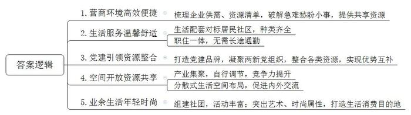
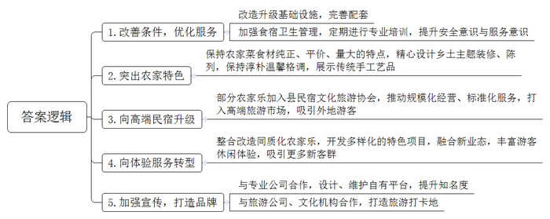
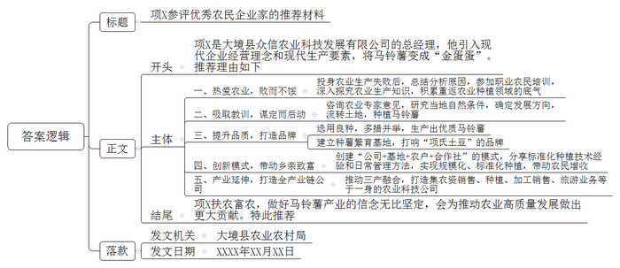

# 2025年公务员多省联考《申论》题（辽宁B卷）

<!-- gwy:overview:start -->
> **辽宁 · 2025 · 申论 · B类** ｜ 4 题 · 图片 4 处 · 答案随题折叠

导航：[题目](#题目) · [材料 1](#材料-1)
<!-- gwy:overview:end -->

> 候选采集稿。参考答案及解析来自粉笔页面，不代表官方答案或真实高分答卷；来源使用许可与原卷对应关系仍需人工核实。

## 给定材料

### 材料 1

手机点一点，就能约一间共享会议室——如此高效便捷的营商环境，就在滨河区星辰产业社区。项目经理小张打算搞一场联谊会，预定成功的共享会议室刚好解决了“找场地”的难题。

这几天，正安能源股份有限公司的员工小黎解决了一桩“烦心事”——3岁的儿子可以在公司附近的幼儿园上托班了。“没有户籍限制，孩子就近托育，上班路上就能顺便送娃上学。没有了后顾之忧，也能更好地投入工作了。”小黎说，自从产业社区成立，原来只有在居民社区里才能享受到的生活配套现在也能在这里享受了。

星辰产业社区分布着1350家企业，其中上市企业15家，总市值近万亿元，产业人口5万余人。从空间形态判断，它与产业园区并无差异。进到产业社区里，高高低低的商业楼宇内，除了大大小小的企业，还设有议事厅、健康屋、咖啡馆、中餐厅、洗衣坊、四点半课堂等生活配套，涵盖了衣、食、住、行等方方面面。

“我们公司成立于2023年5月，社区来走访时，正值我们的创业初期。了解到相关诉求后，社区第一时间为我们链接了辖区内多家银行，并提供政策等多方面支持，帮助解决了初创期的诸多难题。”某医药公司负责人说。

“与传统的居民社区不同，产业社区的‘居民’，是企业和企业员工，他们不仅对生活服务有需求，对产业和政务方面也有需求。”火炬产业社区党委吕书记说，他们通过走访和调研，梳理了企业供需清单和资源清单，从破解企业一件件急难愁盼的小事，到“挖”出一个个可以共享的资源，在产业社区建设推进的过程中，得到了企业和员工的认同。就在上周，火炬产业社区发布“凝‘炬’力”党建品牌，凝聚辖区数十家两新组织党组织，整合省知识产权保护中心、高校和银行等资源，聚场地、聚人才、聚服务，实现各类群体、各项资源的优势互补。

“这里既是高效便捷的发展空间，也是温馨舒适的生活家园。”说起和传统产业园区的区别，滨河区委张书记一语破的，产业社区让“上下班不用长途通勤、左右手就是合作伙伴”成为可能，是企业成长的沃土。

为此，滨河区在产业集聚区块建设了14个不同类型的现代产业社区。通过产业主题化，做到产业集聚发展，创新链、产业链就在“上下楼”和“隔壁栋”。通过人才、技术、资金、信息、物流等要素与配套企业集聚，形成产业自行调节、资源有效共享、企业核心竞争力充分发挥的多维网络体系。在生活服务空间设置方面，幼儿园设在海康园区、健身中心设在聚光科技二期、洗衣坊设在智慧e谷……强调空间开放和资源共享，以促进内部要素与外部环境的交换交流。

针对辖区内年轻人众多的特点，各个产业社区积极打通社区、企业、楼宇间的信息关系网，逐步盘活各类资源，并根据企业的特点和员工的需求，组建了直播协会、骑行俱乐部等12个社团，先后开展了联谊交友、轮滑跑步、非遗手工等丰富多样的党群、社交、文体活动90余场，在产业社区打造艺术中心、雕塑广场、山丘广场等，引入时尚商业品牌，打造科技白领、年轻精英与周边家庭首选的生活消费目的地，力争社区与产业时序上同步演进、空间上有序布局、功能上产城一体。

滨河区委党校李教授认为，城市的发展逻辑已从过去“人才跟着产业走”转变为“产业跟着人才走，人才跟着环境走”。产业社区改变了原有单一的产业空间发展观念，更多地面向城市的需要、生活的需要，能够吸引、留住人们在此工作和生活，并激发人的活力和能量，带来创造力。产业社区是产业园区的升级版，不仅要重视产业发展，还要关注人的需求。

### 材料 2

在很长一段时间里，农家乐可谓是风靡一时。早期的农家乐让游客们真切感受到了农村的烟火气，也让一部分农民走上了脱贫致富之路。

A县东明村紧邻S省省会，原是个毫无特色的小乡村，当地村民收入颇低，只能靠种植花卉苗木养家糊口。上世纪90年代初，全省首家农家乐在这里诞生，村民们纷纷将自家打造成农家乐模式，全村200多户都靠农家乐赚上了大钱，但现在却只剩下三家。

市民赵先生前些年常去农家乐，但这两年不去了。“各方面条件都跟不上，房间简陋，没有洗漱用品，也没有热水器，床单、被褥有时候收拾得也不干净。倒不如自己搭一个天幕，带上卡式炉做点吃的。”赵先生说。

“以前在农家乐，不仅可以吃到纯正的农家土鸡土鸭，还可以品尝到老板亲自去田间摘的菜，村民还会展示像草鞋、竹篮这类的手工艺品，让大家感到久违的温馨和朴素。”市民孙先生说，“但现在可不是这样了，吃的鸡鸭、蔬菜都是从批发市场采购的。还有很多农家乐，菜量缩减，价格却猛涨，一盘青菜卖四五十元，稍微沾点荤的就要百元。这是拿我们当‘冤大头’啊！我看媒体上还有报道在农家乐吃完饭后，食物中毒住院的呢。”

“说到底，农家乐的老板和服务员多是当地村民，他们根本没有安全意识，也没经过专业的培训。我有几次去农家乐度周末，点菜找不到人，服务员也爱答不理。来农家乐本来是放松心情，却让你憋了一肚子气，谁还再来花钱找气受？”市民于先生说。

A县发改委服务业发展科曲科长坦言：“早期农家乐门槛低、可复制性强，乡间的老房子摆几张桌椅就开张，吃的饭菜也大同小异，若没有‘出圈’的记忆点的话，大家慢慢地也就审美疲劳了。”

“农家乐集体退场的原因之一是需求的变化。”某大学陈教授说，“最主要是市场本身的变化、消费层次的提高以及多样化选择的出现。”盛极一时的农家乐真的风光不再了吗？事实上，从A县政府相关部门公开的信息显示，在一些农家乐注销停业的同时，2024年一年全县农家乐仍有23家新增注册。

A县老牛湾是一个远近闻名的4A级旅游景区。“过去，我们这里农家乐的经营者都是散兵游勇，各干各的。去年，我们村依托当地旅游资源，牵头成立了以住宿和餐饮服务为主的县民宿文化旅游协会，组织行业会员在规模化经营、标准化服务上下功夫，将农家乐升级为高端民宿，打入了高端旅游市场，现在我们这里外地来的游客比例一直在提高。”老牛湾村的詹书记说。

A县温泉街道的红熙山寨，是“寨主”周女士在2000年创办的，生意一直不错。那时，周边的农家乐也如雨后春笋般涌现，经营模式基本相同：住一宿、吃三顿饭。但都很快归于沉寂。

于是，周女士在5年前收购了红熙山寨周边的农家乐，开始了大刀阔斧的改造升级。先是创办了人文美术馆、山外美术馆，吸引了一批画家在此驻扎并办画室。之后，利用流转的300亩林地开发了山地越野车和丛林穿越等项目，给游客带来了不一样的休闲体验。她创办的红熙青年夜校，开设了形体、厨艺、插花等课程，为农家乐带来了新的收入增量和客群。去年，她又将山寨与省城的自然博物馆形成联动，建成博物馆亲子主题酒店。如今，红熙山寨的综合年收入有五六百万元。“从‘口味族’到‘体验族’，这是农家乐服务转型的主要方向。”周女士总结道。

走进A县陶然村的“陶然居”土味餐厅，可以看到，在保持农家菜分量足的特点之外，餐厅还把菜品陈列变成“装饰”，每一个包房的装修设计都围绕一个乡土主题展开，一砖一瓦的摆放都经过精心设计，处处有景，格调淳朴。“农家乐要想重新‘乐’起来，就得围绕‘农味儿’做文章。你看我家墙上这些精美的剪纸，都是我们村的大妈剪的，还是我们这里的非遗文化产品呢！”古老板乐呵呵地说。

在网上搜索“S省宝藏农家乐”，排在前列的大多拥有露营、烧烤、音乐节、剧本杀等新业态。排名第一的A县“草原牧歌”农家乐张老板说：“我请专业公司设计了平台，还有专人维护，这比我做多少广告都有效果。我还打算与旅游公司、文化机构合作，让‘草原牧歌’不仅是个吃饭的地方，更成为一个知名的旅游打卡地！”

### 材料 3

金秋时节，瓜果飘香。第四届“中国新农民”故事会在C市举办。活动期间，14位来自全国各地的“中国新农民”分享了自己的酸甜苦辣。这其中就包括W省大境县众信农业科技发展有限公司的总经理项X。他向与会者分享了自己把马铃薯变成“金蛋蛋”的故事：

大家好，我叫项X。1995年高中毕业后和大多数农村孩子一样无法继续上学，挑起养家糊口的担子。当时村里很多年轻人选择外出打工，想走出这个贫困的村庄。但我想，难道我的家乡就一直这样贫困下去吗？于是我选择留下来探索致富之路。

我是土生土长的农民，热爱农业，就想干跟农业相关的行当。所以我先在县城开起了一家农资小店，2008年，销售额已经超过千万元。有了钱，我觉得终于可以接着回去“种地”了。

2010年，当看到大批农村劳动力进城、农村土地开始撂荒时，我意识到农业生产将要走规模化、标准化生产发展道路。我的机会也来了，当年我就在大境县流转了300亩土地种植马铃薯，没想到当年亩产只有1200多公斤，亏损了24万元。面对损失，我只好偃旗息鼓，退还了承包流转的土地，继续从事农资经营。

与此同时，我也做了总结，分析了失败的原因，主要是盲目种植，缺乏市场经营理念和现代农业种植管理技术。2012年，我报名参加了县农业局开展的初级职业农民培训。在培训过程中，我认真听讲，细心观察，虚心向老师和市农科院专家请教，探究农作物种植和植保知识。之后继续深造，参加了中、高级职业农民培训。有了这些垫底，我觉得有了底气，准备重返农业种植领域。

我这次没有再打无准备之仗。光是种什么，我就咨询了省内外十几位农业专家。他们说，必须要找最适合当地的东西，在资源和品种上都要有特色。我们这里土层比较厚，而且是沙土地，比较适合马铃薯生长，所以我决定还是种马铃薯。2013年，我的农业公司在大境县海岩镇流转了3000多亩土地种植马铃薯。为了选用优质品种，我跑遍了全国马铃薯的主要种植区，解决了良种问题，同时采用科学管理方法：播种用机械化、导航定位的播种模式；灌溉用喷灌，减少水的用量；少量多次施有机肥，严格控制农药的使用量……通过多种措施，我们生产出来的马铃薯色泽金黄鲜亮、薯皮光滑、薯形圆润、块大整齐、营养物质丰富、无污染、耐储运、商品性好，成功打上了绿色安全食品的标签，当年就取得了很好的经济效益。为了把马铃薯的品牌打出去，2014年，我又建立了马铃薯种薯繁育基地。现在上网就能查到“项氏土豆”。

为了带动周边的乡亲们一起致富，我创建了马铃薯生产的“公司+基地+农户+合作社”模式，把我们公司摸索出来的马铃薯标准化种植技术和种植经验告诉农民，让他们用我们的马铃薯种子，按照我们的标准种，还教他们怎样进行日常管理。这些年通过示范引领，我们公司带动农民一起发展，马铃薯规模化、标准化种植面积达10万多亩，涉及800多户村民，增加农民收入80余万元。我们公司也逐渐发展成为以农资销售、农作物种植、农资配送、技术服务为一体的农业公司。

从传统土豆变成现代土豆，从传统农业变成现代农业，从一般的“土蛋蛋”变成值钱的“金蛋蛋”，就需要引入现代企业的经营理念，引进现代产业要素，改变传统的农民一家一户的生产经营模式，改变以前“就几亩地，拉着马铃薯、背着背篓到市场上去卖”的传统格局。做大规模，一片一片去开发；做长产业延伸点，一条龙一条龙去开发；做亮品牌闪光点，一个产品一个产品去开发；做圆循环经济点，一个圆圈一个圆圈去开发。让马铃薯经济从资源经济变成产业经济，从产业经济变成品牌经济，让更多的人知道我们“项氏土豆”。

刚才大家在我们公司展示的视频里都看到了：那一望无际的土豆花，本身就是一道风景，所以我们发展了跟马铃薯相关的乡村旅游。目前，我们已经成为一个往前覆盖马铃薯生资供应、信息共享、农业试验示范、标准化生产，往后涉及马铃薯储藏、运输、保鲜、包装、加工、销售和品牌打造等一系列全产业链的农业科技公司，并同国际知名品牌合作，对大境县现代农业技术推广起到了举足轻重的作用。

通过十多年的生产经营，更加坚定了我的信念，我将“咬定青山不放松”，以帮助农民、提高农民、富裕农民为目标，继续搞好马铃薯产业，把土豆都变成“金蛋蛋”，为推动农业高质量发展作出更大的贡献！

### 材料 4

H市作为省级城乡融合发展试验区，坚持走城乡融合发展之路，以工促农、以城带乡，促进发展成果更多更公平地惠及城乡全体居民，城乡融合发展的火热实践正在这里一幕幕上演。

“以前交通不便，想进城比较麻烦，现在有了城乡公交，村村通公交，进城卖水果、蔬菜方便多了。”家住青山镇龙坎村的王大婶开心地说。

“我们把城乡道路内畅外联，作为统筹城乡发展、推进富民强村、助力乡村振兴的重要保障工程。”青山镇王镇长介绍。全镇持续优化农村公路网“毛细血管”，已全面实现了乡镇通县道、建制村通乡道、相邻建制村间通村道，构建起城乡“半小时经济圈”。“以前农村的单子，我们不爱接，算不来经济账啊！现在通村道路越修越好，多家物流快递公司联合开展‘联配联送’模式，运输成本大大降低了，配送效率也极大提高了，城里和乡下基本能同步收到快递。”从事快递业的商户老周说。

沿着干净整洁的乡间小路，走到龙坎村的粮蔬现代农业产业园，温室大棚鳞次栉比，平坦开阔的土地上种满了蔬菜。正在忙着翻耕土地的唐大妈乐呵呵地说：“现在家就在旁边的龙坎村新居里，我平常带孙子，小孙子上学时，就在粮蔬园里打工。这样既可以照顾家人，又有了收入。”城乡融合是城乡关系的高级形态和必然趋势，“我们不仅要在‘看得见’的融合上下功夫，更要着眼‘不可见’层面的深度融合。”H市政研室赵科长说，城乡融合发展不是此消彼长的零和博弈，而是共享发展成果的共生过程。推进城乡融合发展，就是要让不论进城人群，还是下乡人群，既没有制度限制和政策约束，又要能实现社会接纳和心理认同，不能“只合不融”。

江线社区所处区域以前是城乡接合部，被H市人叫作“弯腰树”，意思是土地不肥沃，长起来的树都是弯的。社区党委抓住H市车管所在社区内的优势，引进汽车销售、维修等产业，建起巨龙汽车城等经济实体，吸引12户商家、18个汽车品牌入驻，年营业额6000余万元，入股村民人均年获红利3万余元，为城乡融合发展筑牢坚实的产业支撑。“一业为主，做强产业；一地不闲，发展产业；一人不少，参与产业。”这是江线社区对做强产业支撑的谋划。

走进江线社区党群服务中心，大厅里除了群众办事“吧台”，还设立了阅读空间、亲子空间、多功能活动区等。“这里之前是个楼盘的售楼部，后来社区花1000万元买下，既可以作为以后发展融资的基础，又能设置更多为居民服务的场景。”社区邱主任介绍，江线社区是典型的城中村，2020年5月村级建制调整，由农村社区转变为城市社区，目前仍有近1700人保留农村户籍。

江线社区开办托管班已有5年，在周末和寒暑假的时候均会开班，优先服务辖区内有需要托管服务的家庭，托管班除了提供作业辅导外，还开设了各种丰富多彩的活动，如红色研学、拓展训练、工艺绘画、安全教育、家庭教育指导等。

上知县谷平镇易安职业技能培训学校内，一张长桌上摆满包子、馅饼、烧麦等，香味扑鼻。这是学校中式面点班的学员们刚刚完成的作业，正等待老师“验收”。“创办这所学校，就是为了让更多的人特别是困难群体掌握一门手艺，实现进城务工。”该校负责人介绍，学校已累计开展育婴员、中式面点师、焊工等就业技能培训，以及特种作业和特种设备培训10期，新训、复审培训合格取证学员600余人。

上知县白马镇中心卫生院，虽然位于乡镇，但镇卫生院却是一家不折不扣的一级甲等医院——这里可做胃镜、彩超、全自动血液分析等检查，有些检查直接与县医院联网联机，并由县医院的医生作出检查结果报告。这得益于上知县医院、中医院、妇幼保健院与重点乡镇卫生院等构建的紧密型县域医共体，医院间在信息、财务、药物、管理等方面实行“八统一”。

84岁的高奶奶正在镇卫生院三楼住院病房输液。陪护的儿媳妇说：“以前生病了，我们都爱往县医院跑，现在都来镇卫生院，这里医术提高了，看病吃药也可以省钱，医疗保险还能报销。”

“推动基本公共服务下沉，让乡镇卫生院的医疗水平得到有力提升，用高质量的服务把许多患者‘留’下来了。”白马镇中心卫生院李院长说。

“和实生物，同则不继。城乡融合发展，不是要消除城乡之间的差异，而是要消除城乡公共资源配置、公共服务享有、基本权益保障方面的差距，这就要形成一种尊重差异的系统，让城和乡的优点和特长都能得到最好的发挥，从而在总体上形成一种齐心协力、欣欣向荣的局面。”市社科院张研究员说。

## 题目

### 第 1 题

**请根据“给定资料1”，谈谈滨河区打造的产业社区有哪些特点。（15分）**

关联材料：材料 1

作答要求：

要求：

（1）全面、准确、有条理；

（2）不超过200字。

第 1 题 · 答案与解析

**参考答案（粉笔题库参考内容）**

1.营商环境高效便捷‌。梳理企业供需、资源清单，破解急难愁盼小事，提供共享资源。

2.生活服务温馨舒适。生活配套对标居民社区，种类齐全；职住一体，无需长途通勤。

3.党建引领资源整合‌。打造党建品牌，凝聚两新党组织，整合各类资源，实现优势互补。

4.空间开放资源共享。产业集聚，自行调节，竞争力提升；分散式生活空间布局，促进内外交流。

‌ 5.业余生活年轻时尚。组建社团，活动丰富；突出艺术、时尚属性，打造生活消费目的地。

**解析**

**‌** **参考答案说明：**本参考答案从“营商环境高效便捷”“生活服务温馨舒适”“党建引领资源整合”“空间开放资源共享”和“业余生活年轻时尚”这五个方面进行了分条撰写。各条要点之间在内容上相互并列，没有交叉。

**考点**：特点类

**来源**：2025年公务员多省联考《申论》题（辽宁B卷）

### 第 2 题

**“给定资料2”中S省A县一些农家乐经历了从“乐”到“不乐”的过程。假如你是A县政府相关部门的工作人员，请根据给定资料，谈谈如何才能让A县农家乐重新“乐”起来？（20分）**

关联材料：材料 2

作答要求：

要求：

（1）理解准确，内容全面；

（2）逻辑清晰，措施可行；

（3）不超过300字。

第 2 题 · 答案与解析

**参考答案（粉笔题库参考内容）**

1.改善条件，优化服务。改造升级基础设施，完善配套；加强食宿卫生管理，定期进行专业培训，提升安全意识与服务意识。

2.突出农家特色。保持农家菜食材纯正、平价、量大的特点，精心设计乡土主题装修、陈列，保持淳朴温馨格调，展示传统手工艺品。

3.向高端民宿升级。部分农家乐加入县民宿文化旅游协会，推动规模化经营、标准化服务，打入高端旅游市场，吸引外地游客。

4.向体验服务转型。整合改造同质化农家乐，开发多样化的特色项目，融合新业态，丰富游客休闲体验，吸引更多新客群。

5.加强宣传，打造品牌。与专业公司合作，设计、维护自有平台，提升知名度；与旅游公司、文化机构合作，打造旅游打卡地。

**解析**

**参考答案说明：**本参考答案从“改善条件，优化服务”“突出农家特色”“向高端民宿升级”“向体验服务转型”“加强宣传，打造品牌”五个方面进行了分条撰写。各条答案要点之间在内容上相互并列，没有交叉。

**考点**：提出对策类

**来源**：2025年公务员多省联考《申论》题（辽宁B卷）

### 第 3 题

**W省拟举办优秀农民企业家评选活动，请根据“给定资料3”，以大境县农业农村局的名义，为项X写一份参评推荐材料。（25分）**

关联材料：材料 3

作答要求：

要求：

（1）紧扣资料，内容全面；

（2）层次分明，条理清晰，语言生动；

（3）字数400-500字。

第 3 题 · 答案与解析

**参考答案（粉笔题库参考内容）**

项X参评优秀农民企业家的推荐材料

项X是大境县众信农业科技发展有限公司的总经理，他引入现代企业经营理念和现代生产要素，将马铃薯变成“金蛋蛋”。推荐理由如下：

一、热爱农业，败而不馁。投身农业生产失败后，总结分析原因，参加职业农民培训，深入探究农业生产知识，积累重返农业种植领域的底气。二、吸取教训，谋定而后动。咨询农业专家意见，研究当地自然条件，确定发展方向，流转土地，种植马铃薯。三、提升品质，打造品牌。选用良种，多措并举，生产出优质马铃薯；建立种薯繁育基地，打响“项氏土豆”的品牌。四、创新模式，带动乡亲致富。创建“公司+基地+农户+合作社”的模式，分享标准化种植技术经验和日常管理方法，实现规模化、标准化种植，带动农民增收。五、产业延伸，打造全产业链公司。推动三产融合，打造集农资销售、种植、加工销售、旅游业务等于一身的农业科技公司。

项X扶农富农，做好马铃薯产业的信念无比坚定，会为推动农业高质量发展做出更大贡献。特此推荐！

大境县农业农村局

XXXX年XX月XX日

**解析**

**参考答案说明：**（1）格式方面，本参考答案写到了“标题”“正文”“落款”三个部分。（2）正文部分，一方面从内容上来看，围绕“项X参评优秀农民企业家”这一主题，本参考答案的开头先介绍了项X的背景情况；接着主体部分从“热爱农业，败而不馁”“吸取教训，谋定而后动”“提升品质，打造品牌”“创新模式，带动乡亲致富”“产业延伸，打造全产业链公司”五个方面给出了推荐理由。另一方面，形式上，本参考答案做到了分段分条撰写，整体上条理较为清晰。

**考点**：总结类

**来源**：2025年公务员多省联考《申论》题（辽宁B卷）

### 第 4 题

**请深入思考“给定资料4”中划线的一段话，参考给定资料，联系实际，自选角度，自拟题目，写一篇文章。（40分）**

关联材料：材料 1、材料 2、材料 3、材料 4

作答要求：

要求：

（1）观点明确，见解深刻，内容充实；

（2）思路清晰，语言流畅；

（3）参考给定资料，但不拘泥于给定资料；

（4）字数800-1000字。

第 4 题 · 答案与解析

**参考答案（粉笔题库参考内容）**

**求同存异谋发展，城乡共荣绘新篇**

“和实生物，同则不继。”世间万物，因差异而共生，因融合而繁荣。正如五味杂陈，方有佳肴之美；八音合奏，才成黄钟大吕。城乡融合发展亦需秉持“和”之理念，尊重城乡差异，寻求发展共性，让城与乡携手共进，绘就美美与共的时代新篇。

**城乡融合在发展特色上存异，尊重城乡禀赋差异，挖掘乡村特色，发挥城市优势，实现城乡各美其美。**乡村有其独特的自然生态、民俗文化与农耕文明，是诗意栖居的家园；城市则汇聚先进科技、多元人才与丰富业态，充满创新活力。正如浙江余村依托绿水青山，发展生态旅游，从“卖石头”转型为“卖风景”，让乡村的生态价值得以彰显；深圳凭借创新基因，打造高新技术产业集群，引领科技变革潮流。城乡各自的特色是发展的宝贵财富，只有尊重并发挥这些差异，才能让城乡在不同赛道上绽放光彩。

**城乡融合在资源配置上求同，聚焦公共资源均衡，破除制度阻碍，推动城乡服务等值化，实现发展成果全民共享。**长期以来，城乡二元结构导致公共资源在城乡之间分配不均，推进城乡融合发展，必须打破这一壁垒，加大对农村基础设施建设的投入，完善农村水、电、路、气、通信等基础设施，提升农村基础设施的完备度。同时，推动优质教育、医疗、文化等资源向农村延伸，通过建立城乡学校共同体、医共体等方式，提高农村公共服务的质量和水平，让农村居民也能享受到与城市居民同等的公共服务。

**城乡融合以存异为根基、以求同为纽带，推动城乡要素双向流动，构建互促共生机制，实现城乡协同发展、美美与共。**乡村生态文化与城市科技产业天然互补，此为“存异”赋予的发展动能；公共服务均等化打破要素流动壁垒，则是“求同”搭建的融合通路。城市资金、技术流入乡村，推动特色农业与文旅产业升级，乡村生态产品、优质劳动力反哺城市需求，形成要素循环的良性生态。以浙江德清为例，其借乡村生态资源吸引城市资本发展高端民宿，农民经培训进入城市服务业，既盘活乡村资源，又填补城市人才缺口，让城乡在差异互补中实现美美与共。

存异，是尊重自然与历史的馈赠；求同，是追求公平与发展的担当；共生，是实现城乡繁荣的愿景。在新时代的征程中，唯有坚持存异求同，才能奏响城乡融合共生的美妙乐章，让城市与乡村携手走向更加美好的未来。

**文章分析**

**求同存异谋发展，城乡共荣绘新篇**

【**标题的优点：**首先，范文的标题突出了“城乡融合发展要求同存异”这一主题。其次，形式上采用对称式结构，使标题更加完整饱满。】

（1）“和实生物，同则不继。”<u>世间万物</u>，<u>因差异而共生</u>，<u>因融合而繁荣</u>。正如五味杂陈，方有佳肴之美；八音合奏，才成黄钟大吕。（2）城乡融合发展<u>亦需秉持</u>“<u>和</u>”<u>之理念</u>，<u>尊重城乡差异</u>，<u>寻求发展共性</u>，让城与乡携手共进，绘就美美与共的时代新篇。

【**开头的优点：**★内容方面。范文的开头是紧扣“城乡融合发展要求同存异”这一主题展开的。首先，开头点出主题，做到了主题明确。其次，对“城乡融合发展要求同存异”这一主题进行了分析阐述，指出了：（1）差异与融合对世间万物的影响；（2）城乡融合发展要尊重差异、寻求共性。★文字表达方面。使用了“因……而……”“正如……才……”等连接词，使语言表达更有逻辑性。】

**城乡融合在发展特色上存异，尊重城乡禀赋差异，挖掘乡村特色，发挥城市优势，实现城乡各美其美。**（1）<u>乡村有其独特的自然生态</u>、<u>民俗文化与农耕文明</u>，是诗意栖居的家园；<u>城市则汇聚先进科技</u>、<u>多元人才与丰富业态</u>，充满创新活力。（2）正如<u>浙江余村依托绿水青山</u>，<u>发展生态旅游</u>，从“卖石头”转型为“卖风景”，让乡村的生态价值得以彰显；<u>深圳凭借创新基因</u>，<u>打造高新技术产业集群</u>，<u>引领科技变革潮流</u>。（3）<u>城乡各自的特色是发展的宝贵财富</u>，<u>只有尊重并发挥这些差异</u>，<u>才能让城乡在不同赛道上绽放光彩</u>。

【**论述段1的优点：**★观点句：范文的观点句是紧扣“城乡融合发展要求同存异”这一文章主题提出的。形式上，它在段首处直接写出，位置突出，容易发现。内容上，关键词突出，内容要点明确，可以明显看出是从“城乡融合在发展特色上存异”的角度展开论述。★论述内容：（1）城乡各自的特色和优势；（2）城乡发挥特色和优势的案例；（3）尊重城乡各自特色的重要性。注意：以上三个方面的内容都是紧扣“城乡融合在发展特色上存异，尊重城乡禀赋差异，挖掘乡村特色，发挥城市优势，实现城乡各美其美”这个观点句进行分析论述的，论述的针对性强，内容层次丰富。在论述方法上采用了讲道理、举例子相结合的方式，论述充实清晰。】

**城乡融合在资源配置上求同，聚焦公共资源均衡，破除制度阻碍，推动城乡服务等值化，实现发展成果全民共享。**（1）长期以来，<u>城乡二元结构导致公共资源在城乡之间分配不均</u>，推进城乡融合发展，<u>必须打破这一壁垒</u>，<u>加大对农村基础设施建设的投入</u>，<u>完善农村</u>水、电、路、气、通信<u>等基础设施</u>，<u>提升农村基础设施的完备度</u>。（2）同时，<u>推动优质</u>教育、医疗、文化<u>等资源向农村延伸</u>，通过<u>建立城乡学校共同体</u>、<u>医共体等方式</u>，<u>提高农村公共服务的质量和水平</u>，<u>让农村居民也能享受到与城市居民同等的公共服务</u>。

【**论述段2的优点：**★观点句：范文的观点句是紧扣“城乡融合发展要求同存异”这一文章主题提出的。形式上，它在段首处直接写出，位置突出，容易发现。内容上，关键词突出，内容要点明确，可以明显看出是从“城乡融合在资源配置上求同”的角度展开论述。★论述内容：（1）要打破城乡二元结构，完善农村基础设施；（2）推动优质资源向农村延伸，提高农村公共服务质量和水平。注意：以上两个方面的内容都是紧扣“城乡融合在资源配置上求同，聚焦公共资源均衡，破除制度阻碍，推动城乡服务等值化，实现发展成果全民共享”这个观点句进行分析论述的，论述的针对性强，内容层次丰富。在论述方法上主要采用了讲道理的方式，论述清晰透彻。】

**城乡融合以存异为根基、以求同为纽带，推动城乡要素双向流动，构建互促共生机制，实现城乡协同发展、美美与共。**（1）<u>乡村生态文化与城市科技产业天然互补</u>，此为“<u>存异</u>”<u>赋予的发展动能</u>；<u>公共服务均等化打破要素流动壁垒</u>，则是“<u>求同</u>”<u>搭建的融合通路</u>。（2）<u>城市资金</u>、<u>技术流入乡村</u>，推动特色农业与文旅产业升级，<u>乡村生态产品</u>、<u>优质劳动力反哺城市需求</u>，形成要素循环的良性生态。（3）以<u>浙江德清</u>为例，其<u>借乡村生态资源吸引城市资本发展高端民宿</u>，<u>农民经培训进入城市服务业</u>，既<u>盘活乡村资源</u>，又<u>填补城市人才缺口</u>，让城乡在差异互补中实现美美与共。

【**论述段3的优点：**★观点句：范文的观点句是紧扣“城乡融合发展要求同存异”这一文章主题提出的。形式上，它在段首处直接写出，位置突出，容易发现。内容上，关键词突出，内容要点明确，可以明显看出是从“城乡融合要以存异为根基、以求同为纽带”的角度展开论述。★论述内容：（1）“存异”“求同”对于城乡发展的作用；（2）城市和乡村互促发展的具体方式；（3）城乡互促发展的案例。注意：以上三个方面的内容都是紧扣“城乡融合以存异为根基、以求同为纽带，推动城乡要素双向流动，构建互促共生机制，实现城乡协同发展、美美与共”这个观点句进行分析论述的，论述的针对性强，内容层次丰富。在论述方法上采用了讲道理、举例子相结合的方式，论述充实深刻。】

【**论述段之间的关系：**★内容的内在逻辑：范文的论述段之间是依照“并列”的逻辑展开的。论述段1先写了“城乡融合在发展特色上存异”，论述段2再写了“城乡融合在资源配置上求同”，论述段3最后写了“城乡融合要以存异为根基、以求同为纽带”，文章整体论述思路清晰。】

存异，是尊重自然与历史的馈赠；求同，是追求公平与发展的担当；共生，是实现城乡繁荣的愿景。在新时代的征程中，唯有坚持存异求同，才能奏响城乡融合共生的美妙乐章，让城市与乡村携手走向更加美好的未来。

【**结尾的优点：**范文的结尾回扣了“城乡融合发展要求同存异”这个主题，并且进行了总结升华。】

**解析状态：unknown（来源未提供）**

**考点**：文章写作题

**来源**：2025年公务员多省联考《申论》题（辽宁B卷）

