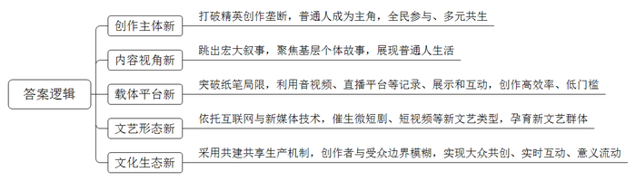
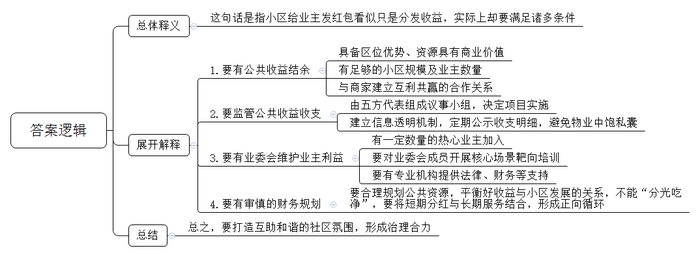
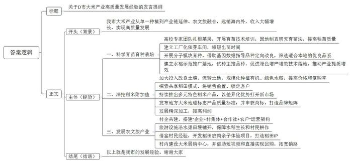
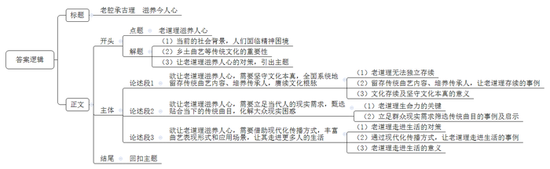

# 2026年公务员多省联考《申论》题（辽宁A卷）

<!-- gwy:overview:start -->
> **辽宁 · 2026 · 申论 · A类** ｜ 4 题 · 图片 4 处 · 答案随题折叠

导航：[题目](#题目) · [材料 1](#材料-1)
<!-- gwy:overview:end -->

> 候选采集稿。参考答案及解析来自粉笔页面，不代表官方答案或真实高分答卷；来源使用许可与原卷对应关系仍需人工核实。

## 给定材料

### 材料 1

在H市东门菜市场里，“菜场女作家”小陈用文字书写着普通人的生命重量。每天清晨，她准时推着自制小推车出摊，售卖日用百货，一边招呼往来的顾客，一边在空闲时捕捉写作素材。包子铺的师傅、水果摊的阿婆、收废品的“破烂王”……她的笔下，是喧闹菜场中的众生相。她的文字就像她小推车上卖的锅碗瓢盆一样，朴素、干净、真切。对于“菜场女作家”这个标签，小陈看得通透：“别人叫我‘菜场女作家’，其实我只是一名写作者，在摊位上赚生活的底气，在文字里找内心的安宁。”

某短视频平台上，一位知名博主用诗歌、散文在田间地头记录着乡村的变迁，春的新绿、夏的蝉鸣、秋的果实、冬的白雪，纷纷化作优美的文字，乘着网络的翅膀飞向更广阔的天地；一支由农民歌者组成的“满天星艺术团”登上了2025年全国村歌集中展演的舞台，他们唱着自己创作的歌曲，不仅让现场观众听得如痴如醉，更通过网络直播让全国网友领略到黄土高原的豪迈风情……

过去，劳动者的形象多由专业写作者“代言”，而今遍布各行各业的普通人——司机、保洁员、产业工人都拿起了笔，成为书写的主角；讲述的是基层的“个体故事”，把普通人生活的点滴片段，汇聚成热气腾腾的“时代日记”，不再执着于“宏大叙事”；音频、视频、手机备忘录、社交平台、新技术是新时代的纸和笔，高效率、低门槛，让更多鲜活故事“破圈”生长。当人人皆可成为创作者时，我们共同讲述的，是一个“全民参与、多元共生”的时代故事。这个故事里，有劳动者的坚守与奋斗，有乡土间的守望与变迁，有普通人的热爱与梦想。

网络直播凭借独特的“即时在场感”打破时空限制，成为新大众文艺展示、互动的重要平台。数据显示，截至2024年12月，我国网络直播用户规模达8.33亿人，同比增长1737万，占网民总数的75.2%；截至2025年6月，全国主播账号累计开通近1.93亿个，同比增长约7.2%。

互联网技术和新媒体改变了文艺形态，催生了网络文学、微短剧、短视频、沉浸式戏剧等一大批新的文艺类型，孕育了网络作家、独立制片人、短视频演员、网络歌手、自由美术工作者等新的文艺群体。文字数码化、书籍图像化、阅读网络化的快速发展，互联网社交平台的强势崛起，让文艺产品传播方式和群众欣赏习惯发生重大变化。“大众不再是被动接受，而是主动选择有趣的内容。”某艺术研究院秦研究员认为，“从生产机制来看，新大众文艺属于‘集市’模式，即网络社会中的‘共建共享’模式。在新大众文艺的场域中，创作者与受众的边界逐渐模糊，网友的一条评论、一个点赞、一次转发，都可能成为创作者灵感的源泉。而创作者的真诚表达，又能唤醒更多人的创作热情，形成全民参与的文化热潮。”

“没有人因为我是一个农民而嫌弃我，更没有因为我写的东西不好而嘲笑我，大家都在积极地回应我、鼓励我。我一下子就找到那种自信了！”一位创作者的话折射出无数素人创作者的共同心境。新大众文艺打破了文艺由“少数人创作、多数人观赏”的固有观念，催生了大众共创、实时互动、意义流动的全新文化生态。这种创作方式，不仅让普通人实现了自我价值的表达，更让文艺成为连接个体与他人、个体与时代的精神纽带。

某短视频平台作品审核中心李主任表示，放眼当下某些新大众文艺的创作实践，其中隐含的商业化趋势，使得部分短视频及网络直播节目存在着内容浮浅、缺乏深度、低俗吆喝等短板。即便只是少数，也使新大众文艺的创演，在一定程度上陷入对情绪价值的简单追逐，缺少对思想价值的创造积累。

某大学刘教授认为，一些人把大众文艺定位于通俗性的审美范畴，实则大众文艺是属普及性的价值范畴。在新大众文艺的浪潮中，人民既是文艺的“剧中人”，也是文艺的“剧作者”，源自大众的创作打破了精英创作的壁垒和垄断，让人们拥有了更多表达自我的机会，也丰富了“文艺为了人民”的内涵。新大众文艺，要将“大众化”的实践提升为“化大众”的旅程。

### 材料 2

2026年元旦佳节，Y市盛乾小区内人头攒动，热闹非凡。小区业委会将18.51万元作为“新年红包”，以每户300元的标准发放给业主。“这些钱是咱们小区电梯广告、停车占道费、公共场地租赁等收入，属于全体业主共有，不是物业公司的，也不是财政拨款。”“这次返还的是2025年的收益，已经扣掉了税款、设备维护和运营管理费等成本。”……小区业委会的乔先生向业主们逐一解释着。

盛乾小区位于Y市发展较为成熟的地带，人流密集，商业活跃。这样的区位优势使得小区内的广告位、停车位等资源更具商业价值，容易吸引商家投放广告和外部车辆停放。“小区规模越大，公共资源积累的收益潜力越大。同时，足够的业主数量也意味着人均分摊的管理成本相对降低，为公共收益结余创造了条件。”Y市某大学公共管理系张教授说。

律师展先生表示，根据民法典和《物业管理条例》的相关规定，小区业主拥有的权利包括所购房屋的专有所有权，小区内道路、电梯等公共设施的共同所有权。但是，由于缺乏信息透明机制，不少小区的公共收益都是一笔“糊涂账”，业主既不知道收入了多少钱，也不知道这些钱都用在了哪里。更有甚者，有的物业公司还趁机浑水摸鱼、中饱私囊。

盛乾小区业委会主任金先生说：“业委会是业主利益的守护者。”作为业主大会的执行机构，业委会由业主大会选举产生，履行业主大会赋予的职责，执行业主大会决定的事项，同时接受业主的监督。成立业委会的目的是维护广大业主的权益，业主不仅有权对业委会进行监督，而且有权通过业主大会罢免不称职的业委会。被业主认可的小区往往都有一定数量的热心业主愿意付出时间和精力参与小区管理，加入业委会。小区业主肖先生也证实：“刚入住的时候，小区问题不少。后来经过大家的努力，成立了业主委员会，换了新物业，问题逐步得到解决。”

业委会成员往往不是社会工作、法律、财务等专业出身，“不会干、不敢干”的短板凸显，直接关系到小区治理水平高低，直接影响着业主的居住质量。2024年，盛乾小区所在街道对业委会成员围绕换届改选、日常运作、监督评价等核心场景开展靶向培训；街道还与律师事务所合作，由社工和律师组成小秘书团队，为业委会提供专业的法律、财务和流程支持。

自从业委会成立以来，盛乾小区已经办成了几件大事：修补了1000多平方米的道路、新修了5条楼间步道、一次性更换摄像头、升级了监控室设备。金先生介绍，这些项目的实施都不是业委会或物业单独说了算，而是由来自物业公司、街道、社区、业委会、业主等五方代表组成的议事小组共同参与招、投、议标，然后由物业公司与中标单位签订项目施工合同书，负责跟踪施工监理过程以及专业项目审验，完工后还要接受大家的联合验收，最后由业委会支付款项。大到工程合同，小到日常维修开销，所有的明细、会议记录、验收报告都会定期在小区里公示，接受每一位业主的查询和监督。金先生指着一份份公示文件说：“我们的银行账户余额、每一笔钱的去向，都是公开的。只有资金流向清晰可查，业主才能放心将公共资源交由业委会管理。”“以前交物业费，钱花在哪儿、小区公共收益有多少，全是一笔糊涂账，现在公示栏上看得清清楚楚、明明白白。”业主们看着最新的公共收益明细，心里踏实多了！

金先生表示，好的业委会需要合理规划公共资源，与商家建立互利共赢的合作关系，同时平衡好收益与小区发展的关系。盛乾小区已经通过增设充电柜、优化停车管理等方式主动“开源”。分红也不是“分光吃净”，现在小区账户共有资金80余万元，但只拿出部分进行分红。这种审慎的财务规划既让业主分享了公共收益，又保留了小区应急维修和持续发展的保障资金。业委会“红包年年有、形成常态化”的可持续性承诺也增强了业主对业委会的信任和支持。

Y市公共管理学研究会王教授说：“返还不是目的，而是维护业主共有权和共同管理权。让业主共享收益，有助于增强归属感，凝聚共建家园的合力。同时，给业主分红是为了促进物业服务良性循环，让业主共享小区共建共治的成果。这种理念将短期分红与长期服务相结合，形成了正向循环。而良好的缴费习惯也为小区公共账户提供了稳定的资金来源，小区在分红条件中明确规定业主必须缴清物业费，这表明公共收益管理与基础物业服务是相辅相成的。”

社会学家臧先生认为：“互助和谐的社区氛围有助于形成治理合力。盛乾小区分红大会上的欢乐氛围降低了管理成本，提高了治理效率。<u><u>小区给业主发红包，看似简单，实际上不是那么容易实现的。</u></u>”

### 材料 3

在D市光西村，某农业大学“D市光西稻米科技小院”有3公顷试验田，李教授带着他的团队常年扎根在这里开展科研。

这里有好米，这里的农民会种米，对此，李教授毫不怀疑。不过，专攻水稻优质育苗技术的他，却发现了问题。问题就出在传统农耕习惯与机械化生产的衔接上。随着机械化耕种的普及，光西村的农户插秧再也不靠手工，都在用插秧机。可大家把不准机器的“手感”，也把不准“质与效”的平衡，为了让机器一次性抓取更多稻苗，往往会在育苗盘上播更多、更密的苗。

“一个育苗盘，以前播二两籽，现在能播到三两半！苗挤苗，长得又细又弱，下地后缓苗慢，影响水稻产量。”李教授看在眼里，急在心上。

于是，他一边为农户开展育苗技术培训，一边根据光西村地理气候条件，研究出了一套阶段式控温控水育苗法。“减播量、控温、控水，让秧苗先扎根再长叶。这样一来，秧苗质量明显提高，插到地里，两三天就精神了，往年则要十来天。”李教授说。

“我建了个催芽室，种子进去72小时就能出苗，比自然出苗快一周！”看到育苗实效后，光西村种粮大户老杨开始积极探索种植新技术，并碰撞出新火花——建个工厂化催芽车间。“我这边提供催芽和棚室，李教授团队研发配套营养土，将来周边农户可以直接来取壮苗。”老杨构想着。

光西村的另一片试验田里，一家农业科技企业的育种工程师小王正在实验分子模块育种。“传统育种靠眼睛在田间筛选，我们是在基因数据指导下，像给系统升级一样，对品种进行定向改良。”她介绍，团队已将储存着十万份种质资源的种子库搬到村里，并筛选出了17个适宜本地的优良品系。

在D市4个县，9家新型农业经营主体建起了170公顷水稻示范推广基地，26个主推品种在这里试种。在水稻栽培中，秸秆还田、抗冷栽培、减氮增磷等绿色增产增效技术落地生根，推动大米产业提质增效。

“10多年前我就想，能不能还原儿时记忆里那个米香味？”D市东盛涌镇嘉香无公害农产品农民专业合作社孙主任回忆，“现在的米好像不如小时候好吃了，化肥农药的使用或许是一个原因。”他发现长期使用化肥农药的土地容易板结，而且残留超标，于是决心探索有机种植。“必须深翻！把有残留的表层土翻下去，换成干净的耕作层。”孙主任带领社员，投入巨大成本进行土壤改良。虽然头三年“有机转换期”产量低、投入大，但合作社硬是挺了过来。如今，合作社通过流转土地，有机水稻种植面积达512公顷，绿色水稻达716公顷。孙主任介绍，他们的有机大米价格是普通米价的数倍，但客户复购率极高。“很多客户宁愿多花钱，也要吃上好米、健康米。”

村民老赵尝试用“共享稻田”拓展市场。消费者可以在老赵的直播间“认领”一小块田，看直播、云监工，秋后收获专属大米。“不仅是卖米，也是卖体验、卖信任。”老赵说，这种模式将销售前置，锁定了客户，也提升了附加值，一亩地的“认领”价最高可达万元。

产业链的延伸与集群效应，让大米的产量和品类越来越多。在D市，27家规模以上大米加工企业日加工能力已从3000吨提升至4800吨。有机米、蟹田米、胚芽米等特色产品层出不穷，以差异化优势打开新市场。

从《D市大米地理标志产品质量标准》发布，到向国家知识产权局提交地理标志证明商标注册申请并获批，目前，D市已形成48个企业品牌、109个产品品牌的矩阵，25款分级分类认证产品占全省总数的12.5%，跻身该省大米中高端市场核心阵营。眼下，合作社又引进了一条技术领先的全自动速食米饭生产线。“一盒自热拌饭，附加值比卖原料米翻了好几倍。”尽管前期投入很大，但孙主任坚信：粗加工利润薄，必须做精深加工，往价值链上游走。

“稻田还是那片稻田，但一粒米的故事，被重新讲出来了。”在D市很多人心里，米香早已超越味觉，沉淀为一种文化记忆。它是乡愁的符号，是放学归来灶台边母亲掀开锅盖的瞬间，是家人围坐分享一餐饭的日常。光西村在“村企共建”模式下，以“企业+村集体+合作社+农户”的运营架构支撑发展农文旅产业。“春天插秧，夏天观景，秋天收割，冬天品尝。”光西村党支部曲书记介绍。

如何在不影响耕作的前提下发展文旅？光西村稻田文旅项目负责人小周选择“在田埂上做文章”：观光亭、稻田小火车、低空缆车，都沿着水渠和田埂铺开，水稻照常生长，村民照常种地。一次偶然的机会，小周注意到有农户在稻田里放养白鸭——鸭子吃草、除虫，粪便又成了天然肥料。“对农民来说，这是种田方式，但对游客来说，却是一道风景。”在村民的建议下，稻田放鸭变成了亲子体验项目，“稻田寻宝”“捡鸭蛋”成了最受孩子们欢迎的环节。

稻田IP的打造，不仅吸引了游客，更反哺了大米产业。游客走进大米展销中心，品尝并购买地道的“光西村大米”，并借助短视频和直播回购。如今，村里100多家农户参与其中，每户都找到了销路。

如今的D市大米产业从以前的单一种植到产业链的延伸，并与文旅产业深度融合，实现了高质量发展。每年有超过5万吨的优质中高端大米销往北京、上海、浙江等地，并远销海外。市场给出了最直接的回应：D市大米每公斤售价从十年前的5至10元，跃升至12至25元，真正实现了“好米卖好价”。2025年，村集体经济收入较10年前增长10.2倍，光西村村民年人均收入远远高于全省农村人均收入水平。

### 材料 4

在西北的山区里，有一个坐落在沟壑深处的小村庄——顾村。每到傍晚，就有十余位老人抱着三弦琴，来到村头广场开口说书。说书是西北地区十分重要的曲艺形式，艺人们采用当地方言，手持三弦或琵琶自弹自唱、说唱相间地叙述故事。

七十八岁高龄的马师傅是村里说书技艺最精湛的艺人。2019年，县文化馆的工作人员小张来村里做民间艺术普查，录下了马师傅整整三天的说书。“我家四代人都说书。以前村里的婚丧嫁娶、节庆祭祀都要请人说书。可现在……”马师傅抚摸着那把传了三代人的三弦琴，叹气道，“学习时间长，赚钱慢，年轻人不爱学了。”回去整理录音时，小张心里沉甸甸的——这门古老的技艺，这些传唱了数百年的民间故事，难道真的要随着老艺人的离去而消失吗？

一天晚上，小张正在整理录音，在旁边听了一会儿的妻子忽然说道：“这段讲的不就是诚信经商的道理吗？和我们公司培训的内容差不多。”这句话让小张怔住了。他反复听那段书，讲的正是历史上一位商人在困境中坚守承诺的故事。

“这些老故事里，蕴藏着超越时代的人生智慧。”小张想。第二年春天，县里要办一期“青年创业者培训班”，小张邀请马师傅去给年轻创业者们说一段书。马师傅有些疑虑：“现在的年轻人，会愿意听咱们这土生土长的说书吗？”

那天，马师傅说了一段《良马寻主》，讲的是千里马如何寻找真正理解它的主人的故事。出人意料的是，那场说书成了培训班最受欢迎的环节。一位做互联网创业的年轻人站起来说：“我创业五年，今天才真正理解了什么是‘价值认同’。我们总在寻找用户，其实更应该寻找的是懂得我们价值的人。”

这件事传开后，邀请马师傅说书的场合多了起来。但马师傅始终坚持一个原则：“我只说传统书目，不编新段子。老书里的智慧，是经过岁月沉淀的。”

真正的转变发生在一场特别的相遇之后。一个心理学专业的学生听完说书后，对马师傅说：“您讲的那个关于坚韧的故事，我想了半天，其实讲述的是人类面对困境时的心理调适机制，这对现在的年轻人特别有用，这方面我想听您多说说。”马师傅第一次听到“心理调适”这个词，有些不解。这位学生耐心解释：“就是帮助人们解开内心困惑的学问。”马师傅想了想：“我们这儿叫‘宽心’，既然对大家有用，以后我就多说，结合着你们的现实需求说。”

马师傅的孙子小马，在省城工作了几年后，决定回乡创业。他开通了网络直播，想让更多人听到爷爷的说书。直播起步并不容易，观众寥寥，有人说听不懂方言，有人说节奏不适应。小马没有气馁，他做了两件事：一是每次说书前先用通俗的语言介绍故事的背景；二是在直播时加上实时字幕。

去年冬天，马师傅应邀到一所大学做讲座。站在讲台上，他抱着三弦琴，对台下的师生们说：“我说了六十年的书，以前总以为我说的是故事，现在才明白，我说的是我们这片土地上的人们千百年来积累的生活智慧。故事的形式会变，但做人做事的道理永远鲜活。”

如今，这个小村庄成为了当地的“民间说书传承基地”。村里办起了说书学堂，马师傅也收了几个年轻徒弟，最小的还在上中学。县文化馆在这里设立了录音室，将老艺人们说的每一段书都精心保存起来。

每天傍晚，小村的院落里就会传出三弦琴声。只是现在听书的人群中，有村里的孩童，有远道而来的访客，还有通过网络连接进来的各地听众。小马正在开发一个文化传播项目，要把爷爷说的每一段书，配上解读、动画和现代诠释。调试设备时，小马感慨道：“爷爷常说，老书里有老理。我现在终于懂得——<u><u>当今人们喜欢说书，不是为了听那些一字不差的脚本复述，而是要在老腔调中体悟老故事里的老道理。</u></u>”

## 题目

### 第 1 题

**根据****“给定资料**1**”，请谈谈新大众文艺“新”在哪里？（15分）**

关联材料：材料 1

作答要求：

要求：

（1）全面、准确、有条理；

（2）不超过200字。

第 1 题 · 答案与解析

**参考答案（粉笔题库参考内容）**

1.创作主体新。打破精英创作垄断，普通人成为主角，全民参与、多元共生。

2.内容视角新。跳出宏大叙事，聚焦基层个体故事，展现普通人生活。

3.载体平台新。突破纸笔局限，利用音视频、直播平台等记录、展示和互动，创作高效率、低门槛。

4.文艺形态新。依托互联网与新媒体技术，催生微短剧、短视频等新文艺类型，孕育新文艺群体。

5.文化生态新。采用共建共享生产机制，创作者与受众边界模糊，实现大众共创、实时互动、意义流动。

**参考答案说明**：本参考答案从“创作主体新”“内容视角新”“载体平台新”“文艺形态新”“文化生态新”五个方面展开，各条答案要点之间在内容上相互并列，没有交叉。

**解析状态：unknown（来源未提供）**

### 第 2 题

**根据****“给定资料**2**”，请谈谈你对划线句子“小区给业主发红包，看似简单，实际上不是那么容易实现的”的理解。（20分）**

关联材料：材料 2

作答要求：

要求：

（1）理解准确，内容全面，条理清晰；

（2）不超过300字。

第 2 题 · 答案与解析

**参考答案（粉笔题库参考内容）**

这句话是指小区给业主发红包看似只是分发收益，实际上却要满足诸多条件。

具体有：1.要有公共收益结余。具备区位优势、资源具有商业价值；有足够的小区规模及业主数量；与商家建立互利共赢的合作关系。2.要监管公共收益收支。由五方代表组成议事小组，决定项目实施；建立信息透明机制，定期公示收支明细，避免物业中饱私囊。3.要有业委会维护业主利益。有一定数量的热心业主加入；要对业委会成员开展核心场景靶向培训；要有专业机构提供法律、财务等支持。4.要有审慎的财务规划。要合理规划公共资源，平衡好收益与小区发展的关系，不能“分光吃净”，要将短期分红与长期服务结合，形成正向循环。

总之，要打造互助和谐的社区氛围，形成治理合力。

**参考答案说明**：（1）思路方面，本参考答案按照词句解释题“总体释义+展开解释+总结”的一般答题思路展开。（2）内容方面，本参考答案首先对“小区给业主发红包，看似简单，实际上不是那么容易实现的”的含义进行了总体释义，再分别从“要有公共收益结余”“要监管公共收益收支”“要有业委会维护业主利益”“要有审慎的财务规划”这四个层面展开解释，最后进行了总结。（3）词句表达方面，本参考答案加上了“具体有”“总之”等连接词来承接上下文，使答案更加顺畅。

**解析状态：unknown（来源未提供）**

### 第 3 题

**C市派出代表团到D市学习交流大米产业高质量发展经验，假如你是D市政府工作人员，请根据“给定资料**3**”，拟写一篇经验交流座谈会发言提纲。（25分）**

关联材料：材料 3

作答要求：

要求：

（1）紧扣资料，内容全面；

（2）结构完整，语言流畅；

（3）字数400-500字。

第 3 题 · 答案与解析

**参考答案（粉笔题库参考内容）**

关于D市大米产业高质量发展经验的发言提纲

背景：我市大米产业从单一种植到产业链延伸、农文旅融合，远销海内外，收入大幅增长，实现高质量发展。

经验：一、科学育苗育种栽培。高校专家团队扎根基层，开展育苗技术培训，因地制宜研究育苗法，提高秧苗质量；建立工厂化催芽车间，缩短出苗时间；开展分子模块育种，借助基因数据指导品种定向改良，筛选适合本地的优良品系；建立水稻示范推广基地，试种主推品种，促进绿色增产增效技术落地，推动产业提质增效。二、深挖稻米附加值。加大投入改良土壤，流转土地，规模化种植有机、绿色水稻，提高价格和复购率；探索共享稻田模式，将销售前置、锁定客户；持续推出多元特色稻米产品，以差异化优势打开新市场；发布地方大米地理标志产品质量标准，并申获商标，打造品牌矩阵；发展精深加工，提高利润。三、发展农文旅产业。村企共建，搭建“企业+村集体+合作社+农户”运营架构；旅游设施沿水渠田埂铺开，保障水稻生长和村民耕作；借鉴村民经验，开发稻田放鸭亲子体验项目，打造稻田IP；村内建设大米展销中心，并借助短视频和直播实现回购，拓宽销路。

结语：以上就是我市的发展经验。谢谢大家！

**参考答案说明：**（1）格式方面，本参考答案写到了“标题”“正文”两个部分。（2）正文部分：一方面从内容上来看，围绕“D市大米产业高质量发展”这一主题，本参考答案的开头先介绍了相关的背景；主体部分从“科学育苗育种栽培”“深挖稻米附加值”“发展农文旅产业”这三个方面介绍了具体的经验做法；结尾进行了总结。另一方面，形式上，本参考答案做到了分段、分条撰写，整体上条理较为清晰。

**解析状态：unknown（来源未提供）**

### 第 4 题

**“给定资料**4**”中提到“当今人们喜欢说书，不是为了听那些一字不差的脚本复述，而是要在老腔调中体悟老故事里的老道理”。请你对此进行深入思考，参考给定资料，联系实际，自选角度，自拟题目，写一篇文章。（40分）**

关联材料：材料 1、材料 2、材料 3、材料 4

作答要求：

要求：

（1）观点明确，见解深刻；

（2）参考给定资料，但不拘泥于给定资料；

（3）思路清晰，语言流畅；

（4）字数1000-1200字。

第 4 题 · 答案与解析

**参考答案（粉笔题库参考内容）**

**老腔承古理** **滋养今人心**

当下社会节奏飞快，相当一部分人陷入心理焦虑、价值迷失等精神困境，短视频等快餐娱乐无法消解深层内心困惑。而说书等乡土曲艺，作为传统文化的活态载体，其讲述的故事内核沉淀着跨越时空、历久弥新的人生哲理和处世智慧。这些老道理恰好适配当代人的精神缺口，也是传统文化破圈重生的密码。想要让这些老道理持续滋养当代人心，既要守住文化根本，也要结合时代顺势而为。

**欲让老道理滋养人心，****需要****坚守****文化****本真****，全面系统地****留存****传统曲艺内容、培养传承人，赓续文化根脉。**老道理无法脱离曲艺技艺、曲目与传承人独立存续。嵊州越剧艺术保护传承中心启动越剧名家影像记录工程，对老艺人唱腔、身段进行全景录音录像，归档原始表演资料，同时依托越剧艺术学校定向招录学徒，补齐代际传承断层，守住剧目承载的崇德向善内核。以音影留档固化曲艺本体，以师徒传承接续传承队伍，方能让内嵌于曲艺的传统道理有存续根基。文化根脉不断，精神滋养才有源头活水。唯有守住本真，才能让诚信、坚韧、价值认同等传统美德在代际传递中生生不息。

**欲让老道理滋养人心，****需****要立足****当代人的现实****需求，甄选贴合当下的传统****曲目****，****化解大众现实困惑****。**老道理的生命力在于能回答时代之问。苏州评弹存量传统书目浩如烟海，其中不乏封建礼教、因果报应的陈旧篇目。当下一些评弹演出团队顺应观众消解焦虑、涵养同理心的精神需求，不新编曲目、不改动原有唱词主旨，仅从原生传统书目中，筛选向善包容、从容处世的段落常态化演出，体现了传统艺术对当代大众需求的呼应。过度解构可能会消解传统本意，按需筛选却能贴合民众精神刚需。这启示我们，不必费力重构故事内涵，只需立足现实痛点做好取舍筛选，便能唤醒传统故事的疗愈力量，解开大众内心困惑。

**欲让老道理滋养人心****，需要借助现代化传播方式，丰富曲艺表现形式和应用场景，让其走进更多人的生活。**老道理要走进人心，先要走进生活，情景和传播形式可以与时俱进。西北某县的青年创业者培训班里讲起了说书，看似“混搭”的场景，却精准解决了创业者“价值认同”的困惑。河南九旬老人口述原生家风家训走红短视频平台；诸多地方官方账号依托六尺巷典故制作邻里和解短剧……数字化打破了时空限制，让古老智慧褪去说教外衣，化作润物无声的情感力量。当老道理走进生活、走进屏幕，它便不再是束之高阁的泛黄旧卷，而是带着人间烟火气的精神慰藉，让更多人从中汲取力量。

老腔调里藏着老道理，老道理中蕴着大智慧。当这些老道理真正滋养人、宽慰人、启迪人，传统文化便找到了最坚实的立足之地。

**文章分析**

**老腔承古理** **滋养今人心**

【**标题的优点：**首先，范文的标题突出了“老道理滋养人心”这一主题。其次，形式上，文字简洁明快。】

（1）<u>当下社会节奏飞快</u>，<u>相当一部分人陷入</u>心理焦虑、价值迷失等<u>精神困境</u>，短视频等<u>快餐娱乐无法消解深层内心困惑</u>。（2）而说书等<u>乡土曲艺</u>，<u>作为传统文化的活态载体</u>，其讲述的故事内核<u>沉淀着</u>跨越时空、历久弥新的<u>人生哲理和处世智慧</u>。<u>这些老道理恰好适配当代人的精神缺口</u>，<u>也是传统文化破圈重生的密码</u>。（3）想要<u>让这些老道理持续滋养当代人心</u>，<u>既要守住文化根本</u>，<u>也要结合时代顺势而为</u>。

【**开头的优点：**★内容方面：范文的开头是紧扣“老道理滋养人心”这一主题展开的。首先，开头点出主题，做到了主题明确。其次，对“老道理滋养人心”这一主题进行了分析阐述：（1）指出当前的社会背景，人们面临精神困境；（2）阐述乡土曲艺等传统文化的重要性；（3）指出让老道理滋养人心的对策，引出主题。★文字表达方面：使用了“既要……也要……”等关联词，使语言表达有逻辑性。】

**欲让老道理滋养人心，需要坚守文化本真，全面系统地留存传统曲艺内容、培养传承人，赓续文化根脉。**（1）<u>老道理无法脱离曲艺技艺</u>、<u>曲目与传承人独立存续</u>。（2）<u>嵊州越剧艺术保护传承中心启动越剧名家影像记录工程</u>，对老艺人唱腔、身段进行全景录音录像，归档原始表演资料，<u>同时依托越剧艺术学校定向招录学徒</u>，补齐代际传承断层，守住剧目承载的崇德向善内核。<u>以音影留档固化曲艺本体</u>，<u>以师徒传承接续传承队伍</u>，<u>方能让内嵌于曲艺的传统道理有存续根基</u>。（3）<u>文化根脉不断</u>，<u>精神滋养才有源头活水</u>。<u>唯有守住本真</u>，<u>才能让</u>诚信、坚韧、价值认同等<u>传统美德在代际传递中生生不息</u>。

【**论述段****1的优点：**★观点句：范文的观点句是紧扣“老道理滋养人心”这一文章主题提出的。形式上，它在段首处直接写出，位置突出，容易发现。内容上，关键词突出，内容要点明确，可以明显看出它是从“坚守文化”这个角度入手，指出了让老道理滋养人心的对策。★论述内容：（1）指出老道理无法独立存续；（2）阐述留存传统曲艺内容、培养传承人，让老道理存续的事例；（3）指出文化存续及坚守文化本真的意义。注意：以上三个方面的内容都是紧扣“欲让老道理滋养人心，需要坚守文化本真，全面系统地留存传统曲艺内容、培养传承人，赓续文化根脉”这个观点句进行分析论述的，论述的针对性强，内容层次丰富。最后，在论述方法上主要采用了讲道理和举例子相结合的方式，论述丰富多样。】

**欲让老道理滋养人心，需要立足当代人的现实需求，甄选贴合当下的传统曲目，化解大众现实困惑。**（1）<u>老道理的生命力在于能回答时代之问</u>。（2）<u>苏州评弹存量传统书目浩如烟海</u>，其中不乏封建礼教、因果报应的陈旧篇目。<u>当下一些评弹演出团队顺应观众消解焦虑</u>、<u>涵养同理心的精神需求</u>，不新编曲目、不改动原有唱词主旨，<u>仅从原生传统书目中</u>，<u>筛选向善包容</u>、<u>从容处世的段落常态化演出</u>，<u>体现了传统艺术对当代大众需求的呼应</u>。过度解构可能会消解传统本意，<u>按需筛选却能贴合民众精神刚需</u>。<u>这启示我们</u>，不必费力重构故事内涵，<u>只需立足现实痛点做好取舍筛选</u>，<u>便能唤醒传统故事的疗愈力量</u>，<u>解开大众内心困惑</u>。

【**论述段****2****的优点：**★观点句：范文的观点句是紧扣“老道理滋养人心”这一文章主题提出的。形式上，它在段首处直接写出，位置突出，容易发现。内容上，关键词突出，内容要点明确，可以明显看出它是从“立足需求”这个角度入手，指出了让老道理滋养人心的对策。★论述内容：（1）指出老道理生命力的关键；（2）阐述立足群众现实需求筛选传统曲目的事例及启示。注意：以上两个方面的内容都是紧扣“欲让老道理滋养人心，需要立足当代人的现实需求，甄选贴合当下的传统曲目，化解大众现实困惑”这个观点句进行分析论述的，论述的针对性强，内容层次丰富。最后，在论述方法上主要采用了讲道理和举例子相结合的方式，论述清晰透彻。】

**欲让老道理滋养人心，需要借助现代化传播方式，丰富曲艺表现形式和应用场景，让其走进更多人的生活。**（1）<u>老道理要走进人心</u>，<u>先要走进生活</u>，<u>情景和传播形式可以与时俱进</u>。（2）<u>西北某县的青年创业者培训班里讲起了说书</u>，看似“混搭”的场景，却精准解决了创业者“价值认同”的困惑。<u>河南九旬老人口述原生家风家训走红短视频平台</u>；<u>诸多地方官方账号依托六尺巷典故制作邻里和解短剧</u>……数字化打破了时空限制，让古老智慧褪去说教外衣，化作润物无声的情感力量。（3）<u>当老道理走进生活</u>、<u>走进屏幕</u>，它便不再是束之高阁的泛黄旧卷，<u>而是带着人间烟火气的精神慰藉</u>，<u>让更多人从中汲取力量</u>。

【**论述段****3****的优点：**★观点句：范文的观点句是紧扣“老道理滋养人心”这一文章主题提出的。形式上，它在段首处直接写出，位置突出，容易发现。内容上，关键词突出，内容要点明确，可以明显看出它是从“现代化传播”这个角度入手，指出了让老道理滋养人心的对策。★论述内容：（1）指出老道理走进生活的对策；（2）列举通过现代化传播方式，让老道理走进生活的事例；（3）指出老道理走进生活的意义。注意：以上三个方面的内容都是紧扣“欲让老道理滋养人心，需要借助现代化传播方式，丰富曲艺表现形式和应用场景，让其走进更多人的生活”这个观点句进行分析论述的，论述的针对性强，内容层次丰富。最后，在论述方法上主要采用了讲道理和举例子相结合的方式，论述丰富多样。】

【**论述段之间的关系：**★内容的内在逻辑：范文的论述段之间是依照并列的逻辑展开的。论述段1先写了“欲让老道理滋养人心，需要坚守文化本真，全面系统地留存传统曲艺内容、培养传承人，赓续文化根脉”，论述段2接着写了“欲让老道理滋养人心，需要立足当代人的现实需求，甄选贴合当下的传统曲目，化解大众现实困惑”，论述段3最后写了“欲让老道理滋养人心，需要借助现代化传播方式，丰富曲艺表现形式和应用场景，让其走进更多人的生活”。这三个论述段分别按照“坚守文化”“立足需求”“现代化传播”展开，相互并列，逻辑清晰。】

老腔调里藏着老道理，<u>老道理中蕴着大智慧</u>。<u>当这些老道理真正滋养人</u>、<u>宽慰人</u>、<u>启迪人</u>，<u>传统文化便找到了最坚实的立足之地</u>。

【**结尾的优点：**范文的结尾回扣了“老道理滋养人心”这个主题，并且进行了总结提升。】

**解析状态：unknown（来源未提供）**

